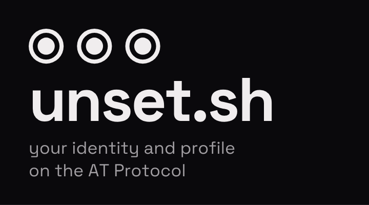

<p align="center">
  <picture>
    <source media="(max-width: 600px) and (prefers-color-scheme: dark)" srcset="docs/human/assets/readme-banner-phone-dark.png">
    <source media="(max-width: 600px)" srcset="docs/human/assets/readme-banner-phone-light.png">
    <source media="(prefers-color-scheme: dark)" srcset="docs/human/assets/readme-banner-dark.svg">
    <source media="(prefers-color-scheme: light)" srcset="docs/human/assets/readme-banner-light.svg">
    
  </picture>
</p>

<p align="center">
  <a href="#status">Status</a> ·
  <a href="#what-works-today">What works today</a> ·
  <a href="#how-it-is-built">How it is built</a> ·
  <a href="#development">Development</a> ·
  <a href="#security">Security</a> ·
  <a href="#licence">Licence</a>
</p>

unset.sh is an identity and profile app for the [AT Protocol](https://atproto.com). Your profile is a set of
records in your own repository on the network, edited and rendered in the app, and you sign in with an account on
our own PDS ([ADR 0025](docs/human/decisions/0025-public-domains.md)). An account on any other PDS is refused until
the public opening. Short video, follows and chat come later, on the same identity.

It is a rebuild of the 0x40 prototype around a small core that one person can read and audit end to end.

## What we care about

- **Security and privacy first.** Every request is checked against who is asking and fails closed. We collect the
  least data we can, and logs never carry a handle, a DID, an IP address or a token. Today an owner can erase
  everything the app's database holds about a member by hand
  ([`docs/human/runbooks/erasure.md`](docs/human/runbooks/erasure.md)); asking for it yourself, and export, come later.
- **Your identity stays yours.** Handles are checked against their DID in both directions, and your profile lives in
  your repository, so you can take it elsewhere.
- **Small and auditable.** Each running process has its own folder, container, database role and network, and the
  boundaries between them are checked in CI rather than left to memory.
- **Open source and self-hosted.** No per-user analytics, and the app and the PDS run on servers we operate. Chat
  will too when it arrives.

## Status

Not usable yet. The project is being built in phases, one small reviewed step per pull request:

| Phase | What it delivers | |
| --- | --- | --- |
| 0 | Repository, CI and guard rails | done |
| 1 | Platform and the first slice: sign in with an atproto account and see your own profile | in progress |
| 2 | Sign-up, sessions and the profile editor | in progress |
| 3 | Indexer, public profiles, directory and moderation | started |
| 4 | Social: short video, follows and likes | |
| 5 | Production hosting, backups and the production PDS | |
| 6 | Chat, on Matrix | |

There is no public launch, invite-only included, until all six phases are done. The full plan is
[`docs/ai/PLAN.md`](docs/ai/PLAN.md) and the step-by-step build order is [`docs/ai/book/`](docs/ai/book/).

## What works today

On a development or staging stack, with an account on our own PDS, you can:

- sign in through atproto OAuth, sign out, and sign out everywhere;
- go through onboarding: an age check (16 and over), the terms, and confirming your email;
- see your own profile page at `/<your DID>` and edit its display name, headline, location and website in place,
  saved to your PDS;
- add, edit, reorder and remove profile cards: a README in markdown, links, a collection and buttons, each a
  `sh.unset.card` record in your repository;
- change your theme and open the profile and account settings;
- invite someone with a one-use sign-up code and share the join link;
- choose whether search engines may list your public page, and whether AI search may show it;
- read the terms, privacy notice and domains pages;
- open a public profile at `/@<handle>` or `/@<DID>`. The page is served from the index.

The indexer runs as its own process, [`interfaces/indexer/`](interfaces/indexer/), in the stacks built from this
checkout.

## How it is built

TypeScript on Node: [SvelteKit](https://svelte.dev/docs/kit) with Svelte 5 and shadcn-svelte, Postgres for everything
the app decides, and the AT Protocol for everything the user owns. A request travels one way:

```text
apps/web  →  interfaces/web   →  domains/identity  →  infrastructure/pds  →  your PDS
  screens     the door: auth,      product rules        external systems
              CSRF, limits                              behind small contracts
```

| Path | What lives there |
| --- | --- |
| `apps/` | Screens and styles only. Today `web`; `admin` and `chat` come later |
| `interfaces/` | Entry points, one process and container each. Today `web` (the SvelteKit server), `indexer` and `pds-admin`; `admin`, `api`, `media`, `review` and `chat-admin` come with their phase |
| `domains/` | Product rules in product words. Today `identity` and `profile`; `content`, `social`, `feed`, `messaging`, `moderation` and `privacy` come with their phase |
| `infrastructure/` | External systems behind small contracts: `postgres`, `pds`, `firehose`, `storage` (S3-compatible objects) and `session`, plus `net-guard` (the one egress check), `seal` and `audit` |
| `shared/` | Generic code with no product meaning, MIT licensed: `lexicons`, `ui`, `ui-build`, `http`, `config`, `errors`, `log`, `host-pin`, `admin-envelope` and `safe-href` |
| `deployment/` | Compose files, the Caddy edge, container images, the PDS build, Postgres bootstrap and the preflight that checks a stack before it starts |
| `tests/` | Integration and end-to-end tests; unit tests sit beside their file |
| `docs/` | `human/` for guides, runbooks, decisions and the engineering guidelines; `ai/` for the plan and step book; `site/` for the Hugo docs site |
| `scripts/` | Repository tooling: CI guards, budgets, docs tests, the dev-stack precheck |

Folders appear with their first code. Where something belongs and why is in
[`docs/human/architecture.md`](docs/human/architecture.md); every decision that is expensive to reverse has an ADR in
[`docs/human/decisions/`](docs/human/decisions/).

## Development

Requires Node 26 (see `.nvmrc`) and Docker.

```sh
npm ci
git config core.hooksPath scripts/githooks   # secret scan + guards before each commit
npm run check                                # typecheck, lint, guards, tests
```

`npm run check` needs Docker: the Postgres tests start the pinned image themselves and fail, rather than skip, without
it.

To run the whole stack (Postgres, the PDS, the edge, object storage and the web app) on your own machine, use
`npm run local:up` and `npm run local:down`. Each goes through the preflight first and reads its settings from
`../unset-dev-env/dev-public.env` beside the checkout; start that file from
[`deployment/env/dev-public.example.env`](deployment/env/dev-public.example.env) and follow
[`docs/human/runbooks/dev-stack-secrets.md`](docs/human/runbooks/dev-stack-secrets.md) for the secrets it needs.

Changes land through pull requests, one step each and kept small; the template in
[`.github/pull_request_template.md`](.github/pull_request_template.md) says what a PR must show. The rules every change
follows are in [`CLAUDE.md`](CLAUDE.md) and [`docs/human/engineering/`](docs/human/engineering/).

## Security

Please report vulnerabilities privately to **security@unset.sh**, not in a public issue. What is in scope and how we
respond is in [`.github/SECURITY.md`](.github/SECURITY.md).

## Licence

Everything is [AGPL-3.0-only](LICENSE) except `shared/` (the `sh.unset.*` lexicons, the UI kit and the generic
helpers), which is [MIT](LICENSE-MIT) so other atproto apps can reuse the record types and helpers freely
([ADR 0012](docs/human/decisions/0012-licence.md)).
