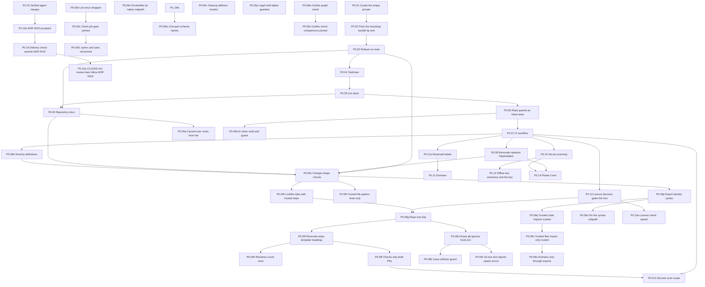
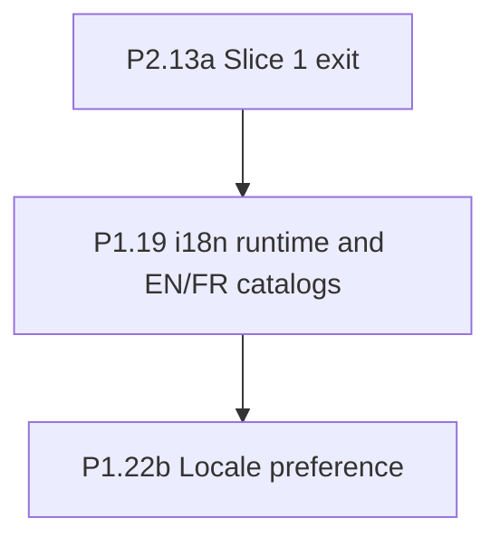
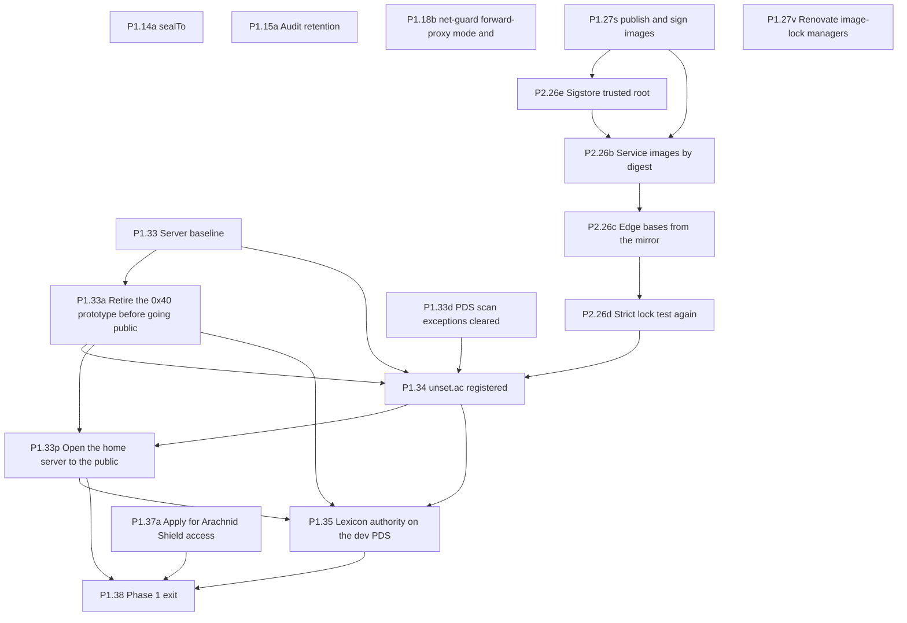
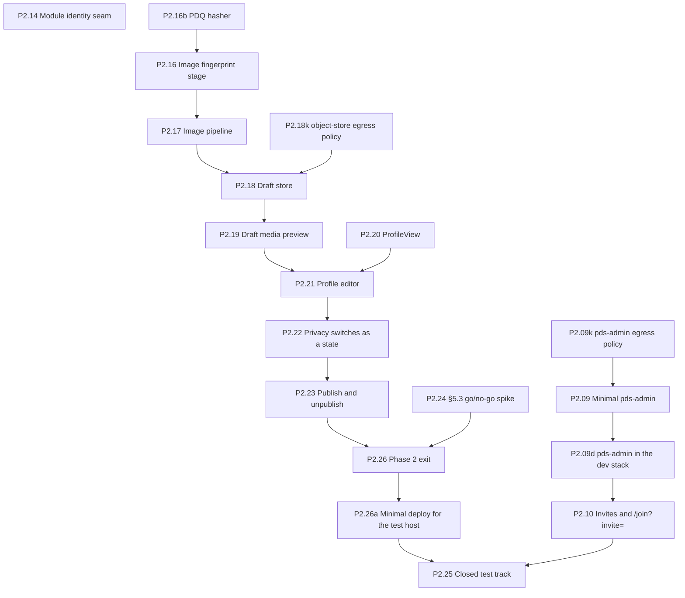
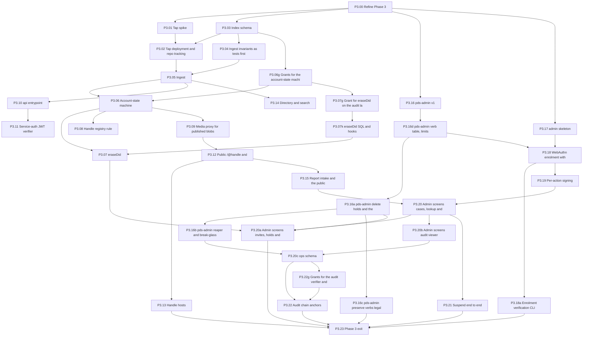
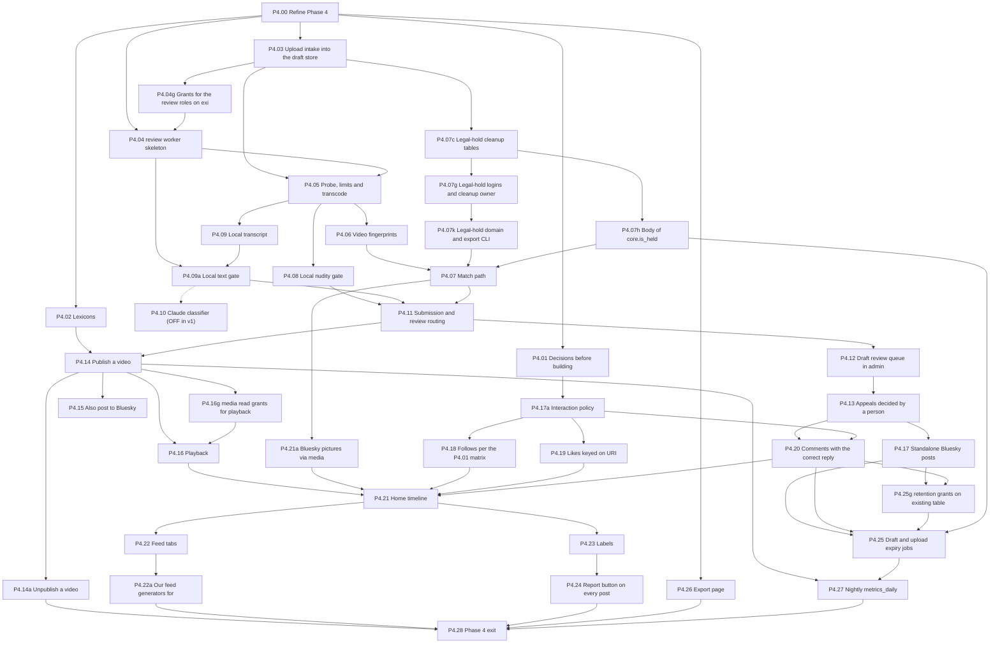
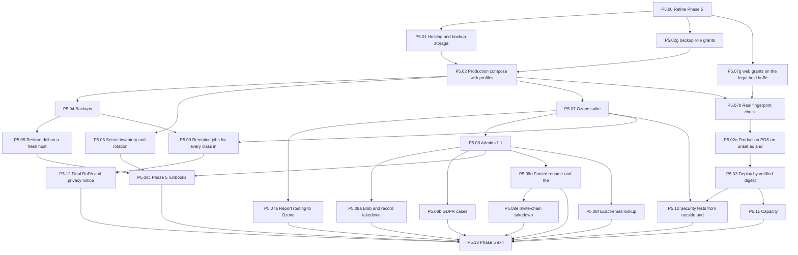
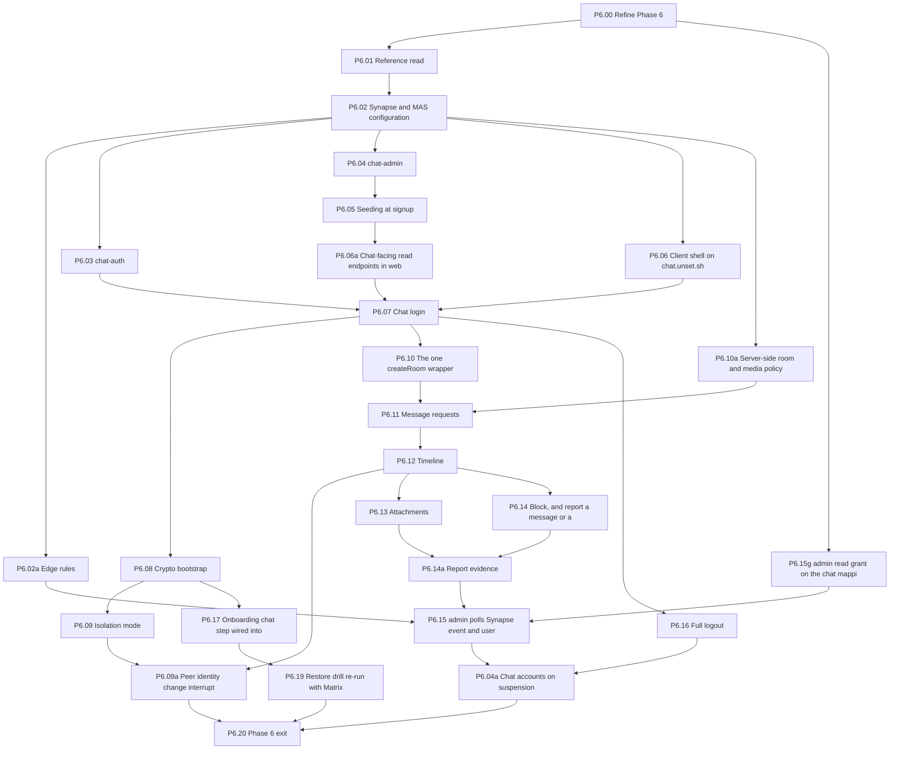
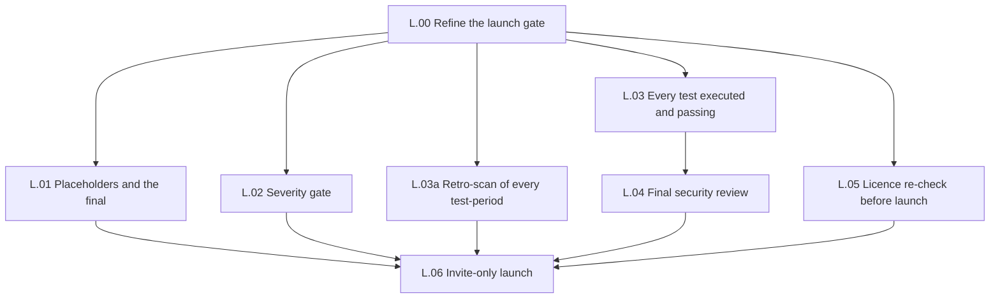
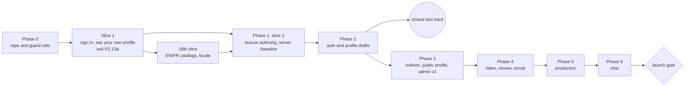

# Step outline (build order)

Every step of the book, in build order, as the phase files stand after the editor pass (2026-10-03) and the decision-34
pass (2026-10-04: slice 1 first, see "Slice 1"; decision 35 and English first, see "i18n slice"). The phase files
own the steps; this file only lists them. Where a row and its step disagree, the step wins and this row is the defect.
"Deps" lists direct dependencies only, copied from each step's `Depends on:` line, plus the outline-only rows that
the phase files' Notes ask for. Tags are explained in `00-README.md`.

How to read it:
- **Build order** is the row order. It follows the phase file's order except where a step depends on one written
  after it; there the outline moves the step down (see "Dependency check" at the end).
- **Depth.** Phases 0, 1 and 2 are **build-ready**. Phases 3 to 6 and the launch gate are **detail by risk**: the
  expensive-to-reverse parts are in full, the algorithms are a reviewed hypothesis, and each phase's `.00 Refine`
  step re-reads the phase against what was built and is reviewed before any other step of that phase (README
  "Depth of detail").
- **Outline-only rows** (*no body yet*) are steps the Notes ask for that have no step text in a phase file:
  P4.00 and P4.14a (P4.00 writes P4.14a; P4.28 already depends on it).
- `P4.00\*`: phase-4.md does not list P4.00 in its headers; the outline adds it to every Phase 4 step with no other
  Phase 4 dependency, because the Refine step comes before every other step of the phase.
- **Diagrams**: one per phase, drawing only dependencies between steps of that phase. An edge already implied through
  another drawn edge is left out to keep the graph readable; dependencies on earlier phases are in the table only.

## Phase 0 — Repository and guard rails

Depth: **build-ready**. 48 steps (P0.09a retired, P0.09d added; editor pass 2026-10-04 evening; P0.09f, P0.09g, P0.09h, P0.09i, P0.09j, P0.09k, P0.09l, P0.11a and P0.13a added 2026-10-05; P0.07a and P0.09m added 2026-10-06; P0.05b, P0.05c and P0.05d added 2026-10-07; P0.15, P0.15a, P0.16, P0.09t, P0.16a, P0.09n, P0.09o, P0.09p, P0.09q, P0.09r, P0.09s, P0.09u and P0.09v added 2026-10-12; P0.09o folded into P0.09n; P0.09w and P0.09x added 2026-10-13; P0.09y added 2026-10-14, its row in Phase 4 below P4.07c, which it depends on; P0.09z added 2026-10-14).

| Id | Step | Tags | Deps | Owner file |
|---|---|---|---|---|
| P0.01 | Create the empty private repository and grant the Claude GitHub app access | [ALEX] | — | `phase-0.md` |
| P0.02 | Push the bootstrap bundle tip and reconcile it with the revised plan | — | P0.01 | `phase-0.md` |
| P0.03 | Ruleset on `main` (applied 2026-10-06, ADR 0017; deferred before that, decision 41), repository Actions settings, CODEOWNERS with security-review paths | [ALEX] [SEC] | P0.02 (its push, step 5; not the reconcile PR) | `phase-0.md` |
| P0.04 | Toolchain: TypeScript 7, Node 26, Vitest only, `.npmrc`, "discovered equals executed" | — | P0.03 | `phase-0.md` |
| P0.05 | Lint stack: Biome CSS rules, dependency-cruiser on the swc parser, file-size and line-budget warnings | — | P0.04 | `phase-0.md` |
| P0.05b | Remove the duplicate lint run; check job runs lint before tests | — | — | `phase-0.md` |
| P0.05c | Check job gate pinned: exact if, gate steps, env, root scripts, alias-free ci.yml | — | P0.05b | `phase-0.md` |
| P0.05d | Root .npmrc pinned and a check path; check job uses-ref must be a 40-hex SHA | [SEC] | P0.05c | `phase-0.md` |
| P0.06 | Repo guards as Vitest tests, each with a planted failing fixture (includes the `pds-admin` file exemption and the `ip-columns` check) | [SEC] | P0.05 | `phase-0.md` |
| P0.07 | CI workflow: pinned images and actions, full gate set, secrets and OIDC bound to `main` | [SEC] [ALEX] (tail: required checks) | P0.06 | `phase-0.md` |
| P0.08 | Renovate replaces Dependabot; exact pins; lockfile and workspace-link guard | [SEC] [ALEX] (tail: app install) | P0.07 | `phase-0.md` |
| P0.09 | Repository docs: slim CLAUDE.md/AGENTS.md, SECURITY.md, licence line, ADR index, the book | — | P0.03, P0.05 | `phase-0.md` |
| P0.09a | ~~Carried-over notes from the prototype~~ **Retired** (plan §8 Phase 0: no old note carried wholesale; `.00` steps port what they need) | — | P0.09 | `phase-0.md` |
| P0.09b | Severity definitions, labels, bug template and triage form | [ALEX] | P0.03, P0.07 | `phase-0.md` |
| P0.09e | Classify grant changes for the trusted base (split from P0.09c) | [SEC] | P0.03 | `phase-0.md` |
| P0.09c | Change-shape checks: commit messages and PR title, PR size, PR template headings (added, decision 35) | [ALEX] (tail: required check) | P0.07, P0.08, P0.09, P0.09b, P0.09e, P0.03 | `phase-0.md` |
| P0.09f | Let the root lockfile ride with a trusted package's dependency change (SE-6 ruling 2026-10-05 02:50Z) | [SEC] | P0.09c | `phase-0.md` |
| P0.09g | Repo-root tidy (config files out of the root) | — | P0.09f, P0.13 | `phase-0.md` |
| P0.09h | Size guard counts a pure rename once | — | P0.09g, P0.09i | `phase-0.md` |
| P0.09i | pr-shape skips template headings for Renovate only | — | P0.09g | `phase-0.md` |
| P0.09l | Checks skip draft PRs | — | P0.09i | `phase-0.md` |
| P0.07a | Secrets job: per-PR range, public-key exception | [SEC] [ALEX] | P0.07, P0.09l | `phase-0.md` |
| P0.09j | Guard fixtures isolate git from the caller's environment | — | P0.09g | `phase-0.md` |
| P0.09k | Case-collision guard | — | P0.09j | `phase-0.md` |
| P0.09m | Grant parser classifies one-part schema names (waits for Alex's typed word: a loosening) | [SEC] [ALEX] | P0.09e | `phase-0.md` |
| P0.09t | Trusted file pattern carries only its own tests (folder patterns unchanged) | [SEC] [ALEX] (typed line: scripts/guards; line asked after P0.16 lands) | P0.09c | `phase-0.md` |
| P0.09p | Export the identity syntax module | — | P0.09c | `phase-0.md` |
| P0.09q | Trusted code imports only trusted modules (trusted base) | — | P0.09p | `phase-0.md` |
| P0.09n | Bar trusted tests from product helpers (P0.09o folded in) | [SEC] [ALEX] (typed line: scripts/guards, CODEOWNERS) | P0.09q | `phase-0.md` |
| P0.09o | ~~Bar trusted code from untrusted packages~~ **Folded** into P0.09n | — | — | `phase-0.md` |
| P0.09r | Report spawn errors in the git-env test | [ALEX] (typed line: scripts/guards) | P0.09j | `phase-0.md` |
| P0.09s | Reach domains only through their exports | — | P0.09n | `phase-0.md` |
| P0.09u | Pin the identity syntax subpath to its file | — | P0.09p | `phase-0.md` |
| P0.09v | Contain Dockerfiles with the native realpath | [SEC] | — | `phase-0.md` |
| P0.09w | Check the outline: cycles, unknown ids, headings | [ALEX] (typed line) | — | `phase-0.md` |
| P0.09x | List the cleanup definers as trusted functions | [ALEX] (typed line) | — | `phase-0.md` |
| P0.09z | Pin the outline check's comparisons (check, SE-6) | [ALEX] (typed line) | P0.09w | `phase-0.md` |
| P0.09d | AI notes vault and the notes guard (added, Alex 2026-10-04 22:11Z) | — **parallel-safe** (touches only `scripts/guards/` and `docs/ai/`) | P0.06 | `phase-0.md` |
| P0.10 | Secret scanning, push protection, hardware-key 2FA and offline codes, allowed-signers file | [ALEX] [SEC] | P0.03; runbook PR: P0.07 | `phase-0.md` |
| P0.11a | Reserved-label list and registrar checklist (agent part of P0.11) | — | P0.04, P0.07 | `phase-0.md` |
| P0.11 | Domains: registration, DNSSEC, CAA and parked records, HSTS plan, reserved-label list | [ALEX] | Alex part: —; agent PR: P0.04, P0.07, P0.11a | `phase-0.md` |
| P0.12 | Offline key ceremony and the key inventory | [ALEX] [SEC] | ceremony: P0.10; agent PR: P0.04, P0.07 | `phase-0.md` |
| P0.13 | Licence decision gates the first public commit (answered: AGPL-3.0 apps, MIT building blocks and lexicons; per-package licence files) | [STOP] (answered) | the question: —; ADR PR: P0.04, P0.07 | `phase-0.md` |
| P0.13a | Licence check stays inside the test timeout | — | P0.13 | `phase-0.md` |
| P0.14 | Phase 0 exit: planted faults are blocked; protection drills run once the ruleset is applied (GitHub Pro, 2026-10-06; no merge attempts) | [ALEX] (tail: applies the ruleset) | P0.03, P0.07, P0.08, P0.10 | `phase-0.md` |
| P0.15 | Verified agent merges: ADR 0019, CLAUDE.md Merging line, README row, 0001 log entry | [SEC] [ALEX] (Alex merges by hand) | — | `phase-0.md` |
| P0.15a | Mark ADR 0019 accepted: status, README rows, "changes with this decision", Alex's CLAUDE.md lines | [SEC] [ALEX] (Alex pastes CLAUDE.md, merges by hand) | P0.15 | `phase-0.md` |
| P0.16 | Delivery check asserts ADR 0019's merge rule ("author threads never merge", "ADR 0019") | [SEC] [ALEX] (Alex commits CLAUDE.md, merges by hand) | P0.15a | `phase-0.md` |
| P0.16a | Align CLAUDE.md's review lines with ADR 0019 | [ALEX] (typed line: CLAUDE.md) | P0.16 | `phase-0.md` |



## Slice 1 — Sign in with an atproto account and see your own profile (decision 34)

Depth: **build-ready**. 299 steps: 275 from `phase-1.md`, 24 from `phase-2.md` (including the
added exit step P2.13a). **English only** (Alex, 2026-10-04 12:58Z): P1.19 moved to the "i18n slice" below; slice-1 screens
keep their English text in one `messages.ts` per feature. Built first after Phase 0 (plan §8 Phase 1 "First slice", guideline §12): `apps/web →
interfaces/http → domains/identity → infrastructure/pds →` the `local` development PDS (P1.29a). The reasons each
non-obvious step is here (seal for the OAuth tokens, audit for P2.12's age-gate row, limits for login, the UI shell, the edge in front of the PDS, the set JSON for the scope strings, the onboarding and email gates)
are in `phase-1.md`, "Slices". Slice 2 starts only after P2.13a is merged.

| Id | Step | Tags | Deps | Owner file |
|---|---|---|---|---|
| P1.01 | Workspace skeleton | — | P0.05 | `phase-1.md` |
| P1.01s | Semgrep custom rules: computed imports and floating promises (parallel-safe) | [SEC] | P1.01, P0.07 | `phase-1.md` |
| P1.01q | References test robust under the full suite (check step; 20 s per-test timeout) | — | — | `phase-1.md` |
| P1.01g | CI test failures name the failing test (check step) | — | — | `phase-1.md` |
| P1.02 | Typed config loader per entrypoint | [SEC] | P1.01 | `phase-1.md` |
| P1.03 | Error model, error-code catalog, structured logger with a field allowlist | — | P1.02 | `phase-1.md` |
| P1.03w | Fixed-word string fields in `shared/log` (SE-7 ruling) | [SEC] | P1.03 | `phase-1.md` |
| P1.04l | Name the HTTP server kit's log events (split from P1.04k, SE-6) | — | P1.03 | `phase-1.md` |
| P1.04q | Route registration guard (split from P1.04k, SE-6) | — | P0.09c | `phase-1.md` |
| P1.04k | HTTP server kit in `shared/http/` (split from P1.04, SE-6) | — | P1.03, P1.04l | `phase-1.md` |
| P1.04c | Composition root guard (split from P1.04, SE-6) | — | P0.09c | `phase-1.md` |
| P1.04m | Route table lists every route option (split from P1.04, SE-6) | — | P1.04k | `phase-1.md` |
| P1.04 | HTTP server skeleton per entrypoint | — | P1.04k, P1.04q, P1.04c, P1.04m, P0.13a | `phase-1.md` |
| P1.05e | Trusted proxy keys in the entrypoint test envs (split from P1.05, SE-6) | — | P1.04 | `phase-1.md` |
| P1.05 | Trusted proxy: the client IP from one configured header only | [SEC] | P1.04, P1.05e | `phase-1.md` |
| P1.06e | Name the rate limiter's log events (split from P1.06, SE-6) | — | P1.05e | `phase-1.md` |
| P1.06 | Body limits and the rate-limit primitive | [SEC] | P1.05, P1.06e | `phase-1.md` |
| P1.06q | Route policy guard (split from P1.06p, SE-6) | — | P0.09c | `phase-1.md` |
| P1.06p | Per-interface rate-limit policy tables and the every-route-has-a-policy check | [SEC] | P1.06, P1.06q, P1.04 | `phase-1.md` |
| P1.07e | Name the CSRF log event (split from P1.07, SE-6) | — | P1.03 | `phase-1.md` |
| P1.07 | CSRF gate | [SEC] | P1.04, P1.07e | `phase-1.md` |
| P1.08e | Seed the CSP config key and name the CSP log event (split from P1.08, SE-6) | — | P1.04, P1.03 | `phase-1.md` |
| P1.08 | CSP builder and security headers | [SEC] | P1.04, P1.08e | `phase-1.md` |
| P1.08i | `inline-style` guard (split from P1.08, SE-6) | — | P1.08 | `phase-1.md` |
| P1.09 | Return-path validator, fuzz-tested | [SEC] | P1.01 | `phase-1.md` |
| P1.10 | Island props serialiser, fuzz-tested | [SEC] | P1.01 | `phase-1.md` |
| P1.11h | Postgres test helper (prelude to P1.11g, SE-6) | [SEC] | P1.02 | `phase-1.md` |
| P1.11g | Postgres bootstrap script: `migrator`, `tap`, the `PUBLIC` revokes (split from P1.11, SE-6) | [SEC] | P1.02, P1.11h | `phase-1.md` |
| P1.11e | Migration log events and the busy error (prelude to P1.11, SE-6) | — | P1.03 | `phase-1.md` |
| P1.11q | Transactions and pool-access Semgrep rules (split from P1.11, SE-6) | — | P1.01s | `phase-1.md` |
| P1.11 | Postgres and the migration runner as the `migrator` role | — | P1.11e, P1.11g, P1.11q, P1.02 | `phase-1.md` |
| P1.11p | Pool, transactions and the connection budget (split from P1.11) | — | P1.11 | `phase-1.md` |
| P1.11t | Postgres integration setup and the query budget test (split from P1.11) | — | P1.11p, P1.11v | `phase-1.md` |
| P1.11v | Gated integration `globalSetup` in `vitest.config.ts` (split from P1.11t, SE-6) | — | P1.11p | `phase-1.md` |
| P1.11w | Make the integration `globalSetup` unconditional | — | P1.11t, P1.11v | `phase-1.md` |
| P1.12 | Roles and grants, the role roster, default privileges, grant-matrix test | [SEC] | P1.11p, P1.11w | `phase-1.md` |
| P1.12t | Tests connect as the process roles (split from P1.12) | — | P1.12 | `phase-1.md` |
| P1.12p | Role password sync (split from P1.12, SE-6) | [SEC] | P1.12, P0.09 (`roles.ts` in the trusted base) | `phase-1.md` |
| P1.12x | Export `syncRolePasswords` and test role logins (split from P1.12p) | [SEC] | P1.12p, P1.12t | `phase-1.md` |
| P1.13 | DID-column registry test reading `pg_catalog` | — | P1.12t | `phase-1.md` |
| P1.14q | New trusted workspace may carry its root reference and lockfile entries (check part of P1.14; SE-6 `q`) | [SEC] | P0.09 | `phase-1.md` |
| P1.14 | Seal: AES-256-GCM envelope encryption with key ids, bound contexts and rotation | [SEC] | P1.14q, P1.02, P1.12 | `phase-1.md` |
| P1.14d | Sealed type and column registry (split from P1.14; P1.14m first if pr-shape classes the migration trusted) | [SEC] | P1.14, P1.13 | `phase-1.md` |
| P1.15x | Migration lint: allow TRUNCATE as a trigger event only (product; loosening) | [ALEX] | P1.11 | `phase-1.md` |
| P1.15q | pr-shape: SET ROLE/RESET ROLE neutral in trusted files (check, loosening) | [SEC] [ALEX] | — | `phase-1.md` |
| P1.15m | Audit SQL part 1: schema grants, default privilege, functions (trusted) | [SEC] | P1.15x, P1.15q, P1.12, P1.13 | `phase-1.md` |
| P1.15d | Audit SQL part 2: tables, seeds, index, triggers, auditor SELECT | [SEC] | P1.15m | `phase-1.md` |
| P1.15g | Audit SQL part 3: EXECUTE grants on `audit.append`, audit tests (trusted) | [SEC] | P1.15d | `phase-1.md` |
| P1.15 | Audit TS workspace: actions, append, rowHash, verify, error, AuditDb | [SEC], trusted | P1.15m, P1.15d, P1.15g, P1.14q | `phase-1.md` |
| P1.15s | Audit chain integration tests and the tests/tsconfig.json reference | feature | P1.15 | `phase-1.md` |
| P1.15b | Audit chain tests: verify through SET ROLE, owner DISABLE TRIGGER tamper | [SEC] | P1.15s | `phase-1.md` |
| P1.15c | Audit chain tests: denials pinned to 42501, schema-USAGE variant | [SEC] | P1.15b | `phase-1.md` |
| P1.16g | Retention's USAGE on schema `app` (trusted, split from P1.16) | [SEC] | P1.12 | `phase-1.md` |
| P1.16 | Durable single-use nonce and ticket store | [SEC] | P1.16g, P1.12t, P1.12, P1.13 | `phase-1.md` |
| P1.17e | Log prelude: `lock.hold_exceeded`, `lock.lost` (prelude to P1.17) | — | P1.03 | `phase-1.md` |
| P1.17 | Per-DID Postgres advisory lock helper (the OAuth client's `requestLock`) | — | P1.11p, P1.17e | `phase-1.md` |
| P1.17r | Lock integration tests wait for the holder to start, not a fixed sleep | — | P1.17 | `phase-1.md` |
| P1.18 | `net-guard` core: classify addresses, resolve once, pin the connection | [SEC] | P1.02 | `phase-1.md` |
| P1.18a | `net-guard` requests: policies, no redirects, size, time and decompression caps | [SEC] | P1.18 | `phase-1.md` |
| P1.20 | Framework-glue spike | [SPIKE] | P1.04, P1.10 | `phase-1.md` |
| P1.21q | CSS budget in `scripts/budgets/` (check part of P1.21; SE-6 `q`) | — | P1.20 | `phase-1.md` |
| P1.21 | Token pipeline | — | P1.21q, P1.20 | `phase-1.md` |
| P1.21l | CSS lint rules and the layer guard (split from P1.21, SE-6) | — | P1.21 | `phase-1.md` |
| P1.21m | Font metrics for the fallback faces (split from P1.21) | — | P1.21 | `phase-1.md` |
| P1.22 | Base styles and theme, English only (server-applied, no cookie variation on public pages; the locale half is P1.22b) | [SEC] | P1.21, P1.21l, P1.21m, P1.07, P1.09 | `phase-1.md` |
| P1.23q | Island budget and its dependency-cruiser rule (check part of P1.23; SE-6 `q`) | [SEC] | P1.20, P1.08 | `phase-1.md` |
| P1.23 | Island runtime | [SEC] | P1.23q, P1.20, P1.08, P1.22 | `phase-1.md` |
| P1.23d | Props fuzz test: one check per run, bounded sizes, breaker examples | [SEC], trusted | — | `phase-1.md` |
| P1.23r | Style-prop lint and island CI wiring (check part of P1.23, after it) | [SEC] | P1.23 | `phase-1.md` |
| P1.23f | CSS scope function (product split of P1.23v) | — | — | `phase-1.md` |
| P1.23v | CSS Modules check config: Vitest scoped names, TOOLING widened to app Vite configs | [SEC] [ALEX] | P1.23f | `phase-1.md` |
| P1.23w | Allow the render-entry subpath import (one depcruise row; check step) | [SEC] [ALEX] | P1.23v | `phase-1.md` |
| P1.23c | CSS Modules server-render glue (gap-fill for P1.23) | — | P1.23, P1.23r, P1.23v, P1.23w | `phase-1.md` |
| P1.23g | Guard test fixtures isolated from global git config (no signing, no system config) | [SEC] [ALEX] | — | `phase-1.md` |
| P1.23h | Fixture git sealed from the caller's home (excludes, attributes, system), secrets-fixtures moved, presence rule per call | [SEC] [ALEX] | P1.23g | `phase-1.md` |
| P1.24i | Icons and inventory (split from P1.24) | [SEC] | P1.22, P1.23r | `phase-1.md` |
| P1.24h | `safeHref` (trusted base, split from P1.24) | [SEC] | P1.22 | `phase-1.md` |
| P1.24q | UI inventory guard (check part of P1.24; SE-6 `q`) | — | P1.24i | `phase-1.md` |
| P1.24 | UI kit, part 1a: Button, Link, Tag, Mark, SectionHeading, Kbd and the form components | — (every sheet piece approved, sheet v45, 2026-10-04) | P1.24i, P1.24h, P1.23c | `phase-1.md` |
| P1.24s | UI kit, part 1b: Avatar, Switch, SkipLink, MediaFrame, DescriptionList, Pagination | — | P1.24i, P1.24h, P1.23c | `phase-1.md` |
| P1.24a | UI kit 2a: zero-JS blocks (added step; split 2026-10-07) | — | P1.24, P1.24s, P1.24q, P1.23, P1.23r | `phase-1.md` |
| P1.24k | UI kit 2b: chrome, no-JS | — | P1.24a | `phase-1.md` |
| P1.24f | UI kit 2c: feed and feedback, no-JS | — | P1.24k | `phase-1.md` |
| P1.24j | Islands, budget-measured | — | P1.24f | `phase-1.md` |
| P1.24b | Toast and select islands within the JS budget (per-icon drawing modules first) | feature | P1.24j | `phase-1.md` |
| P1.24c | Toast focus after close, required select stays native, select labels, font-metrics entry check | feature | P1.24b | `phase-1.md` |
| P1.25k | Error-page hook in the server kit | [SEC], trusted | P1.04, P1.08 | `phase-1.md` |
| P1.25b | Error-page hook leftovers: documentation addresses, byte cap, no-cache per group, 413 close, Promise type test, request id on the fixed page, private page-taking errorResponse | [SEC], trusted | P1.25k | `phase-1.md` |
| P1.25h | UI build runners move to the JSX-free shared/ui-build workspace | — | P1.24c | `phase-1.md` |
| P1.25q | Notes guard: `ui-build` area | check | P1.25h | `phase-1.md` |
| P1.25w | ui-build budget key and lint row (type-only shared-ui import) | check | P1.25h | `phase-1.md` |
| P1.25x | Test pins the shared/ui-build plan default | — | P1.25w | `phase-1.md` |
| P1.25d | jsx-free detector matches resolved shared/ui paths and react-dom | — | P1.25h | `phase-1.md` |
| P1.25r | jsx-free test parses with oxc (vite parseSync): string floor, no loading primitives, realpathed relatives | — | P1.25d | `phase-1.md` |
| P1.25l | Budget check: every island keeps its own lazy chunk | check | P1.25h | `phase-1.md` |
| P1.25s | jsx-free test: contains-floor, eval/Function/vm loaders, named type imports only | [SEC] | P1.25r | `phase-1.md` |
| P1.25o | CODEOWNERS, lint edges and budget for shared/islands | check [ALEX] | P1.25h | `phase-1.md` |
| P1.25i | Island runtime copied to the shared/islands workspace, with a parity test | trusted | P1.25o | `phase-1.md` |
| P1.25p | Point island importers at shared/islands | — | P1.25i | `phase-1.md` |
| P1.25e | Delete the old trusted island runtime files | trusted | P1.25p | `phase-1.md` |
| P1.25u | CODEOWNERS drops the island runtime's old paths | check | P1.25e | `phase-1.md` |
| P1.25 | App shell and error pages | — | P1.24, P1.24k, P1.08, P1.25k, P1.25h, P1.25p | `phase-1.md` |
| P1.26 | Accessibility and browser test harness | — | P1.25, P1.24c | `phase-1.md` |
| P1.27q | Image and mirror workflows, required checks (check part of P1.27; SE-6 `q`) | [SEC] | P1.04, P0.07 | `phase-1.md` |
| P1.27 | Container images, mirrored upstreams, SBOM, provenance and signatures (base pulled from upstream `node:26-alpine` by digest until P2.26b (P2.26c for the edge), interim departure, Alex 2026-10-07 00:17Z; P2.26b, then P2.26c, flip to the mirror after P1.27s, book edit 2026-10-13-p127s-split) | [SEC] | P1.27q, P1.04, P0.07 | `phase-1.md` |
| P1.27d | Switch the web image base to Debian slim (`node:26-trixie-slim`, Alex 2026-10-07 01:29Z) | [SEC] | P1.27 | `phase-1.md` |
| P1.28q | images.yml: build, lint, scan, health-check the edge image | check | P1.27q, P1.27 | `phase-1.md` |
| P1.28d | Base entries labelled by stage (feature) | [SEC] | P1.27 | `phase-1.md` |
| P1.28v | Mirror scan per stage (check, loosening; waits on Alex's card) | [SEC] [ALEX] | P1.28d | `phase-1.md` |
| P1.28w | Mirror scan: pipefail shell so build-stage HIGH warnings fire; one Trivy cache | [SEC] | P1.28v | `phase-1.md` |
| P1.28u | Refuse image references outside FROM: COPY --from, RUN --mount from=, ADD remote | [SEC] | P1.28v | `phase-1.md` |
| P1.28c | Remove the edge Dockerfile's syntax directive | [SEC], trusted | P1.28u | `phase-1.md` |
| P1.28t | Dockerfile reader: ADD refused, case-insensitive mount keys and flags, syntax and escape refused, list as floor | [SEC] | P1.28c | `phase-1.md` |
| P1.28x | Edge pins: caddy bases in bases.lock, mirror list, images test (feature; merged as built, #391) | [SEC] | P1.27 | `phase-1.md` |
| P1.28 | Edge (Caddy) (trusted) | [SEC] | P1.27, P1.28q, P1.28x | `phase-1.md` |
| P1.28a | Bump the edge builder digest; lock and mirror list ride with that FROM change | [SEC] [ALEX] | P1.28, P1.28x | `phase-1.md` |
| P1.28b | Edge leftovers: negative zone test, documentation addresses, ADR 0018 accepted, deterministic log test | [SEC] | P1.28 | `phase-1.md` |
| P1.28h | Caddyfile reader for edge checks | [SEC], trusted | P1.28b | `phase-1.md` |
| P1.28i | Edge image builds move to *.image.test.ts (caddyfile, edge integration) | [SEC], trusted | P1.28h | `phase-1.md` |
| P1.28s | Caddyfile reader refuses quoted top-level tokens | [SEC], trusted | P1.28h | `phase-1.md` |
| P1.28j | Edge image tests drop their CI-only runIf | [SEC], trusted | P1.28i | `phase-1.md` |
| P1.28r | Vitest images project run after the unit projects, gated once in run.ts; image-build guard | [SEC] | P1.28i, P1.28j | `phase-1.md` |
| P1.28n | Image test gate: GITHUB_ACTIONS mode, resolved imports in the build guard, listed-file check in CI | [SEC] | P1.28r | `phase-1.md` |
| P1.30q | Allow the deploy preflight in the boundary matrix (check part of P1.30; SE-6 q) | [SEC] | — | `phase-1.md` |
| P1.30p | Strict Compose parser and SecretMap (split from P1.30) | [SEC] | P1.30q | `phase-1.md` |
| P1.30 | Deploy preflight core, C1–C12 | [SEC] | P1.27, P1.30q, P1.30p | `phase-1.md` |
| P1.30s | Deploy preflight C13–C24 except C17 and C18 | [SEC] | P1.30 | `phase-1.md` |
| P1.30t | Deploy preflight C17: compose networks against the table | [SEC] | P1.30 | `phase-1.md` |
| P1.28e | One edge config reader and site rules in deployment/edge (trusted) | [SEC] | P1.28h | `phase-1.md` |
| P1.28f | Edge reader containment, mutation pins, one site per upstream (trusted) | [SEC] | P1.28e | `phase-1.md` |
| P1.28l | Edge reader: exact env placeholder positions, placeholder-only upstreams, full env-sentinel test, directive lookup guard (trusted) | [SEC] | P1.28f | `phase-1.md` |
| P1.28g | depcruise: deployment/edge never imports deployment/preflight | [SEC] | P1.28e | `phase-1.md` |
| P1.28k | depcruise and raw-specifier allowlist: refuse root-absolute, unresolved and non-allowlisted imports | [SEC] | P1.28g | `phase-1.md` |
| P1.28m | Raw-specifier check: root-only dependencies allowed in test files only | [SEC] | P1.28k | `phase-1.md` |
| P1.28p | depcruise: product code never imports the tooling set (tests, check scripts, fixtures, vectors) | [SEC] | P1.28m | `phase-1.md` |
| P1.28z | Tooling set image-test anchor; depcruise_cruised_nonzero cruises fixed real files, not the whole repo | [SEC] | P1.28p | `phase-1.md` |
| P1.30c | Specifier cruise test: /proc/self/root spelling and a per-spelling presence guard | [SEC] | — | `phase-1.md` |
| P1.30r | Depcruise row: deployment/preflight may import deployment/edge/caddyfile.ts only | [SEC] [ALEX] | — | `phase-1.md` |
| P1.30e | depcruise_allowed_edges cruises all row edges once (collision and coverage guarded; per-edge fallback for messages) | [SEC] | P1.30r | `phase-1.md` |
| P1.30f | depcruise row coverage matches resolved path and import kind; (from, spec) unique across rows | [SEC] | P1.30e | `phase-1.md` |
| P1.30u | Deploy preflight C18: edge rate-limit zones through the shared edge reader | [SEC] [ALEX] | P1.30, P1.28h, P1.28e, P1.28f, P1.28g, P1.28l, P1.30r | `phase-1.md` |
| P1.30h | Edge reader scrubs every given env value from its errors (over ENV_NAMES) | [SEC] | P1.30u | `phase-1.md` |
| P1.30g | Edge reader scrub pinned: host-named site file, longest-first sort, echoing directive fixture, PDS_HOST sentinel | [SEC] | P1.30h | `phase-1.md` |
| P1.30w | Compose reader exact key allowlist, C18 read-only sites mount and edge image pin, shared check value scrub | [SEC] | P1.30u | `phase-1.md` |
| P1.30k | Compose reader exact top-level key allowlist and long-form port key set | [SEC] | P1.30w | `phase-1.md` |
| P1.30m | Preflight runner withholds any reason containing a configured value (one run-wide set); C23 and literal-quoting templates name keys; scrubbed() deleted | [SEC] | P1.30w | `phase-1.md` |
| P1.30v | Withheld marker never carries a configured value (regression fix to P1.30m) | [SEC] | P1.30m | `phase-1.md` |
| P1.30j | Name keys in preflight reasons, not values (P1.30k literal fixtures; stale comments) | [SEC] | P1.30k, P1.30m, P1.30v | `phase-1.md` |
| P1.30z | Resolve compose paths from the project directory | [SEC] | P1.30k | `phase-1.md` |
| P1.30d | Correct project-directory notes and flag test | — | P1.30z, P1.30j | `phase-1.md` |
| P1.30a | Preflight reads Compose's interpolation inputs | [SEC] | P1.30z, P1.30d | `phase-1.md` |
| P1.30o | C9 judges mounted secrets by uid in a locked dir | [SEC] [ALEX] (card answered 16:45:14Z) | P1.30x | `phase-1.md` |
| P1.30l | Pin the Compose version in CI (check step) | [SEC] [ALEX] (typed line, after P0.16 lands) | P1.30a, P0.16 | `phase-1.md` |
| P1.30x | Compose reader: hardening and limit keys (read_only, cap_drop, cap_add, security_opt, user, mem_limit, cpus, pids_limit, restart) | [SEC] | P1.30k | `phase-1.md` |
| P1.30y | Compose reader: build, tmpfs (and volumes type tmpfs), depends_on, short-form service secrets | [SEC] | P1.30k, P1.30z | `phase-1.md` |
| P1.30n | Preflight refuses top-level network names; undefined-network refusal in networkTableProblems | [SEC] | P1.30t | `phase-1.md` |
| P1.29k | Migrate image (separate Dockerfile) and syncRolePasswords wiring | [SEC] | P1.27, P1.12p, P1.12x, P1.28r | `phase-1.md` |
| P1.29x | Stripped paths declared; every image has a known kind; final stages may only remove packages | [SEC] | P1.29k | `phase-1.md` |
| P1.29r | Final-stage package rule: word floor, command allowlist, removal-option allowlist | [SEC] | P1.29x | `phase-1.md` |
| P1.29e | Final-stage recipe holes: apt suffixes, RUN --mount, bare command names, assignments, here-docs, COPY destinations, setcap list | [SEC] | P1.29r | `phase-1.md` |
| P1.28o | Edge runtime drops apk-tools; image test proves no package manager | [SEC], trusted | P1.29x | `phase-1.md` |
| P1.28y | Edge kind gains runtime_has_no_package_manager (apk) | [SEC] | P1.28o, P1.29x | `phase-1.md` |
| P1.29n | Node runtime ships no package manager (built-image test) | [SEC] | P1.29e | `phase-1.md` |
| P1.29m | Kind-wide package manager test: kinds.json, full basename match, inert database allowlist, RM_BY_KIND | [SEC] | P1.29n | `phase-1.md` |
| P1.29f | Final stages: no here-docs, absolute destinations, && only, per-kind allowlists for destinations, ENV keys, no ARG | [SEC] | P1.29e, P1.29n, P1.29m | `phase-1.md` |
| P1.29g | Image readers: tar -tf names, hard links, special mode bits, final-stage-only rm exemption, BuildKit line joins, per-kind glob list | [SEC] | P1.29m, P1.29f | `phase-1.md` |
| P1.29p | Built-image file capabilities and setuid match an exact per-kind list | [SEC] | P1.29e, P1.29g | `phase-1.md` |
| P1.29j | Image tests: fixtures for the --chmod octal bound, readTar agreement throws, glob reverse containment | [SEC] | P1.29p | `phase-1.md` |
| P1.29w | images.yml discovers and scans every image; aggregate "scan" job | [SEC] [ALEX] | — | `phase-1.md` |
| P1.29v | Mirror scan skips declared stripped paths; npm ignores removed | [SEC] [ALEX] | P1.29x, P1.28w, P1.29w | `phase-1.md` |
| P1.29y | Fold the old images/edge jobs (hadolint, SBOM, uid, health) into the discovered scan matrix | [SEC] [ALEX] | P1.29w, P1.29v | `phase-1.md` |
| P1.29b | Mirror build-stage run scans the whole base (stripped skips on runtime only) | [SEC] | P1.29v | `phase-1.md` |
| P1.29u | Stripped-path syntax and final-stage RUN separators fail closed | [SEC] | P1.29v | `phase-1.md` |
| P1.29c | Lock field buildStage, derived from the Dockerfiles and proven by a test | [SEC] | P1.29b | `phase-1.md` |
| P1.29z | Keep docker out of the kind problems reader test (regression fix to P1.29c) | [SEC] | P1.29c | `phase-1.md` |
| P1.29o | Give docker-run image tests an explicit budget | — | P1.29z | `phase-1.md` |
| P1.27e | Give edge image test hooks an explicit budget (trusted base) | — | P1.29z | `phase-1.md` |
| P1.27k | Kill hung docker calls in image tests | — | P1.29o | `phase-1.md` |
| P1.27t | Kill hung docker calls in edge image tests (trusted base) | — | P1.27k, P1.27e | `phase-1.md` |
| P1.27h | Fix the edge image test kill follow-ups (trusted base) | — | P1.27t | `phase-1.md` |
| P1.27g | Fix the docker kill timeout follow-ups | — | P1.27k | `phase-1.md` |
| P1.27i | Fix the docker test cleanup follow-ups | — | P1.27g | `phase-1.md` |
| P1.27x | Tag each test image build uniquely | — | P1.27i | `phase-1.md` |
| P1.27z | Tag each edge test image build uniquely (trusted base) | — | P1.27x, P1.27t | `phase-1.md` |
| P1.27y | Build contexts match the scanned image context | [SEC] | P1.30y | `phase-1.md` |
| P1.27f | ~~Give the C26 symlink test a C9-valid fixture~~ **Superseded** by P1.27g (#684 closed unmerged) | — | P1.27y, P1.30o | `phase-1.md` |
| P1.27a | Refuse sticky writable ancestors in C9 | [SEC] | P1.30o | `phase-1.md` |
| P1.27u | Close the C9 bind reach gaps | [SEC] | P1.27a | `phase-1.md` |
| P1.27p | Withhold only non-public configured values | [SEC] [ALEX] (card answered 23:13:27Z) | P1.29 | `phase-1.md` |
| P1.27w | Run Compose only through the preflight wrapper | [SEC] | P1.30a, P1.30z | `phase-1.md` |
| P1.27n | Close the P1.27y verifier test gaps | [SEC] | P1.27y | `phase-1.md` |
| P1.27j | Tidy preflight comments and the tilde check | — | P1.30a | `phase-1.md` |
| P1.11c | Keep the setup error when cleanup fails | — | P1.27i | `phase-1.md` |
| P1.11f | Keep cleanup errors in Postgres test setup | — | P1.11c | `phase-1.md` |
| P1.11i | Restore edge tag removal; label test images | — | P1.27x, P1.27z | `phase-1.md` |
| P1.11r | Try every edge test tag on cleanup (trusted base) | — | — | `phase-1.md` |
| P1.11s | Report a failed edge removal; pin afterAll | — | — | `phase-1.md` |
| P1.11n | Name test helpers apart; keep them out of images | — | P0.09n | `phase-1.md` |
| P1.11k | Strip the snakeoil key from the postgres image | [SEC] | — | `phase-1.md` |
| P1.33s | Scan each image's exported filesystem (check, SE-6) | [SEC] [ALEX] (typed line) | P1.11k | `phase-1.md` |
| P1.33u | Make the image secret scan gate (check, SE-6) | [SEC] [ALEX] (typed line) | P1.33s | `phase-1.md` |
| P1.33v | Scan shipped mirrors with no allow rules (check, SE-6) | [SEC] [ALEX] (typed line) | P1.33u | `phase-1.md` |
| P1.33c | Accept the PDS scan findings until 2026-11-13 (check, SE-6) | [SEC] [ALEX] (typed line) | — | `phase-1.md` |
| P1.35b | Give host-pin a security review owner (check, SE-6) | [SEC] [ALEX] (typed line) | — | `phase-1.md` |
| P1.35c | Pin the depcruise rows and image export checks (check, SE-6) | [SEC] [ALEX] (typed line) | — | `phase-1.md` |
| P1.35e | Scan the image we built, not a rebuild (check, SE-6) | [SEC] [ALEX] (typed line) | P1.35c | `phase-1.md` |
| P1.33e | Refuse dev while PDS exceptions remain | [SEC] | P1.33c | `phase-1.md` |
| P1.34f | Require the interpolation env flag | [SEC] | P1.30a | `phase-1.md` |
| P1.34p | Refuse secret inputs inside the project | [SEC] | P1.27u | `phase-1.md` |
| P1.34w | Tighten the wrapper's argument handling | [SEC] | — | `phase-1.md` |
| P1.34s | Walk the Docker socket path | [SEC] | P1.27u | `phase-1.md` |
| P1.34e | Allow the edge's two ownership commands | [SEC] | — | `phase-1.md` |
| P1.34x | Admit only chown and chmod in run lists | [SEC] | P1.34e | `phase-1.md` |
| P1.34r | Walk, open, then fstat in the env reader | [SEC] | P1.27j | `phase-1.md` |
| P1.34c | Serve the local app site with a dev leaf (trusted base) | [SEC] | — | `phase-1.md` |
| P1.34a | Let the edge reader accept the local app site (trusted base) | [SEC] | — | `phase-1.md` |
| P1.34b | Tighten the edge local-files check and tests (trusted base) | — | P1.34a | `phase-1.md` |
| P1.34g | Fix the edge integration test nits from #746 | — | P1.29a | `phase-1.md` |
| P1.34i | Close the dev compose test gaps from #745 | — | P1.29a | `phase-1.md` |
| P1.34j | Catch lowercase USER and edge bind mounts (trusted base) | [SEC] | P1.34b | `phase-1.md` |
| P1.34l | Refuse stray files in the secrets folder | [SEC] | — | `phase-1.md` |
| P1.34m | Scan newly pinned runtime images in PR CI | [SEC] [ALEX] (typed line) | — | `phase-1.md` |
| P1.34n | Apply the P1.29a rulings after #774 | [SEC] | P1.29a | `phase-1.md` |
| P1.34k | Deny PDS safety-off flags in the live env | [SEC] | P1.34n | `phase-1.md` |
| P1.34o | Read app.caddy as one local file mount (trusted base) | [SEC] | P1.34a | `phase-1.md` |
| P1.34q | Read local edge sites as per-file mounts (trusted base) | [SEC] | P1.34o | `phase-1.md` |
| P1.33t | Require the tls import in every edge site | [SEC] | P1.27l | `phase-1.md` |
| P1.34t | Pin the PLC URL per environment | [SEC] | — | `phase-1.md` |
| P1.33m | Own the local Postgres init in CODEOWNERS (check, SE-6) | [SEC] [ALEX] (typed line) | — | `phase-1.md` |
| P1.34u | Give the local PLC its own role and database (trusted base) | [SEC] | P1.34t, P1.34d, P1.33m | `phase-1.md` |
| P1.34v | Run a local PLC directory in the local stack | [SEC] [ALEX] (card answered 20:43:34Z) | P1.34u, P1.34d | `phase-1.md` |
| P1.34y | Add an inert local PLC policy to net-guard (trusted base) | [SEC] | P1.34t | `phase-1.md` |
| P1.34z | Point identity resolution at the local PLC | [SEC] | P1.34v, P1.34y | `phase-1.md` |
| P1.33i | Let the preflight import shared/host-pin (check, SE-6) | [SEC] [ALEX] (typed line) | — | `phase-1.md` |
| P1.33h | Move the host pin into shared/host-pin | [SEC] | P1.33i | `phase-1.md` |
| P1.33f | Anchor the depcruise exclude to our outputs (check, SE-6) | [SEC] [ALEX] (typed line) | — | `phase-1.md` |
| P1.33o | Keep shared/host-pin a leaf in depcruise (check, SE-6) | [SEC] [ALEX] (typed line) | P1.33i, P1.33h | `phase-1.md` |
| P1.33j | Use the shared host pin in the token reader | [SEC] | P1.33h | `phase-1.md` |
| P1.33k | Admit the node base for the token reader | [SEC] | P1.33j | `phase-1.md` |
| P1.33l | Pin the token reader to the local stack | [SEC] | P1.33j | `phase-1.md` |
| P1.29i | Judge every outbound PDS key in the token reader | [SEC] | — | `phase-1.md` |
| P1.33w | Refuse binds that reach the dev CA folder (split from P1.34d) | [SEC] | P1.29a, P1.34c, P1.27l, P1.33t, P1.34q, P1.33k | `phase-1.md` |
| P1.33x | Check the local leaf names and expiry (split from P1.34d) | [SEC] | P1.33w | `phase-1.md` |
| P1.33y | Accept per-file site mounts on local (split from P1.34d) | [SEC] | P1.33x | `phase-1.md` |
| P1.35a | Close the dev CA folder rule's gaps (after P1.33y) | [SEC] | P1.33y | `phase-1.md` |
| P1.35f | Root-cause the compose version probe stall | — | — | `phase-1.md` |
| P1.35g | Refuse an IP address as the local PDS host | [SEC] | — | `phase-1.md` |
| P1.34d | Trust one dev root CA on the local stack | [SEC] | P1.29a, P1.34c, P1.27l, P1.33t, P1.34q, P1.33k, P1.33w, P1.33x, P1.33y, P1.35a | `phase-1.md` |
| P1.33z | Run the local stack in CI (split from P1.34d) | [SEC] | P1.34d | `phase-1.md` |
| P1.33n | Drop the directory form from the site reader (trusted base) | [SEC] | P1.34d, P1.34q | `phase-1.md` |
| P1.27m | Local edge TLS snippet for the local stack (trusted base) | [SEC] [ALEX] (card answered 16:44:52Z) | — | `phase-1.md` |
| P1.27l | Let local-only stacks pass C2 to C5 unsigned | [SEC] [ALEX] (card answered 16:44:52Z) | P1.30y, P1.30a, P1.29, P1.27m, P1.34a | `phase-1.md` |
| P1.29l | Mirror runs a whole-base build-threshold scan for buildStage bases; fake docker = form; stray TRIVY_* fails | [SEC] | P1.29c | `phase-1.md` |
| P1.29d | Our own gosu-free Postgres image, locked and mirrored | [SEC] | P1.29v, P1.28r, P1.28n, P1.29r, P1.29e, P1.29n, P1.29p, P1.29f, P1.29m | `phase-1.md` |
| P1.29 | Development stack (`compose.dev.yaml`) without the PDS: postgres, migrate, web | [SEC] | P1.29k, P1.29d, P1.29w, P1.11p, P1.30t, P1.30n, P1.29n, P1.29p, P1.29f, P1.29m, P1.30x, P1.30y, P1.30z, P1.30a, P1.30o, P1.27y, P1.27a, P1.27u, P1.27w | `phase-1.md` |
| P1.27o | Edge /data and /config owned by caddy (trusted base) | [SEC] | P1.34e | `phase-1.md` |
| P1.29a | PDS image, PDS and edge services in the dev stack | [ALEX] [SEC] | P1.29, P1.28, P1.27o | `phase-1.md` |
| P1.29h | Local PDS email-token reader for tests and dev-seed (real confirmEmail flow) | [SEC] | P1.29a | `phase-1.md` |
| P1.33b | Let local stacks run without mail | [SEC] [ALEX] (card answered 20:28:12Z) | P1.27l | `phase-1.md` |
| P1.29s | Dev seed and precheck scripts | [SEC] | P1.29a, P1.29h, P1.34t, P1.34v, P1.34z, P1.29i, P1.33j, P1.33k, P1.33l, P1.34d, P1.33b | `phase-1.md` |
| P1.29t | Running dev stack tests: client_id probe, no client IP in device rows, resolve-and-pin in the image | [SEC] | P1.29a, P1.29s, P1.34d, P1.34k, P1.34t, P1.34v, P1.34z | `phase-1.md` |
| P1.32 | Permanent choices (ask Alex) | [STOP] [PERMANENT] | — | `phase-1.md` |
| P1.32a | Keep ADR 0020 to the answered questions | — | P1.32 | `phase-1.md` |
| P1.31d | Resolve package exports and lexicon scripts (check, SE-6) | [SEC] [ALEX] (typed line) | — | `phase-1.md` |
| P1.31 | Lexicons package (with `sh.unset.follow` in the first set, answer 29b) | [PERMANENT] [SEC] [ALEX] [STOP] (Alex approves fields and consent text in its PR) | P1.01, P1.31d, P1.32 (Q4, the permission-set NSID) | `phase-1.md` |
| P1.31c | Pin the lexicon NSID to the permanent value | — | P1.31 | `phase-1.md` |
| P1.31e | Admit the private unset-source condition | — | P1.31c | `phase-1.md` |
| P1.31f | Export the web server through unset-source | — | P1.31e | `phase-1.md` |
| P1.37 | Legal paperwork, round 1 (Alex) | [ALEX] | — | `phase-1.md` |
| P1.37b | Harden the legal marker docs check | — | P1.37 | `phase-1.md` |
| P1.36 | Compliance skeletons (pulled forward from slice 2, Alex 23:08Z; test in `scripts/docs/`, check class) | — | P0.07 | `phase-1.md` |
| P2.01k | `resolveTxt` in `net-guard` (split from P2.01, SE-6) | [SEC] | P1.18 | `phase-2.md` |
| P2.01q | `alsoKnownAs` guard (split from P2.01, SE-6) | — | P0.09c | `phase-2.md` |
| P2.01m | `resolveVetted` on c-ares for public names | [SEC] | P2.01k | `phase-2.md` |
| P2.01 | DID and handle resolution | [SEC] | P2.01k, P2.01q, P1.18, P1.34z | `phase-2.md` |
| P2.01a | The identity network adapter (size split from P2.01) | [SEC] | P2.01 | `phase-2.md` |
| P2.02 | `verifyHandle(did)` | [SEC] | P2.01 | `phase-2.md` |
| P1.33r | Share in-flight DID lookups (after P2.02, which it depends on) | [SEC] | P2.01, P2.02 | `phase-1.md` |
| P1.32b | Share in-flight handle checks (trusted base, split from P1.33r) | [SEC] trusted | P1.33r | `phase-1.md` |
| P1.32c | Replace the real-looking DID in fixtures | — | — | `phase-1.md` |
| P1.35h | Test the in-flight rejection path | [SEC] | — | `phase-1.md` |
| P2.02x | Export verifyHandle from the identity index (split from P2.02, SE-6) | — | P2.02 | `phase-2.md` |
| P2.03q | Move the session store's trusted path (check part of P2.03; SE-6 q) | [SEC] | — | `phase-2.md` |
| P2.03x | Add the session table, registry rows and timeouts (split from P2.03) | [SEC] | P1.12, P1.15g | `phase-2.md` |
| P2.03e | Add the session store log events (EVENTS prelude) | — | — | `phase-2.md` |
| P2.03c | CODEOWNERS: session trusted path /infrastructure/postgres/session/ → /infrastructure/session/ | [SEC] | — | `phase-2.md` |
| P2.03 | Session store and lifecycle (trusted) | [SEC] | P2.03q, P2.03x, P2.03e, P2.03c | `phase-2.md` |
| P2.03i | Session index (did), annotated with store.ts | [SEC] | P2.03, P2.03x | `phase-2.md` |
| P2.04 | OAuth client | [SEC] | P1.14, P1.14d, P1.17, P1.31, P2.01, P2.03x, P2.03i | `phase-2.md` |
| P2.04s | Session prelude for OAuth: destroyAllForDid, EndSessionsReason, has_token_set probe (trusted, split from P2.04) | [SEC] | P2.03, P2.04 | `phase-2.md` |
| P2.05 | Login | [SEC] | P2.04, P1.09 | `phase-2.md` |
| P2.06 | Callback | [SEC] | P2.05, P2.03, P2.02, P2.02x, P1.07, P1.16, P2.04s | `phase-2.md` |
| P2.07 | Resilience: one wrapper for PDS calls | [SEC] | P2.04, P2.04s | `phase-2.md` |
| P2.08 | Logout and "sign out everywhere" | [SEC] | P2.06, P2.04s | `phase-2.md` |
| P2.11 | Email-verify gate | [SEC] | P2.06, P2.07, P1.29h | `phase-2.md` |
| P2.15 | Legal paperwork part 2 | — (content approved by Alex through the PR) | P1.25, P1.37 | `phase-2.md` |
| P2.12 | Onboarding: age, terms, chat placeholder | [SEC] | P2.06, P2.11, P2.15, P1.15, P2.04s | `phase-2.md` |
| P2.13 | `/me` and the settings shell | — | P2.06, P1.25 | `phase-2.md` |
| P2.13a | Slice 1 exit: sign in and see your own profile, architecture review, `docs/human/features/sign-in.md` (added, decision 34) | [STOP] (next slice after Alex reads the review) | P2.13, P2.08, P2.12, P1.26, P1.29t, P1.30, P1.30s, P1.30t, P1.30u, P2.01a, P2.01m, P1.34d | `phase-2.md` |

```mermaid
flowchart TD
  P1_01["P1.01 Workspace skeleton"]
  P1_01q["P1.01q References test timeout"]
  P1_01g["P1.01g CI names failing test"]
  P1_02["P1.02 Typed config loader per entrypoint"]
  P1_03["P1.03 Error model"]
  P1_04["P1.04 HTTP server skeleton per"]
  P1_04k["P1.04k HTTP server kit in shared/http/"]
  P1_03w["P1.03w fixed-word log fields"]
  P1_04l["P1.04l HTTP kit log events"]
  P1_04q["P1.04q route registration guard"]
  P1_04c["P1.04c composition root guard"]
  P1_04m["P1.04m route table options"]
  P1_05["P1.05 Trusted proxy"]
  P1_05e["P1.05e proxy keys in test envs"]
  P1_06e["P1.06e rate limiter log events"]
  P1_06["P1.06 Body limits and the rate-limit"]
  P1_06q["P1.06q route policy guard"]
  P1_06p["P1.06p Per-interface rate-limit tables"]
  P1_07e["P1.07e CSRF log event"]
  P1_07["P1.07 CSRF gate"]
  P1_08e["P1.08e CSP prelude"]
  P1_08["P1.08 CSP builder and security headers"]
  P1_08i["P1.08i inline-style guard"]
  P1_09["P1.09 Return-path validator"]
  P1_10["P1.10 Island props serialiser"]
  P1_11["P1.11 Postgres and the migration runner"]
  P1_11g["P1.11g Postgres bootstrap script"]
  P1_11h["P1.11h Postgres test helper"]
  P1_11e["P1.11e Migration log events"]
  P1_11q["P1.11q Transactions and pool rules"]
  P1_11p["P1.11p Pool and transactions"]
  P1_11t["P1.11t Postgres integration setup"]
  P1_11v["P1.11v Gated integration globalSetup"]
  P1_11w["P1.11w Unconditional globalSetup"]
  P1_12["P1.12 Roles and grants"]
  P1_12t["P1.12t Tests on the process roles"]
  P1_12p["P1.12p Role password sync"]
  P1_12x["P1.12x Password export and login test"]
  P1_13["P1.13 DID-column registry test reading"]
  P1_14q["P1.14q Trusted workspace guard"]
  P1_14["P1.14 Seal: AES-256-GCM envelope"]
  P1_14d["P1.14d Sealed type and registry"]
  P1_15x["P1.15x Lint: TRUNCATE trigger event"]
  P1_15q["P1.15q SET ROLE in trusted files"]
  P1_15m["P1.15m Audit SQL part 1"]
  P1_15d["P1.15d Audit SQL part 2"]
  P1_15g["P1.15g Audit SQL part 3"]
  P1_15["P1.15 Audit TS workspace"]
  P1_15s["P1.15s Audit chain tests"]
  P1_15b["P1.15b Verify through SET ROLE"]
  P1_15c["P1.15c Denials pinned to 42501"]
  P1_16g["P1.16g Retention schema USAGE"]
  P1_16["P1.16 Durable single-use nonce and"]
  P1_17e["P1.17e Lock log events"]
  P1_17["P1.17 Per-DID Postgres advisory lock"]
  P1_17r["P1.17r Lock tests wait for the holder"]
  P1_18["P1.18 net-guard core"]
  P1_18a["P1.18a net-guard requests"]
  P1_20["P1.20 Framework-glue spike"]
  P1_21["P1.21 Token pipeline"]
  P1_21l["P1.21l CSS lint rules and layer guard"]
  P1_21m["P1.21m Font metrics"]
  P1_22["P1.22 Base styles"]
  P1_23["P1.23 Island runtime"]
  P1_23d["P1.23d Props fuzz test bounded"]
  P1_23r["P1.23r Style lint and island CI"]
  P1_23f["P1.23f CSS scope function"]
  P1_23v["P1.23v CSS Modules check config"]
  P1_23w["P1.23w Render-entry import row"]
  P1_23c["P1.23c CSS Modules glue"]
  P1_23g["P1.23g Guard fixtures isolated from global git"]
  P1_23h["P1.23h Fixture git sealed from the caller's home"]
  P1_24i["P1.24i Icons and inventory"]
  P1_24h["P1.24h safeHref"]
  P1_24q["P1.24q UI inventory guard"]
  P1_24["P1.24 UI kit"]
  P1_24s["P1.24s UI kit part 1b"]
  P1_24a["P1.24a UI kit: zero-JS blocks"]
  P1_24k["P1.24k UI kit: chrome"]
  P1_24f["P1.24f UI kit: feed and feedback"]
  P1_24j["P1.24j Islands"]
  P1_24b["P1.24b toast and select islands"]
  P1_24c["P1.24c toast focus, required select, labels"]
  P1_25k["P1.25k Error-page hook in the kit"]
  P1_25b["P1.25b Error-page hook leftovers"]
  P1_25h["P1.25h UI build runners to shared/ui-build"]
  P1_25q["P1.25q ui-build notes area"]
  P1_25w["P1.25w ui-build budget and lint row"]
  P1_25x["P1.25x ui-build plan default test"]
  P1_25d["P1.25d jsx-free detector"]
  P1_25r["P1.25r jsx-free test parses with oxc"]
  P1_25s["P1.25s jsx-free second regression"]
  P1_25l["P1.25l Islands keep lazy chunks"]
  P1_25o["P1.25o Own shared/islands"]
  P1_25i["P1.25i Island runtime copied to shared/islands"]
  P1_25p["P1.25p Importers point at shared/islands"]
  P1_25e["P1.25e Old trusted runtime deleted"]
  P1_25u["P1.25u Drop old island owner paths"]
  P1_25["P1.25 App shell and error pages"]
  P1_26["P1.26 Accessibility and browser test"]
  P1_27["P1.27 Container images"]
  P1_27d["P1.27d Web image on Debian slim"]
  P1_28q["P1.28q edge image scan"]
  P1_28d["P1.28d base entries by stage"]
  P1_28v["P1.28v mirror scan per stage"]
  P1_28w["P1.28w mirror scan pipefail shell"]
  P1_28u["P1.28u image refs outside FROM"]
  P1_28c["P1.28c edge syntax line dropped"]
  P1_28t["P1.28t Dockerfile reader gaps"]
  P1_28x["P1.28x edge pins"]
  P1_28["P1.28 Edge Caddy"]
  P1_28b["P1.28b Edge leftovers"]
  P1_28h["P1.28h Caddyfile reader"]
  P1_28e["P1.28e One edge config reader"]
  P1_28f["P1.28f Edge reader containment"]
  P1_28l["P1.28l Edge reader echo and aliases"]
  P1_28g["P1.28g Edge never imports preflight"]
  P1_28k["P1.28k No root-absolute or unresolved imports"]
  P1_28m["P1.28m Root-only dependencies in tests only"]
  P1_28p["P1.28p Product never imports tooling"]
  P1_28z["P1.28z Tooling image-test anchor pinned"]
  P1_30c["P1.30c Specifier cruise test checkout-independent"]
  P1_28s["P1.28s Quoted top-level tokens refused"]
  P1_28i["P1.28i Edge image builds in image tests"]
  P1_28j["P1.28j Edge image tests drop runIf"]
  P1_28r["P1.28r Images project after unit tests"]
  P1_28n["P1.28n Image test gate gaps closed"]
  P1_29k["P1.29k Migrate image, syncRolePasswords"]
  P1_29x["P1.29x Stripped paths declared"]
  P1_29r["P1.29r Final-stage rule regression closed"]
  P1_29e["P1.29e Final-stage recipe holes closed"]
  P1_28o["P1.28o Edge drops apk-tools"]
  P1_28y["P1.28y Edge kind forbids apk"]
  P1_29n["P1.29n Node runtime without package manager"]
  P1_29p["P1.29p Capabilities and setuid pinned"]
  P1_29j["P1.29j Image test mutant fixtures"]
  P1_29m["P1.29m Kind-wide package manager test"]
  P1_29f["P1.29f Final-stage allowlists"]
  P1_29g["P1.29g Image reader hardening"]
  P1_29w["P1.29w Discover and scan every image"]
  P1_29v["P1.29v Mirror scan skips stripped"]
  P1_29y["P1.29y Old image jobs folded into the matrix"]
  P1_29b["P1.29b Mirror build stage scanned in full"]
  P1_29u["P1.29u Stripped paths and RUN separators fail closed"]
  P1_29c["P1.29c Lock records build-stage bases"]
  P1_29z["P1.29z Docker out of kind reader test"]
  P1_29o["P1.29o Docker-run test budgets"]
  P1_27e["P1.27e Edge image hook budgets"]
  P1_27k["P1.27k Kill hung docker calls"]
  P1_27t["P1.27t Kill hung edge docker calls"]
  P1_27g["P1.27g Docker kill timeout follow-ups"]
  P1_27h["P1.27h Edge image test kill follow-ups"]
  P1_27i["P1.27i Docker test cleanup follow-ups"]
  P1_27x["P1.27x Unique test image tags"]
  P1_27z["P1.27z Unique edge test image tags"]
  P1_27m["P1.27m Local edge TLS snippet"]
  P1_27l["P1.27l Local stacks pass C2-C5 unsigned"]
  P1_27y["P1.27y Build contexts match scan"]
  P1_27f["P1.27f C26 test gets a C9-valid fixture"]
  P1_27n["P1.27n P1.27y verifier test gaps"]
  P1_27u["P1.27u C9 bind reach gaps"]
  P1_27p["P1.27p Withhold only non-public values"]
  P1_27j["P1.27j Preflight comment and tilde tidy"]
  P1_11c["P1.11c Keep the setup error on cleanup"]
  P1_11i["P1.11i Edge tag removal and test labels"]
  P1_11f["P1.11f Cleanup errors in Postgres setup"]
  P1_34f["P1.34f Require the interpolation env flag"]
  P1_34p["P1.34p Secret inputs outside the project"]
  P1_34w["P1.34w Wrapper argument handling"]
  P1_34s["P1.34s Walk the Docker socket path"]
  P1_11r["P1.11r Try every edge test tag"]
  P1_34e["P1.34e Final-stage RUN lines per kind"]
  P1_11s["P1.11s Edge removal failures reported"]
  P1_11n["P1.11n Test helpers out of images"]
  P1_11k["P1.11k Snakeoil key stripped from postgres"]
  P1_33s["P1.33s Exported filesystem secret scan"]
  P1_33u["P1.33u Image secret scan gates"]
  P1_33v["P1.33v Shipped mirrors scanned, no allow rules"]
  P1_33c["P1.33c PDS scan findings accepted"]
  P1_35b["P1.35b Host-pin security review owner"]
  P1_35c["P1.35c Depcruise rows and export checks pinned"]
  P1_35e["P1.35e Built image scanned, not a rebuild"]
  P1_35c --> P1_35e
  P1_33e["P1.33e Dev refused while exceptions remain"]
  P1_34x["P1.34x Run lists admit chown and chmod only"]
  P1_34r["P1.34r Env reader walks, opens, fstats"]
  P1_34l["P1.34l Secrets folder listing"]
  P1_34b["P1.34b Edge local-files check"]
  P1_34g["P1.34g Edge integration test nits"]
  P1_34i["P1.34i Dev compose test gaps"]
  P1_34j["P1.34j Lowercase USER and bind mounts"]
  P1_34m["P1.34m Scan new runtime pins in PR CI"]
  P1_34n["P1.34n P1.29a rulings after #774"]
  P1_34k["P1.34k Deny PDS safety-off flags"]
  P1_34o["P1.34o app.caddy as one local file mount"]
  P1_34q["P1.34q Local edge sites as per-file mounts"]
  P1_33t["P1.33t tls import in every edge site"]
  P1_34t["P1.34t Pin the PLC URL per environment"]
  P1_33m["P1.33m Local Postgres init owned"]
  P1_34u["P1.34u Local PLC role and database"]
  P1_34v["P1.34v Local PLC in the local stack"]
  P1_34y["P1.34y inert local PLC policy in net-guard"]
  P1_34z["P1.34z Identity resolves through the local PLC"]
  P1_33i["P1.33i Preflight may import shared/host-pin"]
  P1_33f["P1.33f Depcruise exclude anchored"]
  P1_33o["P1.33o Host-pin kept a leaf"]
  P1_33h["P1.33h Host pin moved to shared/host-pin"]
  P1_33j["P1.33j Token reader uses the shared pin"]
  P1_33k["P1.33k Node base for the token reader"]
  P1_33l["P1.33l Token reader pinned to the local stack"]
  P1_29i["P1.29i Token reader judges every outbound key"]
  P1_34c["P1.34c Local app site with a dev leaf"]
  P1_34a["P1.34a Edge reader accepts local app site"]
  P1_33r["P1.33r In-flight DID lookups shared"]
  P1_32b["P1.32b In-flight handle checks shared"]
  P1_33r --> P1_32b
  P1_32c["P1.32c Fixture DIDs replaced"]
  P1_35h["P1.35h In-flight rejection path tested"]
  P1_33w["P1.33w Binds to the dev CA folder refused"]
  P1_33x["P1.33x Local leaf names and expiry"]
  P1_33y["P1.33y Per-file site mounts on local"]
  P1_34d["P1.34d PDS trusts one dev root"]
  P1_33z["P1.33z Local stack in CI"]
  P1_33n["P1.33n Site reader per-file only"]
  P1_27a["P1.27a C9 refuses sticky ancestors"]
  P1_27w["P1.27w Compose only through the wrapper"]
  P1_27o["P1.27o Edge data and config owned by caddy"]
  P1_29l["P1.29l Mirror scans build-stage bases whole"]
  P1_29d["P1.29d Gosu-free Postgres image"]
  P1_29["P1.29 Development stack, no PDS"]
  P1_29a["P1.29a PDS and edge in the dev stack"]
  P1_29h["P1.29h Local email-token reader"]
  P1_33b["P1.33b Local stacks without mail"]
  P1_29s["P1.29s Dev seed and precheck"]
  P1_29t["P1.29t Running-stack tests"]
  P1_30q["P1.30q preflight boundary row"]
  P1_30p["P1.30p compose parser and SecretMap"]
  P1_30["P1.30 Deploy preflight core"]
  P1_30s["P1.30s Preflight C13–C24 but C17, C18"]
  P1_30t["P1.30t Preflight C17 networks"]
  P1_30r["P1.30r preflight-to-edge row"]
  P1_30e["P1.30e row edges in one cruise"]
  P1_30f["P1.30f row coverage by resolved path and kind"]
  P1_30h["P1.30h Edge reader scrubs env values"]
  P1_30g["P1.30g Edge scrub mutant fixtures"]
  P1_30w["P1.30w Preflight key allowlist and value scrub"]
  P1_30k["P1.30k Compose top-level key allowlist"]
  P1_30m["P1.30m Preflight withholds value reasons"]
  P1_30v["P1.30v Withheld marker carries no value"]
  P1_30j["P1.30j Keys not values in reasons"]
  P1_30z["P1.30z Compose paths from project dir"]
  P1_30d["P1.30d Project-directory notes and flag test"]
  P1_30a["P1.30a Compose interpolation inputs"]
  P1_30l["P1.30l Pin Compose in CI"]
  P1_30o["P1.30o C9 mounted secrets by uid"]
  P1_30x["P1.30x Compose hardening and limit keys"]
  P1_30y["P1.30y Compose build, tmpfs, depends_on, secrets"]
  P1_30u["P1.30u Preflight C18 edge zones"]
  P1_30n["P1.30n Preflight refuses network names"]
  P1_32["P1.32 Permanent choices"]
  P1_32a["P1.32a ADR 0020 answered only"]
  P1_31d["P1.31d Exports and lexicon scripts rules"]
  P1_31["P1.31 Lexicons package"]
  P1_31c["P1.31c NSID cross-pin"]
  P1_31e["P1.31e unset-source condition"]
  P1_31f["P1.31f Web server via unset-source"]
  P1_37["P1.37 Legal paperwork"]
  P1_37b["P1.37b Legal marker check hardening"]
  P1_36["P1.36 Compliance skeletons"]
  P2_01["P2.01 DID and handle resolution"]
  P2_01k["P2.01k resolveTxt in net-guard"]
  P2_01q["P2.01q alsoKnownAs guard"]
  P2_01m["P2.01m resolveVetted on c-ares"]
  P2_01a["P2.01a Identity network adapter"]
  P2_02["P2.02 verifyHandledid"]
  P2_02x["P2.02x verifyHandle export"]
  P2_03q["P2.03q session store trusted path"]
  P2_03x["P2.03x session table and timeouts"]
  P2_03e["P2.03e session log events"]
  P2_03c["P2.03c session workspace trusted path"]
  P2_03["P2.03 Session store and lifecycle"]
  P2_03i["P2.03i session index"]
  P2_04["P2.04 OAuth client"]
  P2_04s["P2.04s Session prelude for OAuth"]
  P2_05["P2.05 Login"]
  P2_06["P2.06 Callback"]
  P2_07["P2.07 Resilience"]
  P2_08["P2.08 Logout and sign out everywhere"]
  P2_11["P2.11 Email-verify gate"]
  P2_15["P2.15 Legal paperwork part 2"]
  P2_12["P2.12 Onboarding"]
  P2_13["P2.13 /me and the settings shell"]
  P2_13a["P2.13a Slice 1 exit"]
  P1_01 --> P1_02
  P1_02 --> P1_03
  P1_04 --> P1_05e
  P1_05e --> P1_05
  P1_05 --> P1_06
  P1_04 --> P1_07
  P1_04 --> P1_08
  P1_01 --> P1_09
  P1_01 --> P1_10
  P1_02 --> P1_11g
  P1_11g --> P1_11
  P1_02 --> P1_11h
  P1_11h --> P1_11g
  P1_11e --> P1_11
  P1_11q --> P1_11
  P1_11 --> P1_11p
  P1_11p --> P1_11t
  P1_11p --> P1_11v
  P1_11v --> P1_11t
  P1_11t --> P1_11w
  P1_11v --> P1_11w
  P1_11w --> P1_12
  P1_11p --> P1_12
  P1_12 --> P1_12t
  P1_12t --> P1_13
  P1_12 --> P1_14
  P1_14q --> P1_14
  P1_14 --> P1_14d
  P1_13 --> P1_14d
  P1_13 --> P1_15m
  P1_11 --> P1_15x
  P1_15x --> P1_15m
  P1_15q --> P1_15m
  P1_15m --> P1_15d
  P1_15d --> P1_15g
  P1_15g --> P1_15
  P1_14q --> P1_15
  P1_13 --> P1_16
  P1_16g --> P1_16
  P1_11p --> P1_17
  P1_17e --> P1_17
  P1_03 --> P1_17e
  P1_02 --> P1_18
  P1_18 --> P1_18a
  P1_04 --> P1_20
  P1_10 --> P1_20
  P1_20 --> P1_21
  P1_21 --> P1_22
  P1_21 --> P1_21l
  P1_21 --> P1_21m
  P1_21l --> P1_22
  P1_21m --> P1_22
  P1_07 --> P1_22
  P1_09 --> P1_22
  P1_20 --> P1_23
  P1_08 --> P1_23
  P1_22 --> P1_23
  P1_22 --> P1_24i
  P1_22 --> P1_24h
  P1_24 --> P1_24a
  P1_24i --> P1_24
  P1_23 --> P1_23c
  P1_23r --> P1_23c
  P1_23f --> P1_23v
  P1_23v --> P1_23w
  P1_23w --> P1_23c
  P1_23c --> P1_24
  P1_23c --> P1_24s
  P1_24h --> P1_24
  P1_24i --> P1_24q
  P1_24i --> P1_24s
  P1_24h --> P1_24s
  P1_24s --> P1_24a
  P1_24q --> P1_24a
  P1_23 --> P1_24a
  P1_23 --> P1_23r
  P1_23r --> P1_24i
  P1_23r --> P1_24a
  P1_24a --> P1_24k
  P1_24k --> P1_24f
  P1_24f --> P1_24j
  P1_24j --> P1_24b
  P1_24b --> P1_24c
  P1_24k --> P1_25
  P1_04 --> P1_25k
  P1_08 --> P1_25k
  P1_25k --> P1_25
  P1_25k --> P1_25b
  P1_24c --> P1_25h
  P1_25h --> P1_25
  P1_25h --> P1_25q
  P1_25h --> P1_25w
  P1_25w --> P1_25x
  P1_25h --> P1_25d
  P1_25d --> P1_25r
  P1_25r --> P1_25s
  P1_25h --> P1_25l
  P1_25h --> P1_25o
  P1_25o --> P1_25i
  P1_25i --> P1_25p
  P1_25p --> P1_25e
  P1_25e --> P1_25u
  P1_25p --> P1_25
  P1_24c --> P1_26
  P1_25 --> P1_26
  P1_04 --> P1_27
  P1_27 --> P1_27d
  P1_27 --> P1_28q
  P1_28q --> P1_28
  P1_27 --> P1_28d
  P1_28d --> P1_28v
  P1_28v --> P1_28w
  P1_28v --> P1_28u
  P1_28u --> P1_28c
  P1_28c --> P1_28t
  P1_27 --> P1_28x
  P1_28x --> P1_28
  P1_27 --> P1_28
  P1_11p --> P1_29
  P1_28 --> P1_29a
  P1_28 --> P1_28b
  P1_28b --> P1_28h
  P1_28h --> P1_28s
  P1_28h --> P1_28i
  P1_28i --> P1_28j
  P1_28i --> P1_28r
  P1_28j --> P1_28r
  P1_28r --> P1_29k
  P1_28r --> P1_29d
  P1_28r --> P1_28n
  P1_28n --> P1_29d
  P1_27 --> P1_30
  P1_30q --> P1_30
  P1_30q --> P1_30p
  P1_30p --> P1_30
  P1_01 --> P1_31
  P1_32 --> P1_31
  P1_31d --> P1_31
  P1_31 --> P1_31c
  P1_31c --> P1_31e
  P1_31e --> P1_31f
  P1_32 --> P1_32a
  P1_18 --> P2_01
  P2_01 --> P2_02
  P1_12 --> P2_03x
  P1_15g --> P2_03x
  P2_03q --> P2_03
  P2_03x --> P2_03
  P2_03e --> P2_03
  P2_03c --> P2_03
  P2_03 --> P2_03i
  P2_03x --> P2_03i
  P1_14 --> P2_04
  P1_14d --> P2_04
  P1_17 --> P2_04
  P1_17 --> P1_17r
  P1_31 --> P2_04
  P2_01 --> P2_04
  P2_03i --> P2_04
  P2_03x --> P2_04
  P2_04 --> P2_05
  P2_03 --> P2_04s
  P2_04 --> P2_04s
  P2_04s --> P2_06
  P2_04s --> P2_07
  P2_04s --> P2_08
  P2_04s --> P2_12
  P1_09 --> P2_05
  P2_05 --> P2_06
  P2_03 --> P2_06
  P2_02 --> P2_06
  P2_02 --> P2_02x
  P2_02x --> P2_06
  P1_07 --> P2_06
  P1_16 --> P2_06
  P2_04 --> P2_07
  P2_06 --> P2_08
  P2_06 --> P2_11
  P2_07 --> P2_11
  P1_25 --> P2_15
  P1_37 --> P2_15
  P1_37 --> P1_37b
  P2_11 --> P2_12
  P2_15 --> P2_12
  P1_15 --> P2_12
  P1_15 --> P1_15s
  P1_15s --> P1_15b
  P1_15b --> P1_15c
  P2_06 --> P2_13
  P1_25 --> P2_13
  P2_13 --> P2_13a
  P2_08 --> P2_13a
  P2_12 --> P2_13a
  P1_26 --> P2_13a
  P1_29k --> P1_29
  P1_29k --> P1_29x
  P1_29w --> P1_29v
  P1_29w --> P1_29
  P1_29x --> P1_29v
  P1_29w --> P1_29y
  P1_29v --> P1_29y
  P1_29v --> P1_29b
  P1_29v --> P1_29u
  P1_29b --> P1_29c
  P1_29c --> P1_29l
  P1_29c --> P1_29z
  P1_29z --> P1_29o
  P1_29z --> P1_27e
  P1_29o --> P1_27k
  P1_27k --> P1_27t
  P1_27k --> P1_27g
  P1_27e --> P1_27t
  P1_29x --> P1_29r
  P1_29r --> P1_29d
  P1_29r --> P1_29e
  P1_29e -.-> P1_28y
  P1_29e --> P1_29n
  P1_29e --> P1_29p
  P1_29e --> P1_29d
  P1_29n --> P1_29d
  P1_29p --> P1_29d
  P1_29n --> P1_29
  P1_29p --> P1_29
  P1_29e --> P1_29f
  P1_29n --> P1_29f
  P1_29f --> P1_29d
  P1_29f --> P1_29
  P1_29n --> P1_29m
  P1_29m --> P1_29f
  P1_29m --> P1_29d
  P1_29m --> P1_29
  P1_29m --> P1_29g
  P1_29f --> P1_29g
  P1_29g --> P1_29p
  P1_29p --> P1_29j
  P1_29x --> P1_28o
  P1_28o --> P1_28y
  P1_29x --> P1_28y
  P1_28w --> P1_29v
  P1_29v --> P1_29d
  P1_29d --> P1_29
  P1_30t --> P1_29
  P1_30t --> P1_30n
  P1_30n --> P1_29
  P1_29 --> P1_29a
  P1_29a --> P1_29h
  P1_29h --> P1_29s
  P1_29h --> P2_11
  P1_29a --> P1_29s
  P1_29a --> P1_29t
  P1_29s --> P1_29t
  P1_34c --> P1_34d
  P1_29a --> P1_34d
  P1_27l --> P1_34d
  P1_34a --> P1_27l
  P1_34a --> P1_34b
  P1_29 --> P1_27p
  P1_29a --> P1_34g
  P1_29a --> P1_34i
  P1_34b --> P1_34j
  P1_29a --> P1_34n
  P1_34n --> P1_34k
  P1_34k --> P1_29t
  P1_34d --> P1_29t
  P1_33k --> P1_33w
  P1_33w --> P1_33x
  P1_33x --> P1_33y
  P1_33y --> P1_34d
  P1_35a["P1.35a Dev CA folder rule gaps closed"]
  P1_33y --> P1_35a
  P1_35a --> P1_34d
  P1_35f["P1.35f Compose probe stall root-caused"]
  P1_35g["P1.35g IP refused as local PDS host"]
  P1_34d --> P1_33z
  P1_34a --> P1_34o
  P1_34o --> P1_34q
  P1_34q --> P1_34d
  P1_34d --> P1_33n
  P1_34q --> P1_33n
  P1_11k --> P1_33s
  P1_33s --> P1_33u
  P1_33u --> P1_33v
  P1_27l --> P1_33t
  P1_33t --> P1_34d
  P1_34t --> P1_34u
  P1_33m --> P1_34u
  P1_34u --> P1_34v
  P1_34d --> P1_34v
  P1_34d --> P1_34u
  P1_34d --> P1_29s
  P1_34t --> P1_34y
  P1_34v --> P1_34z
  P1_34y --> P1_34z
  P1_34z --> P1_29s
  P1_29i --> P1_29s
  P1_33j --> P1_29s
  P1_33k --> P1_29s
  P1_33l --> P1_29s
  P1_27l --> P1_33b
  P1_33c --> P1_33e
  P1_33b --> P1_29s
  P1_33j --> P1_33l
  P1_34z --> P1_29t
  P1_33i --> P1_33h
  P1_33h --> P1_33o
  P1_33h --> P1_33j
  P1_33j --> P1_33k
  P1_33k --> P1_34d
  P1_29t --> P2_13a
  P1_34d --> P2_13a
  P1_30 --> P2_13a
  P1_30 --> P1_30s
  P1_30s --> P2_13a
  P1_30 --> P1_30t
  P1_30t --> P2_13a
  P1_30 --> P1_30u
  P1_28h --> P1_30u
  P1_28h --> P1_28e
  P1_28e --> P1_30u
  P1_28e --> P1_28f
  P1_28e --> P1_28g
  P1_28f --> P1_30u
  P1_28f --> P1_28l
  P1_28l --> P1_30u
  P1_28g --> P1_30u
  P1_30r --> P1_30u
  P1_30r --> P1_30e
  P1_30e --> P1_30f
  P1_30u --> P1_30h
  P1_30u --> P1_30w
  P1_30h --> P1_30g
  P1_30w --> P1_30k
  P1_30w --> P1_30m
  P1_30m --> P1_30v
  P1_30v --> P1_30j
  P1_30k --> P1_30j
  P1_30k --> P1_30z
  P1_30z --> P1_30y
  P1_30z --> P1_30d
  P1_30j --> P1_30d
  P1_30d --> P1_30a
  P1_30a --> P1_30l
  P1_30x --> P1_30o
  P1_30o --> P1_29
  P1_30y --> P1_27y
  P1_27y --> P1_29
  P1_29 --> P1_27l
  P1_27m --> P1_27l
  P1_30a --> P1_29
  P1_30a --> P1_27w
  P1_27w --> P1_29
  P1_34e --> P1_27o
  P1_34e --> P1_34x
  P1_27j --> P1_34r
  P1_27o --> P1_29a
  P1_27y --> P1_27n
  P1_30o --> P1_27a
  P1_27a --> P1_29
  P1_27y --> P1_27f
  P1_30o --> P1_27f
  P1_27t --> P1_27h
  P1_27g --> P1_27i
  P1_27i --> P1_27x
  P1_27x --> P1_27z
  P1_27t --> P1_27z
  P1_27a --> P1_27u
  P1_27u --> P1_29
  P1_30a --> P1_27j
  P1_27i --> P1_11c
  P1_11c --> P1_11f
  P1_27x --> P1_11i
  P1_27z --> P1_11i
  P1_30a --> P1_34f
  P1_27u --> P1_34p
  P1_27u --> P1_34s
  P1_30k --> P1_30x
  P1_30x --> P1_29
  P1_30y --> P1_29
  P1_23g --> P1_23h
  P1_28g --> P1_28k
  P1_28k --> P1_28m
  P1_28m --> P1_28p
  P1_28p --> P1_28z
  P1_30u --> P2_13a
  P1_03 --> P1_04k
  P1_03 --> P1_03w
  P1_03 --> P1_04l
  P1_04l --> P1_04k
  P1_04q --> P1_04
  P1_04c --> P1_04
  P1_04k --> P1_04m
  P1_04m --> P1_04
  P1_08 --> P1_08i
  P1_12 --> P1_12p
  P1_12p --> P1_12x
  P1_12t --> P1_12x
  P1_12p --> P1_29k
  P1_12x --> P1_29k
  P1_06 --> P1_06p
  P1_06q --> P1_06p
  P1_05e --> P1_06e
  P1_06e --> P1_06
  P1_03 --> P1_07e
  P1_07e --> P1_07
  P1_04 --> P1_08e
  P1_03 --> P1_08e
  P1_08e --> P1_08
  P2_01k --> P2_01
  P1_34z --> P2_01
  P2_01q --> P2_01
  P2_01k --> P2_01m
  P2_01 --> P2_01a
  P2_01m --> P2_13a
  P2_01a --> P2_13a
```

## i18n slice — EN/FR catalogs and the locale preference (English first, Alex 2026-10-04 12:58Z)

Depth: **build-ready**. 3 steps, after slice 1 (P2.13a merged) and before the Phase 1 exit (P1.38), which needs both
languages; it may run before, beside or after the slice-2 steps. Alex's answer on the step-book card (against the
recommendation): slice 1 is English only, its screens keeping their English text in one `messages.ts` per feature (plain
exported constants, no catalog machinery). This slice's **first task** (P1.19 steps 0a–0d) converts those modules into
the EN/FR catalogs; P1.22b adds the locale half of P1.22 and French to P1.26's test matrix. No French page ships before
this slice lands.

| Id | Step | Tags | Deps | Owner file |
|---|---|---|---|---|
| P1.19q | i18n catalog check in `scripts/lint/` (check part of P1.19; SE-6 `q`) | — | P1.01, P1.03, P2.13a | `phase-1.md` |
| P1.19 | i18n runtime and EN/FR catalogs; missing-key and unused-key checks; first, convert the slice-1 messages modules | — | P1.19q, P1.01, P1.03, P2.13a | `phase-1.md` |
| P1.22b | Locale: negotiation, `?lang`, the locale cookie and language links (moved out of P1.22; added) | [SEC] | P1.19, P1.22, P1.25, P1.26 | `phase-1.md` |



## Phase 1, slice 2 — Lexicon authority, server baseline and platform completion

Depth: **build-ready**. 20 steps, after slice 1: `sealTo`, audit retention, the egress proxy mode, image publishing
and keyless signing pulled forward before P1.34 (P1.27s, contingent on Alex's guard approval, then P2.26e, P2.26b,
P2.26c and P2.26d; Q3 B), clearing the PDS scan exceptions (P1.33d), Renovate managers for the image locks (P1.27v), the server baseline with Tailscale, retiring the prototype, `unset.ac` and the lexicon authority (compliance skeletons pulled forward into slice 1, Alex 23:08Z), the
Arachnid application, and the Phase 1 exit.

| Id | Step | Tags | Deps | Owner file |
|---|---|---|---|---|
| P2.13b | graphify code graphs in CI (added, editor pass 2026-10-04 evening; PI-2) | — | P2.13a, P0.07 | `phase-2.md` |
| P1.14a | `sealTo`: encrypt-only sealing to an offline-held public key (age X25519) | [SEC] | P1.02, P1.14 | `phase-1.md` |
| P1.15a | Audit retention: segments, retention-checked redaction, erasure by lane | [SEC] | P1.15 | `phase-1.md` |
| P1.18b | `net-guard` forward-proxy mode and the egress proxy for processes that are not ours | [SEC] | P1.18a | `phase-1.md` |
| P1.33q | Outside-probe workflow (check part of P1.33; SE-6 `q`) | [SEC] | P1.32 | `phase-1.md` |
| P1.33 | Server baseline (Alex) | [ALEX] [SEC] | P1.33q, P1.32, P1.28 (only for the outside probe through the edge) | `phase-1.md` |
| P1.33a | Retire the 0x40 prototype before going public (formerly L.01 part A; decision 24) | [ALEX] [SEC] | P1.33 | `phase-1.md` |
| P1.27s | Publish, sign and attest images, keyless (contingent split from P1.27q; pulled forward, Q3 B) | [SEC] [ALEX] | P1.27q, P1.27 | `phase-1.md` |
| P2.26e | Commit the Sigstore trusted root (trusted base; pulled forward, Q3 B) | [SEC] trusted | P1.27s | `phase-2.md` |
| P2.26b | Pin service images to the mirror by digest (pulled forward, Q3 B) | [SEC] | P1.27s, P2.26e, P1.34t | `phase-2.md` |
| P2.26c | Pull the edge bases from the mirror (trusted base; pulled forward, Q3 B) | [SEC] trusted | P2.26b | `phase-2.md` |
| P2.26d | Drop the edge dual spelling from the lock test (pulled forward, Q3 B) | [SEC] | P2.26c | `phase-2.md` |
| P1.33d | Clear the PDS scan exceptions (check, SE-6; after the re-pin) | [SEC] [ALEX] (typed line) | P1.33c | `phase-1.md` |
| P1.34 | `unset.ac` registered; dev PDS made fit to host the lexicon authority (Alex) | [ALEX] [SEC] [PERMANENT] | P1.30, P1.30s, P1.30t, P1.30u, P1.33, P0.12, P0.11, P1.29t, P1.34f, P1.34p, P1.34w, P1.34s, P1.33a, P1.33d, P1.33e, P2.26b, P2.26c, P2.26d | `phase-1.md` |
| P1.33p | Open the home server to the public internet (Alex) | [ALEX] [SEC] | P1.33, P1.33a, P1.34 | `phase-1.md` |
| P1.35q | Lexicon monitor workflow and script (check part of P1.35; SE-6 `q`) | [SEC] | P1.18 | `phase-1.md` |
| P1.35 | Lexicon authority on the dev PDS; schemas and permission set published under MIT (Alex) | [ALEX] [PERMANENT] [SEC] | P1.35q, P1.31 (its approved PR), P1.34, P1.33p, P1.33a, P0.12, P0.13 (licence ADR), P1.18 | `phase-1.md` |
| P1.27v | Renovate managers for the image locks (check class if pr-shape classes `renovate.json` a check path) | [SEC] | P1.27 | `phase-1.md` |
| P1.37a | Apply for Arachnid Shield access (Alex) | [ALEX] | — | `phase-1.md` |
| P1.38 | Phase 1 exit | — | P1.26, P1.19, P1.22b, P1.35, P1.33, P1.33p, P1.34, P1.36, P1.37, P1.37a, P1.15s | `phase-1.md` |



## Phase 2 — Identity, auth, profile writing (after slice 1 and slice 2)

Depth: **build-ready**. 20 steps here; P2.01–P2.08, P2.11–P2.13, P2.15 and P2.13a are in slice 1 above, and P2.26b–P2.26e in slice 2 (pulled forward before P1.34, Alex 2026-10-14T20:45:26Z).

| Id | Step | Tags | Deps | Owner file |
|---|---|---|---|---|
| P2.09k | `pds-admin` egress policy in `net-guard` (split from P2.09, SE-6) | [SEC] | P1.18a | `phase-2.md` |
| P2.09 | Minimal `pds-admin` (`invite.issue` only) | [SEC] | P2.09k, P1.27, P1.29t, P1.34 | `phase-2.md` |
| P2.09d | `pds-admin` in the dev stack (split from P2.09, SE-6) | [SEC] | P2.09 | `phase-2.md` |
| P2.10 | Invites and `/join?invite=` | [SEC] | P2.09d, P2.09, P2.05, P1.14, P1.14d | `phase-2.md` |
| P2.14 | Module identity seam | [SEC] | P1.16, P2.03 | `phase-2.md` |
| P2.16b | PDQ hasher (one module for images and video frames) | [SEC] | P1.01 | `phase-2.md` |
| P2.16 | Image fingerprint stage (interface, local PDQ, fake check) | [SEC] [MOD] | P2.16b, P1.02, P1.12, P1.15 | `phase-2.md` |
| P2.17 | Image pipeline | [SEC] | P2.16, P2.16b | `phase-2.md` |
| P2.18k | `object-store` egress policy in `net-guard` (split from P2.18, SE-6) | [SEC] | P1.18a | `phase-2.md` |
| P2.18 | Draft store | [SEC] | P2.18k, P1.12, P1.18, P1.24, P2.17 | `phase-2.md` |
| P2.19 | Draft media preview (minimal `media` entrypoint) | [SEC] | P2.18, P1.08 | `phase-2.md` |
| P2.20 | `ProfileView` | [SEC] | P1.24 | `phase-2.md` |
| P2.21 | Profile editor | — | P2.16, P2.18, P2.19, P2.20, P1.23, P1.31 | `phase-2.md` |
| P2.22 | Privacy switches as a state machine | [SEC] (Q-A, Q-D provisional; Q-B, Q-C, Q-E answered) | P2.21, P2.07 | `phase-2.md` |
| P2.23 | Publish and unpublish | [SEC] | P2.21, P2.22, P1.31, P2.07 | `phase-2.md` |
| P2.24 | §5.3 go/no-go spike | [SPIKE] [ALEX] | P1.34, P1.33p | `phase-2.md` |
| P2.26 | Phase 2 exit | — | P2.23, P2.24, P2.13a, P1.38, P1.29h | `phase-2.md` |
| P2.26f | Postmortem template and its docs check (check part of P2.26a; SE-6 `q`) | — | P2.26 | `phase-2.md` |
| P2.26a | Minimal deploy by verified digest for the test host (added, decision 35 D5) | [SEC] | P2.26f, P2.26, P1.27, P1.27s, P2.26d, P1.30, P1.30s, P1.30t, P1.30u, P1.11p, P1.33 | `phase-2.md` |
| P2.25 | Closed test track | [ALEX] | P2.26, P2.26a, P2.10, P2.15, P2.16 | `phase-2.md` |



## Phase 3 — Indexer, public profile, directory, admin v1

Depth: **detail by risk; P3.00 refines** (contract parts in full, algorithms a reviewed hypothesis). 36 steps.

| Id | Step | Tags | Deps | Owner file |
|---|---|---|---|---|
| P3.00 | Refine Phase 3 | [STOP] | P2.26 (every Phase 0–2 step merged) | `phase-3.md` |
| P3.01 | Tap spike | [SPIKE] | P3.00, P1.29t | `phase-3.md` |
| P3.03 | Index schema | [SEC] | P3.00, P1.12, P1.13 | `phase-3.md` |
| P3.02 | Tap deployment and repo tracking | [SEC] | P3.01, P3.03, P2.06 | `phase-3.md` |
| P3.04 | Ingest invariants as tests first | — | P3.03 | `phase-3.md` |
| P3.05 | Ingest | [SEC] | P3.04, P3.02, P1.31 | `phase-3.md` |
| P3.06g | Grants for the account-state machine (SE-6) | [SEC] | P3.03, P2.04s | `phase-3.md` |
| P3.06 | Account-state machine | [SEC] | P3.06g, P3.05, P2.03 | `phase-3.md` |
| P3.07g | Grant for `eraseDid` on the audit lane (SE-6) | [SEC] | P3.06g, P1.15a | `phase-3.md` |
| P3.07k | `eraseDid` SQL and its storage and untrack hooks (split from P3.07, SE-6) | [SEC] | P3.07g, P3.06, P1.13, P1.15a, P2.18 | `phase-3.md` |
| P3.07 | `eraseDid`: hand-written `core.erase_did`, the `eraseHooks` list (no registry), `core.erase_pending_hold` for held material | [SEC] | P3.07k, P3.07g, P3.06, P1.13, P1.15a, P2.18 | `phase-3.md` |
| P3.08 | Handle registry rule | [SEC] | P3.06, P2.02 | `phase-3.md` |
| P3.09 | Media proxy for published blobs | [SEC] | P3.06, P2.19 | `phase-3.md` |
| P3.10 | `api` entrypoint: public XRPC | [SEC] | P3.05, P1.06 | `phase-3.md` |
| P3.11 | Service-auth JWT verifier; signed-in `getTimeline` and `searchProfiles` | [SEC] | P3.10, P1.16 | `phase-3.md` |
| P3.12 | Public `/@handle` and `/@handle/p/{rkey}` | [SEC] | P3.09, P2.20, P2.02 | `phase-3.md` |
| P3.13 | Handle hosts | — | P3.12 | `phase-3.md` |
| P3.14 | Directory and search | — | P3.05 | `phase-3.md` |
| P3.15 | Report intake and the public notice form | [MOD] [SEC] | P3.12, P3.06, P1.15, P1.14, P1.14d | `phase-3.md` |
| P3.16 | `pds-admin` v1: envelope pipeline, key model and migration from P2.09 | [SEC] | P3.00, P2.09, P1.15 | `phase-3.md` |
| P3.16d | `pds-admin`: verb table, limits, receipts, alerts and the digest | [SEC] | P3.16 | `phase-3.md` |
| P3.16a | `pds-admin`: delete holds and the held delete | [SEC] | P3.16d | `phase-3.md` |
| P3.16b | `pds-admin`: reaper and break-glass CLI | [SEC] | P3.16a | `phase-3.md` |
| P3.16c | `pds-admin`: preserve verbs (legal holds) for Phase 4 | [SEC] [MOD] | P3.16a | `phase-3.md` |
| P3.17 | `admin` skeleton | [SEC] | P3.00, P1.33, P1.12, P1.23 | `phase-3.md` |
| P3.18 | WebAuthn enrolment with attestation, and login | [SEC] [ALEX] | P3.17, P3.16, P3.16d, P1.16 | `phase-3.md` |
| P3.18a | Enrolment verification CLI, roster signing and `checkAttestation` | [SEC] [ALEX] | P3.18 | `phase-3.md` |
| P3.19 | Per-action signing | [SEC] | P3.18 | `phase-3.md` |
| P3.20 | Admin screens: cases, lookup and account actions | [SEC] | P3.19, P3.15, P3.06, P3.16d | `phase-3.md` |
| P3.20a | Admin screens: invites, holds and owner switches | [SEC] | P3.20, P3.16a, P3.07 | `phase-3.md` |
| P3.20b | Admin screens: audit viewer, reports queue and reconciliation | [SEC] | P3.20 | `phase-3.md` |
| P3.20c | `ops` schema, health board and monitor | [SEC] | P3.20b, P3.16b, P3.16d | `phase-3.md` |
| P3.21 | Suspend end to end | [SEC] | P3.20, P3.09, P3.06, P3.05 | `phase-3.md` |
| P3.22g | Grants for the audit verifier and anchoring (SE-6) | [SEC] | P1.15a, P3.20c | `phase-3.md` |
| P3.22 | Audit chain anchors, nightly verifier and admin runbooks 1–8 | [SEC] [ALEX] | P3.22g, P1.15, P3.16d, P3.20c | `phase-3.md` |
| P3.23 | Phase 3 exit | — | every Phase 3 step; directly P3.07, P3.13, P3.16c, P3.18a, P3.20a, P3.21, P3.22 | `phase-3.md` |



## Phase 4 — Video, review, social, feeds

Depth: **detail by risk; P4.00 refines** (contract parts in full, algorithms a reviewed hypothesis). 39 steps.

| Id | Step | Tags | Deps | Owner file |
|---|---|---|---|---|
| P4.00 | Refine Phase 4 (re-read the phase against what was built; reviewed before any other P4 step) *(outline row only; no body yet)* | [STOP] | P3.23 | `phase-4.md` |
| P4.01 | Decisions before building: the private-account interaction matrix (comment and like record types now settled by the plan) | [STOP] | P4.00\* | `phase-4.md` |
| P4.02 | Lexicons: `sh.unset.video`, `sh.unset.comment`, `sh.unset.like` | [ALEX] (schema publish, permission-set PR) | P4.00\*, P1.31 (P4.01 only for the matrix docs table) | `phase-4.md` |
| P4.03 | Upload intake into the draft store, with the caps and the C-16 transmission buffer | [SEC] | P4.00\*, P2.18, P2.16, P1.14a | `phase-4.md` |
| P4.04g | Grants for the `review` roles on existing tables (SE-6) | [SEC] | P4.03, P1.12 | `phase-4.md` |
| P4.04 | `review` worker skeleton: no-network compute container, egress container, Postgres job queue | [SEC] | P4.04g, P4.00\*, P1.27, P1.12, P1.18, P1.18b, P1.02, P1.03 | `phase-4.md` |
| P4.05 | Probe, limits and transcode: ffprobe validation, stripped 1080p master, 360p and 720p faststart renditions, posters | [SEC] | P4.04, P4.03 | `phase-4.md` |
| P4.06 | Video fingerprints: PDQ on sampled frames, checked through the `FingerprintCheck` stage from the egress step | [SEC] [MOD] | P4.05, P2.16 (`FingerprintCheck` stage, fake), P2.16b (PDQ) | `phase-4.md` |
| P4.07c | Legal-hold cleanup tables (split from P4.07, SE-6) | [SEC] | P4.03, P3.07, P3.16c, P1.14a | `phase-4.md` |
| P4.07g | Legal-hold reader logins and the cleanup owner (SE-6) | [SEC] | P1.12, P4.07c, P3.07, P0.09x | `phase-4.md` |
| P4.07k | Legal-hold domain and the offline export CLI (split from P4.07, SE-6) | [SEC] [MOD] | P4.07g, P4.06, P3.16c, P1.14a | `phase-4.md` |
| P4.07h | The body of `core.is_held` (split from P4.07, SE-6) | [SEC] [MOD] | P4.07c | `phase-4.md` |
| P0.09y | Guard the legal-hold tables in migrations (moved down: it depends on P4.07c) | [ALEX] (typed line) | P4.07c | `phase-0.md` |
| P4.07 | Match path: block, sealed per-case legal hold on `pds-admin`'s clock, transmission data held unread, Cybertip.ca report by an owner, no moderator view; the suspected-abuse emergency path (answer 30c) | [SEC] [MOD] | P4.07k, P4.07c, P4.07g, P4.07h, P0.09y, P4.06, P3.16, P3.16c, P4.03, P3.20, P1.14a, P3.07 | `phase-4.md` |
| P4.08 | Local image gate: nudity (NudeNet class) and gore (hold-only), in the no-network container | [MOD] | P4.05 | `phase-4.md` |
| P4.09 | Local transcript (whisper.cpp `base`) → draft WebVTT captions | — | P4.05 | `phase-4.md` |
| P4.09a | Local text gate: rules, Detoxify multilingual, Llama Guard 3 1B, in the no-network container (answers 30, 30b) | [MOD] [SEC] [SPIKE] (step 0) | P4.04, P4.09 | `phase-4.md` |
| P4.10 | Claude classifier: a documented later option, OFF in v1 (answer 30b; enabled only by an Alex-approved PR after measurement) | [SEC] [MOD] [ALEX] (enabling it) | P4.08, P4.09a (measurements) | `phase-4.md` |
| P4.11 | Submission and review routing: pass → publishable; fail → blocked with reason and appeal; unsure → admin queue; suspected → P4.07 | [MOD] | P4.07, P4.08, P4.09a | `phase-4.md` |
| P4.12 | Draft review queue in `admin` (the written carve-out): blurred thumbnails, 360p play (answer 32), transcript, decision, reason code | [SEC] [MOD] | P4.11, P3.20 | `phase-4.md` |
| P4.13 | Appeals decided by a person; statements of reasons say when automated means were used | [MOD] | P4.12 | `phase-4.md` |
| P4.14 | Publish a video: publish screen with consent and caption editor, one `applyWrites`, upload deleted after review | [SEC] | P4.11, P4.02, P2.23 | `phase-4.md` |
| P4.14a | Unpublish a video: repo delete, `media/` removal, Bluesky post delete *(outline row only; no body yet)* | (P4.00 sets them) | P4.14 | `phase-4.md` |
| P4.15 | "Also post to Bluesky": spike against our PDS, then the opt-in tick | [SPIKE] [ALEX] (disposable crawled PDS hostname) | P4.14 | `phase-4.md` |
| P4.16g | `media` read grants for playback (SE-6) | [SEC] | P4.14, P4.02, P3.03 | `phase-4.md` |
| P4.16 | Playback: renditions through the media proxy, and the player | [SEC] | P4.16g, P4.05, P4.14, P4.02, P3.09 | `phase-4.md` |
| P4.17 | Standalone Bluesky posts (text and images) through the same review | [MOD] [SEC] | P4.11, P4.08, P4.09a, P4.13, P2.16, P2.17, P2.07, P2.22 | `phase-4.md` |
| P4.17a | Interaction policy: the P4.01 matrix as typed data | [SEC] | P4.01, P2.22, P3.05, P1.13 | `phase-4.md` |
| P4.18 | Follows per the P4.01 matrix (mixed by target: `sh.unset.follow` or `app.bsky.graph.follow`, answer 29b); Follow button on profiles | [SEC] | P4.17a, P3.12, P3.05, P2.07, P1.17, P1.31 | `phase-4.md` |
| P4.19 | Likes keyed on URI, not CID; foreign likes ignored; counts survive edits | [SEC] | P4.17a, P3.05, P2.07, P1.17 | `phase-4.md` |
| P4.20 | Comments with the correct reply root | [SEC] [MOD] | P4.17a, P3.05, P2.07, P4.11, P4.13, P1.17 | `phase-4.md` |
| P4.21a | Bluesky pictures through our media server (fetch, verify, fingerprint, re-encode, serve; answer 33) | [SEC] [MOD] | P3.09, P2.16, P2.16b, P2.17, P2.01, P1.18a, P4.07 (the labels step is a soft link only, see phase-4; editor pass 2026-10-04) | `phase-4.md` |
| P4.21 | Home timeline: our videos from the index plus Bluesky `getTimeline` through the user's PDS | [SEC] | P4.18, P2.07, P4.16, P4.19, P4.20, P4.21a | `phase-4.md` |
| P4.22 | Feed tabs: saved feeds in the app DB, `getFeed` through the PDS proxy, our own feeds | [SEC] | P4.21 | `phase-4.md` |
| P4.22a | Our feed generators for third-party unset.sh clients | [SEC] [ALEX] | P4.22, P3.11, P3.10 | `phase-4.md` |
| P4.23 | Labels: our labeler's stream into `label`, `atproto-accept-labelers`, hide and warn | [MOD] [SEC] | P4.21 | `phase-4.md` |
| P4.24 | Report button on every post | [MOD] [SEC] | P3.15, P2.07, P4.23 | `phase-4.md` |
| P4.25g | `retention` grants on existing tables (SE-6) | [SEC] | P4.03, P4.06, P4.07, P4.08, P4.09, P4.13, P4.17, P4.20, P1.12, P2.18 | `phase-4.md` |
| P4.25 | Draft and upload expiry jobs (30 days) under the `retention` role | [SEC] | P4.25g, P4.03, P4.07, P4.07h, P4.13, P4.17, P4.20, P1.12, P2.18 | `phase-4.md` |
| P4.26 | Export page: CAR link plus JSON of every app-DB row for the DID; `dsar.export` | [SEC] | P4.00\*, P3.07, P1.13, P2.13, P2.18 | `phase-4.md` |
| P4.27 | Nightly `metrics_daily`: rounded service-wide counts, no DID, 13-month retention | [SEC] | P4.14, P4.25, P3.15 | `phase-4.md` |
| P4.28 | Phase 4 exit: prototype social parity, one regression test per §2 defect, rendition and first-frame budgets | — (gate) | P4.16, P4.17, P4.18, P4.19, P4.20, P4.21, P4.22, P4.22a, P4.23, P4.24, P4.25, P4.26, P4.27, P4.14a | `phase-4.md` |



## Phase 5 — Production

Depth: **detail by risk; P5.00 refines** (contract parts in full, algorithms a reviewed hypothesis). 25 steps.

| Id | Step | Tags | Deps | Owner file |
|---|---|---|---|---|
| P5.00 | Refine Phase 5 | [STOP] | P4.28 | `phase-5.md` |
| P5.01 | Hosting and backup storage decision | [STOP] [ALEX] | P5.00 | `phase-5.md` |
| P5.02g | `backup` role grants (SE-6) | [SEC] | P5.00, P1.12 | `phase-5.md` |
| P5.02 | Production compose with profiles, per-container egress and own-host flows | [SEC] | P5.02g, P5.01 | `phase-5.md` |
| P5.04q | Backup-freshness workflow (check part of P5.04; SE-6 `q`) | [SEC] | P5.02 | `phase-5.md` |
| P5.04 | Backups: age-encrypted, off-box, with freshness alerts | [SEC] | P5.04q, P5.02 | `phase-5.md` |
| P5.05 | Restore drill on a fresh host, scripted and timed | [ALEX] | P5.04 | `phase-5.md` |
| P5.06 | Secret inventory and rotation runbook | [SEC] [ALEX] | P5.02 | `phase-5.md` |
| P5.07 | Ozone spike, then deployment | [SPIKE] [MOD] [SEC] | P5.02, P4.23 | `phase-5.md` |
| P5.07a | Report routing to Ozone | [MOD] | P5.07 | `phase-5.md` |
| P5.07g | `web` grants on the legal-hold buffer definers, for P5.07b (SE-6) | [SEC] [MOD] | P5.00, P4.07 | `phase-5.md` |
| P5.07b | Real fingerprint check: Arachnid Shield spike and client, image transmission buffer, image legal hold | [SPIKE] [SEC] [MOD] | P5.07g, P5.02, P2.16, P2.16b, P1.14a, P1.18b, P3.16c, P4.03, P4.06, P4.07, P1.37a (approved) | `phase-5.md` |
| P5.02a | Production PDS on `unset.ac` and lexicon authority migration | [ALEX] [SEC] | P5.02, P1.35, P5.07b (decision 23) | `phase-5.md` |
| P5.03 | Deploy by verified digest (grows P2.26a) | [SEC] | P5.02, P5.02a, P1.30, P1.30s, P1.30t, P1.30u, P2.26a | `phase-5.md` |
| P5.08 | Admin v1.1: statements of reasons and notice-form handling | [SEC] [MOD] | P4.13, P5.07 | `phase-5.md` |
| P5.08a | Blob and record takedown: the bytes stop everywhere we serve them | [SEC] [MOD] | P5.08 | `phase-5.md` |
| P5.08b | GDPR cases, erasure that does not depend on the firehose, and the legal-hold rule | [SEC] [MOD] | P5.08 | `phase-5.md` |
| P5.08c | Phase 5 runbooks | — | P5.08, P5.05, P5.06 | `phase-5.md` |
| P5.08d | Forced handle rename and the global upload pause | [SEC] [MOD] | P5.08, P3.16d, P3.19, P3.20a, P2.16 | `phase-5.md` |
| P5.08e | Invite-chain takedown | [SEC] [MOD] | P5.08d, P3.16d, P3.19, P3.20a | `phase-5.md` |
| P5.08f | Exact-email account lookup | [SEC] [MOD] | P5.08, P3.16d, P3.19 | `phase-5.md` |
| P5.09 | Retention jobs for every class in plan §6 | [SEC] | P5.04, P5.07 | `phase-5.md` |
| P5.10 | Security tests from outside and inside: edge limits, spoofed headers, own-host flows, port scan, ZAP | [SEC] | P5.03, P5.02a, P5.07 | `phase-5.md` |
| P5.11 | Capacity: edge per-client limits, review worker CPU quota, firehose bandwidth | [ALEX] | P5.03, P3.02 | `phase-5.md` |
| P5.12 | Final RoPA and privacy notice; one Canadian lawyer hour | [ALEX] | P5.07, P5.09 | `phase-5.md` |
| P5.13 | Phase 5 exit | [STOP] | every Phase 5 step (P5.00–P5.12, P5.07b, P5.08d, P5.08e, P5.08f) | `phase-5.md` |



## Phase 6 — Chat

Depth: **detail by risk; P6.00 refines** (contract parts in full, algorithms a reviewed hypothesis). 27 steps.

| Id | Step | Tags | Deps | Owner file |
|---|---|---|---|---|
| P6.00 | Refine Phase 6 | [CHAT], behaves as [SPIKE] | P5.13 (Phase 5 exit) | `phase-6.md` |
| P6.01 | Reference read | [CHAT], behaves as [SPIKE] | P6.00 | `phase-6.md` |
| P6.02 | Synapse and MAS configuration | [SEC] [CHAT] | P6.01, P5.02, P1.32 | `phase-6.md` |
| P6.02a | Edge rules, the Synapse report proxy, and chat preflight | [SEC] [CHAT] | P6.02, P1.28, P1.30, P1.08, P5.10 | `phase-6.md` |
| P6.03 | `chat-auth`: atproto identity to OIDC | [SEC] [CHAT] | P6.02, P2.14, P1.16 | `phase-6.md` |
| P6.04 | `chat-admin`: the seeding service | [SEC] [CHAT] | P6.02, P2.14 | `phase-6.md` |
| P6.05 | Seeding at signup, and the chat contract in `web` | [SEC] [CHAT] | P6.04, P2.12, P2.14, P2.02 | `phase-6.md` |
| P6.06 | Client shell on `chat.unset.sh` | [CHAT] [STOP on new components] | P6.02, P1.24, P1.08, P1.19 | `phase-6.md` |
| P6.06a | Chat-facing read endpoints in `web` | [SEC] [CHAT] | P6.05, P2.03, P2.02, P4.18 | `phase-6.md` |
| P6.07 | Chat login: MAS consent, expected-account check, fail closed on a mismatch | [SEC] [CHAT] | P6.03, P6.06, P6.06a | `phase-6.md` |
| P6.08 | Crypto bootstrap: cross-signing, key backup, recovery key; resumable | [SEC] [CHAT] | P6.07 | `phase-6.md` |
| P6.09 | Isolation mode, own-device verification, device list without location | [SEC] [CHAT] | P6.08 | `phase-6.md` |
| P6.10 | The one `createRoom` wrapper, the invite, and `joinInvitedRoom` | [SEC] [CHAT] | P6.07 | `phase-6.md` |
| P6.10a | Server-side room and media policy in a Synapse module (the Python carve-out) | [SEC] [CHAT] | P6.02, P6.01 | `phase-6.md` |
| P6.11 | Message requests: invite only, accept and decline; server-side spam control | [SEC] [CHAT] | P6.10, P6.10a, P6.06a | `phase-6.md` |
| P6.12 | Timeline, sending text, unread badge | [CHAT] | P6.11 | `phase-6.md` |
| P6.09a | Peer identity change interrupt | [SEC] [CHAT] | P6.09, P6.12 | `phase-6.md` |
| P6.13 | Attachments: refused in unencrypted rooms; the follow gate | [SEC] [CHAT] | P6.12, P6.06a (and through it P4.18) | `phase-6.md` |
| P6.14 | Block, and report a message or a person | [CHAT] [MOD] | P6.12, P3.15 | `phase-6.md` |
| P6.14a | Chat report route, report evidence: upload, fingerprint check, verification | [SEC] [CHAT] [MOD] | P6.14, P6.13, P2.16, P4.04, P4.07, P1.14, P1.14d, P1.16, P1.18 | `phase-6.md` |
| P6.15g | `admin` read grant on the chat mapping (SE-6) | [SEC] [CHAT] | P6.00, P2.14 | `phase-6.md` |
| P6.15 | `admin` polls Synapse event and user reports into its queue | [SEC] [MOD] [CHAT] [ALEX] | P6.15g, P6.14a, P6.02a, P3.20, P3.19 | `phase-6.md` |
| P6.16 | Full logout, revoke, and back-channel logout from the app | [SEC] [CHAT] | P6.07, P6.03, P6.05, P2.08 | `phase-6.md` |
| P6.04a | Chat accounts on suspension, takedown, erasure and "sign out everywhere" | [SEC] [CHAT] | P6.04, P6.05, P6.16, P6.15, P3.06, P3.07, P2.08 | `phase-6.md` |
| P6.17 | Onboarding chat step wired into signup | [CHAT] | P6.08, P6.05, P2.12, P6.07 | `phase-6.md` |
| P6.19 | Restore drill re-run with Matrix databases, media and signing keys | [SEC] | P6.17, P5.05, P5.04, P5.06 | `phase-6.md` |
| P6.20 | Phase 6 exit | [CHAT] | P6.13, P6.14a, P6.15, P6.16, P6.17, P6.09a, P6.19, P6.04a | `phase-6.md` |



## Launch gate

Depth: **detail by risk; L.00 refines** (contract parts in full, algorithms a reviewed hypothesis). 8 steps.

| Id | Step | Tags | Deps | Owner file |
|---|---|---|---|---|
| L.00 | Refine the launch gate | [STOP] | P6.20 (Phase 6 exit) | `launch-gate.md` |
| L.01 | Placeholders and the final retirement check (part B; part A is P1.33a) | [ALEX] [SEC] | L.00, P5.13, P1.33a (part A, run in Phase 1) | `launch-gate.md` |
| L.02 | Severity gate: no severity-1 or severity-2 bug open | — | L.00, P0.09b | `launch-gate.md` |
| L.03 | Every test executed and passing; ASVS row→test map complete | — | L.00, P6.20 | `launch-gate.md` |
| L.03a | Retro-scan of every test-period upload with the real check | [SEC] [MOD] [STOP] | L.00, P5.07b | `launch-gate.md` |
| L.04 | Final security review (multi-agent plus Alex) | [SEC] | L.00, L.03 | `launch-gate.md` |
| L.05 | Licence re-check before launch | [ALEX] | L.00, P0.13 | `launch-gate.md` |
| L.06 | Invite-only launch | [ALEX] [STOP] | L.01 (part B), L.02, L.03, L.03a, L.04, L.05 | `launch-gate.md` |



After launch (not a gate; L.00 keeps the list in `launch-gate.md`, "Post-launch follow-ups"). Deferred by Alex
2026-10-06 12:08Z ("we can look into it after launch"); no step before launch depends on these.

| Id | Step | Tags | Deps | Owner file |
|---|---|---|---|---|
| P1.27r | Make `scan` a required check (split from P1.27q; deferred until after launch) | [SEC] [ALEX] | P1.27q, L.06, P1.29w | `phase-1.md` |

## Phase order



## Ids that moved, were retired or are reserved

| Id | Status |
|---|---|
| P1.33g | Reserved: conditional split of P1.34d (record 2026-10-14-p134d-split). |
| P1.35d | Reserved: conditional split of P1.35c, the depcruise half (record 2026-10-15-verify-863-866-followups). |
| P2.26aq | Renamed **P2.26f** (#859; 2026-10-14, book edit 2026-10-14-verify-847-outline-fixes): it broke the one-trailing-letter rule (`00-README.md:65-68`). Same content, class and place. |
| P2.16a | Retired. The Arachnid Shield API spike moved to **P5.07b** with the real check (decision 23, global resolution 2). |
| L.01 part A | Now **P1.33a** in Phase 1, before going public (global resolution 8; P1.33p since 2026-10-13). L.01 keeps part B. |
| L.02's severity definitions | Now **P0.09b**; L.02 keeps only the gate. |
| P0.11b, P0.12b | Not used. P0.11's agent part that needs no input from Alex is P0.11a. The rest of P0.11, and P0.12 and P0.13, stay split inline. |
| P0.09o | Retired 2026-10-12 21:12Z: folded into **P0.09n** (#692), because its pieces only go green with P0.09n's. Not reused. |
| P0.09a | Retired (editor pass 2026-10-04 evening): the plan no longer carries old notes wholesale in Phase 0; each `.00` step ports what its phase needs. The vault and its guard are **P0.09d**. |
| P1.36a | Not used: the severity step is P0.09b. |
| P4.07a | Not used: the preserve verbs are **P3.16c**. |
| P6.18 | Retired: the branded Element Web fallback was dropped (Alex answer 53). |
| P4.02a | Reserved: a follow-up PR only if a P4.01 answer needs an extra record. |

## Dependency check (2026-10-04, SE-6 corrections)

Re-run by script over all 237 rows after adding P2.09k, P2.09d, P3.07k and P4.07h: no duplicate id, every dependency
names a step that exists and comes earlier in the row order, every id matches P0.09c's id pattern. Changed dependencies:
P2.09 adds P2.09k; P2.10 adds P2.09d; P3.07 adds P3.07k; P4.25 adds P4.07h. P4.07h follows P4.07 (its body reads P4.07's
table); every other split lands ahead of its feature step. *[Superseded 2026-10-13: P4.07h now follows P4.07c and its
row sits above P4.07, which depends on it (book edit 2026-10-13-codex-813-close-expired-hold, architecture amendment of
22:16Z and its step-book mapping, and architecture's 22:17Z confirmation).]*

## Dependency check (2026-10-04, SE-6 follow-up ruling)

Re-run by script over all 233 rows after removing P2.10k, P3.15k and P4.18k and adding P1.06p, P2.01k, P2.18k and
P4.07k: no duplicate id, every dependency names a step that exists and comes earlier in the row order, every id matches
P0.09c's id pattern, and the phase files name no removed id in a `Depends on:` line. Changed dependencies: P2.10, P2.14,
P2.21 drop P2.10k; P3.15, P3.18 drop P3.15k; P4.18, P4.20, P4.21, P4.21a drop P4.18k; P2.01 adds P2.01k; P2.18 adds
P2.18k; P4.07 adds P4.07k. P1.11g (item-5 fix, ahead of P1.11) was added just before this run.

## Dependency check (2026-10-04, SE-6 ruling)

Re-run by script over all 232 rows after adding the 17 split steps below: no duplicate id, every dependency names a step
that exists and comes earlier in the row order, and every id matches P0.09c's `checkCommitMessage` id pattern (one
lowercase letter suffix at most, which is why P5.07b's grants step is `P5.07g`). Changed dependencies: P1.11 adds P1.11g; P1.04 takes
P1.04k instead of P1.03; P1.29 adds P1.12p; P2.10, P2.14, P2.21 add P2.10k; P3.06, P3.07, P3.22 add their `g` step;
P3.15 and P3.18 add P3.15k; P4.04, P4.07, P4.16, P4.25 add their `g` step; P4.18, P4.20, P4.21, P4.21a add P4.18k;
P5.02 adds P5.02g; P5.07b adds P5.07g; P6.15 adds P6.15g. Every new Phase 3–6 step reaches its `.00` step (P4.07g and
P4.18k through `P4.00\*`).

## Dependency check (2026-10-04, decision 35 and English first)

Re-run by script over all rows after moving P1.19 out of slice 1 and adding P0.09c, P1.22b and P2.26a: every dependency
names a step that exists and comes earlier in the row order (result recorded under "Editor pass (2026-10-04, decision
35)"). Changed dependencies: P1.22 drops P1.19 (its locale half moved to P1.22b); P1.19 adds P2.13a (the i18n slice
starts after slice 1); P1.38 adds P1.19 and P1.22b; P2.25 adds P2.26a; P5.03 adds P2.26a. P1.25 and the slice-1 screens
(P2.05, P2.08, P2.11, P2.12, P2.13, P2.15) never listed P1.19 in their `Depends on:` lines; their text now reads their
feature's `messages.ts` in place of the catalogs (phase-1 and phase-2 "Slices"). P6.06 still depends on P1.19, which comes
earlier.

## Dependency check (2026-10-04, decision 34)

Re-run by script after the slice reorder over all 212 rows: every dependency names a step that exists and comes earlier
in the row order. Two violations were found and fixed: P4.21 depended on P4.21a, which was listed after it (P4.21a now
comes first, in the outline and in `phase-4.md`), and P4.21a listed P4.23, which itself depends on P4.21 (a cycle;
P4.21a's own text calls the labels step a soft link, so it was removed from P4.21a's list). The slice reorder changed
these dependencies: P2.04 takes P1.31 instead of P1.35; P2.12 adds P1.15; P2.15 adds P1.37; P2.26 adds P2.13a and P1.38;
the new P2.13a depends on P2.13, P2.08, P2.12, P1.26, P1.29, P1.30.

## Dependency check (2026-10-03)

Checked by script over every row: each dependency names a step that exists and comes earlier in the row order.

- **Missing steps:** none. Every id in a `Depends on:` line exists.
- **Dependencies on a later phase:** none.
- **Steps written before a step they depend on:** none. The editor sweep reordered phase-1, phase-2, phase-3,
  phase-5 and phase-6, so each file's order now matches the row order above.
- **References outside the `Depends on:` lines:** P2.25's wipe script requires L.03a's `retro_scan_record`
  (phase-2 and phase-5 Notes). This is a check at launch time, not a build dependency.
- **Refine steps:** every Phase 3, 5 and 6 step and every launch-gate step reaches its `.00` step through its
  dependencies. Phase 4's headers do not name P4.00
  (see `P4.00\*` above).
- **Exit steps:** P4.28 lists P4.14a, which is still an outline-only row; P4.00 writes its body.

## Stop points at a glance

Taken from the Tags column.

| Kind | Steps |
|---|---|
| Alex acts by hand (`[ALEX]`, including tails) | P0.01, P0.03, P0.07, P0.07a, P0.08, P0.09b, P0.09c, P0.09m, P0.09t, P0.09n, P0.09r, P0.09w, P0.09x, P0.09y, P0.09z, P0.10, P0.11, P0.12, P0.14, P0.15, P0.15a, P0.16, P0.16a, P1.15q, P1.15x, P1.23g, P1.23h, P1.23v, P1.23w, P1.25o, P1.27r, P1.27s, P1.28a, P1.28v, P1.29a, P1.29v, P1.29w, P1.29y, P1.30l, P1.30r, P1.30u, P1.31, P1.33, P1.33a, P1.33c, P1.33d, P1.33f, P1.33i, P1.33m, P1.33o, P1.33s, P1.33u, P1.33v, P1.34, P1.35, P1.35b, P1.35c, P1.35e, P1.37, P1.37a, P2.24, P2.25, P3.18, P3.18a, P3.22, P4.02, P4.10, P4.15, P4.22a, P5.01, P5.02a, P5.05, P5.06, P5.11, P5.12, P6.15, L.01, L.05, L.06 |
| Alex decides; build stops (`[STOP]`, including "STOP on …") | P1.31, P1.32, P2.13a, P3.00, P4.00, P4.01, P5.00, P5.01, P5.13, P6.06, L.00, L.03a, L.06 |
| Spikes that can rewrite later steps (`[SPIKE]`, and steps that behave as one) | P1.20, P2.24, P3.01, P4.09a (step 0), P4.15, P5.07, P5.07b, P6.00, P6.01 |

Open steps that wait on Alex, and what he gives (book edit 2026-10-12-batch-28-slips, item 4 and amendment 1):

- **P0.16a:** a typed line, "yes P0.16a CLAUDE.md", for the classifier path (book edit
  2026-10-12-p016a-claude-md-adr-0019-wording). P0.16 merged at 2026-10-12T16:53:13Z as `45bd8ba` (#625).
- **P0.09t:** a typed line, "yes P0.09t scripts/guards trusted-base", for the classifier path.
- **P0.09n (#692, P0.09o folded in):** one combined typed line, "yes P0.09n scripts/guards CODEOWNERS trusted-base
  imports shared-config shared-errors identity-syntax", on the check-class PR only.
- **P0.09r (#722):** a typed line, "yes P0.09r scripts/guards git-env diagnostics", for the classifier path.
- **P0.09w (#816):** a typed line, "yes P0.09w scripts/docs outline checks", for the classifier path (it supersedes
  "yes docs cycle check scripts/docs").
- **P0.09z (#858):** a typed line, "yes P0.09z scripts/docs outline check equality ids".
- **P1.35b (#872):** a typed line, "yes P1.35b .github/CODEOWNERS scripts/workspace shared/host-pin security review".
- **P1.35c (#877):** a typed line, "yes P1.35c .github/workflows/images.yml scripts/ci scripts/lint export and
  entry checks".
- **P1.35e (#878):** a typed line, "yes P1.35e .github/workflows/images.yml scripts/ci scan the built image".
- **P0.09y (#826):** a typed line, "yes P0.09y .github/CODEOWNERS scripts/guards scripts/workspace", for the
  `scripts/guards/`, CODEOWNERS and `scripts/workspace/` check paths; P4.07 waits on it.
- **P1.23h:** a typed line, "yes P1.23h scripts/guards scripts/ci", for the classifier paths.
- **P1.25o:** a typed line, "yes P1.25o CODEOWNERS".
- **P1.25q:** a typed line, "yes P1.25q notes.ts" (a check step, not tagged `[ALEX]`).
- **P1.27r (#347):** his typed words allowing the guard-file edit, then his ruleset setting adding `scan`; deferred
  until after launch.
- **P1.27s (#184):** a typed line, "yes P1.27s packages: write .github/workflows/publish-images.yml
  .github/workflows/mirror.yml .github/workflows/sigstore-root.yml scripts/guards/workflows.ts scripts/ci
  .github/CODEOWNERS deployment/sigstore" (it replaces the earlier line), and the `signing` environment (branch rule
  and reviewer). Signing is keyless (ADR 0023, written by P1.27s and accepted when Alex merges it; Alex's "Keyless",
  2026-10-14T21:16:36Z, on "Sign our images with GitHub's identity (keyless), or with a key you keep?"), so there is
  no key to generate (book edit 2026-10-13-verify-819-fixes, "Step-book mapping after architecture's answers").
- **P1.33c (#831):** a typed line, "yes PDS exceptions .github/trivyignore.pds.yaml .github/workflows/images.yml
  .github/workflows/mirror.yml scripts/ci".
- **P1.33d (#832):** a typed line when built, for example "yes P1.33d .github/trivyignore.pds.yaml scripts/ci".
- **P1.33v (#849):** a typed line, "yes P1.33v .github/workflows/mirror.yml .github/workflows/images.yml scripts/ci trivy
  allow rules".
- P1.33s is done: merged as 7c56327 (#835).
- P1.33i is done: merged as 6f32ae3 (#829).
- **P1.29a (#442):** his card answer "Allow pinned" (2026-10-07T13:00:19Z), already given and quoted in the body.
- **P1.29y:** a typed line, "yes P1.29y images.yml".
- **P1.30l (#657):** a typed line, "yes P1.30l images.yml/ci.yml compose pin".
- **P4.10 (#261):** the decision to enable the classifier; it stays off in v1 (answer 30b).

## Editor pass (2026-10-03, answers 31-53)

- P5.08d now has a body and two siblings, P5.08e (invite-chain takedown) and P5.08f (exact-email lookup), all built
  (Alex answer 45); the conditional note and the outline-only mention are removed; P5.13 depends on all three.
- P6.18 (branded Element Web fallback) removed and its id retired (answer 53); P6.04a loses `[STOP]` (answer 47);
  P6.07 and P6.14a titles follow answers 52 and 50 revised. Phase step counts updated (Phase 5: 23, Phase 6: 26).

## Editor pass (2026-10-04, decision 34)

- Phase 1 and Phase 2 rows regrouped into **Slice 1** (sign in with an atproto account and see your own profile; 48
  rows from both files plus the new exit step P2.13a), **Phase 1, slice 2** (10 rows) and **Phase 2** (15 rows). Step ids
  are unchanged; order, grouping and the dependencies listed under "Dependency check (2026-10-04)" changed. Diagrams
  regenerated per section (transitive edges left out); the phase-order diagram shows the slice.
- P2.13a added to the stop points.
- Ordering check re-run; two Phase 4 violations fixed (P4.21a before P4.21; the P4.21a → P4.23 cycle).
- Step paths follow `layout-map.md`; the outline itself names no code paths.

## Editor pass (2026-10-04, decision 35)

- English first (Alex, step-book card 12:58Z, against the recommendation): P1.19 leaves **Slice 1** (now 47 rows) for a
  new **i18n slice** section with P1.19 and the new P1.22b (the locale half of P1.22). P1.22 is English only and no
  longer depends on P1.19; P1.38 depends on both i18n-slice steps. Slice-1, i18n and phase-order diagrams updated.
- Decision 35 (Alex, 12:56Z, "Adopt all"): new **P0.09c** (commit-message and PR-title check, PR size guard, PR template
  heading check; D2, D3; plan §8 Phase 0 CI list), Phase 0 now 17 steps; new **P2.26a** (minimal deploy by verified digest
  for the test host; D5, findings F-11), Phase 2 now 16 steps; P5.03 grows P2.26a. P0.09c added to the `[ALEX]` stop list.
- Ordering check re-run by script after these changes over all 215 rows: no duplicate id, no missing dependency, no
  dependency on a later row (see "Dependency check (2026-10-04, decision 35 and English first)").

## Editor pass (2026-10-04, SE-6 ruling)

The architecture thread's ruling on SE-6 (plan §9 and the rule as folded at `f9b48f8`): `shared/http/` stays trusted
base; among migrations and `roles.json`, only role and grant changes on objects that already exist are trusted base
(P0.09c parses them, `grant-matrix.json` included); a migration creating new tables, columns or functions rides with its
feature step. A step that needed both is split, the trusted-base part first: `<id>k` for a kit change, `<id>g` for
grants.

- Slice 1 (now 51 rows): **P1.11g** (the Postgres bootstrap script, ahead of P1.11; coordinator follow-up), **P1.04k** (the `shared/http/` server kit, ahead of P1.04), **P1.08i** (the `inline-style`
  guard, after P1.08), **P1.12p** (role password sync, after P1.12).
- Phase 2 (now 17): **P2.10k** (the `signup`, `invite_issue`, `module_handoff`, `editor` policies).
- Phase 3 (now 36): **P3.06g**, **P3.07g**, **P3.15k**, **P3.22g**.
- Phase 4 (now 37): **P4.04g**, **P4.07g**, **P4.16g**, **P4.18k**, **P4.25g**.
- Phase 5 (now 25): **P5.02g**, **P5.07g** (for P5.07b).
- Phase 6 (now 27): **P6.15g**. Launch gate: none.
- Diagrams: each new node and its in-phase edges added; `P1_03 --> P1_04` removed (now through P1.04k).
- Ordering check re-run (see "Dependency check (2026-10-04, SE-6 ruling)").

## Editor pass (2026-10-04, SE-6 follow-up ruling)

The architecture thread ruled on the SE-6 follow-ups; the plan folded them at `6275827` (plan §9's feature-step list:
"tables, columns, views, sequences or functions, with the grants on those new objects and the erasure-registry rows for
columns the same PR creates").

- Rate-limit policies leave the trusted base and live in each interface's `limits.ts`: **P2.10k, P3.15k and P4.18k
  removed** (ids retired; their contents are back in the feature steps), and **P1.06p** added after P1.06 (the
  interface tables and the CI test `every_route_has_policy`).
- `net-guard` and legal-hold splits, trusted-base part first: **P2.01k** (`resolveTxt`), **P2.18k** (`object-store`
  policy), **P4.07k** (legal-hold domain and export CLI).
- Item-5 fix: **P1.11g** (Postgres bootstrap script, whole-path trusted base), ahead of P1.11.
- Counts: Slice 1 53 rows, Phase 2 17, Phase 3 35, Phase 4 37. Diagrams updated (nodes and in-phase edges; removed
  steps' nodes and edges dropped). Ordering check re-run (see "Dependency check (2026-10-04, SE-6 follow-up ruling)").

## Editor pass (2026-10-04, SE-6 corrections)

Coordinator corrections; SE-6 as folded at `6275827` and `badf15a` (plan §9: any change to a function or view the PR
does not create is isolated trusted base).

- **P2.09k** (`pds-admin` egress policy, ahead of P2.09) and **P2.09d** (the dev-stack compose service, after P2.09,
  since `compose.dev.yaml` is not trusted base). P2.09 itself is all trusted base.
- **P3.07k** (`eraseDid` functions and hooks, ahead of P3.07).
- **P4.07h** (the body of `core.is_held`, right after P4.07; *[superseded 2026-10-13: after P4.07c and before P4.07,
  book edit 2026-10-13-codex-813-close-expired-hold, architecture amendment of 22:16Z and its step-book mapping]*).
- P5.07g keeps any replacement of P4.07's two definers (no new row).
- Counts: Phase 2 19 rows, Phase 3 36, Phase 4 38. Ordering check re-run (see "Dependency check (2026-10-04, SE-6
  corrections)").

## Editor pass B (2026-10-04 late)

- P1.24: design `[STOP] [ALEX]` removed (every sheet piece approved, sheet v45); P1.24 dropped from the `[ALEX]` and
  `[STOP]` lists. P4.00 keeps `[STOP]`, now also for the Spaces status check (decision 38). No dependency changed.
- Ordering check re-run by script over all 242 rows: no duplicate id, no missing dependency, no dependency listed
  after its dependant.

## Editor pass (2026-10-04 evening)

Editor pass A: P0.09d added (AI notes vault and guard; parallel-safe; depends on P0.06); P0.09a retired; P2.13b added
(graphify in CI, first row of slice 2, after P2.13a); P0.03 and P0.14 titles note decision 41 (updated 2026-10-06 for
GitHub Pro; the ruleset was applied 2026-10-06, ADR 0017).

## Dependency check (2026-10-04 evening)

Re-run by script over all 239 rows after adding P0.09d and P2.13b: no duplicate id, every dependency names a step that
exists and comes earlier in the row order, every id matches P0.09c's id pattern. P0.09d depends on P0.06; P2.13b on
P2.13a and P0.07.
