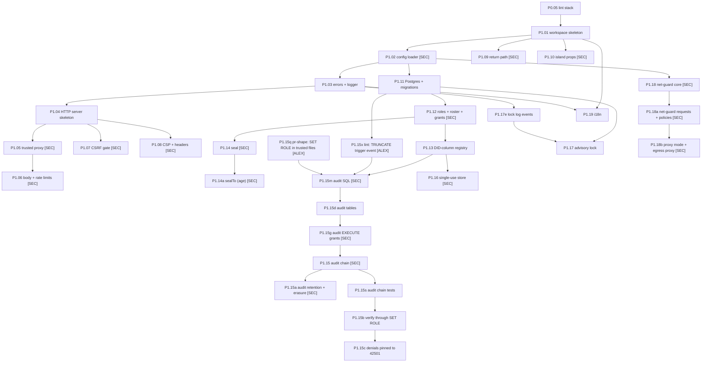
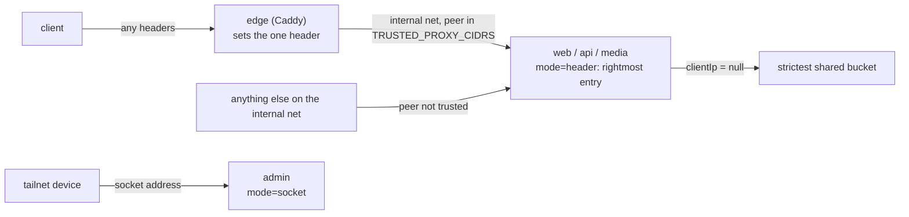
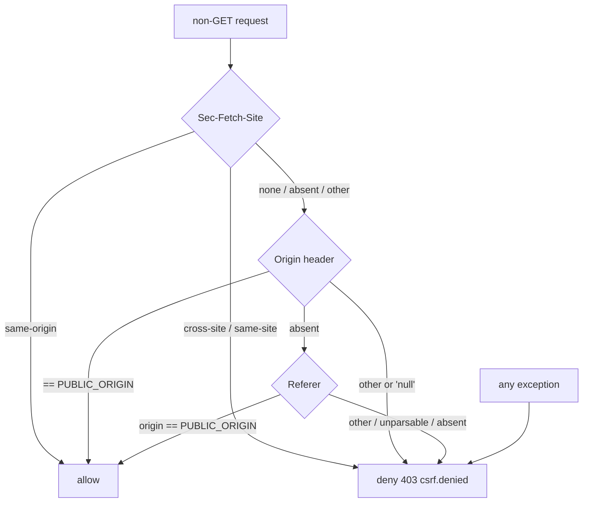
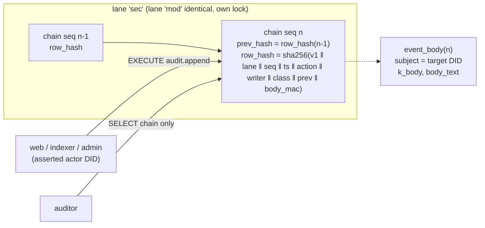
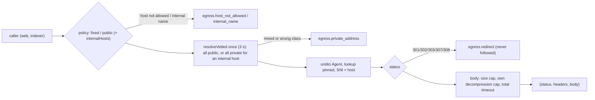
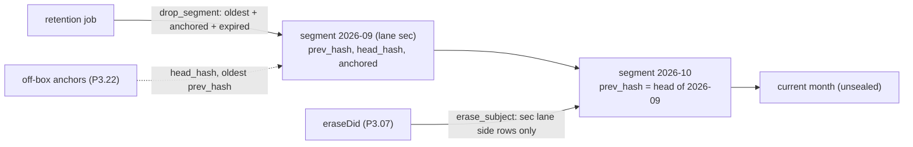
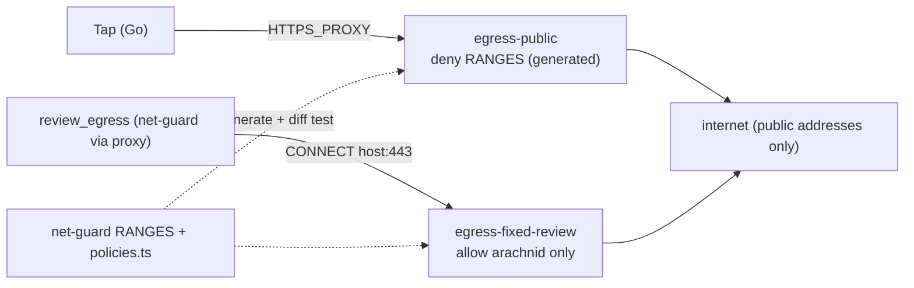
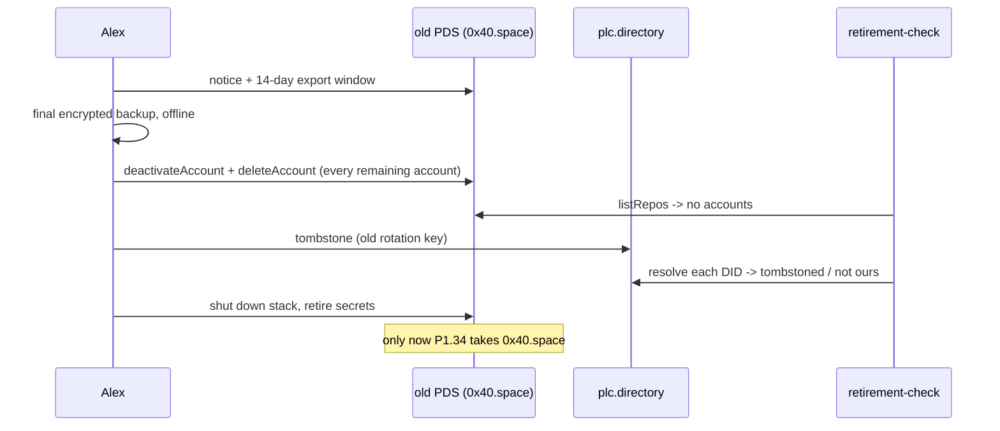

# Phase 1 — Platform, UI, edge, dev stack, lexicon authority (P1.01–P1.38)

Status: **editor pass (2026-10-03)**, build-ready under "detail by risk" (Phases 0–2 are full depth, `00-README.md`).
This file merges part 1 (P1.01–P1.19, round 2 answering [`reviews/r1-phase-1-part1.md`](reviews/r1-phase-1-part1.md))
and part 2 (P1.20–P1.38, round 2 answering [`reviews/r1-phase-1-part2.md`](reviews/r1-phase-1-part2.md)); each part's
round 2 table is kept under "Round 2 changes" at the end, and the editor pass is listed after it. Planning only; no
code. Template, tags, the salvage rule and the global invariants: [`00-README.md`](00-README.md). Step ids and
dependencies: [`01-outline.md`](01-outline.md). Source of truth: [`../unset-sh-rebuild-plan.md`](../unset-sh-rebuild-plan.md)
(03:02Z revision, decisions 1–23) §2, §3, §5.1–§5.4, §5.7, §5.8, §6, §6.1, §7, §8 Phase 1; where this file and the plan
disagree, the plan wins and the disagreement is listed under "Notes for the editor". Engineering rules: Alex's
architecture instructions and practices addendum (`docs/human/engineering/` in the repository): clarity before reuse, no
premature layers, established tools over invention; and, since decision 35 (2026-10-04), the *Engineering Rules*
(`docs/human/engineering/engineering-rules.md`; the plan wins over a rule).

**Goal of the phase.** Build the platform every later feature stands on: one config loader, one HTTP server with the
security middleware (trusted proxy, limits, CSRF, CSP), Postgres with migrations, roles, audit, sealed storage (to our
own key and to an offline key), the single-use store, the advisory lock, the single egress module (with its proxy mode)
and i18n; then (part 2) the UI shell, the local stack, images, the edge, the development PDS and the lexicon authority.
Nothing user-facing beyond the shell ships.

**Phase exit (plan §8 Phase 1):** Playwright smoke passes on the shell in both themes and both languages with zero axe
violations, and the permission set resolves from outside (P1.38, part 2). The framework glue is at or under ~600 lines
with CSS Modules identical on both sides, or the stack switches before Phase 2 (P1.20, part 2).

**What P1.01–P1.19 deliver:** steps P1.01–P1.19 plus P1.14a, P1.15a, P1.18a and P1.18b (letter-suffixed steps added in
round 2, each explained in its own text). All are library or database work testable with Vitest and a Postgres
container; only P1.18b's integration test runs a container image; nothing is deployed. Code layout (decision 34,
settled in P1.01; every old path is in `layout-map.md`): product rules in `domains/<x>/`, external systems and SQL in
`infrastructure/<x>/` (`postgres/`, `seal/`, `audit/`, `net-guard/`), web routes in `interfaces/http/`, the server kit in `shared/http/`,
config, errors, logging and i18n in `shared/<x>/`.

**Added in the editor pass:** `P1.33a` (retire the 0x40 prototype before P1.34; formerly L.01 part A, plan issue
19, global resolution 8) and `P1.37a` (file the Arachnid Shield application; decision 23).

Inputs read for P1.20–P1.38 (UI platform, images and edge, dev stack, lexicon authority): plan §2, §3, §5.1–5.4, §5.7, §6, §6.1, §7, §8 (Phases 1 and 5), §11 Q1, Q3,
Q11; reviews fable 01, 02, 06, 08 and 04, 08; the admin panel design (§4, §5, §8.1, §10, §11); the unset.sh
design sheet (artifact `78Sh5q9HGz74d5AQyMbQVt`, version `1790642962-06cb`: `project/README.md`,
`project/tokens.json`, every `components/*/README.md`, `assets/Logos/README.md`); the 0x40 prototype at
`054ab0f`.

**One added step:** `P1.24a` (UI kit: blocks, chrome and interactive components). The sheet registers 23
components; building all of them plus the "is it on the sheet?" gate is far more than one PR (README: 50–400
lines), and the interactive ones need the island runtime (P1.23), which P1.24 does not depend on. P1.24 keeps
the gate and the static and form components; P1.24a takes the rest.

**Decision 20 (Alex, 22:31Z):** there is no production PDS in Phase 1. P1.34 registers `unset.ac` and makes the
**development PDS on `0x40.space`** fit to host the lexicon authority; P1.35 creates the authority on it. This
puts the homelab dev PDS **on the login path** until P5.02a migrates the authority to production. Round 1
verified that authorization servers keep the last good copy of a resolved permission set, so what must hold is
**durability and integrity** of the authority (backups, Alex's offline keys, CID/PLC/TXT monitoring); availability
is a measured, best-effort figure (provisional, Alex question P1b-A2). P1.33, P1.34 and P1.35 carry this.
The development PDS is the 0x40.space stack: public for the lexicon authority (P1.33p gates its exposure), and it
never runs seeds or probes. Test identities live on the local stack's own PLC (P1.34t; book edit
2026-10-13-local-plc-a4-steps).

## Slices (decision 34, editor pass 2026-10-04)

Plan §8 Phase 1 now opens with a first slice: **sign in with an atproto account and see your own profile**
(`apps/web → interfaces/http → domains/identity → infrastructure/pds → the development PDS`), then the rest follows as
later slices (guideline §12). This file is in build order; step ids did not change, so every cross-reference holds.

- **Slice 1** (this file, in order): P1.01–P1.14, P1.15x, P1.15q, P1.15m, P1.15d, P1.15g, P1.15, P1.15s (book edit
  2026-10-07-p115s-chain-tests, slice line 12:05Z), P1.15b, P1.15c, P1.16, P1.17e, P1.17, P1.17r, P1.23h, P1.18, P1.18a,
  P1.20–P1.25, P1.25c, P1.25z, P1.25a, P1.37i, P1.25f, P1.25g, P1.25y, P1.25m, P1.25n, P1.25t, P1.37h, P1.37f, P1.37j,
  P1.26, P1.27, P1.27d, P1.28q, P1.28d, P1.28v, P1.28w, P1.28u, P1.28c, P1.28t, P1.28x, P1.28, P1.28a, P1.28b, P1.28h,
  P1.28i, P1.28s, P1.28j, P1.28r, P1.28n,
  P1.30q, P1.30p, P1.30, P1.30s, P1.30t, P1.28e, P1.28f, P1.28l, P1.28g, P1.28k, P1.28m, P1.28p, P1.28z, P1.30c, P1.23g,
  P1.30r, P1.30e, P1.30f, P1.30u, P1.30n, P1.29k, P1.29x, P1.29r, P1.29e, P1.28o, P1.28y, P1.29n, P1.29m, P1.29f,
  P1.29g, P1.29p, P1.29j, P1.29w, P1.29v, P1.29b, P1.29c, P1.29z, P1.29o, P1.27e, P1.29l, P1.29u, P1.30h, P1.30g,
  P1.30w, P1.30k, P1.30m, P1.30v, P1.30j, P1.30z, P1.30d, P1.30a, P1.27k, P1.27t, P1.27h, P1.27g, P1.27i, P1.27x,
  P1.27z, P1.01g, P1.30x, P1.30y, P1.27y, P1.30o, P1.27f, P1.27a, P1.27u, P1.27w, P1.27n, P1.27j, P1.11c, P1.11f,
  P1.11i, P1.11r, P1.11s, P1.11n, P1.11k, P1.33s, P1.33u, P1.33v, P1.33c, P1.35b, P1.35c, P1.35e, P1.33e, P1.34f,
  P1.34p, P1.34w, P1.34s, P1.34e, P1.34x, P1.34r, P1.34l, P1.27p, P1.30l, P1.29y, P1.29d, P1.29, P1.27o, P1.27m, P1.34c,
  P1.34a, P1.34b, P1.27l, P1.29a, P1.34m, P1.34n, P1.34k, P1.34o, P1.34q, P1.33t, P1.29h, P1.29i, P1.33i, P1.33h,
  P1.33f, P1.33o, P1.33j, P1.33k, P1.33l, P1.33r, P1.32b, P1.32c, P1.35h, P1.35i, P1.35j, P1.35k, P1.33w, P1.33x,
  P1.33y, P1.35a, P1.35f, P1.35g, P1.33g, P1.35m, P1.35n, P1.35o, P1.34d, P1.35p, P1.35r, P1.35l, P1.36h, P1.35t,
  P1.33z, P1.35w, P1.36f, P1.35y, P1.35z, P1.35x, P1.36m, P1.36n, P1.36d, P1.36e, P1.36o, P1.36b, P1.36c, P1.36g,
  P1.36i, P1.36j, P1.36k, P1.36l, P1.36p, P1.37g, P1.36q, P1.36r, P1.35u, P1.35v, P1.36t, P1.36u, P1.36v,
  P1.37n, P1.33n, P1.34t, P1.33m, P1.34u, P1.34y, P1.33b, P1.29s, P1.29t, P1.34g, P1.34i, P1.34j, P1.32,
  P1.32a, P1.31d, P1.31, P1.31c, P1.31e, P1.31f, P1.31g, P1.35s, P1.37, P1.37b, P1.36 (pulled forward from slice 2, Alex
  23:08Z). P1.34v and P1.34z are dropped (ADR 0022; retired ids, never built). Then phase-2's P2.01–P2.08 (P2.01 and
  P2.02 merged), P2.08b–P2.08h, P2.11, P2.11a, P2.11c–P2.11e, P2.15, P2.12, P2.12a–P2.12c, P2.13, P2.13c, P2.13d and the
  slice exit P2.13a. Order from 2026-10-12T22:22:27Z (Alex, 'Unblock and refocus'): the sign-in path goes first (refocus
  order, book edit 2026-10-12-batch-44-refocus). P1.27, P1.30 and P1.34 hardening steps not on that path, and the paused
  guard and test-helper follow-ups, start only after P2.13a's scenario passes locally. Fixes for holes already on main
  are exempt. Built PRs still get verified and may merge, and a lane may finish a fix it already started on an open PR.
  **English only** (Alex, 2026-10-04 12:58Z, "English first", against the recommendation): each feature keeps its
  user-facing English text in one `messages.ts` beside its screens (plain exported constants, or a small function of its
  parameters returning a string; no catalog, no `t()`); error codes' English text sits in `shared/errors/messages.ts`.
  Where a slice-1 step below says "catalog text", "catalog key" or "EN/FR", read "the feature's messages module" and
  "English"; its tests that name both languages run in English until the i18n slice adds French.
  The development PDS for slice 1 is P1.29a's **`local`** stack (`pds.unset.localhost`, never reachable from outside),
  so slice 1 needs none of the homelab, Tailscale or lexicon-authority steps.
- **i18n slice** (after P2.13a is merged, before P1.38): **P1.19** (its first task converts every slice-1 messages
  module into the EN/FR catalogs) and **P1.22b** (the locale half of P1.22, and French in P1.26's matrix). P1.19's text
  stays where it is below so ids and links hold; P1.22b sits after P1.37. No French page ships before this slice lands.
  It may run before, beside or after slice 2's steps; P1.38 waits for it, because the Phase 1 exit needs both languages.
- **Slice 2** (after P2.13a is merged): P1.14a (`sealTo`), P1.15a (audit retention), P1.18b (egress proxy mode),
  P1.33q, P1.33 (server baseline, Tailscale), P1.33a, P1.27s, P2.26e, P2.26b, P2.26c, P2.26d (pulled forward, Q3 B),
  P1.33d, P1.34, P1.33p, P1.35q, P1.35 (lexicon authority), P1.27v (Renovate managers for the image locks), P1.37a,
  then the Phase 1 exit P1.38 (book edit 2026-10-14-verify-834-fixes, S4).
- Then the rest of Phase 2 (`phase-2.md`, "Slices").

Why some pieces the plan lists for later stay in slice 1 (each is a security or dependency reason; none adds scope):
- **Seal (P1.14):** the OAuth state and token sets are stored sealed (plan §5.3, P2.04); without seal slice 1 would
  store tokens in clear. Only `seal`/`unseal` are needed; `sealTo` (P1.14a) moves to slice 2.
- **Audit (P1.15):** the sign-in writes no audit row (plan §6), but P2.12's age gate records an under-age block with
  `appendAudit`. P1.15 stays as the minimum; its retention and lane erasure (P1.15a) move to slice 2. Nothing in slice 1
  writes a security event anywhere else.
- **Limits and trusted proxy (P1.05, P1.06):** P2.05 limits login attempts with `RateLimiter.consume('login')`.
- **i18n (P1.19):** moved out of slice 1 by Alex's answer (2026-10-04 12:58Z, English first). The editor's concern (English
  literals scattered like the prototype's `choose()` calls) is met by the messages-module rule above: strings stay in one
  module per feature, never inline in screens, so P1.19's conversion is mechanical.
- **UI kit and shell (P1.20–P1.26):** `/me` (P2.13) renders inside `AppShell` with kit components; every design-sheet piece is
  approved (sheet v45, 2026-10-04), so P1.24 no longer waits on design.
- **Images, edge, dev stack, preflight (P1.27–P1.30):** the local PDS runs from our mirrored, signed image behind the
  edge, which does the per-client rate limiting while the PDS's own limits are off (global resolution 1).
- **Lexicons and permanent choices (P1.32, P1.31):** P2.04's scope strings come from the permission set's JSON. The set
  is **published** only in slice 2 (P1.35); until then logins use the tested fallback scope (P2.04 note).
- **Onboarding and email gates (P2.11, P2.12, P2.15, with P1.37):** `/me` requires a verified, onboarded account; slice 1
  keeps those gates rather than show `/me` without them.

## Dependency diagrams

### P1.01–P1.19



### P1.20–P1.38

Solid arrows are the outline's dependencies. Dashed arrows are dependencies accepted by review round 1 and
waiting for the outline edit (see "Notes for the editor"). Dashed-border nodes are steps written in other files.

```mermaid
flowchart LR
  classDef ext stroke-dasharray: 4 3
  P0_07["P0.07 CI"]:::ext
  P0_11["P0.11 domains"]:::ext
  P0_12["P0.12 key ceremony"]:::ext
  P1_01["P1.01 workspace"]:::ext
  P1_04["P1.04 HTTP server"]:::ext
  P1_07["P1.07 CSRF gate"]:::ext
  P1_08["P1.08 CSP builder"]:::ext
  P1_09["P1.09 return path"]:::ext
  P1_10["P1.10 props serialiser"]:::ext
  P1_11["P1.11 Postgres + migrator"]:::ext
  P1_18["P1.18 net-guard"]:::ext
  P1_19["P1.19 i18n"]:::ext
  P1_15s["P1.15s audit chain tests"]:::ext

  P1_20["P1.20 glue spike SPIKE"]
  P1_21["P1.21 token pipeline"]
  P1_22["P1.22 base styles, theme, locale"]
  P1_23["P1.23 island runtime"]
  P1_23d["P1.23d props fuzz test bounded"]
  P1_23g["P1.23g guard fixtures isolated from global git"]
  P1_23h["P1.23h fixture git sealed from the caller's home"]
  P1_24["P1.24 UI kit: gate + primitives"]
  P1_24a["P1.24a UI kit: zero-JS blocks"]
  P1_24k["P1.24k UI kit: chrome, no-JS"]
  P1_24f["P1.24f UI kit: feed and feedback, no-JS"]
  P1_24j["P1.24j islands, budget-measured"]
  P1_24b["P1.24b toast and select islands"]
  P1_24c["P1.24c toast focus, required select, labels"]
  P1_25k["P1.25k error-page hook in the kit"]
  P1_25b["P1.25b error-page hook leftovers"]
  P1_25h["P1.25h UI build runners to shared/ui-build"]
  P1_25q["P1.25q ui-build notes area"]
  P1_25w["P1.25w ui-build budget and lint row"]
  P1_25x["P1.25x ui-build plan default test"]
  P1_25d["P1.25d jsx-free detector"]
  P1_25r["P1.25r jsx-free test parses with oxc"]
  P1_25s["P1.25s jsx-free second regression"]
  P1_25l["P1.25l islands keep lazy chunks"]
  P1_25o["P1.25o own shared/islands ALEX"]
  P1_25i["P1.25i island runtime copied to shared/islands"]
  P1_25p["P1.25p importers point at shared/islands"]
  P1_25e["P1.25e old trusted runtime deleted"]
  P1_25u["P1.25u drop old island owner paths"]
  P1_25["P1.25 app shell, error pages"]
  P1_26["P1.26 test harness"]
  P1_27["P1.27 container images"]
  P1_27d["P1.27d web image on Debian slim"]
  P1_28q["P1.28q images.yml: edge image"]
  P1_28d["P1.28d base entries labelled by stage"]
  P1_28v["P1.28v mirror scan per stage [ALEX]"]
  P1_28w["P1.28w mirror scan pipefail shell"]
  P1_28u["P1.28u image refs outside FROM"]
  P1_28c["P1.28c edge syntax line dropped"]
  P1_28t["P1.28t Dockerfile reader gaps"]
  P1_28x["P1.28x edge pins"]
  P1_28["P1.28 edge (Caddy)"]
  P1_28b["P1.28b edge leftovers"]
  P1_28h["P1.28h Caddyfile reader"]
  P1_28e["P1.28e one edge config reader"]
  P1_28f["P1.28f edge reader containment"]
  P1_28l["P1.28l edge reader echo and aliases"]
  P1_28g["P1.28g edge never imports preflight"]
  P1_28k["P1.28k no root-absolute or unresolved imports"]
  P1_28m["P1.28m root-only dependencies in tests only"]
  P1_28p["P1.28p product never imports tooling"]
  P1_28z["P1.28z tooling image-test anchor pinned"]
  P1_30c["P1.30c specifier cruise test checkout-independent"]
  P1_28s["P1.28s quoted top-level tokens refused"]
  P1_28i["P1.28i edge image builds in image tests"]
  P1_28j["P1.28j edge image tests drop runIf"]
  P1_28r["P1.28r images project after unit tests"]
  P1_28n["P1.28n image test gate gaps closed"]
  P1_29k["P1.29k migrate image, syncRolePasswords"]
  P1_29x["P1.29x stripped paths declared"]
  P1_29r["P1.29r final-stage rule regression closed"]
  P1_29e["P1.29e final-stage recipe holes closed"]
  P1_28o["P1.28o edge drops apk-tools"]
  P1_28y["P1.28y edge kind forbids apk"]
  P1_29n["P1.29n node runtime without package manager"]
  P1_29p["P1.29p capabilities and setuid pinned"]
  P1_29j["P1.29j image test mutant fixtures"]
  P1_29m["P1.29m kind-wide package manager test"]
  P1_29f["P1.29f final-stage allowlists"]
  P1_29g["P1.29g image reader hardening"]
  P1_29w["P1.29w discover and scan every image ALEX"]
  P1_29v["P1.29v mirror scan skips stripped ALEX"]
  P1_29y["P1.29y old image jobs folded into the matrix ALEX"]
  P1_29b["P1.29b mirror build stage scanned in full"]
  P1_29u["P1.29u stripped paths and RUN separators fail closed"]
  P1_29c["P1.29c lock records build-stage bases"]
  P1_29z["P1.29z docker out of kind reader test"]
  P1_29o["P1.29o docker-run test budgets"]
  P1_27e["P1.27e edge image hook budgets"]
  P1_27k["P1.27k kill hung docker calls"]
  P1_27t["P1.27t kill hung edge docker calls"]
  P1_27g["P1.27g docker kill timeout follow-ups"]
  P1_27h["P1.27h edge image test kill follow-ups"]
  P1_27i["P1.27i docker test cleanup follow-ups"]
  P1_27x["P1.27x unique test image tags"]
  P1_27z["P1.27z unique edge test image tags"]
  P1_27m["P1.27m local edge TLS snippet ALEX"]
  P1_27l["P1.27l local stacks pass C2-C5 unsigned ALEX"]
  P1_27y["P1.27y build contexts match scan"]
  P1_27w["P1.27w compose only through the wrapper"]
  P1_27o["P1.27o edge data and config owned by caddy"]
  P1_27a["P1.27a C9 refuses sticky ancestors"]
  P1_27f["P1.27f C26 test gets a C9-valid fixture"]
  P1_27n["P1.27n P1.27y verifier test gaps"]
  P1_27u["P1.27u C9 bind reach gaps"]
  P1_27p["P1.27p withhold only non-public values ALEX"]
  P1_34l["P1.34l secrets folder listing"]
  P1_34b["P1.34b edge local-files check"]
  P1_34g["P1.34g edge integration test nits"]
  P1_34i["P1.34i dev compose test gaps"]
  P1_34j["P1.34j lowercase USER and bind mounts"]
  P1_34m["P1.34m scan new runtime pins in PR CI"]
  P1_34n["P1.34n P1.29a rulings after #774"]
  P1_34k["P1.34k deny PDS safety-off flags"]
  P1_34o["P1.34o app.caddy as one local file mount"]
  P1_34q["P1.34q local edge sites as per-file mounts"]
  P1_33t["P1.33t tls import in every edge site"]
  P1_34t["P1.34t pin the PLC URL per environment"]
  P1_33m["P1.33m local Postgres init owned"]
  P1_34u["P1.34u local PLC role and database"]
  P1_34v["P1.34v local PLC DROPPED ADR 0022"]
  P1_34y["P1.34y inert local PLC policy in net-guard"]
  P1_34z["P1.34z local PLC identity DROPPED ADR 0022"]
  P1_33i["P1.33i preflight may import shared/host-pin ALEX"]
  P1_33f["P1.33f depcruise exclude anchored"]
  P1_33o["P1.33o host-pin kept a leaf"]
  P1_33h["P1.33h host pin moved to shared/host-pin"]
  P1_33j["P1.33j token reader uses the shared pin"]
  P1_33k["P1.33k node base for the token reader"]
  P1_33l["P1.33l token reader pinned to the local stack"]
  P1_29i["P1.29i token reader judges every outbound key"]
  P1_34c["P1.34c local app site with a dev leaf"]
  P1_33r["P1.33r in-flight DID lookups shared"]
  P1_32b["P1.32b in-flight handle checks shared"]
  P1_33r --> P1_32b
  P1_32c["P1.32c fixture DIDs replaced"]
  P1_35h["P1.35h in-flight rejection path tested"]
  P1_35i["P1.35i test handles on reserved domains"]
  P1_35j["P1.35j trusted test handles on reserved domains"]
  P1_35k["P1.35k net-guard test hosts on reserved names"]
  P1_35s["P1.35s net-guard carried IPv4 and range notes"]
  P1_33w["P1.33w binds to the dev CA folder refused"]
  P1_33x["P1.33x local leaf names and expiry"]
  P1_33y["P1.33y per-file site mounts on local"]
  P1_34d["P1.34d PDS trusts one dev root"]
  P1_33z["P1.33z local stack in CI"]
  P1_33n["P1.33n site reader per-file only"]
  P1_27j["P1.27j preflight comment and tilde tidy"]
  P1_11c["P1.11c keep the setup error on cleanup"]
  P1_11i["P1.11i edge tag removal and test labels"]
  P1_11f["P1.11f cleanup errors in Postgres setup"]
  P1_34f["P1.34f require the interpolation env flag"]
  P1_34p["P1.34p secret inputs outside the project"]
  P1_34w["P1.34w wrapper argument handling"]
  P1_34s["P1.34s walk the Docker socket path"]
  P1_11r["P1.11r try every edge test tag"]
  P1_34e["P1.34e final-stage RUN lines per kind"]
  P1_29l["P1.29l mirror scans build-stage bases whole"]
  P1_29d["P1.29d gosu-free Postgres image"]
  P1_29["P1.29 compose.dev.yaml, no PDS"]
  P1_29a["P1.29a PDS and edge in the dev stack ALEX"]
  P1_29h["P1.29h local email-token reader"]
  P1_29s["P1.29s local precheck, no per-run accounts"]
  P1_29t["P1.29t running-stack tests"]
  P1_30q["P1.30q preflight boundary row"]
  P1_30p["P1.30p compose parser and SecretMap"]
  P1_30["P1.30 deploy preflight core"]
  P1_30s["P1.30s preflight C13–C24 but C17, C18"]
  P1_30t["P1.30t preflight C17 networks"]
  P1_30r["P1.30r preflight-to-edge row"]
  P1_30e["P1.30e row edges in one cruise"]
  P1_30f["P1.30f row coverage by resolved path and kind"]
  P1_30h["P1.30h edge reader scrubs env values"]
  P1_30g["P1.30g edge scrub mutant fixtures"]
  P1_30w["P1.30w preflight key allowlist and value scrub"]
  P1_30k["P1.30k compose top-level key allowlist"]
  P1_30m["P1.30m preflight withholds value reasons"]
  P1_30v["P1.30v withheld marker carries no value"]
  P1_30j["P1.30j keys not values in reasons"]
  P1_30z["P1.30z compose paths from project dir"]
  P1_30d["P1.30d project-directory notes and flag test"]
  P1_30a["P1.30a compose interpolation inputs"]
  P1_30l["P1.30l pin Compose in CI ALEX"]
  P1_30o["P1.30o C9 mounted secrets by uid ALEX"]
  P1_30x["P1.30x compose hardening and limit keys"]
  P1_30y["P1.30y compose build, tmpfs, depends_on, secrets"]
  P1_30u["P1.30u preflight C18 edge zones"]
  P1_30n["P1.30n preflight refuses network names"]
  P1_31d["P1.31d exports and lexicon scripts rules"]
  P1_31["P1.31 lexicons package"]
  P1_31c["P1.31c NSID cross-pin"]
  P1_31g["P1.31g lexicons breaking-change check"]
  P1_31e["P1.31e unset-source condition"]
  P1_31f["P1.31f web server via unset-source"]
  P1_32["P1.32 permanent choices STOP"]
  P1_32a["P1.32a ADR 0020 answered only"]
  P1_33["P1.33 server baseline ALEX"]
  P1_33a["P1.33a retire 0x40 prototype before going public (L.01 A) ALEX STOP"]
  P1_33p["P1.33p open the home server to the public ALEX"]
  P1_34["P1.34 unset.ac + dev PDS fit for authority ALEX"]
  P1_35["P1.35 lexicon authority on dev PDS ALEX"]
  P1_36["P1.36 compliance skeletons"]
  P1_37["P1.37 legal paperwork 1 ALEX"]
  P1_37b["P1.37b legal marker check hardening"]
  P1_37a["P1.37a Arachnid application ALEX"]
  P1_38["P1.38 Phase 1 exit"]

  P1_04 --> P1_20
  P1_10 --> P1_20
  P1_20 --> P1_21
  P1_21 --> P1_22
  P1_07 --> P1_22
  P1_09 -.-> P1_22
  P1_20 --> P1_23
  P1_08 --> P1_23
  P1_22 --> P1_24
  P1_24 --> P1_24a
  P1_23 -.-> P1_24a
  P1_24 --> P1_25
  P1_24a --> P1_24k
  P1_24k --> P1_24f
  P1_24f --> P1_24j
  P1_24j --> P1_24b
  P1_24b --> P1_24c
  P1_24k -.-> P1_25
  P1_24c -.-> P1_26
  P1_08 --> P1_25
  P1_04 --> P1_25k
  P1_08 --> P1_25k
  P1_25k --> P1_25
  P1_25k --> P1_25b
  P1_24c --> P1_25h
  P1_25h --> P1_25
  P1_25h --> P1_25q
  P1_25h --> P1_25w
  P1_25w --> P1_25x
  P1_25h --> P1_25d
  P1_25d --> P1_25r
  P1_25r --> P1_25s
  P1_25h --> P1_25l
  P1_25h --> P1_25o
  P1_25o --> P1_25i
  P1_25i --> P1_25p
  P1_25p --> P1_25e
  P1_25e --> P1_25u
  P1_25p --> P1_25
  P1_25 --> P1_26
  P1_25c["P1.25c test routes, prod refusal, 503"]
  P1_25 --> P1_25c
  P1_25z["P1.25z test-routes gate pinned, key off"]
  P1_25c --> P1_25z
  P1_25a["P1.25a PNG favicons ALEX"]
  P1_25 --> P1_25a
  P1_37i["P1.37i assets images on app and admin ALEX"]
  P1_25a --> P1_37i
  P1_25f["P1.25f feed mode, footer prefs"]
  P1_25 --> P1_25f
  P1_25g["P1.25g disabled select focus, kit tests"]
  P1_25 --> P1_25g
  P1_25m["P1.25m DID account route privacy"]
  P1_25 --> P1_25m
  P1_25n["P1.25n DID route privacy tests hardened"]
  P1_25m --> P1_25n
  P1_25y["P1.25y disabled Select styled, tests tightened"]
  P1_25g --> P1_25y
  P1_25t["P1.25t encoded DIDs redacted in log scrub"]
  P1_37f["P1.37f DID route privacy, real accounts"]
  P1_25n --> P1_37f
  P1_37h["P1.37h DID scrub widened"]
  P1_25t --> P1_37h
  P1_37j["P1.37j Lighthouse NO_NAVSTART cause"]
  P1_04 --> P1_27
  P0_07 --> P1_27
  P1_27 --> P1_27d
  P1_27 --> P1_28q
  P1_28q --> P1_28
  P1_27 --> P1_28d
  P1_28d --> P1_28v
  P1_28v --> P1_28w
  P1_28v --> P1_28u
  P1_28u --> P1_28c
  P1_28c --> P1_28t
  P1_27 --> P1_28x
  P1_28x --> P1_28
  P1_27 --> P1_28
  P1_11 --> P1_29
  P1_27 --> P1_29k
  P1_29k --> P1_29
  P1_29k --> P1_29x
  P1_29w --> P1_29v
  P1_29w --> P1_29
  P1_29x --> P1_29v
  P1_29x --> P1_29r
  P1_29r --> P1_29d
  P1_29r --> P1_29e
  P1_29e -.-> P1_28y
  P1_29e --> P1_29n
  P1_29e --> P1_29p
  P1_29e --> P1_29d
  P1_29n --> P1_29d
  P1_29p --> P1_29d
  P1_29n --> P1_29
  P1_29p --> P1_29
  P1_29e --> P1_29f
  P1_29n --> P1_29f
  P1_29f --> P1_29d
  P1_29f --> P1_29
  P1_29n --> P1_29m
  P1_29m --> P1_29f
  P1_29m --> P1_29d
  P1_29m --> P1_29
  P1_29m --> P1_29g
  P1_29f --> P1_29g
  P1_29g --> P1_29p
  P1_29p --> P1_29j
  P1_29x --> P1_28o
  P1_28o --> P1_28y
  P1_29x --> P1_28y
  P1_28w --> P1_29v
  P1_29v --> P1_29d
  P1_29w --> P1_29y
  P1_29v --> P1_29y
  P1_29v --> P1_29b
  P1_29v --> P1_29u
  P1_29b --> P1_29c
  P1_29c --> P1_29l
  P1_29c --> P1_29z
  P1_29z --> P1_29o
  P1_29z --> P1_27e
  P1_29o --> P1_27k
  P1_27k --> P1_27t
  P1_27k --> P1_27g
  P1_27e --> P1_27t
  P1_29d --> P1_29
  P1_28 -.-> P1_29
  P1_30t --> P1_29
  P1_30t --> P1_30n
  P1_30n --> P1_29
  P1_29 --> P1_29a
  P1_29a --> P1_29h
  P1_29a --> P1_29s
  P1_29a --> P1_29t
  P1_29s --> P1_29t
  P1_28 --> P1_28b
  P1_28b --> P1_28h
  P1_28h --> P1_28s
  P1_28h --> P1_28i
  P1_28i --> P1_28j
  P1_28i --> P1_28r
  P1_28j --> P1_28r
  P1_28r --> P1_29k
  P1_28r --> P1_29d
  P1_28r --> P1_28n
  P1_28n --> P1_29d
  P1_27 --> P1_30
  P1_30q --> P1_30
  P1_30q --> P1_30p
  P1_30p --> P1_30
  P1_30 -.-> P1_29
  P1_01 --> P1_31
  P1_31d --> P1_31
  P1_31 --> P1_31c
  P1_31 --> P1_31g
  P1_31d --> P1_31g
  P1_31c --> P1_31e
  P1_31e --> P1_31f
  P1_32 -.-> P1_31
  P1_28 --> P1_33
  P1_32 --> P1_33
  P1_32 --> P1_32a
  P1_30 --> P1_34
  P1_30 --> P1_30s
  P1_30s --> P1_34
  P1_30 --> P1_30t
  P1_30t --> P1_34
  P1_30 --> P1_30u
  P1_28h --> P1_30u
  P1_28h --> P1_28e
  P1_28e --> P1_30u
  P1_28e --> P1_28f
  P1_28e --> P1_28g
  P1_28f --> P1_30u
  P1_28f --> P1_28l
  P1_28l --> P1_30u
  P1_28g --> P1_30u
  P1_30r --> P1_30u
  P1_30r --> P1_30e
  P1_30e --> P1_30f
  P1_30u --> P1_30h
  P1_30u --> P1_30w
  P1_30h --> P1_30g
  P1_30w --> P1_30k
  P1_30w --> P1_30m
  P1_30m --> P1_30v
  P1_30v --> P1_30j
  P1_30k --> P1_30j
  P1_30k --> P1_30z
  P1_30z --> P1_30y
  P1_30z --> P1_30d
  P1_30j --> P1_30d
  P1_30d --> P1_30a
  P1_30a --> P1_30l
  P1_30x --> P1_30o
  P1_30o --> P1_29
  P1_30y --> P1_27y
  P1_27y --> P1_29
  P1_29 --> P1_27l
  P1_27m --> P1_27l
  P1_30a --> P1_29
  P1_30a --> P1_27w
  P1_27w --> P1_29
  P1_34e --> P1_27o
  P1_27o --> P1_29a
  P1_29a --> P1_34g
  P1_29a --> P1_34i
  P1_34b --> P1_34j
  P1_29a --> P1_34n
  P1_34n --> P1_34k
  P1_34k --> P1_29t
  P1_34a --> P1_34o
  P1_34o --> P1_34q
  P1_27l --> P1_33t
  P1_34t --> P1_34u
  P1_33m --> P1_34u
  P1_34u --> P1_34v
  P1_34d --> P1_34v
  P1_34d --> P1_34u
  P1_34d --> P1_29s
  P1_34t --> P1_29s
  P1_34t --> P1_29t
  P1_33b --> P1_29s
  P1_34t --> P1_34y
  P1_34v --> P1_34z
  P1_34y --> P1_34z
  P1_33j --> P1_33l
  P1_33i --> P1_33h
  P1_33h --> P1_33o
  P1_33h --> P1_33j
  P1_33j --> P1_33k
  P1_34c --> P1_34d
  P1_29a --> P1_34d
  P1_27l --> P1_34d
  P1_34q --> P1_34d
  P1_33y --> P1_33n
  P1_34q --> P1_33n
  P1_33t --> P1_34d
  P1_33k --> P1_34d
  P1_34d --> P1_29t
  P1_33k --> P1_33w
  P1_33w --> P1_33x
  P1_33x --> P1_33y
  P1_33y --> P1_34d
  P1_35a["P1.35a dev CA folder rule gaps closed"]
  P1_33y --> P1_35a
  P1_35a --> P1_34d
  P1_33g["P1.33g local dev root documented and tested"]
  P1_35a --> P1_33g
  P1_33g --> P1_34d
  P1_35m["P1.35m dev CA folder walk edges pinned"]
  P1_35a --> P1_35m
  P1_35p["P1.35p dev CA preflight and runbook gaps closed"]
  P1_33g --> P1_35p
  P1_35m --> P1_35p
  P1_34d --> P1_35p
  P1_35r["P1.35r compose limits and local-only env pinned"]
  P1_34d --> P1_35r
  P1_35n["P1.35n web on its own network to the edge"]
  P1_35n --> P1_34d
  P1_35o["P1.35o app network pinned in the dev compose tests"]
  P1_35n --> P1_35o
  P1_35o --> P1_34v
  P1_35r --> P1_34v
  P1_35f["P1.35f compose probe stall root-caused"]
  P1_35g["P1.35g IP refused as local PDS host"]
  P1_35l["P1.35l PDS host checked in every env"]
  P1_35g --> P1_35l
  P1_35t["P1.35t local stack CI job"]
  P1_34d --> P1_35t
  P1_36h["P1.36h migrate lint mode and PDS data dir"]
  P1_36h --> P1_35t
  P1_35t --> P1_33z
  P1_35w["P1.35w plc_pds exemption retired"]
  P1_36f["P1.36f ADR 0025 staging TLS and DNS"]
  P1_35y["P1.35y ADR 0025 accepted"]
  P1_36f --> P1_35y
  P1_35z["P1.35z ADR 0026 accepted"]
  P1_35x["P1.35x dev hosts pinned to staging names"]
  P1_35y --> P1_35x
  P1_36m["P1.36m ADR 0028 edge DNS module drafted"]
  P1_36n["P1.36n ADR 0028 accepted"]
  P1_36m --> P1_36n
  P1_36d["P1.36d edge image with one DNS module"]
  P1_36n --> P1_36d
  P1_36e["P1.36e edge dev mode with one DNS-01 issuer"]
  P1_36d --> P1_36e
  P1_36o["P1.36o edge dev snippet mounted, C18 mapped"]
  P1_36e --> P1_36o
  P1_36b["P1.36b app site on the dev edge"]
  P1_36e --> P1_36b
  P1_36o --> P1_36b
  P1_35x --> P1_36b
  P1_35y --> P1_36b
  P1_36c["P1.36c dev edge DNS token and app site wired"]
  P1_36b --> P1_36c
  P1_36g["P1.36g dev mail and first-invite runbook"]
  P1_36i["P1.36i dev edge aliases and public paths"]
  P1_36b --> P1_36i
  P1_36j["P1.36j dev edge trusts only Newt"]
  P1_36b --> P1_36j
  P1_36k["P1.36k dev-only runtime keys refused outside local"]
  P1_36l["P1.36l zero commit refused under dev"]
  P1_27s --> P1_36l
  P1_36p["P1.36p PDS /tmp capped, blob limits pinned"]
  P1_36h --> P1_36p
  P1_37g["P1.37g PDS temp blob sweep checked"]
  P1_36p --> P1_37g
  P1_36q["P1.36q exact secret set in pds.env"]
  P1_36g --> P1_36q
  P1_36r["P1.36r checkout-built migrate refused under dev"]
  P1_35u["P1.35u islands owner lines narrowed CHECK"]
  P1_35v["P1.35v secret key words split"]
  P1_36t["P1.36t secret key split widened to every env"]
  P1_35v --> P1_36t
  P1_36u["P1.36u private staging addresses refused"]
  P1_36v["P1.36v own-PDS accounts only"]
  P1_37n["P1.37n build keys refused under dev and prod"]
  P1_36r --> P1_37n
  P1_35b["P1.35b host-pin security review owner"]
  P1_35c["P1.35c depcruise rows and export checks pinned"]
  P1_35e["P1.35e built image scanned, not a rebuild"]
  P1_35c --> P1_35e
  P1_34d --> P1_33z
  P1_28 --> P1_29a
  P1_27y --> P1_27n
  P1_30o --> P1_27a
  P1_27a --> P1_29
  P1_27y --> P1_27f
  P1_30o --> P1_27f
  P1_27t --> P1_27h
  P1_27g --> P1_27i
  P1_27i --> P1_27x
  P1_27x --> P1_27z
  P1_27t --> P1_27z
  P1_27a --> P1_27u
  P1_27u --> P1_29
  P1_29 --> P1_27p
  P1_34a --> P1_34b
  P1_30a --> P1_27j
  P1_27i --> P1_11c
  P1_11c --> P1_11f
  P1_27x --> P1_11i
  P1_27z --> P1_11i
  P1_30a --> P1_34f
  P1_27u --> P1_34p
  P1_34f --> P1_34
  P1_34p --> P1_34
  P1_27u --> P1_34s
  P1_34w --> P1_34
  P1_34s --> P1_34
  P1_30k --> P1_30x
  P1_30x --> P1_29
  P1_30y --> P1_29
  P1_23g --> P1_23h
  P1_28g --> P1_28k
  P1_28k --> P1_28m
  P1_28m --> P1_28p
  P1_28p --> P1_28z
  P1_30u --> P1_34
  P1_33 --> P1_34
  P1_33a --> P1_34
  P1_36b --> P1_34
  P1_36c --> P1_34
  P1_36i --> P1_34
  P1_36j --> P1_34
  P1_33 -.-> P1_33a
  P1_33a -.-> P1_33p
  P1_34 --> P1_33p
  P1_36u --> P1_33p
  P1_36d --> P1_33p
  P1_36n --> P1_33p
  P1_33p --> P1_35
  P1_33a --> P1_35
  P1_33p --> P1_38
  P0_12 --> P1_34
  P0_11 -.-> P1_34
  P1_29t -.-> P1_34
  P1_31 --> P1_35
  P1_31g --> P1_35
  P1_34 --> P1_35
  P1_18 -.-> P1_35
  P0_12 -.-> P1_35
  P0_07 --> P1_36
  P1_26 --> P1_38
  P1_15s --> P1_38
  P1_19 --> P1_22b["P1.22b locale (i18n slice)"]
  P1_22 --> P1_22b
  P1_26 --> P1_22b
  P1_22b --> P1_38
  P1_35 --> P1_38
  P1_33 -.-> P1_38
  P1_36 -.-> P1_38
  P1_37 -.-> P1_38
  P1_37 --> P1_37b
  P1_37a -.-> P1_38
```

---

### P1.01 — Workspace skeleton
Paths (2026-10-06 sweep): built before the root tidy (P0.09g, #42); the root `.dependency-cruiser.cjs` named below is
now `scripts/lint/.dependency-cruiser.cjs`.
Tags: —            Depends on: P0.05            Plan: §7 (layout, tooling, boundary rules; decision 34), §5.5 (boundaries), §9
Where: root `package.json` (`workspaces`: `apps/*`, `interfaces/*`, `domains/*`, `infrastructure/*`, `shared/*`),
  `package-lock.json`, `tsconfig.json`, `tsconfig.base.json`, `vitest.config.ts`, `.dependency-cruiser.cjs`,
  `scripts/workspace/{references.test.ts, codeowners.test.ts, new-workspace.md}`. **No workspace folder is created
  here** (guideline §1: folders are created when their first code lands); slice 1's first steps create theirs
  (P1.02 `shared/config`, P1.03 `shared/errors` and `shared/log`, P1.04 `shared/http` and `interfaces/http`, P1.11 `infrastructure/postgres`, …).
  No `packages/`, `modules/` or `plugins/` folder (decision 34; decision 25).
Size: ~120 source lines (mostly config), ~120 test lines

Goal: the repository can hold the decision-34 layout, and the rule for adding a workspace and what it may reference is
written down and tested, so each later step adds its own workspace with its first code.

Inputs: P0.04 (TS 7, Vitest), P0.05 (dependency-cruiser boundary rules, budgets); `layout-map.md` (book).
Outputs:
  - Workspace convention (written in `scripts/workspace/new-workspace.md` and checked by `references.test.ts`): a
    workspace is `<top>/<name>/` with `package.json` (`name` `@unset/<top>-<name>`, for example
    `@unset/domains-identity`; `private: true`, `type: module`, `version: "0.0.0"`, `license` `MIT` under `shared/` and
    `AGPL-3.0-only` elsewhere (P0.13), dependencies added by the step that needs them), `tsconfig.json` (`extends
    ../../tsconfig.base.json`, `composite: true`, `rootDir: .`, `outDir: dist`, `references` to the workspaces it
    may use) and at least one `*.test.ts` next to its code. Integration tests go to `tests/integration/<area>/`,
    end-to-end tests to `tests/e2e/` (guideline §5); each is a Vitest project of its own.
  - Allowed references (mirrors the P0.05 dependency-cruiser rules; the test reads them from one table):
    - `apps/<x>` → `shared/*` only. Never another app, `domains/*`, `infrastructure/*` or `interfaces/*`; islands reach
      the server over HTTP only.
    - `interfaces/http` → `apps/web`'s render entry only (server-side rendering; data passed as props), `domains/*`,
      `infrastructure/*`, `shared/*`; `interfaces/admin` → `apps/admin`'s render entry only, `domains/*`,
      `infrastructure/*`, `shared/*`; every other interface (`api`, `indexer`, `media`, `review`, `jobs` (all scheduled
      work, retention included; R5-01), `audit-verify`, `chat-auth`) → `domains/*`, `infrastructure/*`, `shared/*`. **No interface references another**;
      the server kit is `shared/http`. Each interface is the composition root of its own process, and every running
      process has its own `interfaces/<name>/` (never shared).
    - `interfaces/pds-admin`, `interfaces/chat-admin` → only the zero-dependency allowlist (today `shared/admin-envelope`;
      Node built-ins otherwise; plan §5.2, guideline §1). "Zero dependencies" means no third-party package
      (architecture ruling, 2026-10-04; guideline §1's `pds-admin` bullet): these services list
      `@unset/shared-admin-envelope` in `package.json` `dependencies` as normal and keep the `tsconfig.json` reference.
      Their `dependencies`, and their `devDependencies` apart from test tooling, hold only `@unset/*` packages on
      `ZERO_DEP_ALLOWLIST`, and their installed closure holds no third-party package. An allowlisted workspace has no
      `@unset/*` reference and no `dependencies`.
    - `domains/<x>` → `shared/errors`, `shared/config` (types only), `shared/lexicons` (the one record validator) and,
      only where a feature needs it, another domain (through its `index.ts`). Never another `shared/*` workspace,
      `infrastructure/*`, `interfaces/*` or `apps/*`, and no npm `dependencies` (rule AB-1 as settled 2026-10-04;
      `@atproto/lex` is reached only through `shared/lexicons`).
    - `infrastructure/<x>` → `domains/*` (the contracts it implements), `shared/*`, `infrastructure/net-guard`
      (egress), `infrastructure/seal` (sealed columns). `infrastructure/net-guard` → nothing.
    - `shared/<x>` → `shared/*` only; `shared/ui` and `shared/lexicons` → nothing (`shared/lexicons` has the one npm
      dependency domains may reach, `@atproto/lex`).
    This table and P0.05's `MATRIX` are one list: the test reads the workspace-level rows from `MATRIX`, so a change to
    one is a change to both.
  - `tsconfig.base.json`: the bootstrap compiler options (`strict`, `noUncheckedIndexedAccess`,
    `exactOptionalPropertyTypes`, `verbatimModuleSyntax`, `erasableSyntaxOnly`, `module/moduleResolution: nodenext`,
    `target/lib: es2025` or the newest TS 7 accepts) plus `declaration: true`. Root `tsconfig.json` has `files: []` and
    `references` to every existing workspace and `scripts/` (the references test fails if one is missing).
  - `package.json` scripts: `"typecheck": "tsc -b"`; `vitest.config.ts` `test.projects` = the workspace globs above plus
    `tests/integration`, `tests/e2e` (when present) and `scripts`; a glob that matches no folder yet is not an error.
  - `.dependency-cruiser.cjs`: the P0.05 rules (swc parser); add `allowed-references-match-tsconfig` as a Vitest test
    (below) rather than a cruiser rule. **New `forbidden` rule `infra-shared-via-index`** (rule DC-2 for
    `infrastructure/` and `shared/`; `docs/human/architecture.md` row "planned: P1.01", architecture thread
    2026-10-04): a file outside `infrastructure/<x>/` imports a module of `infrastructure/<x>/**` only through
    `infrastructure/<x>/index.ts`, and the same for `shared/<x>/**` through `shared/<x>/index.ts` (a package import
    `@unset/<top>-<name>` resolves to that `index.ts`; a deep import such as `@unset/shared-http/csrf/gate` does not).
    Files inside `<x>/` itself are free. Exempt: a file whose name ends in `.fake.ts` (the suffix only, nothing else),
    wherever it is imported (architecture ruling 23:05Z: a fake is never exported from an `index.ts`, and
    `fake-only-in-composition-root` plus TE-1 already restrict its importers to tests and `compose.ts`), and
    non-TypeScript assets (`*.css`). A non-fake deep import from `tests/` still fails. It lands
    here, before P1.02 creates the first `shared/` module, with its fixtures. This step's PR also changes the DC-2 row
    of `docs/human/architecture.md` from `planned: P1.01` to `checked: infra-shared-via-index`: once a `P1.01` commit
    is on `main`, P0.09's docs test refuses a `planned: P1.01` cell.
  - Layout decision: TypeScript lives directly under `<top>/<name>/` (for example `domains/identity/auth/`), no `src/`
    level; SQL lives under `infrastructure/postgres/migrations/`. Book paths written with a `src/` level mean the same folder.
  - `scripts/workspace/codeowners.test.ts` (warning level, `console.warn` only, never fails): every security pattern in
    `.github/CODEOWNERS` (P0.03) matches at least one file once the step that owns that area has merged; a pattern
    matching nothing is printed so a path drift is noticed.

Algorithm:
  1. Create the root files above; `npm install` at the root to update the lockfile (no external packages added in this
     step, and no workspace exists yet, so the lockfile changes only in its root entry).
  2. Write `scripts/workspace/references.test.ts`: for every workspace that exists, read its `tsconfig.json`
     `references` and its `package.json` dependencies on `@unset/*`; assert both are inside the allowed set above;
     **match every `@unset/*` import in its source against both its `package.json` `dependencies` and its
     `tsconfig.json` `references`: a missing entry in either fails the test** (Phase 1 build thread, 2026-10-04: `tsc
     -b` does not catch it, see edge cases). For the zero-dependency services (`interfaces/pds-admin`,
     `interfaces/chat-admin`) also assert: `dependencies`, and `devDependencies` apart from test tooling, hold only
     `@unset/*` packages on `ZERO_DEP_ALLOWLIST`; and `npm ls --workspace <ws> --all --json` lists no third-party
     package in the closure;
     assert its folder is one of the decision-34 top-level folders; assert it has at least one `*.test.ts`; assert no
     `packages/`, `modules/` or `plugins/` folder exists.
     Also assert that **every TypeScript file sits inside some project** that the root `tsconfig.json` references
     (`tsc -b` checks only the listed projects, so a file outside every project is never type-checked): a `.ts`/`.tsx`
     file outside `SKIP_DIRS` that no project includes fails the test. **Rule:** a step that first creates TypeScript
     under `tests/` or `deployment/` (or any other new folder) adds its `tsconfig.json` project and the root reference
     in the same PR. TypeScript that Phase 0 already put outside `scripts/` (P0.11's `deployment/reserved-labels.test.ts`,
     P0.12's `docs/human/runbooks/keys.test.ts`, any other found by the scan) gets its project in this step; the first
     `tests/` TypeScript is P1.11's `tests/integration/setup/pg.setup.ts`, which adds `tests/integration/tsconfig.json`.
  3. Run `npm run check`; fix until green.

Edge cases and failures:
  - A workspace imports another without a `references` entry, or without a `package.json` dependency → `tsc -b` does
    **not** fail: npm links every workspace into `node_modules`, so TypeScript resolves it as a library. The references
    test fails instead (step 2 matches each `@unset/*` import against both lists; correction from the Phase 1 build
    thread, 2026-10-04).
  - `interfaces/pds-admin` or `interfaces/chat-admin` gains a third-party `dependencies` entry, an `@unset/*` entry
    not on `ZERO_DEP_ALLOWLIST`, or a closure that pulls in any third-party package → the references test fails
    (zero-dependency rule, plan §5.2, as ruled 2026-10-04: no third-party package).
  - A workspace is added under a folder the layout does not name (for example `packages/x`) → the references test fails.
  - A new workspace is added later without a test file → "discovered equals executed" does not notice (no test file is
    not a skipped file); the references test asserts every workspace has at least one `*.test.ts`.
  - No workspace exists yet → the references test passes on an empty set and its fixtures still run (below).

Done when (tests):
  - references_match_allowed: fixtures in a temp tree: `interfaces/api` referencing `shared/ui` passes;
    `apps/web` referencing `infrastructure/postgres` fails; `domains/identity` referencing `infrastructure/pds` fails;
    `apps/web` referencing `apps/admin` fails; `shared/config` referencing `domains/identity` fails;
    `interfaces/api` referencing `interfaces/http` fails; `interfaces/pds-admin` referencing `shared/admin-envelope`
    passes and referencing `shared/config` fails; `domains/identity` referencing `shared/errors`, `shared/config` or
    `shared/lexicons` passes, referencing `shared/http` or `shared/log` fails, and a `domains/identity/package.json`
    with any `dependencies` entry fails (AB-1 domain row).
  - unset_import_needs_dependency_and_reference: fixture `interfaces/api/a.ts` importing `@unset/shared-errors` with
    the dependency but no `references` entry → fails; with the reference but no dependency → fails; with both →
    passes; `interfaces/pds-admin/a.ts` importing `@unset/shared-admin-envelope` with only the `references` entry →
    fails (it needs the dependency too).
  - pds_admin_no_deps: fixture `interfaces/pds-admin/package.json` with `"dependencies": {"undici": "1.0.0"}` → test
    fails; with `"@unset/shared-admin-envelope": "*"` → passes; with `"@unset/shared-config": "*"` (not on the
    allowlist) → fails; a fixture closure (`npm ls --workspace interfaces/pds-admin --all --json`) holding any
    non-`@unset/*` package → fails; the same for `interfaces/chat-admin`.
  - unknown_top_level_folder: fixture workspace `packages/core/` → test fails.
  - every_workspace_has_a_test: fixture workspace without a test file → test fails.
  - every_ts_file_in_a_project: fixture `tests/integration/x/a.test.ts` (or `deployment/a.ts`) with no project
    including it → test fails; with a `tests/integration/tsconfig.json` referenced from the root → passes.
  - depcruise_on_real_tree: `npm run lint` passes; a planted `apps/web/x.ts` importing `../admin/index.ts` fails it.
  - depcruise_infra_shared_via_index (DC-2): fixtures `interfaces/http/a.ts` importing
    `../../infrastructure/postgres/pool.ts` and `domains/identity/a.ts` importing `../../shared/errors/codes.ts` → exit
    ≠ 0 naming `infra-shared-via-index`; the same files importing `../../infrastructure/postgres/index.ts` and
    `../../shared/errors/index.ts` → exit 0; `infrastructure/postgres/a.ts` importing `./pool.ts` → exit 0;
    `interfaces/http/compose.ts` with `await import("../../infrastructure/arachnid/fingerprint-check.fake.ts")` in
    the non-prod branch → exit 0 (TE-1 governs it); `tests/integration/a.test.ts` importing
    `../../infrastructure/arachnid/fingerprint-check.fake.ts` → exit 0 (the `.fake.ts` suffix is exempt); the same test
    file importing `../../infrastructure/arachnid/fingerprint-check.ts` (a non-fake deep import) → exit ≠ 0 naming
    `infra-shared-via-index`; a file named `fake-helpers.ts` or `x.fakes.ts` → not exempt, exit ≠ 0.
  - typecheck_build_mode: `tsc -b` exits 0.
  - codeowners_security_paths_match: the warning test runs and prints the patterns that match nothing yet.

Reuse: prototype layout (one package per top-level dir with its own lockfile, `/home/claude/0x40/*/package-lock.json`)
→ REJECT (review 02, 07: separate lockfiles caused the per-package CI matrix and `file:` link hacks,
`/home/claude/0x40/.github/workflows/security-gate.yml:41-47`). Provisional — for reuse review.
Not in this step: any workspace folder (each step creates its own with its first code); any runtime dependency (each
later step adds its own, pinned and justified); `chat-admin` (Phase 6); the plugin manifest, registry, boundary lint, `plugin-api` package and fixture plugin (deferred until the first real
plugin, whose PR designs them; decision 25).
Diagram: none.

---

### P1.01s — Semgrep custom rules: computed imports and floating promises
Paths (2026-10-06 sweep): built before the root tidy (P0.09g, #42). Read `.semgrep/rules/` below as
`scripts/lint/semgrep/` (fixtures `scripts/lint/semgrep/fixtures/`) and the root `.dependency-cruiser.cjs` as
`scripts/lint/.dependency-cruiser.cjs`; the mapping is in phase-0.md, P0.09g.
Tags: [SEC]            Depends on: P1.01, P0.07            Plan: §2 (boundaries enforced by CI), rules DC-4 and AB-1 (fallbacks owed by P0.05)
Where: `.semgrep/rules/{computed-import.yml,floating-promises.yml}` + `.semgrep/rules/fixtures/`, `.github/workflows/ci.yml` (one flag), `scripts/lint/semgrep-rules.test.ts`
Size: ~60 rule lines, ~120 test and fixture lines. Touches `.semgrep/` and five Phase 0 files (listed in the
as-built block); coordinate with the Phase 0 thread before building.

Goal: close the two gaps P0.05 left open. dependency-cruiser cannot follow an import whose specifier is not a string
literal, and Biome's `noFloatingPromises` does not run on TypeScript 7 sources. Both now fail CI, closed.

Inputs: P0.07's `semgrep` job (image pinned by index digest), P1.01's workspace and tsconfig projects.
Outputs:
  - The `.semgrep/rules/` folder. P0.07's `semgrep` job gains `--config .semgrep/rules/` beside the registry packs.
    P1.11 adds `transactions.yml` to the same folder.
  - `computed-import.yml`: in any `.ts`/`.tsx` file outside `scripts/` and `tests/`, a finding at severity ERROR for:
    - `import($X)`, `require($X)` or `createRequire(...)($X)` where `$X` is not a string literal (template literals
      with substitutions count as non-literal);
    - `module.require(...)` and `process.mainModule.require(...)` in any form.
    There is no allow comment and no per-file exception. A real need for a dynamic import is a design question for the
    architecture thread, not a suppression.
  - `floating-promises.yml`: a best-effort syntactic stand-in for DC-4. At severity ERROR it flags:
    - an expression statement that calls a function declared `async` in the same file, or a call ending in
      `.then(...)` with no `.catch(...)` or second argument, unless the statement starts with `await`, `return` or
      `void`;
    - `.forEach(async ...)`.
    It is not type-aware. The step records that limit in the rule's `message`, so a reviewer still owns the cases it
    cannot see.

Algorithm:
  1. Write both rules with `languages: [typescript]` and `paths.exclude` for `scripts/`, `tests/`, `**/*.test.ts` and
     `.semgrep/rules/fixtures/` (fixtures are scanned only by the test).
  2. Write fixtures. Each must-fail fixture carries one known-bad pattern; each must-pass fixture holds the nearest
     legal form (`import("./literal.js")`, `await f()`, `void f()`, `return f()`, `f().catch(log)`).
  3. `semgrep-rules.test.ts` runs the pinned image via `docker run` against the fixtures with `--config
     .semgrep/rules/ --metrics=off --json`. It asserts every must-fail fixture yields at least one finding from the
     right rule id and every must-pass fixture yields none. The image or Docker missing → the test fails, never skips.
  4. Add the flag to the CI job. Run CI once with a planted computed import in `apps/web/` on a scratch branch Alex
     provides or approves, or, as with P0.07, record a local run and say so. Record the result in the PR.
  5. If Semgrep loads zero rules from `.semgrep/rules/` → the job fails (it reuses P0.07's zero-rules check).

Edge cases and failures:
  - `import(\`./x.js\`)` with no substitution → a literal; allowed.
  - `await import(name)` inside a test helper under `tests/` → excluded by path; still covered by TE-1 review.
  - A third-party package doing dynamic requires inside `node_modules/` → not scanned (outside the repo's sources).

Threats:
  - E A computed import reaches a module the boundary matrix forbids (for example a domain loading `pg`) →
    `computed_import_fails`.
  - D/R An unawaited promise loses an error or an audit append silently → `floating_promise_fails`.

Done when (tests):
  - computed_import_fails: `import(name)`, `require(path)`, `` import(`./${x}.js`) ``, `createRequire(u)(p)` in
    `apps/web/x.ts` and `domains/identity/x.ts` fixtures → findings; `semgrep` exits ≠ 0.
  - literal_import_passes: `import("./a.js")`, `` import(`./a.js`) `` → no finding.
  - floating_promise_fails: `doAsync();`, `p.then(f);`, `xs.forEach(async (x) => {...})` → findings.
  - handled_promise_passes: `await doAsync()`, `void doAsync()`, `return doAsync()`, `p.then(f, g)`, `p.catch(h)` → none.
  - rules_folder_loaded: CI's semgrep command line contains `--config .semgrep/rules/` (test reads `ci.yml`).
  - The done-check line: AI notes updated or none needed.

Reuse: none (new rules). Semgrep CE → USE (already pinned by P0.07).
Not in this step: transaction rules (P1.11), type-aware promise checks (revisit when Biome or tsgo exposes them; P2.00).
Diagram: none.
Editor note (2026-10-04 late, step book thread): new step, so P0.05's two moved checks have a home before most code
lands. Placed right after P1.01 rather than inside P1.11, because a computed import is a boundary bypass and P1.02 to
P1.10 add code first.


As ruled (architecture thread, 2026-10-05 00:13Z): the Semgrep fixture assertions move to CI. This replaces algorithm
step 3 and the `semgrep-rules.test.ts` description above.
  - `scripts/lint/semgrep-fixtures.ts`, a small node script, runs in the existing CI `semgrep` job with the pinned
    image. It runs Semgrep over `.semgrep/rules/fixtures/` with `--config .semgrep/rules/ --metrics=off --json` and
    asserts:
    - every must-fail fixture yields at least one finding from the rule id it names;
    - every must-pass fixture yields none.
  - The script fails closed (TE-4), reusing P0.07's `semgrep-rules-ran` pattern, when:
    - the image is missing;
    - it ran zero fixtures;
    - the count of rule ids seen firing differs from the count declared in `.semgrep/rules/`.
  - `scripts/lint/semgrep-rules.test.ts` (Vitest, part of `npm run check`) checks static parts only:
    - `ci.yml` passes `--config .semgrep/rules/`;
    - `ci.yml` has the step that calls `semgrep-fixtures.ts`, so removing that step fails locally;
    - every rule file has fixtures;
    - every rule id appears in at least one must-fail fixture.
  - `npm run semgrep:fixtures` is optional and outside `npm run check`. It runs the same script through Docker when
    Docker is present. There is no local pip install of Semgrep.
  - Done-when changes:
    - `computed_import_fails`, `literal_import_passes`, `floating_promise_fails` and `handled_promise_passes` are
      proven by the CI script, and their run URL goes in the PR.
    - New static tests: `ci_calls_fixture_script`, `every_rule_has_fixtures`, `every_rule_id_in_must_fail`.
    - New CI-script tests: `zero_fixtures_fails`, `rule_count_mismatch_fails`.
  - P1.11's `transactions.yml` follows the same pattern: its fixtures run in the CI script, not inside Vitest.

As built (Phase 1 thread, 2026-10-05): besides `.semgrep/rules/`, P1.01s touches five Phase 0 files, coordinated with
the Phase 0 thread:
  - `.github/workflows/ci.yml`: `--config .semgrep/rules/` on the scan line, plus a step "Prove custom rules on
    fixtures" running `node scripts/lint/semgrep-fixtures.ts`.
  - `scripts/guards/files.ts`: `SKIP_DIRS` gains `.semgrep/rules/fixtures`. The deliberately bad fixtures redeclare
    `require`, `module` and `process`, so they cannot be typechecked.
  - `.dependency-cruiser.cjs`: `options.exclude` gains `\.semgrep/rules/fixtures`.
  - `.semgrepignore`: gains `.semgrep/rules/fixtures/`. The fixture step scans a temp copy with the `paths` blocks
    stripped.
  - `package.json`: a `semgrep:fixtures` script, outside `check`.
  - `scripts/ci/semgrep-rules-ran.ts` (P0.07) gains an assertion that every rule id declared under `.semgrep/rules/`
    appears in `semgrep.sarif`'s rule list. P0.07's zero-rules check counts all SARIF rules, so it would not notice
    `.semgrep/rules/` loading nothing. The ids are read from the rule files, not hard-coded, so P1.11's
    `transactions.yml` id is covered without a change.

---

### P1.01q — References test robust under the full suite (check paths, kind/build)
Tags: —            Depends on: —            Plan: book edit 2026-10-06-p101q-references-test-timeout
Why: `scripts/workspace/references.test.ts` › `every_ts_file_is_typechecked` runs two real typecheck passes and timed
  out at vitest's 5 s default under the full push-to-main suite, turning main red at 6d19089 and e4c33f1 (2026-10-06).
Where: `scripts/workspace/references.test.ts` only (check path, SE-6; neutral, cleared by the coordinator). A per-test
  timeout sized from a measurement with about 3× headroom, stated in the PR body; never unbounded. Not allowed: skipping,
  weakening, retrying or moving the test, changing an assertion, or a global `testTimeout` in the root
  `vitest.config.ts`.
As built (#353, merged 2026-10-06): option (b), a 20 s per-test timeout; measured 3.5 s alone and up to 5.7 s inside the
  full suite.
Done when: the test passes in the full suite locally; the PR's CI is green; the first push-to-main run after merge is
  green on that test.
Diagram: none.

---

### P1.01g — CI test failures name the failing test (check paths, kind/build)
Tags: —            Depends on: —            Plan: book edit 2026-10-12-p101g-ci-names-failing-test (16:33Z)
As built: merged by Alex at 2026-10-12T16:52:47Z as `6b067d5` (#668, head 3ee5850) (merge data read by REST).
Why: on main, `scripts/test/run.ts:234` passes `--reporter=default --reporter=json` and never keeps the JSON. In vitest
  5.0.3, command-line reporters replace the config's list, the only place `github-actions` is enabled, so a red `check`
  job carries no per-test annotation. Sessions cannot read job logs, and #625 and #660 went red with no way to name the
  test except asking Alex.
Where: `scripts/test/` only (check path, SE-6, its own PR). Issue #665, Slice 1, lane Phase 2 (Phase 1 may take it). No
  line from Alex: it only adds output and fails nothing, and changes no workflow file.
What:
  1. When `GITHUB_ACTIONS` is `"true"`, `run.ts` adds `--reporter=github-actions`, so each failing test becomes an error
     annotation with its file, line and name. The local argument list is unchanged.
  2. When `GITHUB_STEP_SUMMARY` is set, `run.ts` appends a Markdown table of failing tests (file, full name, first
     message line, at most 50 rows) built from the JSON report it already reads.
  3. A unit test of the argument builder (CI and local), and a unit test of the summary writer on a fixture JSON report
     with one failure, checking the table and the cap.
  Not in scope: uploading the JSON as an artifact (a `.github` change needing Alex's line; ask only if the summary is
  not enough).
Done when: the argument test is red on main and green after; one deliberately failing test on a throwaway branch (never
  merged) shows the annotation and the summary row, and the PR body links that run; check is green.
Diagram: none.

---

### P1.02 — Typed config loader per entrypoint
Tags: [SEC]            Depends on: P1.01            Plan: §2 rule 24, §4 platform row, §9 ("one config"); review 07 §4 (no `required:false` secrets)
Where: `shared/config/{schema.ts,load.ts,secret.ts,index.ts}` + tests; each `interfaces/<x>/config.ts` declaring
  that entrypoint's schema (empty except the common keys in this step)
Size: ~220 source lines, ~250 test lines

Goal: each process reads its configuration once at boot through one typed loader that refuses to start on any missing
or invalid key, never makes a secret optional, and never prints a value.

Inputs: environment variables; secret files mounted by Compose (`/run/secrets/*`).
Outputs:
  - Field kinds (typed pseudocode):
      `str({ pattern?, default? })`, `int({ min, max, default? })`, `bool({ default? })`, `oneOf([...], { default? })`,
      `url({ protocols: ["https:"] | ["https:","http:"], default? })`, `origin()` (scheme+host+port, no path),
      `list(kind, { separator: "," })`, `secret({ minBytes })` — **no `default`, no optional variant exists**;
      `secretFile({ minBytes })` reads the path in `<KEY>_FILE`.
  - `defineConfig(schema): Schema<T>`; `loadConfig(schema, env = process.env): Readonly<T>` or throws
    `ConfigError { code: "config.invalid", problems: Array<{ key: string; reason: "missing" | "invalid" | "unreadable" |
    "forbidden_in_env" }> }` — reasons only, **never values**.
  - `Secret` (a class wrapping a `Uint8Array`/string): `reveal(): string | Uint8Array` (the only accessor);
    `toString()`, `toJSON()`, `[util.inspect.custom]()` all return `"[secret]"`; `equals(other)` constant-time.
  - Common keys every entrypoint has: `UNSET_ENV` = `oneOf(["dev","test","prod"])` (no default), `UNSET_SERVICE`
    = `oneOf([...entrypoint names])`, `UNSET_COMMIT` = `str({ pattern: ^[0-9a-f]{40}$ })` (set at image build, P1.27;
    `dev` value `0000…` allowed only when `UNSET_ENV=dev`), `LISTEN_PORT` = `int({1024..65535})`.
  - `describeConfig(schema): Array<{ key, kind, set: boolean }>` for the health board later; no values.

Algorithm (`loadConfig`):
  1. `problems = []`. For each key in the schema (sorted):
     a. If kind is `secret`: read `env[KEY]`. If kind is `secretFile`: read `env[KEY + "_FILE"]` as a path. If a
        `secretFile` key is also present as plain `env[KEY]` → problem `forbidden_in_env` (secrets come from files in
        `prod`; plain env is allowed only for `secret` kind and only when `UNSET_ENV` is exactly `test`; P1.37l).
     b. Missing (undefined or empty after trim) → if the field has a default and is not a secret → use the default;
        else → problem `missing`.
     c. For `secretFile`: read the file (`readFileSync`, max 64 KiB). Error (ENOENT, EACCES, too large) → problem
        `unreadable`. Trim one trailing newline. Empty → `missing`. If the file mode allows world write → `unreadable`.
     d. Parse by kind. Failure (pattern mismatch, out of range, bad URL, protocol not allowed, secret shorter than
        `minBytes`) → problem `invalid`.
  2. If `problems` is non-empty → throw `ConfigError` (all problems at once, so one boot shows every missing key).
  3. Cross-field rules declared on the schema run next (example: `UNSET_COMMIT` placeholder only in `dev`); a failure
     adds `invalid` for the named key and throws.
  4. Deep-freeze the result; return it.
  Boot wrapper `bootOrExit(schema)`: catch `ConfigError` → write one log line per problem `{event:"config.invalid",
  key, reason}` through the P1.03 logger if loaded, else `process.stderr` with the same JSON → `process.exit(78)`
  (EX_CONFIG). Any other exception → exit 1. Values are never part of either output.

Edge cases and failures:
  - A secret is "optional for dev" → impossible by construction; dev gets generated secret files from the dev compose
    (P1.29).
  - `env` contains unknown `UNSET_*` keys → one warning line naming the keys (not values); boot continues (old and new
    code overlap during a deploy; plan §5.2 expand-then-contract).
  - Secret file is a symlink → followed (Docker secrets are files; Compose may use symlinks); permissions checked on
    the target.
  - Someone calls `JSON.stringify(config)` or logs it → every secret renders `"[secret]"`.
  - A URL with userinfo (`https://u:p@x`) → `invalid` (credentials never travel in URLs).

Threats: the process's environment and secret files at boot.
  - I A secret printed to logs, an error page or a crash dump → secrets render as `[secret]`; errors name keys, never
    values (`secret_never_printed`, `boot_exit_code`).
  - E A missing or defaulted secret leaves a control running open ("optional for dev") → no secret has a default; boot
    refuses with exit 78 (`secret_has_no_default`, `missing_lists_all_keys`).
  - I A secret in a plain env var (visible in `docker inspect`) → refused in prod for `secretFile` keys
    (`secret_file_in_env_forbidden_in_prod`).
  - T Configuration changed after boot → the loaded object is frozen (`frozen`); credentials in a URL → `invalid`
    (`invalid_url_with_userinfo`).

Done when (tests):
  - missing_lists_all_keys: schema with keys A, B (both required), env empty → `ConfigError` with two problems, reasons
    `missing`, and the error message contains neither value nor any env content.
  - secret_has_no_default: calling `secret({ default: "x" })` is a type error (a `// @ts-expect-error` test) and a runtime
    throw.
  - secret_file_read: temp file containing `abc…\n` (32 bytes) → `reveal()` returns 32 bytes without the newline.
  - secret_file_unreadable: path to a missing file → `unreadable`; directory path → `unreadable`.
  - secret_file_in_env_forbidden_in_prod: `UNSET_ENV=prod`, `X=plain` for a `secretFile` key → `forbidden_in_env`.
  - secret_never_printed: `String(s)`, `JSON.stringify({s})`, `util.inspect(s)`, template literal → all `"[secret]"`.
  - invalid_url_with_userinfo: `https://a:b@x.y` → `invalid`.
  - int_range: `LISTEN_PORT=80` → `invalid`.
  - frozen: assigning to a loaded config field throws in strict mode.
  - boot_exit_code: child process with a missing key exits 78 and its stderr contains the key name, not any value.
  - unknown_keys_warn: `UNSET_FOO=1` → a warning naming `UNSET_FOO`; load succeeds.

Reuse: prototype `/home/claude/0x40/app/src/lib/runtime.ts:13` (`process.env.APP_DB ?? "/data/app.sqlite"`) → REJECT
(silent defaults). Prototype `/home/claude/0x40/app/src/lib/secrets/seal.ts:145-160` (KEK parse: hex or base64, 32 bytes)
→ LESSON for the `secret({ minBytes })` parser. A schema library (zod, valibot) → REJECT for now (~200 lines of our own
code is smaller than the dependency and keeps `Secret` semantics exact); reviewer may overturn. Provisional — for reuse
review.
Not in this step: the keys of individual features (each step adds its own fields); the deploy preflight (P1.30).
Diagram: none.

As built (Phase 1 building-blocks thread, relayed 2026-10-04 23:23Z; all fail closed, each listed in the PR):
  - (a) A `secretFile` key given as plain env → `forbidden_in_env` in every environment, not only prod.
  - (b) A missing or unrecognised `UNSET_ENV` counts as prod for plain-env secrets; only exactly `dev` or `test` allows them.
    Superseded by P1.37l (#1090): only exactly `test` allows them, because staging runs `dev`.
  - (c) `Secret` holds a string, so secret files must be UTF-8 text; invalid bytes → `invalid`.
  - (d) `list` has no separator option: comma only; empty or padded items → invalid.
  - (e) `bootOrExit` writes its `config.invalid` lines to stderr as JSON itself, because the logger (P1.03) depends on
    config, not the other way round.
  - Later extension made by P1.18a: `defineConfig` collects per-field `holds` rules (see P1.18a's as-built block).

---

### P1.03 — Error model, error-code catalog, structured logger with a field allowlist
Tags: —            Depends on: P1.02            Plan: §2 rule 15 ("Error codes go in URLs, never free text"), §6 (no IP/UA), §6.1 (ASVS V16 logging, A10)
Where: `shared/errors/{catalog.ts,AppError.ts,redirect.ts}`, `shared/log/{logger.ts,scrub.ts}` + tests
Size: ~200 source lines, ~220 test lines

Goal: every failure has a stable code from one catalog, only catalog codes ever appear in URLs, and the logger
cannot write an IP address, a user agent, a request path, a secret or free text into the logs.

Inputs: P1.02 (`UNSET_SERVICE`, `UNSET_COMMIT`, `UNSET_ENV`).
Outputs:
  - `ERROR_CODES`: a const object `{ [code: string]: { status: 400|401|403|404|405|409|413|415|421|429|500|503,
    public: boolean } }`. Codes are `area.reason` lowercase ASCII (`^[a-z]+(\.[a-z_]+)+$`). Initial set: `http.bad_request`,
    `http.not_found`, `http.method_not_allowed`, `http.unsupported_media_type`, `http.payload_too_large`, `http.misdirected`,
    `http.rate_limited`, `http.deadline` (P1.04k's request deadline; listed here so the kit PR touches only
    `shared/http/`, SE-6), `csrf.denied`, `internal.error`, `service.unavailable`, `config.invalid` (not public).
    Later steps add codes; each code needs EN/FR text (`error.<code>` keys, checked in P1.19). Until the i18n slice
    (English first), each public code's English text is a constant in `shared/errors/messages.ts`; P1.19 converts it.
  - `type ErrorCode = keyof typeof ERROR_CODES`. `class AppError extends Error { code: ErrorCode; status; cause? }` —
    `message` is always the code (no free text).
  - `withErrorParam(path: SafePath, code: ErrorCode): string` → `path?error=<code>`; `readErrorParam(query): ErrorCode |
    null` returns a code only if it is in the catalog and `public`; anything else → `null` (the page then shows nothing,
    never the raw value).
  - `createLogger({ service, commit, env }): Logger` with `info|warn|error(event: LogEvent, fields?: LogFields)`.
    `LogEvent` is a string union of known events (extended by later steps). `LogFields` allowlist (typed and checked at
    runtime): `code`, `route` (a route **template** like `/@:handle`, never a raw path), `method`, `status`, `ms`,
    `reqId` (random per request), `count`, `bytes`, `key` (config key names only), `reason`, `phase`, `kind`, `job`,
    `attempt`. Anything else is dropped and counted in `dropped`.
  - Output: one JSON line per call to stdout: `{ ts, level, svc, commit, event, ...fields, dropped? }`.

Algorithm (`logger.log(level, event, fields)`):
  1. If `event` is not in the known set → set `event = "log.unknown_event"` and `kind = <first 40 chars, scrubbed>`.
  2. For each `(k, v)` of `fields`: if `k` not in the allowlist → `dropped++`, skip. If `v` is not string/number/boolean/
     null → skip and `dropped++`.
  3. Strings: truncate to 200 characters; replace C0/C1 control characters with `?`; then `scrub(v)`:
     replace anything matching an IPv4 address, an IPv6 address (with or without zone), an email address, a JWT
     (`eyJ…​.eyJ…​.…`), a `Bearer ` token, a `did:key:`/multibase private-key-like string longer than 40 chars, and any
     run of ≥32 hex or base64url characters → `"[redacted]"`.
  4. `route` must match `^/[A-Za-z0-9_\-/:@.*]*$` and contain no segment that is not a template parameter where the
     route table says a parameter is; the HTTP layer passes the template, so a failure here means a bug → replace with
     `"[route]"`.
  5. Serialize with `JSON.stringify`; on failure (should not happen) write `{event:"log.serialize_failed"}`.
  6. Write with one `process.stdout.write` call (no interleaving within a line).
  Errors: `logError(err)` logs `{ event: "error", code: err instanceof AppError ? err.code : "internal.error",
  kind: err.name }` and, only when `UNSET_ENV != "prod"`, `stack` frames as `file:line` without the message line.

Edge cases and failures:
  - A caller passes `{ ip: "1.2.3.4" }` → dropped (not allowlisted); passes `{ reason: "from 1.2.3.4" }` → scrubbed.
  - A caller passes a user agent string in `reason` → not reliably detectable; the allowlist and code review are the
    control; `reason` values must come from a closed union in each caller (enforced by its type, not by the logger).
  - A huge field → truncated at 200 chars.
  - An `Error` whose message contains user input → message never logged in prod.
  - `readErrorParam("csrf.denied<script>")` → `null`.
  - stdout closed (EPIPE) → swallow and continue; logging never crashes the process.

Done when (tests):
  - catalog_codes_well_formed: every key matches the pattern; every status is in the allowed set.
  - error_param_roundtrip: `withErrorParam("/login", "csrf.denied")` → `/login?error=csrf.denied`; `readErrorParam` →
    `"csrf.denied"`.
  - error_param_rejects_unknown: `?error=foo`, `?error=config.invalid` (not public), `?error=<script>` → `null`.
  - logger_drops_unlisted: `log("x", { ip: "1.2.3.4", ua: "Mozilla/5.0", path: "/@alice" })` → output has none of these
    keys and `dropped = 3`.
  - logger_scrubs_values: fields containing `10.0.0.1`, `2001:db8::1%eth0`, `a@b.c`, a JWT, `Bearer abc`, 64 hex chars →
    every one replaced by `[redacted]` (parametrised test, one case per kind).
  - logger_no_stack_message_in_prod: `UNSET_ENV=prod`, error `new Error("secret value")` → output does not contain
    `secret value`.
  - logger_one_line: a field with `\n` → output is exactly one line.
  - logger_survives_epipe: stdout write throws → `log` returns without throwing.
  - app_error_message_is_code: `new AppError("csrf.denied").message === "csrf.denied"`.

Reuse: prototype `/home/claude/0x40/app/src/lib/audit.ts:36-66` → REJECT (logs IP and UA, trusts the leftmost
`X-Forwarded-For`, free `detail` field). Prototype `/home/claude/0x40/app/src/lib/chat/errors.ts` → LESSON (code-based
errors for chat; read before writing chat codes). Pino → REJECT for now (our allowlist and scrubber are the point; a
serializer around pino would be as long); reviewer may overturn. Provisional — for reuse review.
Not in this step: audit events (P1.15 — audit is a database lane, not a log); i18n texts for codes (P1.19); request-level
logging (P1.04). The field allowlist governs logs and metrics only (rule SE-7 as settled 2026-10-04): the audit lanes
(P1.15), `pds-admin`'s hash-linked log (P2.09, P3.16) and the sealed C-16 buffer (P4.03, P5.07b) are records with their
own rules and keep the fields their steps give them; no step routes them through this logger or its scrubber.
Diagram: none.

As built (Phase 1 building-blocks thread, relayed 2026-10-04 23:23Z; all fail closed, each listed in the PR):
  - (f) `scrub` redacts first, on a copy capped at 1000 chars, then truncates to 200 by code point. The specified
    truncate-first order left partial IPs such as `192.16`.
  - (g) Until the route table exists (P1.04k), a route is a template only if each segment is a parameter, `*`, a word
    literal or `.well-known`; anything else logs `[route]`.
  - (h) `reqId` is kept only if it is a UUID or 16 to 64 base64url chars, else `[reqId]`; it is never scrubbed.
  - (i) Extra scrub patterns: any `did:*`, Basic credentials, bidi overrides.
  - (j) `withErrorParam` takes a plain string until P1.09's `SafePath` lands, inserts before `#`, and replaces an earlier
    `error` value.
  - (k) The logger's write catch is the DC-4 exception the step asks for, commented with the rule.

---

### P1.04l — Name the HTTP server kit's log events (split from P1.04k, SE-6)
Tags: —            Depends on: P1.03            Plan: as P1.03; §9 trusted base (rule SE-6)
Where: `shared/log/logger.ts` and `shared/log/logger.test.ts`
Size: ~13 source lines

Why a separate step (letter suffix, relayed 2026-10-05 02:51Z): the kit's log events (`http.request`, `http.deadline`,
`http.late_result`, `http.listen_failed`, `http.drain`) must be known to `shared/log/logger.ts`. `shared/log/` is not
trusted base, so that edit cannot ride in the trusted P1.04k PR; the same pattern as P1.03 listing `http.deadline` ahead
(see P1.03's event list).

Done when (tests): logger_http_kit_events, shown failing first.
Diagram: none.

---

### P1.04q — Route registration guard (split from P1.04k, SE-6)
Tags: —            Depends on: P0.09c            Plan: as P1.04; §9 (rule SE-6, check paths)
Where: `scripts/guards/` (the guard and its test); the fixture standing in for `apps/web/src/x.ts` (it calls
  `app.post(`) lives under `scripts/guards/fixtures/`, never under `apps/`, because this is a check-path PR
Size: ~40 source lines, ~40 test lines

Why a separate step (relayed 2026-10-05 02:43Z): `route_registration_guard` forbids `app.get(` and `app.post(` outside
`shared/http/server.ts` and `shared/http/routes.ts`. It lives in `scripts/guards/`, a check path, and P1.04k is a
trusted-base product PR, so the guard gets its own `q` step. It depends on P0.09c only (amended 2026-10-05 02:59Z): on
`main` it passes with no Hono anywhere, and on the P1.04k tree with Hono only in `server.ts` and `routes.ts`, so landing
it first also guards P1.04k itself.

Done when (tests): route_registration_guard: the fixture fails the guard, and the real tree passes.
As built (#39): it flags `app.<hono verb>(` calls and any import of `hono` or `@hono/*` outside `shared/http/server.ts`
  and `routes.ts`, with four fixtures under `scripts/guards/fixtures/route-registration/`.
Diagram: none.

---

### P1.04k — HTTP server kit in `shared/http/` (split from P1.04, SE-6)
Tags: —            Depends on: P1.03, P1.04l            Plan: as P1.04; §9 trusted base (rule SE-6, as ruled 2026-10-04; plan `f9b48f8`)
Where: `shared/http/{server.ts,routes.ts,health.ts,shutdown.ts,errors.ts,config.ts}` + tests
Size: ~200 source lines, ~230 test lines

Why a separate step (letter suffix): `shared/http/` is trusted base, and a PR that changes it changes nothing else
(P0.09c `trusted_base_isolated`). P1.04 used to build the kit and the entrypoints in one PR; the kit lands first, alone.

Goal: the server kit exists and is tested against an in-test server, before any entrypoint uses it.

Inputs: P1.02 (`defineConfig`), P1.03 (errors, including `http.deadline`; logger). Dependencies added (exact pins,
  justified in the PR): `hono`, `@hono/node-server`. The root `package-lock.json` rides in this PR (SE-6 lockfile
  ruling 2026-10-05 02:50Z, built in P0.09f): every entry it changes must be in `shared/http`'s dependency closure.
Outputs: everything P1.04's Outputs list except the composition roots and the route manifests: `defineRoute`,
  `createServer` and `routeTable()`, the request deadline, the fixed middleware order with its empty slots, `/health`,
  the request log line. Plus `httpKitConfig` in `shared/http/config.ts`, the kit's config fragment: P1.04's config keys
  (`PUBLIC_ORIGIN`, `HTTP_ALLOWED_HOSTS`, `SHUTDOWN_GRACE_MS`, `REQUEST_DEADLINE_MS`) and their cross-field rules. Each
  entrypoint's `config.ts` spreads it (wired once by P1.04), so P1.05–P1.09 and every later kit step declare their keys
  in this fragment and never edit an interface.
Algorithm: P1.04's "Algorithm (per request)", shutdown and startup, unchanged.
Edge cases and failures: all of P1.04's (they are the kit's).
Done when (tests): every P1.04 test except `route_manifest_matches`, which needs real entrypoints and stays with
  P1.04, and `route_registration_guard`, which P1.04q owns (`composition_root_split` is P1.04c's); plus
  - kit_config_fragment: `loadConfig(defineConfig({ ...httpKitConfig }))` with `REQUEST_DEADLINE_MS=500` → `invalid`;
    with valid values → the four keys typed.
Reuse: as P1.04.
Not in this step: entrypoints, composition roots, route manifests (P1.04); proxy, limits, CSRF, CSP (P1.05–P1.08).
Diagram: none.

---

### P1.04c — Composition root guard (split from P1.04, SE-6)
Tags: —            Depends on: P0.09c            Plan: as P1.04; §9 (rule SE-6, check paths)
Where: `scripts/guards/composition-root.ts` and its test; fixtures under `scripts/guards/fixtures/`, never under
  `interfaces/`, because this is a check-path PR. Registered in `guards.test.ts` and `repo.test.ts`, as
  `route-registration` is.

Why a separate step (relayed 2026-10-05 12:07Z): `composition_root_split` is a repo scan with a fixture, so it is a
guard, and guards live in `scripts/guards/`, a check path. P1.04 creates product folders under `interfaces/`, so under
SE-6 the guard cannot ride with it. It lands before P1.04, in any order with P1.04q, P1.04k and P1.04m.

Done when (tests):
  - composition_root_split: for every `interfaces/*/main.ts`, the scan finds exactly one import of `./compose.ts` and no
    other import from `infrastructure/**`; a fixture `main.ts` importing `../../infrastructure/postgres/x.ts` fails.
  - composition_root_compose_present: an `interfaces/*` folder with a `main.ts` but no `compose.ts` fails (fixture).
  - composition_root_empty_tree_passes: the real tree passes (today it has no `interfaces/`).
Diagram: none.

---

### P1.04m — Route table lists every route option (split from P1.04, SE-6)
Tags: —            Depends on: P1.04k            Plan: as P1.04; §9 trusted base (rule SE-6), findings F-27
Where: `shared/http/server.ts` and `server.test.ts` only (trusted base)
Size: ~10 source lines

Why a separate step (relayed 2026-10-05 12:09Z): P1.04's `RouteInfo` line listed `{ method, path, group, middleware }`,
and P1.04k (#43) built exactly that, but the F-27 route manifest holds every `defineRoute` option except `handler`, and
`route_manifest_matches` compares the manifest with `routeTable()`. The manifest rule is the intended one: a changed
route option must show in the PR diff for security review. Fixing `RouteInfo` changes `shared/http/`, which is trusted
base, so it cannot ride in P1.04. It is additive and adds no behaviour. It lands before P1.04, in either order with
P1.04c.

Change: `RouteInfo` gains `accepts`, `bodyLimit`, `rateLimit`, `mutates` and `deadlineMs`. P1.06, which adds
`requiresSession` to `defineRoute`, also adds it to `RouteInfo` and to the `route_table_lists_middleware` assertion.

Done when (tests): `route_table_lists_middleware` is extended: a route defined with each option set returns each of
them in `routeTable()`, and a route left on defaults returns the resolved defaults.
Diagram: none.

---

### P1.03w — Fixed-word string fields in `shared/log` (added, SE-7 ruling 2026-10-06)
Tags: [SEC]            Depends on: P1.03            Plan: §6 logging (SE-7: no DID, handle or user-derived message in logs)
Where: `shared/log/logger.ts`, `shared/log/logger.test.ts` (product PR; `shared/log` is not trusted base)
Size: ~40 source lines, ~80 test lines

Goal: a string field in a log line can hold only a fixed word, so a handle, DID, email, IP or URL can never be logged
through it, whatever a caller passes.

Inputs: P1.03's logger (`scrub()`, `EVENTS`, the `route` and `reqId` placeholders).
Outputs: shape checks applied in the logger before a line is written.

Algorithm:
  1. Check each field's shape:
     - `reason`, `phase` and `job` must match `^[a-z][a-z0-9_-]{0,31}$`;
     - `kind` must match `^[A-Za-z][A-Za-z0-9_]{0,39}$`;
     - `key` must match `^[A-Z][A-Z0-9_]{0,63}$`.
  2. A value that fails its shape becomes `[<field>]`, as `route` and `reqId` already do. The line is still written.
  3. An unknown event logs `kind: "[event]"` instead of the scrubbed event text.
  4. The logger's comment states what is accepted: a string of 32 or fewer lowercase alphanumeric characters can pass
     the word shape. SE-7 bans tokens in logs, and token-bearing values never reach these fields by type.
  5. Callers type their reasons as literal unions where the type allows, as `CsrfReason` does. The shape check is the
     runtime backstop.

Edge cases: `reason: "alice.0x40.me"` → `[reason]`; `kind: "TypeError"` → kept; `key: "PG_HOST"` → kept;
  `key: "pg_host"` → `[key]`.

Threats:
  - I An identifier logged through a free string field → shape rule (`word_fields_refuse_identifiers`).

Done when (tests):
  - `word_fields_refuse_identifiers`: a handle, a DID, an email, an IPv4 address, an IPv6 address and a URL, in each of
    the five fields → each is replaced by its placeholder.
  - `word_fields_keep_words`: every reason, phase, job, kind and key value in use on main still passes. The test lists
    them.
  - `unknown_event_kind_placeholder`.

Order: lands before the first PR that logs a value from outside a fixed union, and at the latest before the
composition PR that wires P2.02's `onUnexpected` (P2.04 or P2.06), which gains P1.03w in its Depends-on line.
Rule text: SE-7's "Amended 2026-10-06" line (architecture ruling 2026-10-06-se7-verify-error-and-word-fields).
As built (branch `claude/phase-1-blocks-yyw0e5-p103w`): `shared/log/logger.ts`, `logger.test.ts` and
`logger.hardening.test.ts`, with the three tests above. Accepted deviation: the older `logger_scrubs_*` cases call
`scrub()` directly, since `reason` now refuses non-words before `scrub()` runs; `scrub()` keeps its own coverage
(book edit 2026-10-06-p111-sslmode-and-p103w-as-built).
Diagram: none.

---

### P1.04 — HTTP server skeleton per entrypoint
Tags: —            Depends on: P1.04k, P1.04q, P1.04c, P1.04m, P0.13a            Plan: §5.1 (Hono), §5.2 (processes, `docker-rollout`), §6.1 (ASVS V4: deny unknown methods and content types), review 07 §4 (`/health` reports the commit)
Where: each `interfaces/<x>/main.ts`, `interfaces/<x>/compose.ts` and `interfaces/<x>/config.ts` (spreading P1.04k's
  `httpKitConfig`), together the composition root of its process (R1-14, rule TE-1; `interfaces/http` for `web`, then `api`, `media`, `admin` start an HTTP server;
  `indexer` and `review` start a health-only server); `interfaces/<x>/routes.manifest.json`; their tests
Size: ~60 source lines, ~60 test lines

Split (SE-6, editor pass 2026-10-04): the kit described below (`shared/http/`) is built by **P1.04k**, alone, because it
is trusted base. This step builds only what lives in `interfaces/`: the composition roots, the route manifests and each
entrypoint's `config.ts`, with the test `route_manifest_matches` (P1.04c owns `composition_root_split`; P1.04m makes
`routeTable()` list every option). The rest of this step's
text stays the kit's specification.

Goal: every entrypoint starts one Hono server through one function that answers `/health` with the commit, refuses
unknown hosts, methods and content types, renders errors by code, and shuts down without dropping in-flight requests.

Inputs: P1.02 (config), P1.03 (errors, logger). Dependencies added (exact pins, justified in the PR): `hono`,
  `@hono/node-server`.
Outputs:
  - `defineRoute({ method: "GET"|"HEAD"|"POST", path: string, group: RouteGroup, accepts?: ContentType[], bodyLimit?:
    int, rateLimit: PolicyName | "exempt", mutates?: boolean, deadlineMs?: int 1000..120000, handler })` — the **only** way to register a route; `rateLimit` is required, names a policy in the serving interface's own table (P1.06p), and `"exempt"` is allowed only for group `static` (`/health`, `/assets/*`), else `defineRoute` throws (a guard test
    forbids `app.get/post/…` outside the kit's `shared/http/{server,routes}.ts`). `accepts` defaults to
    `["application/x-www-form-urlencoded"]` for POST and is ignored for GET/HEAD. `mutates` defaults to `true` for POST
    and `false` for GET/HEAD; the GET rule is P1.07's. `RouteGroup` = `"app" | "profile" | "static" | "media" | "admin" |
    "api"` (CSP groups, P1.08; there is no `auth` group, see P1.08).
  - `createServer({ config, routes: Route[], policies: PolicyTable, readiness?: Array<() => Promise<boolean>>, allowedHosts: string[] }):
    (`policies` is the interface's own table, P1.06p; a route naming a policy absent from it → throws at startup)
    { listen(): Promise<void>, close(): Promise<void>, routeTable(): RouteInfo[] }`. `routeTable()` returns
    `{ method, path, group, middleware: string[], accepts, bodyLimit, rateLimit, mutates, deadlineMs }` per route
    (P1.04m; used by the CSRF static test, P1.07). P1.06 adds `requiresSession` here when it adds the option.
  - Route manifest (findings F-27): each entrypoint commits `interfaces/<name>/routes.manifest.json`, one entry per
    route with every `defineRoute` option except `handler` (method, path, group, accepts, bodyLimit, rateLimit, mutates,
    `requiresSession` from P1.06, deadlineMs). A test compares it with `routeTable()`, so a new route or a changed
    option shows in the PR diff, where the CODEOWNERS entrypoint paths route it to security review.
  - Composition root, two files per process (rules TE-1, AB-2; coordinator item e, 2026-10-04): `main.ts` reads the
    config once (P1.02), calls `compose(config)` and starts the server or loop with what it returns; it imports nothing
    from `infrastructure/**` itself. `compose.ts` exports `compose(config) -> Promise<Services>`: it builds every adapter
    and passes it in as a dependency (`infrastructure/**` is imported only here and in `main.ts`'s single `compose`
    import), and it is the **only** file that may load a `*.fake.ts`, by a dynamic `import()` after it has checked
    `UNSET_ENV != "prod"` (P0.05 `fake-only-in-composition-root`, `fake_boot_refused_in_prod`). In this step each
    `compose.ts` wires only the server kit; later steps add their adapters there.
  - Request deadline (findings F-08): every request gets `ctx.deadline: AbortSignal` that fires after the route's
    `deadlineMs`, else `REQUEST_DEADLINE_MS`. Handlers pass it to every outbound call (`guardedRequest`/`guardedFetch`
    `signal`, P1.18a; `pdsCall`, P2.07), so no request outlives its budget however many calls it makes.
  - Middleware order (fixed; later steps fill their slots): `requestId` → `hostCheck` → `trustedProxy` (P1.05) →
    `securityHeaders` (P1.08, applies to every response including errors) → `methodCheck` → `contentTypeCheck` →
    `bodyLimit` (P1.06) → `rateLimitIp` (P1.06: per-IP and global entries of the route's policy) → `csrf` (P1.07,
    non-GET only) → `session` (Phase 2) → `rateLimitDid` (P1.06: per-DID entries, which need the session) → handler.
  - `/health` (GET/HEAD, group `static`): `200 {"status":"ok","service":…,"commit":…}` when ready, `503
    {"status":"starting"|"draining"|"unready", …}` otherwise; `Cache-Control: no-store`. Readiness runs every registered
    check with a 1 s timeout each, cached for 2 s.
  - One request log line per response: `{event:"http.request", route (template), method, status, ms, reqId}`.
  - Config keys added: `PUBLIC_ORIGIN` (`origin()`; `https://unset.sh` for `web`, `https://admin.int.unset.sh` for
    `admin`, …; read by P1.07 and P1.08, defined here so neither depends on the other); `HTTP_ALLOWED_HOSTS`
    (`list(host)`: an exact host, or a leading-dot suffix entry such as `.0x40.me` that matches any single label below it); `SHUTDOWN_GRACE_MS` (`int 1000..30000`, default 10000);
    `REQUEST_DEADLINE_MS` (`int 1000..60000`, default 30000; the largest route deadline is 120 s, below the edge's
    130 s upstream timeout, P1.28; a route that legitimately runs longer, such as P2.22's
    publish, declares its own `deadlineMs`).

Algorithm (per request):
  1. `reqId = randomUUID()`. `deadline = AbortSignal.timeout(route.deadlineMs ?? REQUEST_DEADLINE_MS)` (404s use the
     default); exposed to the handler as `ctx.deadline`. If it fires before the response has started → abandon the
     handler's result, answer 503 `http.deadline` (public, in P1.03's catalog) with the group's error
     body, log `http.deadline` with the route template; the handler's outbound calls see the same signal and abort.
  2. Host: if the path is exactly `/health` → skip the host check (container and `docker-rollout` probes send
     `Host: localhost:<port>`; `/health` reveals only the service name and commit). Otherwise lowercase the `Host` header,
     strip a `:port` equal to the public port; not matching an exact entry or a suffix entry of `allowedHosts` → 421
     `http.misdirected` (stops DNS-rebinding and host-header tricks). Missing Host → 400 `http.bad_request`.
  3. Method: if not GET/HEAD/POST → 405 with `Allow: GET, HEAD, POST`. If the path matches a route but not with this
     method → 405 with that route's methods in `Allow`. (`OPTIONS`, `PUT`, `DELETE`, `TRACE`, `CONNECT`, `PATCH` → 405;
     `api` may add CORS preflight in P3.10.)
  4. Content type (POST only): parse `Content-Type` media type (ignore parameters, lowercase). Missing or not in the
     route's `accepts` → 415 `http.unsupported_media_type`.
  5. Route not found → 404 `http.not_found`, rendered with the CSP group derived from the path prefix (P1.08).
  6. Handler throws `AppError` → its status and code; anything else → 500 `internal.error` and `logError`. The body is the
     group's error page (HTML for `app`/`profile`/`admin`, JSON `{"error":"<code>"}` for `api`, empty for `media`).
     Never the exception text.
  7. After the response → request log line.
  Shutdown (`SIGTERM`, `SIGINT`): first signal → `state = draining` (health 503), stop accepting new connections,
  close idle keep-alive sockets, wait for in-flight requests up to `SHUTDOWN_GRACE_MS`, then run registered close
  hooks (DB pools later) each with a 5 s timeout, then exit 0. In-flight requests still running at the deadline are
  destroyed and the process exits 1. Second signal during drain → exit 1 immediately.
  Startup: `state = starting` until `listen` resolves and every readiness check passes once; listen error (EADDRINUSE)
  → log `http.listen_failed` → exit 1.

Edge cases and failures:
  - `HEAD` on a GET route → handled as GET without body (Hono default); test it.
  - `Transfer-Encoding: chunked` POST without `Content-Length` → allowed; body limit counts bytes (P1.06).
  - Absolute-form request target (`POST http://evil/x`) → Node parses the path; Host check still applies.
  - A request path with `%00` or invalid percent-encoding → 400 `http.bad_request`; never passed to handlers.
  - Readiness check throws → counts as false (fail closed); health 503.
  - Handler writes after the response was sent → ignored and logged once.
  - Deadline fires after the response has started (a stream) → nothing changes; the stream's own limits apply.
  - `deadlineMs` outside 1000..120000 → `defineRoute` throws at startup (fail closed, never "no deadline"; 120 s is the
    largest deadline the edge's 130 s upstream timeout leaves room for, plan §6.1 Deadlines).

Done when (tests): (Hono's `app.request()` in-process, plus one real-socket test for shutdown)
  - health_ok_with_commit: GET `/health` → 200, body has `commit` equal to config, `Cache-Control: no-store`.
  - health_unready: a readiness check returning false → 503 `unready`; one that throws → 503.
  - unknown_host_421: `Host: evil.example` → 421; `Host: a.b.0x40.me` with suffix entry `.0x40.me` → 421 (one label
    only); `Host: alice.0x40.me` → passes the host check.
  - health_any_host: GET `/health` with `Host: localhost:8080` → 200.
  - method_put_405: `PUT /health` → 405 with `Allow`.
  - method_mismatch_405: POST to a GET-only route → 405 `Allow: GET, HEAD`.
  - content_type_415: POST `application/json` to a form route → 415; POST with no content type → 415.
  - not_found_404_no_reflection: GET `/x<script>` → 404, body does not contain `<script>`.
  - error_hides_exception: handler throws `new Error("db password xyz")` → 500, body and log lines do not contain `xyz`.
  - bad_percent_encoding_400: GET `/%E0%A4%A` → 400.
  - ~~route_registration_guard~~: moved to P1.04q (2026-10-05).
  - graceful_shutdown: real server, start a request that takes 300 ms, send SIGTERM at 50 ms → that request completes
    with 200; `/health` during drain → 503; a new connection after drain start is refused; process exits 0.
  - shutdown_deadline: request that never ends, grace 200 ms → process exits 1 after ~200 ms.
  - request_log_uses_template: GET `/@alice` on a route `/@:handle` → the log line has `route: "/@:handle"` and no `alice`.
  - request_deadline_503: a route with `deadlineMs: 1000` whose handler awaits a fake call that settles only when
    `ctx.deadline` aborts → 503 `http.deadline` within 1.1 s, and the fake saw the abort.
  - route_deadline_bounds: `deadlineMs: 130000`, `400000` or `0` → `defineRoute` throws; `120000` → accepted.
  - ~~composition_root_split~~: moved to P1.04c (a repo scan with fixtures is a guard, a check path; SE-6).
  - route_manifest_matches: each entrypoint's `routeTable()` equals its committed `routes.manifest.json`; a fixture
    server with one extra route → the test fails naming it.

Reuse: prototype `/home/claude/0x40/appview/src/server.ts` → LESSON (hand-rolled routing; read for the health and
error-handling choices). Hono, `@hono/node-server` → USE (plan §5.1, Q3 confirmed). Provisional — for reuse review.
Not in this step: CSP and headers (P1.08); proxy, limits, CSRF (P1.05–P1.07); sessions (P2.03); HTML error page design
(P1.25 — this step renders a minimal page with the code and a link home).
Diagram: none.

---

### P1.05e — Trusted proxy keys in the entrypoint test envs (split from P1.05, SE-6)
Tags: —            Depends on: P1.04            Plan: as P1.05; §5.7; §9 (rule SE-6)
Where: the six `interfaces/{http,api,media,admin,indexer,review}/routes.manifest.test.ts`, in their fixed envs only;
  one line each in `shared/log/logger.ts` (`EVENTS`) and `logger.test.ts` (all product paths)

Why a separate step (relayed 2026-10-05 13:09Z): P1.05 makes `TRUSTED_PROXY_MODE` required with no default, and the six
manifest tests load the kit config from a fixed env, so the key added in `shared/http` alone would turn them red. The
test files are product paths and cannot ride in the trusted-base P1.05 PR. `loadConfig` ignores env keys it does not
declare outside `UNSET_*` (`shared/config/load.ts` lines 95-102), so the keys land first and change nothing on main.

Change (plan §5.7): `http`, `api`, `media`, `indexer` and `review` get `TRUSTED_PROXY_MODE=header`, a
`TRUSTED_PROXY_HEADER` and test `TRUSTED_PROXY_CIDRS` (never `0.0.0.0/0` or `::/0`, which P1.05 rejects); `admin` gets
`TRUSTED_PROXY_MODE=socket`. Each env spells the keys as its existing kit keys.

Log event (13:12Z, the P1.04l pattern): P1.05 logs `proxy.untrusted_peer` (step 3a: once per minute, no address), and
the typed `EVENTS` allowlist in `shared/log/logger.ts` must list it or P1.05 will not typecheck. `shared/log` is
product, not trusted base, so P1.05e adds the event to `EVENTS` and one line to `logger.test.ts` that logs it as a
known event. Neither line changes anything on main.

Done when (tests): the six manifest tests stay green on main with the new keys; P1.05's branch, rebased on P1.05e,
keeps them green; `logger.test.ts` logs `proxy.untrusted_peer` as a known event.
Opening order: P1.05e first; P1.05 opens only after P1.05e merges, so it reaches Alex green.
Diagram: none.

---

### P1.05 — Trusted proxy: the client IP from one configured header only
Tags: [SEC]            Depends on: P1.04, P1.05e            Plan: §2 rule 16, §5.2 (rate limits keyed on client IP), §5.7 (`admin` takes the IP from the socket), §10
Where: `shared/http/{clientIp.ts,trustedProxy.ts}` + tests (as built; the book's `proxy/clientIp.ts` and
  `proxy/ClientIp.ts` differ only in case and would collide on a case-insensitive filesystem); its config keys in the kit fragment
  `shared/http/config.ts` (P1.04k), so this PR touches only `shared/http/` (SE-6)
Size: ~120 source lines, ~180 test lines

Goal: a request's client address is read only from the one header the edge sets, only when the request came from the
edge, and the result is a value that cannot be logged or stored by accident.

Inputs: P1.04 middleware slot `trustedProxy`; the socket's remote address from `@hono/node-server`.
Outputs:
  - Config: `TRUSTED_PROXY_MODE` = `oneOf(["header","socket"])` (no default; `admin` sets `socket`);
    `TRUSTED_PROXY_HEADER` = `str({ pattern: ^[a-z0-9-]+$ })` (lowercase name, e.g. `x-forwarded-for`), required when
    mode is `header`; `TRUSTED_PROXY_CIDRS` = `list(cidr)` (the edge's internal addresses), required when mode is `header`;
    `TRUSTED_PROXY_HOPS` = `int({ min: 1, max: 3, default: 1 })` (how many trusted proxies append to the header).
  - `ClientIp` (opaque branded type): `kind: "v4" | "v6"`, internal address bytes; `rateKey(): string` (IPv4: the
    address; IPv6: the /64 prefix) — the only accessor besides `sealForTransmission()` (added in Phase 4, plan §5.8);
    `toString()`, `toJSON()`, `inspect` → `"[ip]"`.
  - `RouteContext.clientIp: ClientIp | null` (as built: the kit passes its own context to handlers; `null` means
    unknown). Later steps that need the address, such as the P1.06 limiter, read it the same way, or the kit's
    internal value in middleware.

Algorithm (middleware):
  1. `peer = socket.remoteAddress` (normalise `::ffff:a.b.c.d` to v4). If missing → `clientIp = null`, continue.
  2. Mode `socket` → `clientIp = parse(peer)`; ignore every forwarding header; done.
  3. Mode `header`:
     a. If `peer` is not inside any `TRUSTED_PROXY_CIDRS` → the request did not come through the edge (internal-network
        misuse or a misconfigured route) → `clientIp = null`; log once per minute `proxy.untrusted_peer` (no address);
        continue (callers treat `null` as the strictest shared bucket, P1.06).
     b. Read **only** `TRUSTED_PROXY_HEADER`. All other forwarding headers (`Forwarded`, `X-Real-IP`, `CF-Connecting-IP`,
        `True-Client-IP`, `X-Client-IP`) are ignored, whatever they contain.
     c. Header missing or empty → `null`. Multiple header lines → join with `,` (RFC 9110 list semantics).
     d. Split on `,`, trim. Take the **rightmost** entry (the one our edge appended or set; anything to its left is
        client-supplied). If it is a trusted proxy address itself (double hop) → step left once more; at most
        `TRUSTED_PROXY_HOPS` steps; if every entry looked at is trusted → `null`.
     e. Parse the entry: strip `[`/`]` and a `:port` suffix for IPv4 (`1.2.3.4:5678`); reject zone ids, hostnames,
        `unknown`, obfuscated identifiers → `null`.
     f. `clientIp = parse(entry)`.
  4. Any exception in 1–3 → `clientIp = null` (fail closed: the request is limited as unknown, never as someone else).

Edge cases and failures:
  - Client sends `X-Forwarded-For: 1.1.1.1` and the edge appends the real address → rightmost wins (the real one).
  - The edge is misconfigured to pass the client's header through unchanged → the rightmost entry is client-controlled;
    the P1.28 edge config test and the P5.10 spoofed-header test catch this; this step cannot.
  - IPv4-mapped IPv6 from the socket → normalised to v4 so the same client keys the same bucket.
  - `TRUSTED_PROXY_CIDRS` contains `0.0.0.0/0` or `::/0` → config `invalid` (P1.02 cross-field rule).
  - `admin` behind Tailscale → mode `socket`; any `X-Forwarded-For` is ignored (plan §10: `admin` takes the IP from the socket).
  - Someone logs `clientIp` → `"[ip]"`.

Threats: the edge-to-app hop: which address the app believes is the client's.
  - S A client forges its address with `X-Forwarded-For` to dodge limits or to blame someone → only the one configured
    header, only from a trusted peer, rightmost untrusted entry (`header_rightmost`,
    `header_ignored_from_untrusted_peer`, `other_headers_ignored`).
  - E A trust-everything proxy list → `0.0.0.0/0` and `::/0` refused (`config_rejects_any_cidr`).
  - D One client rotates IPv6 addresses inside its /64 to get fresh buckets → the rate key is the /64
    (`ipv6_rate_key_is_64`).
  - I A client address written to a log (invariant 3) → `ClientIp` prints as `[ip]` (`not_printable`).
  - D A parser error blocks requests → `null` and the request continues to the strict shared bucket
    (`exception_is_null`).

Done when (tests):
  - header_rightmost: peer in trusted CIDR, header `1.1.1.1, 9.9.9.9` → rate key `9.9.9.9`.
  - header_ignored_from_untrusted_peer: peer `203.0.113.7` not trusted, header `9.9.9.9` → `null`.
  - other_headers_ignored: trusted peer, configured header absent, `X-Real-IP: 9.9.9.9`, `Forwarded: for=9.9.9.9` → `null`.
  - double_hop: trusted CIDRs {10.0.0.0/8}, `TRUSTED_PROXY_HOPS=2`, header `9.9.9.9, 10.0.0.5` → `9.9.9.9`; with
    `TRUSTED_PROXY_HOPS=1` → `null` (the hop count is explicit, never inferred from the CIDR list).
  - all_trusted_is_null: header `10.0.0.4, 10.0.0.5` → `null`.
  - garbage_is_null: header `unknown`, `evil.example`, `1.2.3.4%eth0`, `999.1.1.1` → `null` (parametrised).
  - ipv4_with_port: `1.2.3.4:5678` → `1.2.3.4`.
  - ipv6_rate_key_is_64: `2001:db8:1:2:3:4:5:6` and `2001:db8:1:2:ffff::1` → same rate key.
  - mapped_v4_socket: socket mode, peer `::ffff:192.0.2.1` → v4 `192.0.2.1`.
  - socket_mode_ignores_headers: socket mode, header set → value from the socket.
  - not_printable: `String(ip)`, `JSON.stringify({ip})` → `"[ip]"`.
  - config_rejects_any_cidr: `TRUSTED_PROXY_CIDRS=0.0.0.0/0` → `ConfigError` invalid.
  - exception_is_null: header parser stubbed to throw → `null`, request continues.
  - trusted_proxy_on_every_route_but_health: every route other than `GET /health` lists `trustedProxy` in its
    middleware, checked by allowlist so a new route cannot silently drop it. `trustedProxy` skips `/health` the way
    `hostCheck` does (`server.ts` lines 55-61); the six manifests stay unchanged (architecture ruling 2026-10-05 13:10Z:
    the client IP feeds rate limits only, §5.2, never logs, SE-7, and `/health` is exempt from rate limiting).
  - health_reads_no_request_input: `/health` returns only `status` and `commit` and reads no request input that would
    need a client identity.
  Abuse limiting of `/health` stays with the edge, which limits per client in memory (P1.28); it is not a kit test.
  - node_net_imports_exact: the `node:net` import list in `shared/http` is exactly `{ BlockList, isIPv4, isIPv6 }`,
    named imports only. They open no connection, so the line carries `guard-allow egress` with that reason
    (architecture ruling 2026-10-05 13:24Z); `shared/` may not import `infrastructure/net-guard`.
  - untrusted_private_peer_not_trusted: a peer in 10.0.0.0/8 that is not in `TRUSTED_PROXY_CIDRS` is untrusted. No
    private-range table and no "trust all private ranges" shortcut: net-guard stays the only IP class table, and this
    module only matches the configured list.
  - mapped_trusted_proxy_trusted: `::ffff:10.0.0.5` with 10.0.0.0/8 configured → trusted; mapped_untrusted_not_trusted:
    `::ffff:9.9.9.9` → untrusted. IPv4-mapped addresses are normalised before matching (DO-3: cite the Node 26
    `net.BlockList` docs for how mapped addresses match).

Reuse: prototype `/home/claude/0x40/app/src/lib/audit.ts:36-40` (leftmost `X-Forwarded-For`, then `X-Real-IP`) → REJECT
(leftmost is client-controlled). Prototype Traefik keyed on `CF-Connecting-IP` (review 04 §3) → LESSON (only valid behind
that one proxy; re-key when ingress changes). Node `net.BlockList` for CIDR checks → USE (builtin). Provisional — for
reuse review.
Diagram:

Not in this step: the rate limiter itself (P1.06); the edge's header config and its CI check (P1.28); sealing the
address at a fingerprint match (P4.07).

---

### P1.06e — Name the rate limiter's log events (split from P1.06, SE-6)
Tags: —            Depends on: P1.05e            Plan: rule SE-6 (trusted base alone), the P1.04l/P1.05e prelude pattern
Where: one product PR. `shared/log/logger.ts` and `logger.test.ts`; `interfaces/http/routes.manifest.test.ts`.

Why: P1.06 is trusted base (`shared/http` only) and logs two events; a typed `EVENTS` entry must exist on main before
the trusted PR that logs it.

Outputs:
  - `ratelimit.no_session` and `ratelimit.error` join `EVENTS` in `shared/log/logger.ts`, with one known-event line each
    in `logger.test.ts`. If P1.06 as built logs any other event, it joins this step.
  - The manifest test's extra route declares `session: "none"`, set through a variable so it type-checks both before
    and after P1.06 makes `session` required.

Done when (tests): the two known-event lines pass; the six manifest tests stay green.

As built (Phase 1, 2026-10-05 20:48Z): the files above, green locally.

---

### P1.06 — Body limits and the rate-limit primitive
Tags: [SEC]            Depends on: P1.05, P1.06e            Plan: §2 rule 16, §5.2 (salted IP hash in memory, 60 s TTL, global ceiling), §6 (never written); admin design §8.1 (key changes daily)
Where: `shared/http/limits/{bodyLimit.ts,rateLimit.ts,policy.ts}` + tests (the mechanism and the policy type only; the
  policy tables live with the interfaces that own the routes, P1.06p, rule SE-6 as updated 2026-10-04, plan §9 at
  `6275827`)
Size: ~200 source lines, ~240 test lines

Goal: every request body is capped, and any route can declare per-IP, per-DID and global rate limits held only in
process memory under keys that cannot be turned back into an address.

Inputs: P1.04 middleware slots (`rateLimitIp`, `rateLimitDid`); P1.05 `ClientIp.rateKey()`; session DID (from Phase 2;
  the primitive accepts any key).
Outputs:
  - `bodyLimit(maxBytes)`: default 64 KiB for every POST (`HTTP_BODY_LIMIT_BYTES`, `int 1024..1048576`, default 65536);
    a route may set a smaller or larger `bodyLimit` (uploads stream elsewhere and declare their own, Phase 2/4).
  - `RateLimiter` (one per process, built by `createRateLimiter(policies: PolicyTable)` from the process's own table):
      `consume(policy: PolicyName, subject: { ip: ClientIp | null } | { did: string }): { ok: true } |
      { ok: false, retryAfterS: int }`; an unknown policy name → throws (a bug, never "no limit").
  - `policy.ts`: the types `Policy` (`{ capacity, refillPerSec, scope }[]`), `PolicyName`, `PolicyTable` and
    `definePolicies(table): PolicyTable`, which rejects an empty policy, a non-positive capacity or rate, or a table
    without `default`. No policy values live in `shared/http/`.
  - Policy values (each interface's table, `interfaces/<name>/limits.ts`, created by P1.06p; later feature steps add
    their own entries in the same PR as their routes): `default` (per IP: 300/min burst 60; global: 3000/min),
    `login` (per IP 10/min), `search` (per IP 60/min, per DID 60/min), `report` (per IP 5/min, per DID 10/min),
    `follow` and `like` (per DID 120/min), `upload` (per DID 10/min; the daily cap is a DB counter in P4.03).
    Phase 2 adds `signup`, `invite_issue`, `editor`, `publish` and `module_handoff` in the steps that use them (phase-2
    E23 and the phase-2 editor); Phase 3
    adds windows longer than a minute (reports 5 per 10 min, admin enrolment and login 10 per 10 min).
    Each policy: `{ capacity, refillPerSec, scope: "ip" | "did" | "global" }[]` — all entries must pass.
  - Two middlewares, one per P1.04 slot, both reading the route's `rateLimit` policy (review r1 F10: the DID is only
    known after `session`):
      `rateLimitIp` (before `csrf`) consumes the policy's `ip` and `global` entries with `{ ip }`;
      `rateLimitDid` (after `session`) consumes the policy's `did` entries with `{ did: session.did }`.
    A route whose policy has a `did` entry must also declare `session: "required"`; `createServer` throws at startup
    otherwise (only `createServer` sees the policy table). Every route states `session: "required" | "none"`, a
    required field with no default, so a new route cannot go public by omission (architecture ruling 2026-10-05
    20:40Z). `RouteInfo` and the F-27 manifest carry `requiresSession: true` only for `"required"`; absent means
    `"none"`, so today's six manifests stay unchanged and any route that later sets it shows in its PR's manifest diff.
    `route_table_lists_middleware` (P1.04m) gains that case, in this kit step. If `rateLimitDid` still finds no session at run time, it denies (500 `internal.error`, logged as
    `ratelimit.no_session`): fail closed, never "no DID, no limit". Both answer 429 `http.rate_limited` with
    `Retry-After` when a bucket is empty.
  - Process-held secret `salt`: 32 random bytes from `crypto.randomBytes`, created at start and replaced every 24 h;
    never written, never logged, never exported.

Algorithm:
  Body limit (per request):
  1. If `Content-Length` present and > limit → 413 `http.payload_too_large` before reading anything; close the
     connection after the response (`Connection: close`) so the client cannot keep streaming.
  2. Else wrap the body stream with a byte counter; when the count exceeds the limit → abort the stream, respond 413
     if no response started, else destroy the socket.
  3. `Content-Length` not a valid integer, or both `Content-Length` and `Transfer-Encoding` present → 400 (request
     smuggling shape; Node rejects most of these already; test it).
  Rate limit (`consume`):
  1. Compute bucket keys for each policy entry, prefixed by the policy name and the entry's index so two policies with
     the same scope never share a bucket: `ip` scope → if `subject.ip` is null → key `<policy>#<entryIndex>:ip:unknown`
     (one shared, strict bucket with capacity = policy capacity ÷ 10, min 1); else
     `<policy>#<entryIndex>:ip:` + `base64url(HMAC-SHA256(salt, ip.rateKey()))[0..22]`. `did` scope →
     `<policy>#<entryIndex>:did:` + `HMAC(salt, did)` (pseudonymous in memory too). `global` → `<policy>#<entryIndex>:g`.
  2. For each key: `bucket = map.get(key)`; if absent → new full bucket. Refill:
     `tokens = min(capacity, tokens + (now - lastRefill) × refillPerSec)`. An idle bucket is never recreated full
     early: a drained bucket keeps its state until refill alone would have filled it (editor pass: a 60 s idle reset
     let any limit with a window longer than 60 s, such as 5 per 10 min, be bypassed by pausing).
  3. If any bucket has `tokens < 1` → return `{ ok: false, retryAfterS = ceil((1 - tokens) / refillPerSec) }` without
     consuming from the others.
  4. Else subtract 1 from every bucket; update `lastSeen`; return ok.
  5. Map hygiene: a sweep every 10 s deletes a bucket only when it is full again, that is when
     `now - lastRefill ≥ (capacity - tokens) / refillPerSec`, and it has been idle > 60 s (the plan's 60 s TTL
     applies to a key that holds no unspent penalty; a key in use for a longer window lives until it has refilled,
     at most the policy's window, and at most until the daily salt rotation in step 6). Hard cap `RATE_LIMIT_MAX_KEYS` (default 100 000): when
     full, a new key is not inserted and the request is counted in an `overflow` bucket per policy with capacity 1/10 of
     normal (fail closed: a key flood cannot evict real users' buckets or grow memory).
  6. Every 24 h: replace `salt` and clear the map (old keys become unlinkable; a few clients get a fresh bucket once).
  7. Any exception inside `consume` → deny with `retryAfterS = 1` and log `ratelimit.error` (fail closed, OWASP A10).

Edge cases and failures:
  - Two `web` replicas → limits are per replica (effective limit ×2); the edge also limits per IP (P1.28). Documented.
  - Clock jumps backwards → `now - lastRefill` negative → treat as 0.
  - IPv6 client rotating addresses inside its /64 → same key (P1.05 rate key).
  - A route declares no policy → impossible: `rateLimit` is required (P1.04), `"exempt"` only for group `static`
    (`/health`, `/assets/*`), and P1.06p's `every_route_has_policy` fails CI for any route without one.
  - Memory: 100 000 keys × ~120 bytes ≈ 12 MB; the cap bounds it.

Threats: untrusted request bodies and request rates reaching a handler.
  - D Oversized or smuggled bodies → length and streamed caps, conflicting length headers refused
    (`body_413_by_length`, `body_413_streamed`, `body_conflicting_headers_400`).
  - D Credential stuffing or scraping from one IP or one account → per-IP, per-DID and global buckets
    (`bucket_allows_then_denies`, `did_and_ip_both_apply`, `global_ceiling`).
  - D Memory exhaustion by many distinct keys → key cap with an overflow bucket (`key_cap_overflow`).
  - I The limiter's map becomes a record of who visited → keys are salted hashes, the salt never logged
    (`keys_not_reversible`, `salt_never_logged`).
  - E A limiter bug lets everything through → an exception denies with 429 (`exception_denies`).

Done when (tests):
  - body_413_by_length: `Content-Length: 70000` on the default route → 413 and no handler call.
  - body_413_streamed: chunked body of 70 000 bytes → 413 (or socket closed) and handler not completed.
  - body_conflicting_headers_400: both `Content-Length` and `Transfer-Encoding` → 400.
  - bucket_allows_then_denies: `login` policy, 10 requests from one IP within a second → ok; 11th → 429 with
    `Retry-After ≥ 1`.
  - refill_after_time: fake clock advances 6 s → one more allowed.
  - idle_bucket_expires: one request on `login` (bucket nearly full), fake clock advances 61 s → the sweep deletes the
    bucket; the next request starts a new full bucket.
  - ten-minute-window-survives-idle-gap: a policy of 5 per 10 min per IP; 5 requests → ok; fake clock advances 61 s,
    sweep runs → the bucket is still present and the 6th request is 429; clock advances to 10 min after the first
    request → allowed again.
  - unknown_ip_shared_strict_bucket: `ip = null` → shares one bucket with capacity 1 for `login`.
  - did_and_ip_both_apply: `search` with ip under limit and did over limit → denied.
  - did_limit_at_route_level: a test route with the `follow` policy and a stub session layer; 121 POSTs as one DID, each
    from a different IP → the 121st is 429 (proves `rateLimitDid` runs after `session` with the real middleware order).
  - did_policy_requires_session: `createServer` with a route on the `follow` policy and `session: "none"` → throws.
  - route_must_declare_session: a type-level failure fixture in which a route without `session` does not compile.
  - route_table_lists_middleware (P1.04m) gains a case: `requiresSession: true` appears for `"required"`; the default
    is absent.
  - global_ceiling: many distinct IPs exceed the global entry → denied.
  - keys_not_reversible: inspect the map keys after a request from `198.51.100.7` → no key contains `198.51.100.7` or
    its hex/base64 forms; after salt rotation the same IP yields a different key.
  - key_cap_overflow: `RATE_LIMIT_MAX_KEYS=10`, 11th distinct IP → goes to the overflow bucket; map size stays 10.
  - exception_denies: bucket math stubbed to throw → 429.
  - salt_never_logged: capture all log output across the tests → no 32-byte hex/base64 run appears (P1.03 scrubber is
    belt; this asserts nothing tried).
  - policy_table_validated: `definePolicies` with a zero capacity, an empty entry list or no `default` → throws;
    `consume("nope", …)` → throws. (The tests above use a test table with the values listed in Outputs.)

Reuse: prototype `/home/claude/0x40/app/src/lib/mail/rate-limit.ts:1-24` → REJECT (unbounded map, raw ids as keys, no
expiry). `hono-rate-limiter` (review 02 MINOR-1) → LESSON (it takes our key function; our bucket code is ~80 lines and
keeps the overflow and salt rules explicit). Provisional — for reuse review.
Not in this step: edge (Caddy) rate limits (P1.28); per-DID daily caps stored in the DB (P4.03); per-person admin limits
(P3.20, admin design §7.5); the interfaces' policy tables (P1.06p).
Diagram: none.

As built (Phase 1, relayed 2026-10-05 20:48Z, confirmed 20:51Z; no rule changes):
  - `ClientIp.rateKey()` exists; IP buckets key on `HMAC(salt, ip.rateKey())`. `rateLimitIp` reads the kit's internal
    client-IP value, the one behind `RouteContext.clientIp`.
  - Bucket keys carry the policy name and entry index (Algorithm step 1); `keys_not_reversible` is unchanged.
  - `did_policy_requires_session` is checked in `createServer`. A session-required route with no session reader denies
    with 500 `internal.error` and logs `ratelimit.no_session` (fail closed).
  - `createServer` builds the limiter only when some route is rate-limited, so the six composes' empty `policies: {}`
    still start until P1.06p. A non-exempt route naming a policy absent from the table still throws at startup
    (`checkRoutes`, `rate_limit_required_and_known`), and once any route is limited `createRateLimiter` runs
    `definePolicies`, so a bad table throws (`policy_table_validated`).
  - `session` landed in one PR: no real routes exist under `interfaces/` (P1.06e moved the manifest test's route).
  - Files: `shared/http/limits/{bodyLimit.ts,policy.ts,rateLimit.ts}` and their tests; `config`, `index`, `routes`,
    `server` and the shutdown test change (about 290 source lines).

---

### P1.06q — Route policy guard (split from P1.06p, SE-6)
Tags: —            Depends on: P0.09c            Plan: rule SE-6 (check paths alone; architecture ruling 2026-10-05 20:40Z and 22:01Z)
Where: one check PR. `scripts/guards/route-policy.ts`, its test `scripts/guards/route-policy.test.ts` beside it, fixtures
  under `scripts/guards/fixtures/route-policy/`, registered in `guards.test.ts` only, like `route-registration`. Docs ride
  along: the SE-4 row in `docs/human/architecture.md`. No product path, `package.json`, lockfile, `.github/` or
  CODEOWNERS change, and no `guard-allow`. Independent of P1.06; lands before P1.06p.

Why: `every_route_has_policy` is a repo scan with fixtures, so it is a check path and cannot ride with P1.06p's tables.

Algorithm: for every folder directly under `interfaces/` with a `routes.manifest.json` (none found → fail, AB-4; an
unparsable manifest → fail naming the file), each route needs a string `rateLimit` and a `group`. `"exempt"` is allowed
only in group `static`; any other `rateLimit` must name a policy in that interface's own `limits.ts` (another
interface's table or `shared/http` does not count). An interface without `limits.ts` is never skipped: it passes only if
every route in it is `"exempt"` and `static`. `limits.ts` is read by importing it and taking the keys of its named export
`policies`, a plain object, never by text or regex; an import that throws, a missing `policies` or a non-object fails,
naming the file. A policy no route uses is a warning only. Manifest freshness stays with each `routes.manifest.test.ts`
(F-27); table validity stays with P1.06p's `tables_valid` and `createServer`'s startup checks.

Done when (tests):
  - every_route_has_policy: passes on the real tree (six `/health`-only manifests today).
  - Fixtures, each shown failing first and naming the route or file: `route_without_rate_limit_fails`,
    `unknown_policy_name_fails` (names `nope`), `exempt_on_app_route_fails`, `non_static_route_without_limits_fails`,
    `limits_without_policies_export_fails`, `limits_import_throws_fails`, `no_manifests_fails`. Two pass: an
    exempt-only interface with no `limits.ts`, and an interface whose `limits.ts` policies every route uses.

---

### P1.06p — Per-interface rate-limit policy tables and the every-route-has-a-policy check
Tags: [SEC]            Depends on: P1.06, P1.06q, P1.04            Plan: §2 rule 16, §5.2 (rate limits); rule SE-6 as updated 2026-10-04 (plan §9 at `6275827`: route rate-limit policies live with their interface)
Where: `interfaces/{http,api,media,admin}/limits.ts`, each of those interfaces' `compose.ts` (passes its table to
  `createServer` and `createRateLimiter`). The `every_route_has_policy` guard moved to P1.06q.
Size: ~60 source lines, ~70 test lines

Why a separate step (letter suffix): P1.06 is trusted base (`shared/http/`) and builds only the mechanism; the tables
are feature code owned by each interface, so a feature step adds its policy in its own PR without touching the kit.

Goal: each HTTP interface has its own policy table, and CI fails if any route has no policy.
Inputs: P1.06 `definePolicies`, `createRateLimiter`; P1.04 entrypoints, `routeTable()` and `routes.manifest.json`.
Outputs:
  - `interfaces/http/limits.ts` (`web`): `default`, `login`, `search`, `report`, `follow`, `like`, `upload`, with the
    values P1.06 lists. `interfaces/api/limits.ts`: `default`, `search`. `interfaces/media/limits.ts` and
    `interfaces/admin/limits.ts`: `default`. Each built with `definePolicies`. A later interface (chat, review's HTTP
    side) adds its own file with its first route.
  - Each `interfaces/<name>/limits.ts` exports `export const policies = definePolicies({...})`, the named export the
    P1.06q guard imports.
Algorithm: build each table; wire it in `compose.ts`; the test reads the manifests and tables.
Edge cases and failures: a policy defined but used by no route → warning line only (left for the step that uses it).
Threats: request rates on every route.
  - D A route shipped with no limit → required option, startup check and `every_route_has_policy`.
Done when (tests):
  - tables_valid: each `limits.ts` passes `definePolicies`.
  - every_route_has_policy: passes on the real tree with the new tables (guard from P1.06q).
Reuse: none.
Not in this step: the mechanism (P1.06); policies of later routes (their feature steps).
Diagram: none.

---

### P1.07e — Name the CSRF log event (split from P1.07, SE-6)
Tags: —            Depends on: P1.03            Plan: rule SE-6 (trusted base alone), the P1.04l/P1.05e/P1.06e prelude pattern
Where: one product PR. `shared/log/logger.ts` and `logger.test.ts` (`shared/log` is not trusted base).

Why: P1.07 is trusted base (`shared/http` only) and logs `csrf.denied`; a typed `EVENTS` entry must exist on main before
the trusted PR that logs it. The `csrf.denied` error code already exists in `shared/errors`, so nothing is added there.

Outputs: `csrf.denied` joins `EVENTS`, with one known-event line in `logger.test.ts`.

Done when (tests): the known-event line passes.

As built: merged before P1.07 (book edit 2026-10-05-p107-csrf-split).

---

### P1.07 — CSRF gate
Tags: [SEC]            Depends on: P1.04, P1.07e            Plan: §2 rule 14, §5.1 (Hono's `csrf` not used), §6.1 (A10: an exception denies)
Where: `shared/http/csrf/{gate.ts,gate.test.ts,coverage.test.ts,exceptions.ts}`, `server.ts` (the gate on every route
  that is not GET or HEAD), `routes.ts` (refuses GET with `mutates: true` unless the path is in
  `GET_MUTATION_EXCEPTIONS`), `index.ts`, `server.test.ts`. `shared/http/` only, which CODEOWNERS already covers; the
  log event is P1.07e (SE-6)
Size: ~90 source lines, ~220 test lines

Goal: every request other than GET and HEAD passes one gate that accepts only same-origin requests, decided by
`Sec-Fetch-Site`, then an exact `Origin`, then an exact `Referer`, and denies everything else, including when the gate
itself fails.

Inputs: P1.04 (`defineRoute`, middleware slot `csrf`, `routeTable()`, config `PUBLIC_ORIGIN`).
Outputs:
  - `csrfGate(publicOrigin: string): Middleware` — installed by `createServer` on every route whose method is not
    GET/HEAD. There is **no** exemption flag (plan §2 rule 14: no route skips it; cross-site POSTs such as an OAuth
    `form_post` callback are not used — the callback is a GET, P2.06).
  - Decision type: `"allow" | "deny"`; on deny → 403 `csrf.denied`, and log `{event:"csrf.denied", route, reason}` with
    `reason ∈ {"sfs_cross_site","sfs_same_site","origin_mismatch","origin_null","referer_mismatch","no_signal","error"}`.

Algorithm (`decide(request)`):
  1. If method is GET or HEAD → allow (the gate is not installed on them; a separate static rule, below, keeps GET
     handlers free of state changes).
  2. `sfs = header("sec-fetch-site")` (lowercased).
     a. `sfs == "same-origin"` → allow.
     b. `sfs == "cross-site"` → deny `sfs_cross_site`.
     c. `sfs == "same-site"` → deny `sfs_same_site` (`chat.unset.sh` and `admin.int.unset.sh` are same-site with the
        app; never trusted, plan §2 rule 14).
     d. `sfs == "none"` or absent or any other value → continue to step 3.
  3. `origin = header("origin")`.
     a. Present and equal to `"null"` → deny `origin_null` (sandboxed frames, some redirects).
     b. Present → allow if and only if `origin === publicOrigin` (exact string compare of the serialised origin, after
        lowercasing scheme and host; port must match exactly; no suffix, wildcard or site comparison). Else deny
        `origin_mismatch`. Do **not** fall back to Referer when an Origin is present.
  4. Origin absent → `referer = header("referer")`. Present → parse with `new URL`; parse error → deny
     `referer_mismatch`; allow iff `url.origin === publicOrigin`; else deny `referer_mismatch`.
  5. Nothing present → deny `no_signal`.
  6. The whole of steps 2–5 runs in `try`; any exception → deny `error` (OWASP Top 10 2025 A10).
  Static coverage (`coverage.test.ts`):
  7. Build each entrypoint's server with its real route list; for every route in `routeTable()` with method POST,
     assert `"csrf"` appears in its middleware list and comes before `"handler"` and after `"bodyLimit"`.
  8. For every such route, send a POST with `Sec-Fetch-Site: cross-site` and a valid form body → assert 403 and that the
     handler spy was not called.
  9. Guard: a test scans `apps/**` and `interfaces/**` for `app.post(`, `app.on(`, `.route(` and `new Hono(` outside the
     kit's `shared/http/{server,routes}.ts`
     → none allowed (routes only through `defineRoute`).
  10. GET-purity rule: a GET/HEAD handler gets a context whose DB handle (Phase 2 onwards) is a read-only transaction.
      `defineRoute` refuses `{ method: "GET", mutates: true }` unless the path is in the one explicit list
      `GET_MUTATION_EXCEPTIONS` in `shared/http/csrf/exceptions.ts`, where each entry is
      `{ path, reason, protection }`. The list ships with exactly one entry:
        `{ path: "/oauth/callback", reason: "the OAuth redirect back is a GET (P2.06): it consumes the login nonce,
        stores the sealed token set and creates the session", protection: "state ↔ __Host- nonce binding, single-use
        in the P1.16 store (plan §2 rule 2); not CSRF" }`.
      Adding an entry is a security-reviewed change (CODEOWNERS covers the file). Infrastructure writes that are not the
      handler's (the session `last_seen_at` touch every 5 minutes, P2.03) run on their own connection outside the
      handler's read-only transaction and are not GET mutations in this sense; the session layer documents that.

Edge cases and failures:
  - Browsers that send no `Sec-Fetch-Site` (old Safari) → Origin is still sent on POST → handled by step 3.
  - Privacy extensions stripping Referer → Origin is still sent on POST in every current browser; a form POST with
    neither header is denied (fail closed).
  - `Origin: https://unset.sh.evil.example` → not equal → deny.
  - `Origin: https://UNSET.SH` → lowercased → allow (browsers serialise lowercase anyway).
  - `Origin: https://unset.sh:443` → browsers never serialise the default port; treat as mismatch (exact rule).
  - Multiple `Origin` headers → Node joins with `, ` → not equal → deny.
  - The profile route group sets `Referrer-Policy: same-origin` (P1.08) so Follow POSTs carry Referer as a second signal.

Threats: cross-site requests reaching a state-changing route (the browser as confused deputy).
  - S A cross-site page submits a form or `fetch` POST with the member's cookies → `Sec-Fetch-Site`, then exact
    Origin, then exact Referer; nothing present → deny (`sfs_cross_site_denies`, `origin_exact`,
    `sfs_none_then_origin`).
  - S A sibling origin (`chat.unset.sh`, a member's `*.0x40.me`) posts → `same-site` is denied, never only
    `cross-site` (`sfs_same_site_denies`).
  - T A JSON body slips past a form-only check (the Hono `csrf` gap) → every content type is gated
    (`json_content_type_still_gated`).
  - E A route registered outside the kit or a mutating GET skips the gate → coverage over the real route tables and
    the `app.post(` guard (`every_post_route_gated`, `no_raw_hono_routes`, `get_cannot_mutate`,
    `only_listed_get_routes_mutate`).
  - E An exception inside the gate → deny (`exception_denies`).

Done when (tests):
  - sfs_same_origin_allows: POST with `Sec-Fetch-Site: same-origin`, no Origin → handler called.
  - sfs_cross_site_denies: `cross-site` with a matching Origin → 403 (Sec-Fetch-Site wins).
  - sfs_same_site_denies: `same-site`, `Origin: https://chat.unset.sh` → 403.
  - sfs_none_then_origin: `none` + exact Origin → allowed; `none` + no Origin + no Referer → 403.
  - origin_exact: `https://unset.sh` → allowed; `https://unset.sh.evil.example`, `https://evil.unset.sh`,
    `http://unset.sh`, `https://unset.sh:443`, `null` → 403 (parametrised).
  - origin_present_no_referer_fallback: wrong Origin + correct Referer → 403.
  - referer_exact: no Origin, Referer `https://unset.sh/settings?x=1` → allowed; `https://unset.sh.evil.example/` → 403;
    `not a url` → 403.
  - json_content_type_still_gated: route accepting `application/json`, cross-site POST → 403 (the Hono `csrf` gap, plan §5.1).
  - exception_denies: header getter stubbed to throw → 403 with reason `error`.
  - every_post_route_gated: coverage test over each entrypoint's real routes (steps 7–8).
  - no_raw_hono_routes: satisfied by `route_registration_guard` (P1.04q); its fixtures include `app.post(`. P1.07 adds
    no second guard and changes nothing under `scripts/` or `.github/`. Checked on main at `c31385a`
    (`scripts/guards/route-registration.ts:15`): the verb pattern covers get, post, put, delete, options, patch, query,
    all, on, use, route, basePath and mount, any `hono` or `@hono/*` import outside the two kit files fails, and
    `createServer` never returns its Hono instance, so no P1.07q is needed (book edit 2026-10-05-p107-csrf-split).
  - get_cannot_mutate: `defineRoute({ method: "GET", path: "/x", mutates: true })` throws at definition.
  - only_listed_get_routes_mutate: over each entrypoint's real route table, the set of GET routes with `mutates: true`
    equals the paths in `GET_MUTATION_EXCEPTIONS` (today exactly `/oauth/callback`, once P2.06 adds it); the list has
    one entry.

Reuse: prototype `/home/claude/0x40/app/src/lib/origin.ts:9-20` → LESSON (compares `host` only, ignores
`Sec-Fetch-Site`, falls back to Referer even when Origin is present; and only 7 of 81 server actions called it, plan §2).
Hono `csrf` middleware → REJECT (plan §5.1: ignores JSON requests). Go 1.25 `CrossOriginProtection` → LESSON for the
`Sec-Fetch-Site` ordering (ours is stricter: a request with no signal is denied). Provisional — for reuse review.
Not in this step: session checks (P2.03); the admin's extra `Sec-Fetch-Site` + role checks (P3.17). There is no plugin
pre-handler chain: session and CSRF checks run before every handler, plugin or not, as plain middleware order in `web`'s
composition root (decision 25; P2.03 adds the session check in that order).
Diagram:


---

### P1.08e — Seed the CSP config key and name the CSP log event (split from P1.08, SE-6)
Tags: —            Depends on: P1.04, P1.03            Plan: rule SE-6 (trusted base alone), the P1.05e/P1.06e prelude pattern
Where: one product PR. `shared/log/logger.ts` and `logger.test.ts`; the six `interfaces/*/routes.manifest.test.ts` files.
Size: ~15 lines            Labels: kind/feature

Why: P1.08 adds a required `shared/http` config key, `MEDIA_ORIGIN`, and logs `csp.handler_override`. A required key
needs a product prelude that seeds the six manifest test envs, and an `EVENTS` entry must land before the trusted-base
PR that logs it.

Outputs:
  - `csp.handler_override` joins `EVENTS`, with one known-event line in `logger.test.ts`.
  - Each of the six manifest tests sets `MEDIA_ORIGIN=https://unset-media.test`. `ASSETS_BASE` and `DEV_VITE_ORIGIN`
    are not seeded; if either turns out to be required at startup, it joins this step before P1.08 opens.

Done when (tests): the event test passes, and each of the six manifest tests runs with `MEDIA_ORIGIN` set.

As built: merged before P1.08 (book edit 2026-10-05-p108e-csp-prelude).

---

### P1.08 — CSP builder and security headers
Tags: [SEC]            Depends on: P1.04, P1.08e            Plan: §2 rule 15, §5.1 (script and CSP rules), §5.4 (profile group CSP), §5.2 (media sandbox), §6.1 (Trusted Types, ZAP headers)
Where: `shared/http/csp/{sources.ts,policies.ts,build.ts,headers.ts}` + `__snapshots__/` + tests; its config keys in
  the kit fragment `shared/http/config.ts` (P1.04k), plus `server.ts`, `index.ts` and `server.test.ts`. The `inline-style`
  guard is **P1.08i**, and the `MEDIA_ORIGIN` seed and `csp.handler_override` event are **P1.08e** (SE-6: this PR touches
  only `shared/http/`)
Size: ~200 source lines, ~240 test lines

Goal: every response, error pages included, carries exactly the CSP and security headers of its route group, built from
one typed allowlist that cannot express an unsafe or wildcard source; form submissions may only target our own origin.

Inputs: P1.04 (`RouteGroup`, `securityHeaders` slot, path-prefix group resolution for 404s, `PUBLIC_ORIGIN`); config
  `MEDIA_ORIGIN`, `ASSETS_BASE` (default `${PUBLIC_ORIGIN}/assets/`), `UNSET_ENV`, `DEV_VITE_ORIGIN` (only when
  `UNSET_ENV=dev`).
Outputs:
  - `Source` type (closed union): `"'self'"`, `"'none'"`, `{ origin: ConfigOrigin }`, `{ originPath: ConfigOrigin; path:
    "/assets/" }`, and `"blob:"` (usable only in `img-src` and `media-src`). There is no way to write `'unsafe-inline'`,
    `'unsafe-eval'`, `'strict-dynamic'`, `*`, `https:`, `data:` or a nonce; a test asserts none appears in any built
    policy.
  - `POLICIES: Record<RouteGroup, Directives>`, `buildCsp(group, cfg): string` (directives in a fixed order, sources
    sorted, joined with `; `), `securityHeaders(group, cfg): Record<string, string>`.
  - Policies (production; `A` = `ASSETS_BASE`, `M` = `MEDIA_ORIGIN`):
      `app`: `default-src 'none'; script-src A; style-src A; img-src 'self' M; font-src A; connect-src 'self';
        form-action 'self'; base-uri 'none'; frame-ancestors 'none'; object-src 'none'; manifest-src 'self';
        require-trusted-types-for 'script'; trusted-types 'none'`. (P1.23 replaces `trusted-types 'none'` with the
        island runtime's named policy if it needs one. The upload-preview step in Phase 2 adds `blob:` to `img-src` of
        `app`; the type already allows it.)
      `profile` (`/@…`): `default-src 'none'; img-src M; style-src A; font-src A; form-action 'self'; base-uri 'none';
        frame-ancestors 'none'` — no `script-src` at all (zero JS, plan §5.4).
      `static` (`/assets/*`, `/health`): `default-src 'none'; frame-ancestors 'none'`.
      `media` (media entrypoint): `default-src 'none'; sandbox` (plan §5.2).
      `admin`: as `app` with the admin origin; `img-src 'self'` only.
      `api`: `default-src 'none'; frame-ancestors 'none'`.
  - **Leaving the site after a form POST (login, signup).** `form-action` is enforced by the CSP of the document that
    holds the form, including on the redirects that follow its submission (CSP Level 3; Chromium enforces it), so a
    303 from `/login` or `/signup` to the user's authorization server would be blocked by `form-action 'self'`. The
    rule for the whole product: **`form-action 'self'` everywhere, no exceptions**; a POST that must send the browser
    to another origin answers 303 to a same-origin GET interstitial, and the interstitial page navigates on with
    `<meta http-equiv="refresh" content="0;url=<target>">` plus a visible "Continue to <host>" link. A meta refresh starts
    a new navigation, not part of the form's redirect chain, so `form-action` does not apply; it needs no script; and
    the page carries the plan's "you are going to <PDS host>" sentence. P2.05 builds the interstitial
    (`/login/continue?r=<single-use id>`, the id from P1.16, the target never taken from the query string) and its
    Playwright test.
  - Headers on every response (group-specific where noted): `Content-Security-Policy`; `X-Content-Type-Options: nosniff`;
    `Referrer-Policy: same-origin` (`media`: `no-referrer`); `Cross-Origin-Opener-Policy: same-origin`;
    `Cross-Origin-Resource-Policy: same-origin` (`media`: `cross-origin`, since the app and OG crawlers embed it from
    another site); `X-Frame-Options: DENY`; `Permissions-Policy: camera=(), microphone=(), geolocation=(), payment=(),
    usb=(), serial=(), bluetooth=(), browsing-topics=()`; `Strict-Transport-Security: max-age=63072000;
    includeSubDomains` (also set at the edge, P1.28).
  - Inline styles: `style-src A` also blocks `style="…"` attributes. Rule: components never use `style=`; sizes go in
    `width`/`height` attributes or CSS Modules (poster aspect ratios included, plan §5.8). Guard `inline-style` (a
    P0.06-shaped scanner, built by P1.08i) flags `style={` and `style="` in `.tsx` under `apps|interfaces|domains|infrastructure|shared`.
  - Dev (`UNSET_ENV=dev` only): `script-src` and `connect-src` gain `DEV_VITE_ORIGIN` and its `ws:` form for HMR; a boot
    check refuses `DEV_VITE_ORIGIN` when `UNSET_ENV != dev`. Vite's React-refresh preamble is inline by default and the
    typed `Source` cannot allow it, so P1.20 serves the preamble as an external file from `DEV_VITE_ORIGIN`.

Algorithm:
  1. At boot, build every group's header set once from config; freeze.
  2. Per request, the `securityHeaders` middleware decides the group: the matched route's `group`; if no route matched,
     by path prefix: `/@` → `profile`, `/assets/` → `static`, `/health` → `static`, otherwise the entrypoint's default
     group. This happens **before** routing so 400, 404, 405, 413, 415, 421, 429 and 500 responses get the right policy.
  3. Set the headers in an `onResponse` hook so a handler cannot remove them; a handler that set its own
     `Content-Security-Policy` → overwritten and logged `csp.handler_override` (one code path builds CSP).
  4. Building: for each directive in the fixed order, map sources to strings (`{ originPath }` → `origin + path`, which
     must end with `/`); a directive with no sources is omitted.
  5. Building fails at boot (bad origin in config) → `ConfigError` → exit 78.

Edge cases and failures:
  - `MEDIA_ORIGIN` equal to `PUBLIC_ORIGIN` or on the same registrable domain → config `invalid` (plan §5.2). The
    registrable-domain comparison uses the configured domains' known suffixes (`.sh`, `.ac`, `.me`, `.space` and the
    media domain's TLD, listed in the schema), not a public-suffix library.
  - `/@<script>` (no such handle) → 404 with the `profile` CSP (plan §5.4).
  - An exception inside the headers middleware → a final catch applies the `static` set (the most restrictive).
  - HEAD responses → same headers as GET.

Threats: the browser's handling of our responses: which scripts, frames, forms and resources a page may use.
  - T Injected markup runs script (stored XSS on a profile) → `profile` group has `default-src 'none'` and no
    `script-src`; no `unsafe-*`, nonces, `data:` or wildcards anywhere (`profile_has_no_script_src`,
    `no_unsafe_tokens`, `source_type_rejects_wildcards`).
  - T A form posts our data to another site → `form-action 'self'` everywhere (`form_action_self_everywhere`).
  - T An uploaded file opened directly runs in our origin → media on a separate registrable domain with `sandbox`
    (`media_group`, `media_same_site_refused`).
  - E A handler, an error page or a dev setting weakens the policy → group policy wins, error pages carry it, dev
    origins refused in prod (`handler_cannot_override`, `error_pages_use_group_csp`, `headers_on_every_response`,
    `dev_origin_refused_in_prod`).

Done when (tests):
  - snapshot_per_group: one snapshot per group (prod and dev), committed.
  - no_unsafe_tokens: no built policy contains `'unsafe-`, `'strict-dynamic'`, `nonce-`, `data:`, `https:`, ` * ` or
    `*;`.
  - form_action_self_everywhere: every group that has `form-action` has exactly `form-action 'self'`.
  - source_type_rejects_wildcards: `// @ts-expect-error` tests for `"https:"` and `"*"` as a `Source`.
  - profile_has_no_script_src: `profile` has no `script-src` and `default-src 'none'`.
  - error_pages_use_group_csp: GET `/@%3Cscript%3E` → 404 with the `profile` policy; GET `/nope` → 404 with `app`;
    oversized POST → 413 with `app`.
  - headers_on_every_response: 200, 400, 404, 405, 415, 429 (stub), 500 each carry `nosniff`, `Referrer-Policy`, CSP,
    HSTS.
  - handler_cannot_override: handler sets `Content-Security-Policy: default-src *` → the group policy wins.
  - media_group: exactly `default-src 'none'; sandbox`, CORP `cross-origin`, `Referrer-Policy: no-referrer`.
  - dev_origin_refused_in_prod: `UNSET_ENV=prod` with `DEV_VITE_ORIGIN` set → boot exits 78.
  - media_same_site_refused: `MEDIA_ORIGIN=https://media.unset.sh` → `ConfigError`.
  (`inline_style_guard` moved to P1.08i.)
  (The end-to-end proof that signup reaches a foreign authorization server in Chromium, `signup_form_reaches_pds`, is
  P2.05's, because the interstitial is built there.)

Reuse: prototype `/home/claude/0x40/app/src/lib/csp.ts:1-49` → REJECT (nonce + `'strict-dynamic'`, `style-src
'unsafe-inline'`, raw PDS blob origin in `img-src`, path checks by string prefix; plan §5.1 and the
`nextjs-csp-nonce-pitfalls` note). Prototype `/home/claude/0x40/app/src/lib/csp.test.ts` → LESSON (snapshot idea kept).
Provisional — for reuse review.
Not in this step: the island runtime's Trusted Types policy (P1.23); the login/signup interstitial (P2.05); edge headers
(P1.28); the chat origin's policy (P6.06).
Diagram: none.

---

### P1.08i — `inline-style` guard (split from P1.08, SE-6)
Tags: —            Depends on: P1.08            Plan: §2 rule 15, §5.1 (script and CSP rules)
Where: `scripts/guards/inline-style.ts` + fixture + test
Size: ~30 source lines, ~30 test lines

Why a separate step (letter suffix): P1.08 is trusted base (the CSP builder in `shared/http/`); this guard lives in
`scripts/guards/`, which is not, so it lands as its own PR right after (SE-6 as ruled 2026-10-04).

Goal: no component writes an inline `style` attribute, which P1.08's `style-src` blocks.
Inputs: P1.08's "Inline styles" rule; P0.06's guard shape.
Outputs: guard `inline-style` (P0.06-shaped scanner): flags `style={` and `style="` in `.tsx` under
  `apps|interfaces|domains|infrastructure|shared`, printing `file:line`.
Algorithm: scan the listed folders; any finding → exit 1 with the list; none → exit 0.
Edge cases and failures: the text inside a comment or a string still matches → flagged (simple scanner; reword it);
  an unreadable file → exit 1, never skipped.
Done when (tests):
  - inline_style_guard (moved from P1.08): fixture `.tsx` with `style={{ aspectRatio: 1 }}` → 1 finding; the real tree → 0.
Reuse: none.
Not in this step: the CSP itself (P1.08).
Diagram: none.

---

### P1.09 — Return-path validator, fuzz-tested
Tags: [SEC]            Depends on: P1.01            Plan: §2 rule 5 (control characters, `//`, `\`, schemes; one implementation, fuzz-tested)
Where: `shared/http/returnPath.ts` + `returnPath.test.ts` + `returnPath.fuzz.test.ts`
Size: ~60 source lines, ~180 test lines

Goal: one function turns an untrusted "where to go next" value into a same-origin relative path or nothing, so no
redirect in the product can be pointed off-site.

Inputs: none (pure function). Dev dependency: `fast-check` (exact pin, justified: property-based fuzzing the plan asks for).
Outputs:
  - `safeReturnPath(input: unknown, opts?: { allowPrefixes?: string[] }): SafePath | null` where `SafePath` is a branded
    string. `opts.allowPrefixes` (e.g. `["/me", "/settings", "/@"]`) narrows further; default allows any path.
  - `DENIED_TARGETS = ["/login", "/logout", "/oauth"]` — returning there would loop; such inputs → `null`. Matched on a
    path-segment boundary: `out === target` or `out` starts with `target + "/"`, `target + "?"` or `target + "#"`
    (so `/logins` and `/oauthy` are not caught).

Algorithm:
  1. If `typeof input !== "string"` → null.
  2. If `input.length < 1` or `> 512` → null.
  3. If it contains any character in U+0000–U+001F, U+007F–U+009F, U+2028, U+2029, or U+FEFF → null (browsers strip tab,
     CR and LF from URLs, which can turn `/\t/evil` into `//evil`).
  4. If it contains `\` anywhere → null (browsers treat `\` as `/` in special URLs).
  5. If it does not start with exactly one `/`, i.e. `input[0] !== "/"` or `input[1] === "/"` → null.
  6. If it contains `//` anywhere → null (simplest safe rule; no legitimate app path needs it).
  7. If it contains `:` before the first `/`, `?` or `#` after position 0 → impossible after step 5, kept as an assert.
  8. Resolve: `u = new URL(input, "https://return.invalid")`; on throw → null. If `u.origin !== "https://return.invalid"`
     → null.
  9. `out = u.pathname + u.search + u.hash`. If `out` does not start with `/` or starts with `//` → null (defence in
     depth after normalisation of `/.//x` and similar).
  10. If `out` matches any `DENIED_TARGETS` entry on a segment boundary (above) → null.
  11. If `allowPrefixes` is set and `out` does not start with one of them → null.
  12. Return `out` as `SafePath`.

Edge cases and failures:
  - `/%2F%2Fevil.example` → stays percent-encoded in the path; a browser does not decode `%2F` in a Location path; allowed
    (it is a path on our origin). The fuzz property checks this resolves same-origin.
  - `/@alice` → allowed (profile path; `@` after the slash is not userinfo).
  - `/..//evil` → step 6 null.
  - `/./evil` → normalised to `/evil`, allowed.
  - Unicode paths (`/@élodie`) → `new URL` percent-encodes them; allowed.
  - Very long query strings → length cap at step 2.

Threats: an untrusted `next` value turned into a redirect.
  - S An open redirect sends a member from our login to a look-alike site → only same-origin relative paths survive
    (`rejects_offsite`, `fuzz_same_origin`).
  - T Parser differentials (backslashes, control characters, `//`, U+2028) → rejected (`rejects_control_chars`,
    `rejects_double_slash_anywhere`, `fuzz_generators_include_attacks`).
  - D A redirect loop through login or the OAuth callback → loop targets refused (`rejects_loop_targets`).

Done when (tests):
  - accepts_app_paths: `/me`, `/settings?tab=privacy`, `/@alice/p/3k2a`, `/me#x` → returned unchanged (or normalised
    equivalently).
  - rejects_offsite: `https://evil.example/`, `//evil.example`, `/\evil`, `\\evil`, `chat`, `javascript:alert(1)`,
    `/chat/../https://x` → null (parametrised; ported from prototype tests).
  - rejects_control_chars: `/\t/evil.com`, `/\r/evil.com`, `/\n/evil.com`, `/\x00/x`, `/\x7f/x`, and `/` + U+2028 + `/x` (built from the code point in the test) → null.
  - rejects_double_slash_anywhere: `/a//b` → null.
  - rejects_loop_targets: `/login`, `/logout?x`, `/oauth/callback` → null; `/logins`, `/oauthy` → returned (segment
    boundary).
  - allow_prefixes: with `["/settings"]`, `/me` → null, `/settings/export` → ok.
  - non_string: `undefined`, `42`, `["/me"]` → null.
  - fuzz_same_origin (fast-check, 10 000 runs in CI, seed printed on failure): for any string `s`, if
    `r = safeReturnPath(s)` is non-null then (a) `new URL(r, "https://app.example").origin === "https://app.example"`;
    (b) the same holds after removing every tab, CR and LF from `r` (browser Location parsing); (c) `r` contains no
    character from step 3; (d) `safeReturnPath(r) === r` (idempotent).
  - fuzz_generators_include_attacks: the arbitrary mixes random strings with fragments `/`, `//`, `\`, `%2f`, `%5c`,
    `@`, `:`, `\t`, `.`, `..`, `javascript:`, `https://` so the property is exercised on the dangerous space.

Reuse: prototype `/home/claude/0x40/app/src/lib/safe-return-path.ts:3-15` → SALVAGE-candidate for the rule list (it
already rejects C0 + DEL, `//` prefix, `://`, `\`), but rewrite: it lacks C1/U+2028 rejection, `new URL` resolution and the
loop targets, and its cookie helpers are Next-specific (lines 17-44). Its tests `safe-return-path.test.ts:4-26` → SALVAGE
as cases. `fast-check` → USE (dev only; MIT; exact pin). Provisional — for reuse review.
Not in this step: where the return path is stored during login (a `__Host-` cookie or the OAuth state, P2.05).
Diagram: none.

---

### P1.10 — Island props serialiser, fuzz-tested
Tags: [SEC]            Depends on: P1.01            Plan: §5.1 ("one serialiser that escapes `<`, `>`, `&` and U+2028/2029, with a fuzz test")
Where: `shared/ui/islands/props.ts` (server), `shared/ui/src/islands/readProps.ts` (client) + tests
Size: ~60 source lines, ~170 test lines

Goal: island props are written into HTML as JSON that can never end the surrounding `<script>` element or be read as
HTML, and read back to exactly the same value.

Inputs: none (pure). Dev dependencies: `fast-check` (P1.09), `parse5` (exact pin).
Outputs:
  - `type JsonValue = null | boolean | number | string | JsonValue[] | { [k: string]: JsonValue }`.
  - `serializeProps(value: JsonValue, opts?: { maxBytes?: number }): string` — default `maxBytes` 15 360 (the 15 KB per
    island budget of §6.1 is for code; props get the same bound so a page cannot bloat silently).
    Throws `SerializeError { code: "islands.props_invalid" | "islands.props_too_large" }`.
  - `renderPropsTag(id: string, value): { id, json }` — the server component writes
    `<script type="application/json" id="{id}">{json}</script>`; `id` must match `^[a-z][a-z0-9-]{0,40}$`.
  - `readProps(id): JsonValue` (client) — `JSON.parse(document.getElementById(id).textContent)`; a missing element or a
    parse error → throws `PropsMissing` (the island does not hydrate; the server-rendered HTML stays).
  - The escape table. This book writes it by code point and ASCII only, because an earlier draft had its escapes
    decoded into the very characters they replace. Each input code point on the left is replaced by the six ASCII
    characters on the right (backslash, `u`, four lowercase hex digits):

    | Input code point | Name | Output (six ASCII characters) |
    |---|---|---|
    | U+003C | less-than sign | backslash `u003c` |
    | U+003E | greater-than sign | backslash `u003e` |
    | U+0026 | ampersand | backslash `u0026` |
    | U+2028 | line separator | backslash `u2028` |
    | U+2029 | paragraph separator | backslash `u2029` |

    In source code, write the matcher with escape sequences only (a character class of the five code points written as
    `\u` escapes), never with the literal characters, and keep the replacement map keyed by those escapes. Biome or a
    review should never see a literal U+2028/U+2029 in the file.

Algorithm (`serializeProps`):
  1. Validate the value recursively (depth ≤ 32): numbers must be finite (`NaN`, `±Infinity` → `props_invalid`);
     strings any; objects must be plain (`Object.getPrototypeOf(v) === Object.prototype` or `null`); arrays plain;
     `undefined`, functions, symbols, `BigInt`, `Date`, `Map`, class instances → `props_invalid`; a cycle (tracked with a
     `WeakSet` of ancestors) → `props_invalid`.
  2. `s = JSON.stringify(value)` (ES2019+ escapes lone surrogates as backslash-`u` sequences).
  3. Replace every occurrence of each input code point in the table with its six-character output, in one pass.
  4. If `Buffer.byteLength(s, "utf8") > maxBytes` → `props_too_large`.
  5. Return `s`.
  The output is still valid JSON (a backslash-`u` escape inside a JSON string means the same character) and contains
  none of the five input code points.

Edge cases and failures:
  - Keys named `__proto__` → `JSON.parse` creates an own property, not a prototype change; round-trip holds; tested.
  - `-0` → serialises as `0`; round-trip compares with `-0` normalised (documented).
  - A string containing `</script>` or `<!--` → every U+003C becomes backslash-`u003c` → cannot close the element.
  - An object key needing a JSON escape or containing an HTML breaker → `props_invalid` (engine bug, see as-built).
  - Very deep nesting → depth limit → `props_invalid` (no stack overflow).
  - Two islands with the same id on one page → moved to P1.23 (`renderPropsTag` is stateless); P1.23's per-request
    counter makes ids unique (test `island_ids_unique_per_response`).

Threats: server data embedded into HTML for islands.
  - T A string in props ends the `<script>` element and injects markup (XSS) → every `<`, `>`, `&`, U+2028 and U+2029
    escaped (`props_known_answer`, `escapes_html_breakers`, `fuzz_no_breakers`, `html_parse_check`).
  - T Prototype pollution through a `__proto__` key → own property only (`proto_key_roundtrip`).
  - D A huge or cyclic value hangs the render → size, depth and cycle limits (`rejects_too_large`, `rejects_cycle`).

Done when (tests):
  - props_known_answer: `serializeProps({ a: "</script>" })` equals the ASCII string
    `{"a":"\u003c/script\u003e"}` — in the test source written as `'{"a":"\\u003c/script\\u003e"}'` (escaped
    backslashes, so the expected value is the literal six-character sequences). A second case: an object whose
    string is built with `String.fromCharCode(0x26, 0x2028, 0x2029, 0x3e)` → the output contains the ASCII text
    `\u0026\u2028\u2029\u003e` (again written with escaped backslashes in the test source).
  - escapes_html_breakers: `{ a: "</script><script>alert(1)</script>", b: "<!--", c: "a&b", d: String.fromCharCode(0x2028,
    0x2029) }` → the output contains none of the five input code points (checked with `codePointAt` over the string),
    and `JSON.parse(output)` deep-equals the input.
  - no_literal_separators_in_source: a test reads `props.ts` and asserts it contains no U+2028 or U+2029 code point.
  - rejects_non_json: `NaN`, `Infinity`, `undefined` in an object, a function, a `Date`, a `Map`, `1n` → each
    `props_invalid` (parametrised).
  - rejects_cycle: `a.self = a` → `props_invalid`.
  - rejects_too_large: a 20 000-character string → `props_too_large`.
  - proto_key_roundtrip: `{"__proto__": {"x": 1}}` built with `JSON.parse` → round-trips; the parsed object's prototype is
    still `Object.prototype`.
  - fuzz_roundtrip (fast-check `jsonValue()` with unicode strings, 10 000 runs): `JSON.parse(serializeProps(v))` deep-equals
    `v` (with `-0` normalised).
  - fuzz_no_breakers: for the same arbitrary, no code point of the output is one of U+003C, U+003E, U+0026, U+2028,
    U+2029 (checked by iterating code points, not by a regex with literal characters).
  - html_parse_check: for 1 000 fuzzed values, embed in `<script type="application/json">…</script>` inside a document,
    parse with `parse5` → exactly one script element whose text equals the serialised string.
  - read_props_missing: `readProps("nope")` in jsdom → throws `PropsMissing`.
  - id_validation: `renderPropsTag("A b", {})` → throws.

Reuse: none found in the prototype (Next.js handled props through RSC). `serialize-javascript` → REJECT (it emits
JavaScript, not JSON, for inline scripts we do not have). `fast-check`, `parse5` → USE (dev only). Provisional — for reuse
review.
Not in this step: the island bootstrap that calls `readProps` and hydrates (P1.23).
Diagram: none.

As built (Phase 1 building-blocks thread, relayed 2026-10-04 23:49Z):
  - Inputs gain `jsdom` 30.1.1, an exact-pinned dev dependency for `read_props_missing` and the client tests.
  - The duplicate-id edge case moved to P1.23, which satisfies it with the per-request counter (test
    `island_ids_unique_per_response`).
  - P1.23 calls `renderPropsTag`, `readProps` and `serializeProps` with the 15 360-byte bound, not its own 16 384.
  - CI's fuzz test found a V8 `JSON.parse` bug, reproduced in Node 26.10 (V8 14.6) and headless Chrome 141: after
    parsing `{"x":1,"\\\\":1}`, parsing `{"x":1,"\\n":1}` returns the key `"\\"`. `serializeProps` output was correct,
    but an escaped key cannot round-trip in the browser (PR #32).
  - `serializeProps` now refuses, with `islands.props_invalid`, any object key that JSON would escape (control
    characters, `"`, `\`, U+2028, U+2029) or that holds one of the five HTML breakers from the escape table. Values
    are unaffected and still escaped by the table.
  - Tests: `refuses_escaped_keys` (one case per key class); `v8_key_cache_bug_pinned` reproduces the engine behaviour,
    naming the Node and V8 versions it ran on (DO-3), so the refusal can be revisited when it starts failing on a fixed
    engine.

Moved (P1.25i #954, P1.25p #955, P1.25e #959): the Where line above is read with this note. The serialiser and the
reader are now `shared/islands/props.ts` and `shared/islands/readProps.ts`, exported from `@unset/shared-islands`,
with their tests beside them; the shared/ui files are deleted.

---

### P1.11h — Postgres test helper (prelude to P1.11g, SE-6)
Tags: [SEC]            Depends on: P1.02            Plan: TE-2 (real Postgres from the production image); architecture ruling 2026-10-06 00:10Z (p111g-postgres-test-mechanism, corrected 00:14Z)
Status: built (#70).
Where: `tests/support/postgres.ts`, `tests/tsconfig.json`, the root `tsconfig.json` reference to it, the
  `deployment/tsconfig.json` reference to `../tests`, the README line saying `npm run check` needs Docker, and
  `tests/integration/postgres-helper.test.ts`.

Why a separate step: the ruling let the helper ride in P1.11g, but change-shape refuses these files in a trusted-base
PR under SE-6 (they are outside the trusted base), so the e-step prelude pattern applies.
Rule recorded (one mechanism): every test that needs Postgres starts it with `docker run` from the test process
  through this one helper. No CI service container, no Testcontainers, no PGlite (banned by TE-2). The local gate and
  CI run the same tests the same way. A step proposing a second mechanism stops and asks architecture.
  - `postgres:18` is pinned by index digest in one place, a constant the helper exports. The first Compose step with
    Postgres adds `compose_postgres_digest_matches_tests`.
  - Each container: `--rm`; its port published only on `127.0.0.1`, to a random host port; no `--privileged`, no host
    network, no extra capabilities; the init script mounted read-only and no other volumes; a random superuser
    password per run, never logged. Teardown removes it, including after a failure.
  - Tests that use it run in every `npm run check` and in CI's `check` job. Without Docker they fail, never skip. No
    slow tag; if integration tests slow the local gate, an `integration` Vitest project is added as its own step (it
    changes the root `vitest.config.ts`, so never in a trusted-base PR).
Done when (tests, as built): `postgres_helper_is_hardened` (loopback-only port, no privileged mode or host network,
  auto-remove, read-only mounts), `postgres_helper_reports_init_failure`, `postgres_helper_leaves_nothing_behind`.
Not in this step: the bootstrap script (P1.11g). No ADR (a test helper is cheap to reverse).

---

### P1.11g — Postgres bootstrap script: `migrator`, `tap` and the `PUBLIC` revokes (split from P1.11, SE-6)
Tags: [SEC]            Depends on: P1.02, P1.11h            Plan: §5.2 (database); §6.1 (CIS Postgres); §9 trusted base (rule SE-6, as ruled 2026-10-04; plan `f9b48f8`)
Where: `deployment/postgres/init/00-bootstrap.sh` + its test only; the container comes from P1.11h's
  `tests/support/postgres.ts`
Size: ~60 lines shell/SQL, ~30 test lines

Why a separate step (letter suffix): the script creates roles and revokes privileges, which is trusted base. It cannot
move into `roles.json` or a migration: it runs once at `initdb` as the superuser and creates `migrator`, the role that
runs every migration. So `/deployment/postgres/init/` is a whole-path entry in the CODEOWNERS `# trusted base (SE-6)`
section (P0.03), and this script lands alone, ahead of the runner.
Goal: a fresh cluster has exactly `migrator`, `tap`, their databases and the `PUBLIC` revokes, and nothing else.
Inputs, Outputs, Edge cases: the `00-bootstrap.sh` bullet of P1.11's Outputs (unchanged; P1.11 keeps the text as the
  specification).
Algorithm: as that bullet: `password_encryption` first, then the roles, databases, revokes and `pgcrypto`; any missing
  or empty secret file → exit non-zero before any statement.
Threats: the cluster's first roles.
  - E `PUBLIC` keeping rights on `unset`, `tap` or schema `public` → the revokes (`bootstrap_revokes_public`).
  - S A role created with a weak or missing password → fail closed on the secret file (`bootstrap_script_fails_closed`),
    SCRAM only (P1.11 `scram_only`).
Done when (tests):
  - bootstrap_script_fails_closed (moved from P1.11): run `00-bootstrap.sh` in a fresh container without the secret
    file → container exits non-zero. It runs in every `npm run check` and in CI's `check` job and needs Docker;
    without Docker it fails, never skips (ruling 2026-10-06 00:10Z).
  - bootstrap_revokes_public: after the script, `PUBLIC` has no privilege on databases `unset` and `tap` or on schema
    `public` in `unset`; the only login roles are `migrator`, `tap` and the bootstrap superuser.
Reuse: none. Not in this step: the runner and `0001_init.sql` (P1.11); every other role (P1.12). Diagram: none.

---

### P1.11e — Name the migration log events and the busy error (prelude to P1.11, SE-6)
Tags: —            Depends on: P1.03            Plan: §6.1; SE-6 (step book 2026-10-06, p111-shape (a), (b))
Status: built (#77).
Where: `shared/log/` (EVENTS entries `migrate.database_ahead`, `migrate.failed`, `migrate.done`, plus the logger test)
  and `shared/errors/` (catalog entry `db.busy`, 503, public, plus the catalog test). About 20 lines. Label kind/feature.
Why: `/infrastructure/postgres/` is a security-review path in CODEOWNERS, so P1.11 is a trusted-base PR; a shared/log
  EVENTS entry precedes the trusted-base PR that logs it (the P1.04l, P1.05e, P1.06e pattern), and `shared/errors` is
  outside the trusted base, so `db.busy` cannot ride P1.11 or P1.11p.
Fields (SE-7, amended 2026-10-06 by architecture's P1.11e ruling): the events log only `migration version` and
  `sqlstate` beyond the usual fields.
  - `version` must be a non-negative safe integer; anything else (a non-integer, a negative number, a string) is
    dropped, not coerced.
  - `sqlstate` is kept only when it matches `^[0-9A-Z]{5}$`, else written as `[sqlstate]`. It never carries the
    driver's `message`, `detail`, `hint`, `where` or `constraint` text, which can echo row values.
  - `db.busy` carries the generic public message only; no pool or Postgres detail reaches the response.
  - A further field needs an architecture ruling and a line under SE-7.
Done when: the logger test lists the three events and drops a bad `version` and a malformed `sqlstate`; a planted
  failing statement whose error detail holds a DID and a handle yields a log line with neither; the catalog test has
  `db.busy` as 503 and public, with the generic message.

---

### P1.11q — Transactions and pool-access Semgrep rules (split from P1.11, SE-6)
Tags: —            Depends on: P1.01s            Plan: rule DM-2; SE-6 (step book 2026-10-06, p111q-reshaped, p111-shape (e))
Status: built (#75).
Where: `scripts/lint/semgrep/transactions.yml` and the pool-access rule beside it, their must-fail and must-pass
  fixtures under `scripts/lint/semgrep/fixtures/`, the matching cases in `semgrep-rules.test.ts`, and the DM-2 row of
  `docs/human/architecture.md`. No `ci.yml` change (its semgrep step already runs `--config scripts/lint/semgrep/`) and
  no `required-checks.json` change.
Why: both rules decide CI, so they are check paths and cannot ride P1.11 or P1.11p. The Postgres service and the
  required-check entry this step once carried are dropped: Postgres in tests runs through P1.11h's helper inside the
  existing `check` job (ruling 2026-10-06 00:10Z).
Rules (text from P1.11's Outputs):
  - `BEGIN`, `COMMIT`, `START TRANSACTION`, `ROLLBACK` as a SQL string, and `.transaction(`, are allowed in TypeScript
    only in `infrastructure/postgres/tx.ts`. Fixtures: one in `domains/identity/x.ts` (finding), one in
    `infrastructure/postgres/tx.ts` (no finding).
  - `pool.connect(` and `pool.query(` are allowed only in `infrastructure/postgres/pool.ts`.
  Both land before `tx.ts` and `pool.ts` exist, which is harmless: nothing opens a transaction or a pool yet.
Done when: `transactions_only_in_tx` and `pool_access_single_file` (P1.11's Done when) pass on the fixtures, the real
  tree passes, and the DM-2 row reads `checked: transactions-only-in-tx` (P0.09's table convention; docs never change a
  PR's class).

---

### P1.11 — Postgres and the migration runner as the `migrator` role
Split (SE-6 and size; step book 2026-10-06, p111-shape and p111q-reshaped; architecture rulings 2026-10-06
p111-test-db-and-pg-config and p111g-postgres-test-mechanism). This text stays the specification for all five parts:
  - **P1.11e** (prelude): the `migrate.*` log events and `AppError('db.busy')`.
  - **P1.11q** (check): the transactions and pool-access Semgrep rules; it flips the DM-2 row.
  - **P1.11** (this step, a product PR: CODEOWNERS' trusted-base section lists `roles.json`, not
    `infrastructure/postgres/*.ts`, and `0001_init.sql` holds comments only): `migrate.ts`, `migrate-cli.ts`,
    `sqlLint.ts`, `tx.ts` with only `inTransaction(client, fn)` (the runner's one transaction per file),
    `migrations/0001_init.sql`, `docs/human/db/migrations.md` and ADR 0014 "node-postgres as the Postgres driver"
    (`pg` 8.23.0, `@types/pg` 8.23.1). Database tests sit in `tests/integration/postgres/migrate.test.ts` (a workspace
    may not reference the tests project, and `pg` stays out of `tests/`, so the lock test uses a slow migration);
    unit tests for `sqlLint` and the CLI config sit beside their files. Tests: `applies_in_order`, `idempotent_rerun`, `checksum_mismatch_exit_2`,
    `gap_exit_3`, `database_ahead_exit_0`, `failing_migration_rolls_back`, `concurrent_runners`, `expand_lint`,
    `must_be_migrator`, `index_needs_query_comment`, `scram_only`.
  - **P1.11p** (product): `pool.ts` (`createPool`, `acquire`, `withClient`), `withTransaction(pool, deadline, fn)` in
    `tx.ts` on top of `inTransaction`, `checkConnectionBudget` and the use of `db.busy`; database tests under
    `tests/integration/postgres/`, as P1.11; the `PG_SSLMODE` host rule and `PG_SSLROOTCERT` (see the config keys
    below). Tests: `pool_settings`, `pool_exhaustion_fails_fast`, `acquire_nested_in_deadline`,
    `tx_commit_and_rollback`, `connection_budget`, `sslmode_disable_refused_for_ipv6_literal` (`fd00::5`),
    `sslmode_disable_allowed_for_loopback` (`127.0.0.1`, `::1`), `sslmode_disable_allowed_for_single_label`
    (`postgres`), `sslmode_disable_refused_for_dotted_host`, `sslrootcert_passed_as_ca`.
  - **P1.11t** (product): the `tests/integration/setup/pg.setup.ts` globalSetup and `query_budget_per_route`. It folds
    into P1.11p if P1.11p stays near 400 source lines, else stays its own step after P1.11p; P1.11p's PR says which
    (book edit 2026-10-06-p111-as-built).
  Until P1.11t lands, P1.11 and P1.11p tests that need a database use `tests/support/postgres.ts` (P1.11h) directly
  from their own test files under `tests/integration/postgres/`.
Tags: —            Depends on: P1.11e, P1.11g, P1.11q, P1.02            Plan: §5.2 (database, `migrate` one-shot, expand-then-contract), §6.1 (`statement_timeout` 2 s on `web`), review 02 SERIOUS-5. P1.11h comes in through P1.11g.
Where (all five parts, per the split above): `infrastructure/postgres/{pool.ts,tx.ts,migrate.ts,migrate-cli.ts,sqlLint.ts}`
  and `infrastructure/postgres/package.json` (`pg` pinned exactly, never `pg-native`), `infrastructure/postgres/migrations/0001_init.sql`,
  `docs/human/db/migrations.md`, `docs/human/decisions/0014-*.md`, the database tests in `tests/integration/postgres/`,
  the globalSetup `tests/integration/setup/pg.setup.ts`
  (through `tests/support/postgres.ts`; P1.11h's `tests/tsconfig.json` already covers `tests/integration`). The Semgrep
  rules are P1.11q; `deployment/postgres/init/00-bootstrap.sh` is **P1.11g**. No `ci.yml` service, no
  `required-checks.json` change (ruling 2026-10-06 00:10Z).
Size: ~260 source lines, ~260 test lines, ~60 lines shell/SQL

Goal: schema changes are SQL files applied once, in order, by a one-shot process holding only the `migrator`
credentials, safely under concurrency, with checksums that stop edited history, and written so old and new code can
run against the same schema during a deploy.

Inputs: P1.02 (config). Dependencies (exact pins): `pg` (node-postgres), never the optional `pg-native` binding (ADR
  0014; architecture 2026-10-06). Postgres image: **18, latest minor**, pinned by
  index digest (not a fresh x.0 major for a from-scratch security-sensitive stack; 18 is supported to 2030). The digest
  lives once, as the constant in `tests/support/postgres.ts` (P1.11h); P1.29's Compose asserts the same digest
  (`compose_postgres_digest_matches_tests`). Check the image documentation for the PG 18 data path (the official image is
  believed to use `PGDATA=/var/lib/postgresql/18/docker` with the volume at `/var/lib/postgresql`; unverified) and
  record the confirmed path in `docs/human/db/migrations.md` for P1.29's volume mount. P1.29 names the mount
  `pgdata:/var/lib/postgresql`, a named volume (P1.27u amendment 6).
Outputs:
  - `deployment/postgres/init/00-bootstrap.sh` (runs once at `initdb` as the superuser): creates role `migrator`
    (`LOGIN NOSUPERUSER NOCREATEDB CREATEROLE NOREPLICATION NOBYPASSRLS`, password from `/run/secrets/pg_migrator_password`),
    role `tap` (`LOGIN`, password from `/run/secrets/pg_tap_password`), database `unset` owned by `migrator`, database
    `tap` owned by `tap`; `REVOKE ALL ON DATABASE unset, tap FROM PUBLIC`; in `unset`: `REVOKE ALL ON SCHEMA public FROM
    PUBLIC`, `CREATE EXTENSION IF NOT EXISTS pgcrypto` (needed by P1.15). It also sets `ALTER SYSTEM SET
    password_encryption = 'scram-sha-256'` before creating any role (PG 18 deprecates MD5; stated explicitly, not
    assumed). Fails (non-zero exit, so the container stops) if a secret file is missing or empty.
  - Migration files: `infrastructure/postgres/migrations/NNNN_<name>.sql`, `NNNN` 4 digits, contiguous from 0001. First line
    header `-- phase: expand` or `-- phase: contract`; optional second line `-- unset: no-transaction`.
  - Table `public.schema_migrations(version int PRIMARY KEY, name text NOT NULL, checksum text NOT NULL, phase text NOT
    NULL, applied_at timestamptz NOT NULL DEFAULT now())`, created by the runner if absent (inside the advisory lock).
  - `migrate({ databaseUrl, migrator credentials, dir }): Promise<{ applied: int[], ahead: int[] }>`;
    CLI `unset-migrate` (exit 0 ok, 1 error, 2 checksum mismatch, 3 gap). Run by the Compose `migrate` service (P1.29)
    from the `web` image with a different command; `web`, `api`, `indexer` services declare `depends_on: migrate:
    condition: service_completed_successfully`. The `migrate` service receives only `pg_migrator_password` and the
    per-role password files P1.12 syncs, never `web`'s other secrets.
  - `createPool(role, cfg)`: one `pg.Pool` per process role with `statement_timeout`, `idle_in_transaction_session_timeout`
    and `application_name = <service>` set on connect; `max` from config; `connectionTimeoutMillis =
    PG_CONNECT_TIMEOUT_MS`, so an exhausted pool fails fast instead of queueing forever (node-postgres waits without
    limit by default; findings F-09); an acquire timeout becomes `AppError('db.busy')` (503, public, added to P1.03's
    catalog by P1.11e); registers a close hook with the P1.04 shutdown. The pool is lazy: nothing connects until first
    `acquire`, and no `compose.ts` connects at startup.
  - `acquire(pool, deadline: AbortSignal | null) -> Promise<PoolClient>` and `withClient(pool, deadline, fn)`, the only
    ways code takes a client (plan §6.1 Deadlines: pool acquire nests inside the request deadline). The wait is
    `min(PG_CONNECT_TIMEOUT_MS, time left on deadline)`; a deadline already fired → `AppError('http.deadline')` without
    asking the pool; the deadline firing while waiting → the same error, and a client the pool hands over afterwards
    is released at once, never leaked. Request handlers pass `ctx.deadline` (P1.04); jobs and scripts pass their own
    budget's signal, or `null` for `PG_CONNECT_TIMEOUT_MS` alone. The role's `statement_timeout` (2 s on `web`) and
    `idle_in_transaction_session_timeout` are already far below any request deadline. A Semgrep rule (P1.11q)
    forbids `pool.connect(` and `pool.query(` outside `infrastructure/postgres/pool.ts`.
  - `infrastructure/postgres/tx.ts` (rule DM-2; architecture table "planned: P1.11"): `withTransaction(pool, deadline,
    fn: (client) => Promise<T>) -> Promise<T>`, the only place a transaction is opened: `BEGIN` (with the isolation
    level the caller names, default `READ COMMITTED`), `COMMIT` on success, `ROLLBACK` on any throw or deadline, the
    client always released; built on `withClient`. A Semgrep rule (P1.11q: `scripts/lint/semgrep/transactions.yml`, run by P0.07's
    `semgrep` job with `--config scripts/lint/semgrep/` beside the registry packs; folder created by P1.01s) allows `BEGIN`, `COMMIT` and `.transaction(` in TypeScript only in `tx.ts`: a SQL string starting
    with `BEGIN`, `COMMIT`, `START TRANSACTION` or `ROLLBACK`, or a `.transaction(` call, anywhere else fails
    (migrations are `.sql` files run by `migrate.ts` inside `tx.ts`, so they are not TypeScript and not scanned). P1.11q
    flips the DM-2 row of `docs/human/architecture.md` to `checked: transactions-only-in-tx` (P0.09's
    table convention).
  - `checkConnectionBudget(client, pools: number[], maxReplicas)`: at boot, after every pool of the process exists (the
    P1.17 lock pool included), reads `rolconnlimit` for `current_user` from `pg_roles`; if `sum(pools) >
    floor(limit / maxReplicas)` → `ConfigError` (exit 78). This stops a `docker-rollout` with three replicas from
    running into connection refusals mid-deploy. `rolconnlimit = -1` (no limit) → pass.
  - `docs/human/db/migrations.md`: the expand/contract convention and the index rule (below).
  - Test databases (P1.11t; TE-2; ruling 2026-10-06 01:25Z): the globalSetup `tests/integration/setup/pg.setup.ts`
    starts Postgres only through `tests/support/postgres.ts`. The container boots with `00-bootstrap.sh`; the setup
    runs the real migrations once, as `migrator`, into a template database; each test file gets `CREATE DATABASE
    t_<random> TEMPLATE <template>`; test files connect as `web`, `api` or `indexer`, never as the superuser, whose
    password only the setup holds and which never reaches a test file or a log; connection details pass through Vitest
    `provide`/`inject`; teardown removes the container, including after a failure; without Docker the run fails, never
    skips. No `services:` container and no `TEST_DATABASE_URL`. Known cost: with no Vitest projects the setup runs on
    every `vitest` run.
  - Config keys: `PG_HOST`, `PG_PORT`, `PG_DATABASE`, `PG_USER`, `PG_PASSWORD` (`secretFile`), `PG_POOL_MAX`
    (`int 1..50`), `PG_CONNECT_TIMEOUT_MS` (`int 100..10000`, default 2000; 0, which node-postgres reads as "wait
    forever", is outside the range), `PG_MAX_REPLICAS` (`int 1..4`, default 3: the most replicas of one service alive at once during a
    rollout), `PG_SSLMODE` (`oneOf(["disable","verify-full"])`, no default: every environment states it and a missing
    value fails at startup; `disable` is for the Compose network only, `verify-full` is `ssl: true`, so Node checks
    the chain and the host name, `pg/lib/connection.js:102-121`, pg 8.23.0; there is no mode that encrypts without
    verifying, so never `require` and never `rejectUnauthorized: false`). As built in P1.11 (#80): the cross-field
    rule refuses `disable` when `PG_HOST` contains a dot (`migrate_config_plain_tcp_only_inside_compose`). P1.11p
    replaces it with architecture's rule (2026-10-06 02:41Z): `disable` only when `PG_HOST` is a single-label name
    matching `^[a-z][a-z0-9-]{0,62}$`, tested locally in the Postgres config, or a loopback address by
    `classifyAddress(host) === "loopback"` from net-guard's `index.ts` (not `isInternalName`, which admits `.local`,
    `.internal`, `.home.arpa` and metadata names); every dotted name and every other IP literal, IPv6 included, must
    use `verify-full`. A private CA gets `PG_SSLROOTCERT`, passed as `ssl.ca` (P1.11p). No prelude seeds these keys
    while no `compose.ts` wires a pool (ruling 2026-10-06 01:25Z (2)): they are parsed only by the migrate CLI and the
    test setup. The step that first wires a pool into a compose adds the `PG_*` keys to that interface's manifest test
    env in the same PR, with a prelude only if that PR is trusted base.

Algorithm (`migrate`):
  1. `files = list(dir)` filtered by `^\d{4}_[a-z0-9_]+\.sql$`, sorted. Any other `.sql` file → error (exit 1). Versions
     must be 1..n contiguous → else exit 3 (gap).
  2. For each file: read; `checksum = sha256(content)` hex; parse header → `phase` (missing → exit 1), `noTx` flag.
  3. Lint expand files (`sqlLint`): reject `DROP TABLE|COLUMN|SCHEMA|INDEX` (without `CONCURRENTLY IF EXISTS` on an index
     created in the same file), `RENAME`, `ALTER COLUMN … TYPE`, `ALTER COLUMN … SET NOT NULL`, `TRUNCATE` → exit 1 naming
     the file and line. Contract files may contain them.
  4. Connect as `migrator` (`SET lock_timeout = '5s'; SET statement_timeout = '15min'`). Connecting is tried six times,
     with waits of 1, 2, 4, 8 and 16 s between tries (Postgres may still be starting); when the tries run out → log
     `migrate.failed`, exit 1.
  5. Poll `SELECT pg_try_advisory_lock(<MIGRATE_LOCK_ID>)` (session lock, constant `0x756e7365`) every 250 ms, up to
     60 s; a second runner keeps polling. When the 60 s run out → log `migrate.failed`, exit 1 "another migrate is
     running". The runner never proceeds without the lock.
  6. Create `schema_migrations` if absent. `applied = SELECT version, checksum FROM schema_migrations`.
  7. For each applied version that has a file: if checksums differ → release lock, exit 2 ("migration NNNN was edited
     after it was applied; write a new migration instead").
  8. `ahead = applied versions with no file` (the database is newer than this code: a rollback deploy). If non-empty →
     log `migrate.database_ahead` with the versions, apply nothing, release, exit 0 (old code must run against the newer,
     expand-compatible schema).
  9. For each file not applied, in order: if `noTx` → run the SQL outside a transaction, then insert the row; else
     `BEGIN; <sql>; INSERT INTO schema_migrations …; COMMIT`. On SQL error → `ROLLBACK` (if in a tx), release lock, log
     `migrate.failed` with the version and the Postgres error **code** (not the message, which can contain data), exit 1.
     A failed `noTx` migration leaves partial state → the log says so; the next run retries it (such files must be
     idempotent: `CREATE INDEX CONCURRENTLY IF NOT EXISTS`).
  10. Release the lock; log `migrate.done {count}`; exit 0.
  Convention (`docs/human/db/migrations.md`): an expand migration only adds (tables, nullable columns, columns with defaults,
  indexes concurrently, new functions); code that uses it ships in the same or a later release; a contract migration
  removes what the **previous** release stopped using, and ships at least one release after the code change. Every
  migration that creates a table states its grants (P1.12) in the same file.
  Index rule (plan §6.1 Data access; rule PF-1): every `CREATE [UNIQUE] INDEX` is directly preceded by two comment
  lines, `-- query: <the function or file:symbol whose query it serves>` and `-- why: unique | foreign-key | speed`.
  `sqlLint` (step 3, expand and contract files alike) rejects an index without both lines, or a `query:` naming no
  file that exists (exit 1 naming the line). An index, cache or denormalisation added for `speed` carries
  before-and-after p50/p95/p99 for that query in the PR's `Performance evidence` field (P0.09 template); P0.09c's
  `pr-shape` check fails a PR whose diff adds a `-- why: speed` line while that field says `n/a`.

Edge cases and failures:
  - Two `migrate` containers start together → the second waits on the advisory lock, then finds nothing to do.
  - A migration file is renamed (same content, new name) → version unchanged → fine; a different version number → gap
    or duplicate → exit 3/1.
  - Database unreachable for 31 s → exit 1; Compose keeps `web` from starting (`service_completed_successfully`).
  - The `migrate` service is given a non-migrator user → `CREATE` fails → exit 1. The runner also checks
    `SELECT current_user = 'migrator'` first and exits 1 otherwise.
  - Superuser password is never in any service's environment except the Postgres container itself.

Done when (tests): (real Postgres through `tests/support/postgres.ts`; each test file in its own database cloned
  from the migrated template; the part that owns each test is in the split above)
  - applies_in_order: two migrations → both applied; `schema_migrations` has versions 1, 2 with checksums.
  - idempotent_rerun: second run applies nothing, exit 0.
  - checksum_mismatch_exit_2: edit file 1 after applying → exit 2, nothing else applied.
  - gap_exit_3: files 0001 and 0003 → exit 3.
  - database_ahead_exit_0: DB has version 3, files 1–2 → exit 0, logs `migrate.database_ahead`, applies nothing.
  - failing_migration_rolls_back: 0002 contains a syntax error → exit 1; `schema_migrations` has only 1; no partial table
    from 0002.
  - concurrent_runners: two `migrate` calls in parallel → both exit 0; each migration applied once.
  - expand_lint: an expand file with `ALTER TABLE x DROP COLUMN y` → exit 1 naming the line; the same as contract → applied.
  - must_be_migrator: run as another role → exit 1.
  - pool_settings: a pool for role `web` → `SHOW statement_timeout` returns `2s`; `application_name` is the service.
  - pool_exhaustion_fails_fast: pool `max = 1`, `PG_CONNECT_TIMEOUT_MS = 2000`; hold the one client and acquire again →
    rejects with `db.busy` within 2.5 s. `PG_CONNECT_TIMEOUT_MS = 0` → `ConfigError`.
  - acquire_nested_in_deadline: pool `max = 1` held, `PG_CONNECT_TIMEOUT_MS = 2000`, `acquire` with a deadline that
    fires in 300 ms → rejects with `http.deadline` within 400 ms; when the held client is then released, the pool's
    idle count returns to 1 (no leak); an already-fired deadline → rejects without a pool wait.
  - pool_access_single_file: a fixture calling `pool.connect(` outside `pool.ts` → the scan fails.
  - tx_commit_and_rollback: `withTransaction` commits on success; a throw inside `fn` rolls back (the row is absent) and
    rethrows; a fired deadline rolls back; the client is released in every case.
  - transactions_only_in_tx (DM-2): Semgrep over fixtures: `client.query("BEGIN")` and `db.transaction(` in
    `domains/x/a.ts` and in `infrastructure/postgres/other.ts` → findings, `semgrep` exits ≠ 0; the same in
    `infrastructure/postgres/tx.ts` → none; the rule set loaded more than zero rules (AB-4).
  - query_budget_per_route (README invariant 14; plan §6.1 Data access; integration project,
    `tests/integration/query-budget.test.ts`):
    - `withClient` counts statements per request through `ctx`.
    - For every route in every `interfaces/*/routes.manifest.json` (P1.04), the test sends the request fixture that
      route's step adds in `tests/integration/query-budget/fixtures/` and asserts at most 5 statements.
    - A manifest route without a fixture fails (each route step adds its fixture in the same PR), and so does a
      fixture route that runs 6 statements.
    - It passes on zero manifests until `interfaces/http` exists, then requires at least one.
  - index_needs_query_comment: a migration with `CREATE INDEX` and no `-- query:` / `-- why:` lines → exit 1 naming
    the line; with both, and `query:` naming an existing file → applied; `query:` naming a missing file → exit 1.
  - scram_only: `SHOW password_encryption` = `scram-sha-256`; `pg_authid.rolpassword` for `migrator` starts with
    `SCRAM-SHA-256$` (read as the test superuser).
  - connection_budget: role limit 40, pools 20 + 8, `PG_MAX_REPLICAS=3` → `ConfigError` (28 > 13); pools 8 + 4 → passes.
  - test_files_never_superuser (P1.11t): a test file's connection details name a process role, never the superuser,
    and no test file or log line carries the superuser password.
  - teardown_after_failure (P1.11t): a setup that fails after starting the container still removes it.
  - (`bootstrap_script_fails_closed` moved to P1.11g.)

Reuse: prototype `/home/claude/0x40/app/src/lib/crm/migrate.ts:59-89` → LESSON (good: advisory lock and one transaction;
missing: checksums, gap detection, "database ahead" handling, role check, expand/contract lint; lines 22-37 search five
directories, which this step replaces with one fixed path). `node-pg-migrate` 9.0.0 (review 02 SERIOUS-5) → LESSON
(reviewer may prefer it; our runner is ~150 lines and keeps the checksum and ahead rules exact). `pg` → USE. Provisional —
for reuse review.
Not in this step: roles other than `migrator` and `tap` and all grants (P1.12); the Compose `migrate` service itself
(P1.29); backups (P5.04); `pool.ts` and `withTransaction` (P1.11p).
Migrations are trusted base: `migrations/` is a parsed path in CODEOWNERS' trusted-base section, and the grant parser
treats any statement there as unclassified, so even `SELECT 1` makes a PR trusted base. A later step adding a migration
with a statement plus non-trusted code splits the migration out, or puts the code in a prelude (the e/p pattern).
Builders check this when sizing P1.12 onward.
Diagram:
```mermaid
sequenceDiagram
  participant C as Compose
  participant M as migrate (one-shot, migrator role)
  participant P as Postgres
  participant W as web / api / indexer
  C->>M: start
  M->>P: pg_advisory_lock(MIGRATE_LOCK_ID)
  M->>P: read schema_migrations, compare checksums
  alt edited history
    M-->>C: exit 2 (web never starts)
  else database ahead (rollback deploy)
    M-->>C: exit 0, nothing applied
  else pending files
    M->>P: BEGIN; file; INSERT row; COMMIT (per file)
    M-->>C: exit 0
  end
  C->>W: start (service_completed_successfully)
```

---

### P1.11p — Pool, transactions and the connection budget (split from P1.11)
Tags: —            Depends on: P1.11            Plan: as P1.11 (§6.1 Deadlines, Data access); step book 2026-10-06 p111-shape (d)
Where: `infrastructure/postgres/{pool.ts,tx.ts}` and `checkConnectionBudget`, with tests beside them under
  `infrastructure/postgres/`. Trusted base (`/infrastructure/postgres/` is a security-review path), so no `tests/` file
  rides it.
Spec: P1.11's Outputs bullets for `createPool`, `acquire`/`withClient`, `tx.ts` and `checkConnectionBudget`, and its
  tests `pool_settings`, `pool_exhaustion_fails_fast`, `acquire_nested_in_deadline`, `tx_commit_and_rollback`,
  `connection_budget`. The pool is lazy: nothing connects until first `acquire`. It uses `db.busy` from P1.11e.

---

### P1.11t — Postgres integration setup and the query budget test (split from P1.11)
Tags: —            Depends on: P1.11p, P1.11v            Plan: TE-2; README invariant 14; ruling 2026-10-06 01:25Z (1)
Where: `tests/integration/setup/pg.setup.ts` (the globalSetup) and `tests/integration/query-budget.test.ts` with
  `tests/integration/query-budget/fixtures/`. A product step: `tests/` cannot ride the trusted P1.11 or P1.11p.
Spec: P1.11's "Test databases" bullet (the TE-2 conditions) and its tests `query_budget_per_route`,
  `test_files_never_superuser` and `teardown_after_failure`. If a later architecture ruling places the setup
  elsewhere, this step follows it.
Ruling 2026-10-06 03:15Z (architecture, p111t-test-db-roles-budget-vitest):
  - Before P1.12, test files may use per-file clones with `migrator` credentials, never the superuser. `migrator` owns
    the schemas, so until P1.12 no test may assert a permission outcome. P1.12 creates `web`, `api` and `indexer`, and
    P1.12t, right after it, switches the test connections to them and adds `test_files_connect_as_process_role`
    (book edit 2026-10-06-p112-split: tests outside a `postgres` path segment cannot ride P1.12's trusted-base PR).
  - `migrate.test.ts` and `postgres-helper.test.ts` use `tests/support/postgres.ts` directly. `pool.test.ts` creates
    throwaway roles as `migrator`, each with a random `t_` prefix, dropped in teardown, never granted `SUPERUSER`,
    `CREATEROLE` or `BYPASSRLS`.
  - The query budget counts at pool level through an `onStatement` hook on `createPool` and a harness running one
    request at a time, with no `RouteContext` change. The hook also sees checked-out clients, so statements inside
    `tx.ts` count (`query_budget_counts_tx_statements`); transaction control (`BEGIN`, `COMMIT`, `ROLLBACK`,
    `SAVEPOINT`/`RELEASE`) does not, stated in the test's comment. Production composes do not set the hook; a later
    metrics step that wants it asks first.
  - `vitest.config.ts` and `biome.json` are check paths (CODEOWNERS' `# checks:` line, since #93). P1.11t therefore
    carries no `vitest.config.ts` change: its `globalSetup` line is **P1.11v**, and P1.11w later makes it
    unconditional (book edit 2026-10-06-p111tq-vitest-split).

Split rule (2026-10-06, from P1.11t): any step that changes `vitest.config.ts` or `biome.json` together with product
code splits. The config change is a check-path step of its own that merges first, then the product PR follows. A
config change that bridges a file that does not exist yet may gate on that file only temporarily, and the step that
removes the gate is named when the bridge is recorded.

---

### P1.11v — Gated integration `globalSetup` in `vitest.config.ts` (split from P1.11t, SE-6)
Tags: —            Depends on: P1.11p            Plan: TE-2; rule SE-6
Where: check paths only, kind/build: `vitest.config.ts`. Opened as #95 (first recorded as P1.11tq; renamed because a
  step id takes one suffix letter).
Spec: adds `globalSetup` on the `tests/integration` project only, gated on
  `existsSync("tests/integration/setup/pg.setup.ts")`; no change to `retry`, `allowOnly`, `passWithNoTests`,
  `include`/`exclude` or any other project. Until P1.11t lands the file is absent and the gate does nothing. It merges
  before P1.11t, which then carries no config change and stays a product PR.
Bridge: the `existsSync` gate is temporary; **P1.11w** removes it. If the setup file were renamed or removed meanwhile,
  the database tests would run without a container and fail (no Docker means fail, TE-2), so nothing passes silently.

### P1.11w — Make the integration `globalSetup` unconditional
Tags: —            Depends on: P1.11t (#94), P1.11v            Plan: TE-2; rule SE-6
Where: check paths only, kind/build: `vitest.config.ts`, and the test below in `scripts/docs/` or `scripts/test/`,
  whichever already holds the config tests.
Size: under 30 lines.
Spec: drop the `existsSync` gate and point the `tests/integration` project's `globalSetup` at
  `tests/integration/setup/pg.setup.ts` directly. Why (architecture): a config whose behaviour depends on whether a
  file exists is a quiet switch, and a check path keeps none. If another `vitest.config.ts` check-path change is queued
  when P1.11t merges, this step folds into it. It lands before P1.12, the next step that adds database tests.
Done when (tests): `integration_global_setup_file_exists`: every `globalSetup` path in the config resolves to an
  existing file.

---

### P1.12 — Roles and grants, the role roster, default privileges, grant-matrix test
Tags: [SEC]            Depends on: P1.11p, P1.11w            Plan: §5.2 (roles map to processes; grant-matrix test), §5.7 (`admin`, `retention` roles), §6.1 (CIS Postgres)
Where: `infrastructure/postgres/migrations/0002_schemas.sql` (the four schemas) and
  `infrastructure/postgres/migrations/0003_roles_and_grants.sql` (one combined `0002` is equally fine, Phase 1's
  choice, as long as the schemas exist before the grants that name them), `infrastructure/postgres/roles.json`,
  `infrastructure/postgres/grant-matrix.json`, `tests/integration/postgres/grants.test.ts` on a container of its own
  (password sync is **P1.12p**; switching the other tests to the process roles is **P1.12t**: this PR is all schema,
  role and grant statements, so it is trusted base and carries nothing else; SE-6 as ruled 2026-10-04)
Size: ~140 lines SQL, ~30 source lines, ~200 test lines

Split (book edit 2026-10-06-p112-split, ruling 13:01Z): a bare `CREATE SCHEMA` reads as trusted to the grant guard
(see P0.09m), so the schemas ride here and the short-lived prelude P1.12s is withdrawn; the id P1.12s is retired and
not reused. Tests outside a `postgres` or `migrations` path segment cannot ride a trusted-base PR
(`scripts/guards/trusted-base.ts`, `ridesAlong`), so `tests/integration/setup/pg.setup.ts` and
`query-budget.test.ts` move to the process roles in **P1.12t**, right after this step. Order: P1.11w, P1.12, P1.12t,
P1.13; P1.12p goes beside P1.12t.

Architecture's rulings (2026-10-06 12:55Z and 13:10Z, book edit 2026-10-06-p112-roles-passwords-schema-owner; PG 18
docs for ALTER ROLE, CREATE ROLE, createrole_self_grant, ALTER SCHEMA and ALTER DEFAULT PRIVILEGES, read 2026-10-06):
  - **No password-setting function.** P1.12 creates no `set_role_password` or other definer helper and grants no
    EXECUTE for one. `migrator` is `CREATEROLE` and created the login roles, so it already holds ADMIN OPTION on them;
    a definer function would add a standing object that sets any role's password by name, and dynamic SQL whose error
    CONTEXT line can carry the password into the server log. P1.12p is code.
  - **`audit` schema:** created by `migrator`, USAGE granted, then `ALTER SCHEMA audit OWNER TO audit_owner`, all in
    one migration (one transaction). The owner change needs SET on `audit_owner`, which the membership below gives.
    `migrator` keeps SET, since P1.15, P1.15a and P3.07g create and grant audit objects under `SET ROLE audit_owner`;
    a revoke would stop nobody, because `migrator` created `audit_owner` and holds ADMIN OPTION on it (PG 18,
    createrole_self_grant). The real boundary is the custody of `migrator`'s credential, plus P1.15's accepted edge
    case.
  - **Global routine default:** `ALTER DEFAULT PRIVILEGES FOR ROLE migrator REVOKE EXECUTE ON ROUTINES FROM PUBLIC`
    (global, because a per-schema default cannot revoke a global grant). Any other role that creates objects
    (`audit_owner` through SET ROLE) gets the same line FOR ROLE itself, in the migration that first lets it create.
  - **`passwordFrom`:** `pg_web_password`, `pg_api_password` and `pg_indexer_password`; every other role `null` until
    its owning step. `null` means no password, and a LOGIN role with none cannot authenticate under SCRAM-only
    `pg_hba` (fail closed).

Goal: each process connects as its own role, which can do exactly what the plan says and nothing more; the whole role
roster later phases need exists from the start with no privileges until its owning step grants them; and a test fails
the build the moment any grant drifts from the checked-in matrix.

Inputs: P1.11 (`migrator` with CREATEROLE, database `unset`, runner, `checkConnectionBudget`).
Outputs:
  - Schemas (owned by `migrator`): `app` (app tables), `idx` (index tables; the one name used everywhere, never
    `index`), `audit` (created here, then owned by `audit_owner`; its objects are P1.15's), `types` (shared domains,
    P1.13/P1.14). Later: `plugin_<id>`.
  - `roles.json`, the **role roster** (one entry per role: `name`, `class`, `login`, `connectionLimit`, `settings`,
    `createdBy`, `grantsBy`, `passwordFrom` or `null`). All roles below are created by this migration, so later steps
    only add grants; a login role whose `passwordFrom` is `null` has no password and cannot log in until its owning
    step sets `passwordFrom` (fail closed).

    | Role | Class | Login | Limit | `statement_timeout` | Privileges granted by |
    |---|---|---|---|---|---|
    | `web` | service | yes | 40 | 2s (plan §6.1) | P1.12 (baseline), each table's step (e.g. P5.07b: INSERT on `fingerprint_request`, EXECUTE on `keep_transmission_for_match` and `destroy_transmission` for image subjects) |
    | `api` | service | yes | 20 | 2s | P1.12 |
    | `indexer` | service | yes | 10 | 10s | P1.12; EXECUTE on `core.erase_did` by P3.07 (`audit.erase_subject` is reached through `core.erase_did`, whose owner `migrator` holds that grant) |
    | `admin` | service | yes | 10 | 5s | P1.12; views by Phase 3 |
    | `retention` | job | yes | 2 | 60s | each table's step; `audit.redact` by P1.15a |
    | `media` | service | yes | 10 | 2s | Phase 2/3 media steps (P2.19, P3.09); P4.21a (SELECT, INSERT, UPDATE on `app.bsky_image_state` by column list and nothing else new, through Phase 4's grants rule) |
    | `review` | service | yes | 4 | 10s | P4 review steps |
    | `review_egress` | service | yes | 2 | 5s | P4 review-egress step; P5.07b (claims and answers `fingerprint_request`) |
    | `auditor` | job | yes | 2 | 60s | P1.15, P1.15a (SELECT on `audit.chain`, `audit.segment`, `audit.redaction_log` only) |
    | `backup` | job | yes | 2 | 0 (none) | P5.04 (explicit SELECT grants per table, by column list on registry tables, listed in the matrix; never `pg_read_all_data`; nothing on any `transmission_buffer` table) |
    | `legal_hold_reader` | group | **no** | — | — | P4.07 (EXECUTE on `core.export_sealed_record` only); members are named owners' own login roles `lh_<owner>` (class `human`, added by P4.07, `passwordFrom: null`; TLS client-certificate login only, the key on the owner's device), never a service or job role |
    | `audit_owner` | owner | **no** | — | — | P1.15 (owns the `audit` schema) |

    Every role: `NOSUPERUSER NOCREATEDB NOCREATEROLE NOREPLICATION NOBYPASSRLS`; settings
    `idle_in_transaction_session_timeout = '10s'`, `lock_timeout = '3s'`, `search_path = ''` (code always
    schema-qualifies; prevents search-path hijack).
  - Baseline grants (each later table adds its row to the matrix in the same PR):
      `audit` schema (created here; USAGE rides with its creation, SE-6): USAGE to `web`, `indexer`, `admin` (callers
        of `audit.append`, P1.15), `retention` (P1.15a's segment and redaction functions) and `auditor` (P1.15, P1.15a
        reads). USAGE alone grants nothing in the schema; the function and table grants stay with P1.15 and P1.15a.
      `web`: CONNECT; USAGE on `app`, `idx`, `types`; USAGE on `app` sequences (default privilege); EXECUTE on
        `audit.append` (P1.15). **No table privilege by default** (column-list ruling, plan §5.2 at `9c54e52`): each
        table's creating step grants `web` what it needs, by column list on a personal-data table.
      `api`: CONNECT; USAGE on `idx`, `types`; table grants by each `idx` table's step; **nothing on `app`** (plan §5.2).
      `indexer`: CONNECT; USAGE on `idx`, `types`; table grants by each `idx` table's step; EXECUTE on `audit.append`.
        Nothing on `app`.
      `admin`: CONNECT; USAGE on `app`, `idx`, `types`; EXECUTE on `audit.append`. No default table privileges.
      Every other role: CONNECT only (plus USAGE on `audit` for `retention` and `auditor`, above).
  - Default privileges, **narrowed** (column-list ruling; SE-6; plan §5.2 at `9c54e52`: "`ALTER DEFAULT PRIVILEGES`
    covers only tables with no personal data … no role's default privileges reach" a table with a row in
    `erasure-registry.json`): `ALTER DEFAULT PRIVILEGES FOR ROLE migrator IN SCHEMA app GRANT USAGE, SELECT ON
    SEQUENCES TO web;` and, globally, `ALTER DEFAULT PRIVILEGES FOR ROLE migrator REVOKE EXECUTE ON ROUTINES FROM
    PUBLIC` (architecture 12:55Z: a per-schema default cannot revoke a global grant). **No `ON TABLES`
    default privilege for any role in `app` or `idx`.** A default cannot tell a personal-data table from another at
    creation, and nearly every `app` and `idx` table carries a DID column, so the earlier table defaults (`web` on
    `app`; `web`, `api`, `indexer` on `idx`) are dropped; each table's creating step grants explicitly in its own
    migration (it rides, SE-6: grants on objects the PR creates). A table that lands without its grants fails the
    matrix test (the matrix row names them), so "never lands without grants" still holds, through the test.
  - `audit_owner` and `migrator` (PG 16+ `CREATEROLE` gives the creator ADMIN on a role but not SET): the migration runs
    `GRANT audit_owner TO migrator WITH SET TRUE, INHERIT FALSE`, so P1.15 can create the audit objects under
    `SET ROLE audit_owner`. Consequence, recorded in P1.15: `migrator` can act as the audit owner (and so drop its
    triggers); the off-box chain-head anchor (P3.22) is the control for that.
  - `grant-matrix.json`: `{ "<schema>.<object>": { "<role>": ["SELECT", …] } }` for tables, views, sequences and
    functions, plus `{ "schemas": { … } }`, `{ "roles": { "<role>": { attributes, settings, memberOf } } }`. For a
    table, a role's entry is either table-level (`["SELECT", …]`, or `{ "privileges": [...], "wholeTable": true }`)
    or column-level (`{ "columns": { "<column>": ["SELECT", "UPDATE"] } }`). **`wholeTable: true`** states, in review,
    that the role is meant to hold those privileges on every column of the table, including columns added later
    (rule SE-6; P0.09c rule 3g lets an `ADD COLUMN` on such a table ride with its feature step). A table-level entry
    without the flag fails the test below; so the step that creates a table chooses, per role, whole-table (flagged)
    or column-level. **`wholeTable` is allowed only on a table with no row in `erasure-registry.json`** (SE-6 as
    updated; plan §5.2): a table with personal data (`app.account` and every other table with a registry row) is
    granted to every role by column list (`GRANT SELECT (c1, c2), UPDATE (c2) ON app.t TO web`), and a later step that
    adds a column such a table needs a role to read carries an explicit column grant (it rides only when the column
    is new in the same PR; P0.09c rule 3c). Postgres has no column-level `DELETE` (or `TRUNCATE`, `TRIGGER`), so a
    column-level entry may carry `"rowPrivileges": ["DELETE"]`, the one table-level privilege allowed on a
    personal-data table (it reveals no column; a `WHERE` still needs SELECT on the columns it names). `TRUNCATE` and
    `TRIGGER` are never granted to a service or job role.
  - `syncRolePasswords(cfg)` (built by P1.12p, exported and integration-tested by P1.12x): run by the `migrate`
    service after migrations, on the `migrator` connection, `ALTER ROLE <format('%I', role)> PASSWORD '<verifier>'`
    per roster role with a non-null `passwordFrom`, where `<verifier>` is a SCRAM-SHA-256 verifier computed
    client-side (salt from a CSPRNG, 4096 iterations). The plaintext password never reaches the server or any log,
    and the verifier is a quoted literal built only from its fixed alphabet (validated by regex before use).
    Rotation = change the secret file and re-run `migrate` (review 07 lesson 27).

Algorithm:
  The role migration (`0003`, or the combined `0002`; idempotent, because roles are cluster-global while P1.11 gives each test file its own database):
  1. For each roster role: `DO $$ BEGIN IF NOT EXISTS (SELECT 1 FROM pg_roles WHERE rolname = '<r>') THEN CREATE ROLE
     … ; END IF; END $$;` then `ALTER ROLE` to the roster attributes and settings (so a role created by an earlier test
     database is brought to the same state).
  2. `GRANT CONNECT ON DATABASE` through dynamic SQL on `current_database()`, never the literal `unset`.
  3. Schemas (first, or in the earlier `0002_schemas.sql`), default privileges, baseline grants, the `audit_owner`
     membership, then `ALTER SCHEMA audit OWNER TO audit_owner`.
  `grants.test.ts` (on a database migrated from scratch):
  4. Query `information_schema.role_table_grants`, `role_routine_grants`, `has_schema_privilege(role, schema,
     'USAGE'|'CREATE')`, `pg_roles` attributes, `pg_auth_members`, and `pg_db_role_setting`.
  4a. Column grants come from `information_schema.column_privileges`; a privilege a role holds on every column only
      because of a table-level grant is normalised to the table-level form.
  5. Normalise to the matrix shape; sort; diff with `grant-matrix.json`. Any extra or missing privilege → fail with a
     readable diff (`+ web SELECT app.drafts`).
  6. Per-class assertions independent of the matrix:
     service and job roles: no `CREATE` on any schema, no DDL, not a member of any role except as the roster says;
     `api`: no privilege on any object in `app`;
     `backup`: SELECT only, on exactly the tables the matrix lists (P5.04 adds them); never a member of
       `pg_read_all_data` or any other role; no privilege on any table named `transmission_buffer` in any schema
       (phase-5 F6: the C-16 buffer is never backed up); it is the only role allowed bulk reads of `audit` side tables
       and sealed columns;
     `auditor`: SELECT on `audit.chain`, `audit.segment` and `audit.redaction_log` and USAGE on schema `audit` only,
       nothing else anywhere;
     `legal_hold_reader`, `audit_owner`: `rolcanlogin = false`;
     `legal_hold_reader`: no `service` or `job` role (`admin` included) is a member, directly or through another role;
       only `human`-class roles are (lead decision 2026-10-03; fail closed: the build fails otherwise);
     no role is SUPERUSER, BYPASSRLS or REPLICATION; `PUBLIC` has no privilege on `app`, `idx`, `audit` objects.
  7. Connect as each role with a password set by the test and run a smoke matrix: `api` → `SELECT 1 FROM app.<any
     table>` fails with `42501`; `web` → `CREATE TABLE app.x()` fails with `42501`.

Edge cases and failures:
  - A new table lands without a matrix update → it has no grants (no table defaults) and the matrix row is missing →
    the matrix test fails until the PR adds both (intended friction: every grant is reviewed).
  - A table `web` must only read → its migration grants SELECT (on the listed columns) and the matrix row says so.
  - `ALTER DEFAULT PRIVILEGES` applies only to objects created by `migrator` → the runner always connects as `migrator`
    (P1.11 step 4).
  - A later step needs a role not in the roster → it adds it to `roles.json` and a migration, and the per-class
    assertions apply to it automatically by its class. A new role, a role attribute (`passwordFrom` included), a role
    membership, default privileges, a policy or a grant on an object that already exists is trusted base (SE-6 as ruled
    2026-10-04; P0.09c's grant parse), so that change is its own `<id>g` step just ahead of the step that needs it. A
    later step's grants on the tables, columns and functions its own migration creates ride with it.
  - Plugin roles (decision 25): there are none in v1. The rule is written now, as the `pluginRule` entry of `grant-matrix.json` that the test reads: a later plugin gets
    exactly one schema `plugin_<id>` and one role of its own, with `search_path` pinned to that schema, added with its
    own matrix section in the plugin's PR. The test `plugin_schema_rule` below enforces it.
  - Connection limits versus pools: each entrypoint calls P1.11's `checkConnectionBudget` at boot.

Threats: each process's database role: what a compromised process can read or change.
  - E A compromised `api` reads private app data → `api` has nothing on `app` (`api_cannot_read_app`,
    `matrix_matches`).
  - E A new table silently granted to a role by default privileges, or a personal-data table granted whole-table →
    no table defaults exist, and the matrix test fails on any table-level grant on a registry table
    (`no_default_privilege_reaches_personal_data`, `personal_data_by_column_list`, `matrix_detects_extra_grant`).
  - E A service role creates or alters objects → no DDL for service and job roles (`no_ddl_for_services`).
  - T Search-path hijack of an unqualified name → `search_path = ''` on every role (`role_settings`).
  - S A role with no owning step logs in → no password, no login (`no_password_no_login`,
    `password_sync_missing_file`).
  - D One role exhausts the connection pool of all → per-role connection limits and P1.11's budget check
    (`roster_complete`).

Done when (tests):
  - (`test_files_connect_as_process_role` moved to P1.12t.)
  - schemas_exist: `app`, `idx`, `audit` and `types` exist after migrating from scratch.
  - matrix_matches: steps 4–5 pass on a fresh database.
  - matrix_detects_extra_grant: a temp migration granting `api` SELECT on an `app` table → diff fails naming it.
  - personal_data_by_column_list (plan §5.2 at `9c54e52`; SE-6): the test also diffs `information_schema.
    role_column_grants`; for every table with a row in `erasure-registry.json`, any table-level privilege held by any
    role other than the owner (from a `wholeTable` entry, a table-wide `GRANT`, or a default privilege) → fails naming
    table and role, except `DELETE` recorded under `rowPrivileges`; a `wholeTable: true` matrix entry on such a table → fails; a temp migration `CREATE TABLE app.t (did
    types.did, x int)` with a registry row and `GRANT SELECT ON app.t TO web` → fails; with `GRANT SELECT (did, x) ON
    app.t TO web` and a column-level matrix entry → passes.
  - no_default_privilege_reaches_personal_data: `pg_default_acl` for schemas `app` and `idx` holds no `ON TABLES`
    entry for any role; a temp migration `ALTER DEFAULT PRIVILEGES … IN SCHEMA app GRANT SELECT ON TABLES TO web` →
    fails (any default-privilege grant on schema `app` to a service role that would reach a personal-data table fails;
    since every new table may get a registry row, any `ON TABLES` default in `app` or `idx` fails).
  - table_grant_needs_whole_table_flag (SE-6, P0.09c rule 3g): a matrix with a table-level entry lacking
    `wholeTable: true` → fails naming the table and role; with the flag on a table with no registry row → passes (on
    a table with a registry row → fails, `personal_data_by_column_list`); a column-level entry
    (`GRANT SELECT (did, created_at) ON app.t TO admin`) matches `{ "columns": … }` and passes; a temp migration adding
    a column to a flagged table → the matrix still matches with no change (the inherited grant is the intended one).
  - roster_complete: every role in `roles.json` exists with the listed attributes; every login role in the cluster is in
    `roles.json` or is `migrator`, `tap` or the bootstrap superuser.
  - class_assertions: step 6 passes; a temp migration granting `auditor` SELECT on `audit.event_body` → fails; a temp
    migration granting `pg_read_all_data` to `backup`, or `backup` SELECT on a test `app.transmission_buffer` → fails;
    a temp migration granting `legal_hold_reader` to `admin` (or to any service or job role, directly or through a
    test role) → fails.
  - api_cannot_read_app: step 7 as `api` → `42501`.
  - no_ddl_for_services: every service and job role → `CREATE TABLE` in each schema fails `42501`.
  - role_settings: as `web`, `SHOW statement_timeout` = `2s`; `SHOW search_path` = `""`.
  - no_password_no_login: a login role with `passwordFrom = null` (e.g. `review` today) cannot authenticate.
  - rerun_in_second_database: run the role migration in two databases of the same cluster → both succeed (idempotent).
  - audit_owner_membership: `pg_auth_members` shows `migrator` in `audit_owner` with `set_option = true`,
    `inherit_option = false`.
  - audit_schema_end_state (architecture 12:55Z): the exact `nspowner` and `nspacl` of `audit`, so a PostgreSQL that
    rewrote ACLs differently on owner change fails CI instead of silently changing access.
  - no_public_execute_on_routines: no routine outside `pg_catalog`, `information_schema` and extension-owned objects
    has EXECUTE for PUBLIC, whoever created it.
  - null_password_roles_have_none: as the container's setup superuser, `rolpassword` is NULL for every role whose
    `passwordFrom` is `null`. The test checks presence only and never reads or prints a verifier.
  - (`password_sync` and `password_sync_missing_file` moved to P1.12p.)
  - plugin_schema_rule (decision 25): a temp migration creating `plugin_x` plus a role `plugin_x` whose `search_path` is
    not `plugin_x`, or which holds any privilege outside `plugin_x`, or a second service or job role with privileges on
    `plugin_x` → fails; one schema, one role, pinned `search_path` → passes. No plugin schema exists in the real tree.

Reuse: prototype used SQLite per service and one CRM Postgres with a single user (review 04 §1) → LESSON (no role
separation existed). Provisional — for reuse review.
Not in this step: `audit_owner` objects (P1.15); the DID domain and erasure registry (P1.13); per-table retention grants
(each table's step); Tap's own database contents (Tap migrates itself, P3.02).
Diagram: none.

---

### P1.12t — Tests connect as the process roles (split from P1.12)
Tags: —            Depends on: P1.12            Plan: TE-2; ruling 2026-10-06 03:15Z (P1.11t)
Where: product: `tests/integration/setup/pg.setup.ts` (provides only the `web`, `api` and `indexer` credentials),
  `tests/integration/query-budget.test.ts` (connects as `web`), `tests/integration/postgres/pool.test.ts` (moves to
  a container of its own; it still creates throwaway `t_` roles, per ruling (b) of P1.11t), and the new test below.
Why its own step: these files have no `postgres` or `migrations` path segment, so they cannot ride P1.12's trusted-base
  PR (`scripts/guards/trusted-base.ts`, `ridesAlong`). It goes right after P1.12; P1.13 and every later step that
  adds database tests depend on it.
Done when (tests): test_files_connect_as_process_role (moved from P1.12): `current_user` in a test file is never
  `migrator` or the superuser.

---

### P1.12p — Role password sync (split from P1.12, SE-6)
Tags: [SEC]            Depends on: P1.12, P0.09 (the carrier that lists `infrastructure/postgres/roles.ts` in
  CODEOWNERS' trusted-base section)            Plan: §5.2 (roles map to processes), §6.1 (CIS Postgres); review 07 lesson 27
Where: `infrastructure/postgres/roles.ts` + `roles.test.ts`. No migration. The module is trusted base (architecture
  12:55Z), so its PR carries only it, its test and docs; the re-export from `infrastructure/postgres/index.ts` (or the
  wiring at the composition root) follows in its own small product PR.
Size: ~60 source lines, ~60 test lines

Why a separate step (letter suffix): P1.12 is all schema, role and grant statements; this TypeScript is a different
trusted-base file, so it lands as its own PR beside P1.12t.

Goal: each login role whose roster entry names a password file gets that password, set safely, every time `migrate` runs.
Inputs: P1.12 `roles.json` (`passwordFrom`); P1.02 config. The `migrator` connection.
Outputs: `syncRolePasswords(cfg)`.
Algorithm (architecture 12:55Z; PG 18: "a password string already in … SCRAM-encrypted format … is stored as-is"):
  1. Take role names only from `roles.json` entries whose `passwordFrom` is non-null. Check each against the role-name
     shape and quote it as an identifier; any other name fails closed.
  2. Read every secret from its file under `/run/secrets/`, never from argv or an env var; all read first, and any
     missing or empty → exit 1 before any `ALTER ROLE`.
  3. For each role, compute a SCRAM-SHA-256 verifier client-side with `node:crypto` (PBKDF2 with a salt from a CSPRNG
     and 4096 iterations, then HMAC and SHA-256), in the stored form
     `SCRAM-SHA-256$<iter>:<salt>$<StoredKey>:<ServerKey>`, validate it by regex against that fixed alphabet, and
     issue `ALTER ROLE <format('%I', role)> PASSWORD '<verifier>'` as a quoted literal. The plaintext never reaches
     the server, a log or `pg_stat_activity`.
Edge cases and failures: missing or empty file → exit 1, no role altered; a role in the roster but absent from the
  cluster → exit 1 (P1.12's migration creates every roster role); errors are logged by name as kind, never with a
  secret (SE-7).
Threats: the role passwords.
  - I A password reaches a log, an error or `pg_stat_activity` → only a verifier is ever sent
    (`password_never_sent_cleartext`, `password_never_logged`).
  - E A role name or value used to inject SQL, or a password set on a role outside the roster → identifier quoted; only
    a regex-validated SCRAM verifier is sent; role names only from `roles.json` entries with a non-null `passwordFrom`
    (`unknown_role_refused`).
Done when (tests; unit tests in `roles.test.ts`):
  - scram_verifier_matches_vector: the verifier for a known password, salt and iteration count equals the reference.
  - password_never_sent_cleartext: the statement holds a `SCRAM-SHA-256$` value, never the secret.
  - unknown_role_refused: a name outside the roster, or not of the role-name shape → refused, nothing altered.
  - Quoting, all secrets read first, a missing or empty file → exit 1 before any `ALTER ROLE`, and no password in
    any error.
  - (`password_sync`, `password_sync_missing_file` and `password_never_logged` moved to P1.12x.)
As built (pushed, not yet opened): `roles.ts`, `roles.test.ts` and a paragraph in `docs/human/db/migrations.md`.
  Order: P1.12t after P1.12, P1.12p after this carrier's predecessor #106, then P1.12x.
Reuse: none.
Not in this step: setting a role's `passwordFrom` (a role attribute: the owning step's `<id>g` grants step); the
`migrate` service (P1.29); the index re-export and the login integration test (P1.12x).
Diagram: none.

---

### P1.12x — Export `syncRolePasswords` and test role logins (split from P1.12p)
Tags: [SEC]            Depends on: P1.12p, P1.12t            Plan: §5.2 (roles map to processes); review 07 lesson 27
Where: product: the `syncRolePasswords` re-export from `infrastructure/postgres/index.ts`, and
  `tests/integration/postgres/role-passwords.test.ts` on a container of its own. The `x` letter follows the book's
  convention for a non-trusted part split out of a trusted-base PR.
Why its own step (book edit 2026-10-06-p112-split): a trusted-base file and the index re-exporting it land in two PRs;
  the depcruise rule `infra-shared-via-index` forbids `tests/` from importing `infrastructure/postgres/roles.ts`
  directly; and a test inside `infrastructure/postgres` cannot import `tests/support` because of the composite
  tsconfig `rootDir`.
Binding: merges before anything wires `syncRolePasswords` into the `migrate` service (P1.29's dev stack at the
  latest), so no unexported or untested path ships.
Done when (tests, moved from P1.12p):
  - password_sync: log in as `web`, `api` and `indexer` with the new secret → ok; the old one fails. Rotation too.
  - password_sync_missing_file: no role is altered.
  - A failure partway alters nothing.
  - password_never_logged: captured logs across all of it hold no password.

---

### P1.13 — DID-column registry test reading `pg_catalog`
Tags: —            Depends on: P1.12t (a database test, so it connects as a process role)            Plan: §2 rule 11 ("erasure covers every table with a DID column"), §5.2 (the test reads `pg_catalog`), §6 (`eraseDid`)
Where: `infrastructure/postgres/migrations/<next>_types.sql` (the next free number after P1.12's migrations), `infrastructure/postgres/erasure-registry.json`,
  `infrastructure/postgres/didColumns.ts`, `tests/integration/postgres/did-columns.test.ts`,
  `tests/integration/postgres/grants.test.ts` (two assertions; rides under the postgres-segment rule),
  `docs/human/db/erasure.md`
Ruling (architecture 2026-10-06, record 2026-10-06-p113-domain-usage-and-at-uri-check; PostgreSQL 18 ddl-priv, Table
  5.2: domains default to USAGE for PUBLIC): no `GRANT … ON DOMAIN`, and the `at_uri` check casts inline rather than
  calling a routine, because the P1.12 global revoke of routine EXECUTE from PUBLIC makes a routine call in a check
  fail for writers (42501). There is no P1.13x.
Size: ~30 lines SQL, ~40 source lines, ~160 test lines

Goal: every column that can hold a DID is found by querying the database itself, and the build fails while any such
column has no declared erasure behaviour.

Inputs: P1.12 (schemas, `types` schema, matrix). Schema names are `app` and `idx` everywhere (never `index.`; other
  phase files are being aligned, see Notes).
Outputs:
  - Domain `types.did AS text CHECK (VALUE ~ '^did:(plc:[a-z2-7]{24}|web:[a-z0-9]([a-z0-9-]{0,61}[a-z0-9])?(\.[a-z0-9]([a-z0-9-]{0,61}[a-z0-9])?)+)$')`
    with domain USAGE left to PUBLIC's default; schema USAGE on `types` is the gate (P1.12's 0003). The `did:web` form is hostname only, lowercase, no port
    and no path, as atproto uses it. Every DID column in every later migration uses `types.did` (or `types.did[]`).
  - Domain `types.at_uri AS text CHECK (VALUE ~ '^at://did:(plc|web):[^/]+(/[^/]+(/[^/]+)?)?$' AND <the authority
    cast inline to types.did> IS NOT NULL)`: the check casts the authority inline to `types.did` and calls no routine.
    `types.at_uri_did(text) RETURNS types.did` (IMMUTABLE, plain SQL) returns the URI's authority and is kept for
    P3.07; its EXECUTE stays revoked as built. An AT-URI names a DID in its authority, so a column that stores one is a DID column
    for erasure (phase-3 request: these columns were outside the `types.did` scan and had to be listed by hand). Every
    AT-URI column in every later migration uses `types.at_uri` (or `types.at_uri[]`); a handle authority is resolved
    and replaced by the DID before storage, never stored. Domain USAGE as for `types.did`.
  - `erasure-registry.json`: `{ "<schema>.<table>.<column>": { "strategy": "delete_row" | "set_null" | "retain" |
    "audit_redact" | "retain_legal_hold", "class"?: "<retention class>", "reason"?: "<why retained>" } }`.
    `retain` requires `class` and `reason`. `audit_redact` is the audit side tables' strategy (P1.15a): erasure calls
    `audit.erase_subject(did)`, which deletes the subject's `sec`-lane side rows and keeps `mod`-lane rows until their
    retention class ends (GDPR Art. 17(3)(e), admin design §8); its row must carry the `mod` class and reason.
    `retain_legal_hold` is defined by P4.07 (erasure skips held rows only); listed now so the enum does not change later.
  - `didColumns(db): Promise<{ schema, table, column, kind: "did" | "did[]" | "at_uri" | "at_uri[]" }[]>` in
    `infrastructure/postgres/didColumns.ts`, exported: algorithm step 1's `pg_catalog` query as the one function that
    lists DID-bearing columns, reused by the test below, by `eraseDid` (P3.07) and by P4.26's `EXPORT_POLICY`
    (02-shared-blocks.md; one copy of the query).
  - `docs/human/db/erasure.md`: how to add a DID column (use the domain, add a registry row, P3.07 will erase it).

Algorithm (`did-columns.test.ts`, on a database migrated from scratch):
  1. Domain columns (`didColumns(db)`): `SELECT n.nspname, c.relname, a.attname FROM pg_attribute a JOIN pg_class c ON … JOIN pg_namespace n
     ON … JOIN pg_type t ON a.atttypid = t.oid WHERE t.typname IN ('did', '_did', 'at_uri', '_at_uri') AND t.typnamespace = 'types'::regnamespace
     AND c.relkind IN ('r','p') AND NOT a.attisdropped` (tables and partitioned tables, every schema including
     `plugin_%`).
  2. Suspicious columns (catches a DID column that forgot the domain): every column of type `text`, `varchar` or
     `text[]` whose name matches `(^|_)did($|_)|_did$|^did` or `(^|_)(uri|at_uri)$`, or whose name is in `{subject,
     actor, author, owner, target}` and that is **not** of domain type → fail listing them (an explicit allow-list
     `NOT_A_DID = ["schema.table.column", …]` in the test, each with a comment, is the only way out).
  3. Coverage: `set(domain columns) == set(registry keys)` → missing in registry → fail ("add an erasure row for …");
     registry rows with no column → fail ("stale registry row").
  4. Validate each registry row: `retain` has `class` and `reason`; `set_null` only on nullable columns (check
     `attnotnull`); `delete_row` on any.
  5. Views and materialised views are skipped (they derive from tables); foreign tables are an error (none expected).

Edge cases and failures:
  - A JSONB column holding DIDs inside (e.g. an event body) → not detectable by type; its table must have a domain column
    for the owning DID, and the registry row's strategy covers the row. The audit side tables are the known case: each
    has a `subject types.did` column (P1.15) with strategy `audit_redact`.
  - Plugin schemas created later → included automatically by step 1.
  - A column added by a contract migration rename → still found by type.

Done when (tests):
  - registry_complete: steps 1–4 pass on the real migrations (initially: no DID columns except those added by P1.15 and
    P1.16, which add their registry rows in their own PRs).
  - detects_missing_row: temp migration adds `app.t(owner types.did)` with no registry row → fails naming `app.t.owner`.
  - detects_stale_row: registry row for a column that does not exist → fails.
  - detects_plain_text_did: temp migration adds `app.u(subject_did text)` → fails as suspicious.
  - at_uri_column_needs_row: temp migration adds `idx.r(record_uri types.at_uri)` with no registry row → fails naming
    `idx.r.record_uri`; a plain `text` column `record_uri` → fails as suspicious.
  - at_uri_domain_check: `at://did:plc:<24 chars>/sh.unset.video/3k` → ok, and `types.at_uri_did` returns the DID;
    `at://alice.example/sh.unset.video/3k` (handle authority) → `23514`.
  - at_uri_check_matches_helper: over one fixture set (valid `did:plc:` and `did:web:` authorities, a handle
    authority, a malformed DID, an empty authority, a percent-encoded authority, upper-case scheme or method
    variants, an authority followed directly by `?` or `#`), the inline check and `types.at_uri_did` agree on accept
    or reject and extract the same authority. A disagreement fails; P1.13 never ships with a known divergence.
  - types_schema_usage_exact (`grants.test.ts`): the roles holding USAGE on schema `types` equal the matrix row
    exactly.
  - types_domains_typacl_null (`grants.test.ts`): `pg_type.typacl IS NULL` for every domain in `types`; a later
    explicit grant or revoke on a domain fails this test and must be ruled.
  - allows_listed_non_did: same column listed in `NOT_A_DID` → passes.
  - retain_needs_reason: registry row `retain` (or `audit_redact`) without `class` and `reason` → fails.
  - domain_check: inserting `did:plc:abc` (too short) into a domain column → `23514`; a valid `did:plc` of 24 base32
    characters → ok; `did:web:example.com` → ok; `did:web:example.com%3A8443`, `did:web:Example.com`,
    `did:web:example.com:user` → `23514`.

Reuse: prototype appview erasure fix `e9a014f` (review 07 §3: erasure repeatedly missed tables) → LESSON (hand lists
drift; read the catalog). Provisional — for reuse review.
Not in this step: `eraseDid` itself (P3.07, which reads this registry); export of DID rows (P4.26).
Diagram: none.

---

### P1.14 — Seal: AES-256-GCM envelope encryption with key ids, bound contexts and rotation
Tags: [SEC]            Depends on: P1.14q, P1.02, P1.12            Plan: §5.3 (tokens sealed, KEK from the secret store, key id for rotation), §4 platform row, §6.1 (ASVS V11)
Split (book edits 2026-10-06-p114-split and architecture's 2026-10-06-p114-seal-structure-and-new-trusted-workspace,
  final 19:53Z): `infrastructure/seal/` is trusted base, so the database half cannot ride with it. Three steps, in order:
  1. **P1.14q** (check paths, [SEC], Alex said yes 19:50Z): `scripts/guards/trusted-base.ts` lets two root files ride
     with a trusted-base PR that creates a new trusted workspace. The root `tsconfig.json` rides only when its diff
     adds nothing but `references` entries `{ "path": "<dir>" }` whose `<dir>/package.json` is added in the same PR and
     matches a trusted pattern; a removed or reordered reference, `compilerOptions`, `files`, or a reference to an
     existing or non-trusted folder keeps it a feature path. In `lockfileOutsideScope`, the entries `<dir>` and
     `node_modules/<name from the added package.json>` (its link, resolving to the same `<dir>`) are in scope; every
     other changed entry must still be in a trusted package's closure. Eight fixtures: a new trusted workspace plus
     its root reference passes; a reference to an existing workspace fails; a reference to a new non-trusted folder
     fails; a reference plus a `compilerOptions` change fails; a removed reference fails; a lockfile diff of only the
     new workspace and link entries passes; the same plus an unrelated third-party entry fails; a link for the new
     name resolving to another folder fails. Every later new trusted package uses the same path.
  2. **P1.14** (this step, trusted): `infrastructure/seal/**` and its unit tests, the root `tsconfig.json` reference
     and the lockfile. Built at 409 lines; the PR body gives the reason.
  3. **P1.14d** (sealed type and column registry; below), or **P1.14m** then P1.14d if local pr-shape classes
     migration 0005 as trusted base (the book accepts the class only on pr-shape's own output).
  If Alex had declined P1.14q there would be no non-guard path: seal would wait, with no workaround booked.
Where: `infrastructure/seal/{keyring.ts,context.ts,seal.ts,sealStream.ts,rewrap.ts}` + unit tests. Seal is generic and
  knows no registry: `sealContext` takes the context as a required argument, bound into the AEAD associated data, and
  an empty or malformed context is refused (fail closed). Seal's own tests use literal contexts. The migration,
  `sealed-columns.json`, `SealedColumnId` and `rewrapAll` are P1.14d's.
Size: ~200 source lines (built at 409 with the root files), ~330 test lines

Goal: any secret the app must store and read back itself (OAuth token sets, DPoP keys) is encrypted with a fresh data
key wrapped by a named key-encryption key, bound to the exact column and row it belongs to, and every stored value can be
re-wrapped to a new key without downtime.

Inputs: P1.02 (`secretFile` kind); P1.12 (schemas, `types` schema, matrix) for the database half.
Outputs:
  - Config: `SEAL_KEYRING_FILE` (`secretFile`): JSON `{ "active": "<kid>", "keys": { "<kid>": "<base64 32 bytes>", … } }`;
    `kid` matches `^[a-z0-9]{1,16}$`. Boot fails if `active` is missing from `keys`, any key is not 32 bytes, or there are
    more than 4 keys.
  - Contexts are not free strings. (P1.14d) `sealed-columns.json` in `infrastructure/postgres` lists every column of
    type `types.sealed` as `{ "<schema>.<table>.<column>": { "rowKey": "<column whose value identifies the row>" } }`.
    `SealedColumnId` is `keyof` that JSON, typed in `infrastructure/postgres` with no generator, and wraps seal's
    generic `sealContext`. `sealedContext(column: SealedColumnId, rowKey: string): SealContext` (named apart from
    seal's own `sealContext`, book edit 2026-10-07-p114d-names) returns the
    branded string `"<schema>.<table>.<column>|<rowKey>"`; `rowKey` must be non-empty printable ASCII without `|`.
    Two call sites can therefore never share or drift on a context.
  - `seal(plaintext: Uint8Array, context: SealContext): string` and `unseal(sealed: string, context: SealContext):
    Uint8Array`; `sealJson`/`unsealJson` wrappers. The context is GCM additional data, so a value moved to another row or
    column fails to open.
  - Format (ASCII, `.`-separated, base64url without padding): `s1.<kid>.<wrapIv>.<wrappedDek+tag>.<iv>.<ciphertext+tag>`.
    DEK: 32 random bytes per call. Wrap: AES-256-GCM(KEK[kid], wrapIv, DEK, aad = `unset.seal.wrap.v1|` + kid).
    Data: AES-256-GCM(DEK, iv, plaintext, aad = `unset.seal.data.v1|` + context). IVs: 12 random bytes. Max plaintext
    1 MiB (token sets and keys are a few KiB; larger data goes through `sealStream`).
  - **The one chunked envelope** (editor pass: held media and phase-6 report evidence, up to tens of MB, need one
    streaming form, defined once here; P1.14a's `sealToStream` is its public-key counterpart):
    `sealStream(source: ReadableStream<Uint8Array>, context: SealContext, maxBytes: int): ReadableStream<Uint8Array>`
    and `unsealStream(sealed: ReadableStream<Uint8Array>, context: SealContext, maxBytes: int):
    ReadableStream<Uint8Array>`. Format `s1c`: an ASCII header line `s1c.<kid>.<wrapIv>.<wrappedDek+tag>.<prefix>\n`
    (DEK wrapped exactly as in `s1`; `prefix` = 7 random bytes, base64url), then the plaintext in 64 KiB chunks, each
    sealed as AES-256-GCM(DEK, iv = prefix ‖ uint32-BE chunk index ‖ final-flag byte (0x01 on the last chunk, else
    0x00), aad = `unset.seal.chunk.v1|` + context) and written as its ciphertext+tag. This is the STREAM construction
    (as in age and Tink): reordering fails the index, truncation fails because the last chunk read was not flagged
    final, and an empty plaintext is one empty final chunk. `rewrap` works on the header line alone. The stored
    object is a binary file, never a `types.sealed` column; the column that names the object records its key.
  - **Registering contexts that are not `types.sealed` columns** (lead sweep 2026-10-03). A context still comes only
    from `sealed-columns.json`, so the column that names a stream-sealed object, or a `text`/`bytea` column holding a
    P1.14a `a1.` record, is registered too, with a `form`: `{ "rowKey": "…", "form": "sealStream" | "sealToStream" |
    "sealTo" }` (no `form` = a `types.sealed` column). Examples: `app.legal_hold.media_key` (`sealToStream`, row key
    `subject_ref`, P4.07), `app.transmission_buffer.sealed` (`sealTo`, P4.03). `rewrapAll` skips entries with a `form`.
  - Nonce argument (why random IVs are safe here): each call uses a fresh DEK, so the data IV never repeats under a key.
    The KEK wraps one DEK per call with a random 96-bit IV; NIST SP 800-38D bounds random-IV use at 2^32 invocations per
    key, far above our volume. A counter per kid (no context) lets rotation happen long before that: P1.14 exports it
    in-process only, as `sealCountByKid()` (a per-process `Map<kid, number>`; `kid` is an identifier, never key
    material). The metrics step exports it as `seal.count_by_kid`; adding `kid` to SE-7's allowlist with a shape rule
    needs an architecture ruling then.
  - Errors: `SealError { code: "seal.format" | "seal.unknown_kid" | "seal.auth_failed" | "seal.too_large" }`; no partial
    plaintext is ever returned.
  - `rewrap(sealed): string` — unwraps the DEK with its kid and wraps it with the active kid; the data part is unchanged
    (cheap, no plaintext touched).
  - (P1.14d) Domain `types.sealed AS text CHECK (VALUE ~ '^s1\.[a-z0-9]{1,16}\.')`; `sealed-columns.test.ts` compares the
    `pg_catalog` columns of type `types.sealed` with the entries without a `form` (the P1.13 method), and checks that
    every entry with a `form` names an existing `text` or `bytea` column that is not `types.sealed`.
  - (P1.14d, in `infrastructure/postgres`) `rewrapAll(pool, keyring, { batchSize = 500 })` (the keyring is passed in;
    the CLI builds it from the secret store; book edit 2026-10-07-p114d-names): for each registered column: `SELECT … WHERE split_part(col,'.',2) <> $active
    LIMIT $batch FOR UPDATE SKIP LOCKED`, rewrap, `UPDATE`, commit per batch; returns counts per kid.
    `rewrapAll --check <kid>` exits 1 while any row still uses that kid. Run by the operator after adding a key; a key is
    removed from the keyring only after `--check` passes (runbook text in P5.06).

Algorithm (`unseal`):
  1. Split on `.`; exactly 6 parts and part 0 = `s1` → else `seal.format`.
  2. `kek = keyring.keys[kid]` → missing → `seal.unknown_kid`.
  3. Decode base64url parts; wrong lengths (wrapIv 12, iv 12, wrapped 32 + 16) → `seal.format`.
  4. Decrypt the DEK with GCM; auth failure → `seal.auth_failed`. Decrypt the data with the context AAD; auth failure →
     `seal.auth_failed`.
  5. Return the plaintext. (The DEK buffer is not "zeroed": Node's crypto copies key material internally, so zeroing
     our copy would be a claim we cannot keep; the book does not make it.)
  Callers: an `unseal` failure means "not stored" (for OAuth, the user signs in again; P2.04). Never log the sealed
  string; log `{event:"seal.failed", code}` only.

  `unsealStream`: 1. Read the header line (≤ 256 bytes, else `seal.format`) and unwrap the DEK as in steps 2–4.
  2. For each chunk: decrypt with its index; a chunk is emitted only after its own tag verifies; auth failure →
     the stream errors `seal.auth_failed`. 3. End of input after a chunk not flagged final, or data after a final
     chunk → `seal.format`. 4. Output past `maxBytes` → `seal.too_large`. Callers write the output to a temporary
     place and use it only after the stream ends without error (a stream that errors may already have emitted
     verified earlier chunks; they are discarded, never served).

Edge cases and failures:
  - Keyring rotated: new `active` = k2, k1 kept → new seals use k2, old values still open with k1; `rewrapAll` moves
    them; removing k1 before `--check` passes → those rows fail `unknown_kid` (fail closed).
  - **KEK compromise** (an attacker holds a database dump and the old KEK): rewrapping does not help, because the
    attacker can already open every value in the dump. The P5.06 runbook therefore says: revoke the OAuth grants
    (sessions must sign in again), rotate the KEK, then rewrap; not "rewrap" alone.
  - Context mismatch (bug or tampering) → `auth_failed`.
  - Truncated or edited value → `format` or `auth_failed`.
  - Empty plaintext → allowed.

Threats: data at rest that the app must read back (token sets, DPoP keys, sealed objects) versus a database dump or a
  misplaced row.
  - I A database dump or backup exposes tokens → envelope encryption with keys outside the database (`roundtrip`,
    `known_answer`, `stream_known_answer`).
  - T A sealed value moved to another row or column and accepted there → the context binds column and row
    (`context_bound`, `context_is_branded`, `stream_context_bound`).
  - T Bit flips, truncation, reordered chunks → authenticated encryption, never a plaintext on failure
    (`tamper_each_part`, `stream_truncated`).
  - I A sealed value or key printed → never logged (`never_logged`).
  - I An old key stays in use after a rotation → rewrap and a per-kid count show what still uses it (`rotation`,
    `rewrap_all_counts`, `count_metric`). Accepted: a KEK leaked together with a dump cannot be fixed by rewrapping
    (edge case above; the response is a token-set revocation).

Done when (tests):
  - roundtrip: seal/unseal 0 bytes, 1 byte, 1 MiB → equal.
  - too_large: 1 MiB + 1 → `seal.too_large`.
  - fresh_dek_and_iv: sealing the same plaintext twice → different outputs.
  - context_bound: seal with `sealedContext(colA, "1")`, unseal with `sealedContext(colA, "2")` or `sealedContext(colB, "1")` →
    `auth_failed`.
  - context_is_branded: `seal(bytes, "free string")` is a type error (`// @ts-expect-error`).
  - context_rowkey_rules: `sealedContext(colA, "")` and `sealedContext(colA, "a|b")` → throw.
  - tamper_each_part: flip one bit in each of parts 2–5 → `auth_failed` or `format` (parametrised); never a plaintext.
  - unknown_kid: value with kid `zz` → `unknown_kid`.
  - rotation: keyring {k1 active} seal; then {k2 active, k1} → unseal works; `rewrap` → value now `s1.k2.…` and unseals;
    with keyring {k2} only → works.
  - rewrap_all_counts (P1.14d): a table with 3 k1 values → `rewrapAll` → {k1: 0, k2: 3}; `--check k1` exits 0;
    before rewrap it exits 1.
  - keyring_validation: active missing, a 31-byte key, 5 keys, a bad kid → boot `ConfigError` (parametrised).
  - sealed_columns_registry (P1.14d): a temp migration adding a `types.sealed` column without a registry row → test fails; an
    entry with `form: "sealToStream"` naming a missing column, or a `types.sealed` one → test fails.
  - count_metric: three seals with k1 → `sealCountByKid()` reports k1 = 3.
  - context_required: an empty or malformed context → refused before any crypto.
  - never_logged: capture logs during `auth_failed` → no part of the value appears.
  - known_answer: fixed DEK, IVs and KEK (randomness injected as a dependency) → exact expected output, guarding the format.
  - stream_roundtrip: 0 bytes, 1 byte, exactly 64 KiB, 25 MiB + 1 byte → `unsealStream(sealStream(x))` equals x.
  - stream_truncated: drop the last chunk → `seal.format`; drop a middle chunk or swap two chunks → `seal.auth_failed`.
  - stream_context_bound: unseal with another row's context → `seal.auth_failed` on the first chunk.
  - stream_max_bytes: `maxBytes` exceeded on seal or unseal → `seal.too_large`.
  - stream_rewrap: `rewrap` of the header line to k2 → the object still opens with keyring {k2}.
  - stream_known_answer: fixed DEK, prefix and KEK, two chunks → exact expected bytes.

Reuse: prototype `/home/claude/0x40/app/src/lib/secrets/seal.ts:20-57` → LESSON (correct AES-256-GCM with 12-byte IV and
tag; no key id, no context binding, no envelope, KEK read from a hard-coded env name at every call). Node `crypto` → USE.
Provisional — for reuse review.
Not in this step: public-key sealing for data no server may read back (P1.14a); the OAuth stores that use `seal`
(P2.04); KEK custody and the rotation runbook (P5.06); the sealed type, registry and `rewrapAll` (P1.14d).
Diagram: none.

---

### P1.14d — Sealed type and column registry (split from P1.14)
Tags: [SEC]            Depends on: P1.14, P1.13            Plan: §5.3
If P1.14m is split out, it joins Depends.
Where: `infrastructure/postgres/migrations/0007_sealed_type.sql` (`types.sealed`; built as 0007 in #376, merged
  2026-10-07 00:43Z),
  `infrastructure/postgres/sealed-columns.json`, `SealedColumnId` (`keyof` that JSON, no generator) and the mapping
  from a column id and row key to seal's context string, `rewrapAll` with `--check`, `sealed-columns.test.ts`.
  The `d` letter: unused on P1.14, and r1's suggested `b` was never booked.
Class check before opening: if local pr-shape classes `0007_sealed_type.sql` as trusted base, split once more into
  **P1.14m** (trusted: the migration plus `tests/integration/postgres/` tests only) and P1.14d (product: JSON, types,
  `rewrapAll` and its tests), which then depends on P1.14m.
Size: ~80 source lines.
Done when (tests): `rewrap_all_counts` and `sealed_columns_registry` (specified in P1.14), and a test that two different
  columns, or two rows, produce different contexts, so a sealed value cannot be moved between them and still open.
Binding: every step that declares a sealed column or calls `rewrapAll` depends on P1.14d next to P1.14 (P2.04, P2.10,
  P3.15, P6.14a). P1.14a keeps P1.14 only.
Diagram: none.

---

### P1.15 — Audit: append-only `audit.append()`, two hash-chained lanes, side tables, chain verifier
Tags: [SEC]            Depends on: P1.15m, P1.15d, P1.15g, P1.14q            Plan: §5.7 (audit), §6 (no user sign-in records; retention), invariant 3; admin design §7.1–7.4, §8, §8.1
Split (book edit 2026-10-06-p115-split, final 23:01Z): `infrastructure/audit/` is a new trusted workspace, so its root
  `tsconfig.json` reference and lockfile entries wait for P1.14q, while the SQL needs neither (the P1.14 / P1.14m
  precedent: `m` is the migration part). Three steps, in order; this section's text specifies the last two:
  0. **P1.15x** (product, non-trusted, [ALEX]; depends on P1.11; architecture record
     2026-10-06-p115x-truncate-trigger-event-lint): P1.11's `sqlLint` rejects the word `TRUNCATE` anywhere in an expand
     file, and the trigger below names it as an event. In `sqlLint.ts` and `sqlLint.test.ts` only, one exported
     regex `TRIGGER_EVENTS` matches a whole `CREATE [OR REPLACE] [CONSTRAINT] TRIGGER name {BEFORE|AFTER|INSTEAD OF}
     event [OR event]... ON` clause (events INSERT, UPDATE, DELETE, TRUNCATE; no `UPDATE OF` list); the lint blanks
     the TRUNCATE words inside each match to spaces and runs the unchanged rules, so any clause that does not match
     still fails. A bare lookbehind, dropping the TRUNCATE trigger, and a false phase label are refused. Tests:
     `trigger_event_list_allowed` (also `AFTER TRUNCATE ON`, `CREATE OR REPLACE TRIGGER`, newlines between tokens)
     and `truncate_statement_still_refused`, which reports rule `truncate` on the right line for `TRUNCATE t;`,
     `TRUNCATE TABLE ONLY t;`, a TRUNCATE in a `$$` body, `EXECUTE 'TRUNCATE t'`, `'a OR TRUNCATE b'` outside a
     trigger, a `-- do this BEFORE` line then `TRUNCATE t;`, `CREATE TRIGGER x BEFORE UPDATE OF c OR TRUNCATE ON t`,
     and `CREATE TRIGGER x AFTER INSERT ON t EXECUTE FUNCTION f('TRUNCATE')`. A loosening: it opens only with
     Alex's typed word naming the change and the branch, quoted in the PR body.
  0b. **P1.15q** (check path, [ALEX]; depends on nothing; architecture 00:24Z, book edit 2026-10-06-p115m-tailnet-deferral-steps): pr-shape refuses
     0008 and 0010 with `mixed_grant_change`, because `SET ROLE` and `RESET ROLE` are neutral findings and
     `scripts/guards/trusted-base.ts`'s `kindOf` counts any neutral finding in a trusted file as mixed. In
     `trusted-base.ts` and its tests only, `kindOf` leaves out exactly two findings when judging trusted versus mixed:
     an exact `SET ROLE <ident>` and a bare `RESET ROLE`. Every other neutral finding still counts, and a file holding
     only `SET ROLE` stays not trusted. Fixtures: `trusted_file_with_set_role_is_trusted`,
     `set_role_with_feature_statement_still_mixed`, `set_role_only_file_not_trusted`,
     `set_role_with_extra_tokens_unclassified`; the P0.09m fixture is unchanged. 0008 and 0010 each end with
     `RESET ROLE`. A loosening: it opens only after Alex's word on the card naming P1.15q is verified. (The id reuses
     the lapsed, never-issued allow-entry draft.)
  1. **P1.15m** (trusted; depends on P1.12, P1.13, P1.15x, P1.15q, never stacked on P1.15x; and on #126's 0005, P1.16's
     0006 and P1.14d's 0007 (#376) for migration order only):
     `infrastructure/postgres/migrations/0008_audit.sql` (the number free at open time) under `SET ROLE audit_owner`,
     with `retention_classes`, `actions`, `reasons`, `chain`, `event_body`, `audit.row_hash`,
     `audit.append`, the triggers, auditor SELECT and the default-privileges line; the `grant-matrix.json` and
     `erasure-registry.json` rows. Tests in `tests/integration/postgres/audit.test.ts`: `append_as_admin`,
     `writer_denied`, `unknown_action`, `unknown_reason`, `no_direct_insert`, `append_only`, `append_has_no_pii_argument`,
     `concurrent_appends`, `audit_flood_does_not_block`, `registry_rows`, and `row_hash_known_answer` (SQL) against a
     vector file committed under `tests/integration/postgres/`, which P1.15 reuses unchanged. No `REVOKE TRUNCATE`:
     only the owner holds it, and the grants test proves no role does (a default-privileges path that grants it goes
     back to architecture). The append-only trigger is statement-level (see Triggers below).
     **Three-way split** (book edit 2026-10-06-p115m-tailnet-deferral-steps, split section final 00:03Z; local pr-shape
     reports mixed_grant_change on one 0008, so the class comes from pr-shape, the P1.14m precedent). The SQL above
     ships in three PRs, merged in number order, each leaving main green:
     - **P1.15m** (trusted; P1.15x, P1.15q, P1.12, P1.13), 0008: the `types` and `public` USAGE grants to `audit_owner`,
       `audit_owner`'s routine default privilege, the four `audit.*` functions, the matrix `schemas` and
       `defaults` lines and the `grants.test.ts` stand-in updates. As built (#411, merged 2026-10-07T03:43:30Z, book
       edit 2026-10-07-p115m-as-built), it also created `tests/integration/postgres/audit.test.ts` with
       `append_has_no_pii_argument` and `row_hash_known_answer`, and the vector file
       `tests/integration/postgres/audit-row-hash.vector.json`, which P1.15g does not rewrite. The default privilege revoking EXECUTE from
       PUBLIC comes before the CREATE FUNCTIONs, and `grants.test` asserts no role holds EXECUTE on `audit.*` after
       0008. Functions name no audit table in a body that is checked at CREATE time. `lp` and `row_hash` are
       SQL-standard `RETURN` bodies, and the two that touch tables are plpgsql (no audit table type in a signature,
       no `%ROWTYPE`).
     - **P1.15d** (feature; P1.15m), 0009 under `SET ROLE audit_owner`: the tables (five under the "No
       address" answer below), the seeds, the `(writer, ts)` index with its PF-1 evidence, the triggers (the
       statement-level one included; none on `event_pii`), auditor's SELECT on the chain, the matrix `audit.chain`
       row and the registry rows (no `event_pii` row).
     - **P1.15g** (trusted, grant migration; P1.15d), 0010: `GRANT EXECUTE ON audit.append` to `web`, `indexer` and
       `admin` (only they hold it after 0010), the matrix `audit.append` row, and **extends**
       `tests/integration/postgres/audit.test.ts` (created in P1.15m) with the EXECUTE-grant tests.
     **No audit PII** (P1a-A1 answered "No address", 2026-10-07; book edit 2026-10-06-p115m-tailnet-deferral-steps, architecture 00:20Z):
     `audit.event_pii` goes entirely. In 0008 `audit.append` has no `p_pii` and no step 7, `redact` works on the body
     only, and `erase_subject` has no `event_pii` clause; 0009 creates five tables (`retention_classes`, `actions`,
     `reasons`, `chain`, `event_body`) with no `event_pii` trigger or registry row; the verifier's `full` mode checks
     body MACs only (P1.15). `pii_only_admin` is replaced by `append_has_no_pii_argument`. P1.15t is retired (the
     P1.15q id is reused above for the check step) and `ip-columns.allow.json` stays `[]`. Any future audit PII is
     Alex's decision and an expand migration
     with a new signature. `adm.session.login_ip` and `pds-admin`'s staff addresses (P3.17) are unchanged. The text
     below is amended to match.
  2. **P1.15** (trusted, Closes #143; depends on P1.15m #411, P1.15d #418, P1.15g #420 and P1.14q, all merged; book
     edit 2026-10-07-p115s-chain-tests): the `infrastructure/audit` workspace alone, `actions.ts`, `append.ts` (with
     the TS validation), `rowHash.ts`, `verify.ts`, `error.ts`, and `db.ts` with a one-method `AuditDb` interface
     (the transaction narrowed to what append and verify need), plus the root `tsconfig.json` reference and the
     package's own lockfile entries as P1.14q permits. No `pg` import and no MATRIX change: the workspace reaches the
     database only through `AuditDb`, so the rule that `infrastructure/audit` cannot import `infrastructure/postgres`
     holds unchanged, and P1.15v is not needed and not booked. Test in this PR: `rowHash.test.ts` inside the
     workspace (`row_hash_known_answer`, TS), reproducing `audit-row-hash.vector.json` byte for byte with the fixture
     DIDs of 02-shared-blocks (the two constants of `audit.test.ts:77-78`, or a shared `tests/fixtures/dids.ts` if one
     exists by then). P1.14 and P1.15 each add one trusted workspace alone: two PRs after P1.14q, in either order.
     **As built** (#426, merged by Alex at 2026-10-07T11:58:59Z; book edit 2026-10-07-p115-as-built): the workspace
     also has `index.ts`, its package entry (`package.json` exports it, rule DC-2), and an extra test
     `to_micros_keeps_the_sixth_digit` guards the timestamp precision the row hash depends on. Its `notes-hub`
     warning (`scripts/guards/notes.ts:206`) is answered by P1.15s.
  3. **P1.15s** (feature, slice 1 beside P1.15; depends on P1.15, opened only after it merges, never stacked): the
     audit chain integration tests. A trusted PR may carry only trusted files and tests with a matching path segment,
     and these tests need the `tests/tsconfig.json` reference to the new workspace, which is outside
     `infrastructure/audit/`; splitting keeps P1.15 pure with no change to the gate. Contents:
     `tests/integration/audit/chain.test.ts` with `reason_union_matches_table`, `typed_append_rejects_free_text`,
     `chain_links`, `tamper_chain_metadata` and `tamper_body` as worded below, its own `AuditDb` over a real `pg`
     client and real roles (the adapter lives in the test file, not the workspace), and the `tests/tsconfig.json`
     reference, plus the audit hub note `docs/ai/notes/area/audit.md` (book edit 2026-10-07-p115-as-built): what the
     workspace owns and that it reaches the database only through `AuditDb`; links to `rowHash.ts`, `verify.ts` and the
     vector; the pitfalls (microsecond timestamps, SQL `RETURN` bodies, `SET ROLE audit_owner`). Docs never change a
     PR's class, so P1.15s stays feature. Red evidence: each tamper test fails with `verify` stubbed to report ok.
     Widening `trusted-base.ts` to let a trusted PR carry the reference line would be a loosening of a check gate and
     is not booked; if the split recurs, the step book can propose it as its own check-class step for Alex.
     **As built** (#434, merged by Alex at 2026-10-07T12:14:07Z as `57631d6`; book edit
     2026-10-07-p115s-as-built-and-p115b): the body showed the missing-module failure instead of the booked red run
     (P1.15b shows it); it called two carried records "not yet carried" (once carried, a body cites the
     `docs/ai/book/` path); its "AI notes: none needed" was wrong, though the hub note is in. `chain.test.ts:193`
     creates a test-only login role `IN ROLE audit_owner`, which with default `INHERIT` holds the owner's rights
     without `SET ROLE`, so the test does not prove the documented path; and `chain.test.ts:89-91` calls the
     superuser-only `session_replication_role = replica` edit an owner's attack (an owner would use `ALTER TABLE ...
     DISABLE TRIGGER`). Nothing in production changed; P1.15b fixes both.
  4. **P1.15b**: verify the audit chain through `SET ROLE`; its own section follows P1.15's.
  Downstream steps keep depending on P1.15 (P1.15a included); none calls `audit.append` from SQL alone as booked.
  P1.38 waits for P1.15s, so the tamper tests exist before Phase 1 closes. P1.15b and P1.15c are follow-ons on the
  same test file that no other step waits for.
Where: `infrastructure/postgres/migrations/0008` to `0010` (P1.15m, P1.15d, P1.15g),
  `infrastructure/audit/{index.ts,actions.ts,append.ts,rowHash.ts,verify.ts,error.ts,db.ts}` (P1.15) +
  `rowHash.test.ts`; `tests/integration/audit/chain.test.ts`, the `tests/tsconfig.json` reference and
  `docs/ai/notes/area/audit.md` (P1.15s); `erasure-registry.json` and `grant-matrix.json` rows (P1.15m to P1.15g)
Size: ~180 lines SQL, ~200 source lines, ~300 test lines

Goal: moderation and security events are written only through one database function that stamps the writing role itself
and records the human actor the writer asserts; each row is chained to the previous one in its lane with a hash over
the row's own metadata; personal fields sit in separately keyed side rows that can later be erased without breaking the
chain; and the chain can be verified end to end.

What is **not** audited (plan §6 "no user sign-in records"; review r1 F3, F4): user logins, logouts, failed logins,
session creation or destruction, and any event an unauthenticated client can trigger (CSRF denials, bad requests). Those
are counted only, service-wide, in the daily metrics (decision 17), and CSRF denials keep their P1.07 log line. Phase 2
must not add per-user session events (P1a-A2, settled: answered by Alex 2026-10-03 11:51Z, counts only).

Inputs: P1.12 (roles, `audit` schema, `audit_owner` with `migrator` holding SET), P1.13 (`types.did`), pgcrypto (P1.11).
Outputs (SQL, created under `SET ROLE audit_owner`, so `audit_owner` owns everything):
  - `audit.retention_classes(class text PRIMARY KEY, keep interval NOT NULL, counted_from text NOT NULL CHECK
    (counted_from IN ('event','case_close')))`, seeded: `mod_action` 2 years from event; `mod_decision` 1 year from case
    close; `security` 1 year from event; `pii_admin` 2 years from event (admin design §8.1).
  - `audit.actions(action text PRIMARY KEY, lane text NOT NULL CHECK (lane IN ('mod','sec')), writers name[] NOT NULL,
    retention_class text NOT NULL REFERENCES audit.retention_classes, rate_class text NOT NULL CHECK (rate_class IN
    ('user_triggered','operator','system')))` — the closed list, seeded:
      lane `mod`, writers `{admin}`, rate `operator`: `mod.delist`, `mod.undelist`, `mod.takedown`, `mod.reinstate`,
        `mod.sessions_ended`, `pii.email_reveal`, `hold.created`, `hold.executed` (class `mod_action`), `mod.decision`
        (class `mod_decision`);
      lane `sec`, writers `{web}`, rate `user_triggered`: `report.submitted`, `age_gate.blocked` (class `security`);
      lane `sec`, writers `{indexer}`, rate `system`: `index.account_state` (class `security`);
      lane `sec`, writers `{indexer, admin}`, rate `system`: `account.erased` (class `security`; `admin` runs P3.07's
        erasure after a confirmed delete, phase-3 editor);
      lane `mod`, writers `{admin}`, rate `operator`: `pii.review_play` (class `mod_action`, like `pii.email_reveal`;
        one row per reviewer play of a 360p rendition, P4.12, Alex answer 32);
      lane `mod`, writers `{review, review_egress}`, rate `system`: `csam.suspected` (class `mod_action`; the P4.07
        emergency path, written with the reviewer's DID as actor when a person decided, else the service key; Alex
        answer 30c).
    Later steps add actions by migration (Phase 2 adds `invite.denied`; the step that first writes a fingerprint match
    adds `fingerprint.matched` with its writer).
  - `audit.reasons(reason text PRIMARY KEY)` — the closed reason list `p_reason` is checked against, seeded with admin
    design §7.4's codes (`spam`, `impersonation`, `illegal_content`, `harassment`, `legal_order`, `user_request_gdpr`,
    `security_incident`, `support_request`, `csam`, `underage`) plus `age_gate_hosted` and `harmful-abusive-material`
    (the Arachnid classification name, hyphenated as the provider spells it; requested by the phase-2 editor) and the
    `why` values P3.07 passes with `account.erased`: `account_deleted`, `moderator_foreign`, `user_request`,
    `legal_hold_closed` (phase-3 editor; the list is P3.07's). Later
    steps add codes by migration; the TS `AuditReason` union mirrors the table (test `reason_union_matches_table`).
  - `audit.chain(lane text, seq bigint, ts timestamptz NOT NULL, action text NOT NULL REFERENCES audit.actions, writer name
    NOT NULL, retention_class text NOT NULL, body_mac bytea NOT NULL, prev_hash bytea NOT NULL,
    row_hash bytea NOT NULL, PRIMARY KEY (lane, seq))`; index on `(writer, ts)`.
  - `audit.event_body(lane, seq, subject types.did, k_body bytea NOT NULL, body_text text NOT NULL, PRIMARY KEY (lane,
    seq))` — `subject` is the **target** DID (null when none); `body_text` is the exact UTF-8 text that was MACed (the
    viewer reads it as `body_text::jsonb`; the MAC never depends on Postgres re-printing jsonb the same way after an
    upgrade).
  - No `audit.event_pii` (P1a-A1 answered "No address"; see the split above), and no `pii_mac` in the chain
    (architecture 00:24Z).
  - `audit.append(p_action text, p_outcome text, p_actor_did types.did, p_actor_key text, p_target types.did, p_reason
    text, p_case uuid, p_jti text, p_request_id uuid, p_receipt bytea) RETURNS TABLE(lane text, seq bigint,
    row_hash bytea)` — `SECURITY DEFINER`, `SET search_path = pg_catalog, audit`, EXECUTE granted to `web`, `indexer`,
    `admin`. `p_actor_did` / `p_actor_key` (a WebAuthn credential id) mean "asserted by the writing process": the
    database cannot verify a session, and says so.
  - Triggers: `audit.chain` `BEFORE UPDATE OR DELETE OR TRUNCATE ... FOR EACH STATEMENT` (PostgreSQL 18 allows TRUNCATE
    triggers only per statement; one statement-level trigger also raises on a zero-row update, architecture record
    2026-10-06-p115x point 3) → raise `audit is append-only`, except inside the
    P1.15a definer functions (they set `audit.maintenance = 'on'` locally and the trigger checks it). Side tables: UPDATE
    always refused; DELETE only inside P1.15a functions.
  - `auditor` (P1.12 roster): SELECT on `audit.chain` and (P1.15a) `audit.segment` and `audit.redaction_log` only.
  - TS: `AuditAction` union mirroring `audit.actions`; `appendAudit(tx, { action, outcome, actorDid?, actorKey?, target?,
    reason?, case?, jti?, requestId?, receipt? }): Promise<{ lane, seq }>` — the only TS entry point; the lane is
    derived from the action, never chosen by a caller. `outcome` ∈ `attempted | succeeded | failed | denied | unknown`
    (`unknown` for a PDS call that timed out, admin design §7.2). `reason` ∈ `audit.reasons` (admin design §7.4 and the
    additions above).
    `jti` matches `^[A-Za-z0-9_-]{22}$`; `receipt` is a 32-byte hash. Phases 2 and 3 use exactly this shape.
  - `rowHash(…)` in TS and the same computation in SQL (`audit.row_hash(…)`), with the encoding below.
  - `verifyChain(db, lane, mode: "links" | "full", from?)`: `links` checks prev links and `row_hash` from chain rows only
    (what the `auditor` role can read; P3.22 runs it daily); `full` also checks every surviving body row's MAC (needs
    side-table access; run by the owner's weekly script, admin design §7.3, and by tests).

Row hash encoding (fixed, length-prefixed; `lp(x)` = 2-byte big-endian byte length of the UTF-8 string `x`, then its
bytes):
  `row_hash = sha256( "unset.audit.v1" ‖ 0x00 ‖ lp(lane) ‖ u64be(seq) ‖ i64be(ts as microseconds since the Unix epoch) ‖
  lp(action) ‖ lp(writer) ‖ lp(retention_class) ‖ prev_hash (32 bytes) ‖ body_mac (32) )`. (`pii_mac` left the
  encoding with `event_pii`, architecture 00:24Z; the committed vector is regenerated, and P1.15g's and P1.15's
  `row_hash_known_answer` use the new one.)
  So editing any chain column (an early-redaction trick through `retention_class`, a relabelled action, a moved time)
  breaks the hash even after the side rows are gone.

Algorithm (`audit.append`, inside the caller's transaction):
  1. `w = session_user`. `a = audit.actions[p_action]`; missing → raise `audit_unknown_action`. `w` not in `a.writers` →
     raise `audit_writer_denied`.
  2. Validate in SQL (not only in TS): `p_outcome` in the set; `p_reason` null or in `audit.reasons`; `p_jti` null or
     matching its pattern; `p_receipt` null or 32 bytes; anything else → raise `audit_bad_input`.
  3. Rate cap per writer **and** rate class: count chain rows with this writer whose action has this `rate_class` in the
     last minute; above the cap (`user_triggered` 300, `system` 600, `operator` 120) → raise `audit_rate_limited`. A
     flood of one class cannot block another (an operator action still succeeds while `user_triggered` is capped).
  4. `SET LOCAL lock_timeout = '2s'`; `PERFORM pg_advisory_xact_lock(hashtext('audit:' || a.lane))`.
  5. `prev` = `row_hash` of the lane's highest `seq`, or 32 zero bytes (genesis; P1.15a replaces "genesis" by the oldest
     segment's recorded `prev_hash` once segments are dropped). `seq` = highest + 1. `ts = clock_timestamp()`
     truncated to microseconds.
  6. `body_text` = `jsonb_build_object('ts', ts, 'writer', w, 'actor', p_actor_did, 'actor_key', p_actor_key, 'action',
     p_action, 'outcome', p_outcome, 'target', p_target, 'reason', p_reason, 'case', p_case, 'jti', p_jti, 'request',
     p_request_id, 'receipt', encode(p_receipt, 'hex'))` with nulls stripped, then `::text` once; `k_body =
     gen_random_bytes(32)`; `body_mac = hmac(convert_to(body_text, 'UTF8'), k_body, 'sha256')`.
  7. (Removed: no audit PII and no `pii_mac`.)
  8. `row_hash = audit.row_hash(…)` per the encoding. Insert the chain row and the body row (`subject = p_target`).
     Return `(lane, seq, row_hash)`.
  Any exception propagates → the caller's transaction rolls back; per admin design §7.2 the caller treats a failed
  `attempted` write as "stop, do not act".
  `verifyChain(mode)`: read chain rows in `seq` order in batches of 5 000; start `prev` at genesis (or the oldest
  segment's `prev_hash`, P1.15a); for each row: `prev_hash ≠ prev` → `{ok:false, badSeq, reason:"link"}`; recomputed
  `row_hash` differs → `reason:"hash"`; a seq gap → `reason:"gap"`; in `full` mode, a surviving body row whose MAC
  does not match → `reason:"body_mac"`; a missing body row is fine (redacted).

Edge cases and failures:
  - Two writers in one lane concurrently → serialised by the advisory lock; seqs contiguous.
  - A `user_triggered` flood → only that class is capped; `operator` and `system` appends continue (and the caller of a
    capped append alerts).
  - The audit holds no IP address: P1a-A1 answered "No address" (Alex, 2026-10-07), so there is no exception to
    invariant 3 here.
  - `migrator` holds SET on `audit_owner` and could disable the triggers → out of scope for in-database controls; the
    off-box chain-head anchor (P3.22) is the control.
  - A Postgres major upgrade changes jsonb printing → irrelevant: MACs cover the stored `body_text`, never a re-print.

Threats: the record of moderator and security actions versus the people and processes it records.
  - R A writer denies or rewrites what it did → append-only chain, writer stamped by the database role, two
    hash-chained lanes (`append_as_admin`, `append_only`, `no_direct_insert`, `chain_links`).
  - S `web` writes a moderator event → the writer must match the action's lane (`writer_denied`).
  - T Rows edited with the triggers disabled → the chain verifier and body MACs detect it (`tamper_chain_metadata`,
    `tamper_body`); `migrator` acting as the owner is answered by P3.22's off-box anchor.
  - I Personal data or secrets in free-text audit fields → typed fields, a closed reason list, no PII parameter
    (`typed_append_rejects_free_text`, `unknown_reason`, `append_has_no_pii_argument`).
  - D A user-triggered flood blocks operator events → only that class is capped (`audit_flood_does_not_block`).
  - I A per-member sign-in record → no such action exists (`unknown_action`; Alex answer P1a-A2).

Done when (tests): (real Postgres)
  - append_as_admin: `admin` appends `mod.takedown` with `p_actor_did`, `p_actor_key`, a target → chain row in lane `mod`,
    `writer = 'admin'`; body has `actor`, `actor_key`, `target`; `event_body.subject` = target.
  - writer_denied: `web` appends `mod.takedown` → `audit_writer_denied`; nothing inserted.
  - unknown_action: `web` appends `user.session_created` → `audit_unknown_action` (the sign-in events do not exist).
  - unknown_reason: `p_reason = 'because'` → `audit_bad_input`; `harmful-abusive-material` → accepted.
  - reason_union_matches_table: the TS `AuditReason` union equals `SELECT reason FROM audit.reasons`.
  - no_direct_insert: `web` runs `INSERT INTO audit.chain …` → `42501`.
  - append_only: as `audit_owner`, `UPDATE`, `DELETE`, `TRUNCATE` on `audit.chain` → raise; `UPDATE` on a side table →
    raise.
  - append_has_no_pii_argument: `audit.append` has no `p_pii` argument (replaces `pii_only_admin` and
    `pii_refused_until_exception_settled`).
  - chain_links: 100 appends across both lanes → `verifyChain` ok in both modes; seqs 1..n contiguous per lane.
  - row_hash_known_answer: fixed inputs → the same 32 bytes from `rowHash` (TS) and `audit.row_hash` (SQL), equal to a
    vector committed in the test.
  - to_micros_keeps_the_sixth_digit: a timestamp with a non-zero sixth fractional digit keeps it through `rowHash`'s
    microsecond encoding (added as built, #426).
  - tamper_chain_metadata: a test superuser disables the trigger and edits `retention_class` on a row → `verifyChain`
    (`links`) reports that seq with reason `hash`.
  - tamper_body: edit a body row's `body_text` (trigger disabled) → `full` reports `body_mac`; `links` stays ok (documents
    the weaker daily check).
  - concurrent_appends: 20 parallel transactions → contiguous seqs, chain verifies.
  - audit_flood_does_not_block: 301 `user_triggered` appends by `web` within a minute (the 301st raises
    `audit_rate_limited`), then one `operator` append by `admin` → succeeds.
  - typed_append_rejects_free_text: `appendAudit` with an email, an IP or a JWT in `reason`, `jti` or `target` →
    validation error before SQL (parametrised; admin design §7.1 test).
  - registry_rows: `audit.event_body.subject` is in `erasure-registry.json` with strategy
    `audit_redact`, and the P1.13 test passes.

Reuse: prototype `/home/claude/0x40/app/src/lib/audit.ts:43-66` → REJECT (stdout JSON with IP and UA, free `detail`,
no chain). Admin design §7.1–7.3 → USE as the design. pgcrypto → USE (contrib, trusted extension). Provisional — for
reuse review.
Not in this step: segments, retention, redaction and erasure (P1.15a); the `pds-admin` JSON-lines log and the nightly
cross-check (P3.16, P3.22); off-box anchoring (P3.22); the audit viewer (P3.20); daily metrics (decision 17's step).
Diagram:


---

### P1.15b — Verify the audit chain through SET ROLE
Tags: [SEC]            Depends on: P1.15s (merged, #434)
Slice 1 beside P1.15s, feature class: `tests/integration/audit/chain.test.ts` and, if needed, the hub note; no trusted
or check path. Book edits 2026-10-07-p115s-as-built-and-p115b and architecture's 2026-10-07-p115b-keep-set-role.
Letter `b`: leftovers of P1.15 and P1.15s (P1.15's taken letters are d, g, m, q, s and x). Owner: Phase 1; by the
next-step rule it comes before P1.28u, and the two touch different files. Nothing depends on it. No word from Alex:
tests only, a tightening.

**Why:** `chain.test.ts:193` creates a test-only login role `IN ROLE audit_owner`. With default `INHERIT` it holds the
owner's rights without `SET ROLE`, so the test does not prove the path `audit.test.ts` and the hub note describe.
The body of #434 disclosed it under security review (TE-2); `audit_owner` stays NOLOGIN and the container is
throwaway, so nothing in production changed. And `chain.test.ts:89-91` calls the superuser-only
`session_replication_role = replica` edit an owner's attack; an owner would use `ALTER TABLE ... DISABLE TRIGGER`.

**Changes:**
1. `verifyAsOwner` connects as a test-only login role that is a `NOINHERIT` member of `audit_owner` (`WITH SET TRUE,
   INHERIT FALSE`, the shape migrator holds at 0003:65) and runs `SET ROLE audit_owner` before `verify`, as
   `audit.test.ts` does. A check proves the login role alone cannot read `event_body` before `SET ROLE`.
2. The `tamper` comment says what it is: a superuser edit behind the triggers.
3. New `tamper_as_owner_disable_trigger_detected`: as the owner (after `SET ROLE`), `ALTER TABLE ... DISABLE
   TRIGGER`, edit a row, re-enable, and `verify full` reports it.
4. The body shows the booked red run: `verify` stubbed to ok, and every tamper test fails.

**Architecture's ruling (keep SET ROLE):** production will use `SET ROLE`: migrator is the only role holding
`audit_owner` today, `WITH SET TRUE, INHERIT FALSE`, and the weekly owner script will follow the same pattern. Under
inheritance `current_user` stays the login role; under `SET ROLE` it becomes `audit_owner`, so anything reading
`current_user`, ownership, `pg_has_role` or default privileges can pass in one form and fail in the other. A
NOINHERIT member holds nothing until a visible `SET ROLE` (least privilege), and test roles are the template a later
production role is copied from. **TE-2 is not affected:** the role is test-only, `audit_owner` stays NOLOGIN, no
production login role is created, and the weekly script's own role remains the later step it is today.

Tests: `verifier_login_role_needs_set_role`, `verifier_without_set_role_is_denied` (the same login role without `SET
ROLE` is refused on the chain read, proving the NOINHERIT shape), `tamper_as_owner_disable_trigger_detected`, and the
existing tamper tests under the new role.

**As built** (#453, merged by Alex at 2026-10-07T12:56:02Z as `8d498cd`; book edit
2026-10-07-p115b-as-built-and-p115c): the role is created `LOGIN NOINHERIT` with `GRANT audit_owner ... WITH INHERIT
FALSE, SET TRUE`; both denials (the `event_body` read and `verifyChain` on links) are asserted before `SET ROLE`; the
new tamper test finds the tamper; the hub note changed, as allowed; the red evidence was a local run. P1.15c pins the
denials to their error code.

---

### P1.15c — Pin the audit chain denials to code 42501
Tags: [SEC]            Depends on: P1.15b (merged, #453)
As built: merged by Alex at 2026-10-07T20:58:20Z as `49f5a64` (#491).
Slice 1, feature, `tests/integration/audit/chain.test.ts` only; book edit 2026-10-07-p115b-as-built-and-p115c. Letter
`c`: glue on P1.15b (P1.15's taken letters are b, d, g, m, q, s and x). Owner: Phase 1. `chain.test.ts:213` and
`:221-225` match `/permission denied/` on the message, which also fires on a missing schema `USAGE`, so the test would
pass even if the table privilege were wrongly granted. Both denials assert SQLSTATE `42501` (`insufficient_privilege`),
as `tests/integration/postgres/audit.test.ts:170,172` does, and a variant grants the login role `USAGE` on schema
`audit` and is still refused on the table, pinning the denial to the table privilege. Tests: `verifier_denial_is_42501`
and `verifier_denied_on_table_with_schema_usage`.

---

### P1.16g — Retention's USAGE on schema `app` (split from P1.16)
Tags: [SEC]            Depends on: P1.12            Plan: §5.2 (roles map to processes)
Where (trusted base, alone; book edit 2026-10-06-p116-split and architecture's 2026-10-06-p116-retention-usage-and-p124-icon-source,
  Amendment 20:05Z): one migration `GRANT USAGE ON SCHEMA app TO retention`, the matching `grant-matrix.json` row, and
  `grants.test.ts` `retention_has_app_usage`, which pins the exact USAGE holders on `app` (admin, retention, web), USAGE
  as retention's only schema privilege, and no default privileges for retention. The `g` letter follows the grants-step
  convention (P4.04g, P5.02g). As built: #126, migration 0005.
Why: on main `retention` had no USAGE on `app`, so P1.16's table grants would do nothing, and `GRANT USAGE ON SCHEMA`
  is trusted for the grant guard. Sweep must be tested as `retention` (TE-2), not as migrator, so the grant cannot wait
  for the retention-job step.
Diagram: none.

---

### P1.16 — Durable single-use nonce and ticket store
Tags: [SEC]            Depends on: P1.16g, P1.12t, P1.12, P1.13            Plan: §2 rule 6 ("Every nonce and ticket is single-use in a durable store"), §5.2 (`jti` replay), §4 identity seam
Where: `infrastructure/postgres/migrations/0007_single_use.sql`, `infrastructure/postgres/singleUse/store.ts` + tests; registry and
  matrix rows
Size: ~40 lines SQL, ~120 source lines, ~200 test lines

Goal: any token that must work once (a login nonce, a module identity assertion, a service-auth `jti`) is consumed
atomically in Postgres, so a replay, a race or a restart can never make it work twice.

Inputs: P1.12 (roles), P1.13 (`types.did`).
Outputs:
  - Table `app.single_use(id bytea PRIMARY KEY, purpose text NOT NULL, bind_did types.did, bind_extra bytea,
    expires_at timestamptz NOT NULL, consumed_at timestamptz, created_at timestamptz NOT NULL DEFAULT now())`, index on
    `expires_at`. `id` = `sha256(token)` for issued tokens, and for claimed ones
    `sha256(JSON.stringify([purpose, issuer, externalId]))` (a JWT `jti` is unique only per issuer, so the issuer is
    part of the id; a plain `purpose:issuer:id` join is ambiguous because DIDs contain colons; architecture Amendment
    20:15Z). Each element is validated before hashing (`purpose` from its enum, `issuer` by the DID shape,
    `externalId` by its own shape and length cap; a non-string is refused) and nothing is normalised after, so the same
    input always gives the same bytes. Changing the encoding later orphans every stored key: it is a migration with its
    own step, never a refactor;
    raw tokens are never stored. Grants (written in this migration; `bind_did` has a registry row, so by column list,
    02-shared-blocks §11): `web` SELECT/INSERT/UPDATE on the columns it uses; `api` none (the `api` process gets its own
    `idx.jti_seen` table in P3.11 because it has no `app` access — see notes); `retention` DELETE (as `rowPrivileges`)
    with SELECT on `expires_at` only, as a column list, in this same migration (the schema USAGE is P1.16g's).
    `grants.test.ts` pins the table-level limits: no other column, no INSERT, UPDATE or TRUNCATE, nothing on other `app`
    tables. If sweep ever needs another column, that column is added by name, never the whole table. As built: migration
    0006, which local pr-shape classes as feature, so there is no P1.16m. `tests/integration/setup/pg.setup.ts`'s
    `PROCESS_ROLES` gains `"retention"` (the jobs process's role; `pg.setup.test`'s expected list with it), so the
    sweep test connects as `retention`. The `expires_at` index is kept on PF-1 evidence (daily sweep p99
    58.54 to 7.95 ms; a missed day p99 207.67 to 87.10 ms).
  - `Purpose` closed union with a max TTL each: `login.nonce` (10 min), `module.assertion` (2 min), `service_auth.jti`
    (2 min), `invite.claim` (10 min), `email.interstitial` (10 min), `chat.openid` (1 h; Phase 6's OpenID handoff,
    added at the phase-6 editor's request). Later steps add purposes.
  - `issue(db, purpose, { ttlS, bindDid?, bindExtra? }): Promise<string>` — returns a 32-byte random token, base64url.
  - `consume(db, purpose, token, { bindDid?, bindExtra? }): Promise<"ok" | "invalid">` — the caller learns only ok or not.
    Internally the reason (`unknown`, `expired`, `reused`, `purpose_mismatch`, `bind_mismatch`) is logged as
    `{event:"single_use.rejected", reason, kind: purpose}`.
  - `claim(db, purpose, { issuer, externalId }, expiresAt): Promise<boolean>` — first use of an externally minted id (a
    JWT `jti` from `iss`) returns true, every later one false. P2.14 and P3.11 pass the token's `iss`.
  - `sweep(db)`: `DELETE FROM app.single_use WHERE expires_at < now() - interval '1 day'` (run by the retention job later;
    callable now).

Algorithm:
  `issue`: 1. `ttlS ≤ maxTtl(purpose)` else throw. 2. `token = randomBytes(32)`; `id = sha256(token)`. 3. `INSERT …
  expires_at = now() + ttlS` (database clock). 4. Return base64url(token). A unique violation (astronomically unlikely) →
  retry once with a new token, then throw.
  `consume`:
  1. Decode the token; not 32 bytes → `invalid` (reason `unknown`), no query.
  2. `UPDATE app.single_use SET consumed_at = now() WHERE id = $1 AND purpose = $2 AND consumed_at IS NULL AND
     expires_at > now() AND bind_did IS NOT DISTINCT FROM $3 AND bind_extra IS NOT DISTINCT FROM $4 RETURNING 1`.
  3. One row → `ok`. Zero rows → a second `SELECT purpose, consumed_at, expires_at, bind_did … WHERE id = $1` only to
     choose the log reason; return `invalid`.
  4. Any DB error → throw (the caller's request fails; never treated as ok).
  `claim`: `INSERT … (id, purpose, expires_at, consumed_at) VALUES (…, now()) ON CONFLICT (id) DO NOTHING RETURNING 1` →
  row → true; none → false. `expiresAt` beyond `now() + maxTtl` → clamp and log.

Edge cases and failures:
  - Two concurrent `consume` of the same token → Postgres row lock on the UPDATE; exactly one gets the row.
  - Expired and unconsumed → `invalid` (`expired`).
  - Bound to DID A, presented with DID B → `invalid` (`bind_mismatch`); the token stays unconsumed. A wrong bind
    cannot burn someone else's token, because presenting it at all requires the token itself.
  - Clock skew between app and DB → the DB clock decides everything.
  - Retention sweep deletes a consumed row after a day → a replay after that is `unknown` → still `invalid`.

Threats: single-use tokens (login nonces, module assertions, service-auth `jti`).
  - S A replayed token → consumed once, atomically (`consume_twice`, `concurrent_consume`, `claim_once`).
  - S A token used for another purpose or another account → purpose and bind checks (`purpose_mismatch`,
    `bind_mismatch_keeps_token`).
  - I A database read yields usable tokens → only a hash is stored (`token_not_stored`).
  - E A database error read as success → it throws, never `ok` (`db_error_throws`).

Done when (tests): (real Postgres)
  - issue_consume_ok: issue then consume → `ok`.
  - consume_twice: second consume → `invalid`, logged reason `reused`.
  - concurrent_consume: 10 parallel consumes of one token → exactly one `ok`.
  - expired: issue with ttl 1 s, wait 1.1 s (or set `expires_at` in the past) → `invalid`, reason `expired`.
  - purpose_mismatch: issued as `login.nonce`, consumed as `module.assertion` → `invalid`.
  - bind_mismatch_keeps_token: bound to DID A; consume with B → `invalid`; then with A → `ok`.
  - malformed_token: `"abc"` → `invalid` without a query (spy on the DB).
  - token_not_stored: after issue, no column contains the token bytes (search all `bytea`/`text` columns).
  - ttl_cap: `issue("module.assertion", { ttlS: 600 })` → throws.
  - claim_once: `claim({issuer: A, externalId: j})` → true, again → false; concurrent claims → one true.
  - claim_scoped_by_issuer: `claim({issuer: A, externalId: j})` then `claim({issuer: B, externalId: j})` → both true.
  - sweep (connected as `retention`): rows expired 2 days ago deleted; rows expired 1 hour ago kept.
  - claim_key_no_colon_collision: two (issuer, externalId) pairs whose plain colon joins are equal hash differently;
    claim_key_vector: a fixed vector pins the exact key; claim_key_validated: each invalid element is refused before
    any database call.
  - db_error_throws: pool stubbed to fail → `consume` rejects (not `invalid`, not `ok`).

Reuse: prototype `/home/claude/0x40/chat-auth/src/store.ts:142-154` (`consumeHandoffNonce`: INSERT … ON CONFLICT DO
NOTHING, `changes === 1`) → LESSON (the atomic insert-as-check is right and becomes `claim`; it was SQLite and stored the
raw nonce). Prototype note `pitfalls/chat-handoff-nonce-not-consumed` → LESSON. Provisional — for reuse review.
Not in this step: the OAuth library's own state store (sealed, P2.04 — the library manages state; this store holds our
`__Host-` nonce cookie binding, P2.05); the `api` process's `jti` table (P3.11).
Diagram: none.

---

### P1.17e — Name the lock log events (prelude to P1.17)
Tags: —            Depends on: P1.03            Plan: §6.1; book edit 2026-10-06-p117e-split (final 23:15Z)
Status: built (#363).
Where: `shared/log/` only: EVENTS entries `lock.hold_exceeded` and `lock.lost` plus their EVENTS test rows. Label
  kind/feature.
Why: a shared/log EVENTS entry precedes the PR that logs it, trusted base or not (the P1.11e, P1.16e and P1.23e
  pattern); #361 first carried both entries with the code. No new log field: one would need an architecture ruling and
  an engineering-rules line (SE-7). P1.17 merges main after this lands.
Diagram: none.

---

### P1.17 — Per-DID Postgres advisory lock helper (the OAuth client's `requestLock`)
Tags: —            Depends on: P1.11p, P1.17e            Plan: §5.2 (`pg_advisory_xact_lock(hashtext(did))`, ~40 lines, two `web` replicas); review 02 SERIOUS-5
Where: `infrastructure/postgres/lock.ts` + `lock.test.ts`
Size: ~80 source lines, ~160 test lines

Goal: work keyed on one DID (above all an OAuth token refresh) runs in at most one place at a time across every `web`
replica, so two replicas never spend the same refresh token.

Inputs: P1.11 (`pg` pool creation, config, `checkConnectionBudget`, which counts this lock pool too). The `@atproto/oauth-client-node` `requestLock` signature (≥0.5.8):
  `requestLock<T>(name: string, fn: () => T | PromiseLike<T>): Promise<T>` (confirm against the pinned version's types in
  P2.04; the adapter is the only place that changes if it differs).
Outputs:
  - `createLockPool(cfg): Pool` — a **separate** small pool (`LOCK_POOL_MAX`, default 8) for lock holders, so waiting
    locks cannot starve normal queries.
  - `withAdvisoryLock<T>(pool, namespace: LockNamespace, key: string, fn: () => Promise<T>, opts?: { waitMs?: number;
    holdMs?: number }): Promise<T>`; `LockNamespace` = closed enum of int4 constants (`oauth = 1`, later others);
    defaults `waitMs = 10_000`, `holdMs = 30_000`.
  - `requestLock = (name, fn) => withAdvisoryLock(lockPool, LockNamespace.oauth, name, fn)` — the adapter passed to the
    OAuth client.
  - Errors: `LockError { code: "lock.timeout" | "lock.lost" | "lock.pool_exhausted" }`.

Algorithm (`withAdvisoryLock`):
  1. Acquire a client from the lock pool with a 2 s timeout → on timeout throw `lock.pool_exhausted`.
  2. `BEGIN; SET LOCAL lock_timeout = '<waitMs>ms'; SET LOCAL statement_timeout = '<waitMs + 1000>ms';
     SET LOCAL idle_in_transaction_session_timeout = '<holdMs + 5000>ms';
     SELECT pg_advisory_xact_lock($1::int4, hashtext($2))` (two-key form: the namespace keeps it apart from the migration
     lock and future uses). The role's own `statement_timeout` (2 s for `web`, P1.12) would otherwise cancel the wait
     first, with `57014` instead of `55P03`. After the lock is taken: `SET LOCAL statement_timeout` back to the role
     default (`RESET statement_timeout`). Lock timeout (`55P03`) or statement timeout (`57014`) during the wait →
     `ROLLBACK`, release client, throw `lock.timeout`.
  3. Listen for the client's `error`/`end` event → set `lost = true`.
  4. Run `fn()` with a `holdMs` watchdog: if `fn` is still running at `holdMs`, log `lock.hold_exceeded` (do not abort `fn`;
     the transaction stays open until the idle timeout kills it, which releases the lock).
  5. On `fn` settle:
     a. `lost` is set → release the client as broken; log `lock.lost`; if `fn` succeeded, return its result (the work
        already happened; a second refresh elsewhere during the gap is detected by the OAuth library as an invalid
        refresh token and the user signs in again); if `fn` threw, rethrow its error.
     b. Else `COMMIT` (releases the lock; nothing was written), release the client, return the result or rethrow `fn`'s
        error.
  6. Any error from `COMMIT`/`ROLLBACK` → release the client as broken (`client.release(err)`), still return/rethrow `fn`'s
     outcome.

Edge cases and failures:
  - `hashtext` collisions between two DIDs → they serialise needlessly; harmless.
  - The key passed by the library is not a DID (it passes its own lock names) → any string works; tests use both.
  - Long PDS calls inside `fn` (token refresh over the network, P2.07 timeouts ≤ 10 s) → covered by `holdMs` 30 s.
  - Postgres restarts while locked → connection lost → lock released by the server → `lost` path; logged.
  - Pool exhaustion under a burst of logins → `lock.pool_exhausted` → the login fails with 503 `service.unavailable`
    (fail closed, retryable), not a double refresh.

Done when (tests): (real Postgres; two separate pools simulate two replicas; timing made start-driven by P1.17r)
  - serialises_same_key: replica A holds key `did:plc:aaa…` for 300 ms; replica B's call on the same key starts after
    A's `fn` ends (timestamps recorded in `fn`).
  - parallel_different_keys: keys X and Y run concurrently (overlapping timestamps).
  - wait_timeout: A holds for 2 s; B with `waitMs = 200` → `lock.timeout` after ~200 ms; A unaffected.
  - wait_longer_than_role_timeout: both pools connect as the real `web` role (`statement_timeout` 2 s); A holds for 6 s;
    B with `waitMs = 5000` → `lock.timeout` at about 5 s (not a `57014` error at 2 s).
  - releases_on_throw: `fn` throws → error rethrown; the next caller gets the lock immediately.
  - releases_on_success: after return, `pg_locks` shows no advisory lock for the key.
  - namespace_isolated: holding the migration lock id does not block `LockNamespace.oauth` on the same int.
  - lock_lost_logged: kill the backend (`pg_terminate_backend`) during `fn` → `fn`'s result returned, `lock.lost` logged,
    client discarded.
  - pool_exhausted: lock pool max 1, one holder busy → second call fails `lock.pool_exhausted` within ~2 s.
  - adapter_shape: `requestLock("k", () => 42)` → 42 (synchronous `fn` supported).

Reuse: prototype `/home/claude/0x40/app/src/lib/crm/migrate.ts:70` (`pg_advisory_xact_lock(872014001)` around migrations)
→ LESSON. Prototype OAuth client ran with a process-local lock (plan §5.2: the reason for a single replica) → REJECT.
Provisional — for reuse review.
Not in this step: wiring into the OAuth client (P2.04); `docker-rollout` (P5.03).
Diagram: none.

---

### P1.17r — Lock tests wait for the holder to start
Tags: —            Depends on: P1.17 (merged)
As built: merged by Alex at 2026-10-12T06:46:03Z as `f062c81` (#593).
Slice 1, issue #590, product, test-only (`tests/integration/postgres/lock.test.ts`), kind/fix; book edit
2026-10-12-p117r-lock-test-start-race (final 03:20Z), from the third lane's root cause relayed by the coordinator at
03:14Z. Regression class, so it takes the front of the next free lane (Phase 1 or the third lane, as the coordinator
assigns). Not on an SE-6 check path or a classifier path; no line from Alex. Nothing depends on it.

**Why:** `serialises_same_key` (:78-86) starts holder A (300 ms), sleeps a fixed 50 ms (:82), starts B and asserts B
started after A ended (:85). On a cold Postgres, A's pool connect takes longer than 50 ms, so B can take the lock first
(observed once: a 313 ms inversion). The lock is not at fault. `wait_timeout` (:102), `wait_longer_than_role_timeout`
(:117) and `pool_exhausted` (:182) make the same fixed-sleep assumption, and `parallel_different_keys` (:88-96) asserts
overlap with no barrier.

**What:**
- `hold()` gains a `started` promise, resolved inside `fn` when `times.start` is set.
- Each test that does `await sleep(N)` to mean "the first holder holds it" awaits `first.started` instead:
  serialises_same_key, wait_timeout, wait_longer_than_role_timeout and pool_exhausted (its `busy` fn resolves a started
  promise).
- parallel_different_keys makes each holder wait inside `fn` until both have started (a barrier), so overlap holds by
  construction.
- No timeout bump, retry or skip. The 300 ms, 2000 ms and 6000 ms holds and every assertion bound stay; `sleep` stays
  only inside `fn` bodies and `lock_lost_logged`'s fn.

**Red evidence:** the PR shows the race reproduced before the fix by delaying A's connect (for example a pool wrapper
whose `connect` waits 200 ms), with serialises_same_key red, and green with the fix. The wrapper stays in the test as
`slow_connect_still_serialises`.

Done when the lock suite is green on a cold Postgres and with the slow-connect wrapper, and the full suite is green.

---

### P1.18 — `net-guard` core: classify addresses, resolve once, pin the connection
Tags: [SEC]            Depends on: P1.02            Plan: §2 rule 13, §7 (`net-guard` "ported with its 23 tests"); net-guard ruling (book-edits/2026-10-04-net-guard-ruling.md: `infrastructure/net-guard` is the only place with the IP class table)
Where: `infrastructure/net-guard/src/{ranges.ts,classify.ts,resolve.ts,index.ts}` + tests
Size: ~150 source lines, ~280 test lines (the prototype's 23 tests ported plus the new ranges)

Why split (P1.18 → P1.18, P1.18a, P1.18b): about 320 source and 450 test lines plus the proxy mode is more than one PR
(review r1 F21). This step is the port of the prototype's core; P1.18a adds the request functions and policies; P1.18b
the forward-proxy mode. Ids are kept; the two new steps take letter suffixes.

Goal: one table defines every non-public address range, one function classifies an address against it, and one
resolver looks a name up once, with a time limit, and hands the connection layer only vetted addresses.

Inputs: P1.02 (config). Node builtins only (`node:net` `BlockList`, `node:dns`).
Outputs:
  - `RANGES` (`ranges.ts`): the one table of special-purpose ranges (IANA IPv4 and IPv6 special registries), each
    `{ cidr, class: "private" | "loopback" | "reserved" }`: v4 `0.0.0.0/8`, `10/8`, `100.64/10`, `127/8` (loopback),
    `169.254/16`, `172.16/12`, `192.0.0/24`, `192.0.2/24`, `192.88.99/24`, `192.168/16`, `198.18/15`, `198.51.100/24`,
    `203.0.113/24`, `224/4`, `240/4`, `255.255.255.255/32`; v6 `::/128`, `::1/128` (loopback), `64:ff9b:1::/48`,
    `100::/64`, `2001::/32` (Teredo), `2001:2::/48`, `2001:db8::/32`, `2001:10::/28`, `fc00::/7`, `fe80::/10`,
    `fec0::/10`, `ff00::/8`. Embedded-v4 forms are unwrapped and the embedded address classified: `::ffff:0:0/96`
    (mapped), `::a.b.c.d` (compatible), `64:ff9b::/96` (NAT64), `2002::/16` (6to4). P1.18b generates the proxy's deny
    list from this same table (invariant 2: one definition of "private").
  - `classifyAddress(ip: string): "public" | "private" | "loopback" | "reserved"`, built on `net.BlockList`.
  - `isInternalName(host)`: `.internal`, `.local`, `.localhost`, `.home.arpa`, `localhost`, single-label names, and the
    metadata names (`metadata.google.internal`, `instance-data`) → true; trailing dot and zone ids normalised first.
  - (Since P2.01m: public names resolved on c-ares; see phase-2.md, P2.01m.)
  - `resolveVetted(host, { allow: "public" | "private" }, { timeoutMs = 3000 }): Promise<string[]>` — `dns.lookup(host,
    { all: true, verbatim: true })` raced with the timer; IP literals skip DNS. Errors: `egress.dns_timeout`,
    `egress.dns_failed` (error or empty answer), `egress.private_address` (for `allow: "public"`, **any** answer not
    `public`; for `allow: "private"`, any answer that is `public`).
  - `pinnedLookup(addresses)`: a `lookup` function for the socket layer that returns only the vetted addresses and never
    resolves again. It supports both call shapes Node uses: the single-address callback and `{ all: true }` (Node's
    default `autoSelectFamily` asks for all addresses).
  - `NetGuardError { code }` (codes listed in P1.18a, which uses the rest).

Algorithm (`resolveVetted`):
  1. `host = normalise(host)` (lowercase, strip brackets, trailing dot, zone id).
  2. IP literal → `addrs = [host]`. Else race `dns.lookup(host, { all: true, verbatim: true })` with a `timeoutMs`
     timer: timer first → `egress.dns_timeout`; lookup error or empty → `egress.dns_failed`.
  3. Classify every address. `allow: "public"` → all must be `public` (one private answer fails the whole request:
     rebinding with mixed answers); `allow: "private"` → all must be `private` or `loopback`. Else
     `egress.private_address`.
  4. Return the addresses in resolver order.

Edge cases and failures:
  - `127.attacker.example` (a hostname that looks like a literal) → resolved and vetted like any name, never
    short-circuited to loopback (prototype lesson, `index.ts:63-75`).
  - `[::ffff:169.254.169.254]`, `[::ffff:a9fe:a9fe]`, `[64:ff9b::a9fe:a9fe]`, `[2002:a9fe:a9fe::]` → private.
  - IDN names → `new URL` gives punycode before this layer; compared as punycode.
  - Lookup that never answers → the timer wins; the late answer is ignored.

Threats: outbound connections to addresses a caller or the network can influence (SSRF).
  - E A request reaches internal services, cloud metadata or loopback → one table of non-public ranges, embedded IPv4
    forms included (`special_ranges_parametrised`, `prototype_ported`).
  - T DNS rebinding between check and connect → resolve once, pin the socket to the vetted addresses
    (`pinned_lookup_both_shapes`; P1.18a `pinned_connection`).
  - E A name resolving to both public and private addresses → refused (`mixed_answers_refused`,
    `private_mode_refuses_public`).
  - D A resolver that never answers holds the request → 3 s timer (`dns_timeout`).

Done when (tests):
  - prototype_ported: the 23 tests of `/home/claude/0x40/net-guard/net-guard.test.ts:11-262` ported to Vitest (names kept),
    including the `all: true` lookup branch (`:222`).
  - special_ranges_parametrised: one case per `RANGES` row and per embedded-v4 form (≥ 40 cases) → not `public`; public
    samples (`1.1.1.1`, `8.8.8.8`, `2606:4700:4700::1111`) → `public`.
  - mixed_answers_refused: stub lookup `[93.184.215.14, 10.0.0.1]`, `allow: "public"` → `egress.private_address`.
  - private_mode_refuses_public: stub lookup `[93.184.215.14]`, `allow: "private"` → `egress.private_address`.
  - dns_timeout: lookup stub that never resolves → `egress.dns_timeout` after 3 s (fake timers).
  - pinned_lookup_both_shapes: `pinnedLookup(["93.184.215.14"])` called with a callback and with `{ all: true }` → the
    vetted address in both shapes; the stub resolver is never called.

Reuse: prototype `/home/claude/0x40/net-guard/index.ts:22-123` (normalisation, mapped-v4 parsing, tunnel prefixes,
loopback-literal rule) → SALVAGE with changes: replace the hand-written range checks with `RANGES` + `net.BlockList` and
add the missing ranges (`192.0.0/24`, `192.0.2/24`, `198.18/15`, `198.51.100/24`, `203.0.113/24`, `2001:db8::/32`,
`fec0::/10`, `100::/64`, `.home.arpa`, single-label names); `resolvePinnedAddresses` (`:140-170`, add the timeout) and
`pinnedLookup` (`:178-201`, keep the `all: true` branch at `:188-197`). Tests `/home/claude/0x40/net-guard/net-guard.test.ts`
→ SALVAGE (port to Vitest; confirmed 23 tests on `node:test`). Provisional — for reuse review.
Not in this step: requests, policies, caps (P1.18a); proxy mode (P1.18b); DID and handle resolution (P2.01).
Diagram: none.

As built and ruled (architecture thread, 2026-10-04 23:33Z):
  - Module entry is `infrastructure/net-guard/index.ts`, not `src/index.ts`. net-guard is the single source of truth for
    the address-class table.
  - Per-row classes are fixed:
    - private: `10/8`, `172.16/12`, `192.168/16`, `fc00::/7`.
    - reserved: `169.254/16` (cloud metadata), `100.64/10`, `fe80::/10`, `fec0::/10`.
    So even an internal-only policy never reaches the metadata address.
  - IPv4-mapped and NAT64 forms (`::ffff:0:0/96`, `64:ff9b::/96`) are converted to IPv4 before classification.
  - Loopback, unspecified, multicast and broadcast keep their own non-public classes.
  - Tests: one row per range in the class table, plus mapped and NAT64 forms of `169.254.169.254` and `10.0.0.1`
    classifying the same as the bare IPv4 address.
  - net-guard keeps its 400-line warning for real code; its `*.fake.ts` test servers no longer count (architecture
    ruling 2026-10-04 23:53Z). If P1.18b's proxy takes net-guard's real code past 400, the reviewer checks the
    module's depth first. If splitting would hurt readability, the budget goes up with a one-line reason in
    budgets.json. That is allowed, not a failure (Alex via architecture, 2026-10-05).

---

### P1.18a — `net-guard` requests: policies, no redirects, size, time and decompression caps
Tags: [SEC]            Depends on: P1.18            Plan: §2 rule 13, §5.2 (our own PDS reached inside the stack; edge-only rate limiting), §5.8 (fixed hosts for Claude and Arachnid Shield)
Where: `infrastructure/net-guard/src/{policies.ts,request.ts,libraryFetch.ts}` + tests
Size: ~180 source lines, ~260 test lines

Goal: every outbound HTTP request a caller or the network can influence goes through one function per shape (a plain
request, or a `fetch` for libraries), under a named policy, connected only to vetted addresses, never following a
redirect, and capped in time, bytes and decompressed bytes.

Inputs: P1.18 (`resolveVetted`, `pinnedLookup`, `isInternalName`). Dependency: `undici` (exact pin; the only package
allowed to import it, P0.05 `net-guard-leaf` and the P0.06 egress guard).
Outputs:
  - `Policy` (two kinds):
      `{ kind: "fixed", hosts: string[] }` — exact hostnames, https, port 443, answers must be public.
      `{ kind: "internal", origins: string[] }` — an HTTP service inside the stack (P2.18's object store, P2.09's
        `pds-admin`): exact origins `http://<compose service name>:<port>` (or `https://`), each one fixed in the
        policy; the name must resolve only to private addresses; any other scheme, host or port → refused. Requests
        never leave the internal network, so plain HTTP is allowed here and nowhere else.
      `{ kind: "public", internalHosts: string[] }` — any host, https, port 443; a host that equals an entry of
        `internalHosts` must resolve **only** to private addresses (our own PDS reached inside the stack); every other host
        must resolve only to public addresses and must not be an internal name.
    Named policies (`policies.ts`): `plc` (fixed `plc.directory`), `arachnid`
    (fixed, host from config, used from P5.07b; v1 has **no `anthropic` policy**: moderation is local, Alex answer 30b,
    and only an Alex-approved PR enabling P4.10 may add one), `object-store` (internal, origin from config; added by P2.18,
    phase-2 E23), `pds-admin` (internal, origin from config; added by P2.09), `atproto` (public, `internalHosts = NETGUARD_INTERNAL_HOSTS`): user PDSes and
    authorization servers, `did:web` documents, `.well-known/atproto-did`. One `atproto` policy serves the OAuth client,
    so a login on our own PDS and a login on any other PDS both work through the same `guardedFetch`. There is no
    separate `own-pds` or `atproto-public` policy.
  - `libraryFetch = guardedFetch(atproto, defaults)` (`libraryFetch.ts`): the one fetch handed to atproto libraries
    (P2.04); our own PDS is reached through the `internalHosts` exception of the same policy.
  - Why our own PDS is "internal": `web` reaches it through the edge on the internal network, so the PDS sees the edge
    (a unique-local address it trusts: `app.set('trust proxy', ['loopback','linklocal','uniquelocal', …])`,
    `pds/src/index.ts:197-205`). The edge strips every forwarded-address header on the way to the PDS (P1.28), so the
    PDS sees only the edge's address for every request, ours and every user's; its per-IP rate limits are therefore
    off, and no bypass key or bypass-IP setting is used at all (editor pass, global resolution 1; per-client
    limits live at the edge). A direct `http://pds:3000` route is not used: it would
    break the https-only rule and the DPoP `htu`. The handle domain (`*.0x40.me`) is **not** an internal host: wildcard
    names cannot be split-resolved by Docker aliases, so handle lookups go out and back through the public address
    (hairpin) under the `public` rule.
  - Config: `NETGUARD_INTERNAL_HOSTS` (`list(str)` of exact hostnames; **required** in `prod`, where it must equal the
    PDS public hostname; cross-field rule); `NETGUARD_ALLOW_LOOPBACK` (`bool`, default false; boot refuses `true` unless
    `UNSET_ENV=dev`).
  - `guardedRequest(policy, { url, method: "GET" | "POST", headers?, body?: Uint8Array, timeoutMs ≤ 30 000 (default
    10 000), maxBytes ≤ 64 MiB (default 1 MiB), accept?: string[], signal?: AbortSignal }): Promise<{ status, headers,
    body: Uint8Array }>`. `signal` is the caller's request deadline (P1.04 `ctx.deadline`; findings F-08); the request
    aborts at whichever comes first, it or `timeoutMs`. `guardedFetch` honours `init.signal` the same way.
  - `guardedFetch(policy, defaults): typeof fetch` — a WHATWG-`fetch`-shaped function for libraries that take a custom
    fetch (`@atproto/oauth-client-node`, identity resolvers). It is built on `undici.request` (which does not decompress)
    and wraps the result in a `Response`, so the decompression cap applies on the library path too; undici's own
    `fetch` would decompress gzip/br itself.
  - `NetGuardError.code`: `egress.scheme`, `egress.port`, `egress.host_not_allowed`, `egress.internal_name`,
    `egress.private_address`, `egress.dns_failed`, `egress.dns_timeout`, `egress.connect`, `egress.tls`,
    `egress.timeout`, `egress.too_large`, `egress.redirect`, `egress.encoding`, `egress.content_type`.

Algorithm (`guardedRequest`; `guardedFetch` runs the same steps):
  1. Parse `url` with `new URL`; error → `egress.scheme`. For an `internal` policy the scheme and port are checked in
     step 3 instead. Otherwise `protocol` must be `https:` (dev loopback may use `http:` only
     with `NETGUARD_ALLOW_LOOPBACK`) → else `egress.scheme`. Userinfo present → `egress.scheme`. Port empty or 443 → else
     `egress.port` (dev loopback excepted).
  2. `host = normalise(url.hostname)`.
  3. Policy: `fixed` → `host ∈ hosts` else `egress.host_not_allowed`; `public` → if `host ∈ internalHosts` then
     `allow = "private"`, else (`isInternalName(host)` → `egress.internal_name`) `allow = "public"`; `internal` → the
     URL's scheme, host and port must equal one of `origins` exactly (this replaces the https and port 443 checks of
     step 1 for this kind only) else `egress.host_not_allowed`; `allow = "private"`.
  4. `addrs = resolveVetted(host, { allow })` (P1.18).
  5. Connect with an undici `Agent` whose `connect.lookup = pinnedLookup(addrs)`, `connect.timeout = min(5 000,
     timeoutMs)`, TLS `servername = host` (the certificate is checked against the name, never the IP). No redirect
     interceptor is installed (undici follows nothing by default on `request`). One agent per request; destroyed in
     `finally`.
  6. Send with `headers` plus `accept-encoding: gzip, br, identity` (we decompress ourselves, under a cap) and
     `user-agent: unset.sh/<commit>`; an `AbortController` with `timeoutMs`, combined with the caller's `signal` when
     given (`AbortSignal.any`), covers the whole exchange → abort → `egress.timeout`. A `signal` already aborted →
     `egress.timeout` before any DNS lookup. TLS error → `egress.tls`; socket error → `egress.connect`.
  7. Status 301, 302, 303, 307, 308 → discard ≤ 1 KiB, throw `egress.redirect` (never followed; the caller decides).
     304 and other 3xx are returned as normal statuses (a 304 is not a redirect).
  8. `accept` set and the response media type not in it → `egress.content_type`.
  9. `content-encoding` `gzip`, `br` or `deflate` → decompress with `zlib` and `maxOutputLength = maxBytes`; over →
     `egress.too_large`; any other non-identity encoding → `egress.encoding`.
  10. Stream the body counting bytes; `content-length > maxBytes` → abort before reading; running count > `maxBytes` →
      `egress.too_large`.
  11. Return. Log one line `{event:"egress.request", kind: policyName, status, ms, bytes}` — never the URL, host or path
      (they can name a user's PDS or DID).
  `guardedFetch` specifics: the caller's `redirect` option is ignored (step 7 always applies); a `ReadableStream`
  request body is buffered up to 1 MiB.

Edge cases and failures:
  - DNS rebinding (public at check, private at connect) → impossible: the socket uses the vetted addresses only.
  - Our PDS hostname resolving to a public address inside the stack (misconfigured split DNS) → `egress.private_address`
    (the internal route must stay internal; the login fails closed rather than leaving the stack and coming back).
  - A server that gzips 1 KB into 10 GB → `maxOutputLength` stops it on both paths.
  - Slowloris response → the overall `timeoutMs` aborts.
  - `did:web` with a port (`did:web:example.com%3A8443`) → port ≠ 443 → `egress.port` (P1.13 also rejects it).

Threats: every outbound HTTP request a caller or the network can influence.
  - E A request to a private, internal or metadata address → named policies; the `public` policy allows our own PDS
    only as a private-only internal host (`public_with_internal_exception`, `internal_policy`, `fixed_policy`).
  - E A redirect to an internal address → never followed (`no_redirects`).
  - T DNS rebinding → the socket uses only the vetted addresses (`pinned_connection`).
  - D A slow, huge or compressed-bomb response → total timeout, byte cap, decompression cap on both paths (`timeout`,
    `caller_signal_aborts`, `too_large_by_length`, `gzip_bomb_request`, `gzip_bomb_fetch`).
  - I A user's PDS host or DID path written to logs → the log line has no URL (`log_has_no_url`).
  - E A model-provider host added quietly → no such policy exists (`no_model_provider_policy`).

Done when (tests): (local TLS test servers with a test CA; resolver stubbed through P1.18)
  - public_with_internal_exception: `atproto` policy with `internalHosts = ["unset.ac"]`: `unset.ac` → `172.20.0.5` allowed;
    `unset.ac` → `93.184.215.14` refused (`egress.private_address`); `bsky.social` → `10.0.0.7` refused; `bsky.social` →
    a public address allowed.
  - internal_host_required_in_prod: `UNSET_ENV=prod` without `NETGUARD_INTERNAL_HOSTS` → `ConfigError`.
  - pinned_connection: stub lookup returns `93.184.215.14` once, then `127.0.0.1`; the test server records the connect
    address → only the first answer used.
  - no_redirects: test server answers 302 → `egress.redirect`; the redirect target receives nothing; same through
    `guardedFetch` called with `{ redirect: "follow" }`.
  - not_modified_is_status: 304 → returned as status 304.
  - too_large_by_length / too_large_streamed: `content-length: 2000000` / chunked 2 MiB with `maxBytes` 1 MiB →
    `egress.too_large`.
  - gzip_bomb_request and gzip_bomb_fetch: gzip of 10 MiB zeros, `maxBytes` 1 MiB → `egress.too_large` on
    `guardedRequest` **and** on `guardedFetch`.
  - timeout: a server that never answers, `timeoutMs` 200 → `egress.timeout` within ~250 ms.
  - caller_signal_aborts: a server that never answers, `timeoutMs` 10 000 and a `signal` aborted at 200 ms →
    `egress.timeout` within ~250 ms, on `guardedRequest` and on `guardedFetch` (`init.signal`); an already-aborted
    signal → no DNS lookup (resolver spy).
  - scheme_and_port: `http://x`, `https://x:8443`, `https://u:p@x` → errors.
  - fixed_policy: `plc` with `https://plc.directory.evil.example/` → `egress.host_not_allowed`.
  - no_model_provider_policy: `policies.ts` names no `anthropic` (or other model-provider) policy (answer 30b).
  - internal_policy: policy `{ kind: "internal", origins: ["http://objects:8333"] }`: that origin resolving to
    `172.20.0.9` → allowed over HTTP; resolving to a public address → `egress.private_address`; `http://objects:9000`
    or `http://other:8333` → `egress.host_not_allowed`; `http://` on a `fixed` or `public` policy → `egress.scheme`.
  - loopback_flag_prod_refused: `NETGUARD_ALLOW_LOOPBACK=true` with `UNSET_ENV=prod` → `ConfigError`.
  - log_has_no_url: captured logs contain no hostname or path from the test URLs.

Reuse: prototype `/home/claude/0x40/app/src/lib/crm/safe-webhook.ts:99-134` (`getGuardedJson`) → LESSON (no-redirect via
`redirect: "error"` at `:119` and pinning are right; it reads the whole body before the size check, decides loopback
from `NODE_ENV`, and its `fetchFn` test seam bypasses the guard). `undici` → USE (exact pin). Provisional — for reuse
review.
Not in this step: the forward proxy (P1.18b); DID and handle resolution (P2.01); the Arachnid Shield and Claude clients
(P5.07b, P4.10); per-container networks (P5.02).
Diagram:


As built and ruled (architecture thread, 2026-10-04 23:33Z):
  - net-guard stays a leaf under the MATRIX (`net-guard-leaf`). It imports neither `shared/config` nor `shared/log`.
  - It takes a plain options type `{ internalHosts, allowLoopback }` and a logging callback.
  - The field definitions and cross-field rules live in one `shared/config` export, `netGuardFields`. Its tests,
    `internal_host_required_in_prod` and `loopback_flag_prod_refused`, sit beside it. Each interface merges
    `netGuardFields` into its composition-root schema (AB-2). This replaces the step's two direct config keys
    `NETGUARD_INTERNAL_HOSTS` and `NETGUARD_ALLOW_LOOPBACK`; the env names are unchanged.
  - The per-request log line passes SE-7's field allowlist:
    `{ event: "egress.request", dep: <policy kind>, status, ms, counts: { bytes } }`.
    It has no `kind` and no bare `bytes`. The callback never receives the host, URL or IP.
    Test: `log_callback_never_sees_target`.
  - net-guard keeps its 400-line warning for real code; its `*.fake.ts` test servers no longer count (architecture
    ruling 2026-10-04 23:53Z). If P1.18b's proxy takes net-guard's real code past 400, the reviewer checks the
    module's depth first. If splitting would hurt readability, the budget goes up with a one-line reason in
    budgets.json. That is allowed, not a failure (Alex via architecture, 2026-10-05).

As ruled (architecture thread, 2026-10-04 23:53Z):
  - TE-6 needs a real fast-check property test, and the deterministic 65 536-address sweep stays alongside it. The
    sweep is exhaustive for what it covers, but it never feeds the classifier malformed or unusual text, which is
    where SSRF bypasses live.
  - Dependency-cruiser exemption, kept narrow: only `infrastructure/net-guard/**/*.test.ts` may import `fast-check`
    (and `vitest`) despite `net-guard-leaf`. This is a tooling change, not a boundary change, because test files never
    ship.
  - Tests:
    - `classifier_property` (fast-check, fixed `numRuns`, seed printed on failure). Generators produce text forms of
      addresses in every reserved and private range, plus the public controls:
      - octal, hex and short IPv4 forms (`0177.0.0.1`, `0x7f.1`, `127.1`, `2130706433`);
      - zero-compressed and expanded IPv6;
      - IPv4-mapped (`::ffff:a.b.c.d`, `::ffff:7f00:1`) and NAT64 (`64:ff9b::a.b.c.d`) forms;
      - zone ids (`fe80::1%eth0`);
      - leading or trailing whitespace and stray characters.
      Property: every input either is refused as unparseable or classifies the same as its canonical address. No
      reserved or private input ever classifies as public.
    - Every shrunk counterexample is kept as a plain example test (TE-6).
    - `fast_check_only_in_net_guard_tests`: a fixture `infrastructure/net-guard/x.ts` importing `fast-check` fails
      dependency-cruiser, and the same import in `x.test.ts` passes.
  - Built by the Phase 1 thread in P1.18a.
  - Outputs gain (architecture ruling 2026-10-05 00:00Z): the PR flips docs/human/architecture.md's `net-guard-leaf`
    row, following the table convention. Its "What it says" becomes exactly: "net-guard imports only Node built-ins,
    undici and its own files; its *.test.ts may also import fast-check and vitest". The check name is unchanged.

As built (Phase 1 thread, relayed 2026-10-05 00:11Z):
  - `request()` caps request bodies at 1 MiB. The cap moved there from `guardedFetch`.
  - The egress event has a code `egress.invalid` for programming-error refusals.
  - Review finding S6: `shared/config` fields gained an optional per-field cross-field rule (`holds`, plus a
    `withRule()` helper), which `defineConfig` collects automatically. `netGuardRules` was removed, and the
    `netGuardFields` export now carries its rules on the fields themselves. No ADR is needed (architecture ruling,
    2026-10-05 00:13Z): DO-1 asks for one only when a decision is costly to reverse or crosses a boundary. Two
    requirements:
    - `holds` and `withRule()` carry DC-2 doc comments stating the invariant: every field's rule runs whenever the
      field is merged, so a schema cannot take a field without its rule.
    - The S6 regression test stays: an interface that merges only `netGuardFields` still refuses the bad prod
      settings.

---

### P1.19 — i18n runtime and EN/FR catalogs; missing-key and unused-key checks

Split (SE-6 `q` rule, recount after the 2026-10-05 01:43Z narrowing: only check folders are check paths): CI runs the
catalog check to pass or fail, so it moves to `scripts/lint/i18n.ts` and lands first as **P1.19q** (the check, its
allow-list, its tests and the `check` job entry); this step brings `shared/i18n/` and the conversion.

**Built in the i18n slice, after P2.13a (Alex, 2026-10-04 12:58Z, "English first"); its text stays here so ids hold.**
Tags: —            Depends on: P1.19q, P1.01, P1.03, P2.13a (slice 1 merged)            Plan: §8 Phase 1 ("i18n catalogs (EN/FR; these replace 1,076 inline `choose()` calls)"), global invariant 8, §6.1 (WCAG language of page)
Where: `shared/i18n/{runtime.ts,locale.ts,catalog.ts}`, `shared/i18n/catalogs/{en,fr}.json`,
  `scripts/lint/i18n.ts` + tests; every slice-1 `messages.ts` (converted, then deleted) and its importers
Size: ~160 source lines plus the mechanical conversion of the slice-1 messages modules, ~220 test lines. If the
  conversion pushes the PR past P0.09c's 800-line fail, the runtime and checks land first and the conversion follows as
  a second PR of this step (`large-pr` is not used for it).

Goal: every user-visible string comes from an EN and an FR catalog through one function, and CI fails on a key used but
missing, a key present in one language only, a placeholder mismatch, or a key nobody uses.

Inputs: P1.01. The error-code catalog from P1.03 (for the `error.*` keys; see notes for the dependency). The slice-1
  messages modules: one `messages.ts` per feature under `apps/` and `interfaces/`, and `shared/errors/messages.ts`.
Outputs:
  - Catalog files: flat JSON objects `{ "<key>": "<text>" }`, keys `^[a-z][a-z0-9_]*(\.[a-z0-9_]+)+$`, sorted (checked).
    Plurals as sibling keys with CLDR suffixes: `.one` and `.other` **required in both catalogs** for every plural base
    (a missing FR `.one` would give "1 vidéos"); `.many` optional in FR (fallback `.other`); no `.zero` key exists
    (`Intl.PluralRules` has no `zero` category for `en` or `fr`, so it would never be selected).
    Placeholders `{name}` with `name` `^[a-z][a-zA-Z0-9]*$`. No HTML: values must not contain `<` or `>` (formatting is
    done by components, never by catalog markup).
  - `type Locale = "en" | "fr"`; `type MessageKey` generated from `en.json` into `catalog.generated.ts` by
    `scripts/lint/i18n.ts --write` (checked in; CI fails if stale).
  - `t(locale: Locale, key: MessageKey, params?: Record<string, string | number>): string`.
  - `tPlural(locale, keyBase, count: number, params?)` → picks `keyBase + "." + rules(locale).select(count)`, falling back
    to `.other`; `rules(locale)` is one cached `Intl.PluralRules` per locale; `count` is also available as `{count}`
    formatted with `Intl.NumberFormat(locale)`.
  - `resolveLocale({ cookie?: string, acceptLanguage?: string }): Locale` — cookie value `en`/`fr` wins; else the first
    Accept-Language tag whose primary subtag is `en` or `fr` by q-order; else `en`. Public pages pass no cookie (plan-issue
    21: public pages carry no cookie variation); only signed-in pages read the locale cookie.
  - `htmlLang(locale)` → `"en"` / `"fr"` for `<html lang>`.
  - `scripts/lint/i18n.ts`: `npm run i18n:check` (added to the `check` job) implementing the checks below.

Algorithm:
  First task, conversion of the slice-1 messages modules (Alex's English-first answer; the i18n slice lists it first):
  0a. For each `messages.ts`: each exported constant becomes an EN key `<feature>.<constant_in_snake_case>` with its
      text; a function constant becomes a key with `{name}` placeholders for its parameters; the codes in
      `shared/errors/messages.ts` become `error.<code>` keys.
  0b. Write the FR text for every new key (Alex reviews all user-visible text in the PR, as for every catalog change).
  0c. Replace each import and use with `t(locale, key, params?)` (the screen gets `locale` from P1.22b's `resolvePrefs`;
      until P1.22b merges, `"en"`), then delete the module.
  0d. `check.ts` gains rule `no-messages-modules`: any `messages.ts` under `apps/` or `interfaces/`, or
      `shared/errors/messages.ts`, fails the check from this PR on.
  `t`:
  1. `msg = catalogs[locale][key]`. If missing: in `dev`/`test` → throw `I18nError("i18n.missing")` (tests catch it);
     in `prod` → `msg = catalogs.en[key]`; if still missing → return the key itself; log `i18n.missing` once per key.
  2. Replace each `{name}`: `params[name]` missing → in dev/test throw; in prod leave `{name}` visible and log. Values are
     inserted as plain text (React escapes on render; `t` never returns HTML).
  3. Return the string.
  `check.ts` (static, no runtime):
  4. Parse both catalogs; invalid JSON, unsorted keys, bad key format, `<`/`>` in a value → fail.
  5. Key parity: `keys(en) == keys(fr)` (plural keys compared by base; FR may have `.many`, EN must not need it) → else
     fail listing the differences.
  6. Placeholder parity: for each plain key, the set of `{name}` in EN equals FR → else fail. For a plural base, compare
     the **union** over its variants, with `{count}` exempt (EN `"One video"` and FR `"{count} vidéo"` are both fine).
     Every plural base has `.one` and `.other` in both catalogs → else fail.
  7. Used keys: scan `apps/**`, `interfaces/**`, `domains/**`, `shared/**` (`.ts`, `.tsx`) for `t(<locale>, "<literal>"` and `tPlural(<locale>,
     "<literal>"` (regex over source with a tolerant whitespace pattern) and `msg("<literal>")` (the React helper added in
     P1.24). Dynamic keys are allowed only through `tKey(prefix: KeyPrefix, suffix: string)` where `KeyPrefix` is a closed
     union declared with its suffix list in `catalog.ts` (`error.` + every code from P1.03's `ERROR_CODES`, and later
     ones such as `reason.`), which the checker expands.
  8. Missing: used keys not in EN → fail. Unused: EN keys not used and not covered by a declared prefix expansion → fail
     (with an allow-list file `scripts/lint/i18n-allow-unused.txt` for keys used only from non-TS sources such as email
     templates; each line needs a comment).
  9. Error codes: for every public code in `ERROR_CODES`, `error.<code>` exists in both catalogs → else fail.
  10. Stale generated types: regenerate `MessageKey` in memory; differs from the file → fail.

Edge cases and failures:
  - French typography (non-breaking space before `:`, `?`, `!`) → allowed in values; the checker does not touch it.
  - A key used inside a template literal (`t(l, \`a.${x}\`)`) → the checker flags it as "dynamic key outside tKey" and
    fails (one way to do dynamic keys).
  - Accept-Language `fr-CA;q=0.9, en;q=0.8` → `fr`. Malformed header → `en`.
  - Cookie value `de` → ignored → Accept-Language → `en`.
  - Count `1.5` in FR → `PluralRules("fr").select(1.5)` = `one` (CLDR); EN → `other`; both handled.

Done when (tests):
  - t_interpolates: EN `"greeting.hello": "Hello, {name}"` → `t("en","greeting.hello",{name:"Alex"})` = `Hello, Alex`.
  - t_missing_throws_in_test: unknown key → throws `i18n.missing`.
  - t_missing_prod_fallback: `UNSET_ENV=prod`, key only in EN, locale FR → EN text; key in neither → the key.
  - t_never_html: param value `<b>x</b>` → returned verbatim as text (the caller's React escapes it); the catalog test
    rejects `<` in values.
  - plural_en_fr: `tPlural("en","items",1)` → `.one`; `("en",0)` → `.other`; `("fr",0)` → `.one`; `("fr",1000000)` →
    `.many` if present else `.other`; `("fr",1.5)` → `.one`.
  - plural_requires_one_other: fixture where FR lacks `items.one` → check fails; a `.zero` key anywhere → check fails.
  - plural_placeholder_union: EN `items.one = "One video"`, `items.other = "{count} videos"`, FR `items.one = "{count}
    vidéo"`, `items.other = "{count} vidéos"` → passes.
  - resolve_locale: cookie `fr` → fr; no cookie + `fr-CA,en;q=0.5` → fr; `de-DE` → en; garbage → en.
  - check_parity_fails: fixture catalogs where FR lacks a key → check fails naming it.
  - check_placeholder_mismatch: EN `{name}`, FR `{nom}` → fails.
  - check_unused_fails: EN key not referenced → fails; listed in allow-unused with a comment → passes.
  - check_missing_used_key: fixture source `t(l, "nope.key")` → fails.
  - check_dynamic_key_rejected: fixture `` t(l, `a.${x}`) `` → fails.
  - check_error_codes_covered: remove `error.csrf.denied` from FR → fails.
  - check_generated_stale: edit EN without regenerating → fails.
  - real_catalogs_pass: `npm run i18n:check` on the tree passes.
  - messages_modules_converted: no `messages.ts` remains under `apps/`, `interfaces/` or `shared/errors/`; every former
    constant has an EN and an FR key (a list in the PR maps each constant to its key).
  - no_messages_module_after_i18n: fixture tree with a new `apps/web/src/x/messages.ts` → check fails naming it.

Reuse: prototype `/home/claude/0x40/app/src/lib/locale.ts:1-5` (`pickLocale(locale, english, french)`) and the 1,076
inline `choose()`/`pickLocale` calls → REJECT as a mechanism (strings colocated in code, no parity or unused checks);
LESSON: review 02 MINOR-3's codemod idea does not apply, since screens are rewritten, not ported. Prototype
`/home/claude/0x40/app/src/lib/request-locale.ts:7-9` (cookie only) → LESSON. An i18n library (i18next, FormatJS) →
REJECT for now (`Intl.PluralRules` and a 100-line runtime cover two languages; reviewer may overturn). Provisional — for
reuse review.
Legal texts: this step's PR adds `apps/web/legal/{terms,privacy,domains}.fr.md` beside P2.15's `.en.md` files,
approved by Alex like all legal text (book edit 2026-10-19-five-step-audit).
Not in this step: the locale cookie, its POST switch and language negotiation on pages (P1.22b); the React `msg()` helper and `<html lang>` in the shell
(P1.24/P1.25); email templates (PDS-owned).
Diagram: none.

---

### P1.20 — Framework-glue spike

**Tags:** [SPIKE] · **Depends on:** P1.04, P1.10 · **Plan:** §5.1, §6.1 (budgets), §10 row 4, §11 Q3; review fable 02 SERIOUS-4

**Where:** branch `claude/p1-20-glue-spike`. Throwaway code in `spikes/p1-20-hono/` and `spikes/p1-20-astro/` on that
branch only; nothing under `spikes/` merges, so main has no `spikes/` folder and no dependency-cruiser rule for it
(architecture ruling 2026-10-06-p120-spike-artefacts-layout). The spike's npm dependencies live only in the branch's
`package.json`; main's lockfile is untouched. What merges, in one check-path PR (docs never change a PR's class, SE-6;
no P1.20q):
- `docs/human/decisions/NNNN-web-framework-glue.md`, the ADR and its README row; the ADR links to its evidence folder;
- `docs/human/evidence/NNNN-web-framework-glue/` (amended 02:50Z: `adr_index_complete` allows only `NNNN-title.md` under
  `docs/human/decisions/`, so ADR evidence lives at `docs/human/evidence/NNNN-title/` from now on, one folder per ADR,
  named exactly like it, and the check stays unchanged): `MEASUREMENTS.json` per candidate and only the raw
  Playwright reports `hono_verdict_consistent` reads (no screenshots or traces, about 200 KB at most, fixture data
  only); larger Playwright output stays a CI artefact linked from the ADR;
- `scripts/budgets/count-glue-lines.ts` with `count_glue_lines_rule` and `glue_count_includes_config_plugin` (kept,
  because P1.23 and P1.38 re-measure with the same rule; the npm script name stays `count-glue-lines`);
- in `scripts/docs/`: `hono_verdict_consistent`, `astro_measurements_recorded` and `adr_has_required_sections`.
The spike code itself stays on the branch, tagged `spike/p1-20`, as the reference P1.23 starts from. Its other tests
(`css_map_diff_detects_mismatch`, `neg_route_style_attr_blocked`, `zero_js_route_check`) run on the branch, and their
output joins the raw reports.

**Size:** ~450–700 spike lines (not merged), ~150 measurement-script lines, ~250 test lines; ADR ~120 lines.

**As built (2026-10-06, relayed 02:46Z):** Hono PASS (glue 150 lines; CSS identical in dev and prod; 0 hydration
errors; 0 CSP violations; React runtime 58,886 B gzipped, headroom 16,680 B), so ADR **0015** is "Accepted (pending
merge)" with no stop. Astro FAIL: its inline island runtime is blocked by the CSP unless hashed. Files:
`docs/human/decisions/0015-web-framework-glue.md` and its README row; `scripts/budgets/count-glue-lines.ts` and its
test; `scripts/docs/glue-spike.ts` and its test (`hono_verdict_consistent`, `verdict_rule`,
`css_map_diff_detects_mismatch`, `astro_measurements_recorded`, `adr_has_required_sections`); the evidence under
`docs/human/evidence/0015-web-framework-glue/`. One PR with the `large-pr` label: pr-size counts 1424 lines, about 960
of them generated evidence JSON, and splitting the evidence out would land data without the test that checks it. The PR
body's "Large PR:" line names the evidence and its line count; reviewers read the ADR, the two scripts and the tests,
and `hono_verdict_consistent` checks the JSON (book edit 2026-10-06-p120-split-and-browsers).

**Goal:** Decide, with measured numbers, whether Hono plus server-rendered React plus islands can be glued
together in about 600 lines with CSS Modules identical on server and client, and record the answer and what it
changes in an ADR.

**Inputs:**
- P1.04 Hono server skeleton (entrypoint, `/health`, unknown method and content-type denial).
- P1.10 `serializeIslandProps(value) → string` (escapes `<`, `>`, `&`, U+2028, U+2029).
- Versions to test, pinned exactly; the agent re-reads the npm registry on the spike's first day and writes the
  exact versions into the ADR: `hono` 4.13.x, `@hono/node-server`, `@hono/vite-dev-server` 0.26.x, `vite`
  8.3.x, `react`/`react-dom` 19.2.x; `astro` 7.3.x with `@astrojs/react` and `@astrojs/node`.
- Budgets from §6.1: app pages ≤75 KB gzipped JS in total and ≤15 KB per island; `/@handle`-style routes 0 bytes
  of JS.

**Outputs:**
- `MEASUREMENTS.json` per candidate:
  `{ candidate, versions{}, ssrRenderer, glueLines{ devSsr, manifest, css, islands, serialiser, config, total },
  declarativeConfigLines,
  cssIdentical{ dev: bool, prod: bool, mismatches: string[] }, hydrationErrors: int (Chromium's),
  hydrationErrorsByEngine{ chromium: int, firefox: int|null, webkit: int|null }, cspViolations: int,
  styleAttrViolations: int, zeroJsRoute{ scriptTags: int, modulePreloads: int, jsBytes: int },
  jsGzipBytes{ reactRuntime, bootstrap, perIsland{}, total, headroomFor75KB }, rawReports: string[],
  buildSecondsMedian, deps{ direct, transitive }, verdict: "PASS"|"BORDERLINE"|"FAIL"|"INCOMPLETE" }`.
- `count-glue-lines <dir> [--config <file>...] → int`: non-blank, non-comment lines of `.ts`/`.tsx` under
  `<dir>`, tests excluded. Config files passed with `--config` count too: any function, plugin or hook defined in a
  config file is glue; plain declarative config (object literals of options) is allowed up to 80 lines, and every
  line beyond 80 counts as glue. The rule is printed in the script header so every later measurement uses it.
- The ADR (contents in Algorithm step 9).

**Algorithm:**
```text
1. Build one fixture app, the same for every candidate, with four routes:
   a. GET /        SSR page using a shared component Box (styled by Box.module.css) and two islands that
                   also render Box: Counter (local state, a button) and Search (input → fetch('/api/echo?q=')
                   → list of results).
      a'. GET /neg     negative control, test server only: one element with a React style={{ color: "red" }}
                   prop; the CSP must block it (proves step 4c catches style= attributes).
   b. GET /@demo   zero-JS route rendering Box only.
   c. POST /form   a stub CSRF check (Sec-Fetch-Site: same-origin else 403) → 303 to /?ok=1.
   d. GET /api/echo  JSON echo.
2. Hono candidate: SSR with React's renderToString (no streaming: the island list and every CSS link are known
   before the first byte, which keeps the manifest and CSS-link logic simple). The ADR records whether
   streaming (renderToReadableStream) is needed later and what it would change. Write the glue as five files
   under spikes/p1-20-hono/src/glue/:
   dev-ssr, manifest, css, islands (server renderIsland + client bootstrap), serialiser (re-exports P1.10;
   its lines are counted).
   - Dev: Vite in middleware mode or @hono/vite-dev-server; server modules loaded through Vite SSR; CSS of
     every server-rendered CSS Module collected from the module graph and emitted as <link> tags. Vite's
     React-refresh preamble is served as an external file (`<script type="module" src=...>`), never inline:
     the typed CSP (P1.08) cannot allow an inline script, in dev either.
   - Prod: vite build for the client (one entry per island plus the bootstrap) and for the server (SSR
     bundle); the server reads .vite/manifest.json once at boot.
   - CSS Modules: css.modules.generateScopedName = one deterministic function of (path relative to the repo
     root, class name), the same in both builds; no content hash that can differ between builds.
   - Bootstrap: one external module /assets/boot-<hash>.js; it finds [data-island], reads the sibling
     <script type="application/json">, JSON.parse, dynamic-imports the island by its manifest URL,
     hydrateRoot. No inline script anywhere.
3. Serve the production build with the plan's CSP (host substituted for localhost):
   app routes:   default-src 'none'; script-src https://<host>/assets/; style-src https://<host>/assets/;
                 font-src https://<host>/assets/; img-src 'self'; connect-src 'self'; form-action 'self';
                 frame-ancestors 'none'; base-uri 'none'; require-trusted-types-for 'script';
                 trusted-types 'none'
   /@demo:       the same without script-src and connect-src.
4. Measure, each by a script that writes MEASUREMENTS.json:
   a. glue lines: count-glue-lines on src/glue with --config vite.config.ts (and any other build config);
      the config rule of Outputs applies, so moving glue into a Vite plugin does not hide it.
   b. CSS identical:
      i.   build both bundles; extract every CSS Module's exported class map from the server bundle and from
           the client bundle; diff; each difference is a mismatch.
      ii.  Playwright on Chromium (Firefox and WebKit where available; where not, record
           `hydrationErrorsByEngine: { chromium: n, firefox: null, webkit: null }`, `null` meaning not measured) on
           the prod build and on the dev server: load /, use both islands; collect console errors and page errors;
           every React hydration-mismatch message is counted. The verdict uses Chromium's count and the ADR states
           the gap in one line; P1.26's `hydration_errors_all_engines` re-checks all three engines on the real app
           (waiting for P1.26 would deadlock: it depends on P1.20 through P1.25, P1.24, P1.22 and P1.21).
           Each run's raw Playwright JSON report is saved and listed in rawReports.
      iii. Box's computed style on / differs from an unstyled <div> (proves the CSS was linked for SSR).
   c. CSP: on the prod build (Chromium; Trusted Types is Chromium-only), count console messages containing
      "Content Security Policy" or "Trusted Type" on / and /@demo → cspViolations. Separately count
      style-src-attr violations on /neg → styleAttrViolations; it must be ≥1 (the control works), and every
      production component must use classes only (any style= prop in src/ is a lint error in P1.23).
   d. zero-JS route: in /@demo's HTML count "<script" and rel="modulepreload"; Playwright counts script
      bytes transferred for the page.
   e. JS: gzip -9 sizes of react + react-dom/client on their own (reactRuntime), the bootstrap, and each
      island chunk; headroomFor75KB = 75 KB − reactRuntime − bootstrap. If reactRuntime alone is above 60 KB
      gzipped, record "budget problem for Alex" in the ADR: raise the total, or allow preact/compat. That is a
      stack change, not configuration, so the agent does not choose it.
   f. build seconds (median of 3 clean builds); direct and transitive dependency counts from a clean install
      (npm ls --all --parseable, unique paths).
5. Hono verdict:
   PASS        if glue total ≤ 600 AND cssIdentical.dev AND cssIdentical.prod AND hydrationErrors = 0 AND
               cspViolations = 0 AND styleAttrViolations ≥ 1 on /neg only AND the zero-JS route has 0 scripts,
               0 preloads, 0 JS bytes AND the JS budgets hold (headroomFor75KB ≥ 15 KB, one island).
   BORDERLINE  if every condition holds except 600 < glue total ≤ 700. The plan says "~600"; the agent does
               not round it.
   FAIL        otherwise, including: any prod CSS mismatch; any CSP or Trusted Types violation whose only fix
               is 'unsafe-inline', a nonce, a hash or a 'default' Trusted Types policy; glue > 700; a budget
               miss that configuration cannot fix (reactRuntime > 60 KB is reported to Alex, see 4e).
6. Astro day, timeboxed to one working day whatever Hono's result: the same four routes in
   spikes/p1-20-astro/ with React islands (client:load / client:visible), the Node adapter, and middleware that
   sets the headers and runs the CSRF stub. Measure the same fields, and record specifically:
   a. whether island hydration needs an inline <script> (the astro-island runtime), which breaks the
      path-scoped, no-inline script-src of §5.1;
   b. that Astro's own CSP feature is a <meta> tag, which cannot carry frame-ancestors, so headers must come
      from our middleware;
   c. the transitive dependency count;
   d. /@demo at 0 bytes of JS;
   e. the cost of a fourth syntax (.astro files).
   If the timebox ends first: verdict INCOMPLETE with what was measured.
7. React Router 8 is not built in this spike. The ADR states what switching to it would cost (table below), so
   Alex can choose without a second spike if Hono fails.
8. If the Hono verdict is FAIL or BORDERLINE: STOP. Open the ADR PR with status "proposed" and ask Alex to choose
   one of: Hono with the measured glue, React Router 8, or Astro. Start no step after P1.20 until answered.
   If PASS: ADR status "accepted (pending merge)".
9. The ADR records: context (§5.1, Q3); the fixture; exact versions; both MEASUREMENTS tables; the counting
   rule; the verdict; the consequences table below; which spike files P1.23 carries over; the dev-only
   deviations, each marked dev-only (for example a dev CSP that adds connect-src ws: for HMR, or a dev-only
   flash of unstyled content); and the re-measure rule (P1.23's CI warns when its glue exceeds the accepted
   number); and a "Re-checks" line: P1.26's `hydration_errors_all_engines` re-checks the hydration count on all
   three engines, and a failure there reopens this ADR, never silenced.
```

Outcome → later steps that change:

| Outcome | Steps that change |
|---|---|
| Hono PASS | Nothing in substance. P1.23 productionises the spike glue; P1.21 relies on the deterministic `generateScopedName`; P1.08 registers `script-src https://<app host>/assets/`. |
| Hono BORDERLINE, accepted by Alex | P1.23's Size grows; the CI warning threshold in P1.23 is set to the accepted number. |
| React Router 8 | P1.23 becomes "RR8 route modules": `<Scripts/>` omitted for zero-JS route groups, per-route headers, the P1.07 gate as RR middleware. Loader data is serialised by RR's own encoder, which needs its own escaping review [SEC] (P1.10 still covers any JSON we embed). The ≤15 KB-per-island budget becomes a per-route budget (review 02: about 45 KB gzipped baseline) and §6.1's 75 KB total must be re-checked with Alex. P1.25 becomes RR layout routes; P2.21's preview hydrates at route level. |
| Astro | P1.07 and P1.08 run as Astro middleware. If hydration needs inline scripts, §5.1's "no nonces, path-scoped `script-src`" cannot hold: Alex decides before any further step. P1.23 is replaced by Astro island configuration; P2.20 `ProfileView` is rendered from `.astro` pages. |

**Edge cases and failures:**
- A pinned version is unavailable or yanked → use the nearest patch release and record it; never a range.
- Vite emits an island's CSS only in the client build, so the SSR page has no `<link>` for it → counted as a CSS
  mismatch; in production that is FAIL, in dev it is recorded as a dev-only deviation.
- React reports hydration mismatches only in development builds → the measurement build also hooks
  `onRecoverableError` to a counter behind a build flag `SPIKE_INSTRUMENT` that only the measurement build sets.
- A library needs a Trusted Types policy → record the sink and library; if one named, non-default policy fixes
  it, verdict at best BORDERLINE (the plan implies no policy; Alex decides), otherwise FAIL.
- The Astro timebox runs out → INCOMPLETE; no further work on it.
- The agent environment has no npm registry access → the spike cannot run; stop and report.

**Done when (tests):**
- `count_glue_lines_rule`: a fixture directory with comments, blank lines, a test file and code → the script
  returns exactly the code-line count of the non-test files.
- `css_map_diff_detects_mismatch`: two class maps differing in one class → one mismatch; identical maps → zero.
- `hono_verdict_consistent`: a test recomputes every measured field from the raw reports listed in `rawReports`
  (Playwright JSON, build stats, gzip output), checks they equal MEASUREMENTS.json, then recomputes the verdict
  with step 5's rule and gets the recorded verdict; every field is non-null. (Recomputing only from
  MEASUREMENTS.json would be circular.)
- `glue_count_includes_config_plugin`: fixture vite.config.ts with a 30-line plugin function → the 30 lines count.
- `neg_route_style_attr_blocked`: `/neg` produces ≥1 style-src-attr violation in Chromium.
- `astro_measurements_recorded`: Astro's MEASUREMENTS.json exists with verdict INCOMPLETE or with every field.
- `zero_js_route_check`: `/@demo` HTML from the Hono production build contains no `<script` and no
  `modulepreload`.
- `adr_has_required_sections`: the ADR has the headings Context, Fixture, Versions, Measurements, Verdict,
  Consequences, Carried into P1.23.
- The Playwright runs of steps 4b–4d are CI artefacts linked from the ADR.

**Reuse** (all provisional — for reuse review):
- Prototype `app/` on Next.js 16 → REJECT: plan §5.1 reasons (nonce CSP making every page dynamic, forced
  webpack, `scripts/fix-matrix-sdk-esm.mjs` postinstall rewriting `node_modules`).
- `@hono/vite-dev-server` 0.26.x → USE candidate for dev SSR, confirmed or rejected by the spike.
- `@hono/react-renderer` 1.0.1 → REJECT: last published 2025-04-11, no streaming under Vite (review 02).
- HonoX 0.1.x → LESSON: alpha ("zerover"); read its island and manifest code for patterns, do not depend on it.

**Not in this step:** the real island runtime (P1.23); the CSP builder (P1.08); tokens (P1.21); any production
route.

---

### P1.21 — Token pipeline

Split (SE-6 `q` rule, recount after the 2026-10-05 01:43Z narrowing: only check folders are check paths): the CSS
budget moves to `scripts/budgets/css.ts` and lands first as **P1.21q** with `budget.css.json` and its tests; this step
brings `shared/ui/` and the rest.

Split again 2026-10-06 (book edits `2026-10-06-p121-split` and `2026-10-06-p121-token-pipeline-structure`; SE-6, since
`biome.json` is a check path from #93) into three PRs:
- **P1.21** (this step, product; opened as #99): the sheet copy, fonts, `contrast-pairs.json`, `font-metrics.json`
  committed empty, the pure token build and contrast check with their tests, the generated `tokens.css` and
  `layers.css`, the thin entry `scripts/ui/tokens.ts`, and ADR 0016 with its README row.
- **P1.21l** (check paths, kind/build): the `biome.json` CSS section, `scripts/lint/biome/token-only.grit` and the
  `scripts/guards/css-layers.ts` layer guard, each with fixtures. See its section below.
- **P1.21m** (product): `scripts/ui/font-metrics.ts`, its exact-pinned dev dependency with the lockfile, and the filled
  `font-metrics.json`. See its section below.
P1.22 depends on both P1.21l and P1.21m. Letters used on P1.21: l, m, q.

As built (#99): Node built-ins are forbidden in `shared/ui` (the depcruise shared-ui row), so the build, the contrast
check and the run are pure functions with file access and sha256 injected, and the tests bind `node:fs`. The sheet's
`components/index.d.ts` is stored as `shared/ui/sheet/components-index.d.ts.txt`, because Biome would reformat a
`.d.ts` and break its hash; `source.json` records the original path under `copiedFrom`. `font-metrics.json` is
committed empty, so `buildTokens` emits no fallback faces until P1.21m fills it. `scripts/tsconfig.json` gains a
reference to `../shared/ui`, and the entry imports through the `shared/ui` index (DC-2).

Node-side entries (architecture 12:23Z and 12:33Z): `scripts/ui/` is a generator folder, not a check path (SE-6 lists
only the check folders). `scripts/ui/tokens.ts` and `scripts/ui/font-metrics.ts` are thin bindings of `node:fs` and
sha256 to the pure functions in `shared/ui`; each writes only its own output, nothing imports them, and neither
`ci.yml` nor the `check` script runs them. There is **no `tokens` npm line**: `checks_list_complete` requires every
`scripts/` folder the root `package.json` runs to be on CODEOWNERS' checks line, and loosening that test is not worth
a convenience alias. The documented invocation is `node scripts/ui/tokens.ts [--check]`. Freshness (the committed
output equals what the pure function builds) is a product test in `shared/ui`.

**Tags:** — · **Depends on:** P1.21q, P1.20 · **Plan:** §8 Phase 1 (styling paragraph), §6.1 (CSS and font budgets), §7 (Biome CSS rules, GritQL plugin), §11 Q11

**Where:** `shared/ui/sheet/` (read-only copies of the sheet's `tokens.json`, fonts, component READMEs and
`components-index.d.ts.txt`, plus `source.json`); `shared/ui/tokens/{contrast-pairs.json, font-metrics.json}`;
`shared/ui/scripts/{build-tokens.ts, contrast.ts, tokens.ts}` (pure); `scripts/ui/tokens.ts` (the thin entry);
generated and checked in: `shared/ui/src/tokens.css`; `shared/ui/src/layers.css`; `shared/ui/fonts/` (the two woff2
files and their OFL licence texts); tests. In P1.21l: `scripts/lint/biome/token-only.grit`, the `biome.json` CSS
section and `scripts/guards/css-layers.ts`. In P1.21q: `scripts/budgets/css.ts` and `budget.css.json`.

**Size:** ~250 source lines, ~300 test lines.

**Goal:** Turn the design sheet's `tokens.json` into one generated, checked-in `tokens.css`, and make lint and
CI reject any CSS that bypasses the tokens, the layer order or the size budget.

**Inputs:**
- P1.20 ADR: the CSS Modules configuration (deterministic scoped names) and the build tool.
- The sheet's files, provided by Alex or by an agent that can read the artifact: `project/tokens.json`,
  `project/fonts/SpaceGrotesk-Variable.woff2` (22,288 bytes), `project/fonts/JetBrainsMono-Variable.woff2`
  (71,556 bytes), sheet version id (at writing `1790642962-06cb`).
- P0.05 Biome 2.5 configuration.

**Outputs:**
- `shared/ui/sheet/source.json`: `{ sheetUrl, sheetVersion, copiedAt, sha256: { "<path>": "<hex>" } }`.
- `buildTokens(tokensJson, fontMetrics) → { css: string, names: Set<string> }`; `node scripts/ui/tokens.ts` writes
  `tokens.css`; `node scripts/ui/tokens.ts --check` exits 1 when the file on disk differs. No npm line.
- Custom property naming (one rule, no exceptions): colour → `--color-<name>`; spacing → `--<name>` (names are
  already `space-N`); radius → `--<name>` when it starts with `radius-`, else `--radius-<name>` (so `cut` →
  `--radius-cut`); shadow → `--<name>`; zIndex → `--<name>`; mark → `--<name>` (unitless numbers); type
  families → `--font-<family>`; type styles → `--type-<style>-size`, `-line`, `-weight`, `-tracking`.
- `tokens.css` shape, all inside `@layer tokens`, Dark first because the sheet's native theme is Dark:
  ```text
  @font-face × 2 (real fonts, font-display: swap) + @font-face × 2 fallbacks (size-adjust, ascent-override,
             descent-override, line-gap-override from font-metrics.json)
  :root                                  { color-scheme: dark;  Dark values of every token }
  :root[data-theme="light"]              { color-scheme: light; Light values of every per-theme token }
  @media (prefers-color-scheme: light)   { :root:not([data-theme]) { color-scheme: light; same Light values } }
  ```
  (`data-theme="dark"` needs no block: Dark is the default, and the media block excludes any `[data-theme]`.
  "Per-theme token" means any token, in any family, whose value is an object keyed by theme id — colours and,
  on the current sheet, shadows. The Light block is emitted twice, which counts toward the CSS budget.)
- `layers.css`: the single statement `@layer tokens, base, components, screens;`, imported first by every bundle.
- Biome (P1.21l): CSS linting on with the rules plan §7 names (`noHexColors`, `noMissingVarFunction`,
  `useLayeredStyles`); the agent confirms each rule id against the pinned Biome 2.5.x documentation and stops and
  reports if one does not exist (never substitutes silently). `useLayeredStyles` is nursery-only in Biome 2.5.15
  (reported by P1.21): Alex chose "Turn on" (2026-10-06 12:38Z), so it is enabled at its nursery id at error level,
  and the `css-layers` guard stays as the backstop. Plus the GritQL plugin `token-only.grit`.
- `budget.css.json`: `{ "perBundle": { "unminifiedBytes": 53248, "minGzipBytes": 12288 }, "perPage":
  { "unminifiedBytes": 53248, "minGzipBytes": 12288 } }`. Limits are KiB (52 KiB = 53,248 bytes; 12 KiB =
  12,288 bytes). P1.21 shipped 40 KiB (40,960). P1.25 raised the unminified cap: the one shared tokens, base and
  kit bundle measures 50,063 bytes, and Alex chose a higher cap over trimming it (2026-10-17). 52 KiB is the next
  multiple of 4 KiB above that measurement (48 KiB is 49,152, short of it) and leaves 3,185 bytes. The gzip cap
  is unchanged and bounds the bytes sent. Plan §8 Phase 1 speaks of the total shipped CSS, §6.1 of bundles: both
  are checked.
- `docs/human/decisions/NNNN-design-source.md` (short): "design source = unset.sh sheet `<version>`; the 0x40 v2e direction
  (amber, serif face, chamfers, `UiIcon`) is superseded; icons are Iconoir 7.12.1 SVGs copied from the sheet's Icon
  list (P1.24, #12b), not the 0x40 `iconoir-react` set-up." P0.09 lists the vault note `v2e-visual-direction-locked`
  as superseded so agents do not follow it.

**Algorithm:**
```text
build-tokens:
1. Read and JSON-parse sheet/tokens.json; parse error → exit 1 "tokens.parse".
2. sha256 of tokens.json and both fonts must equal source.json; mismatch → exit 1 "tokens.source_mismatch"
   (tokens are edited on the sheet by Alex, never in the repo copy).
3. Shape: color.themes is a list whose first id is "dark" and which contains "light"; every family except
   "type" is { tokens: [{ name, value, usage }] }; names match [A-Za-z0-9][A-Za-z0-9_.-]{0,63}; each name is
   unique across families. Violation → exit 1 naming the token. A family the generator does not know (for
   example "motion") → exit 1 "tokens.unknown_family" (never dropped silently).
4. Per-theme values (every family, not only colours): a plain value applies to all themes; an object keyed by
   theme ids gives per-theme values, and a missing theme inherits the first theme's value; an object with a key
   that is not a theme id → exit 1 "tokens.bad_theme_key". Colours:  an alias "{x}" → var(--color-x) if x is a colour token,
   otherwise exit 1 "tokens.bad_alias"; alias cycles → exit 1. Accepted literals: hex (3, 4, 6, 8 digits),
   rgb(), rgba(), hsl(), oklch() with numeric arguments. Anything else (named colours, var(), color-mix())
   → exit 1 "tokens.bad_color".
5. Lengths (space, radius including cut): px, rem, em, % or unitless 0; else exit 1. `cut` is also used as a
   length inside clip-path polygons by the components; that is allowed (it is a length). zIndex: integer.
   mark: a number or a numeric string ("220") parsed to a number; anything else → exit 1. Shadow (per theme):
   a comma-separated list of `<len> <len> [<len> [<len>]] <colour>` with an optional leading `inset`, the colour
   a literal accepted by step 4; anything else → exit 1 "tokens.bad_shadow".
6. Type: families → --font-<key>; each style → its four properties; a "lo hi" weight range is allowed only
   in @font-face.
7. @font-face per type.fonts[] entry: src url("../fonts/<basename>") format("woff2"), weight from the entry,
   style normal, font-display swap. Fallback faces from font-metrics.json, two per family, each with its own
   metrics: "<Family> Fallback" on local("Arial") (display) / local("Courier New") (mono) for desktop, and
   "<Family> Fallback Android" on local("Roboto") / local("Droid Sans Mono"), because Android, the plan's
   reference device, has neither Arial nor Courier New. The Android local() names are unverified: checked on a
   real Android device in P1.26's manual pass, and replaced if wrong. Both fallback names are inserted right
   after the real family in --font-*.
8. Emit the blocks of Outputs; within a block, properties ordered by family, then by the sheet's token order
   (stable output, reviewable diffs).
9. Contrast: for each pair in contrast-pairs.json { fg, bg, min, over? } and each theme, composite a
   translucent bg over `over` (default ground), compute the WCAG 2.x ratio; below min → exit 1
   "tokens.contrast <fg>/<bg>/<theme>/<ratio>". Initial pairs: ink, ink-muted, plum, cyan, emerald, link on
   ground, surface-raised, surface-card (min 4.5); line-strong and focus on ground and surface-raised (min 3);
   on-ink on ink, on-plum on plum, on-cyan on cyan, on-emerald on emerald (min 4.5). ASCII-field worst case:
   ink, ink-muted and link on surface-card with `over` set to each field colour (line, line-strong, plum, cyan,
   emerald) — the 95 % card composited over the brightest glyph colour beneath it (min 4.5). The results are
   printed in a table that goes with the design session's solid-card draft (P1.24 step 4), so Alex approves it on
   numbers. (Approved: sheet v40 makes `surface-card` opaque, `#161519` dark / `#fbfafa` light, so the composite
   equals the plain colour; the pairs stay as a regression check. Editor pass B 2026-10-04.)
10. Write tokens.css, or in --check mode compare and exit 1 on difference.

font-metrics.json: produced once by a dev script that reads the two woff2 files (exact-pinned dev dependency,
justified in the PR) and computes the four override values against each fallback font; checked in; re-run
only when the fonts change (source.json hash change makes the test below fail until it is re-run).

css-budget:
1. Build every CSS bundle twice: normally (Lightning CSS minifies) and with build.cssMinify = false.
2. Per bundle: unminified bytes from the second build; gzip -9 bytes of the minified file from the first.
3. Per page: for each page in P1.26's pages.ts, the stylesheets the server links on that page (read from the
   rendered HTML of the production build); sum both measures over them; tokens.css counts.
4. Any bundle or page over budget → exit 1 listing it and both numbers; always print the numbers.

token-only.grit (P1.21l; applies to every .css file except shared/ui/src/tokens.css, exempted by exact path):
1. Declarations of color, background, background-color, border-color (and sides), outline-color, fill,
   stroke, box-shadow, text-shadow, padding*, margin*, gap, row-gap, column-gap, inset*, top, right, bottom,
   left, border-radius (and corners), font-size, font-family, font-weight, line-height, letter-spacing,
   z-index: the value may contain only var(--…), calc() over vars and numbers, 0, auto, inherit, initial,
   unset, none, currentColor, transparent. Otherwise: diagnostic "use a token".
2. Literal 1px, 2px and 3px are allowed only in border-width (and sides), outline-width, outline-offset,
   text-underline-offset, text-decoration-thickness, translate and transform (the sheet: hairlines, focus
   offsets and the 3px hover lift are not spacing).

Layer guard (P1.21l: scripts/guards/css-layers.ts with fixtures, repo-wide, AB-4; it reads the layer names from
the one declaration in shared/ui/src/layers.css, proves it scanned more than zero CSS files and fails on a planted
unlayered rule):
1. tokens.css: only @layer tokens. shared/ui/src/base.css: only @layer base.
   shared/ui/components/**/*.module.css: only @layer components.
   apps/*/screens/**/*.module.css (and apps/*/src/screens/**): only @layer screens.
2. Any other .css file in apps/, interfaces/ or shared/ → fail (no unplanned global CSS).
3. Every var(--x) used in any CSS file is in buildTokens(...).names or declared in the same file → else fail
   with file:line.
```

**Edge cases and failures:**
- The sheet renames a token that CSS uses → the undeclared-var check fails with file and line.
- `surface-card` is opaque since sheet v40 (decided 2026-10-04; it was 95 %); the check still composites it over
  `ground` and each ASCII-field colour (step 9), which now equals the plain colour. A failing pair fails the build.
- A theme value missing for Light → inherits Dark (sheet rule), and the contrast check still runs on it.
- A font file missing or changed → exit 1 (hash mismatch) and the `font_metrics_current` test fails.
- In Phase 1 the app bundle is nearly empty, so the budget passes trivially → the budget test also runs on the
  UI kit showcase bundle once P1.24 lands.
- Fonts total 93,844 bytes, under the 120 KB budget; a sheet font update that exceeds it → `fonts_budget` fails.

**Done when (tests):**
- `tokens_generate_matches_committed`: real sheet copy → `--check` passes.
- `tokens_alias_resolves`: `focus` = `{ink}` → `--color-focus: var(--color-ink)`.
- `tokens_bad_alias_rejected`: fixture alias `{nope}` → exit `tokens.bad_alias`.
- `tokens_named_color_rejected`: value `red` → exit `tokens.bad_color`.
- `tokens_duplicate_name_rejected`; `tokens_unknown_family_rejected`.
- `tokens_source_hash_mismatch`: one changed byte → exit `tokens.source_mismatch`.
- `tokens_theme_blocks`: Dark values in `:root`, Light values in `[data-theme="light"]` and in the media block
  under `:root:not([data-theme])`.
- `tokens_contrast_fails_low`: fixture with `ink-muted` lowered to 3:1 → exit `tokens.contrast`.
- In P1.21m: `font_metrics_current`: metrics file records the font hashes it was computed from, equal to `source.json`.
- `fonts_budget`: sum of shipped font bytes ≤ 122,880.
- In P1.21l: `lint_hex_rejected`: fixture module with `color: #fff` → Biome diagnostic.
- `lint_raw_spacing_rejected`: `padding: 12px` → diagnostic; `border-width: 1px` and `outline-offset: 2px` → none.
- In P1.21l: `layered_styles_known_bad`: a fixture with an unlayered rule → `useLayeredStyles` diagnostic (the
  nursery rule must fire).
- In P1.21l: `layer_guard_wrong_layer`: a screens file declaring `@layer base` → fails with the path.
- `undeclared_var_detected`: `var(--color-nope)` → fails with file:line.
- In P1.21q: `css_budget_over`: fixture bundle of 41 KiB → exit 1 with both numbers; `css_budget_current`: real bundles pass.
- `css_budget_per_page_over`: three fixture bundles of 15 KiB each linked by one page → exit 1 naming the page.
- `tokens_shadow_per_theme`: a shadow with `{dark, light}` values → Dark value in `:root`, Light value in both
  Light blocks; `tokens_bad_shadow_rejected`.
- `tokens_mark_string_parsed`: `"220"` → `--mark-x: 220`.
- In P1.21m: `tokens_android_fallback_faces`: both fallback faces per family exist and appear in `--font-*` order.
- `tokens_contrast_ascii_field_pairs_present`: the pairs file contains the five `over` field colours.

**Reuse** (all provisional — for reuse review):
- `app/scripts/gen-theme.mjs:1-72` → LESSON: right idea (JSON → generated custom properties, dark and light by
  media query and `data-theme`, a semantic layer); wrong details for us: Tailwind `@theme`, a hard-coded name
  list (line 11), gitignored output, no validation, no contrast check.
- `v2e-tokens.json` → REJECT: the old v2e palette, serif face and 10/16/24 px radii; replaced by the sheet.
- `app/src/styles/primitives.css:1-22` → LESSON: its header documents a specificity truce between layered and
  unlayered rules; `@layer tokens, base, components, screens` makes that structural.
- Sheet `project/components/bundle.css` → LESSON: shows how the sheet's author maps tokens; not copied (not split
  per component, not layered).

**Not in this step:** base element styles (P1.22); components (P1.24, P1.24a); the theme cookie (P1.22); font
preload links (P1.25).

---

### P1.21l — CSS lint rules and the layer guard (split from P1.21, SE-6)

Merged as #103.

**Tags:** — · **Depends on:** P1.21 · **Plan:** §7 (Biome CSS rules, GritQL plugin), decision 16; rule SE-6

**Where:** check paths only, kind/build: the `biome.json` CSS section; `scripts/lint/biome/token-only.grit` with
fixtures under `scripts/lint/`; `scripts/guards/css-layers.ts` with fixtures (architecture ruling 2026-10-06 12:15Z
and 12:20Z: a rule file `biome.json` loads is check configuration wherever it sits, and a repo scan that decides CI
is a guard, so neither may live in `shared/ui/` where a product PR could weaken the rule and the CSS it judges at
once).

**Spec:** P1.21's Biome bullet, its `token-only.grit` and layer-guard algorithms, and the tests marked "In P1.21l".
`useLayeredStyles` is enabled at its Biome 2.5.15 nursery id at error level with a known-bad fixture that must fail;
the `css-layers` guard stays as the backstop. Biome is pinned exactly, so a Renovate bump that renames or graduates
the rule is handled in that bump's check-path PR, and `biome.test.ts` fails loudly on a rename. `tokens.css` is the
one file allowed literal values, exempted by exact path. Its CI run lints P1.21's CSS, so the generated tokens must
pass the rules when it merges. Until it merges, nothing checks CSS beyond P1.21's own tests, which is why P1.22 waits
for it.

---

### P1.21m — Font metrics for the fallback faces (split from P1.21)

**Tags:** — · **Depends on:** P1.21 · **Plan:** §6.1 (CSS and font budgets; CLS)

**Where:** product: `scripts/ui/font-metrics.ts` (thin entry, run as `node scripts/ui/font-metrics.ts`, no npm line,
never run by CI), its exact-pinned dev dependency with the lockfile change (the lockfile rides only with its own
dependency, justified in the PR), and the filled `shared/ui/tokens/font-metrics.json`.

**Spec:** P1.21's font-metrics paragraph and its algorithm step 7. Once the file is filled, `buildTokens` emits the
fallback faces and `tokens.css` is regenerated. Tests: those marked "In P1.21m", and a test that regenerating
`font-metrics.json` reproduces the committed file. It does not depend on P1.21l (depcruise's tooling row already lets
`scripts/ui` import `shared/ui`). P1.22 depends on it: base styles set the font stacks, and without metric-matched
fallbacks the font swap shifts layout, which the CLS budget would catch late.

**As built (default, confirmed by architecture 13:09Z; book edit 2026-10-06-p121-split, 13:08Z notes):**
- Dev dependencies `@capsizecss/unpack` 4.0.1 and `@capsizecss/metrics` 4.3.0, both exact-pinned and MIT, three
  packages in the closure.
- Three fallback faces are emitted: Arial and Roboto for Space Grotesk, Courier New for JetBrains Mono. The Android mono
  fallback (`local("Droid Sans Mono")`) is left out: its metrics are not in `@capsizecss/metrics` 4.3.0 and the proxy
  blocks fetching the font. On Android the mono face therefore has no metric-matched fallback until the webfont loads,
  so mono text alone may shift slightly on the swap. `tokens_android_fallback_faces` checks the faces that exist.
- **P1.26 adds the missing metrics** (below). The build never invents metrics for a face.

---

### P1.22 — Base styles, theme and locale (server-applied, no cookie variation on public pages)

**English first (Alex, 2026-10-04 12:58Z):** this step is built in slice 1 **without its locale half**, which moves to
**P1.22b** in the i18n slice. The builder of P1.22 skips these items, all English in slice 1 (`<html lang="en">`): the
`Locale` part of `resolvePrefs` (public pages get `vary = []`, app pages `vary = ["Cookie"]`), `localeCookie`,
`POST /prefs/locale`, `?lang`, negotiation, `Vary: Accept-Language`, `LanguageLinks()`, the language form in
`PrefsForms()`, and the tests `prefs_locale_sets_cookie`, `prefs_locale_invalid_400`, `public_lang_query_override`,
`public_language_links_work_without_js`, the French half of `prefs_forms_work_without_js` and the `__Host-locale` and
`Accept-Language` parts of `public_page_ignores_pref_cookies` and `public_page_no_vary_cookie`. Everything else below is
built here unchanged. The P1.19 dependency moved to P1.22b.

**Shape as built (book edit 2026-10-06-p122-shape; opened as #107):**
- **No `document.tsx` here.** P1.22 ships the pure function in `interfaces/http/prefs/` that takes the route group and
  the request and returns `html lang`, `data-theme`, the `color-scheme` meta, `Vary` and `Cache-Control`. **P1.23**
  wires it into the document and takes `document_no_inline_script_or_style` and the rendered
  `public_page_ignores_pref_cookies` byte-equality. P1.26's harness takes `checkbox_forced_colors_native` and
  `prefs_forms_work_without_js`; `PrefsForms` markup is P1.25's.
- **Files:** `shared/ui/src/base.css`; `shared/errors/catalog.ts` and `messages.ts` (`prefs.invalid`, which rides
  here: `shared/errors` is neither trusted base nor a check path, and an error code carries no personal data);
  `interfaces/http/prefs/theme.ts`; `interfaces/http/routes/prefs.ts`; `interfaces/http/compose.ts`;
  `interfaces/http/limits.ts` (a product path, so no trusted-base split); `routes.manifest.json`; tests beside each.
- **Two new tests:** `theme_function_ignores_cookies_for_public_group` (public group with pref cookies → output
  byte-identical to the same request without them, no `Vary: Cookie`, identical `Cache-Control`) and
  `theme_function_varies_on_cookie_for_app_group` (app group → `Cache-Control: private` and `Vary: Cookie`).

**Theme cookie conditions** (architecture, [SEC]; book edit 2026-10-06-p121-token-pipeline-structure point 8 as
corrected 13:33Z). The cookies are the book's two single-purpose ones, `__Host-theme` here and `__Host-locale` in
P1.22b (`__Host-prefs` in the ruling was a generic label). Each binds as follows:
- **Allowlist parse.** The theme is exactly `light`, `dark` or `system`; the locale comes from the supported list
  (English only at launch). Anything else, an absent cookie or a duplicate means the default: the page never errors
  and the raw value is never echoed. `Accept-Language` is not used before i18n.
- **`prefs.invalid` is for the write path only.** A bad cookie on a read is not an error and is not logged; the cookie
  value is never logged (SE-7).
- **Attributes.** `Secure`, `Path=/`, no `Domain`, `SameSite=Lax`, `Max-Age` one year, `HttpOnly`. Set only when the
  person chooses; choosing `system` deletes it. It carries no identifier, so it stays a strictly functional cookie
  with no consent banner.
- **The write goes through the CSRF gate and Origin check** like every state-changing POST. No exceptions.
- **Caching.** A response that varies on the cookie sends `Cache-Control: private` (or the route's stricter value)
  with `Vary: Cookie`, never `public`.
- **No inline script** applies the theme. The server renders `data-theme` and the `color-scheme` meta, and `system`
  resolves in CSS through `prefers-color-scheme`.

**Tags:** [SEC] (cookies and state-changing POSTs; proposed in round 1, accepted) · **Depends on:** P1.21, P1.21l, P1.21m, P1.07, P1.09 · **Plan:** §5.1 (theme applied by the server, no inline pre-paint script), §5.4 (caching: public pages carry no cookie variation), §8 Phase 1, §2 rule 4, §6.1 WCAG row; review 08 §5

**Where:** see "Shape as built" above (in slice 1: no `locale.ts`, and the document renderer is P1.23's). Originally:
`shared/ui/src/base.css`; `interfaces/http/prefs/{theme.ts, locale.ts}`; `interfaces/http/routes/prefs.ts`; the
document renderer from P1.20/P1.23 (`apps/web/src/document.tsx`); catalog keys in the P1.19 EN/FR catalogs; tests.

**Size:** ~140 TS source lines plus ~170 lines of CSS, ~280 test lines.

**Goal:** Plain HTML looks right with no classes; public pages follow the visitor's system theme and language
with no cookie and no cookie variation, and signed-in pages apply a theme and language the user chose through
plain form POSTs, with no client script.

**Inputs:** `tokens.css` and `layers.css` (P1.21); the CSRF gate (P1.07); P1.19's `negotiateLocale(acceptLanguage)
→ "en" | "fr"`; `validateReturnPath(s) → path | null` (P1.09); the error-code catalog (P1.03); the body limit
primitive (P1.06); the route-group type `RouteGroup = "app" | "public"` from P1.08 (the CSP builder already
groups routes; this step uses the same groups, it does not add a second grouping).

**Outputs:**
- `base.css`, all in `@layer base`: `html`/`body` (`--color-ground`, `--color-ink`, display family, `body` type
  style); `h1`–`h3` → `heading-1`…`heading-3`; `p`; `a` (the sheet's inline Link look: `link` colour, 1px
  underline offset 3px); `code`, `kbd`, `samp`, `pre` (mono, `code` style; `pre` on `surface-raised`); `hr`
  (`line`); `table`, `th`, `td` (the sheet's Table look); text-like `input`, `textarea`, `select` (the Input
  look, 40 px tall); `button` and `input[type=submit]` (the Button look: `ink` fill, `on-ink` text, bottom-right
  cut painted on `::before` so the focus ring is never clipped); `fieldset`/`legend` (`label` style); native
  checkbox and radio drawn as text the way the sheet draws them — `appearance: none` on the real input, then
  `::before` content `[ ]`/`[x]` and `( )`/`(•)` in the mono face (the sheet: "keep real inputs underneath");
  `:focus-visible` 2px `--color-focus` outline offset 2px on every interactive element; `[disabled]`;
  `::selection`; one utility class `.visually-hidden`; interactive elements at least 24×24 CSS px;
  `@media (prefers-reduced-motion: reduce)` disabling animations and transitions; `@media (forced-colors: active)`
  restoring native checkbox and radio rendering (`appearance: auto`, because `::before` text may vanish) and
  keeping borders and focus visible.
- `type ThemePref = "dark" | "light" | "system"`; `type Locale = "en" | "fr"`.
- `resolvePrefs(group, req) → { theme: ThemePref, locale: Locale, vary: string[] }` (pure; the request is passed
  as its parsed parts):
  - `group = "public"`: never reads `__Host-theme` or `__Host-locale`. theme = `"system"`; locale =
    `?lang=en|fr` if valid, else `negotiateLocale(Accept-Language)`, else `"en"`; vary = `["Accept-Language"]`.
  - `group = "app"` (signed-in pages): theme from `__Host-theme` (`dark|light`, anything else → `"system"`);
    locale from `__Host-locale` (`en|fr`), else `?lang`, else negotiation, else `"en"`; vary = `["Cookie"]`.
- `themeCookie(pref)`, `localeCookie(locale) → string`: `__Host-<name>=<value>; Path=/; Secure; HttpOnly;
  SameSite=Lax; Max-Age=31536000`; for `"system"` the theme cookie with `Max-Age=0` (deleted).
- Routes (group `app`, CSRF-gated): `POST /prefs/theme` (fields `theme`, `return`) and `POST /prefs/locale`
  (fields `locale`, `return`): 303 with `Location` = validated return path or `/`, `Cache-Control: no-store`.
  These routes do not require a session in Phase 1 (there is none yet); P2 decides whether they move behind
  the session. The cookie they set is only ever read on `app` pages.
- Document:
  - `<html lang="<locale>">`, plus `data-theme="dark|light"` only on `app` pages with a theme cookie;
  - `<meta name="color-scheme">` matching the server-chosen theme: `dark`, `light`, or `dark light` for system,
    so the canvas before CSS loads does not flash;
  - headers: public pages `Vary: Accept-Language` (the edge normalises `Accept-Language` to `en` or `fr` before
    any cache key — a P3.12 and edge concern, recorded there) and **no** `Vary: Cookie`; app pages
    `Vary: Cookie` and `Cache-Control: private, no-store`.
- `PrefsForms()` for app pages (two small forms: native radios plus a submit button) and `LanguageLinks()` for
  public pages (links to the current path with `?lang=en` / `?lang=fr`, `hreflang` set). P1.25 places the right
  one in the Footer by route group. Public pages show no theme control: the theme follows the system there, and a
  theme POST from a public page would change nothing the visitor sees.

**Algorithm:**
```text
POST /prefs/theme:
1. P1.04 has already rejected unknown methods and content types; the P1.07 gate runs before any body parsing.
   Gate denies → its 403; no cookie is set.
2. Read the body under a route limit of 2 KB (P1.06); only application/x-www-form-urlencoded is parsed.
   Over the limit → 413 (P1.06); no cookie.
3. theme ∉ {dark, light, system} → 400 error page with code prefs.invalid; no cookie.
4. return → validateReturnPath; null or absent → "/".
5. Set-Cookie: themeCookie(theme); 303 to the return path.
POST /prefs/locale: the same with locale ∈ {en, fr}.

Document render (every HTML response; the route's group is known from the route table):
1. prefs = resolvePrefs(group, req).
2. Emit <html lang=prefs.locale>; if group = app and prefs.theme ∈ {dark, light} then data-theme=prefs.theme
   else no attribute. Never echo a raw cookie or query value: only the enum values are written.
3. Emit the color-scheme meta for prefs.theme.
4. Set Vary to prefs.vary; for group = app also Cache-Control: private, no-store.
```

**Edge cases and failures:**
- Cookie value tampered (`__Host-theme=<script>`) on an app page → `"system"`; only enum values reach HTML.
- A visitor with a theme cookie opens a public page → the cookie is ignored; the page follows the system theme;
  the response is byte-identical to the one without the cookie (shared cache stays valid).
- `?lang=de` or `?lang=<script>` → ignored → negotiation; never echoed.
- `return` = `//evil.example`, `https://evil.example`, `/\evil`, control characters → `/` (P1.09).
- `GET /prefs/theme` → 405 from P1.04: no state change on a GET (§2 rule 4).
- JSON or multipart body → 415 from P1.04; a cross-site form → 403 from the gate. Both deny; tests cover both.
- Browser without `prefers-color-scheme` → Dark (the default block).
- Forced-colors mode → native checkboxes come back so their state stays visible.
- Local development over plain HTTP: `__Host-` cookies need `Secure`; browsers accept Secure cookies on
  `http://localhost`; any other dev host uses HTTPS through the edge.

**Threats:** preference cookies and the shared cache in front of public pages.
  - I A shared cache serves one visitor's theme or language page to another, or a cookie splits the cache per visitor
    → public pages read no preference cookie and send no `Vary: Cookie` (`public_page_ignores_pref_cookies`,
    `public_page_no_vary_cookie`; global resolution 6).
  - T A tampered cookie or `?lang` value reaches the HTML → enum values only, never echoed (`app_document_theme_attr`,
    `prefs_theme_invalid_value_400`, `public_lang_query_override`).
  - S A cross-site form changes a preference, or `return` sends the visitor off-site → CSRF gate and P1.09
    (`prefs_csrf_denied`, `prefs_return_path_rejects_offsite`).
  - T Inline script or style in the document → none (`document_no_inline_script_or_style`).

**Done when (tests):**
- `base_has_no_classes_except_visually_hidden` (layer placement is covered by P1.21's layer guard).
- `checkbox_drawn_as_text`: rendered checkbox has `appearance: none` and `::before` content `[ ]`, checked `[x]`;
  `checkbox_forced_colors_native` (Playwright `forcedColors: active` → `appearance: auto`; runs in P1.26's harness).
- `prefs_theme_sets_cookie`: same-origin POST `theme=light` → 303 to `/`, Set-Cookie exactly as specified.
- `prefs_theme_system_deletes_cookie` → `Max-Age=0`.
- `prefs_theme_invalid_value_400` → 400, no Set-Cookie; `prefs_body_too_large_413`.
- `prefs_return_path_rejects_offsite`: `return=//evil.example` → `Location: /`.
- `prefs_csrf_denied`: cross-site Origin → 403, no Set-Cookie.
- `prefs_get_405`; `prefs_json_415`; `prefs_locale_sets_cookie`; `prefs_locale_invalid_400`.
- `public_page_ignores_pref_cookies` (the rendered byte-equality moves to P1.23): a public page with and without `__Host-theme=light; __Host-locale=fr` →
  identical HTML and identical headers.
- `public_page_no_vary_cookie`: `Vary` contains `Accept-Language` and not `Cookie`.
- `public_lang_query_override`: `?lang=fr` with `Accept-Language: en` → `lang="fr"`; `?lang=de` → negotiation.
- `app_page_vary_cookie`: an app page has `Vary: Cookie` and `Cache-Control: private, no-store`.
- `app_document_theme_attr`: cookie light → `data-theme="light"`; no cookie or garbage → no attribute.
- `color_scheme_meta_matches`: light → `light`; system → `dark light`.
- `document_no_inline_script_or_style` (moves to P1.23): no `<script>` without `src`, no `<style>`, no `style=` attribute.
- `theme_function_ignores_cookies_for_public_group` and `theme_function_varies_on_cookie_for_app_group` (above).
- `prefs_forms_work_without_js` (Playwright, JS disabled; runs in P1.26's harness, app group test page): switch
  to light, then to French, through the footer forms → the reloaded page is light and French.
- `public_language_links_work_without_js`: click "Français" on a public page → `lang="fr"`.

**Reuse** (all provisional — for reuse review):
- `app/src/components/theme-control.tsx:1-60` → REJECT: theme applied in `useEffect` from `localStorage`, the
  flash of wrong theme the plan removes (review 08 §2).
- `app/src/components/language-control.tsx:1-26` → LESSON: cookie plus reload is right for signed-in pages, but
  it is JS-only and the cookie lacks `Secure` and the `__Host-` prefix; becomes a form POST.
- `app/src/styles/primitives.css:43-115` → LESSON: the touch-target floor, the `:focus-visible` ring, and painting
  the cut fill on `::before` so the focus outline is not clipped (lines 67-115); values, selectors, the
  top-left plus bottom-right cut and Tailwind `@apply` are rejected (the sheet cuts bottom-right only).
- `app/src/styles/globals.css:27-33` (`.sr-only`) → LESSON.

**Not in this step:** Button, Input and other components (P1.24); the footer that hosts the forms and links
(P1.25); the profile route group's caching and the edge's `Accept-Language` normalisation (P3.12 — the same
public-page rule must be applied there; see Notes).

---

### P1.23 — Island runtime

Split (SE-6 `q` rule, recount after the 2026-10-05 01:43Z narrowing: only check folders are check paths): the island
budget moves to `scripts/budgets/island.ts` and lands first as **P1.23q** with the dependency-cruiser rule and their
tests; this step brings `apps/web/` and the Vite config.

**Tags:** [SEC] · **Depends on:** P1.23q, P1.20, P1.08, P1.22 · **Plan:** §5.1 (islands, props, script and CSP rules), §6.1 JS budgets, §2 rule 15

From P1.22 (book edit 2026-10-06-p122-shape): this step wires P1.22's pure prefs function into the document and carries
`document_no_inline_script_or_style` and the rendered `public_page_ignores_pref_cookies` byte-equality.

**Where:** `apps/web/src/islands/runtime/{registry.ts, island.tsx, bootstrap.ts}`; `apps/web/render.tsx` (takes the
parsed manifest as a prop); `apps/web/vite.config.ts`; `interfaces/http/routes/assets.ts` (the assets route) and the
manifest parser `interfaces/http/web/build.ts`, read once in `compose.ts`; tests. As built (book edit
2026-10-06-p123-shape, appendix): http config key `WEB_BUILD_DIR`, optional, empty means `apps/web/dist/client`;
tests point it at a committed testdata manifest; a missing or malformed manifest there still fails startup. `apps/` never touches `node:fs`. The island budget
(`scripts/budgets/island.ts`) and the dependency-cruiser rule landed in P1.23q.

**Shape and placement (book edits 2026-10-06-p123-shape and -p123-islands-runtime-placement):**
- **Splits.** P1.23q (merged before this step) carries the budget script, `island.test.ts`, `budget.island.json` and
  the island import allowlist. **P1.23r** (check paths, kind/build) opens after this step merges and carries
  `biome.json` with the `jsx_style_prop_rejected` GritQL rule in `scripts/lint/biome/` and its fixture, plus the CI
  wiring: build web, run `scripts/budgets/island.ts` on the output, and `glue_line_warning`. Fallback if a slot sits
  idle while this step is open: the lint rule opens alone as P1.23r and the CI wiring follows as P1.23s, with the
  same bindings. P1.24 and P1.24a depend on P1.23r, and it lands before P1.26.
- **Assets route [SEC].** At startup the route builds a map from the manifest's emitted file names to absolute paths
  under the one build output directory; a request is looked up by exact name and anything else is 404. The request
  path is never joined to a directory, so `..`, encoded slashes, absolute paths and symlinks have no effect. Fixed
  content types by extension plus `X-Content-Type-Options: nosniff`; an unknown extension is not served. Hashed names
  get `Cache-Control: public, max-age=31536000, immutable` (the one place `public` is right: the bytes carry no
  personal data); nothing else gets a long cache. GET and HEAD only; security headers and CSP as the server kit sets
  them.
- **Manifest.** `compose.ts` reads and parses it once at startup and validates its shape (file names only, no `..`,
  no leading `/`). A missing or malformed manifest fails startup. One parse feeds both the render prop and the route
  map.
- **Dependencies.** Exact pins `react` and `react-dom` 19.2.8; dev `@types/react` 19.2.18 and `@types/react-dom`
  19.2.7. As built: JSX by Vite's built-in transform with the automatic runtime; plugin-react not used. The runtime
  specifier `react/jsx-runtime` must equal the single P1.23q allowlist entry.
- **No dev server here.** This step ships the production build only; dev SSR lands with the first step that needs
  it, P1.29 at the latest. P1.08's dev-only CSP branch stays unused until then. When a dev server lands it is a dev
  dependency only, never imported by `compose.ts` or any production entry and absent from the production image
  (P1.27's `prod_image_has_no_dev_server`).
- **Size.** Expect 400 to 550 source lines; the PR body gives the reason. `count-glue-lines` is still reported
  against the ADR 0015 number.

**Size:** ~300 source lines (re-measured with `count-glue-lines`, warning above the number the P1.20 ADR
accepted), ~350 test lines.

**Goal:** Any page can include a hydrated island under a nonce-free, path-scoped CSP with Trusted Types, and
every page without islands ships zero JavaScript.

**Inputs:** the P1.20 ADR with the Hono outcome accepted (any other outcome means this step is rewritten first)
and the spike's glue; P1.08 `buildCsp(group)` with its typed allowlist; P1.10 serialiser; P1.02 config
`APP_ORIGIN`.

**Outputs:**
- File convention: one island per file `*.island.tsx` under `apps/web/src/islands/` and `shared/ui/islands/`;
  the island name is the file stem; the registry is generated at build time.
- `defineIsland<P>(component: (props: P) => Element, opts: { propsSchema: Validator<P>, maxPropsBytes?: int
  /* default 15360, P1.10's serializeProps bound; a larger value is refused */ })`.
- Island props objects use plain keys only: `serializeProps` (P1.10) refuses any key that needs a JSON escape or holds
  an HTML breaker, so `propsSchema` rejects such keys too. Data that needs arbitrary keys (user-chosen labels, maps
  keyed by user text) travels as an array of `[key, value]` pairs or `{ key, value }` records, never as an object's own
  keys. Test `island_props_user_keys_as_pairs`: an island whose props carry a user-text map renders and hydrates via
  the pairs form, and the object form fails in dev with `IslandPropsInvalid`.
- Server: `<Island name props>` renders `<div data-island="<name>" data-island-id="<id>">…SSR…</div>` followed by
  the props script that P1.10's `renderPropsTag(id, props)` writes, `<script type="application/json"
  id="<id>">…serialised…</script>`, and sets `request.needsBootstrap = true`. The id is the per-request counter
  `i1, i2, …`, which matches P1.10's id rule `^[a-z][a-z0-9-]{0,40}$`.
- Document: when `needsBootstrap`, one `<script type="module" src="/assets/boot-<hash>.js">` plus
  `<link rel="modulepreload">` for the islands used on this page only; otherwise no script tag at all.
- Client bootstrap behaviour (Algorithm below).
- `GET /assets/<file>`: serves only files in the build manifest, with `Cache-Control: public, max-age=31536000,
  immutable`, `X-Content-Type-Options: nosniff`, `Cross-Origin-Resource-Policy: same-origin`, `Content-Type` from
  the allowlist {js `text/javascript`, css `text/css`, woff2 `font/woff2`, svg `image/svg+xml`, png `image/png`};
  anything else 404 with `Cache-Control: no-cache`.
- CSP entries registered in P1.08's allowlist for the app route group: `script-src <APP_ORIGIN>/assets/`,
  `style-src <APP_ORIGIN>/assets/`, `font-src <APP_ORIGIN>/assets/`, `require-trusted-types-for 'script'`,
  `trusted-types 'none'`. Zero-JS route groups get no `script-src`.
- `island-budget`: after build, each island chunk ≤15 KB gzipped and bootstrap + shared runtime + all islands
  ≤75 KB gzipped; over → exit 1.
- dependency-cruiser (lands in P1.23q): `*.island.tsx` may import only `shared/ui`, type-only modules, and the named
  npm modules listed in the rule (initially only the pinned UI library's JSX runtime module, named exactly); never
  `domains/`, `infrastructure/` or `interfaces/` modules (db, config, seal, net-guard, audit). Every other bare
  specifier fails, including other subpaths of the same package and `node:` modules. The list grows only by a
  check-path PR (SE-6) naming the module and why the island needs it, with an architecture ruling and Alex's typed
  word naming the package. A vendor SDK never goes on the list; it gets its own adapter folder (ADG §1). Seeding the
  list with the JSX runtime is not a loosening, since P1.23q creates the rule; every later entry is (book edit
  2026-10-06-p123q-island-import-boundary).
- Lint: a JSX `style` prop anywhere in `apps/`, `interfaces/` or `shared/` is an error (a GritQL rule next to P1.21's
  token-only rule). `style-src` has no `'unsafe-inline'`, so server-rendered `style=` attributes are blocked by
  the CSP (P1.20 measured it with `/neg`); the lint catches it before the browser does.

**Algorithm:**
```text
Server render of <Island name props>:
1. name not in the registry → throw IslandUnknown (a programming error; the request gets P1.25's 500 page).
2. propsSchema(props) fails → throw IslandPropsInvalid (programming error; 500).
3. s = serializeProps(props, { maxBytes: maxPropsBytes }) (P1.10). A SerializeError with code
   islands.props_invalid → throw IslandPropsInvalid (500). Code islands.props_too_large:
   - NODE_ENV test or development → throw IslandPropsTooLarge;
   - production → render the SSR markup without the props script and without setting needsBootstrap for
     this island (it stays static; every island must work without JS), and log code island.props_too_large
     with the island name only.
4. Render SSR HTML; the id is a per-request counter (i1, i2, …), never derived from data.

Client bootstrap (type=module, so it runs after parsing):
1. For each [data-island] element:
   a. readProps(id) (P1.10); PropsMissing → leave static, console.error("island.props_missing", name); continue.
   b. The bootstrap never parses JSON itself; readProps does.
   c. url = manifest[name] (embedded at build); missing → console.error; continue.
   d. import(url); rejected (network, 404 after a deploy) → leave static; continue.
   e. propsSchema check on the client; fails → leave static; continue.
   f. hydrateRoot(el, component(props), { onRecoverableError: e => console.error(...) }).
2. Islands are processed with Promise.allSettled, so one failure never blocks another. No error beacon is sent
   anywhere (plan §6: no real-user monitoring).

GET /assets/<file>:
1. Path must match ^/assets/[A-Za-z0-9._-]+$ → else 404.
2. File must be in the manifest set computed at boot → else 404.
3. Extension must be in the content-type allowlist → else 404.
4. Stream the file with the headers above; HEAD supported; no Range.
```

**Edge cases and failures:**
- An island throws while hydrating → it keeps its SSR markup; the others hydrate.
- Props containing `</script>`, `<!--`, U+2028 → escaped by P1.10.
- Two instances of one island → two ids, one module import.
- Two islands with the same id on one page: moved here from P1.10, whose `renderPropsTag` is stateless. The
  per-request counter makes ids unique (`island_ids_unique_per_response`).
- Browser without Trusted Types → the directive is ignored; the path-scoped `script-src` still applies.
- `/assets/..%2fsecret`, `/assets/%2e%2e/x` → regex rejects → 404.
- HTML from the previous release references an old hash during a `docker-rollout` overlap → 404 for the old
  chunk; the island stays static and the page still works. Keeping the previous release's assets is a P5.03
  concern.
- No CSP `report-uri`: no endpoint exists and nothing leaves; violations are caught by Playwright (P1.26).

**Threats:** scripts the browser runs on our app pages.
  - T Injected script runs on an app page → path-scoped `script-src` with Trusted Types, no inline script
    (P1.08's `snapshot_per_group` and `no_unsafe_tokens`, `csp_no_violations`, `island_none_no_script`).
  - T Props escape their script element → P1.10's serialiser (`island_props_xss_escaped`).
  - I A crafted asset path reads files outside the manifest → only listed files, encoded traversal rejected
    (`unlisted_file_404`, `traversal_refused`).
  - E An island reaches server code by import → dependency-cruiser boundary (`island_import_boundary`).

**Done when (tests):**
- `island_renders_props_script`: island `demo` with `{a: 1}` → markup and props script as specified; document has
  the bootstrap tag and one modulepreload.
- `island_none_no_script`: page without islands → no `<script` in the HTML.
- `island_props_xss_escaped`: props `"</script><script>alert(1)</script>"` → no raw `</script` inside the props
  script.
- `island_props_too_large_prod`: production, 20 KB props → no props script, no bootstrap, one log line with the
  code and island name only; `island_props_too_large_dev_throws`.
- `island_unknown_throws`; `island_props_invalid_throws`.
- `island_ids_unique_per_response`: a page with three islands, two of the same name → three distinct ids.
- `assets_serves_manifest_file`: exact headers; `assets_rejects_bad_extension` → 404. (`unlisted_file_404` and
  `traversal_refused` below replace `assets_rejects_unlisted` and `assets_rejects_encoded_traversal`.)
- `csp_app_group_snapshot` is dropped: P1.08's `snapshot_per_group` and `no_unsafe_tokens` already cover it.
- `bootstrap_isolates_failure_unit` and `bootstrap_leaves_static_on_bad_props` (`hydrate.test.tsx`, Vitest's jsdom
  environment; jsdom 30.1.1 is already a root dev dependency): one island's import rejects, the other still hydrates;
  bad props leave the island static.
- `bootstrap_isolates_failure` and `csp_no_violations` (Playwright, production build) move to P1.26's harness.
- `traversal_refused`, `unlisted_file_404`, `content_type_fixed_with_nosniff`, `hashed_asset_immutable`,
  `manifest_missing_fails_startup` (the placement ruling's conditions).
- `jsx_runtime_matches_allowlist`: the build's JSX runtime specifier equals the single P1.23q allowlist entry.
- `island_budget_check` is P1.23q's; `glue_line_warning` (`count-glue-lines apps/web/src/islands/runtime --config
  apps/web/vite.config.ts`, so the number compares with ADR 0015's total; warning above it) is P1.23r's CI wiring.
  Known gap in P1.23r's style-prop rule: it does not inspect JSX spreads (`{...{ style }}`). Mitigated, not closed: the
  CSP without `'unsafe-inline'` blocks a server-rendered `style=` attribute and review catches a spread carrying
  `style`. Closing it is a later check-path tightening (a GritQL spread case), booked when a slot is free.
- `island_import_boundary`: fixture island importing `infrastructure/postgres` → dependency-cruiser violation.
- P1.23q's allowlist fixtures: `island_imports_jsx_runtime_passes` (the named JSX runtime module passes),
  `island_imports_other_subpath_fails` (another subpath of the same package), `island_imports_unrelated_package_fails`
  and `island_imports_node_builtin_fails` (`node:fs`).
- `jsx_style_prop_rejected` (P1.23r): fixture component with `style={{ color: "red" }}` → lint error.

**Reuse** (all provisional — for reuse review):
- Spike glue `spikes/p1-20-hono/src/glue/*` (on the `spike/p1-20` tag, never on main) → SALVAGE candidate only if the reuse reviewer confirms it meets this
  step; expected changes: registry from the file convention, the `SPIKE_INSTRUMENT` flag removed, tests added.
- Prototype: no island runtime (Next.js) → none.
- `app/src/lib/csp.ts:1-49` → LESSON: `wasm-unsafe-eval` and Matrix `connect-src` on every route is the
  anti-pattern (review 08 §3); here each route group gets only what it needs.

**Not in this step:** specific islands (the kit's in P1.24a, the editor preview in P2.21, like and follow, search);
the chat bundle (P6.06); the CSP builder itself (P1.08).

---

### P1.23d — Bound the island props fuzz test's work
Tags: [SEC], trusted            Depends on: —
As built: merged by Alex at 2026-10-07T19:50:07Z as `c9aa116` (#489).
Slice 1, trusted base; book edit 2026-10-07-p123d-p128i-p128r-test-timing, from architecture's
2026-10-07-test-timing-fuzz-and-image-tests. Neutral; the coordinator clears it. Owner: the third thread. Priority: the
next free slot, ahead of every other step, because it protects every PR's check. Order: P1.23d, P1.28i, P1.28r.

**Where:** `shared/ui/islands/props.fuzz.test.ts` (trusted base, CODEOWNERS:50-51, 118-119), or the same file under
`shared/islands/` if P1.25i has moved the island runtime by then.

**What:** one check per run instead of one `expect` per serialized character (one precompiled regex over the output,
or one pass collecting the offending positions), with the breaker set unchanged and a failure that shows the offending
substring and its index; explicit bounds on every arbitrary (strings `maxLength` 256, `maxDepth` 4, arrays `maxLength`
16; larger only if the test stays under half of 5000 ms on a loaded runner); `numRuns` stays 10,000, with no fixed
seed. Refused: a raised timeout, a retry, a skip, fewer runs or a fixed seed.

Test: `props_breaker_examples_fail` (every known breaker makes the new check fail: `</script`, `<!--`, and U+2028 and
U+2029 if they are in the set, with mixed case where the set is case-insensitive). Done when `npm run check` is green
and the fuzz file's time in the check log is under 2500 ms.

---

### P1.23f — CSS scope function (product split of P1.23v)
Tags: —            Depends on: —            Plan: ADR 0015
Where: `scripts/ui/css-scope.ts` (a tool under the P1.21 ruling, not a check folder): sha256 over the repo-relative
  POSIX path (never absolute, so builds reproduce across machines) plus the class name, and its test
  `css_scope_fixed_vector`. Nothing imports it yet. As built: `scopedName(name, filename)` returns
  `<class>_<first 8 hex of sha256("<repo-relative POSIX path>:<class>")>`, strips the query string, and refuses a
  relative path or a file outside the repo; `shared/ui/components/Button/Button.module.css` with class `root` gives
  `root_9e846a57`; four tests.
Why its own step: local pr-shape classes `scripts/ui/css-scope.ts` as feature (as `scripts/ui/icons.ts` was in #127),
  and check and product paths never mix, so the function lands first on its own.
Diagram: none.

---

### P1.23v — CSS Modules check config (check paths, kind/build)
Tags: [SEC] [ALEX]            Depends on: P1.23f            Plan: ADR 0015; architecture Amendments 20:20Z, 20:55Z,
  21:05Z
Why: Vitest 5.0.2 replaces `generateScopedName` unless `test.css.modules.classNameStrategy` is `"scoped"`, and proxies
  `.module.css` without `test.css.include`; the depcruise app row allows no core modules and TOOLING covered only root
  `*.config.ts`.
Where:
  - Root `vitest.config.ts` gains `css.modules.generateScopedName` imported from `scripts/ui/css-scope.ts`, and
    `test.css` with `include: [/\.module\.css$/]` and `modules.classNameStrategy: "scoped"`. This weakens no check;
    the coordinator cleared it as a tightening.
  - `scripts/lint/.dependency-cruiser.cjs`: TOOLING widens to exactly `^apps/[^/]+/vite\.config\.ts$`
    (`APP_BUILD_CONFIG`; a Vite config is Node build tooling that never reaches the browser). Only the root
    `vitest.config.ts` and `apps/<app>/vite.config.ts` may import `css-scope.ts`. Rejected: moving the web config to
    the root (against the root tidy, #42) and a pure-JS sha256 in `shared/` (a second hash implementation).
  - **Three rule lines implement the one approved allowance (Amendment 20:55Z):** (a) `app-only-shared` gains
    `pathNot: APP_BUILD_CONFIG`; (b) new `app-build-config-not-imported`: nothing imports a `vite.config.ts`; (c) new
    `app-build-config-imports`: an `APP_BUILD_CONFIG` file may import only Node built-ins, npm packages, its own app,
    `shared/` and exactly `scripts/ui/css-scope.ts`. (a) alone would open the config to every folder; (c) closes it
    back down, so the net effect is exactly the approved one. The PR body says "three rule lines implement the one
    approved allowance".
  - `scripts/tsconfig.json` references `scripts/ui` and includes exactly `../apps/*/vite.config.ts` (the configs are
    tooling, so the tooling project typechecks them; `apps/web`'s own project keeps excluding `vite.config.ts`;
    Amendment 21:05Z). `run.test.ts`'s fixture copy follows; `architecture.md` gains one rule-table row each for (b)
    and (c).
  - `[ALEX]`: the TOOLING line is a loosening, so this step needs Alex's typed word naming the change and the branch,
    verified first-hand before it opens (given 2026-10-06 20:39Z, "1 yes"; (a) to (c) sit inside it).
Done when (fixtures in `depcruise.test.ts`): `apps/web/vite.config.ts` importing `node:crypto` and
  `scripts/ui/css-scope.ts` passes; an app source file importing `node:crypto` fails; an app source file importing
  `scripts/ui/css-scope.ts` fails; any file importing `apps/web/vite.config.ts` fails; `apps/web/src/vite.config.ts`
  (not at the app root) is not tooling and fails on `node:crypto`; the config importing `scripts/guards/<any>.ts`
  fails; the config importing `domains/` fails; the config importing `apps/<other>/` fails.
Diagram: none.

---

### P1.23w — Allow the render-entry subpath import (check paths, kind/build)
Tags: [SEC] [ALEX]            Depends on: P1.23v            Plan: architecture Amendment 21:45Z; book edit
  2026-10-06-p123w-render-entry-depcruise-row
Why: P1.23c's loader imports the literal `@unset/apps-web/server` through an `apps/web` package.json subpath export
  (Amendment 21:45Z). dependency-cruiser cannot resolve that exports subpath (couldNotResolve, dependencyTypes
  unknown, target under the excluded `dist/`), so allowing it widens a guard: its own check step before the product
  PR (SE-6), scoped to exactly the one import. Id `w` follows `v`, as P1.11v and P1.11w did.
Where:
  - `scripts/lint/.dependency-cruiser.cjs` gains one allowed row: from `^interfaces/http/web/render-entry\.ts$` to
    exactly the module `@unset/apps-web/server` (anchored exact match, no wildcard), with `couldNotResolve`. Nothing
    else: no other source, no other specifier, no general couldNotResolve allowance.
  - `docs/human/architecture.md` gains a row recording the exception and its reason.
  - `[ALEX]`: a loosening, so it opens only after Alex's typed word naming this change and the branch
    (`claude/phase-2-blocks-p201k-p123w`), verified first-hand. Without it P1.23w does not open and P1.23c stays
    blocked; there is no fallback that weakens the computed-import rule (architecture refused that option).
Done when (fixtures in `depcruise.test.ts`): `render-entry.ts` importing `@unset/apps-web/server` passes; any other
  file importing `@unset/apps-web/server` fails; `render-entry.ts` importing any other unresolvable module fails;
  `render-entry.ts` importing `apps/web` source or `apps/web/dist/...` by relative path fails; local pr-shape classes
  it as check.
Diagram: none.

---

### P1.23c — CSS Modules server-render glue (gap-fill for P1.23)
Tags: —            Depends on: P1.23, P1.23r, P1.23v, P1.23w            Plan: §5.1; ADR 0015 ("Carried into P1.23")
Why (book edit 2026-10-06-p123c-css-modules-glue; architecture follow-up 20:10Z): ADR 0015 carries `css.ts`,
  `styles.ts` and `generateScopedName` into P1.23, and none of P1.23, P1.23q or P1.23r shipped them. P1.24's Button is
  the first `.module.css`. Owner: Phase 2. Unblocks P1.24 and P1.24s.
Where (product paths only): `apps/web/vite.config.ts` and the document glue.
  - **Scoped names.** One `generateScopedName` (`scripts/ui/css-scope.ts`, from P1.23f: sha256 of the
    repo-relative POSIX path and class name), shared by the client build, the SSR build and Vitest.
  - **Production server render.** A Vite SSR build (`build.ssr`) of `apps/web`'s render entry from the same config,
    loaded by `interfaces/http` through one loader that fails startup if the output is missing or malformed. Vitest
    keeps importing source. No Vite or dev server at runtime, and no hand-built class map.
  - **Fixed server-build path (Amendment 21:05Z).** The loader resolves the server build at a fixed path relative to
    the built `interfaces/http` entry; no `WEB_RENDER_DIR` or other environment key (a configurable code-loading path
    buys nothing). Production never reaches source: `interfaces/http` imports only the loader, which `import()`s the
    fixed built file, and the production entry's static import graph holds no `apps/` module. The mode is decided by
    which entry runs, never by an environment flag.
  - **Literal package-subpath import (Amendment 21:45Z).** `apps/web/package.json` gains one subpath export,
    `"./server": { "types": <the source module declaring the render entry's export shape>, "default":
    "./dist/server/render.js" }`. The loader imports the literal `import("@unset/apps-web/server")`: Semgrep's
    computed-import rule sees a literal, TypeScript resolves types through `types` (no TS2307, no `@ts-expect-error`),
    and at run time Node resolves `default`, the built file at the fixed place set by the manifest, not the
    environment. A computed-import exception and a relative literal into `dist/` were both refused.
    - **Test seam.** The loader takes the importer as a parameter, defaulting to
      `() => import("@unset/apps-web/server")`; tests inject a stub importer for the missing, malformed and good
      cases, and one integration test runs the real build and the real default importer.
    - **Workspace dependency.** `interfaces/http`'s `package.json` lists `@unset/apps-web` (with the tsconfig
      reference if `references.test.ts` requires it); ADG §1 already lets the serving interface import its app's
      render entry. Both manifests and the lockfile link are product paths.
    - The depcruise row this import needs is P1.23w's; P1.23c merges main again after P1.23w lands.
  - **Styles.** One styles entry imports every CSS Module. The document links the client manifest's css entries as
    `/assets/<hash>.css` through P1.23's exact-name route; no inline styles, so the CSP is unchanged.
  - **P1.27's image** runs both builds and ships only their outputs (`prod_image_has_ssr_build_only`).
  - **Glue lines** re-measured with `count-glue-lines.ts` (warning above 150 as the ADR says); the result goes in the PR
    body and ADR 0015's evidence.
Size: about 250 to 350 lines; above 400 the body gives the reason.
Order: P1.23f, P1.23v, P1.23w, P1.23c, then P1.24 and P1.24s; P1.24i, P1.24h and P1.24q are unaffected.
Done when (tests): `ssr_class_equals_client_selector`, `scoped_name_deterministic` (client build, SSR build and Vitest
  agree), `ssr_loader_fails_startup_when_missing`, `document_links_manifest_css` (exact hashed names; nothing unknown
  served), `no_inline_style_in_document`, `scoped_names_unique` (eight hex digits is 32 bits, so a collision would
  be silent: the build fails if two distinct path and class pairs share a scoped name), `prod_entry_imports_no_app_source`
  (walks the production entry's import graph; the built file is allowed, any `apps/` source fails), the runtime
  export-shape check failing startup; the SSR loader wired in `interfaces/http`; the glue count recorded; local
  pr-shape classes it as product.
Diagram: none.

### P1.23g — Isolate guard test fixtures from global git config
Tags: [SEC] [ALEX]            Depends on: —            Plan: SE-6 (check paths)
As built: merged by Alex at 2026-10-12T03:24:00Z as `2473434` (#589).
Check class (scripts/guards test files and git-env.ts), kind/build; issue #582; slice 1 (book edit
2026-10-12-p123g-guard-fixture-git-isolation, from the coordinator's lead at 02:25Z on Cursor's #573 notes; it is the
root cause of the `job_reads_git_safely` local timeout reported at 02:21Z). Owner: Phase 2 or the third lane (not Phase
1: scripts/guards), with Alex's typed line, for example "yes P1.23g scripts/guards tests". Neutral: no rule changes; it
needs his line only because of the CI-bypass classifier on scripts/guards. P1.23h depends on it.
Why: a container's global git config can set `commit.gpgsign=true`, `gpg.format=ssh` and `gpg.ssh.program`, so every
  commit is signed by an external program. `withoutGitEnv()` (`scripts/guards/git-env.ts:8-10`) strips `GIT_*` variables
  but not the global config, so the throwaway repositories in guard tests inherit it and every fixture commit runs the
  signer (job_reads_git_safely makes 4 commits; pr-size, notes and git-env tests commit as well). The cost depends on
  the signer and the machine, not the test, and signing throwaway fixture commits with a developer's or agent's key is
  wrong in itself.
Where:
  - Add one helper, `fixtureGitEnv()`, in `scripts/guards/git-env.ts`: `withoutGitEnv()` plus
    `GIT_CONFIG_GLOBAL=/dev/null`, `GIT_CONFIG_NOSYSTEM=1` and a fixed author and committer.
  - Every guard test that creates a throwaway repository uses it (change-shape-wiring, pr-size, notes and git-env tests;
    the PR lists them by grep).
  - The guards themselves are unchanged: they do not commit, and in CI they read the real checkout.
Test: `fixture_git_ignores_global_config`. With `HOME` pointed at a temp dir whose .gitconfig sets `commit.gpgsign=true`
  and a `gpg.program` that exits 1, a fixture commit still succeeds; without the helper, the same commit fails.
Done when that test is green, the four suites are green, and the PR body gives job_reads_git_safely's isolated time
  before and after, both measured in this kind of container.
Diagram: none.

---

### P1.23h — Seal fixture git from the caller's home
Tags: [SEC] [ALEX]            Depends on: P1.23g (merged, #589)
Paused (refocus 2026-10-12): starts after P2.13a's scenario passes locally.
Check class (`scripts/guards/git-env.ts` and its tests, `scripts/ci/secrets-fixtures.ts`, the presence rule's test), a
tightening, kind/build; issue #596; slice 1; book edit 2026-10-12-p123h-fixture-git-follow-ups (final 03:38Z), from the
coordinator's check of #589 relayed at 03:30Z. Owner: the third lane after P1.17r (#590), or Phase 2 if that frees
first; not Phase 1 (scripts/guards). His line is needed only for the CI-bypass classifier and approves nothing looser:
"yes P1.23h scripts/guards scripts/ci". Nothing depends on it.
Why:
  - Git reads `$XDG_CONFIG_HOME/git/ignore` and `git/attributes` (or `~/.config/git/…`) as the default
    `core.excludesFile` and `core.attributesFile` even with `GIT_CONFIG_GLOBAL=/dev/null`. A global `*.secret` ignore
    hid `a.secret` in a fixture repository, which for a secrets-scanner fixture is a false green.
  - `scripts/ci/secrets-fixtures.ts:87-91` still commits with `withoutGitEnv()` plus an identity, so a caller's global
    signer and config apply there.
  - The presence rule is a text match: importing `fixtureGitEnv` satisfies it even if a spawn in that file does not pass
    it.
What:
  1. `fixtureGitEnv()` also pins `core.excludesFile=/dev/null` and `core.attributesFile=/dev/null` through
     `GIT_CONFIG_COUNT`, `GIT_CONFIG_KEY_n` and `GIT_CONFIG_VALUE_n`, setting the count fresh rather than appending to a
     caller's. Red tests: `fixture_git_ignores_xdg_excludes` (with `HOME` and `XDG_CONFIG_HOME` at a temp dir whose
     `git/ignore` says `*.secret`, a `.secret` file is still tracked) and `fixture_git_ignores_xdg_attributes` (a home
     attributes file that sets a filter or `-text` has no effect); `fixture_git_ignores_system_config` if cheap
     (`GIT_CONFIG_SYSTEM` at a file with gpgsign and a failing signer, and the commit still succeeds).
  2. `scripts/ci/secrets-fixtures.ts` uses `fixtureGitEnv()` with its identity, and scripts/ci joins the presence rule's
     scope.
  3. The presence rule checks each call: every `execFileSync`, `execFile`, `spawn` or `spawnSync` of `git` in an
     in-scope file passes an `env` that is `fixtureGitEnv()` or spreads it, checked with the TypeScript AST already in
     the repo, not a text match. Red fixtures: an import with no use, a git spawn with `withoutGitEnv()`, and a git spawn
     with no `env`.
Done when the reds are red on main and green on the PR, the four guard suites and the secrets fixtures are green, and
the full suite is green.

---

### P1.24 — UI kit, part 1: the "is it on the sheet?" gate and the static and form components

**Tags:** — (every sheet piece is approved, final in sheet v45, 2026-10-04; no design stop remains) · **Depends on:** P1.24i, P1.24h, P1.23c · **Plan:** §8 Phase 1 (every UI piece is on the sheet; anything missing is a stop item for Alex), §7 (icon wrapper), §6.1 WCAG row; review 08

**Answered by Alex 2026-10-03 (#12 P1b-A5 at 11:53Z; #13 at 11:53Z; icons superseded by #12b at 18:00Z):** icons are
**Iconoir** (7.12.1, regular, MIT): the design session's Icon draft on the sheet lists 36 Iconoir icons whose SVG files are
copied onto the sheet at that pinned version; the kit copies them as data, never the npm package. **Alex approved the
36-icon list at 18:02Z** (published as final on the sheet, version 34, Foundations group), so the Icon piece is settled
and this step builds `Icon` (not `Glyph`). **Alex approved Avatar as a disc at 18:13Z** (design-thread card, option
"Disc"): round pictures; no photo shows the name's first letter in the mono face; sizes 24, 40, 64, 128; a thin hairline
so pale photos keep an edge. Final on sheet v36 (People group): no shape prop; the no-picture fallback is one mono
letter on `surface-raised`; the hairline is 1px in the `line` token; `alt` defaults to "". P1.24 builds it from v36. **Alex approved Switch at 18:16Z**
(final on sheet v37, Forms group): text-drawn `[──◉] on` in green and `[○──] off` in grey, the words always shown, label
on the left of a 40px row, over a real `input type=checkbox role=switch`, state swap CSS-only, no JS. **Alex approved Toast at 18:18Z** (final on
sheet v38, Status group): one line at the bottom on the menu surface with a thin border, one at a time, a close button,
never auto-hides (stays until closed or the next page); the live region exists from page load, `role=status`, or
`role=alert` for errors; without JS the server prints it on the page after the redirect. **Alex approved SkipLink at 18:21Z** (final on sheet v39, Navigation group): an off-screen link to
`#main` reading "SKIP TO CONTENT", shown on focus at the top left on ground with a 1px ink border, the first focusable
element on every page; P1.25 no longer waits on it. **The rest is approved too (2026-10-04, final in sheet v45; Editor pass B):** every Card
is solid (v40: `surface-card` is opaque, `#161519` dark and `#fbfafa` light, read only through the token; the `solid`
prop and the `surface-card-solid` token are gone); **MediaFrame** (v41); **Pagination** (non-feed lists only);
**DescriptionList** (v45, Data group, approved 22:00Z); and the feed pieces **NewPosts** and **FeedMore** (v44). P1.24, P1.24a and P1.25 no longer wait on design.

**Split (book edits 2026-10-06-p124-split and architecture's 2026-10-06-p116-retention-usage-and-p124-icon-source,
20:00Z).** 18 components with module CSS, `safeHref`, the inventory and the icon pipeline come to 1,100 to 1,400 lines,
and the inventory check decides CI, so it is a guard. Steps, in order (`b` stays reserved for P1.24b):
1. **P1.24i, icons and inventory** (product; depends on P1.22, P1.23r): the sheet copy extension (the 23 component
   READMEs and `shared/ui/sheet/bundle.js.txt`, each sha256 in `sheet/source.json`); the 36 Iconoir v7.12.1
   `icons/regular/*.svg` files byte for byte as `shared/ui/icons/svg/<our-name>.svg.txt` (Biome 2.5.15 lints `.svg` as
   HTML; provenance only, never served by the assets route and never imported) and Iconoir's `LICENSE` from the same
   tag as `LICENSE-iconoir.txt`; one generated `shared/ui/icons/icons.json` (`iconoirVersion`, `sheetVersion`, each
   icon's geometry, sha256 against the upstream file and Iconoir name; `IconName` is `keyof` it); the pure functions in
   `shared/ui/scripts/icons.ts` (no Node built-ins; nothing in `apps/` or any island imports it) with the Node entry
   `scripts/ui/icons.ts` (P1.21 ruling: run by `node`, no npm line, never run by CI); the folder README; the Icon
   component; `inventory.json` with all 23 components plus the stop items; `docs/human/ui/stop-items.md`. The fetch
   happened once, by hand, and is recorded in the PR body; nothing touches the network at build or test time. Tests:
   `icon_allowlist_matches_sheet`, `icon_renders_inline`, `icon_approval_recorded`, `stop_item_needs_dated_approval`,
   `stop_items_doc_exists`, `inventory_covers_sheet`, `icons_bundle_not_executed` (a fixture with a side effect),
   `icon_svg_allowlist_enforced`, `icons_match_sheet_data`, and one freshness test on `icons.json`.
2. **P1.24h, `safeHref`** (trusted base, `/shared/ui/safe-href.ts` in CODEOWNERS; its tests only; can run beside
   P1.24i).
3. **P1.24q, UI inventory guard** (check paths, kind/build; after P1.24i, since it reads `inventory.json`; a
   tightening, no Alex): `scripts/guards/ui-inventory.ts` with every check-inventory rule, its fixtures and an AB-4
   planted failure, wired into the guards run; it passes on main as it stands then.
4. **P1.24, UI kit part 1a** (this step; depends on P1.24i, P1.24h, P1.23c): Button, Link, Tag, Mark, SectionHeading, Kbd,
   Input, Textarea, Checkbox, RadioGroup, Select.
5. **P1.24s, UI kit part 1b** (depends on P1.24i and P1.23c, plus P1.24h if any of its components links): Avatar, Switch,
   SkipLink, MediaFrame, DescriptionList, Pagination.
6. P1.24a (zero-JS blocks), P1.24k (chrome, no-JS), P1.24f (feed and feedback, no-JS), P1.24j (islands), then P1.24b
   (toast and select, per-icon drawing modules first; book edits 2026-10-07-p124b-island-icons,
   2026-10-07-p124a-split and 2026-10-07-p124k-split).
These PRs add only the server-rendered showcase markup; `components_axe_clean` and `components_target_size` run in
P1.26's harness. `card_surface_opaque` moves to P1.24a with Card.

**Icon source [SEC]** (architecture follow-up 20:10Z and Amendment 20:12Z, final): the icons are the Iconoir v7.12.1
files, copied byte for byte and checked against the sheet's ICONS data, which is the equality oracle. The sheet data
is read from `bundle.js.txt` by `JSON.parse` of a slice cut at fixed, tested boundaries, never executed (no `eval`,
`import()`, `require`, `vm` or `Function`; no parser dependency); invalid JSON fails, with no evaluating fallback. Each
committed SVG must equal its ICONS entry element by element and attribute by attribute (order and whitespace aside),
and the name list must equal the Icon README table. The allowlist applies to the upstream files (a third party):
elements `svg`, `g`, `path`, `circle`, `ellipse`, `rect`, `line`, `polyline`, `polygon`; presentation attributes only
(`d`, `points`, coordinates, `fill`, `stroke`, `stroke-*`, `viewBox`, `xmlns`); script, `on*`, `href`, `style`,
`foreignObject` or `use` fails. A bundle whose sha256 differs from `source.json`, a name not on the README list or a
count other than 36 is refused. Mark takes its geometry from the same check. Any mismatch with the sheet is a
stop-and-report, not an edit.

**Where:** `shared/ui/components/<Name>/{<Name>.tsx, <Name>.module.css, <Name>.test.tsx}`;
`shared/ui/inventory.json`; `scripts/guards/ui-inventory.ts` (P1.24q); `shared/ui/showcase/` (a zero-JS
showcase page served only by the test server, P1.26); `docs/human/ui/stop-items.md`.

**Size:** ~400 source lines (TSX plus module CSS), ~400 test lines. Over the README's PR upper bound is avoided
by moving the rest to P1.24a.

**Goal:** The kit's static and form components exist exactly as the sheet defines them, and CI refuses any
component, variant or icon that is not on the sheet.

**Inputs:** the sheet copy (P1.21: `shared/ui/sheet/components/*/README.md` and `index.d.ts`); `tokens.css`,
`base.css`; P1.09 is not needed here. **P1.24 owns `safeHref` and `SafeHref`** (lead sweep 2026-10-03): every later
step imports them from `shared/ui`; P2.20 and every other caller use this one function and never rebuild it.

**Outputs:**
- `shared/ui/safe-href.ts`: the branded type `SafeHref` and its only constructor
  `safeHref(raw: string, allow: ('http:' | 'https:' | 'mailto:' | 'path')[]) -> SafeHref | null`: trims; length ≤ 2000;
  `'path'` accepts a same-origin path that starts with exactly one `/` (never `//` or `/\`); otherwise `new URL(raw)`
  (absolute only); scheme in `allow`; for http/https no username or password; returns the parsed, normalised `href`,
  never the raw input. `javascript:`, `data:`, `vbscript:` and protocol-relative URLs are always `null`.
- `inventory.json`: `{ "<Component>": { "sheet": "components/<Name>/README.md", "sheetSha256": "…", "props":
  "<the d.ts props type name>", "variants": [...], "status": "built" | "p1.24a" | "stop" } }` for all 23 sheet
  components plus every stop item.
- Components in this step (props follow the sheet's `index.d.ts`, trimmed to what the plan uses; every
  difference is listed in the component's test file header):
  - `Button` — one style (ink fill, `on-ink` text, bottom-right cut, 3px hover lift); its label ends in the 16px
    `next` `Icon` where the sheet shows it (sheet v34), never a typed →. `as="button"|"a"`; `href`
    accepts only `SafeHref`. `type` defaults to `"button"` when not in a form, `"submit"` is explicit.
  - `Link` — inline and standalone; a standalone link ends in the 16px `next` `Icon` (sheet v34), never a typed →;
    `href: SafeHref`; external links get `rel="noopener noreferrer"`, never
    `target=_blank` by default.
  - `Tag`, `Mark`, `SectionHeading` (with the mono `#` eyebrow the sheet shows), `Kbd`.
  - `Input`, `Textarea`, `Checkbox`, `RadioGroup` (a `<fieldset>` with `<legend>`), `Select` (native `<select>`
    only; the listbox island is P1.24a).
  - Every field component takes `label` (required), `hint?`, `error?` (catalog-resolved text), wires
    `aria-describedby` to hint and error ids, and sets `aria-invalid` when `error` is set.
  - `Icon` — **settled, built in this step** (#12b: Iconoir chosen 2026-10-03 18:00Z; the sheet's 36-icon list,
    Iconoir 7.12.1 regular, MIT, approved by Alex at 18:02Z and published as final in sheet version 34, Foundations
    group). Inventory entry `{ "Icon": { "sheet": "Foundations/Icon (sheet v34)", "status": "built" } }`, with the
    approval line in `docs/human/ui/stop-items.md`. Rules: Iconoir v7.12.1 files copied byte for byte, checked against
    the sheet's ICONS data (bundle sha256 recorded in `shared/ui/sheet/source.json`; see "Icon source" above), at the
    pinned version into `shared/ui/icons/svg/<name>.svg.txt` (data, not a dependency; nothing fetched at build or run
    time); `shared/ui/icons/icons.json` records `{ iconoirVersion: "7.12.1", sheetVersion, icons: { "<name>":
    "<sha256>" } }` and is the **allowlist, generated from the sheet's Icon list** (never hand-edited, never the font
    `cmap`); `shared/ui/icons/LICENSE-iconoir.txt` carries Iconoir's MIT notice and the folder README states the
    pinned version (fits licence decision 27 / P0.13). `Icon({ name: IconName })` (`IconName` is the union generated
    from `icons.json`) renders the SVG **inline** on the server (zero JS, no ``, no CSP change), with
    `stroke`/`fill` `currentColor`, `aria-hidden="true"` and `focusable="false"` always, sized by tokens; meaning comes
    from visible text next to it or a `.visually-hidden` sibling span (never `role="img"` with `aria-label`). An icon
    is decorative unless the text label is present: an `Icon` used without a visible or visually hidden label in an
    interactive element is a review defect and fails `icon_has_text_label`.
- Approved stop-item components built here (static, zero JS; Editor pass B 2026-10-04):
  - `Avatar` (v36, as above), `Switch` (v37, as above), `SkipLink` (v39, as above).
  - `MediaFrame` (v41): exactly five shapes, as the sheet names them; 2px corners; a hairline border in the `line`
    token; the shape is fixed by the prop, never computed from the image, so nothing shifts when the image loads; with no
    image it shows the mono text `[no image]`.
  - `DescriptionList` (v45, Data group): a real `<dl>` of label and value pairs, used for account details and admin
    records. Labels sit on the left when the list is wide and stack above their values on a phone (a container query,
    like `Header`); an empty value shows a dash `—`.
  - `Pagination`, for **non-feed lists only**: numbered pages for admin lists (`?page=<n>`); cursor `newer` / `older`
    links for followers and search (`?cursor=`). Plain links; the current page has `aria-current="page"`. Feeds never use
    it: they use `FeedMore` (P1.24a).
- `check-inventory`: fails CI on any of: a directory in `shared/ui/components/` not in the inventory; a
  `status: "built"` entry without a directory; a sheet README hash that changed since recorded (re-review
  needed); a `stop` item that is used anywhere in `apps/`; an `import` of any icon package (`iconoir*`,
  `lucide*`, `@heroicons/*`, `react-icons`, `@tabler/icons*`, `@phosphor-icons/*`, `@fortawesome/*`) anywhere, or any
  such package in a `package.json` dependency list or the lockfile (the copied SVG data under `shared/ui/icons/` is
  allowed: it is files, not a package); an `Icon` name, or an `.svg` file in `shared/ui/icons/svg/`, that is not on
  the sheet's Icon list in `icons.json`; an icon SVG whose sha256 differs from `icons.json`, or whose `iconoirVersion`
  is not the sheet's pin; an icon SVG containing `<script>`, `<style>`, `<foreignObject>`, an `on*` attribute or any
  `href`/`xlink:href`; any `.svg` icon file or inline `<svg>` outside `shared/ui/icons/` and the sheet's logo files.
- `docs/human/ui/stop-items.md`: the list of UI pieces the plan needs that are not on the sheet, each with where it
  is needed (step id), the design session's sheet draft (link) and Alex's approval with a date, one line per piece.

**Algorithm:**
```text
Gate (done first, before any component):
1. For each sheet README, record name, variants, states and the d.ts props in inventory.json.
2. Walk the plan's Phase 1–3 UI needs (§8: app shell, error pages, sign-in, editor, profile page, hub,
   settings, admin panel §8.1 of the admin design) and list each UI piece; for each, find its sheet component.
3. A piece with no sheet component → inventory status "stop" with the step that needs it. Expected (from
   reading the sheet at 1790642962-06cb): Avatar (profile, hub), Switch/toggle (settings), Toast/live status
   (copy confirmation, save), skip link (shell), an opaque card surface (surface-card is 95 % opaque over the
   ASCII field), a media frame (profile images), a pagination control, a description list. Also the
   Light-theme value of any token that only the Dark theme defines, if any.
4. [ALEX] STOP per piece (answered #13): ask the coordinator to start a design-sheet session thread; that session
   drafts each stop item on the design sheet (the Icon list is already approved, 18:02Z; Avatar approved as a disc, 18:13Z; Switch approved, 18:16Z; Toast approved, 18:18Z; SkipLink approved, 18:21Z; all-solid cards v40, MediaFrame v41, Pagination, NewPosts and FeedMore v44 and DescriptionList v45 approved 2026-10-04, so no stop item is open), and Alex approves each one separately. An
   approved piece reaches the sheet copy (P1.21), its inventory status changes from "stop", and the step that needs it
   (P1.24, P1.24a or P1.25) builds it. Components not affected keep going; no stop item is designed by a build agent
   in code ("no workaround": the plan's rule, not a style choice).
Components:
5. For each component in this step: build TSX with semantic HTML first (button, a, input, fieldset,
   select); module CSS in @layer components using tokens only; no client JS.
6. A component whose sheet README states a behaviour that needs JS → not in this step (P1.24a).
7. Snapshot the server-rendered HTML of every variant and state into the showcase page.
```

**Edge cases and failures:**
- `Button` with `href` that is not a `SafeHref` → TypeScript error (branded type); at runtime the constructor
  refuses `javascript:`, `data:`, `vbscript:` and protocol-relative URLs and returns `null`, and the button renders
  disabled — never an unsafe `href`.
- A screen needs an icon that is not on the sheet's Icon list → stop item for Alex (the design session adds it to the
  sheet at the same pinned Iconoir version); never copied from Iconoir or elsewhere by a build agent.
- A design-session draft is not approved, or Alex asks for changes → that piece stays "stop"; only the steps that use
  it wait.
- A field with `error` but no `label` → TypeScript error; a runtime check throws in dev.
- Sheet README hash changes after a sheet update → `check-inventory` fails until the component is re-reviewed and
  the hash updated (sheet is authoritative; Alex edits it, the agent follows).
- A screen author writes a one-off button style → caught by P1.21's layer guard (screens may not restyle
  `button` globally) and by review against the inventory.

**Done when (tests):**
- `inventory_covers_sheet`: all 23 sheet components appear in `inventory.json`.
- `inventory_unknown_component_fails`: fixture directory `shared/ui/components/Fancy` → check fails.
- `inventory_stop_item_used_fails`: fixture app import of a `stop` component → check fails.
- `no_icon_packages`: fixture import of `iconoir-react` → check fails; fixture `package.json` with `iconoir` (or
  `lucide-react`) as a dependency → check fails; the copied files under `shared/ui/icons/` → pass.
- `button_renders_single_style`, `button_safehref_rejects_javascript` (renders disabled, no href attribute),
  `button_type_default_button`.
- `link_external_rel`: external `SafeHref` → `rel="noopener noreferrer"`, no `target`.
- `safeHref.table` (moved here from P2.20): `javascript:`, `data:`, `vbscript:`, `//evil`, `/\evil`, userinfo, a
  relative path without `'path'`, > 2000 characters → `null`; valid http/https/mailto/path cases → the normalised
  output (`HTTPS://A.EXAMPLE` → `https://a.example/`).
- `field_aria_wiring`: `Input` with hint and error → `aria-describedby` lists both ids, `aria-invalid="true"`.
- `radiogroup_fieldset_legend`; `select_native`.
- `icon_approval_recorded`: inventory status for Icon is `built` and `docs/human/ui/stop-items.md` records Alex's approval of
  the sheet's Icon list (2026-10-03 18:02Z, sheet v34, Foundations group).
- `next_icon_on_button_and_link`: `Button` and a standalone `Link` render the 16px `next` `Icon` (inline SVG,
  `aria-hidden`) after the label and contain no typed `→`.
- `icon_allowlist_matches_sheet`: `icons.json` regenerated from the sheet copy equals the checked-in file;
  `iconoirVersion` is `7.12.1`; `LICENSE-iconoir.txt` exists and is the MIT text.
- `icon_not_on_sheet_fails`: fixture `<Icon name="rocket">` (not on the list) → type error and check fails;
  fixture extra `shared/ui/icons/svg/rocket.svg` → check fails.
- `icon_svg_hash_mismatch_fails` and `icon_svg_unsafe_content_fails` (fixtures with an edited path, a
  `<script>`, an `onload` attribute, an `href`).
- `icon_renders_inline`: server HTML contains an inline `<svg aria-hidden="true" focusable="false">` with
  `currentColor`, no ``, no `<script>`, no external URL.
- `icon_has_text_label`: an icon-only `Button` or `Link` without a visible or `.visually-hidden` label →
  check fails; axe on the showcase finds no unnamed control.
- `stop_item_needs_dated_approval`: any inventory entry that left `stop` has a dated approval line and a sheet link in
  `docs/human/ui/stop-items.md`.
- `components_axe_clean` (P1.26 harness on the showcase page): axe zero violations in both themes.
- `components_target_size`: every interactive element in the showcase ≥ 24×24 CSS px.
- `stop_items_doc_exists` and lists a step id for each `stop` entry.
- `card_surface_opaque` (moves to P1.24a with Card): `surface-card` resolves to an opaque colour in both themes (alpha 1); no `surface-card-solid`
  token and no `solid` prop on `Card` exist (type error and inventory check).
- `mediaframe_shapes`: exactly the five sheet shapes (any other → type error); 2px corners and hairline from tokens; no
  image → `[no image]`; the box keeps its size with the image missing.
- `descriptionlist_layout`: wide container → label left; 360 px container → stacked; empty value → `—`.
- `pagination_numbered_and_cursor`: numbered variant marks the current page with `aria-current="page"`; cursor variant
  renders only `newer`/`older` links and never a page count.
- Each new component (Avatar, Switch, SkipLink, MediaFrame, DescriptionList, Pagination) is covered by
  `<name>_keyboard` (every interactive part reachable and operable by keyboard, visible focus), `<name>_reduced_motion`
  (no animation under `prefers-reduced-motion`), `<name>_both_themes` (axe clean in dark and light) and `<name>_no_js`
  (works with scripts off; all are zero-JS).

**Reuse** (all provisional — for reuse review):
- `renderer/src/render/sanitize.ts:1-20` (`safeHref`) → SALVAGE with changes (moved here from P2.20): return the
  parsed `href` instead of the raw string, reject userinfo, add the allow-list parameter and the length cap; port
  `renderer/test/sanitize.test.ts`.
- `app/src/components/ui-icon.tsx:1-166` → REJECT: it imports the `iconoir-react` package and is a `"use client"`
  component; unset.sh uses Iconoir SVGs copied from the sheet, rendered on the server with zero JS (#12b).
- `app/src/components/submit-button.tsx` → LESSON: pending state for form submits; here a form submit is a
  plain POST, no client pending state in this step.
- `app/src/components/settings/cfg-controls.tsx` (228 lines) → LESSON: field-label-hint-error wiring; Tailwind
  classes and client state rejected.
- `app/src/styles/primitives.css:24-60` → LESSON: target-size floor (44 px there; the plan's floor is 24 px,
  the sheet's Input is 40 px).

**Not in this step:** Callout, Card, Table, Progress, Spinner, CodeBlock, CommandBlock, Header, Footer, Tabs,
Modal, the Select listbox island, AsciiBackground, Toast, NewPosts, FeedMore (P1.24a); designing any stop item.

---

### P1.24a — UI kit, part 2: blocks, chrome and interactive components (added step)

**Added because:** P1.24 holding all 23 components plus the gate exceeds one PR, and the interactive components
need the island runtime (P1.23), which P1.24 does not depend on.

**Tags:** — (every sheet piece it uses is approved, sheet v45, 2026-10-04) · **Depends on:** P1.24, P1.24s, P1.24q, P1.23, P1.23r · **Plan:** §8 Phase 1, §5.1 (islands; zero-JS pages), §6.1

**Where:** `shared/ui/components/<Name>/…` as P1.24; islands under `shared/ui/islands/*.island.tsx`.

**Size:** ~500 source lines, ~450 test lines (upper end of a PR; if it runs over, the islands split off into a
review-only second PR within the same step).

**Split (book edit 2026-10-07-p124a-split, final 00:09Z):** measured on main 1462b4b the kit components average about
75 source lines each, so this step's 15 components and up to 6 islands come to about 1,200 to 1,500 lines, over the
800-line limit even with the islands in a second PR. Four product steps of about 400 lines each (a reason in the PR
body above that; P1.24f split from P1.24k by book edit 2026-10-07-p124k-split); this section's text specifies all
four:
  1. **P1.24a** (deps unchanged; keeps the issue and `card_surface_opaque`): Callout, Card, Table, Progress, Spinner,
     CodeBlock, AsciiBackground.
  2. **P1.24k** (depends on P1.24a; about 450 lines, its body gives the reason): no-JS versions only: Header (details
     and summary, container query), Footer, Tabs (link fallback), Modal (`fallbackHref` link), with their SSR unit
     tests.
  2b. **P1.24f** (depends on P1.24k; about 370 lines; split from P1.24k by book edit 2026-10-07-p124k-split, because
     P1.24k as built reached 823 changed source lines, over the 800-line gate): no-JS versions only: Toast (printed
     by the server, close link), CommandBlock (no button without JavaScript), NewPosts and the FeedMore markup, with
     their SSR unit tests; then `inventory_all_built`, which moves here because the inventory is complete only after
     this part.
  3. **P1.24j** (depends on P1.24f): the islands in order of need (copy, header-menu, tabs, modal, toast, select),
     measuring the island budget after each and stopping at the last that fits the 76,800-byte total
     (2026-10-06-p123-shape measure-first rule); the rest go to P1.24b. As built (#419) toast and select went to P1.24b.
  SSR unit tests cover every component's no-JS behaviour here. The Playwright tests (commandblock copy and denied,
  select and tabs keyboard, `header_folds_by_container`, axe in both themes) run in P1.26's harness on the showcase,
  since P1.26 depends on P1.25, which depends on this work. P1.25 depends on P1.24k instead of P1.24a (the shell needs
  the no-JS Header and Footer, not the islands); P1.26 adds P1.24j.

**Goal:** The rest of the sheet's components exist; every interactive one works without JavaScript and is only
enhanced by an island.

**Inputs:** P1.24 inventory and conventions; P1.23 `defineIsland`; tokens.

**Outputs (each component's no-JS behaviour first, island second):**
- Any icon inside these components (for example a Callout tone marker or a link arrow, as the sheet draws them) is
  P1.24's `Icon` with a name on the sheet's Icon list (#12b); the text-drawn controls below (checkbox, radio,
  progress, spinner) and the bracketed status words stay text, as the sheet draws them.
- `Callout` with exactly the sheet's four tones `info`, `note`, `success`, `danger`. `Card` (on `surface-card`, which is
  opaque since sheet v40, so every card is solid and there is **no** solid variant, `solid` prop or `surface-card-solid`
  token; its actions end in the 16px `next` `Icon`, sheet v34, never a typed →), `Table` (real `<table>`, `<caption>` required,
  `scope` on headers).
- `Progress`, drawn as text the way the sheet draws it: the visible value is mono text `[#####-----] 50%`
  (`aria-hidden="true"`), and a real `<progress>` underneath carries the semantics and is `.visually-hidden`
  (the sheet: "keep real inputs underneath").
- `Spinner`: the sheet's text spinner `| / - \` cycled by a CSS animation of `content` steps (no JS),
  `aria-hidden`, next to `role="status"` text from the catalog; under reduced motion a static `|`.
- `CodeBlock` (`<pre><code>`, no syntax-highlighting library), `CommandBlock` (CodeBlock plus a copy button
  island `copy.island.tsx`: without JS the button is not rendered; with JS it uses `navigator.clipboard.writeText`
  and announces "Copied" in a polite live region; clipboard denied → announces the failure text).
- `Header` (site name, nav links). The sheet folds the menu when the header's content is 440 px or narrower: a
  **container query** on the header (`container-type: inline-size`), not a viewport media query. Folded, the
  menu is `<details><summary>`, which works without JS; the island `header-menu.island.tsx` only adds
  Escape-to-close and focus return.
- `Footer` (links, and one slot that P1.25 fills by route group: `PrefsForms` on app pages, `LanguageLinks` on
  public pages, P1.22).
- `Tabs`: two modes (book edit 2026-10-07-p124j-tabs-modes-and-styles-entry). Default: without JS, each tab is a link
  to `?tab=<id>` and the server renders only that panel (`aria-current="page"`). In the default mode the tabs island
  adds keyboard handling only: arrow, Home and End move focus between the tab links, which keep their natural tab
  order and aria-current, with no tab roles. Choosing a tab is still a plain navigation to ?tab=<id>, and the server
  renders that panel. There is no fetch and no client-side panel swap. `eager`: the server renders every panel with the
  unchosen ones `hidden`; the island turns it into the ARIA tabs pattern with roving tabindex and arrow keys, and keeps
  the URL in sync with `history.replaceState`. See "Tabs eager mode" below.
- `Modal`: requires `fallbackHref` — without JS the trigger is a link to a full page with the same content; island
  `modal.island.tsx` opens a native `<dialog>` with `showModal()` (focus trap and Escape come from the
  platform), returns focus to the trigger on close.
- `Select` listbox island `select.island.tsx`. The sheet's Select is **always** a custom listbox (typeahead,
  Home/End, opening upward when there is no room below), so every `Select` is enhanced. Without JS (or before the
  island loads) the P1.24 native `<select>` stays and submits normally. The island hides the native select from
  the accessibility tree only after it has mounted, keeps the native element as the form value (so the form
  POST is unchanged), and follows the ARIA combobox-with-listbox pattern (APG).
- `AsciiBackground`: server-rendered, seeded by a value the caller passes (never `Math.random()` in SSR, so
  server and client match), `aria-hidden="true"`, no animation under `prefers-reduced-motion`, zero JS by
  default; an animated island only if the sheet requires motion.
- `Toast` (v38, as P1.24 records it): one line at the bottom on the menu surface, one at a time, a close button, never
  auto-hides; the live region exists from page load (`role=status`, `role=alert` for errors). Without JS the server
  prints it in the page after the redirect and the close button is a plain link back to the same page; island
  `toast.island.tsx` only closes it in place.
- `NewPosts` (v44): a sticky status bar under the header on `surface-raised`, written as a terminal line like the toast:
  `[info] 3 new posts  SHOW ↑` (count and words from the catalog). It hides when the reader scrolls up; when the reader
  reaches the top of the feed, the feed reloads in place with the new posts; `SHOW` does both in one step. It is
  rendered only by the feed-list island (P4.21): without JS nothing is shown.
- `FeedMore` (v44): without JS, an `older posts` link to the next cursor page; the feed-list island (P4.21) turns it
  into auto-load with three states: loading (the text `Spinner`), end (a plain line, no link) and error (the line plus a
  retry button that keeps the link).
- Feed layout rules the kit fixes for P3.12 and P4.21/P4.22 (sheet v44): the feed list has the ARIA `feed` role
  (`role="feed"`, each item an `article` with `aria-posinset`/`aria-setsize`, `aria-busy` while loading); the island
  keeps the current cursor in the URL with `history.replaceState`; **feed pages have no footer**. The footer links move
  into the `Header` menu on feed pages, and `PrefsForms` is reached through Settings (architecture's 04:30Z ruling on
  #1066). `Pagination` (P1.24) is never used for a feed.
- Inventory updated: all 23 at `status: "built"`.

**Algorithm:**
```text
1. For each component: write the no-JS version; check it renders and works with JS disabled in the showcase.
2. For each island: define with a propsSchema; props contain only what the island needs (no user data beyond
   text it displays); budget ≤15 KB gzipped each (P1.23's island-budget).
3. Islands never fetch, never write to storage, never use innerHTML or dangerouslySetInnerHTML (P0.06's
   `inner-html` guard is the one mechanism, with zero exemptions; Biome's noDangerouslySetInnerHtml is not enabled
   as a second copy (phase-0 request); Trusted Types 'none' catches it at runtime).
4. Showcase page: every component in every state, once with JS and once without (P1.26 runs both).
```

**Edge cases and failures:**
- Clipboard API missing or permission denied → live region announces the catalog text `ui.copy_failed`; the
  code stays selectable.
- `<dialog>` unsupported (very old browsers) → the island detects `typeof HTMLDialogElement` and leaves the
  fallback link in place.
- Tabs given a `?tab=` value that is not a tab id → first tab, no error, value not echoed.
- Modal without `fallbackHref` → TypeScript error (required prop).
- AsciiBackground with a seed from user data → the seed is hashed to an integer first; the text never reaches
  the DOM.
- Table without caption → TypeScript error.

**Island budget, measure first (book edit 2026-10-06-p123-shape, 19:45Z):** after React 19.3.0 the island JS total is
67,839 of 76,800 gzip bytes (60,452 at P1.23), so about 8.9 KB remains for every island this step adds. The PR body
lists the total after each island it adds, measured by `scripts/budgets/island.ts` on the production build. Islands go
in order of need; if the next one would cross the total, this step stops at the last one that fits and reports it. It
never raises the budget or ships an island over it. The rest wait in **P1.24b**.

**How kit components place islands: `IslandSlot`** (architecture 2026-10-07 03:45Z, record
2026-10-07-p124j-island-slots-and-styles-budget; option A). `shared/ui` declares the slot and `apps/web` supplies the
renderer by context, so the dependency still points from apps to shared, and a component renders correctly with no
provider (showcase, tests, zero-JS pages get the server markup). Conditions:
1. The slot takes the island's `IslandDefinition` from its `*.island.tsx`, its registry name and the props. With no
   provider it runs the same `propsSchema` and P1.10 serialiser checks before rendering, so invalid props fail in both
   paths (`island_slot_static_checks_props`).
2. Sibling ids come from the per-render counter or React's `useId`, never from data; an island reaches sibling server
   markup only by an id in its props, as `apps/web/src/islands/runtime/island.tsx` does (`island_slot_ids_not_from_data`).
3. An island owns only its serialisable part (the copy button, the tablist, the menu toggle, the modal trigger).
   ReactNode children never cross into props; the slot's types refuse them, so the mistake fails at compile time.
4. No provider means static (`island_slot_without_provider_renders_static`); with the provider the island is wrapped
   (`island_slot_with_provider_wraps_island`, in apps/web).
No ADR: no dependency or boundary changes. Architecture adds the guideline line "shared/ui places an island only
through IslandSlot; apps/web provides the renderer" in its own document.

**Tabs eager mode** (same record): `Tabs` keeps both modes. The default stays as above (tabs as `?tab=` links, only
the chosen panel rendered). `eager` renders every panel and hides the unchosen ones with the `hidden` attribute, not
CSS alone, so no-JS shows only the chosen panel and `?tab=` still picks it
(`tabs_eager_hides_unchosen_with_hidden_attribute`). Hiding is not a security boundary: hidden panels ship in the
HTML, so every panel of an eager Tabs holds only what the viewer may see on that request, and a panel that needs a
different permission or costly data uses the default mode. Eager mode departs from P1.24k's "server renders only the
chosen panel" (departure record 2026-10-07-p124j-tabs-modes-and-styles-entry). In the default mode the tabs island
adds keyboard handling only: arrow, Home and End move focus between the tab links, which keep their natural tab
order and aria-current, with no tab roles (as built in #419, `TabsBar.tsx` lines 72 to 105,
`tabs_island_default_mode_keys_only`; the ARIA tabs pattern with roving tabindex is eager mode's only).
Choosing a tab is still a plain navigation to ?tab=<id>, and the server renders that panel. There is no fetch and no
client-side panel swap. In eager mode an unknown `?tab=` falls back to the first
tab and is not echoed, and the island switches panels client-side with the ARIA tabs pattern. Mode of each booked
use (checked on main 16d10ee): P4.21 and P4.22, the `/home` feed tab bar, use the default (per-viewer feeds loaded
through the PDS proxy, and P4.21 already routes `?tab=<id>` to the server); the P1.24j and P1.26 showcase shows both
modes, each with its own fixture, and P1.26 runs the keyboard and axe tests on both; P2.13 `SettingsShell` is links to
separate routes, not a Tabs use. A new use names its mode in its step text; if it does not, it uses the default.
If the IslandSlot and eager additions push P1.24j past about 400 source lines the body says why; past 800 it splits
at an island boundary and comes back to the step book.

**The styles entry in the island total** (same record): `apps/web/src/styles.ts` is a build device whose output that
matters is CSS; its JS (3,735 gzip bytes of class-name maps) is never requested by a page, so it does not belong in
the island total. First fix, product side, inside P1.24j: the entry emits CSS only instead of exporting the eager glob's
maps, on vite 8.3.1 and rolldown, with the build's CSS output unchanged; as built (#419) via a vite config plugin and
a `?styles-entry` import query (a plain side-effect import is tree-shaken), leaving 39 bytes of entry JS and
byte-identical CSS (`styles_entry_emits_css_only`: the entry's JS is under 300 gzip bytes, the CSS asset list is
unchanged, and an island that imports a CSS Module does not pull that module's CSS out of the linked stylesheet).
Only if
that fails: **P1.24v** (architecture wrote P1.24q, an id the merged UI inventory guard #368 holds; booked only if
needed, step book 2026-10-07-p124j-tabs-modes-and-styles-entry), a check-class PR in `scripts/budgets/` alone, which is a loosening and needs Alex's word
naming the change ("the styles entry's JS leaves the island total") and the branch. Its exclusion matches the
manifest key `src/styles.ts` exactly, fails if that chunk imports or dynamically imports any JS chunk or if any island
or bootstrap chunk imports it, and prints the excluded bytes on every run (`styles_entry_excluded_only_by_exact_key`,
`styles_entry_with_imports_fails`, and in apps/web `pages_never_load_styles_entry`). The per-island 15 KB gate, the
75 KB total and the CSS budget still hold. Until then the step builds islands in book order and stops at the last
one that fits the current measure. As built the fix held, so P1.24v is not needed and not booked.

**Done when (tests):**
- Island total reported per island in the PR body; stop at the budget.
- `inventory_all_built`: 23 entries `built` (plus stop items untouched).
- `commandblock_no_js_no_button`: SSR HTML has no copy button; with JS (Playwright) the button appears.
- `commandblock_copy_announces` and `commandblock_copy_denied_announces` (Playwright with clipboard permission
  granted / denied).
- `header_menu_details_no_js`: JS disabled → menu opens and closes via `<summary>`.
- `tabs_link_fallback`: `?tab=b` → panel b rendered, `aria-current="page"` on tab b; `tabs_unknown_param`.
- `tabs_island_keyboard`: arrow keys move focus and selection; Home/End work.
- `callout_tones_match_sheet`: exactly `info`, `note`, `success`, `danger`; any other tone → TypeScript error.
- `progress_text_and_native`: value 50 → visible `[#####-----] 50%` and a hidden `<progress value=50 max=100>`.
- `spinner_reduced_motion_static`.
- `select_nojs_native`: JS disabled → native select submits its value.
- `select_island_keyboard`: open with Alt+Down / Enter, arrow keys move, Home/End jump, Enter selects, Escape
  closes and returns focus; the submitted form value equals the chosen option.
- `select_island_typeahead`: typing "fr" moves to the first option starting with "fr".
- `select_island_flip_up`: placed at the viewport bottom → listbox opens upward.
- `header_folds_by_container`: header inside a 400 px container folds even in a wide viewport.
- `modal_fallback_link_no_js`; `modal_dialog_focus_return`.
- `ascii_background_deterministic`: same seed → identical HTML on two renders; `aria-hidden`.
- `no_inner_html_lint`: fixture island using `dangerouslySetInnerHTML` → P0.06's `inner-html` guard fails.
- `kit_islands_budget`: each kit island ≤15 KB gzipped.
- `island_slot_static_checks_props`, `island_slot_ids_not_from_data`, `island_slot_without_provider_renders_static`,
  `island_slot_with_provider_wraps_island` (apps/web).
- `tabs_eager_hides_unchosen_with_hidden_attribute`; the P1.24k Tabs tests stay for the default mode.
- `styles_entry_emits_css_only`.
- `kit_axe_both_themes_js_and_nojs` via P1.26.
- `card_no_solid_variant`: `Card` has no `solid` prop (type error) and renders on the opaque `surface-card`.
- `toast_nojs_server_printed`, `toast_live_region_from_load`, `toast_never_auto_hides`.
- `newposts_status_bar_text`: renders `[info] 3 new posts  SHOW ↑` on `surface-raised` under the header;
  `newposts_hides_on_scroll_up`; `newposts_top_reloads_in_place`; `newposts_show_does_both`.
- `feedmore_nojs_link`: JS off → a plain `older posts` link to the next cursor; `feedmore_states`: loading, end and
  error states with JS.
- `feed_role_and_no_footer`: a feed page has `role="feed"`, articles with `aria-posinset`, no `<footer>`, and the
  footer links are in the header menu; `feed_cursor_replacestate`: after an auto-load the URL carries the new cursor.
- Each new component (Toast, NewPosts, FeedMore) has `<name>_keyboard`, `<name>_reduced_motion` (no slide animation
  under `prefers-reduced-motion`), `<name>_both_themes` and `<name>_no_js` tests.

**Reuse** (all provisional — for reuse review):
- `app/src/components/clipboard-toast.tsx` (65 lines) → LESSON: announce copy in a live region; the toast
  pattern itself is a stop item.
- `app/src/components/dither-background.tsx` (146 lines) → REJECT: canvas plus client random; replaced by a
  seeded SSR AsciiBackground.
- `app/src/components/app-shell.tsx:28-186` → LESSON for Header/Footer structure (P1.25 takes the rest).

**Not in this step:** the app shell and error pages (P1.25); stop items (Alex's answers become new steps).

---

### P1.24b — Add the toast and select islands within the JS budget
Tags: —            Depends on: P1.24j
Slice 1, issue #421, feature class (`shared/ui` islands and icon drawings, `scripts/ui/icons.ts`); book edits
2026-10-07-p124b-and-p124j-as-built and 2026-10-07-p124b-island-icons (architecture's ruling). P1.24j (#419) built
the copy, header-menu, tabs and modal islands at 72,799 of 76,800 gzip bytes; toast measured 78,206 because
`Icon.tsx` imports the whole `icons.json` (5,082 gzip bytes), so one close icon shipped all 36 drawings.
- **Drawing modules first.** The icon build (`scripts/ui/icons.ts`, product class) also writes one generated module per
  icon, `shared/ui/icons/drawings/<name>.generated.ts` (as built; the suffix the size guard and line budget already
  treat as generated), exporting that icon's frozen path list, from the same `icons.json`, never edited by hand.
- **Icon.tsx keeps the only inline svg** (the kit rule stays word for word). It gains one internal drawing component;
  `Icon` (by name, server-side) and an exported `IconDrawing` (by path list) both render through it, sharing size,
  `aria-hidden`, `focusable` and the `label` rule. Islands use `IconDrawing` with a static import of the one drawing
  they need; pages keep `<Icon name>`. `Icon` reads the map inside its body, so a chunk that only uses `IconDrawing`
  carries no map.
- **Then toast, then select,** each measured against the island budget as it stands; the close icon's measured cost
  goes in the body. If toast or select still does not fit, the PR stops at the last island that fits and comes back
  to the step book; a budget change stays a separate loosening needing Alex.
- **Split if large:** the drawing modules, `IconDrawing` and the three tests go first as **P1.24d** (feature class;
  P1.24h is taken by safeHref), and P1.24b then depends on it.
- **Refused by the ruling:** icon markup reached by id, a smaller icon subset, a shared icon chunk, a budget change.
- No-JS behaviour is unaffected: P1.24f already ships the server-printed toast with its close link and the native
  select; only the enhancement waits. P1.26's toast and select island keyboard tests move here and run when it lands;
  until then P1.26 lists them as pending, never skipped.

Tests: `island_bundle_has_no_icon_map` (apps/web build: no island chunk holds the `iconoirVersion` or `sheetVersion`
keys or the path data of a fixed sentinel icon no island imports), `icon_drawing_modules_match_icons_json` (in the
freshness test beside `icon_allowlist_matches_sheet`: every module equals its entry and every entry has a module),
`icon_drawing_matches_icon_markup` (`IconDrawing` with `close` renders the same markup as `<Icon name="close">` at all
three sizes, with and without `label`), and the island budget gate unchanged.

**As built** (#423, merged by Alex at 2026-10-07T11:27:10Z as "P1.24b Add the toast and select islands within
budget", Closes #421; book edit 2026-10-07-p124b-as-built-and-p124c, amended 12:12Z):
- **Title:** the booked title's summary (53 characters) failed `SUMMARY_MAX = 50` in `scripts/guards/commit-msg.ts:23`,
  so the PR shortened it, as the row-title rule in 00-README allows.
- **Size:** pr-shape warned at 444 changed source lines, under the split threshold of about 550; P1.24d was not
  triggered.
- **Regression fix inside the step:** #419 exported `IslandSlot` from `shared/ui/islands/slot.tsx` through
  `shared/ui/index.ts`; Node 26 refuses `.tsx`, so `node scripts/ui/icons.ts`, `tokens.ts` and `font-metrics.ts`
  stopped loading. `slot` has no JSX and is now `slot.ts` (test `ui_build_entries_run_in_node`); the P1.24j paths
  read `slot.ts`. Rule for later steps: a module that the `scripts/ui` entries reach has no JSX and a `.ts` name.
- **Drawing modules** are `<name>.generated.ts`, within the ruling's intent.
- **`Icon.tsx` reads `icons.json` inside `Icon`'s body,** not at module level: a module-level read kept the whole map
  in every chunk, and inside the body rolldown 1.2.12 drops it from chunks that never call `Icon`
  (`island_bundle_has_no_icon_map` proves it on the real build).
- **Measured** on the production build (`scripts/budgets/island.ts`, gzip bytes): toast island 731, select island
  1,557, the close drawing module alone 308; island total 75,199 of 76,800 (1,601 bytes of headroom). No budget
  change; P1.24d and P1.24v were not needed and are not booked.
- **AI notes:** `docs/ai/notes/area/ui.md` and the copied-SVG pitfall note changed in their own commit, disclosed in
  the body.
- **`shared/ui` line budget** warns at 2,742 of 2,500 (it already warned at 2,535 on main): a warning, not a failure.
  No step is booked; if it crosses the hard limit, the step that crosses it splits.
- Its open points go to P1.24c.

### P1.24c — Settle toast focus, required select, labels
Tags: —            Depends on: P1.24b (merged)
Slice 1, feature class (`shared/ui` only; no check path, no budget change); book edit
2026-10-07-p124b-as-built-and-p124c. Letter `c` is glue on P1.24b (P1.24's taken letters are a, b, d (reserved), f,
h, i, j, k, q and s). It stays inside the 1,601 bytes of island headroom, and the body measures it.
- **Focus after a toast closes.** Today the focused close link disappears and focus falls to `<body>`, losing the
  keyboard user's place (WCAG 2.2 SC 2.4.3 Focus Order). When the toast island hides a toast that held focus, it
  moves focus to the page's `<main id="main">` (the target `SkipLink` already names,
  `shared/ui/components/SkipLink/SkipLink.tsx:9`), adding `tabindex="-1"` if it is missing. With no `#main`, focus is
  left where the browser puts it; if focus was elsewhere, it is not moved. Behaviour, not a visual change, so not a
  sheet question.
- **A required select stays native.** Today a required Select whose placeholder is still chosen hides its native
  control, so the browser cannot focus it to show its message: the form silently does not submit and the browser
  logs "An invalid form control is not focusable", which P1.26's zero-console-errors check would fail. Fail safe
  until the sheet says otherwise: the select island does not take over a native `<select required>`; the native
  control stays, styled as it is with no JS, and the browser's own validation works. How a required listbox shows
  its error is a sheet question parked for Alex; no slice-1 form uses a required Select, so nothing waits on it, and
  when a form needs one the coordinator asks Alex on a card with the sheet piece.
- **Labels.** Today the combobox takes its name from the label's text through `aria-label`, and clicking the visible
  label focuses the hidden native control, so nothing happens. `fieldIds` gains a label id, `${control}-label`, and
  `Field` prints it on the `<label>`; the combobox points `aria-labelledby` at it instead of copying the text, and the
  island handles a click on that label by focusing the combobox.
- **`font-metrics.ts` in the entry test.** #423's `ui_build_entries_run_in_node` (`scripts/ui/entries.test.ts:11`)
  runs only `icons.ts` and `tokens.ts`, each with `--check`; `font-metrics.ts` has no `--check`, so running it would
  rewrite `font-metrics.json`. P1.24c gives `font-metrics.ts` a `--check` flag that writes nothing and exits non-zero
  when the file is stale, as the other two do, and adds it to the test's list. `scripts/ui` is product class, not a
  check path, so this stays inside P1.24c's feature class.

Tests: `toast_close_moves_focus_to_main` (jsdom; P1.26's toast keyboard test asserts it in the browser),
`select_island_leaves_required_native`, `select_island_labelledby_label`, `select_label_click_focuses_combobox`,
`ui_build_entries_run_in_node` with `font-metrics.ts --check` added, `toast_close_leaves_focus_held_elsewhere` (added
as built, #433), and the island budget gate unchanged.

**As built** (#433, merged 2026-10-07T12:12:22Z as `30022a8`; book edit 2026-10-07-p125-split, P1.24c section added
12:28Z): no deviation from the record; an extra test, `toast_close_leaves_focus_held_elsewhere`, joins the list. Its
follow-ups ride P1.25 (product class; P1.26 is check class and cannot carry product code).

---

### P1.25k — Add the error-page hook to the server kit
Tags: [SEC], trusted            Depends on: P1.04, P1.08 (both merged; P1.08 is #66)
As built: merged by Alex at 2026-10-07T12:38:20Z as `78e9033` (#445).
Slice 1, trusted base (`/shared/http/` is in CODEOWNERS' trusted section, "CSRF gate, session and CSP builder"); book
edits 2026-10-07-p125-split and architecture's 2026-10-07-p125k-error-page-hook (which wins where they differ).
Letter `k` is the server-kit part, the letter architecture named. No word from Alex is needed: the 404 change is the
book's adopted behaviour, narrowed, and the hook is an extension point inside the trusted base under trusted review.

**Where:** `shared/http/` only (`server.ts`, `errors.ts` as needed); tests in `shared/http/server.test.ts`.

**What** (read on main fa74f1a: `errorResponse` maps non-public codes to `internal.error` and sets `no-store`;
`fail()` at `server.ts:148`; `secured()`'s catch at `:222`; `reqId = randomUUID()` at `:292`):
1. **The hook:** `errorPage?: (code: ErrorCode, ctx: { group: "app" | "profile" | "admin"; reqId?: string }) =>
   string` (`group` gains `"public"` with the `public` group below).
   - Synchronous: a Promise return is a type error, so the hook cannot await I/O or hang a response past the kit.
   - Inputs are only what the kit chooses: `code` after the public mapping (never an internal code); a page group
     (the api, media and static groups never call it); `reqId` only for `internal.error`. No path, query, header,
     cookie, locale or session reaches it, so an error body cannot echo the caller and the hook cannot look up who
     is signed in.
   - It returns only the body. The kit keeps the status, `content-type`, `cache-control`, every extra header
     (`allow`, `retry-after`, `connection`) and the group's security headers through `secured()`.
   - A throw, a non-string or a body over 256 KiB falls back to today's fixed page for that code, logged once through
     the existing `log.logError` (stack path-only); the hook is never called twice and the error's text never
     reaches the body.
   - `secured()`'s catch never calls the hook: the last-resort 500 stays the fixed static page.
2. **404 gets `no-cache`**, for `http.not_found` in the page groups only: app, profile, admin and public (public as
   built, #445). Every other error (405
   included) and every api, media and static response stays `no-store`. Safe because the 404 body depends only on
   the group.
3. **The request id in the 500 body only:** the kit's `reqId` (never taken from a request header) goes in the body of
   `internal.error` responses, not 4xx and not `http.deadline`. No `x-request-id` header until a booked step asks.

**Done when (tests),** in `shared/http/server.test.ts`:
- `error_page_hook_renders_page_groups`: app, profile, admin and public use the hook's body; api, media and static
  never call it.
- `error_page_hook_receives_no_request_data`: a spy records only the code, the group and, for 500, the reqId.
- `error_page_hook_throw_falls_back`: today's fixed page, same status and headers, one logError line, no error text.
- `error_page_hook_non_string_or_oversize_falls_back`.
- `error_page_hook_keeps_kit_headers`: status, content-type, cache-control, allow and retry-after unchanged; security
  headers present.
- `internal_error_body_has_kit_request_id`: the 500 body holds the same reqId as `http.request`, UUID shape; no 4xx
  body holds it.
- `not_found_body_identical_across_requests`: two 404s in one group with different paths, queries, cookies and
  Accept-Language give byte-identical bodies with `cache-control: no-cache`.
- `secured_fallback_never_calls_hook`.

**The `public` group** (book edit 2026-10-07-p125-split, section added 12:55Z; architecture's
2026-10-07-p125-public-route-group): the kit gains a group `public` for `/`, `/terms` and `/privacy`: `default-src
'none'`, no `script-src` (so no script runs), `style-src` and `font-src` from the assets path, `img-src` the assets
path only (favicons and any sheet logo; no media origin, since these pages show no user images), `manifest-src
'self'`, the locked `form-action`, `base-uri` and `frame-ancestors`, and `object-src 'none'`; every other header as
the page groups. `documentPrefs(group)` already gives public behaviour to any group other than app, so it reads no
cookie and sends no `Vary: Cookie`, and theme.ts keeps its signature. `groupForPath` is unchanged: unmatched paths
stay `app`, and the three routes declare `group: "public"` at registration (P1.25). Neither `profile` (its `img-src`
is fixed to the media origin by plan line 658, which only Alex can change) nor `app` (a script-src three zero-JS pages
do not need) fits. It is not a loosening: a group stricter than `app`, with no existing policy changed. It landed in
this step: #445 (merged 2026-10-07, `78e9033`) adds `public` to `shared/http/csp/policies.ts` with the hook's page
groups, so the fallback trusted part P1.25j ("Add the public page group to the server kit") is not needed and not
booked. Tests, as booked for whichever kit PR carried it: `public_policy_has_no_script_src` (no `script-src`, no
`'unsafe-*'`), the `public` snapshot in `policies.test.ts`, and `public_policy_img_src_assets_only` (`img-src` exactly
the assets path). This supersedes the unbooked per-page `script-src 'none'` candidate the split record first noted.

---

### P1.25b — Finish the error-page hook's leftovers
Tags: [SEC], trusted            Depends on: P1.25k (merged, #445)
As built: merged by Alex at 2026-10-07T21:51:37Z as `9cdca36` (#503).
Slice 1, trusted base (`/shared/http/`); book edit 2026-10-07-pds-image-answer-and-p125k-riders, with architecture's
13:20Z addendum in 2026-10-07-p125k-error-page-hook. Letter `b`: leftovers of P1.25k (P1.25's taken letters are h, j
reserved, k and q). Owner: the third thread, after P1.28c; it must merge before any later kit step touches
`server.test.ts`. Not paired with P1.28c: different subjects in different trusted areas. No word from Alex.

**Where:** `shared/http/errors.ts`, `shared/http/server.ts`, `shared/http/index.ts` if its exports change, and
`shared/http/server.test.ts`.

**What:**
1. Documentation addresses: `server.test.ts:452-624` uses the routable `1.1.1.1` and `9.9.9.9` as client stand-ins
   (9 uses); they move to documentation ranges such as `192.0.2.1` and `198.51.100.1`. Behaviour unchanged.
2. The kit's fixed page carries the request id too, for `internal.error` with a known `reqId` matching the UUID shape
   (`/^[0-9a-f]{8}-[0-9a-f]{4}-[0-9a-f]{4}-[0-9a-f]{4}-[0-9a-f]{12}$/`); otherwise the line is omitted. The fixed
   template does no escaping, so the shape check is the escape. Point 3 of P1.25k then holds on every path.
3. `errorResponse`'s exported signature goes back to `(code, group, headers)`; it is called outside the kit
   (`interfaces/http/routes/assets.ts:19`, `prefs.ts:29`). The page-taking variant is module-private, used only by
   `fail()` through `hookedPage`, so every renderer passes the try/catch and the 256 KiB cap.

Tests: `error_page_hook_cap_counts_bytes` (a multibyte body under 256 KiB in characters but over it in bytes falls
back), `not_found_no_cache_in_every_page_group` (profile, admin and public), `payload_too_large_closes_connection`
(413 sends `connection: close`), `error_page_hook_promise_is_type_error` (a `@ts-expect-error` on a
Promise-returning hook), `fixed_page_carries_request_id` (no hook), `fallback_page_carries_request_id` (a throwing
hook), and `error_response_public_signature_has_no_page`.

---

### P1.25h — Move the UI build runners to shared/ui-build
Tags: —            Depends on: P1.24c (merged; it last touched the entries test and `font-metrics.ts`)
Slice 1, feature class; book edit 2026-10-07-p125h-ui-build-workspace and architecture's
2026-10-07-p125-ui-build-workspace as amended 13:10Z (which wins where they differ). Letter `h`: helper part; P1.25's
taken letters are k and j (j was P1.25k's fallback, not needed). Owned by the third thread, before P1.25.

**Why:** DC-2 (`scripts/lint/.dependency-cruiser.cjs:184-195`) lets anything outside a shared workspace reach it only
through its one `index.ts`. `shared/ui/index.ts` exports the island plumbing and the Node build runners (`runIcons`,
`runTokens`, `buildFontMetrics`), which `scripts/ui/*.ts` loads under plain Node 26, which refuses `.tsx`; so the
index cannot also export the React components apps/web needs. A second public entry would be a lint loosening and
would break DC-2's one-surface rule. The cause is two runtimes in one workspace, so the runners move out.

**Where:** new MIT workspace `shared/ui-build/` (`@unset/shared-ui-build`, exports `"."`): `index.ts`, `package.json`,
tsconfig, LICENSE, hub note `docs/ai/notes/area/ui-build.md`; `build-tokens.ts`, `font-metrics.ts`, `icons.ts`,
`tokens.ts` and their tests, moved unchanged from `shared/ui/scripts/`; `scripts/ui/*.ts` importing the new index;
the workspace and lockfile entries. (As built, `shared/ui/index.ts` exports no components; see below.)

**Rules:**
- The data stays in shared/ui (`icons/icons.json`, `icons/drawings/*.generated.ts`, tokens, fonts); the runners still
  read and write it through the injected IO and the paths `scripts/ui` binds. Only the code moves.
- `FontMetrics` and `FallbackFace` stay owned by shared/ui and exported from its index. shared/ui-build imports them
  with a whole-statement `import type { … } from "@unset/shared-ui"` (the inline `import { type X }` is refused: it
  can leave a runtime import behind). `@unset/shared-ui` is a devDependency of `@unset/shared-ui-build`, types only;
  shared/ui takes no dependency on shared/ui-build, so there is no cycle. The generic `shared` row
  (`.dependency-cruiser.cjs:116`) already covers `shared/ui-build/`, so the MATRIX is unchanged and no MATRIX q or v
  part is booked.
- The freshness tests (`icon_allowlist_matches_sheet` and the token test) move with the runners into shared/ui-build
  (as built, #464): keeping them in shared/ui would need a shared/ui to ui-build tsconfig reference and a `tsc -b`
  cycle, a build-graph reason the architecture record did not foresee. They still read shared/ui's files by path;
  `icon_drawing_modules_match_icons_json` moved to `shared/ui/icons/drawings.test.ts`, since it imports only shared/ui
  files. ADR 0016 still names `shared/ui/scripts/tokens.ts`; accepted ADRs are never edited, so it is read with this
  note: the path is now `shared/ui-build/tokens.ts`.
- A pure move counts lightly against the size budget; the body says it is a move with no logic change, and `git diff
  -M` shows the renames.

Tests: `ui_build_is_jsx_free` (under `shared/ui-build/`: no `.tsx` file, no `react` import, and every import of
`@unset/shared-ui` a whole-statement `import type`), `ui_build_entries_run_in_node` against the new index (the
end-to-end proof that nothing reaches `.tsx` at runtime), the moved runner tests unchanged, and P1.25's component
imports through `@unset/shared-ui` passing depcruise with no rule change.

**As built** (#464, merged by Alex at 2026-10-07T19:04:01Z as `f893a3f`; book edit 2026-10-07-p125h-ui-build-workspace,
"Added 14:20Z", verified 19:08Z):
- The hub note `docs/ai/notes/area/ui-build.md` lists area `ui`, because the notes guard's `AREAS`
  (`scripts/guards/notes.ts:14`) has no `ui-build`; P1.25q adds it.
- **The shared/ui index exports no components.** Re-exporting them (c739577) put Header and the header-menu island in
  boot's static graph: island JS went from 12 files to 7, boot from 69.71 to 71.08 kB gzip, and the build warned
  `INEFFECTIVE_DYNAMIC_IMPORT`. It was reverted as f4bd852 (ruling 2026-10-07-p125h-boot-chunk). `"sideEffects":
  ["**/*.css"]` was tried and dropped: boot came out at 69.72 kB against main's 69.71. The island runtime moves out
  instead (P1.25o, P1.25i, P1.25p, P1.25e, P1.25u), and P1.25 exports components after P1.25p.
- **The bundle is unchanged from main**, in the check job on #464's final head b64f68f (job 112839200477):
  `boot-3CIOxxve.js` 222.61 kB, 69.71 kB gzip; six island lines (copy 748, header-menu 810, modal 483, select 1630,
  tabs 975, toast 808); all island JS 75345 gzip bytes in 12 files (max 76800); no `INEFFECTIVE_DYNAMIC_IMPORT`. The
  push run on main has no check job, so the PR head's check is the record.
- Follow-ups: P1.25w, P1.25d, P1.25l, and the island-runtime split P1.25o, P1.25i, P1.25u (book edits
  2026-10-07-p125w-p125d-ui-build-follow-ups and 2026-10-07-p125l-islands-lazy-chunks).

---

### P1.25q — Add ui-build to the notes guard's areas
Tags: check            Depends on: P1.25h
Paused (refocus 2026-10-12): starts after P2.13a's scenario passes locally.
Slice 1, check class (`scripts/guards/notes.ts` and its test); book edit 2026-10-07-p125h-ui-build-workspace (P1.25q
section, 13:12Z). Letter `q`: the check part that follows P1.25h. The notes guard's `AREAS`
(`scripts/guards/notes.ts:14`) has no `ui-build`, so P1.25h's hub note `docs/ai/notes/area/ui-build.md` lists area
`ui` until this step adds `ui-build` and moves the note's area (docs never change a PR's class). Neutral: one area
name is added and nothing the guard refuses today is let through, but the harness classifier on `scripts/guards/`
still needs Alex's typed line (for example "yes P1.25q notes.ts"). Owner: the third thread, when that line arrives.
P1.25 does not depend on it: the hub note works under `ui` until then.

Tests: the guard's area test gains `ui-build`, and the `notes-hub` check finds `area/ui-build.md` for
`shared/ui-build`.

---

### P1.25w — Measure and fence the ui-build workspace
Tags: check            Depends on: P1.25h (merged, #464)
As built: merged by Alex at 2026-10-07T22:53:43Z as `edc165b` (#516).
Slice 1, check class (`scripts/budgets/`, `scripts/lint/`); book edit 2026-10-07-p125w-p125d-ui-build-follow-ups,
from architecture's 2026-10-07-p125h-follow-ups (N1, N2). Owner: Phase 2. A tightening (N2 restores lint enforcement
lost in the move), cleared by the coordinator; not a classifier path.
1. **Budget:** `"shared/ui-build": 800` in `scripts/budgets/budgets.json` and in `PLAN_DEFAULTS` in
   `scripts/budgets/check.ts:13-25` (the `shared/ui-build` key is at :24), both together; `shared/ui` stays at 2500, no
   combined key.
2. **Lint row:** a MATRIX row for `^shared/ui-build/` next to `shared-ui-lexicons` (`.dependency-cruiser.cjs:117`),
   allowing exactly `^shared/ui-build/`, npm packages, and the `@unset/shared-ui` index as a type-only dependency; no
   CORE built-ins and no value import of shared/ui. A fixture proves `^(shared/(ui|lexicons)/)` does not match
   `shared/ui-build/`.

Tests: a `check.test.ts` case counting a `shared/ui-build/` file under its own key; AB-1 fixtures (pass: an internal
import, a type-only import of the shared-ui index; fail: `node:fs` from shared/ui-build, a value import of the
shared-ui index, a relative `../ui/index.ts` value import). Done when `npm run check` is green, the budget prints a
`shared/ui-build` line, and all five fixtures behave as listed.

---

### P1.25x — Pin the ui-build plan default with a test
Tags: —            Depends on: P1.25w (merged, #516)
As built: merged by Alex at 2026-10-07T23:54:19Z as `bdb3723` (#526).
Slice 1, issue #521, check class (`scripts/budgets/`, `scripts/lint/`); book edit
2026-10-07-p125w-p125d-ui-build-follow-ups (amendment 2, 23:08Z), from the coordinator's check of #516. Owner: Phase 2.
A tightening, cleared by the coordinator; not a classifier path, because it changes tests only.

**Why:** reverting the `shared/ui-build` key at `scripts/budgets/check.ts:24` leaves every test green. The comment at
`check.test.ts:148-149` says the plan defaults carry the same number as budgets.json, but nothing asserts this.
1. In `scripts/budgets/check.test.ts`, give `shared/ui-build` a budgets.json value above 800 with no reason, and expect
   the "raised to" warning. With the key removed, the test must fail.
2. In `scripts/lint/depcruise.test.ts`, drop the relative value import of the index at :396-397; the stricter :393
   already asserts that edge (cosmetic).

Done when `npm run check` is green and the new test fails locally with the :24 key removed; the PR body states the
failing output.

---

### P1.25d — Tighten the jsx-free detector's matching
Tags: —            Depends on: P1.25h (merged, #464)
As built: merged by Alex at 2026-10-07T22:37:20Z as `cbc2f20` (#512). Its matcher read only strings after `from` or
`import`, so `createRequire(...)("@unset/shared-ui")`, `require()` in a `.cts` file, an `import()` of a const, and an
import hidden by a stray quote in an earlier comment all pass where main refused them; relative specifiers were not
realpathed (main missed that too). It regressed below main; P1.25r fixes it.
Slice 1, feature class (`shared/ui-build/jsx-free.test.ts` only; it cannot ride P1.25w); book edit
2026-10-07-p125w-p125d-ui-build-follow-ups (N4). Owner: the third thread. KIT matches any import that resolves into
`shared/ui/` (the bare specifier, any subpath, any relative path), on the resolved path, not the text; REACT matches
`react`, `react/*`, `react-dom` and `react-dom/*`; the inline `import { type X }` refusal stays. Tests: one case per
newly caught form (a subpath, a relative path, `react-dom/client`, `react/jsx-runtime`). Rider option: a PR touching
`shared/ui-build/` that opens before P1.25d is claimed carries it, with one line in its body, and P1.25d is then
recorded as built. Defence in depth beside P1.25w's row, so their order does not matter.

---

### P1.25r — Close the jsx-free test's regression
Tags: —            Depends on: P1.25d (merged, #512)
As built: merged by Alex at 2026-10-07T23:07:29Z as `5681a4f` (#520; issue #518). It regressed below main again: `eval`
and `Function` holding `import("@unset/shared-ui")` pass, where main's text count refused them, and the type exception
also accepts `import type * as K` and `import type K`. Its subpath fixture uses `@unset/shared-ui/index.ts`, not the
`/sub` named below; both are subpaths, and the book line stays. Not pinned: a file holding both an `import type` and a
value import of the index is refused by the logic, but no fixture covers it. Dead code: the workspace-link branch at
`jsx-free.test.ts:88-92`. P1.25s fixes all of these.
Slice 1, product class (`shared/ui-build/jsx-free.test.ts`, plus the two nits below); book edit
2026-10-07-p125w-p125d-ui-build-follow-ups (P1.25r, text final 23:00Z), from architecture's N4 amendment in
2026-10-07-p125h-follow-ups. Owner: the third thread, in its next slot, ahead of P1.25l. A tightening, cleared by the
coordinator.

Parse each scanned file with oxc through vite's `parseSync`, never with regexes (typescript 7.0.2 has no in-process
parser; vite is pinned exactly and `scripts/budgets/count-glue-lines.ts:9` and `:47` already parse this way, so no
dependency is added). The language comes from the file extension (`ts`, `tsx`, `mts`, `cts`); a parse error fails the
test for that file and never counts as "no imports found".
1. **Floor:** any string literal or no-substitution template literal whose value is exactly `@unset/shared-ui`, or that
   value followed by `/`, fails wherever it appears (the parser ignores comments and JSX text). The one exception is
   main's: a whole `import type { … } from "@unset/shared-ui"` with exactly the index specifier. Refused as on main:
   `export type … from`, a type-only import from a subpath or a relative path into shared/ui, and the inline
   `import { type X }`.
2. **Loading primitives** are refused in ui-build sources: `require`, `createRequire`, `module.require`, and `import()`
   with a non-literal argument. A runner that needs one states it under "What I am unsure about" and it is ruled on,
   never exempted in code.
3. **Relative specifiers** are resolved, and realpathed when the target exists; the target must stay inside
   `shared/ui-build/`. A target under `node_modules/` or `shared/ui/` fails, and so does one that does not exist.
4. **The react/jsx-runtime and JSX checks** keep their intent, now on the parsed tree.

Nits that ride along: wrap `docs/ai/notes/area/ui-build.md:32` (129 characters) to the note's 120; make the comment at
`jsx-free.test.ts:94` say react-markdown is "named like react", not "named like the kit".

Tests: red fixtures `createRequire(...)("@unset/shared-ui")`, `require()` in a `.cts` file, a specifier in a const then
`import(n)`, a stray quote in an earlier comment hiding a following import, a relative path through `node_modules`,
`import()` of a variable, `` `@unset/shared-ui` `` as a template literal, `export type { X } from "@unset/shared-ui"`,
`import type { X } from "@unset/shared-ui/sub"`, and a file that does not parse; green fixtures
`import type { X } from "@unset/shared-ui"`, a comment containing `'` before a legitimate relative import, the string
`"@unset/shared-uix"` (the floor matches the exact name or a path under it, not any prefix), and a comment holding
`@unset/shared-ui` and a stray quote that yields no Literal (the parser proof). Done when `npm run check` is green,
every red fixture fails, every green one passes, and the real `shared/ui-build` sources still pass.

---

### P1.25l — Check that every island keeps a lazy chunk
Tags: check            Depends on: P1.25h (merged, #464)
As built: merged by Alex at 2026-10-07T23:21:28Z as `1bd6c0d` (#523).
Slice 1, check class (`scripts/budgets/island.ts` and its test); book edit 2026-10-07-p125l-islands-lazy-chunks, from
architecture's 2026-10-07-p125h-boot-chunk (part 3). Owner: the third thread (moved from Phase 2 by the coordinator at
22:38Z). A tightening that restores the adopted island model (plan §5.1), cleared by the coordinator. #464's first build
inlined islands into boot and the budget silently counted fewer, so the manifest is checked against the source list.

`islandsAreLazyChunks` reads the Vite manifest (the `ManifestChunk` type, `island.ts:16-23`), never the build log, and
runs in `main` before the size gate; a refusal exits 1 and names the island (and, for rule 3, the entry that reaches
it). The source list is every `*.island.tsx` under the two island roots the depcruise island rule names
(`.dependency-cruiser.cjs:55`), passed in as `gzipBytes` is. Each listed island must: 1. have a manifest key whose
`src` is that file; 2. have `isDynamicEntry: true` and no `isEntry`; 3. not appear in the static closure (`imports`
only) of any `isEntry` chunk, boot included.

Tests (`islands_are_lazy_chunks`): fail an island statically imported from boot (the #464 shape), an island with no
manifest chunk, and an island chunk marked `isEntry`; pass today's shape, where boot reaches each island only through
`dynamicImports`. Done when `npm run check` is green on main and the report still prints one line per island.

---

### P1.25s — Close the jsx-free test's second regression
Tags: [SEC]            Depends on: P1.25r (merged, #520)
As built: merged by Alex at 2026-10-08T00:02:01Z as `1240700` (#531).
Slice 1, issue #525, product (`shared/ui-build/jsx-free.test.ts`); book edit 2026-10-07-p125w-p125d-ui-build-follow-ups
(amendment 3, 23:30Z), from the coordinator's check of #520 and architecture's second note under N4 in
2026-10-07-p125h-follow-ups (23:25Z). A tightening; the coordinator clears it, no word from Alex. Owner: the third
thread, after P1.25l (#523).

1. **The floor:** any parsed string or template literal whose value contains `@unset/shared-ui` as a whole specifier
   fails, wherever it sits. "Whole" means followed by the end, `/`, a quote, or a character that cannot appear in a
   package name, so `@unset/shared-uix` still passes. This replaces "equals or starts with"; the only exception is the
   exact specifier of an allowed type import (item 3).
2. **LOADERS** gains `eval`, called directly and indirectly as `(0, eval)`; `Function`, both called and constructed; and
   any import of `vm` or `node:vm`.
3. **The type exception** applies only when every specifier is a named ImportSpecifier
   (`import type { A, B } from "@unset/shared-ui"`). `import type * as K` and `import type K` fail, as on main.
4. **Pin every check:** realpath, the node_modules segment, `import =`, createRequire, eval, Function and vm, and the
   contains-floor each get at least one red fixture that only it catches, so removing the check turns a test red. The PR
   body lists each check with its pinning fixture. The dead branch at :88-92 is removed, not pinned.
5. **The node_modules test** works on `relative(HERE, target)`, not the absolute target: a checkout whose own path
   contains `node_modules` must not refuse every import.
6. **Concatenation is out of scope:** a specifier split across string concatenation is out of reach for any text test.
   Catching it is the P1.25w depcruise row's job, and this test stays defence in depth (architecture's second N4 note,
   p125h:97; amendment 3, added 23:55Z).

Fixtures: red, `eval('import("@unset/shared-ui")')` and `(0, eval)(…)`;
`Function('return import("@unset/shared-ui")')()` and `new Function(…)`; `import vm from "node:vm"` with
`vm.runInThisContext(…)`; `setTimeout('…@unset/shared-ui…')` (floor only); `import type * as K from "@unset/shared-ui"`
and `import type K from "@unset/shared-ui"`; one file holding `import type { X }` and a value import of the index.
Green: a checkout path containing `node_modules` (relative-path test); `"@unset/shared-uix"`;
`import type { A, B } from "@unset/shared-ui"`.

Done when `npm run check` is green, every red fixture fails for its stated check, and the PR body shows the
check-to-fixture table.

---

### P1.25o — Own the island runtime's new paths
Tags: check, [ALEX]            Depends on: P1.25h (merged, #464)
As built: #912 at 1e61c26, merged as 66a75b2, on Alex's typed line "Yes p131d and 125o" (project chat, 2026-10-15
11:52:12Z), quoted in its PR body.
Slice 1, check class (`.github/CODEOWNERS`, `scripts/lint/`, `scripts/budgets/`); book edit
2026-10-07-p125l-islands-lazy-chunks (the split, 14:20Z). Owner: Phase 2. Order: P1.25o, P1.25i, P1.25p, P1.25e, P1.25u,
then P1.25 and P1.26 (book edit 2026-10-12-p125i-p125p-p125e-island-move-split); P1.25o only adds paths, so no trusted
file is ever unowned.
1. **CODEOWNERS:** add `/shared/islands/` under "Islands and links" and under "Islands props serialiser" (the
   trusted-base section). Remove nothing.
2. **The depcruise edges the move needs** (a trusted PR never widens the MATRIX, so they land here first), in
   `scripts/lint/.dependency-cruiser.cjs`: `islands` joins `LEAF_SHARED` (:55), so the general `shared` row (:120)
   grants it no CORE, and `shared/islands` gets its own row allowing only itself and npm, like `shared-ui-lexicons`
   (:121); a row of its own ahead of :120 is refused, since that row's `pathNot` would still have to exclude it. The
   shared/ui row and apps/web may import the `@unset/shared-islands` index; the island rule (:286-291) allows
   `^shared/islands/` beside `^shared/ui/` (book edit 2026-10-12-batch-44-refocus, amendment 2).
   AB-1 fixtures: pass a kit import of the islands index; fail `node:fs` from shared/islands and
   shared/islands importing shared/ui.
3. **Budgets:** a `"shared/islands"` key in `budgets.json` and in `check.ts`'s duplicate map, the moved lines rounded
   up to the next hundred, at least 300.

A loosening (coordinator's ruling, 14:11Z): the new trusted-section directory widens what a trusted PR may carry until
P1.35u narrows it (P1.25u merged without the narrowing), and the new edges widen what may import what. Phase 2 opens it
only after Alex's typed line (for example "yes P1.25o CODEOWNERS"), quoted with its time in the PR body. Line: received
2026-10-15 11:52:12Z (As built).

---

### P1.25i — Move the island runtime to shared/islands
Tags: trusted            Depends on: P1.25o
As built: #954 at b1ba1ed, merged as 0e48461.
Slice 1, trusted; book edits 2026-10-07-p125l-islands-lazy-chunks and 2026-10-12-p125i-p125p-p125e-island-move-split
(23:00Z, amendments 1 23:10Z and 2), from architecture's 2026-10-12-p125i-islands-move-split (23:05Z, amendment 1),
which its PR body cites. Owner: Phase 2, moved from the third thread by the refocus (2026-10-12) so the shell stays in
one lane. As first booked it failed trusted-base isolation (`define.ts` and `slot.ts` are not trusted, and about 20
untrusted importers change), and widening isolation for a move is declined, so it is now step 1 of four: P1.25i, P1.25p,
P1.25e, P1.25u.

**What:** a new workspace `@unset/shared-islands` (`shared/islands/`) with **copies** of define, props, readProps and
slot and their tests, the tsconfig reference and the lockfile link; `safeHref` stays in shared/ui. The old files stay,
so no importer changes. `shared/islands/tests/move-parity.test.ts` pins the new sources byte-identical to the old ones
after an exact, listed import-specifier map (no regex), reads the old files by fixed repo-relative paths (never imports
or runs them), and has a red one-byte fixture. A missing original passes only for the `define.ts` and `slot.ts` pairs,
listed by exact path; a missing `props.ts` or `readProps.ts` original fails, and so does any missing copy, each with
a red fixture. Nothing outside the workspace imports it in this step. Its
`docs/ai/notes` hub note rides along under area `ui` until a notes-guard area exists (a P1.25q-style check step).

Done when the parity test passes (red on a one-byte change) and `npm run check` is green.

---

### P1.25p — Point island importers at shared/islands
Tags: —            Depends on: P1.25i
As built: #955 at 9afb95d, merged as b13a3ce.
Slice 1, issue #747, product, kind/refactor, lane Phase 2; book edit 2026-10-12-p125i-p125p-p125e-island-move-split.
It runs back to back with P1.25e: nothing else touches the eight runtime files in between. P1.25 depends on it.

**What:** every importer (the kit, each `*.island.tsx`, `hydrate.ts`, apps/web) points at `@unset/shared-islands`;
`shared/ui/index.ts` drops the runtime exports; the old, untrusted `define.ts` and `slot.ts` and their tests are
deleted. It touches no trusted file: `move-parity.test.ts` lives in the trusted `shared/islands/` and stays as is,
tolerating those two absences (amendment 2). It also deletes the untrusted
`shared/ui/islands/props.{fuzz,keys,review}.test.ts`, whose copies in `shared/islands` run the same cases; its PR
body maps each deleted test to its copy, case for case, and the ASVS rows V1.2.3, V1.5.2 and V15.3.6 move to the
copies in the same PR (amendments 3 and 4; architecture's amendment 2 of 2026-10-12-p125i-islands-move-split).
It ends with zero importers of the old `props.ts` and `readProps.ts`, proven by CI's
DC-2 depcruise run, not by grep. Refused: a subpath import for readProps, and P1.25 importing components by subpath.

Done when `npm run check` is green, boot's gzip size is at or below main's, and the island report keeps 12 files and
one line per island (P1.25l).

---

### P1.25e — Delete the old trusted island runtime files
Tags: trusted            Depends on: P1.25p
As built: #959 at 304abdf, merged as 96a9550.
Slice 1, issue #748, trusted, kind/refactor, lane Phase 2, right after P1.25p; book edit
2026-10-12-p125i-p125p-p125e-island-move-split. P1.25u depends on it.

**What:** delete `shared/ui/islands/props.ts`, `shared/ui/src/islands/readProps.ts`, their own trusted tests and the
whole parity test. Nothing imports them by then. P1.25p deleted the three untrusted props tests; nothing touching
`shared/ui/islands/` lands between the two (amendment 4).

Done when `npm run check` is green with the files gone.

---

### P1.25u — Drop the island runtime's old owner paths
Tags: check            Depends on: P1.25e
Slice 1, check class (`.github/CODEOWNERS`); book edit 2026-10-07-p125l-islands-lazy-chunks, and amendment 2 of
2026-10-12-batch-44-refocus. Owner: Phase 2 (the refocus order's lanes). P1.25i moves only the runtime; the six kit
islands (`copy`, `header-menu`, `modal`, `select`, `tabs`, `toast`) stay in `shared/ui/islands/` by design. So it
keeps the `/shared/ui/islands/` ownership lines (CODEOWNERS:50-51) while any file remains under that path, and
removes only the trusted-section lines for the moved files, `/shared/ui/islands/props.ts` and
`/shared/ui/src/islands/readProps.ts` (:118-119), plus `/shared/ui/src/islands/` if `git ls-files` shows it empty.
Its check also asserts that no remaining `*.island.tsx` loses an owner, and the trusted-base tests pass. A
tightening: nothing becomes unowned.

---

### P1.25 — App shell and error pages

**Tags:** — (every sheet piece it uses is approved, sheet v45, 2026-10-04; no design wait) · **Depends on:** P1.24, P1.24k, P1.08, P1.25k, P1.25h, P1.25p · **Plan:** §8 Phase 1, §5.1, §5.4 (no cookie variation on public pages), §2 rule 15 (error codes), §6.1 (fonts). P1.25j if that splits. P1.25 then exports components from shared/ui's index (book edit 2026-10-07-p125l-islands-lazy-chunks).

**Where:** `apps/web/src/shell/{AppShell.tsx, head.tsx}`; `interfaces/http/routes/{home.tsx, legal.tsx}`;
`apps/web/src/errors/{NotFound.tsx, ServerError.tsx, Unavailable.tsx}`;
`interfaces/http/routes/test-routes.ts`; the two favicon PNGs from the sheet (below); tests. P1.25 wires the
kit's `errorPage` hook (P1.25k) in `apps/web`: feature class, no trusted path. `static-500.html` is dropped (book edits
2026-10-07-p125-split and 2026-10-07-p125k-error-page-hook): the kit's fixed page and `secured()`'s static 500 already
cover it.

**Size:** ~300 source lines, ~300 test lines.

**Goal:** Every page of the app has one shell (head, header, main, footer) and every error the server can produce
renders as a designed, accessible page with a stable code and no leaked detail.

**Inputs:** kit components (P1.24, P1.24a); P1.08 CSP per route group; the P1.03 error-code catalog; the shell's
English text in `apps/web/src/shell/messages.ts` and the error codes' in `shared/errors/messages.ts` (English first; P1.19
converts both in the i18n slice); P1.22 document attributes and preference forms; request id from P1.04.
`LanguageLinks` joins the Footer in P1.22b.

**Outputs:**
- `AppShell({ group, title, children, noindex? })` (`group` from the route table, P1.22): `<head>` with charset,
  viewport, `<title>`, the `color-scheme` meta from `resolvePrefs`, `<link rel="preload" as="font" type="font/woff2"
  crossorigin>` for the two fonts, the stylesheet links from the manifest, favicons (the 32 px PNG and the 180 px
  apple-touch PNG from the sheet; the SVG favicon later), `<meta name="robots" content="noindex">` when `noindex`;
  body with a skip link (SkipLink, approved by Alex 18:21Z, sheet v39), `Header`, `<main id="main">`, `Footer` whose
  slot holds `LanguageLinks` on public pages and `PrefsForms` on app pages (P1.22). `AppShell` takes `feed?: true`: a
  feed page renders **no footer**; the footer's links move into the `Header` menu, and a plain `Settings` NavItem to
  /settings replaces the slot (PrefsForms lives on Settings, Alex 02:59:37Z; sheet v44; used by P3.12 and
  P4.21/P4.22).
- Route groups in Phase 1: `/`, `/terms`, `/privacy` and every error page are **public** (no cookie read, no `Vary:
  Cookie`). The three pages register with the kit's `group: "public"` (P1.25k, #445): no `script-src`, `img-src`
  the assets path only. Error pages render through the kit's hook, so they are anonymous by construction: the hook
  receives only the code, the kit's group and, for 500, the kit's `reqId`. The hook's `group` is the kit's header
  group, not P1.22's app/public page group. The only `app` page in Phase 1 is the test page `/__test/app` (test server
  only), which P1.22's and P1.26's cookie tests use until Phase 2 adds real signed-in pages.
- Zero-JS pages: `renderPage` takes `islands: "off"` as a fixed argument for `/`, `/terms`, `/privacy`, 404 and 500,
  never from the request. "off" emits no bootstrap script, no props `<script type="application/json">`, no
  `modulepreload` and no island markers; Document provides no IslandSlot renderer, so the header menu renders static
  as `<details>`/`<summary>` (P1.24j condition 4). App pages keep the island; error pages render with no island run at
  all. A component that renders correctly only with its island is a bug on an "off" page.
- Routes: `GET /` (placeholder landing text from the catalog), `GET /terms` and `GET /privacy` (placeholder pages
  saying the documents are in preparation, `noindex`; real texts come with the legal work).
- Error pages:
  - 404: catalog text, link home; `Cache-Control: no-cache`, set by the kit in page groups (P1.25k); the requested
    path is never echoed.
  - 500: catalog text plus the kit's `reqId` (shown so a user can quote it; the same id `http.request` logs);
    `Cache-Control: no-store`. If the hook throws, returns a non-string or runs over 256 KiB, the kit's fixed page
    is the fallback.
  - 503: no maintenance flag is booked. The `/__test/unavailable` route, defined in the test file only and never in
    production routing, returns its own page with `Retry-After: 30` and `Cache-Control: no-store`.
  - `?error=<code>` on any shell page: the code is looked up in the catalog; known → a `Callout` (danger) with the
    catalog text; unknown → ignored; the raw value is never rendered.
- `TEST_ROUTES=1` (test server only) mounts `/__test/throw`, `/__test/showcase`, `/__test/unavailable`, `/__test/app`; in
  `NODE_ENV=production` the server refuses to start when `TEST_ROUTES` is set (exit 1 `config.test_routes_in_prod`).

**Algorithm:**
```text
Request → route:
1. Matched route renders inside AppShell.
2. No route → 404 page (status 404).
3. Handler throws → the kit's existing logError event (no new event; stack path-only, per P1.03 rule) → the
   kit renders the 500 page through the hook; a hook failure → the kit's fixed page. Both with status 500.
```

**Edge cases and failures:**
- `/<script>` 404 → the path does not appear anywhere in the body.
- `?error=` with HTML or an unknown code → no Callout; no echo.
- A font file 404s → the fallback faces from P1.21 apply; no layout jump beyond metric-adjusted fallback.
- `noindex` pages also send `X-Robots-Tag: noindex`.
- HEAD on any page → same headers, no body.

**Done when (tests):**
- `shell_head_contents`: preload links for both fonts, stylesheet from manifest, the two PNG favicon links and no
  SVG favicon link, color-scheme meta.
- `public_routes_use_public_group`: `/`, `/terms` and `/privacy` are registered with group `public` and carry its
  CSP.
- `shell_zero_js`: `/`, `/terms`, `/privacy`, 404, 500 → no `<script` of any type and no `modulepreload` link.
- `header_menu_static_on_zero_js_pages`: the menu is a `<details>` with a `<summary>`, its links present with no JS.
- `notfound_no_echo`: `GET /%3Cscript%3Ex` → 404, body lacks `script>x`, `Cache-Control: no-cache` (now from the
  kit).
- `server_error_request_id`: `/__test/throw` → 500, body holds the kit's `reqId` (UUID shape), the same as on
  `http.request`, no stack text.
- `server_error_fallback_static`: the hook forced to throw → the kit's fixed page, status 500.
- `unavailable_retry_after`: 503 with `Retry-After: 30`, on the test-only route.
- `error_param_known_code` → Callout with catalog text; `error_param_unknown_ignored`.
- `test_routes_refused_in_prod`: config with both set → startup exits 1 with the code.
- `legal_placeholders_noindex`: meta and header present.
- `shell_feed_no_footer`: `AppShell` with `feed` → no `<footer>`; the footer links and `PrefsForms` are in the header
  menu, reachable by keyboard with JS off.

**Favicons** (book edit 2026-10-07-p125-split, section added 12:55Z): sheet v45 names only the Logos README; the image
files are unnamed uploads. P1.25 ships the 32 px PNG favicon and the 180 px apple-touch icon, each picked from the
uploads by its pixel size and recorded in the PR body by sha256. The self-switching SVG favicon is left out: no
uploaded file matches it, and nothing is drawn by hand in its place. Once Alex publishes it on the sheet by name, the
next PR that touches `apps/web/src/shell/head.tsx` adds it with its sha256 and the test updated; no step is booked for
it alone.

**Riders from P1.24c** (book edit 2026-10-07-p125-split, added 12:28Z; product class, like P1.25; the body lists them
under a "Riders from P1.24c" heading):
1. Disabled Select label click: `SelectListbox.tsx:57-62` focuses the combobox on a label click even when the native
   control is disabled, unlike native behaviour. The handler returns without focusing when `element.disabled`. Test:
   `select_label_click_disabled_no_focus`.
2. Untested branches get tests: `toast_close_without_main_leaves_focus` (the no-`#main` branch, `ToastClose.tsx:43`)
   and `font_metrics_check_fails_when_stale` (the stale branch of `font-metrics.ts --check`).
3. Prefs uses the hook (book edit 2026-10-07-pds-image-answer-and-p125k-riders; architecture's 13:20Z addendum):
   `interfaces/http/routes/prefs.ts:29` returns `errorResponse("prefs.invalid", "app")` directly, so that error shows
   the kit's fixed page, not the designed shell. It throws the matching `AppError` instead, and the kit renders the
   page through the hook. Test: `prefs_error_renders_through_kit`. (The static 404 in `assets.ts` stays: the static
   group has no body.)
- Stays a note, no change: `aria-labelledby` has no fallback when a label lacks an id (`SelectListbox.tsx:135`).
  Every Select goes through `Field`, which always prints the label id; a later step that renders a Select outside
  `Field` adds the fallback.

**Reuse** (all provisional — for reuse review):
- `app/src/components/app-shell.tsx:28-186` (StateWindow 158-186) → LESSON: one state component for empty,
  error and loading states; the client-side chrome is rejected.
- `app/src/app/not-found.tsx`, `app/src/app/error.tsx` → LESSON: copy tone; Next.js mechanisms rejected.
- Prototype privacy and terms pages → REJECT: written for 0x40 and its PDS; legal texts are rewritten.

**As built** (#963, #965, #975; book edit 2026-10-19-five-step-audit, architecture's section labelled 02:25Z): part one
only. The remainder is P1.25c (test routes and the 503), P1.25f (favicons, feed mode, footer prefs, D-2's tests), P1.25g
(riders 1 and 2) and P1.25m (D-5's privacy tests); #963's "P1.25j" is that remainder, not the booked P1.25j. #975's
departures: D-1 accepted (`GET /` is an empty home with a visually hidden heading; the catalog placeholder is dropped,
and the first step that gives the home real content owns the visible heading); D-3 accepted (one
`apps/web/src/errors/ErrorPage.tsx` with variants replaces NotFound, ServerError and Unavailable; each status keeps its
own code and test, and no variant renders exception detail); D-4 accepted (`/legal/{terms,privacy,domains}`, as
phase-2.md:57). D-2 (the Navigation popover on `/`) is accepted with two tested conditions, carried by P1.25f; whether
Alex approved the core-shell design itself is still to be cited. D-5 (the account page at `/<DID>`) is P2.13's.

**Not in this step:** landing page content; legal texts; sign-in (Phase 2).

---

### P1.25c — Add test routes, prod refusal and the 503 page
Tags: [SEC]            Depends on: P1.25
Slice 1, issue #989, product, lane Phase 2. **It comes first for staging**, because nothing yet refuses test routes
in prod. Book edit 2026-10-19-five-step-audit.
**What:**
1. Add `TEST_ROUTES` and `interfaces/http/routes/test-routes.ts`, with `/__test/throw`, `/__test/showcase`,
   `/__test/unavailable` and `/__test/app`.
2. A prod config with test routes turned on exits at start (`config.test_routes_in_prod`).
3. Add `Unavailable.tsx`, a 503 page with `Retry-After: 30`.
4. The 500-page tests use `/__test/throw` instead of their in-test `/boom` route.

Done when these tests pass, red first, and check is green: `test_routes_refused_in_prod`, `unavailable_retry_after`,
and `server_error_request_id` and `server_error_fallback_static` on `/__test/throw`.

As built: merged as 29ef862 (#1011, head 51f4656), with `UNSET_ENV === "test"` only, a dynamic import inside the
gate, and the never-loaded red under prod and dev with `TEST_ROUTES` set; the key-off case is P1.25z (book edit
2026-10-19-p125c-as-built, architecture's sections labelled 03:00Z, 03:45Z and 05:10Z). Four departures, accepted.
  1. The paths are `/test-routes/{throw,unavailable,app}`: the kit's trusted `SEGMENT` template refuses a leading
     underscore (shared/http/routes.ts:65-66), and widening it would loosen a check. The `/test-routes/` prefix is
     reserved: no product route may use it, and with `TEST_ROUTES` off each path answers byte for byte like an unknown
     path (`test_routes_absent_by_default`).
  2. The refusal is the config rule, not a second exit: `config.invalid`, key `TEST_ROUTES`, exit 78, like every other
     refused key (shared/config/load.ts:153-173). The book's `NODE_ENV=production` reads `UNSET_ENV`.
  3. No showcase route: test-only code stays out of the production server bundle; `/fixture/showcase` keeps P1.26
     covered.
  4. No `Unavailable.tsx`: the 503 is the one `ErrorPage`'s `service.unavailable` variant (D-3), and the route sets
     `Retry-After: 30` and `Cache-Control: no-store` itself.
  `TEST_ROUTES` is a positive allowlist: it boots only when `UNSET_ENV` is `test`. Dev (staging) and prod refuse it.
  Runtime `UNSET_ENV` has no `local` value (shared/config/schema.ts:170) and compose.local.yaml runs `dev`, so the
  ruled "local and test" reduces to `test` alone, which is stricter and accepted. Runtime code never treats `dev` as
  local; a local-only runtime behaviour needs a local-only key that preflight refuses under `--env dev` and `prod`.
  compose.ts imports the test routes only after the `UNSET_ENV === "test"` and `TEST_ROUTES` check passes, with no
  static import left. Red (05:10Z S2): under prod and under dev, with `TEST_ROUTES` set, startup still exits 78 and the
  test-routes module is never loaded. The file may still sit in the image's source tree, never loaded outside test.
  Open note for the server kit's next step: the kit's `AppError` path sends no `Retry-After`, so every 503 it renders
  gains `Retry-After` and `no-store` there.

---

### P1.25z — Pin the test-routes gate when the key is off
Tags: [SEC]            Depends on: P1.25c
Slice 1, issue #1055, product (`interfaces/http/compose.ts`, `main.test.ts`; about +15/-6), lane Phase 2. A
tightening. Build on `unset-plan/verify/verify-1011-51f4656.patch`. Book edit 2026-10-19-p125c-as-built,
"verify-1011-51f4656 follow-up".
**What:**
1. Under prod and under dev with `TEST_ROUTES` unset, config passes and the test-routes module is never loaded. Pin
   it with the same throwing module mock. This makes #1011's Threats bullet 2 true.
2. The gated import moves to the top of `compose()`, so the startup control no longer depends on `apps/web/dist`
   existing. In CI, npm test runs before the web build.
Threats: test-only routes loaded outside test when the key is off. Answered by the never-loaded pin.
Done when item 1 is red against a copy that loads the module unconditionally, item 2 passes in a tree with no
`apps/web/dist`, and check is green.

---

### P1.25a — Ship the PNG favicons
Tags: [ALEX] (his favicon files)            Depends on: P1.25
Slice 1, issue #1058, product, lane Phase 2. Split out of P1.25f because it needs Alex's files (book edit
2026-10-19-alex-cards-and-edge-dev-mode, last two sections). The wait is met: files from the design artifact (Alex,
2026-10-19 03:00:41Z), `unset-favicon-32.png` and `unset-apple-touch-icon.png`. The PR body quotes his message with
its time, and his merge confirms the files. Nothing is drawn by hand (head.tsx:4); if the PR's files differ from the
design artifact's, the lane stops.
**What:** ship the 32 px PNG favicon and the 180 px apple-touch PNG. `shell_head_contents` asserts both links; today it
asserts none (AppShell.test.tsx:104-105). Only the SVG favicon stays deferred, as the book says.

Done when the test passes and check is green.

### P1.37i — Allow /assets/ images on app and admin pages
Tags: [SEC] [ALEX] (CSP loosening, trusted base; typed line)            Depends on: P1.25a
Slice 1, issue #1084, trusted base only (`shared/http/csp/policies.ts` and its test), lane Phase 2, in its own SE-6
PR. Book edit 2026-10-19-alex-cards-and-edge-dev-mode, "Architecture 05:00Z on #1072, mapped". It needs Alex's typed
line before it is built: "yes P1.37i shared/http/csp/policies.ts app and admin img-src add the assets origin /assets/
path only". Staging's ASSETS_BASE is empty (shared/http/config.ts:81), so the icons load as 'self' there and this is
not a staging go-live blocker. It is a Phase 5 launch prerequisite; if a change sets ASSETS_BASE under dev first, this
step joins the go-live blockers before that change merges.
- The app and admin img-src gain exactly the public group's source (`{ originPath: assets, path: "/assets/" }`,
  policies.ts:40, its img-src at :46), and nothing more.
- The layers that still hold: the source is path-scoped to /assets/ on the configured origin; the origin comes only
  from config, in sources.ts shapes; script-src and style-src already trust that path; the path serves only our
  immutable build output; default-src stays 'none'.
- Reds: (1) an image from the assets origin outside /assets/ is blocked; (2) an image from any other origin is
  blocked; (3) admin still allows no media origin.
Threats: image-based exfiltration or tracking through a widened img-src. The source is limited to one path on our own
configured origin, with no new party.
Done when the reds are shown and check is green.

---

### P1.25f — Add feed mode and footer prefs
Tags: (none)            Depends on: P1.25
Slice 1, issue #990, product, lane Phase 2. Book edit 2026-10-19-five-step-audit. The favicons are P1.25a.
**What:**
1. (moved to P1.25a)
2. Add an `AppShell` `feed?: true` prop, with `shell_feed_no_footer`.
3. **PrefsForms** (Alex tapped "Settings + footer" at 2026-10-19 02:59:37Z on "Where should the theme and language
   settings live in the app?"; architecture's section labelled 03:55Z; book edit
   2026-10-19-alex-cards-and-edge-dev-mode):
   - The canonical place is a "Language and theme" section in Settings. That section, its test
     `settings_prefs_section` and its design-sheet entry are P2.13c's (issue #992, booked in the next batch), because
     P2.13c builds the SettingsShell after this step (book edit 2026-10-19-alex-cards-and-edge-dev-mode, "Order fixes
     from Codex on #1037").
   - The footer form stays on app-group pages without the side navigation, such as sign-in and verify-email, where
     signed-out visitors need it. It never goes on the public legal pages (/legal/terms, /legal/privacy,
     /legal/domains): P1.22 gives public pages no theme control and `LanguageLinks()` instead (book edit
     2026-10-19-alex-cards-and-edge-dev-mode, "Correction: no theme form on public legal pages", a correction, not a
     departure).
   - Nothing goes in the Navigation panel.
   - Both are zero-JS form POSTs that set the prefs cookie, same-origin, behind the CSRF and Origin gates, and they
     work in both shells.
   - The PR body quotes his 02:59:37Z tap.
   - LanguageLinks stays with P1.22b.
   - Tests: `default_shell_footer_prefs` (the form on an app-group default-shell page, and its absence on a legal
     page), and `prefs_post_csrf_origin`, which rides whichever of this step and P2.13c lands first.
4. D-2's two conditions (architecture's section labelled 02:25Z): with JavaScript disabled, the Navigation popover
   opens, closes on Escape and returns focus; the default shell keeps its `<details>` menu for pages without the
   Navigation variant. Each has a test.

Done when the tests pass and check is green.

---

### P1.25g — Fix disabled select focus and add two kit tests
Tags: (none)            Depends on: P1.25
Slice 1, issue #991, product (`shared/ui/`), lane Phase 2. These are riders 1 and 2 of P1.25's text. Book edit
2026-10-19-five-step-audit.
**What:**
1. When the native control is disabled, a click on the label must not focus the combobox (SelectListbox.tsx:57-60).
   The test is `select_label_click_disabled_no_focus`.
2. Add `toast_close_without_main_leaves_focus` and `font_metrics_check_fails_when_stale`.

Done when the tests pass, red first for item 1, and check is green.

---

### P1.25y — Style disabled Select and tighten its tests
Tags: (none)            Depends on: P1.25g
Slice 1, product (`shared/ui/components/Select/`) plus `scripts/ui/font-metrics-check.test.ts`, which is neither a
check nor a product path, so it may ride (SE-6). Lane Phase 2. Book edit 2026-10-19-five-step-audit,
"verify-1024-532b6a1 follow-ups". Issue: the board opens it.
**What:**
1. **M1.** Once its script loads, a disabled Select shows the same disabled fill and text as a native disabled select
   (base.css:304-309), with tokens only and no new hex. Select.module.css:40-41 and :57-59 change. Verified in both
   themes and added to the axe matrix. Today no page uses it.
2. **N1.** The disabled test also asserts `aria-disabled="true"`, `tabIndex -1` and `aria-labelledby`
   (SelectListbox.test.tsx:161-167).
3. **N2.** The font-metrics `--check` test asserts the stale file is unchanged, byte for byte, not only that it
   differs from the fresh one, so a `--check` that empties it fails.
4. **N5.** Disabled means `element.matches(":disabled")`, which also covers a select inside a disabled fieldset. This
   widens P1.25g's `element.disabled` wording, as a correctness tightening. The red is a select inside
   `<fieldset disabled>`. If the lane finds a reason to keep `element.disabled`, it stops and tells the step book.
5. **N6.** The font-metrics test gets no timeout bump. If it is slow, the lane finds the root cause.
Done when the tests pass, red first for items 1, 2 and 4, and check is green.

---

### P1.25m — Pin the DID account route's privacy
Tags: [SEC]            Depends on: P1.25
Slice 1, issue #1004, product (`interfaces/http/`, tests), lane Phase 2. Book edit 2026-10-19-five-step-audit, D-5.

**What:** these are D-5's conditions 1 to 3, each a test, red first where main fails:
1. A request to `/<DID>`, and the redirects from `/me` and `/did`, write no DID to any app log line. The edge's access
   log already never carries the path (deployment/edge/snippets/log.caddy:4). This step only asserts that with an
   existing edge test, if one exists. If the edge needs a change, the step stops and reports, because that would be a
   trusted step.
2. The account page sends the same-origin referrer policy (shared/http/csp/headers.ts:37), and a test pins it.
3. The one-segment DID route is registered after every explicit route:
   - a test lists the explicit one-segment routes and proves each still wins;
   - DID validation stays strict, as in the me.test.ts:137-149 cases (no double percent-decoding, and a did:web with
     a path is refused);
   - a foreign DID and a signed-out request can't tell "exists" apart from "doesn't".

Condition 4 needs no code. `/<DID>` serves only its owner, and showing it to anyone else needs a new ruling and
Alex's word.
As built: #1017 (merged as e284029); its two Codex hardenings are P1.25n.

---

### P1.25n — Harden the DID route privacy tests
Tags: [SEC]            Depends on: P1.25m
Slice 1, product tests only, lane Phase 2; book edit 2026-10-19-alex-cards-and-edge-dev-mode. P1.25m merged in #1017
(e284029) without Phase 2's two Codex hardenings (local commit 6261eb4, tests only). Issue #1026.

**What** (verify-1017-3271762 folded in; book edit 2026-10-19-alex-cards-and-edge-dev-mode, P1.25n section, and
2026-10-19-verify-1017-scrub-and-gate):
1. **M1.** The log-privacy test sends a percent-encoded DID, and the `did%3A` check is case-insensitive
   (me.privacy.test.ts:85, :95).
2. **M3.** The signed-out test compares header values and the body, not only the status, the header names and the
   location (:124-134).
3. **M5.** The page has no meta referrer override (head.tsx:22).
4. **M6.** The handle and IP addresses stay out of the logs (:92-97).
5. **N1.** The did:web-with-path case at :37 is dropped; it can't fail there and me.test.ts:134-145 covers it.
6. **N3.** The test ids join the ASVS 5.0 V8.2.2 row (docs/human/compliance/asvs-5-l2.md:211).
7. **M4.** The signed-out and log cases run on `compose(CONFIG, web)` with its log captured, not the stand-in `open`
   at :56-59. The verifier's plant G1 must be red: if the real gate's signed-out branch answers differently when the
   DID has an account (app-gate.ts:66), for example in `set-cookie`, the test fails. The whole shape is compared:
   status, every header name and value, and the body (this folds into item 2). Two DID paths redirect to different
   `next` values, so `Location` is compared after normalizing the requested path, and each path's own redirect is
   asserted separately (Codex on #1037).
If 6261eb4 applies cleanly to main, the lane cherry-picks it onto a new branch from main. P1.25t is its own step, in
any order (architecture withdrew "P1.25t first"; verify-1017-scrub-and-gate, 04:04Z). The step never merges red, and
never skips or weakens the assertion. As built: #1053 (merged as bf79b64); its follow-ups are P1.37f.

Done when the tests are red against a deliberately broken copy (shown in the PR) and green on main, and check is
green.

---

### P1.25t — Redact percent-encoded DIDs in the log scrub
Tags: [SEC]            Depends on: —
Slice 1, product (`shared/log/` and its tests, about 30 lines), lane Phase 2, a PR separate from P1.25n. Book edit
2026-10-19-verify-1017-scrub-and-gate (M2). A tightening, so no card or typed line. Issue #1044.
**What:** shared/log/scrub.ts:14 matches only a literal `did:<method>:`, so `did%3Aplc%3A…` passes.
- The DID pattern accepts, as each of its two separators, `:`, `%3A` or `%253A` (double-encoded), and matches
  case-insensitively throughout (`DID`, `%3a`). It keeps its place before IPv6.
- Reds in shared/log's logger tests, each coming out `[redacted]`: `did%3Aplc%3A` + 24 `a`; `did%3aplc%3a…`;
  `DID:PLC:…`; `did%253Aplc%253A…`; and a DID inside a path, `/did%3Aplc%3A…/x`.
- Greens: `didn't`, and a `did:` with no method, stay unredacted.
- Out of scope: decoding the whole value before scrubbing, and other encodings.
Threats: an encoded DID slipping past the last log layer (SE-7). Answered by matching `:`, `%3A` and `%253A`
case-insensitively.
Done when the reds fail on main first, the mutants that drop each separator form or the case flag are killed, and
check is green.
As built: #1070 (merged as c5d979a).

### P1.37h — Widen the DID scrub: digits, no word boundary
Tags: [SEC]            Depends on: P1.25t
Slice 1, issue #1083, product (`shared/log/`), lane Phase 2. Book edit 2026-10-19-verify-1017-scrub-and-gate, last
section, from Codex P2 on #1070. shared/log is not in CODEOWNERS' trusted section; if the lane finds otherwise, it
splits that part out. A tightening, so it needs no card or typed line. W3C did-core gives `method-name =
1*method-char` with `method-char = %x61-7A / DIGIT` (https://www.w3.org/TR/did-core/#did-syntax), but
shared/log/scrub.ts:16 matches the method as `[a-z]+`, so `did:v1:alice` passes the last log layer. Its leading `\b`
also misses a DID glued to a word character or an escape (`user_did:plc:…`, `%2Fdid%3Aplc%3A…`). Restated by
architecture 07:11Z (real UTC), option 2.
- shared/log/scrub.ts:16 becomes exactly `/did(?::|%3a|%253a)[a-z0-9]+(?::|%3a|%253a)[a-z0-9._:%-]+/gi`: digits in
  the method, and no word boundary.
- Red: `logger_scrubs_encoded_dids` gains numeric-method cases, plain and encoded once and twice (`did:v1:alice`,
  `did%3Av1%3Aalice`, `did%253Av1%253Aalice`), and four boundary cases: `/login?next=%2Fdid%3Aplc%3A…` (the Location
  app-gate.ts:68 builds), `%22did:plc:…`, `%20did:plc:…` and `user_did:plc:…`.
- Pinned rows: `candid:camera:roll` redacts to `can[redacted]`, an accepted over-redaction; `didn't` and a `did:`
  with no method stay unredacted.
- Mutants: one drops `0-9`, one restores `\b`; each turns a red case green.
- The PR notes that the pattern has no nested quantifier over a shared character, so matching stays linear and there
  is no ReDoS hazard.
Threats: a DID with a digit in its method reaches the logs unscrubbed (SE-7). The scrub covers the full did-core method
grammar.
ASVS 5.0: V16.2.5.
Done when the reds and both mutants are shown and check is green.

---

### P1.37f — Test DID route privacy against real accounts
Tags: [SEC]            Depends on: P1.25n
Slice 1, product tests (`me.privacy.test.ts` and the fixture manifest, or `tests/integration` if item 1 needs it),
lane Phase 2. Tests only, a tightening. Book edit 2026-10-19-verify-1017-scrub-and-gate, "verify-1053-8602684
follow-up". P1.25n merged as #1053. P1.25t stays its own step, in any order. Issue #1060.
**What:**
1. **M1.** If compose already has a dependency seam for the account store, the test passes in a fake store with three
   DIDs: our own DID with an account, a foreign DID with an account, and an unknown DID with none. It also uses a
   well-formed `__Host-sid` that names no live session. The verifier's plants G1 and G1soft both go red. If there is
   no seam, none is added only for the test; the same cases run as a Postgres case in the existing CI integration
   project.
2. **M2.** The log check decodes each line repeatedly, up to 3 rounds. A malformed escape counts as a match, and
   `did:` matches case-insensitively on both the raw and the decoded line. Add the fully encoded, `%253A` and
   mixed-case paths, plus `/%64%69%64%3A…` and `did%3Ap%6Cc%3A…` (architecture 07:11Z).
3. **N1.** The fixture manifest uses one style, so the referrerpolicy check sees the head's links.
4. **N2.** The wording at me.privacy.test.ts:173 and :186 is trimmed to what the tests prove.
Threats: the DID route answering differently, or leaking the DID in logs, depending on whether an account exists (an
account-existence oracle), unseen because tests ran on a stand-in. Answered by real-store cases with G1 and G1soft
red, and multi-round decoding of every log line.
Done when G1 and G1soft are red, each new M2 path is red against a copy that skips decoding, and check is green.

### P1.37j — Find why Lighthouse fails with NO_NAVSTART
Tags: (none; root cause, then Alex's typed line for the fix)            Depends on: —
Slice 1, issue #1085, lane Phase 2. Book edit 2026-10-19-alex-cards-and-edge-dev-mode, "Architecture 05:00Z on #1072,
mapped". Research first; the fix comes only on Alex's typed line. It failed the same way on #1072 at ec43af5 and on
#1056's branch at 7607ecb, both with HeadlessChrome 156 (chromium-1248) and Lighthouse 12.6.1. Version skew is the
inferred cause, not yet shown.
1. Reproduce it locally with the preinstalled Chromium and the pinned Lighthouse on /legal/privacy.
2. Prove the cause with a supported pair: a Lighthouse release that supports Chrome 156, or a Chromium that Lighthouse
   12.6.1 supports.
3. Propose the exact diff to .github/workflows/e2e.yml or lighthouserc.json, then ask for Alex's line naming the file
   and the change, for example "yes P1.37j .github/workflows/e2e.yml pin Lighthouse to <version> for Chrome 156". No
   line is pre-approved.
- Never: retries, a skip, a timeout bump, or dropping /legal/privacy from the run.
- Meanwhile #1072 and #1056 each get one PR comment (the failing check, why it isn't that PR's, and P1.37j), and
  neither pushes for e2e.
Done when the cause is shown and the fix PR, on Alex's line, makes e2e green.

---

### P1.26 — Accessibility and browser test harness

**Tags:** — · **Depends on:** P1.25, P1.24c · **Plan:** §6.1 (WCAG 2.2 AA, Playwright + axe, Lighthouse budgets), §7

The toast and select islands landed in P1.24b (#423) and are settled in P1.24c, so P1.26 depends on P1.24c as well as
P1.25 and its keyboard, axe and console checks run on the settled islands (book edit
2026-10-07-p124b-as-built-and-p124c); the toast keyboard test asserts focus moves to `#main` after close. The
browser checks the #423 body left unverified (the APG combobox pattern, a hidden select's real POST) stay here as
booked. The tabs keyboard and axe tests check the
default mode against its built form (links in natural tab order with aria-current, no tab roles) and eager mode
against the ARIA tabs pattern.

Any harness that turns `TEST_ROUTES` on runs its server as `UNSET_ENV=test`, or startup exits 78 by design. No harness
relaxes the gate. tests/e2e/fixtures/servers.ts:54 runs as dev today, so the P1.26 harness that needs test routes
changes that server to test (book edit 2026-10-19-p125c-as-built, "Step-book mapping of 05:10Z").

**Where:** `tests/e2e/{playwright.config.ts, pages.ts, a11y.spec.ts, nojs.spec.ts, csp.spec.ts, headers.spec.ts}`;
`tests/e2e/fixtures/servers.ts`; `.pa11yci.json`; `lighthouserc.json`; `.github/workflows/e2e.yml`;
`scripts/assert-tests-ran.ts`; `.github/required-checks.json` (appends the `e2e` job, with P0.07's Alex tail: Alex
updates the ruleset to match; phase-0 note 1).

**Size:** ~350 lines of test code and config.

**English first:** in slice 1 the matrix's locale dimension has the single value English (no `?lang`, no locale
cookie); P1.22b adds French and the stray-`__Host-locale` cells in the i18n slice.

**Goal:** Every page is tested in CI, in both themes and both languages, with and without JavaScript, for
accessibility, CSP violations, headers and budgets — and a page that is added but not tested fails CI.

**Inputs:** the app (P1.25), the kit showcase (P1.24, P1.24a), P1.08 CSP snapshots.

**Outputs:**
- `pages.ts`: the single list of page fixtures `{ path, group: "app"|"public", zeroJs: bool, expectJs: bool }`
  (the same groups as P1.08 and P1.22). A
  test compares it against the server's route table (exported by P1.04's router) and fails on any GET HTML
  route not listed.
- Two servers started by the fixture: production config on one port (no test routes) and test config with
  `TEST_ROUTES=1` on another. Both from the production build.
- Matrix per page:
  - `app` pages: theme ∈ {cookie dark, cookie light, system with `colorScheme: dark`, system with `colorScheme:
    light`} × locale ∈ {cookie en, cookie fr};
  - `public` pages: theme ∈ {`colorScheme: dark`, `colorScheme: light`} × locale ∈ {`Accept-Language: en`,
    `?lang=fr`}, each cell also run **with** stray `__Host-theme`/`__Host-locale` cookies, asserting the response
    is identical to the cookie-free one (P1.22 rule).
- Checks per matrix cell: `@axe-core/playwright` with tags `wcag2a, wcag2aa, wcag21a, wcag21aa, wcag22aa` → zero
  violations; zero console errors; zero CSP or Trusted Types console messages; header snapshot (CSP, HSTS
  absent in dev, nosniff, Referrer-Policy, Vary); for `expectJs: false` zero JS requests.
- Once per page: `forcedColors: active` focus visible; `reducedMotion: reduce` no running animations (computed
  `animation-name` none or duration 0); JS disabled (separate context) page usable and axe-clean; target size
  ≥24×24 on all interactive elements; reflow at 320 CSS px width with no horizontal scroll.
- Manual pass (recorded in `docs/human/phase-exits/phase-1.md` by P1.38, not CI): on a real Android phone, check
  the fallback font faces of P1.21 apply (no visible layout jump while fonts load) and record the local() names
  that worked. The same pass adds the Droid Sans Mono metrics that P1.21m left out to
  `shared/ui/tokens/font-metrics.json` and regenerates `tokens.css` with `node scripts/ui/tokens.ts` (architecture
  13:09Z): the metrics come only from the real font file, measured by `scripts/ui/font-metrics.ts`, with the file's
  source URL or device path and its sha256 recorded next to the entry; typed-in or secondary-source numbers are never
  accepted. Until then the face stays omitted.
- `pa11y-ci` over the same URL list (second engine, catches different issues).
- Lighthouse CI: `lighthouserc.json` with budgets from §6.1 (JS, CSS, fonts per page), accessibility score
  assertion = 1, upload target `filesystem` only (never `temporary-public-storage`, which publishes reports).
- `assert-tests-ran`: reads Playwright's JSON report; fails when discovered ≠ executed or any test is skipped
  without an allowlisted reason.

**Algorithm:**
```text
CI job e2e:
1. npm ci --ignore-scripts; build production.
2. Start both servers; wait on /health (timeout 30 s → job fails with the server log, secrets-free).
3. Run Playwright (Chromium, Firefox, WebKit for the a11y and no-JS specs; Chromium only for header and CSP
   snapshots); retries 0 (flakes are bugs).
4. assert-tests-ran on the report.
5. pa11y-ci; lhci autorun with filesystem upload.
6. Upload reports as workflow artefacts (retention 14 days; no external upload).
Any step fails → job fails; required check on main.
```

**Edge cases and failures:**
- A new route without a fixture → `pages_cover_routes` fails, naming it.
- axe rule disabled for a known false positive → only via a per-rule, per-selector allowlist with a reason and
  an expiry date; expired → fails.
- WebKit missing a feature (Trusted Types) → CSP checks run on Chromium only; documented in the config.
- Browser download in CI blocked → job fails; never skipped.
- Lighthouse score variance → only deterministic assertions (budgets, a11y) are gating; performance scores are
  reported, not gating.

**Done when (tests):**
- `pages_cover_routes`: fixture route added to the router without `pages.ts` entry → fails.
- `axe_matrix_green`: all cells pass on the real pages.
- `bootstrap_isolates_failure` and `csp_no_violations` (moved from P1.23, production build): two islands, one whose
  chunk returns 404 → the other is interactive with no uncaught error; interacting with a demo island → zero console
  messages about CSP or Trusted Types.
- `axe_detects_violation`: fixture test page with an unlabeled input → the a11y spec fails (proves the harness
  bites).
- `csp_violation_detected`: fixture page with an inline script → csp spec fails.
- `public_pages_no_csp_violations`: `/`, `/terms` and `/privacy` load under the `public` group with zero CSP
  violation reports, favicon included (book edit 2026-10-07-p125-split, public group section).
- `zero_js_detected`: fixture page with a script on a zero-JS route → fails.
- `assert_tests_ran_skip_fails`: report with one skipped test without reason → exit 1.
- `lhci_no_public_upload`: config test asserts `upload.target === "filesystem"`.
- `reflow_320`: real pages have `scrollWidth ≤ clientWidth` at 320 px.
- `hydration_errors_all_engines`: on the real app, Chromium, Firefox and WebKit load a page with islands, and the
  count of hydration errors is 0 in each. A failure reopens the P1.20 ADR; it is never silenced (book edit
  2026-10-06-p120-split-and-browsers).

**Reuse** (all provisional — for reuse review):
- Prototype Playwright setup (`app/e2e/` if present) → LESSON at most; its pages and selectors are Next.js-specific.
- `@axe-core/playwright`, `pa11y-ci`, `@lhci/cli` → USE (pinned exactly).

**Not in this step:** visual regression screenshots (not in the plan); real-user monitoring (excluded by §6).

---

### P1.27 — Container images, mirrored upstreams, SBOM, provenance and signatures

Split (SE-6 `q` rule, ruling 2026-10-05 01:15Z): `.github/workflows/{images.yml,mirror.yml}` and
`required-checks.json` land first as **P1.27q**, with `scripts/ci/verify-images.ts` (moved under a check folder,
ruling 2026-10-05 01:43Z); this step brings `deployment/images/node-app.Dockerfile`, `.dockerignore` and the ADR.
P1.27q also adds the `images` entry to `required-checks.json` (ruling 2026-10-05 01:25Z; no follow-up step). While the
Dockerfile does not exist, the `images` job prints `::notice title=images::skipped, no Dockerfile yet (lands in
P1.27)` and exits 0; the static test `images_skip_only_without_dockerfile` pins the skip condition to exactly "the
Dockerfile path is absent", so P1.27's PR is built and verified by the same job. P1.27 itself then touches only
product paths, tooling and docs.

P1.27q as built (Phase 2, branch `claude/phase-2-blocks-p201k-p127q`, kind/build, check paths only; book edits
2026-10-06-p127q-as-proposed and 2026-10-06-p127s-contingent-split). `scripts/guards/workflows.ts` (P0.07,
`lineProblems`) refuses every write permission except `id-token`, and pushing to a private GHCR needs `packages: write`;
allowing it loosens a CI guard, so it needs Alex's typed words. Unless he approves before P1.27q opens, P1.27q is the
reduced default below and the push, sign and attest work is **P1.27s**:
- `images.yml` runs on every PR and every push to `main` with no path filter, so the `images` check always
  reports. With the Dockerfile present: Buildx build, hadolint, Trivy, syft, the non-root check and the health check.
  No push job and no sign job. Permissions `contents: read`.
- `mirror.yml` runs when `deployment/mirror.list.json` changes and weekly, scan only, with no copy to GHCR; while the
  list is absent it exits 0 with a notice.
- P1.27q opened (about 11:45Z) without the `"images"` entry in `.github/required-checks.json` and without its pin line
  in `scripts/guards/workflow-pins.test.ts`: the building thread's harness refused the guard-file edit until Alex's
  own words reach that thread. Both land in **P1.27r** (book edit 2026-10-06-p127r-images-required-check).
- `.github/hadolint.yaml` and `.github/trivyignore.yaml` sit under `.github/` after the root tidy, not at the root
  paths named in the Where line below.
- Tests: `verify_images_rejects_unsigned`, `verify_images_rejects_wrong_key`,
  `verify_images_rejects_provenance_from_other_workflow`, `verify_images_rejects_provenance_from_other_branch`
  (`scripts/ci/verify-images.test.ts`, cosign through an injected runner; nothing calls it until P1.27s);
  `images_skip_only_without_dockerfile`, `mirror_list_digest_only` (`scripts/ci/image-workflows.test.ts`);
  `trivyignore_expiry_enforced` (`scripts/ci/trivyignore.ts`, 90-day expiry); `scripts/docs/change-shape-config.test.ts`
  gains `images` unless that also waits for P1.27r. `tlog_upload_never_disabled` (it replaces
  `no_tlog_upload_flag_present`; superseded by the keyless signing ADR (written by P1.27s; numbered when it opens)) and
  the sign job's `workflow_permissions_minimal` move to P1.27s.
- Until P1.27s lands nothing is published to GHCR, so no unsigned image exists anywhere a deploy could pull it (fail
  closed). P1.30's preflight and P2.26a deploy only images `verify-images` accepts.
- If Actions minutes run short once the Dockerfile lands, the fix is change detection inside the job, so the required
  check still reports, never a workflow path filter.
- If Alex approves the guard change before P1.27q opens, P1.27s's shape (below) lands in P1.27q instead and P1.27s
  lapses.

**Interim base: upstream Node on Debian slim by digest until P2.26b (P2.26c for the edge) (Alex, 01:29Z)** (book edit
2026-10-06-p127-base-by-digest-book-text, final; architecture 2026-10-06-p127-upstream-base-by-digest; base changed by
architecture 2026-10-07-p127-node-base-debian-slim and book edit 2026-10-07-p127d-node-debian-slim). Alex answered "Yes,
digest" at 2026-10-07 00:17Z. He first chose Alpine at 00:09Z ("Base image for container will be alpine linux"), then
asked at 01:26:43Z "Is it too late to revert docker image to debian slim?" and tapped "Debian slim" at 01:29:53Z on the
card "Switch the web image base from Alpine back to Debian slim (P1.27)?"; P1.27d makes that change in code. The mirror
exists only once P1.27s can push, so until then P1.27 builds from the one official upstream base by digest. This amends
the text below:
- **Goal (amended):** every image a deploy can pull comes from our registry by digest, was scanned, carries an SBOM and
  SLSA provenance, and is signed with our key; until P2.26b, builds in CI and on dev machines pull the upstream base by
  digest. Nothing is pushed or signed until P1.27s (publish), and the bases flip in P2.26b (book edit
  2026-10-13-verify-819-fixes, S1); Trivy scans the built image.
- **Base:** `node:26-trixie-slim`, pinned by its multi-arch index digest in every stage (`deps`, `build`, `runtime`).
  The runtime stage runs no `apt-get install`; a build stage that needs a package pins its exact version (hadolint
  DL3008, never ignored) and removes the apt lists in the same layer. apt and dpkg stay in the image, so Trivy can
  inventory OS packages. The runtime stage's package-manager strip covers npm, npx, yarn, `yarnpkg`, corepack and
  pnpm, in Node's bin directory, `/usr/local/lib/node_modules` and `/opt/yarn-*`. `USER 65532:65532`,
  read-only-friendly, the node HEALTHCHECK and `npm ci --ignore-scripts` are unchanged. A new Debian codename is its
  own reviewed bump.
- **Pins:** `deployment/images/bases.lock.json`, shaped `{ "node": { ref, tag: "26-trixie-slim", digest (index), source:
  "upstream" | "mirror" } }`. The signing ADR moves to P1.27s, and `images.lock.json` to P2.26b, so the Where line drops
  `deployment/images.lock.json` and the ADR and gains `bases.lock.json`. `verify-images.ts` is unchanged; it checks
  every `FROM` digest equals its lock entry, no `FROM` lacks a digest, and every host is on the allowlist (the one
  official upstream image plus our GHCR namespace).
- **Hadolint:** each upstream `FROM` is preceded by a reason comment (citing the record, "removed by P2.26b (P2.26c for
  the edge)"), then `# hadolint ignore=DL3026` on the line directly above it (v2.15.1 applies an inline ignore to the
  next line only). Allowed nowhere else; P2.26b removes it (P2.26c for the edge).
- **Tests (added):** `base_digest_matches_lock`, `dl3026_ignore_only_on_upstream_base` (asserts that order),
  `from_without_digest_refused`, `from_host_not_allowlisted_refused`, `runtime_has_no_package_manager`,
  `runtime_base_is_debian_slim` (every Node `FROM` is `docker.io/library/node` with a tag matching
  `^26(\.\d+){0,2}-[a-z]+-slim$`, its digest equals the lock entry, and the built image has `ID=debian`), and
  `runtime_stage_installs_no_os_packages` (no `apt-get install` or `apt install` in the runtime stage). The root
  `vitest.config.ts` `deployment` project already selects
  `deployment/images/images.test.ts`; no new project and no q step.
- **Order:** P1.27; then P1.28, P1.29 and P1.30 on locally built images; then P1.27s (Alex: `packages: write` and the
  signing environment); P1.27r after launch.

**Official images rule, until P2.26b (P2.26c for the edge)** (book edit 2026-10-07-official-images-rule, final). Alex
tapped "Yes, all official" at 2026-10-07 00:54Z on the card "Until our private mirror exists, may every container build
use official Docker images, Alpine where offered, pinned by digest?". This generalises the Node-only interim base above:
- **Which images:** every container build (node-app, edge, and the dev-stack services P1.28 to P1.30 build or run)
  may use any `docker.io/library/*` official image.
- **Variant** (amended by 2026-10-07-p127d-node-debian-slim, Alex 01:29Z): Debian slim for Node; Alpine where offered
  for every other official base; where neither applies, the official default, and the PR body says so. Caddy is
  unchanged.
- **Pinning:** each image by its multi-arch index digest, recorded in `deployment/images/bases.lock.json`, in
  `deployment/mirror.list.json` (so P1.27s mirrors it by digest), and in the `from_host_not_allowlisted_refused`
  allowlist, which names `docker.io/library` plus each image, never a wildcard registry. The DL3026 reason line and
  ignore order above apply to each upstream `FROM`.
- **Vendor namespaces** (a PDS image, Tap, anything outside `library/`) are not covered: each needs an architecture
  ruling per image.
- **End:** after P1.27s's first mirror run, P2.26b (service images) and then P2.26c (edge) flip every image to the
  mirror by the same digest (`mirrored_digest_equals_lock` stays P1.27s's; book edit 2026-10-13-p127s-split).
- **Tests:** `base_digest_matches_lock` and `from_without_digest_refused` apply to every Dockerfile and compose
  image; `runtime_base_is_debian_slim` applies to node-app, and other images assert Alpine only where the lock says the
  official image offers it.

**Bumping a pinned base digest** (book edit 2026-10-07-base-digest-bump-procedure, final 01:05Z). P0.08's Renovate
dockerfile manager bumps only the `FROM` line, so `base_digest_matches_lock` would fail its PR until P1.27v adds
managers for the lock files. The repeatable procedure:
1. Take the newest upstream multi-arch index digest of the same tag that is at least 7 days old (P0.08's
   `minimumReleaseAge`); `docker buildx imagetools inspect` shows an OCI index. A younger digest is allowed only when
   it fixes a HIGH or CRITICAL finding with a fixed version, and the PR body names the CVEs. The age rule also applies
   to a first pin and to a variant switch (step book 02:03Z): the cooling-off period guards against a bad or
   compromised push, and that risk is the same for a first pin.
2. Change the one digest in four places in one PR: the `FROM` lines, `bases.lock.json`, `mirror.list.json`, and any
   test fixture that pins it. When the `FROM` line is in `deployment/edge/Dockerfile`, those companion files ride with
   that trusted-base change only as P1.28a describes: a digest substitution, nothing else.
3. The PR body shows Trivy on the new digest: zero HIGH or CRITICAL findings with a fixed version, against the old
   digest's list.
4. Run `base_digest_matches_lock`, `runtime_base_is_debian_slim` and the images test locally.
- **Who bumps:** until P1.27v merges, an agent may hand-bump under this procedure; once it merges, bumps are
  Renovate's and Alex merges them, and agents hand-bump only for a security finding Renovate has not yet opened.
- **Id:** a hand bump is maintenance, not a book step, so it takes no step id. Subject `deps: bump <image>:<tag> index
  digest` (Renovate's `deps` convention), with the `security` label when it fixes CVEs. Phase 2 first confirms that
  pr-shape and the commit-subject check accept a `deps:` subject, as they must for Renovate PRs; if they reject it,
  the first bump rides as **P1.27b** ("bump node:26-trixie-slim digest for CVE fixes") and an id-less maintenance class
  goes to the step book.
- **No fixed upstream digest:** a time-boxed `.trivyignore.yaml` entry per CVE (`id`, `reason`, `expires`), a
  loosening that needs Alex's card, expiring in 14 days (well under the 90-day cap), then re-checked. The reason
  says npm is bundled in the base, that npm is absent from the runtime image (citing the test or the Dockerfile
  line), and "re-check on expiry, bump per 2026-10-07-base-digest-bump-procedure.md". Where the scanner allows it,
  the entry is scoped to the base and mirror scan, not the runtime image scan.
- **First use of the fallback** (step book 02:05Z): Alex tapped "Ignore 14 days" at 2026-10-07 02:02:20Z for the
  three fixed HIGH npm CVEs in the upstream Node base that keep main's mirror scan red, with no fixed upstream digest.
  Id-less maintenance, subject `deps: ignore bundled npm CVEs in node:26 base until 2026-10-21`, label `security`
  (P1.27b with the same text if pr-shape or the subject check refuses `deps:` on a check-path file). The PR holds only
  three entries in `.github/trivyignore.yaml`: CVE-2026-102276 and CVE-2026-102278 (brace-expansion 5.0.9) and
  CVE-2026-19534 (undici 6.28.0), each with the reason text above and `expired_at` 2026-10-21, scoped to the bundled
  npm paths if Trivy's format allows. If `mirror.yml` does not already read that file, the PR stops and comes back
  (wiring an ignore file into a workflow is a further check change the card did not name). The body quotes the tap
  and says the entries cover both variants, since the same npm ships in `26-trixie-slim`.

**Tags:** [SEC] · **Depends on:** P1.27q, P1.04, P0.07 · **Plan:** §2 rule 23, §6.1 SLSA row ("`cosign verify` and `gh attestation verify` in the deploy preflight"), §8 Phase 0 ("images signed with cosign plus SLSA provenance"), §7 (CI); review 04-infra

**Where:** `deployment/images/node-app.Dockerfile`; `.dockerignore`; `.github/workflows/{images.yml, mirror.yml}`;
`deployment/images.lock.json`; `deployment/mirror.list.json`; `deployment/cosign.pub` (superseded by the keyless signing
ADR, written by P1.27s and numbered when it opens: no `cosign.pub` exists); `.trivyignore.yaml`; `.hadolint.yaml`;
`scripts/ci/verify-images.ts` (lands in P1.27q); `docs/human/decisions/NNNN-image-signing-private-repo.md`; `.github/required-checks.json` (appends the
image build and scan jobs, with P0.07's Alex tail; phase-0 note 1). This is the repository's first job with a secret
(the `signing` environment below), so it follows P0.07's environment rule; Alex creates the environment.

**Size:** ~160 lines of Dockerfile and workflows, ~180 script lines, ~200 test lines.

**Goal:** Every image a deploy can pull — first-party or upstream — comes from our private registry by digest,
was scanned, carries an SBOM and SLSA provenance, and is signed with our key without publishing anything about
the private repository.

**Superseded by the keyless signing ADR (written by P1.27s; numbered when it opens; accepted when Alex merges it).**
Alex tapped "Keyless" at 2026-10-14T21:16:36Z on the card "Sign our images with GitHub's identity (keyless), or with a
key you keep?" (book edit 2026-10-13-verify-819-fixes). The key-pair text below (the signing design, `cosign.pub`, the
key custody, `--tlog-upload=false`, `--insecure-ignore-tlog`, Alex's key checklist and the `no_tlog_upload` tests) is
history; P1.27s, P2.26e and P2.26b carry the keyless design.

**Signing design (provisional — Alex question P1b-A3; recommendation (a)):** while the repo is private, sign with
**cosign using a key pair and no transparency log**. Why not the alternatives:
- keyless cosign writes a Fulcio certificate to the public Rekor log; it names the workflow
  (`https://github.com/<owner>/<repo>/.github/workflows/images.yml@refs/heads/main`), the commit and the digest,
  so it publishes the private repo's name and activity;
- GitHub artifact attestations for **private** repos appear to need GitHub Enterprise Cloud (unverified; the agent
  checks GitHub's current documentation at the start of the step and records the answer in the ADR). If they are
  available on Alex's plan, they are added *in addition* (the plan names both `cosign verify` and
  `gh attestation verify`), never instead of cosign.
When the repo becomes public, the ADR's follow-up is to move to keyless cosign and public Rekor (or GitHub
attestations); that is a separate, reviewed change.

**Inputs:** P1.04 server entrypoint; P0.07 CI conventions (pinned action SHAs, minimal `permissions`); the
committed lockfile; a cosign key pair generated by Alex (checklist below).

**Outputs:**
- One multi-stage `node-app.Dockerfile` with `ARG APP` (web, and later workers): stage `deps` (`npm ci
  --ignore-scripts --omit=dev` of the workspace), stage `build`, stage `runtime` from the **mirrored**
  `ghcr.io/<owner>/mirror/node:26-<variant>@sha256:<multi-arch index digest>`; `USER 65532:65532`;
  `WORKDIR /app`; read-only-friendly (no writes outside `/tmp`); `HEALTHCHECK` via a tiny node script hitting
  `/health`; `ENTRYPOINT ["node", "dist/<app>/server.js"]`; labels `org.opencontainers.image.source`,
  `.revision`, `.created` (from `SOURCE_DATE_EPOCH`).
- `mirror.list.json`: each upstream image compose or the Dockerfile uses (Node base, PDS, Postgres, Caddy, Tap,
  CoreDNS; no Mailpit, book edit 2026-10-07-no-mailpit) as `{ "source": "<registry/name>@sha256:<index digest>",
  "mirror": "ghcr.io/<owner>/mirror/<name>" }`, digests chosen in the PR that adds or bumps them (Renovate proposes, a
  human reviews).
- `mirror.yml` (on change to `mirror.list.json`, and weekly for the scan only): for each entry, `crane copy` by
  digest into the private mirror (all platforms of the index) → Trivy scan of the mirrored digest → syft SBOM →
  `cosign sign --key env://COSIGN_PRIVATE_KEY --tlog-upload=false <mirror>@<digest>` → `cosign attest
  --type spdxjson` with the SBOM, also `--tlog-upload=false`. Upstream provenance is not invented: the mirror
  carries our signature meaning "reviewed, scanned, mirrored by us", and the lock records `origin: upstream`.
- `images.yml` (first-party): on PRs build and scan only; on push to main: hadolint → build (Buildx,
  `SOURCE_DATE_EPOCH` from the commit) → Trivy scan → syft SBOM → push to private GHCR by digest →
  `cosign sign --key … --tlog-upload=false` → `cosign attest --type slsaprovenance1` (provenance generated in the
  job: builder id = this workflow at `refs/heads/main`, source repo and commit, build parameters) and
  `cosign attest --type spdxjson` (SBOM), both `--tlog-upload=false`.
- Key custody: the private key is a GitHub **environment** secret `COSIGN_PRIVATE_KEY` (plus its password) in an
  environment `signing` restricted to the `main` branch with Alex as required reviewer; only the sign jobs use
  that environment. Better, if Alex has a cloud account: a KMS key reached through OIDC (`--key
  gcpkms://…` or `awskms://…`), so the key never exists outside the KMS. The public key is committed as
  `deployment/cosign.pub`. SLSA Build L2 holds: the provenance is generated and signed on the hosted build
  platform with a key only its protected environment can use.
- Permissions: build jobs `contents: read`; push-and-sign jobs `contents: read`, `packages: write`, plus
  `id-token: write` only if KMS is used. No job has `write-all`.
- `images.lock.json`: `{ "<image>": { "ref": "ghcr.io/<owner>/…@sha256:…", "origin": "first-party" | "upstream",
  "upstreamSource"?: "<registry/name>@sha256:…", "verify": "cosign-key" } }`. Every entry points at our private
  registry; `verify` is always `cosign-key` (the mirror makes the plan's "refuse unsigned images" hold for
  upstream images too).
- **Lock update without a dead PR:** a PR opened with the default `GITHUB_TOKEN` triggers no workflows, so its
  required checks never run and it could never merge. The job therefore opens the lock PR with a **GitHub App
  token** (an app Alex installs on this repo only, permissions `contents: write` and `pull-requests: write`,
  credentials in the `signing` environment). Fallback if Alex prefers no app: the job writes the new lock to its
  summary and Alex commits it in a normal PR. The App credentials go into the secret inventory (P5.06).
- `.trivyignore.yaml`: each entry has `id`, `reason`, `expires` ≤ 90 days ahead; a test fails on an expired or
  reasonless entry.
- `verify-images(lock) → { ok } | { ok: false, failures[] }` (used by P1.30 C3/C4): for each entry,
  `cosign verify --key deployment/cosign.pub --insecure-ignore-tlog=true <ref>`; for first-party entries also
  `cosign verify-attestation --key … --insecure-ignore-tlog=true --type slsaprovenance1 <ref>` and a check that
  the provenance names this repo, `refs/heads/main` and the workflow path `.github/workflows/images.yml`; plus
  `gh attestation verify` only if the ADR records that attestations are available. The host needs a
  **read-only GHCR token** (`read:packages` only) to pull and verify; it is listed in the secret inventory (P5.06).
- ADR `image-signing-private-repo`: the design above, the P1b-A3 answer, the attestation-availability finding, and
  the switch-to-keyless trigger.

**Checklist (Alex, once, before the first push to main):**
1. Generate the key pair on the operator machine: `cosign generate-key-pair` (strong password from the password
   manager), or create the KMS key and grant the workflow's OIDC identity sign-only access.
2. Create environment `signing`: deployment branch `main` only, required reviewer Alex; add `COSIGN_PRIVATE_KEY`
   and `COSIGN_PASSWORD` (or the KMS reference). Delete the local private key file after storing a sealed backup
   with the other offline material (P0.12).
3. Commit `cosign.pub` via a PR.
4. Install the lock-update GitHub App on this repo only (or choose the manual fallback).
The agent verifies: `cosign.pub` parses; a test image signed in the `signing` environment verifies with it; the
environment's branch rule and reviewer are set (GitHub API read).

**Algorithm:** (CI, push to main, first-party)
```text
1. hadolint the Dockerfile; any error → fail.
2. Build per APP for linux/amd64 and linux/arm64 (the homelab architecture is confirmed in P1.33).
3. Trivy image scan: HIGH/CRITICAL with a fixed version → fail unless in .trivyignore.yaml and not expired.
   Timeout 10 min → fail (never pass on timeout). Vulnerability DB download failure → fail.
4. syft SBOM (SPDX JSON).
5. Push by digest to private GHCR.
6. In environment `signing`: cosign sign (--tlog-upload=false); cosign attest provenance and SBOM
   (--tlog-upload=false). Any signing error or timeout (5 min) → fail; the unsigned digest never enters the lock.
7. Verify what was just pushed with verify-images (same code as the deploy) → fail on any mismatch.
8. Open the lock-update PR with the App token; its CI runs like any PR.
Mirror job: the same steps 3–7 for each mirrored digest, after crane copy (copy failure or timeout → fail,
nothing written to the lock).
```

**Edge cases and failures:**
- A dependency with an install script needed at runtime → `--ignore-scripts` breaks it → the build fails; the
  dependency is replaced or its script is run explicitly in the Dockerfile with a comment and a review (never a
  blanket `postinstall`).
- Base or upstream digest updated → Renovate PR changes `mirror.list.json`; the mirror job re-scans and re-signs;
  never a tag.
- An upstream registry deletes the digest → our mirror still has it; deploys keep working (and do not hit Docker
  Hub rate limits).
- The `signing` environment's reviewer does not approve → the job waits and then times out; nothing unsigned is
  locked.
- Private key leaked → rotate: new key pair, re-sign every locked digest, replace `cosign.pub` in a PR; old
  signatures stop verifying. The procedure is in the ADR.
- A workflow step with `--tlog-upload=true` or without the flag → `no_tlog_upload` lint fails (default cosign
  behaviour would upload to public Rekor).
- Image runs as root by mistake → `image_runs_non_root` fails.

**Threats:** the images a deploy can pull.
  - T A tampered or substituted image runs in production → our registry by digest only, signed and with provenance;
    deploys verify (`lock_covers_compose_images`, `verify_images_rejects_unsigned`,
    `verify_images_rejects_wrong_key`).
  - T An upstream retags or deletes an image → mirrored by digest and re-signed (`mirror_list_digest_only`).
  - E A container runs as root or carries build tools → non-root, no dev dependencies (`image_runs_non_root`,
    `image_has_no_dev_deps`).
  - I The private repository leaks through a public transparency log → `--tlog-upload=false`
    (`no_tlog_upload_flag_present`).
  - E A workflow signs without the reviewer → only sign jobs use the `signing` environment
    (`workflow_permissions_minimal`).
  - T A known-vulnerable image ships under a stale ignore → `.trivyignore` entries expire and carry reasons
    (`trivyignore_expiry_enforced`).

**Done when (tests):**
- `dockerfile_hadolint_clean`; `dockerfile_base_from_mirror_by_digest` (regex on `FROM`: our mirror and
  `@sha256:` required).
- `image_runs_non_root`: `docker run --rm  id -u` → 65532 (CI job step).
- `image_has_no_dev_deps`: no `devDependencies` present in the runtime image.
- `prod_image_has_no_dev_server`: the image is built with production dependencies only, and no dev server package
  is present or imported by any production entry (book edit 2026-10-06-p123-shape).
- `prod_image_has_ssr_build_only`: the image build runs both Vite builds (client and SSR, P1.23c) and ships only their
  outputs, with the server build copied to the fixed path relative to the built `interfaces/http` entry that P1.23c's
  loader resolves (no environment key).
- `image_health_ok`: container started with test env → `/health` 200 within 20 s.
- `trivyignore_expiry_enforced`: expired entry → fails; missing reason → fails.
- `lock_covers_compose_images`: every `image:` in compose files resolves to a lock entry that points at our
  registry by digest.
- `mirror_list_digest_only`: every `source` in `mirror.list.json` has `@sha256:`.
- `workflow_permissions_minimal`: parse YAML; no `write-all`; only sign jobs use environment `signing`.
- `no_tlog_upload_flag_present`: every `cosign sign|attest` line has `--tlog-upload=false`; every `cosign
  verify*` line has `--key`.
- `verify_images_rejects_unsigned`, `verify_images_rejects_wrong_key`,
  `verify_images_rejects_provenance_from_other_workflow` (fixture provenance naming another workflow path),
  `verify_images_rejects_provenance_from_other_branch`.

**Reuse** (all provisional — for reuse review):
- `appview/Dockerfile:1-27`, `app/Dockerfile` → LESSON: uid 65532 and multi-stage are right; Node 24 base, a
  `postinstall` step and tag-pinned bases rejected.
- Vault note `pin-image-index-digests` → LESSON: pin the multi-arch index digest, not a per-arch manifest.
- `cosign`, `crane`, `syft`, `trivy`, `hadolint` → USE, each pinned (binary checksum or action SHA).

**Not in this step:** deploy (P1.30, P5.03); patching upstream images (the PDS image is used unmodified — the
prototype's `deploy/pds/Dockerfile` sed patch is REJECTED).

---

### P1.27d — Switch the web image base to Debian slim

**Tags:** [SEC] · **Depends on:** P1.27 (merged) · **Class:** feature (every file is product) · records
2026-10-07-p127-node-base-debian-slim (architecture, 01:35Z) and 2026-10-07-p127d-node-debian-slim (final 01:38Z)

**Why:** Alex asked at 2026-10-07 01:26:43Z "Is it too late to revert docker image to debian slim?" and tapped "Debian
slim" at 01:29:53Z on the card "Switch the web image base from Alpine back to Debian slim (P1.27)?". The PR body
quotes both, with their times. The letter `d` marks a non-trusted follow-on that changes the merged P1.27's output;
b, q, r, s and v are taken.

**Where:**
- The Dockerfile's three Node stages (`deps`, `build`, `runtime`) become
  `docker.io/library/node:26-trixie-slim@sha256:<index digest>`, the same digest in every stage; the DL3026 reason
  comment and ignore line stay directly above each `FROM`.
- Any `apk` line in a build stage becomes `apt-get install --no-install-recommends` with exact versions (DL3008), the
  apt lists removed in the same layer. The runtime stage installs nothing.
- The package-manager strip also covers `/opt/yarn-*` and `yarnpkg`.
- `bases.lock.json`: the node entry gets tag `26-trixie-slim`, the new digest and `"source": "upstream"`.
- `mirror.list.json`: the node entry is replaced with the same tag and digest. The allowlist is unchanged
  (`docker.io/library/node`).
- `deployment/images/images.test.ts`: `runtime_base_is_alpine` is replaced by `runtime_base_is_debian_slim`; new
  `runtime_stage_installs_no_os_packages`; kept `runtime_has_no_package_manager`, `dl3026_ignore_only_on_upstream_base`,
  `base_digest_matches_lock`, `from_without_digest_refused` and `from_host_not_allowlisted_refused`.

**Digest** (ruling, step book 2026-10-07 01:59Z): a switch follows the same 7-day rule as a bump, with no exception
and nothing waiting on P1.27d. The `26-trixie-slim` index current at booking (`sha256:930557a2…5b33`, pushed
2026-10-06T05:41Z, Node 26.10.0) is too young. Take the newest `node` trixie-slim multi-arch index on Node 26 pushed
at least 7 days before the PR opens, which may be on an earlier Node 26 patch release; find it through the tag's
digest history or an exact-version tag such as `26.9.x-trixie-slim`. The lock and `FROM` lines record the tag the
digest was taken from (`runtime_base_is_debian_slim` already allows an exact-version tag). Exception: if Trivy shows
the older index has a fixable HIGH or CRITICAL finding that the current index fixes, take the current index and
name the CVEs. If no index at least 7 days old can be found or verified, wait: on or after 2026-10-13T05:41Z, take
`sha256:930557a2…5b33` if it is still the newest index that old. The PR body shows how the digest was chosen and its
push time, and shows Trivy (HIGH and CRITICAL,
`--ignore-unfixed`) for the old Alpine pin and the new pin; the bundled npm findings in the mirror scan exist in both
variants and are named as such, not as new.

**Trivy on Debian slim:** more reported-but-unfixed OS CVEs are expected and `--ignore-unfixed` covers them; fixable
findings stay red; any `.trivyignore.yaml` entry still needs a reason and an expiry of 90 days or less. Node's own
binary is not a dpkg package, so the reviewed base-digest bumps cover Node's CVEs.

**Order:** independent of P1.28x and P1.28. If both are open together, whichever merges second merges main first,
since both touch `mirror.list.json`. If pr-shape reports a class other than feature, the PR stops and asks the step
book; it does not split itself.

**Size:** small, well under 400 lines.

---

### P1.27e — Give edge image test hooks an explicit budget
Tags: trusted            Depends on: P1.29z (merged, #649)
Built after P1.29o (#655), whose `CONTAINER_MS` it shares (lane order; both merged).
As built: merged by Alex at 2026-10-12T16:41:00Z as `def148f` (#661, head e923d12): each of the two files declares
`CONTAINER_MS = 120_000` (the coordinator's post-merge read of #660, 16:45Z).
Slice 1, issue #658, trusted base (`deployment/edge/`, CODEOWNERS' last section; kind/feature), lane Phase 1; book edit
2026-10-12-p127e-edge-image-hook-budgets (16:14Z). The `deployment/edge/` half of P1.29o, split out because SE-6 keeps
trusted base apart from product files. Nothing depends on it except P1.27t.

**What:** the two `afterAll` hooks in `deployment/edge/caddyfile.image.test.ts` and
`deployment/edge/package-manager.image.test.ts` get the explicit `CONTAINER_MS` budget with a comment, as in P1.29o. No
retries and no skips.

Done when neither file has a container or image hook left on a default budget, and check is green. P1.29o's own
done-when is fully met only once this merges.

---

### P1.27k — Kill hung docker calls in image tests
Tags: —            Depends on: P1.29o (merged, #655)
As built: merged at 2026-10-12T17:05:17Z as `605c0ae` (#674, head 167ea4a) (merge data read by REST, 17:10Z).
Slice 1, issue #663, product, lane Phase 1 after P1.30a; book edit 2026-10-12-p127k-p127t-docker-kill-timeout (16:25Z,
amendment 1 16:30Z, amendment 2 17:28Z), from Codex's P2 finding on #655. Not urgent: vitest still fails an
overrunning synchronous test once it returns, so this is a cost and diagnosability fix, not a correctness hole.

**Why:** the image tests' `docker()` helpers call `spawnSync` with no kill timeout. A docker call that never returns
blocks the event loop, so vitest's per-test budget cannot stop it, and it uses up the rest of the 600 s test run
(`scripts/test/run.ts:25`) instead of failing by name (amendment 2).

**What:**
- Files: `deployment/images/{migrate,package-manager,postgres}.image.test.ts`,
  `tests/integration/deployment/edge/edge-container.ts`, `tests/support/postgres.ts` (:60, :75, :89, :97, :103, :149,
  :152 (the readiness poll), :186), `tests/integration/postgres-helper.test.ts` (:32, :72), and any other product docker
  `spawnSync` the builder's grep finds.
- Each docker helper takes a required per-call budget and passes it to `spawnSync` as `timeout`, with
  `killSignal: "SIGKILL"`. Builds are killed at 295 s under a 300 s test budget (amendment 2: a 595 s kill could never
  fire before `run.ts` stops the run); runs, removes and inspects get the budget P1.29o gave their test or hook
  (`CONTAINER_MS`). The kill budget sits just under the vitest budget, so the test fails with "docker <subcommand>
  killed after N ms", not a vitest timeout. A killed call is a failure, never a retry or a skip.
- Amendment 1: the remaining default and short budgets get an explicit budget with a comment, and each docker call a
  kill timeout under it: `tests/integration/postgres-helper.test.ts:14` `afterAll`;
  `tests/integration/postgres/role-passwords.test.ts` `afterAll` (:110) and `password_never_logged` (:182); and
  `tests/integration/deployment/edge/edge.image.test.ts:273` `edge_logs_no_client_address` (product, under `tests/`),
  whose 10 s budget becomes `CONTAINER_MS` and whose probe call gets a kill timeout.
- Test: a unit test of the helper with a stand-in command that sleeps past a short budget, red before (it hangs until
  the outer budget) and green after (killed, the message names the subcommand).

Done when every docker `spawnSync` in these files passes a timeout (a grep in the PR body), no test or hook in them
starts, stops, logs or removes a container on a default or unexplained short budget, the helper test passes, and check
is green. P1.27t depends on it.

---

### P1.27t — Kill hung docker calls in edge image tests
Tags: trusted            Depends on: P1.27k (same option shape), P1.27e
Slice 1, issue #664, trusted base (`deployment/edge/`, kind/feature), lane Phase 1; book edit
2026-10-12-p127k-p127t-docker-kill-timeout. P1.27k's change for
`deployment/edge/{caddyfile,package-manager}.image.test.ts`.

Done when both files pass a timeout on every docker `spawnSync`, and check is green. Nothing depends on it.

As built: merged at 2026-10-12T21:07:35Z as `6442968` (#686, head 0c83058) (merge data read by REST, 21:15Z).

---

### P1.27h — Fix the edge image test kill follow-ups
Tags: trusted            Depends on: P1.27t
Paused (refocus 2026-10-12): starts after P2.13a's scenario passes locally.
Slice 1, not urgent, issue #691, trusted base (`deployment/edge/*.image.test.ts` and
`deployment/postgres/init/00-bootstrap.test.ts`, kind/fix), lane Phase 1, after P1.27t merges; book edit
2026-10-12-p127h-p127t-follow-ups (17:50Z, amendment 1 18:12Z), from the coordinator's verifiers on #686 and #690.
SE-6 keeps these out of P1.27g and #686. Nothing from Alex: it tightens tests only. Nothing depends on it.

**What:**
- N1: each test's call budgets in `caddyfile.image.test.ts` sum to less than its vitest budget (they add up to 850 s
  against a 600 s test today), and every budget stays under `run.ts`'s 600 s (builds 295 s under 300 s).
- N2: the local `subcommand()` names the subcommand, not the image, for `docker run busybox`.
- N3: correct the comment at :36 ("two removals", and `cat` listed as a docker subcommand).
- N4: a kill-path test whose stand-in outlives a short budget, red first.
- N6: after a killed run, `afterAll` checks each `rmi` result and attempts every removal, not only up to the first kill.
- Amendment 1 (18:12Z, P1 of the verifier on #690): the ninth `afterAll(stopAllPostgres)`, in
  `deployment/postgres/init/00-bootstrap.test.ts:8`, runs three containers on the 10 s default; it gets an explicit
  budget of about 185 s with a comment.

Not here: N5 (trusted tests importing `tests/support`) is a check path; architecture ruled it as P0.09n.

Done when N4's test is red before the change and green after, the PR body shows each test's call budgets summing
below its budget, and check is green.

---

### P1.27g — Fix the docker kill timeout follow-ups
Tags: —            Depends on: P1.27k (merged, #674)
As built: merged at 2026-10-12T18:47:42Z as `e1a5e39` (#690, head d609000) (merge data read by REST, 19:27Z).
Slice 1, not urgent, issue #688, product only (`tests/`, `deployment/images/*.image.test.ts`,
`deployment/preflight/compose-parse.test.ts`, `docs/ai/notes`; no check or trusted-base path), kind/fix, lane Phase 1;
book edit 2026-10-12-p127g-p127k-follow-ups (17:28Z), from the coordinator's verifier on #674. One PR of about 150
source lines; it adds no product behaviour. Nothing depends on it.

**What:**
- N1: drop the "30 minutes" premise wherever it was written; build kills become 295 s under a 300 s budget in every
  product image test (P1.27k's amendment 2).
- N2: correct the Threats bound for `kindProblems`.
- N3: give the eight `afterAll(stopAllPostgres)` hooks that run on the 10 s default an explicit budget with a comment,
  and line up `postgres-helper`'s 30 s test with the 60 s `rm` kill.
- N4: a helper test whose stand-in process ignores SIGTERM; it fails unless the kill is SIGKILL.
- N5: cleanup in `finally` no longer masks the real failure (migrate, package-manager including its `rmSync`, and the
  postgres image tests).
- N6: in `edge-container.ts`, a killed `run -d` closes the stub and removes the container.
- N7: `killBefore` and `timeoutMs` refuse a value of 0 or below.
- N8: kill timeouts on the docker compose calls in `compose-parse.test.ts` (:476, :524, :690 at `605c0ae`).
- N9: the kill message names the subcommand in full. #686 (P1.27t) fixes its own copy of N9.

Each behaviour change is red first: N4's SIGTERM-ignoring stand-in, N7's zero and negative values, N5's failing body
whose error survives a failing cleanup, and N6's killed `run -d`.

Done when those tests are red on `605c0ae` (or the PR's base) and green after, a grep in the PR body shows no product
docker build kill above 300 s, and check is green.

---

### P1.27i — Fix the docker test cleanup follow-ups
Tags: —            Depends on: P1.27g (merged, #690)
As built: merged at 2026-10-12T19:20:13Z as `7636024` (#697, head 62280f2) (merge data read by REST, 19:27Z).
Slice 1, not urgent, issue #693, product (`tests/support/`, `tests/integration/`, `deployment/images/*.image.test.ts`),
kind/fix, lane Phase 1; book edit 2026-10-12-p127i-p127g-follow-ups (18:12Z, amendment 1 19:40Z), from the
coordinator's verifier on #690 (passed at d609000). Its P1 rides P1.27h. It merged before P0.09n, so P2 and P9
stayed in this product step.

**What:**
- P2 [red first]: `remove()` in `tests/support/postgres.ts` no longer swallows a killed `rm`; a hung removal fails the
  hook by name.
- P3: a test that the edge stub closes after a killed `run -d`.
- P4: the postgres image removal kill rises above the 60 s queueing allowance and stays under its hook budget. As
  built (amendment 1, departure): each removal is killed at exactly 60 s, like every other helper call, inside a hook
  of 3 × 60 s + 5 s (`deployment/images/postgres.image.test.ts:28-31`).
- P6: `dockerAsync`'s kill message names the full subcommand (`edge-container.ts:104`).
- P7: `GROUPS` gains `checkpoint` and the swarm commands.
- P8: wrap the three comment lines over 120 columns.
- P9 [red first]: `withCleanup` refuses an async body (a type error or a runtime throw, whichever the builder shows
  red).
- P10: the SIGTERM test waits for the stand-in's ready signal before starting the budget, instead of assuming Node
  starts within 300 ms. As built (amendment 1, departure): `runOrKill` uses `spawnSync`, so no ready signal can be
  awaited; the stand-in is `/bin/sh -c "trap '' TERM; exec sleep 10"`, which ignores SIGTERM before it `exec`s, with
  a 1 s kill budget (`tests/integration/docker-helper.test.ts:35-43`). Codex found a start-up race left in it; the
  fix rides P1.11c.

P5 is a wording error in #690's PR body, corrected there; nothing to build. The verifier's post-merge follow-ups on
#697 (amendment 1: B2 in `pg.setup.ts`, leaked temp folders, a 123-column line) are P1.11c.

Done when P2 and P9 are red on the base and green after, and check is green.

---

### P1.27x — Tag each test image build uniquely
Tags: —            Depends on: P1.27i (merged, #697)
As built: merged at 2026-10-12T20:42:36Z as `87fcd53` (#702, head 7fb875a) (merge data read by REST, 20:44Z).
Slice 1, issue #698, product (`deployment/images/{migrate,package-manager,postgres}.image.test.ts`,
`tests/integration/deployment/edge/{edge-container,edge.image.test}.ts`), kind/fix, lane Phase 1, ahead of other Phase 1
work; book edit 2026-10-12-p127x-p127z-image-tag-race (19:15Z), from Phase 1's finding on #686
(https://github.com/Undefined6799/unset/pull/686#issuecomment-6130885833). P1.27z depends on it.

**Why:** `migrate.image.test.ts` and `package-manager.image.test.ts` both build `migrate.Dockerfile` from the same
context, so BuildKit gives both the same image id. migrate's cleanup runs `rmi -f <id>` while package-manager still
uses it, which fails with "No such image: sha256:…". The four edge image tests share the edge image id the same way.
Any PR's check can go red from it. This is the root-cause fix, not a retry.

**What:**
- Each build gets its own tag, `-t unset-test-<random>`, and every later `run`, `inspect` and cleanup uses that tag.
  Cleanup is `rmi <tag>` without `-f`, so Docker removes the image only when its last tag goes.
- Red first: a test that builds the same Dockerfile and context twice under two tags, removes one, and shows the other
  still runs. It fails with the old `rmi -f <id>` cleanup.
- The `xcaddy build` failure message keeps enough of stderr to name the cause (for example the last Go error line, not a
  fixed byte tail). The PR body says whether #686's `xcaddy` failure was this race or a module fetch; a module fetch
  goes back to the step book as its own issue, not a retry. (Unverified when booked.)

**Order (19:48Z):** until P1.27z lands, the trusted edge tests still run `rmi -f <id>`, which untags every tag on
that id, P1.27x's unique edge tag included. That race exists on main already; P1.27x fixes the other images now and
proceeds as built, and P1.27z merges next, right after #686, as a priority. An edge failure in between is that known
race, cited, not retried. As built (amendment 2, the verifier on #702 at b067a28): `edge.image.test.ts` no longer
removes its own tag, because removing the last tag deleted the image under a trusted edge test still using it by id;
a product follow-up restores the removal after P1.27z, and test images carry no `--label` yet (N7). Both are P1.11i.

Done when a grep in the PR body shows no product image test removing an image by id or with `-f`, the red-first test
passes, and check is green.

---

### P1.27z — Tag each edge test image build uniquely
Tags: trusted            Depends on: P1.27x, P1.27t
Slice 1, issue #699, trusted base (`deployment/edge/{caddyfile,package-manager}.image.test.ts`), kind/fix, lane
Phase 1; book edit 2026-10-12-p127x-p127z-image-tag-race (19:15Z). SE-6 splits it from P1.27x. It may land beside
P1.27h or stacked on it, whichever merges first. Nothing from Alex. Nothing depends on it.

**What:** the same unique tag and `rmi <tag>` without `-f` as P1.27x.

Done when a grep in the PR body shows no trusted image test removing an image by id or with `-f`, and check is green.

As built: merged at 2026-10-12T21:17:49Z as `dda9079` (#717, head 41d62b2) (merge data read by REST, 21:21Z).

---

### P1.27m — Local edge TLS snippet for the local stack
Tags: [SEC] [ALEX] trusted            Depends on: —
As built: merged at 2026-10-12T19:23:34Z as `7816758` (#678, head ab64101) (merge data read by REST, 19:27Z).
Slice 1, issue #670, trusted base (`deployment/edge/`, kind/feature), lane Phase 2, before P1.27l; book edit
2026-10-12-p127l-p127m-local-unsigned-path (16:50Z), from architecture's 2026-10-12-p129-local-build-preflight and
2026-10-12-p129-tls-override-and-edge-sites (item 1). Alex's card "Let a local-only stack built from source pass the
image checks before signing exists?" answered "Yes, local only" at 2026-10-12T16:44:52Z; the PR body quotes the
question, the option and the time. P1.27l depends on it.

**What:** one file, `deployment/edge/local/tls.caddy`, outside `snippets/`, so the Dockerfile's `COPY snippets/` never
ships it and the edge reader's `snippets/*.caddy` glob never reads it. Its content is the `(tls)` snippet with `tls
internal` as its only directive, plus a comment header like every other snippet, not the bare line (as built; P1.34c
replaces it with the local tls snippet serving the dev leaf, architecture's option B): the mount replaces
`/etc/caddy/snippets/tls.caddy`, which every site imports as `import tls`, and a bare `tls internal` at top level is a
keyless server block Caddy refuses (departure 1 of 2026-10-12-p127m-departures; `caddy adapt` on the locally built edge
image, Caddy 2.11.7, shows the issuer change from `acme` to `internal` with the file mounted). Only P1.27l's local
compose file mounts it; no symlink and no copy of site files. No test in this step: P1.27l's C18 rule pins the three
allowed items (departure 3; batch 45).

Done when the file exists with that content and check is green.

---

### P1.27l — Let local-only stacks pass C2 to C5 unsigned
Tags: [SEC] [ALEX]            Depends on: P1.30y (merged, #659), P1.30a, P1.29 (services), P1.27m, P1.34a
As built: merged at 2026-10-13T12:26:10Z as `b9434e6` (#789, head 3435dbf) (merge data read by REST). It carried C7's
crawler rule and C18's build-only edge on local (Amendment 2 of book edit 2026-10-13-p127l-to-third-lane), C25 and C27
by exact Dockerfile identity (Amendment 4), and C15's `.localhost` handle rule, the narrowed C2 and the C23 and
network-table pins (Amendment 5; read on main in Amendment 6: `checks/settings.ts:29-58`, `images.ts:45-79`,
`lock.ts:16-21` (`lockOrNone`); book edit 2026-10-13-p127l-verify-owners, point 4). The local compose file and
`local:up` moved to P1.34d (Amendment 4). #789 refuses the node base unbuilt on every service under local;
architecture's Amendment 4 of 2026-10-13-p127l-local-gaps rules that this is the intended fail-closed state for now, but
it would block P1.34d's `compose.local.yaml`, so P1.33k admits it before P1.34d, on `pds-token-reader` only.
Slice 1, issue #671, product (`deployment/preflight/`, its tests, the local compose file and the `local:up` script),
lane the third thread (moved for lane balance, book edit 2026-10-13-p127l-to-third-lane); book edit
2026-10-12-p127l-p127m-local-unsigned-path, from architecture's 2026-10-12-p129-local-build-preflight (item 2). Alex's
card as for P1.27m ("Yes, local only", 16:44:52Z). It replaces the pending record
2026-10-12-pending-local-unsigned-path. P1.34d (#742) depends on it; P1.34a (#749) lands before it.

**Why:** C2 fails a build-only service (no `image:`), and C3 to C5 fail until P1.27s, so no machine can run the Slice 1
stack before Alex sets up signing. Under `--env local` a local build is the checked-out source, with no registry hop
for C2 to C5 to guard.

**What (only under `--env local`):**
- C2: a service with no `image:` passes only if its `build:` passed P1.30y's checks; any `image:` is digest-pinned and
  named in `deployment/mirror.list.json` or `bases.lock.json`.
- C3, C4 and C5 print `UNSIGNED <id>`, not `PASS`; the run's last line says the stack is unsigned and local-only; the
  exit code is 0 only when every other check passes.
- Every published port binds `127.0.0.1`, and `PDS_HOSTNAME` ends in `.localhost`; either failing fails the run.
- A test pins that C2 to C5 under `--env dev` and `--env prod` are unchanged byte for byte.
- Only `npm run local:up` passes `--env local`, through P1.27w's wrapper; `dev:up` stays on `--env dev` and waits for
  P1.27s.
- The TLS override lives only in this step's local compose file: C18 under `--env local` allows exactly three things
  and refuses anything else under local: the read-only `tls.caddy` mount at `/etc/caddy/snippets/tls.caddy`,
  `app.caddy` in `sites/enabled`, and the leaf secret; red tests cover an extra mount and the root key path (book
  edit 2026-10-12-p134c-p134d-local-dev-root-ca, amendment 1). It passes P1.34a's local opt-in. The edge exists
  only from P1.29a, so the local
  file's edge and mount land here if P1.29a has merged, or in a follow-up once it has; the C18 rule and its fixtures
  land here either way.

Layers that still hold: base images digest-pinned and lock-checked, Dockerfiles scanned in CI, every other check
(secrets, networks, hardening and limit keys, C18, the compose-input agreement), loopback-only ports and a `.localhost`
PDS with no real accounts. What it gives up: local images are not the signed CI artifacts.

Notes (book edits 2026-10-12-batch-46-hold-lines and 2026-10-13-p134a-as-built-and-p127l-notes):
- P1.29h's token-reader wrapper gains this step's local label as an extra required check (book edit
  2026-10-13-p129h-book-lines, Amendment 1).
- C11 and C19 (SMTP and moderation mail) under `--env local`: Alex answered the local-mail card "Local only" at
  2026-10-14T20:28:12Z, and the loosening is P1.33b (book edit 2026-10-13-p127l-local-gaps, Amendment 6).
- Update ASVS V13.3.2 (`docs/human/compliance/asvs-5-l2.md`): #746 (P1.27o) left the row as it was, because the
  deployed volume belongs here, and P1.29 marked it partial.
- The local edge's sites: P1.34o reads `local/app.caddy` as one extra file mount; P1.34q replaces that with one
  read-only file mount per site under local (architecture's Amendment 3 of 2026-10-13-p127l-local-gaps). A link would
  dangle in the container, so none is allowed.
- Until this step changes it, C18's `overCaddyConfig` refuses the `local/tls.caddy` mount at
  `/etc/caddy/snippets/tls.caddy`. That is expected and fails closed.

Done when the ruling's tests are green, the dev/prod pin test is green, and check is green.

---

### P1.27y — Build contexts match the scanned image context
Tags: [SEC]            Depends on: P1.30y (merged, #659)
As built: merged at 2026-10-12T17:05:45Z as `4ca6711` (#675, head f57667f) (merge data read by REST, 17:12Z).
Slice 1, issue #672, product (`deployment/preflight/` and its tests), lane the third thread; book edit
2026-10-12-p127y-build-context-follow-up (16:55Z, amendment 1 16:58Z), from the coordinator's verification of #659,
which merged before the review-gap commit landed. P1.29 depends on it: `docker compose up` fails without commit 1
("/sites/pds.caddy: not found").

**What:**
1. C26 follows `images.yml`'s own rule (`images.yml:235-236`), confirmed by architecture in an amendment to
   2026-10-12-p129-compose-service-keys: once `list-dockerfiles` has discovered the Dockerfile, the context is its
   folder for `*/Dockerfile` and the repository root for `*.Dockerfile`. Each Dockerfile still has one fixed context, so
   this is a correction toward what CI scans, not a widening. Rider: a test beside C26 reads
   `.github/workflows/images.yml` and fails unless the build step's case has exactly those two arms (a read, not an
   import, so the PR stays product).
2. The six review gaps from #659: C26 refuses symlinks (compared via realpath) and names outside `^[a-z0-9-]+$`; the
   fixtures name files that exist; C27's reason no longer carries likely configured values (P1.30m's withhold rule);
   every refused build key has a fixture by name; the two-directory test uses `./ctx`; and `cpus` below 0.01 is refused
   (Compose's `create.go` computes `int64(cpus * 1e9)` and moby treats 0 as unset; the PR body cites both at their
   pinned versions).

Done when each new refusal is red on `4e07a42` and green after, the edge builds through `docker compose` from its own
folder in the agreement test, architecture's confirmation is linked in the PR body, and check is green.

---

### P1.27f — Give the C26 symlink test a C9-valid fixture (**superseded** by P1.27g)
Tags: —            Depends on: P1.27y (merged, #675), P1.30o (merged, #676)
Slice 1, issue #682, product (preflight tests only), lane Phase 2, first, in its own small PR ahead of P1.27a; book
edit 2026-10-12-p127f-main-red-c26-c9 (17:14Z), from the coordinator (17:11Z). Nothing depends on it.

**Why:** main `520422e` is red on check. #675 and #676 were each green on their own base and red together: #675's
`c26_symlinks_and_bad_image_names_fail` calls `preflight()` without the lstat helper, and #676 made that fixture's web
secret owned by uid 65532, so C9 now fails inside the test. Root cause, recorded: each PR was verified against its own
base, and the ruleset lets branches merge without being up to date (ADR 0017). Before merging a PR whose base is
behind main and which touches the same files, the verifier re-runs check on a merge with current main.

**What:** the C26 test passes the same lstat/stat helper the P1.30o fixtures use, with a C9-valid owner (uid 65532, a
locked directory), so only C26's own refusals fire. No assertion is weakened, and C9 is not changed.

Done when check is green on the PR and on main after the merge.

Superseded: #684 was closed unmerged; #690 (P1.27g, merged 18:47:42Z as `e1a5e39`) carried the same fixture fix to
main, which went green. Nothing is left to build; issue #682 closes on Alex's word.

---

### P1.27a — Refuse sticky writable ancestors in C9
Tags: [SEC]            Depends on: P1.30o (merged, #676)
As built: merged at 2026-10-12T19:21:16Z as `3915cfc` (#689, head c9df6a0) (merge data read by REST, 19:27Z).
Slice 1, issue #681, product (`deployment/preflight/checks/secrets.ts` and its tests), lane Phase 2; book edit
2026-10-12-p127a-c9-sticky-ancestors (17:15Z), from architecture's amendment 1 (a) to 2026-10-12-c9-secret-file-owner.
Nothing new from Alex: it tightens within his C9 card ("Yes", 16:45:14Z). P1.29 depends on it, so the C9 rule is
final before the stack's secrets folder is laid out.

**Why:** on main, C9 still lets an ancestor of the mounted-secrets folder pass when it is world-writable with the
sticky bit (the `/tmp` shape), which P1.30o's item 2 forbids.

**What:**
- Every ancestor of the mounted-secrets directory is owned by root or the deploy user, with no group or other write
  bit, sticky or not.
- A red-first fixture: a sticky, world-writable ancestor fails, and the reason names the path's position, not its
  value.
- The coordinator's verifier findings on #676 may join this step, each red first.
- Amendment 1 (17:28Z, architecture's Amendment 2 of 2026-10-12-c9-secret-file-owner), each red first:
  1. Both walks, the realpath of the secrets folder and the path as written in the compose file, follow the same
     ancestor rule; the folder and every secret file must not be symlinks (`lstat`). Superseded for P1.27u by one
     component walk: each directory entered and each link met is checked in turn (owner, mode, procfs), at most 40
     link hops.
  2. Each secret file has `nlink === 1`.
  3. A secret name declared in more than one compose file is refused, as networks are.
  4. Any bind source in `volumes:` whose realpath equals, contains or lies under the secrets folder is refused, whoever
     mounts it.
  5. A leading `~` or any `$` in a top-level secret `file:` is refused (F2), only if P1.30a lands without that case.

  Red fixtures: a deploy-owned symlink into a uid-2000 tree, a second hard link outside the folder, a duplicate secret
  name, `./secrets:/s:ro`, and a bind of the folder's parent. Past about 400 lines the builder splits it into P1.27a
  and a lettered follow-up from the step book.

- Amendment 2 (18:12Z, architecture's Amendment 3 of 2026-10-12-c9-secret-file-owner), each red first:
  1. `--compose` must be absolute and already normal (no `.` or `..` segment, no trailing slash); otherwise the
     preflight fails closed with a fixed reason that echoes no value.
  2. Containment compares realpaths with a separator-aware test in both directions, plus a `(dev, ino)` match between
     the bind source and the secrets folder and each of its ancestors, both ways.

  Red-first tests: a bind of `/`; a bind of the stack folder's parent; a bind of the secrets folder itself; a sibling
  `secrets-old` that passes; a relative `--compose` and one with `..`, both refused; and a link on the `$PWD` path that
  is walked when the absolute path names it.

Done when the sticky-ancestor fixture and amendments 1 and 2's fixtures are red on `520422e` and green after, and
check is green. The verifier's later gaps on #689 are P1.27u.

---

### P1.27p — Withhold only non-public configured values
Tags: [SEC] [ALEX]            Depends on: P1.29 (merged, #745)
Slice 1, issue #756, product (`deployment/preflight/` and its tests), kind/fix, lane the third thread, after sign-in;
book edit 2026-10-12-p127p-public-config-keys (with amendment 1), from architecture's amendment 3 of
2026-10-12-p130v-fixed-words. It moves earlier only if a lane is actually blocked by a withheld reason. Nothing
depends on it.

**Alex:** it narrows what P1.30m's withhold rule hides, so it is a loosening of a security check. Alex tapped "Yes,
exact list only" (recommended) at 2026-10-12T23:13:27Z on the card "Let the deploy check show public settings, such
as the database name, hostnames and ports, in its messages?". The PR body quotes the question, the option and the
time.

**What:**
1. An exact list of public keys, each named exactly, with no patterns.
2. Their values leave the run-wide withhold set and the per-check scrub.
3. Every other key stays withheld as today, new keys included by default.
4. A test pins the list; another fails if a listed name matches `PASSWORD|SECRET|TOKEN|KEY|EMAIL|SALT`
   (case-insensitive).
5. Withheld values are still never printed, and secret files and their contents are never shown.

Done when, red first, a fixture shows `PG_DATABASE=unset` no longer emptying C21's reason, a credential-named key
added to the list fails the name test, and check is green.

---

### P1.27u — Close the C9 bind reach gaps
Tags: [SEC]            Depends on: P1.27a (merged, #689)
Slice 1, issue #695, product (`deployment/preflight/checks/` and its tests), kind/fix, lane Phase 2 (the C9 owner),
before P1.29 lays out the secrets folder; book edit 2026-10-12-p127u-c9-bind-reach-gaps (18:47Z, amendments 1
18:55Z to 8 20:57Z; 9 and 10 are on its As built line), from the coordinator's verifier on #689 at c6aa877, and
architecture's ruling
2026-10-12-p127u-bind-ancestors-and-build-context for item 4. Nothing from Alex: every item tightens within his C9 card
("Yes", 16:45:14Z). P1.29 depends on it.

**What:**
1. Tests only: the suite fails for each surviving mutant, namely a one-direction `sharesIdentity`; no ancestor line;
   no path containment; `within()` reverted to the old `/` bug; and a `realpathOrNull` that swallows every error.
   New fixtures: an alias of the folder's parent; a missing child under an alias; one run with `stat: () => null`; and
   a real self-loop link with the default realpath. The PR body shows each mutant killed.
2. [red first] A bind source that is a link whose target resolves lexically inside the secrets folder
   (`./dangle -> secrets/newdir`) is refused, even when the target does not exist yet.
3. [red first] A bind source under `/proc` is refused.
4. [red first] Architecture's ruling:
   - (a) For every bind mount, `:ro` included, the source and every ancestor up to `/` meet the secrets folder's
     ancestor rule (root- or deploy-owned, no group or other write, no sticky exception) on both walks, with `lstat`.
     A missing source fails. Named volumes are out of scope. Fixtures: a `:ro` bind under a uid-2000 ancestor, a bind
     under a 0777 sticky ancestor, an as-written path crossing a writable link folder (all fail), and a clean
     deploy-owned path (passes).
   - (a, amendment 2, 19:30Z) The bind source itself is owned by root or the deploy user, with no group or other
     write, like its ancestors. Fixtures: a uid-999 bind source fails; a named volume passes.
   - (b) C26 refuses a build context whose realpath equals, contains or sits inside the secrets folder, using the
     two-way test plus the `(dev, ino)` match; `.dockerignore` never counts. Fixtures: a root context with the secrets
     folder inside the checkout, a context equal to it and one inside it (all fail), a sibling layout (passes), and a
     `.dockerignore` that lists the folder (still fails).

5. (amendment 3, 19:42Z) [red first] C26 refuses a build context containing any secret input (`inputs.secretPaths`:
   lexical, realpath and `(dev, ino)`; `.dockerignore` never counts). Every directory on the walks fails if `statfs`
   reports procfs (0x9fa0), and fails closed if `statfs` throws or is missing. Tests: an env file inside a root
   context fails; the sibling layout passes; a procfs directory fails. Declined, a known limit in the PR body: a host
   bind mount of the secrets folder inside a context, which only root can make. The required `--interpolation-env`
   and the `.env` belt left this step for P1.34f (amendment 5).
6. (amendment 7, 20:04Z) One component walk (`resolveChecked`) replaces walking the realpath and the path as written,
   for bind sources, the secrets folder, every secret input and build contexts: each directory entered and each link
   met is checked in turn (owner, mode, statfs); every link met is owned by root or the deploy user; `/proc` targets
   and procfs directories are refused; at most 40 hops; a missing component fails. The final entry is a directory
   under the same rule, or a regular file owned by root or the deploy user with no group or other write; a socket,
   device or FIFO fails. Realpath and `(dev, ino)` stay only for containment. Every secret input, env files
   included, has `nlink === 1`. The red-first tests are the ruling's seven.
7. (amendment 8, 20:57Z) [red first] B3: the containment realpath is `fs.realpathSync.native`, never the JS
   `fs.realpathSync`, which collapses `x/..` as text before following `x`; ELOOP or any other error fails closed with
   a fixed reason. Tests: `y -> x/..` with `x -> /` fails; a loop through `x/../imgs` fails rather than hangs. The
   secrets folder may stay outside `resolveChecked` only because its stricter check is a superset of the walk: it
   refuses every link and still applies the per-directory statfs check (procfs and FUSE) and the owner and mode rule
   to every ancestor. One test proves the statfs check runs on that path, and the PR body says so. Binds reaching
   env inputs, regular-file env reads and FUSE ride P1.34p (its amendment 2).

If items 1 to 4 pass about 400 lines, the builder splits 4b out as a lettered follow-up from the step book.

**Layout consequence:** because `images.yml` builds `*.Dockerfile` images from the repository root, the secrets folder
lives outside the checkout: a deploy-owned 0700 sibling folder `unset-dev-secrets`, reached from
`deployment/compose.dev.yaml` as `../../unset-dev-secrets/`. P1.29 lays it out that way. Env files live in a second
deploy-owned 0700 sibling, `unset-dev-env` (files 0600, deploy-owned), reached as `../../unset-dev-env/`; the wrapper
passes the interpolation file by absolute path (amendment 3). The checkout itself must have no group or other write:
the runbook says to clone under `umask 022` or run `chmod -R go-w` on an existing checkout, and the failure reason
names the rule, not the path (amendment 7).

Done when every mutant in item 1 is killed, items 2 to 7 are red on the base and green after, and check is green.

As built: merged at 2026-10-12T21:36:35Z as `d34c3ab` (#700, head f8469e7) (merge data read by REST, 21:50Z).
`resolveChecked` takes `WalkInputs = Pick<Inputs, "lstat" | "readlink" | "statfs" | "uid">` (amendment 9), so
P1.34s can call it without a full preflight `Inputs`. Item 7's loop test merged without the real hang layout; the
test-only fix (Phase 2's 632a55a) rides P1.34p as its first, separate commit (amendment 10).

---

### P1.27w — Run Compose only through the preflight wrapper
Tags: [SEC]            Depends on: P1.30a, P1.30z (merged, #652)
Slice 1, issue #680, product (`deployment/preflight/stack.ts` and its test, under the existing preflight depcruise
row), lane the third thread (lane change 17:15Z), after P1.30a; book edit 2026-10-12-p127w-stack-wrapper (17:12Z),
from architecture's 2026-10-12-stack-wrapper-location, option (ii) as its own step. It replaces the wrapper rider once
on P1.29 (ruling items F3.1, F3.3 and F3.5's unit test of 2026-10-12-preflight-compose-inputs). No depcruise row and
no line from Alex. P1.29 depends on it; P1.27l uses the same wrapper with `--env local`, and P1.34 step 11 calls it.

**What:**
- The wrapper runs the preflight as a child process, `node <script> -- --compose … --interpolation-env <file>`
  (amendment 17:32Z: never a flag starting with `--env-file`), and stops on any non-zero exit.
- It then runs `docker compose -f … --env-file <file> …` with the same files in the same order.
- The child environment is built from an allowlist only: exactly `PATH`, `HOME`, `DOCKER_HOST`, `DOCKER_CONFIG` and
  `DOCKER_CERT_PATH` (`DOCKER_CONTEXT` left it at 19:58Z), and a unit test asserts it is exactly that.
- The tests are the ones the ruling lists.
- Amendment (18:12Z, C9 Amendment 3 and architecture's 18:07Z addendum): the wrapper hands the same absolute,
  normalized compose path string to the preflight's `--compose` and to `docker compose -f`, and never adds `PWD` to
  the child environment. It may accept a relative path (so P1.34 step 11 stands): `stack.ts` resolves it once with
  `path.resolve(process.cwd(), arg)` and never reads `$PWD`. Tests: both children receive the identical string, and a
  cwd reached through a link gives both the same physical absolute string.
- From P1.27n's verifier (17:42Z): N-a, `build.test.ts:36` requires exactly three `/\bCONTEXT\b/` matches (the two
  arms plus the build line), red first on `CONTEXT+=`, `printf -v CONTEXT` or `read -r CONTEXT <<<`; a `cd` before the
  buildx line stays a known limit, named in the test comment. N-b, the fixture at `preflight.test.ts:1082` gains
  `deployment/images/web.Dockerfile`, so "only the prefix rule refuses it" is true.
- Amendment (18:53Z, from the third lane): the agreement test `preflight_matches_compose_config` maps a missing image
  as `image: service.image ?? null` (`compose-parse.test.ts:614`), red first on a fixture with a build-only service.
  `compose.dev.yaml` is the first compose file with one, so P1.29 needs it.

- Amendment (19:58Z, architecture's 2026-10-12-workspace-imports-and-remote-daemon, from Codex on #701): refuse a
  remote Docker daemon, because C9, C18 and C26 walk the client's filesystem. The wrapper always sets `DOCKER_HOST`
  for both children: `unix:///var/run/docker.sock` when unset; when set, only `unix://` plus an absolute path whose
  lstat type is a socket (rootless sockets included). `tcp://`, `ssh://`, `npipe://` and anything else are refused
  with a fixed reason. Belt: before planning, `docker info --format '{{.OperatingSystem}}|{{.Name}}'` through the
  same environment must report Name equal to `os.hostname()`. The belt catches an operator misconfiguration, not an
  attacker: a remote engine behind a local socket proxy with the same name passes it, and the code comment and PR
  body say so. Red-first tests: `tcp://` and `ssh://` refuse; `DOCKER_CONTEXT` is absent from both children; a
  config.json with a remote `currentContext` does not reach the children; a daemon name mismatch refuses (injected
  docker runner).
- Amendment (21:12Z, architecture's Amendment 1 item 2 of the same record, from Codex on #710) [SEC]: the primary
  control is the socket path, walked with P1.27u's `resolveChecked` and owned by root or the deploy user. #711 merged
  before it, so P1.34s carries it (book edits 2026-10-12-p127w-stack-wrapper, 21:12Z amendment, and
  2026-10-12-p134w-p134s-wrapper-follow-ups).

Done when the ruling's tests are red first where they can be, then green, and check is green.


As built: merged at 2026-10-12T21:08:32Z as `9a4bdd0` (#711, head a5c5ad7) (merge data read by REST, 21:15Z). It
carries the 19:58Z amendment, the Name belt documented as a misconfiguration check (`stack.ts:147`). The 21:12Z
socket-walk amendment arrived after the merge and is not built; it is P1.34s. Argument follow-ups are P1.34w.

---

### P1.27o — Edge /data and /config owned by caddy
Tags: [SEC] trusted            Depends on: P1.34e
Slice 1, issue #679, trusted base (`deployment/edge/Dockerfile`, kind/feature), lane the third thread, after P1.29 and
before P1.29a; book edit 2026-10-12-p127o-edge-data-config-owner (17:10Z, amendments 1 21:36Z and 2 21:58Z), from
architecture's 2026-10-12-edge-data-volume-owner and its Amendments 1 and 2. The verifier's ADR 0019 review is the
SE-6 review; no line from Alex. P1.29a depends on it; P1.29 does not.

**What (amendments 1 and 2: `COPY --chown --chmod` into the existing `/data/` left it alone, and the base leaves
`/data/caddy` and `/config/caddy` at 1777):**
1. The final stage of `deployment/edge/Dockerfile` runs exactly two exec-form lines before `USER`:
   `RUN ["/bin/chown", "-R", "65532:65532", "/data", "/config"]` and
   `RUN ["/bin/chmod", "-R", "u=rwX,go=,-t", "/data", "/config"]` (the ruled `go=` form left `/data` at 1700, because
   the base's sticky bit survived). `deployment/edge/final-stage-runs.json` lists exactly those two lines, which
   P1.34e's images test reads. The edge image test pins the final stage to exactly three RUNs before USER: the
   existing setcap/apk del/rm line, unchanged, and the two exec-form chown and chmod lines. Any other RUN fails
   (Amendment 3 of 2026-10-12-edge-data-volume-owner). P1.34x's allowlist judges the JSON.
2. (dropped by amendment 1: there is no COPY, so the images.test.ts destination row is unchanged.)
3. In the image, `/data`, `/config`, `/data/caddy` and `/config/caddy` are 65532:65532, directories 0700, with no
   sticky or world bit; uid 65533 cannot list `/data`.
4. P1.28's integration test (`tests/integration/deployment/edge/edge.image.test.ts`) switches `/data` from tmpfs to a
   named volume and asserts that it is writable, and that Caddy as 65532 writes its CA under `/data/caddy` on a fresh
   named volume.

Runbook line: Docker seeds a named volume only when it is empty, so an edge data volume made before this change keeps
the old ownership; remove it (`docker volume rm <stack>_edge-data`) and let Caddy re-issue. The PR body says the 17:05Z
failure is most likely such a volume, unproven.

Items 3 and 4 test the trusted Dockerfile and must change with it or CI goes red. If pr-shape's trusted-base isolation
refuses them in one PR, the builder does not split the change into a red PR; it reports the refusal to architecture
and the step book.

Done when the outcome test is red on main and green after, the named-volume write test passes, the images test passes
with the edge's JSON, and check is green.

---

### P1.27n — Close the P1.27y verifier test gaps
Tags: [SEC]            Depends on: P1.27y (merged, #675)
As built: merged at 2026-10-12T18:48:41Z as `20835d3` (#687, head fd73623) (merge data read by REST, 19:27Z).
The verifier passed it at 17:42Z; its test nits N-a and N-b ride P1.27w, and N-c goes in P1.29's PR body under
"What I am unsure about".
Slice 1, issue #685, product (preflight tests and comments, plus one small C26 refusal), lane the third thread, after
P1.27w and before P1.29; book edit 2026-10-12-p127n-p127y-verifier-gaps (17:20Z), carrying the coordinator's verifier
nits N1 to N6 on #675. Nothing depends on it; P1.29 does not wait for it.

**What:**
- N1: a test pins that `$CONTEXT` reaches `docker buildx build` in `images.yml`. It only reads the file.
- N2: one fixture for each C26 rule, including the `deployment/` prefix and is-a-file.
- N3: `cpus` 0.01 and 0.25 are accepted, as boundary fixtures.
- N4: a socket tmpfs with no lock file.
- N5: C26 refuses duplicate image names, as `list-dockerfiles` does. This tightening needs no ruling. Red first.
- N6: the comment at `types.ts:22`.

Done when the N5 fixture is red on main and green after, the other fixtures pass, and check is green.

---

### P1.27j — Tidy preflight comments and the tilde check
Tags: —            Depends on: P1.30a
Slice 1, not urgent, issue #694, product (`deployment/preflight/` and its docs/ai note), kind/refactor, lane Phase 1;
book edit 2026-10-12-p127j-preflight-tidy (18:22Z, amendment 20:28Z), from the coordinator's verifiers on #677 (passed
at 3ca7476, then 7f34fd2). It touches #677's lines, so it waits for P1.30a. Nothing from Alex. Nothing depends on it.

**What:**
1. Wrap the six comment lines in `deployment/preflight/index.ts` that run past 120 columns.
2. As its own refactor-only commit: fold the duplicated `~` check at `compose-parse.ts:354` into `r.path`. The
   existing `~` tests stay green unchanged.
3. Record, beside the Compose-version comment in `index.ts` and in the preflight's docs/ai note, that compose-go's
   `template/` changed between v2.7.1 and v2.13.0; P1.30l's revisit trigger watches for that kind of change.
4. (amendment 20:28Z, N-D) The usage text says `--interpolation-env <absolute file>`, matching the 20:05Z rule.
5. (amendment 20:28Z, N-E) `deployment/preflight/index.ts` is over 300 lines: split it along an existing seam (for
   example input loading apart from the check run), with no behaviour change and the existing tests unchanged.

Not here: a hand run without `--` is P1.27w's and the runbook's.

Done when the existing preflight tests pass untouched, no line in the touched files is over 120 columns, and check is
green.

As built: merged at 2026-10-12T22:24:20Z as `e8491f2` (#712, head bbc6586) (merge data read by REST, 22:35Z). The
coordinator's verifier passed it at bbc6586. It moved input loading to `deployment/preflight/inputs.ts`; N-B (#712
verify) rode P1.11f, and P1.34f was built stacked on it.

---

### P1.11c — Keep the setup error when cleanup fails
Tags: —            Depends on: P1.27i (merged, #697)
Slice 1, not urgent, issue #703, product (`tests/integration/setup/pg.setup.ts`, `tests/support/{postgres,docker}.ts`,
`tests/integration/postgres/role-passwords.test.ts`, `tests/integration/postgres-helper.test.ts`,
`tests/integration/docker-helper.test.ts`), kind/fix, lane Phase 1; book edit 2026-10-12-p111c-postgres-cleanup-errors
(19:42Z; amendments 1 19:51Z, 2 19:53Z, 3 20:12Z, 4 20:52Z), from the coordinator's post-merge verifier on #697.
It takes a P1.11 letter because that family owns the Postgres test helper. It merges before P0.09n (#692), which moves
these helpers into the trusted base; if #692 lands first, the step book renames it as a trusted step and splits out
its product files.

**What:**
1. [red first] B2, a DC-4 regression: `pg.setup.ts:69-71` catches, calls `stopAllPostgres()` and rethrows, and a
   killed `rm` now makes `stopAllPostgres` throw, replacing the setup error. As built (amendment 1): a
   refactor-only commit extracts `failAfterCleanup(failure, cleanup)` from `withCleanup`, and `pg.setup.ts`'s catch
   calls it; `setup_error_survives_a_failing_cleanup` in `docker-helper.test.ts` proves the setup error comes first in
   the AggregateError. The test sits on the helper, because a failing cleanup through `startTestDatabase` would hold
   the integration run for over a minute.
2. Temp-folder leak: when `stopAllPostgres` throws, the `rmSync` after it is skipped (`role-passwords.test.ts:111-114`,
   `postgres-helper.test.ts:15-18`). As built: `cleanUpAll(...cleanups)` in `tests/support/docker.ts` runs every
   cleanup and throws one AggregateError; both hooks use it (`every_cleanup_runs_and_every_failure_is_reported`).
3. Wrap `tests/support/docker.ts:18` (123 columns).
4. (amendment 19:53Z, Codex on #701) P1.27i's P10 SIGTERM test: with a 1 s budget a descheduled `/bin/sh` may not
   reach `trap '' TERM` before the kill, so a SIGTERM mutant could still pass. Fix it with a readiness handshake or a
   direct assertion of the spawned `killSignal`, and show the SIGTERM mutant failing. As built (amendment 3): the
   stand-in writes a marker after `trap '' TERM` and `call_ignoring_sigterm_is_still_killed` requires it; the
   SIGTERM mutant fails on time, and with a `sleep 3` before the trap it fails on the marker. The budget stays 1 s.
   N1: `startTestDatabase` takes an optional `stop` seam (TE-1: not a module mock); N7: the failing-setup tests
   remove their broken migrations folder in a `finally` (amendment 4).

Done when item 1 is red on `7636024` (the helper did not exist), item 4's SIGTERM mutant fails, neither hook can skip
its `rmSync`, and check is green.


As built: merged at 2026-10-12T21:07:53Z as `7c6225f` (#706, head d83c2ba) (merge data read by REST, 21:15Z).

---

### P1.11f — Keep cleanup errors in Postgres test setup
Tags: —            Depends on: P1.11c
Slice 1, not urgent, issue #709, product (`tests/integration/setup/pg.setup.ts`, six integration hook files,
`tests/support/{docker,postgres}.ts`), kind/fix, lane Phase 1, after P1.11c (#706), which edits the same files; book
edit 2026-10-12-p111f-postgres-cleanup-follow-ups (20:12Z), from the coordinator's verifier on #706. If it is ready
before P0.09n (#692) merges, it is one product PR; if #692 merges first, its `tests/support` parts move to a trusted
PR under a letter the step book gives. Nothing from Alex. Nothing depends on it.

**What, each red first:**
- F1: `startPostgres` in `pg.setup.ts` runs outside the `try`, so when it fails a killed `remove()` error is dropped
  and its secrets folder leaks (a failed globalSetup gets no teardown). It moves inside the `try`, and its own failure
  path keeps the removal error and removes its secrets folder.
- F2: the hooks in `tests/integration/audit/chain.test.ts` and
  `tests/integration/postgres/{audit,did-columns,grants,sealed-columns,pool}.test.ts` skip `stopAllPostgres` when an
  awaited `close()` rejects. `stopAllPostgres` runs whatever `close()` does, and both errors are reported.
- N3: `messageOf` in `tests/support/docker.ts` never throws (a null-prototype object or a throwing `toString` falls
  back to a fixed string).
- N4: `failAfterCleanup` and `cleanUpAll` refuse a thenable cleanup result with a named error.

Done when each item has a test that fails on the base and passes after, and check is green.

As built: merged at 2026-10-12T22:25:48Z as `1ab3fe8` (#733, head 58c68fe) (merge data read by REST, 22:35Z; book
edit 2026-10-12-p111f-postgres-cleanup-follow-ups, amendment 2). The coordinator's post-merge verify found no
blocker. Its six nits are parked in the refocus order, section 4, until hardening resumes: (1) `messageOf` trusts
`error.message`, so a null-prototype message throws over every error; (2) a `{ then() {} }` thenable case is missing;
(3) N9 in `pg.setup.test.ts` is unpinned; (4) `docker.ts` and `postgres.ts` skip the async refusal on the success
path; (5) the `postgres.ts` docstring on `secretsDir` is wrong; (6) N-B (#733 verify), unbooked:
`deployment/preflight/stack.test.ts` calls `spawnSync("docker", …)` with no kill timeout.

---

### P1.11i — Restore edge tag removal; label test images
Tags: —            Depends on: P1.27x, P1.27z
Slice 1, issue #708, product (`tests/integration/deployment/edge/edge.image.test.ts`, `tests/support/image-build.ts`
and its test), kind/fix, lane Phase 1; book edit 2026-10-12-p111i-test-image-cleanup (20:04Z), from P1.27x's
amendment 2 (the verifier on #702: race direction 2 and N7). It takes a P1.11 letter, the test-helper family. It
must not land before #699 (P1.27z), or race direction 2 returns. If P0.09n has made `image-build.ts` trusted by then,
that half becomes a trusted PR of its own (SE-6). Nothing from Alex. Nothing depends on it.

**What:**
1. `edge.image.test.ts`'s afterAll removes its own tag again with `removeTestImage`, separate from `stop()`, so
   neither error replaces the other.
2. `buildTestImage` adds `--label sh.unset.test-owner=<value>` to every test image, matching the edge containers'
   label, so a leaked tag can be found by label. A sweep script is optional; if built, it removes only labelled images
   and never runs `prune`.

Done when, red first, an afterAll whose `stop()` and removal both fail reports both errors, a built test image
carries the label (inspect), and check is green.

As built: merged at 2026-10-12T21:46:33Z as `6d39468` (#723, head 4e70585) (merge data read by REST, 21:50Z). The
edge-test cleanup items E1 and E2 (21:27Z amendment) are in `deployment/edge/`, the trusted base, so they are P1.11r.
Its follow-up is P1.11s (#734, PR #737).

---

### P1.11r — Try every edge test tag on cleanup
Tags: trusted            Depends on: —
Slice 1, issue #720, trusted base (`deployment/edge/{caddyfile,package-manager}.image.test.ts`), kind/fix, lane Phase
1; book edit 2026-10-12-p111r-edge-tag-cleanup (21:28Z), from the 21:27Z amendment of
2026-10-12-p111i-test-image-cleanup (the coordinator's post-merge verify of #717, P1.27z). It takes a P1.11 letter,
the test-helper family. Its own PR: it could not ride P1.11i, which is product (SE-6). Nothing from Alex. Nothing
depends on it.

**What, each red first:**
1. E1: the cleanup loop (:106 at dda9079) tries every tag and collects every error, as
   `deployment/images/package-manager.image.test.ts:422-438` does, instead of throwing out of `built.map` on the first
   removal killed for running too long.
2. E2: the removal error (:108) names the tag.

Done when, with an injected removal that fails for the first tag, the second tag is still removed and both errors are
reported, each naming its tag (red on the base), and check is green.

As built: merged at 2026-10-12T21:54:32Z as `f92af7d` (#725, head d1195a2) (merge data read by REST, 22:35Z). The
loop lives in `deployment/edge/image-cleanup.ts` (`removeEveryTag`) with `image-cleanup.test.ts`. The hook
closures throw only on Docker's success path; parked (refocus order, section 4): a later trusted step pins the throw
on a non-zero exit.

---

### P1.11s — Report a failed edge removal; pin afterAll
Tags: —            Depends on: —
Slice 1, issue #734, product (`tests/integration/deployment/edge/`, which CODEOWNERS does not anchor), kind/fix, lane
Phase 1; book edit 2026-10-12-p111s-edge-stop-reports-failures (22:16Z), from the coordinator's post-merge verify of
#723 (P1.11i). Nothing from Alex. Nothing depends on it.

**What, each red first:**
1. `edge-container.ts` `stop()` checks the code `docker rm -f` returns (`tests/support/docker.ts` does not throw) and,
   on a non-zero code, throws an error naming the container and carrying `err` (DC-4). The stub server still closes in
   the `finally`; if closing fails too, both errors are reported.
2. A plain (non-image) test, through a small exported seam such as the teardown the file registers, fails when
   `edge.image.test.ts`'s afterAll is reverted to `edge?.stop()`. A source-text match is not acceptable.

Done when a `stop()` whose removal exits non-zero rejects naming the container (red on db10ce2), the item 2 test goes
red on the revert, and check is green.

As built: merged at 2026-10-12T22:56:40Z as `f092db4` (#737, head 000bc41) (merge data read by REST, 23:40Z; verified
with nits at 000bc41, book edit 2026-10-12-batch-44-refocus, amendment 1). Departure: the afterAll pin is an image
test, not a plain test, because `scripts/test/image-rules.test.ts:22-28` classes anything reaching `removeTestImage`
as an image build. Its nits are parked in the refocus order, section 4.

---

### P1.11n — Name test helpers apart; keep them out of images
Tags: —            Depends on: P0.09n
Slice 1, issue #740, product (helpers under `shared/` and `tests/support/`, and the node-app build in
`deployment/images/`), kind/refactor, lane Phase 1; book edit 2026-10-12-p111n-test-support-out-of-images (22:40Z),
from item 1 of architecture's Amendment 6 of 2026-10-12-workspace-imports-and-remote-daemon. A renamed file under a
trusted path (for example `shared/http/capture-logger.ts`) goes in its own trusted PR (SE-6); the step book splits it
when the builder lists the files. Nothing from Alex. Nothing depends on it.
Paused (refocus 2026-10-12): starts after P2.13a's scenario passes locally.

**What:**
1. Every test-only helper module is renamed to `*.test-support.ts`, with its importers updated.
2. The node-app image build excludes `*.test-support.ts` with the pattern that already excludes `*.test.ts`.

Done when, red first on main (where the helper ships), an image test that lists the built node-app image's files finds
no `*.test-support.ts` and no `capture-logger`, and check is green.

---

### P1.11k — Strip the snakeoil key from the postgres image
Tags: [SEC]            Depends on: —
Slice 1, issue #801, product (`deployment/images/postgres.Dockerfile`, `deployment/images/bases.lock.json`,
`deployment/images/postgres.image.test.ts`; none is trusted base or an SE-6 check path), kind/fix, lane Phase 1; book
edit 2026-10-13-p111k-postgres-snakeoil-key, from the coordinator's relay at 12:37Z. Not paused: a hole on main, exempt
from the refocus pause. The mirror scan at 9c9cefa fails on `postgres:18-trixie` because Trivy's secret scanner finds
the upstream ssl-cert snakeoil private key, and our image built from that base ships it too.

**What:**
- The final stage deletes `/etc/ssl/private/ssl-cert-snakeoil.key` and `/etc/ssl/certs/ssl-cert-snakeoil.pem`, and both
  paths are listed under the base's `stripped` entry in `bases.lock.json`.
- An image test fails while either file is in the built image, run first against the unfixed Dockerfile.
- Our postgres uses only the socket and our own certs, so nothing should reference these files. If a config does, stop
  and report rather than keep the key.

The mirror scan is in scope (Amendment 1, as built in #804, merged at 2026-10-13T19:25:34Z as `47690a0`, head 8285c07,
merge data read by REST; #804 also removes the dangling `ce275665.0` hash link to the deleted certificate, with a
dangling-link test): `mirror.yml:71-74` passes each runtime entry's `stripped` paths to Trivy as `--skip-dirs` and
`--skip-files` (P1.29v, which Alex approved, "Skip stripped files", 2026-10-07T18:56:42Z), so listing the two paths
clears the mirror's postgres finding with no allowlist, no loosening and no check-path edit. The stop condition was not
triggered: Debian's `pg_createcluster` hard-codes the snakeoil paths (`:457-458`; `createcluster.conf` mentions them
only in a comment) and skips SSL when the key is missing, and neither the entrypoint nor this repository runs it.

Done when the image test is green, check is green, and the PR body shows the test failing before the fix.

---

### P1.33s — Scan each image's exported filesystem
Tags: [SEC] [ALEX] (typed line)            Depends on: P1.11k
Slice 1, issue #807, check path (`.github/workflows/images.yml`, and the coverage comment in `mirror.yml`), kind/fix,
lane the third thread; book edit 2026-10-13-p133s-exported-fs-secret-scan, from architecture's
2026-10-13-image-secret-scan-gap. Not paused: it fixes a hole on main. It needs Alex's typed line "yes P1.33s
.github/workflows exported-filesystem secret scan in images.yml".
As built: #835, merged as 7c56327 (Cursor). P1.33u and P1.33v follow from its verify (book edit
2026-10-14-verify-835-secret-scan).

**What:** for each image `images.yml` builds, create a container without starting it, `docker export` its filesystem,
and run `trivy rootfs --scanners secret --exit-code 1` on it, with the same Trivy pin, no ignore file and no skip. It
runs beside the existing per-image scan; the vuln scan is unchanged. The coverage comments at `images.yml:74-76` and
`mirror.yml:62-64` are corrected to say what each scan covers. Whether `scan` becomes a required check stays P1.27r's
(after launch).

Done when the new job is green on a branch with P1.11k merged and red on a fixture image that carries a test key, the
PR shows both runs, and check is green.

---

### P1.33u — Make the image secret scan gate
Tags: [SEC] [ALEX] (typed line)            Depends on: P1.33s (merged, 7c56327)
As built: #866, merged as af44fc7.
Slice 1, issue #848, check path (`.github/workflows/images.yml`, the comment at `.github/workflows/mirror.yml:62-66` and
a new test in `scripts/ci/`), kind/build, lane Cursor with the P1.33s family (Alex's 20:24:47Z choice; directive
`/mnt/project-files/unset-plan/cursor/directive-check-steps.md`); book edit 2026-10-14-verify-835-secret-scan, step 1
(verify-835-5a57467 S1-S4, N1-N6). It does not wait on P1.27r. It lands before P1.33c (preferred, not required);
whichever lands second merges main in (21:56Z note). Typed line: "yes P1.33u .github/workflows/images.yml
.github/workflows/mirror.yml scripts/ci secret scan gate".

Threats (SE-1; the builder's PR expands this to one screen and updates the matching ASVS 5.0 rows):
- a skipped or cancelled secret scan reading as green: S1;
- the scan job edited away or weakened unnoticed: S2's mutants;
- an empty export scanning "0 files" and passing: S3.

**What:**
- S1: `scan-export` joins the `scan` aggregate's `needs` (`images.yml:319`). The aggregate fails when any need's result
  is anything but `success` (failure, cancelled or skipped). P1.27r is not amended; it will require a `scan` that now
  covers the export.
- S2: a test in the pattern of `scripts/ci/mirror-scan.test.ts` and `pins-job.test.ts` pins the job's existence, its
  needs edge, the scanner flags and the failure exit.
- S3: an export with zero files, or without the image's expected entry file (`/etc/os-release` plus the image's
  ENTRYPOINT target), fails before Trivy runs.
- S4: the `mirror.yml:62-66` comment says what is true after this step: no export secret scan on mirrors yet, even
  though pds ships unmodified. P1.33v adds that scan and rewrites the comment.
- `scan-export` gets an explicit `--ignorefile /dev/null` (P1.33c's wiring test admits it only with that flag). If
  P1.33c lands first, P1.33u's explicit `--ignorefile /dev/null` must satisfy P1.33c's wiring test as written
  (architecture's clarification 1; verify-842-e4f6e94 N2).
- N1-N6 ride along: the stale v0.74.0 comments become 0.75.0, and the rest follow the report. N6 (node:26-trixie-slim
  running unmodified at `compose.dev.yaml:197`) is covered by P1.33v's mirror export scan, not by a comment.

Size: about 60 source lines and 150 test lines.

Done when, red first: all 15 of the verifier's mutants die; an export with zero files, or one missing `/etc/os-release`
or the ENTRYPOINT target, fails before Trivy runs; `scan` fails on a skipped or cancelled `scan-export`; and check is
green.

---

### P1.33v — Scan shipped mirrors with no allow rules
Tags: [SEC] [ALEX] (typed line)            Depends on: P1.33u
Slice 1, issue #849, check path (`.github/workflows/mirror.yml`, `.github/workflows/images.yml`, a committed
trivy-secret config under `.github/`, and tests in `scripts/ci/`), kind/build, lane Cursor with the P1.33s family; book
edit 2026-10-14-verify-835-secret-scan, step 2 (verify-835-5a57467 S5, S6). It does not wait on P1.27r. Typed line: "yes
P1.33v .github/workflows/mirror.yml .github/workflows/images.yml scripts/ci trivy allow rules".

Threats (SE-1; the builder's PR expands this to one screen and updates the matching ASVS 5.0 rows):
- a key inside an upstream image we run unmodified: S6;
- a key under a shipped `node_modules` or `usr/share` hidden by Trivy's built-in allow rules: S5;
- a later allow rule widening the scan unseen: each needs a recorded reason, a test and Alex's typed line.

**What:**
- S6: `mirror.yml` gains the same export secret scan for every mirrored image that runs unmodified (pds, caddy, the
  node base where it runs as-is, and any other `mirror.list.json` entry compose runs directly), with P1.33u's gating,
  and rewrites the `mirror.yml:62-66` comment P1.33u left.
- S5: the image secret scans disable Trivy's built-in allow rules: the `disable-allow-rules` list in a committed
  trivy-secret config names every built-in rule id for the pinned 0.75.0, with a test that the list matches that
  version's rule set. Any narrower allow rule added later gets a recorded reason and a test; adding one is a loosening
  and needs Alex's typed line.
- Measure first: the PR runs the tightened scans on current main's images and mirrors and lists every finding. If
  there are none, it lands. If there are any, it stops and reports them: a real secret goes to Alex at once (rotation
  is his); a false positive gets a proposed narrow allow rule, under his typed line. A pds finding joins
  `/mnt/project-files/unset-plan/book-edits/2026-10-13-pds-0.4.5037-findings.md` (`.github/trivyignore.pds.yaml`
  covers vulnerabilities, not secrets) and is not waved through.

Main's red mirror scan (pds 0.4.5037 and caddy CVEs) is unchanged by P1.33u and P1.33v.

Size: about 80 source lines and 120 test lines.

Done when the disable list matches Trivy 0.75.0's built-in rule ids (tested), each mirror that runs unmodified has a
gated export scan, the PR lists the tightened scans' findings on current main (stopping as above if any appear), and
check is green.

Also (verify-866 N5; book edit 2026-10-15-verify-863-866-followups, "Elsewhere"): this step rewrites the mirror.yml
comment anyway, so it fixes the "vulnerabilities only" wording (mirror.yml also secret-scans) and the stale
`mirror.yml:53` (v0.74.0) and `:63`. The typed line already covers `mirror.yml` and is unchanged.

---


### P1.34f — Require the interpolation env flag
Tags: [SEC]            Depends on: P1.30a
Paused (refocus 2026-10-12): starts after P2.13a's scenario passes locally.
Slice 1, issue #705, product (`deployment/preflight/` and its tests, plus any npm script or test that calls the
preflight), kind/fix, lane Phase 1, before P1.34; book edit 2026-10-12-p134f-require-interpolation-env (19:50Z,
amendments 1 20:14Z, 2 20:28Z and 3 21:26Z as built), from
architecture's Amendment 5 of 2026-10-12-p127u-bind-ancestors-and-build-context. #677 (P1.30a) had already passed
verification, so this is a lettered follow-up; the letter sits on P1.34, the step that must not run without it, and
P1.34's [ALEX] tag does not carry over. It supersedes the flag and `.env` items that once rode #700 (P1.27u
amendment 5). Nothing from Alex. P1.34 depends on it.

**What:**
1. `--interpolation-env` is required; with no flag the preflight refuses with a fixed reason. No flag never means an
   empty source.
2. The `.env` belt: the preflight refuses a `.env` in the Compose project directory, `dirname(files[0])`.
3. Every existing caller passes the flag. P1.27w's wrapper already requires it exactly once.
4. (amendment 2, N-C of the #677 verify) The `--interpolation-env` file always joins secretPaths, even when empty or
   comments only, so C9 checks it every time: the component walk, a regular file, owned by the deploy user, mode
   0600, `nlink === 1`, outside the project directory (P1.34p). The content rule stays separate and unchanged.

Done when "no flag", "a `.env` in the project directory", and an empty and a comments-only `--interpolation-env`
file at 0666 (each failing C9 on mode) are red first and refused after, and check is green.

---

### P1.34p — Refuse secret inputs inside the project
Tags: [SEC]            Depends on: P1.27u
Slice 1, issue #704, product (`deployment/preflight/` and its tests), kind/fix, lane Phase 2, before P1.34 runs the
stack on the host; book edit 2026-10-12-p134p-secret-inputs-outside-project (19:48Z, amendments 1 19:55Z, 2 20:57Z,
3 21:18Z and 4 22:00Z), from architecture's Amendment 4 of 2026-10-12-p127u-bind-ancestors-and-build-context. P1.34's
[ALEX] tag does not carry over. P1.29 does not wait for it, since it already keeps live inputs outside the checkout.
Nothing from Alex: a tightening within his C9 card ("Yes", 16:45:14Z). P1.34 depends on it.

**What:** the preflight refuses any secret input (every `env_file:`, every `secrets.*.file` and the
`--interpolation-env` file) whose realpath sits inside the Compose project directory, `dirname(files[0])`, using the
two-way separator-aware test plus the `(dev, ino)` match, with a fixed reason that echoes no value. Exactly
`<projectDir>/.env` is excluded: refusing it is P1.34f's belt. The committed fixtures `deployment/edge/edge.test.env`
and `deployment/images/web.test.env` keep their names and fake values; this step stops a live stack from using one,
and a test that runs the preflight on a stack naming one moves its fixture outside the project directory.

Red-first tests: `edge/edge.test.env` fails; a link from `unset-dev-env` into the project fails; a secret file inside
the project fails; an `--interpolation-env` file inside the project fails (this rides P1.34f instead if #677 is not on
main when P1.34p rebases); `../../unset-dev-env/dev-public.env` passes.

**Amendment 2 (20:57Z, architecture's Amendment 8 of 2026-10-12-p127u-bind-ancestors-and-build-context), each red
first:**
1. A bind fails when its source equals, contains or lies inside the secrets folder, the env folder (unset-dev-env)
   or any secretPaths file, by the same two-way separator-aware test and `(dev, ino)` match.
2. An env file's final walk entry must be a regular file (a FIFO, socket or device fails). The reader opens it with
   `O_RDONLY|O_NOFOLLOW|O_NONBLOCK`, `fstat`s the descriptor, and requires a regular file with the `(dev, ino)` the
   walk saw before reading. Tests: a FIFO env file fails without hanging; a swap between walk and open fails.
3. Any directory entered whose `statfs.type` is `0x65735546` (FUSE_SUPER_MAGIC, linux/magic.h) fails, beside the
   procfs check (`0x9fa0`). Test with an injected statfs.
4. (amendment 3, 21:18Z) C18 (`checks/edge.ts:31`, edge sites containment) uses `fs.realpathSync.native` and fails
   closed on ELOOP or any other error with a fixed reason, the class of P1.27u's B3. Tests: a sites entry `y -> x/..`
   with `x -> /` fails C18; a link loop fails rather than hangs. It may be the split-off PR if one is needed.
If the step passes about 400 lines, Phase 2 splits it and the step book gives the second PR a P1.34 letter.

**Amendment 4 (22:00Z):** #700 (P1.27u) merged before item 7's loop test was fixed (the B3 class), so this PR opens
with that fix as its
own first commit (Phase 2's 632a55a): the loop test uses the real hang layout and is shown hanging on the old code,
build.ts's comment is reworded, the pitfall line is corrected and the V13.3.2 row is put in order. Test lines do not
count toward the ~400.

Done when the red-first tests pass as stated and check is green.

As built: merged at 2026-10-12T21:54:51Z as `c20a107` (#726, head 62f2563) (merge data read by REST, 22:35Z); its
first commit `e5c2b5e` carries amendment 4. Its env reader reads before the walk, a departure from the ruled order
that P1.34r (#735) fixes (Amendment 9 of 2026-10-12-p127u-bind-ancestors-and-build-context).

---

### P1.34w — Tighten the wrapper's argument handling
Tags: [SEC]            Depends on: —
Slice 1, issue #715, product (`deployment/preflight/stack.ts` and its tests), kind/fix, lane the third thread, before
P1.34 runs the stack; book edit 2026-10-12-p134w-p134s-wrapper-follow-ups (21:20Z). A follow-up to the merged P1.27w
(#711); the letter sits on P1.34, the wrapper's first host run, and P1.34's [ALEX] tag does not carry over. Nothing from
Alex. P1.34 depends on it.

**What, each red first:**
1. Strip exactly one leading `--` (the form `node stack.ts -- up …`).
2. A test lists the accepted flags and bans any flag starting `--env-file`, `--require` or `--import`.
3. A fixed reason, echoing no value, when `spawnSync` returns `.error` or `.signal` (DC-4).
4. A deadline on `docker info` (RE-1), killed and reported with a fixed reason.

Done when each item is red first and green after, and check is green.

As built: merged at 2026-10-12T21:54:03Z as `4083cb9` (#718, head 6451cc2) (merge data read by REST, 22:35Z). The
coordinator's verifier nits ride P1.34s (its amendment 2).

---

### P1.34s — Walk the Docker socket path
Tags: [SEC]            Depends on: P1.27u
Slice 1, issue #716, product (`deployment/preflight/stack.ts` and its tests), kind/fix, lane the third thread, before
P1.34 runs the stack; book edit 2026-10-12-p134w-p134s-wrapper-follow-ups (21:20Z, amendments 1 21:44Z and 2 21:52Z).
It carries the 21:12Z amendment of P1.27w (2026-10-12-p127w-stack-wrapper), which arrived after #711 merged. It calls
P1.27u's `resolveChecked`, with no inline walk (architecture's Amendment 2 of
2026-10-12-workspace-imports-and-remote-daemon). Nothing from Alex. P1.34 depends on it.

**What:** walk `dirname(socket)` with `resolveChecked`, then lstat the socket itself: a socket, not a link, owned by
root or the deploy uid (`getuid`), with nlink 1 (amendment 1, 21:44Z). `resolveChecked` is called unchanged, through
its narrowed `WalkInputs` parameter (P1.27u amendment 9), and gains no socket option, because sockets stay refused
everywhere else. The `docker info` Name check stays, described in the code comment and PR body as a
misconfiguration check, not proof of locality.
- Runbook line (amendment 1), carried by P1.29's runbook `docs/human/runbooks/dev-stack-secrets.md`: "Docker
  Desktop is not supported; use the native Docker Engine on Linux." Desktop's
  daemon runs in a VM and binds go through its file-sharing layer, so C9's host-side walk would not describe what the
  container sees. Desktop later is a card for Alex, not an allowance in code.
- (amendment 2, 21:52Z) #718's verifier nits (P1.34w), each red first where it can be: the flag test bans by prefix
  (`--env-file*`, `--require*`, `--import*`), not by exact name; the real-process spawn and timeout wiring gets a
  test (a child that outlives the deadline is killed and reported); on ETIMEDOUT the reason is fixed and names the
  timeout, and the child is killed with SIGKILL so the wait is bounded; no reason prints `process.execPath` or any
  other path; the two stale test texts are corrected.

Done when, red first, a socket in sticky `/tmp`, a socket owned by another uid, a socket with a second hard link, a link
hop through a directory another user can write and a `/proc` path each fail; `/var/run -> /run` and
`/run/user/<uid>/docker.sock` pass; and check is green.

As built: merged at 2026-10-12T22:25:29Z as `2c8fe92` (#732, head e108eae) (merge data read by REST, 22:35Z). The
coordinator's post-merge verify at e108eae parked N1 to N3, N7 and N8 in the refocus order, section 4, until
hardening resumes.

---

### P1.34e — Allow the edge's two ownership commands
Tags: [SEC]            Depends on: —
Slice 1, issue #721, product (`deployment/images/images.test.ts`), kind/fix, lane the third thread (it owns P1.27o);
book edit 2026-10-12-p134e-edge-final-stage-commands (21:40Z, amendment 1 21:58Z), from architecture's addendum to
Amendment 1 and its Amendment 2 of 2026-10-12-edge-data-volume-owner. The letter sits on P1.34, the edge's first host
run; P1.34's [ALEX] tag does not carry over. It lands before P1.27o, which is trusted, so SE-6 keeps them apart. The PR
title may read "Read final-stage RUN lines per image kind" (amendment 1). Nothing from Alex: architecture scoped it.
P1.27o depends on it.

**What (amendment 1):** a kind's extra final-stage RUN lines are read, exactly, from
`deployment/<kind>/final-stage-runs.json` (exec-form arrays). With no file, a kind keeps `FINAL_STAGE_COMMANDS`
(`images.test.ts:477`), `{rm, setcap}`, only. The structural rules stay in the test and apply to every listed line:
final stage only, exec form, no shell, no package manager, no indirection, no globs, no RUN flags (`--mount`,
`--network`, …), placed before `USER`, exact match. So a JSON cannot admit a shell or an install, and widening what the
edge runs needs a trusted-base review. P1.34e adds no JSON file itself; P1.27o adds the edge's.

Done when, red first with fixtures only, a fixture kind with a JSON passes its exact listed line; the same command with
other arguments fails; a listed line in shell form, or naming a shell or package manager, fails; a kind with no JSON
still allows only `rm` and `setcap`; and check is green.

As built: merged at 2026-10-12T22:24:33Z as `fd0b716` (#728, head 6655201) (merge data read by REST, 22:35Z),
before the fix for its verify blocker: a basename deny list cannot bound an interpreter. P1.34x closes that hole.

---

### P1.34x — Admit only chown and chmod in run lists
Tags: [SEC]            Depends on: P1.34e (merged, #728)
Slice 1, issue #738, product (`deployment/images/images.test.ts`), kind/fix, lane the third thread; book edit
2026-10-12-batch-44-refocus item 7, whose step text is Amendment 4 (22:22Z) of 2026-10-12-edge-data-volume-owner,
from the coordinator's verify of #728. Exempt from the refocus pause: it closes a hole #728 put on main. A tightening,
so nothing from Alex. P1.27o's JSON is judged by it.

**What (Amendment 4: an allowlist by construction, since a basename deny list cannot bound an interpreter):**
1. Programs: a listed line names its program by absolute path from a closed set in the test, today exactly
   `/bin/chown` and `/bin/chmod`. setcap is never listable; it stays only on the pinned edge line (Amendment 3).
2. Arguments, checked one by one even when listed: the only flag is `-R`; chown's owner is `N:N` with numeric non-zero
   ids; chmod's mode is octal with no 4000, 2000 or 1000 bit, or symbolic with no `+s`, `=s`, `+t` or `=t` (`-s` and
   `-t` are allowed); paths are absolute and normalized, with no glob characters, `..`, `$` or quotes; exec form only.
3. Kinds: a constant set of kinds may have a `final-stage-runs.json`, today `{edge}`; a JSON for any other kind,
   postgres included, fails. Adding a kind changes the test, which is a product PR, still capped by item 1.

Done when, red first, each of the verifier's bypasses (`setsid /bin/sh -c`, `time busybox sh -c`, awk `system()`, sed
`1e`, `ap''k add`), a listed `setcap`, `chmod 4755`, `chmod u+s`, `chown 0:0`, a postgres JSON and a relative path
fail, and check is green.

As built: merged at 2026-10-12T22:56:55Z as `4389fec` (#739, head 41bad5c) (merge data read by REST, 23:02Z). Its
test-row nits are parked in the refocus order, section 4.

---

### P1.34r — Walk, open, then fstat in the env reader
Tags: [SEC]            Depends on: P1.27j (merged, #712)
Slice 1, issue #735, product (`deployment/preflight/`), kind/fix, lane Phase 2; book edit
2026-10-12-p134r-env-reader-order (22:30Z), from architecture's Amendment 9 (B1) of
2026-10-12-p127u-bind-ancestors-and-build-context and the coordinator's post-merge verify of #726. #726 read before
the walk; the PR body names that order as a departure from the ruled order. Nothing from Alex. P1.34 depends on it.
Paused (refocus 2026-10-12): starts after P2.13a's scenario passes locally.

**What:** the single reader in `deployment/preflight/inputs.ts` does, in this order and no other:
1. `resolveChecked(path)`; the final entry must be a regular file.
2. `open(O_RDONLY|O_NOFOLLOW|O_NONBLOCK)`.
3. `fstat` on that descriptor: a regular file, the walk's `(dev, ino)`, nlink 1.
4. A 64 KiB cap, checked from the fstat size and enforced again while reading.
5. Read from that descriptor only. C9's separate later `stat(path)` comparison is removed; step 3 replaces it.

#726's verify nits ride it: the FIFO test drops its local `{ timeout: 10_000 }`; tests kill mutant M6 (an open
without O_NOFOLLOW) and M17 (an unreadable `.env` must be an ERROR); tests use `dev-public.env`; `envReader` keeps
every id for a path read twice.

Done when, red first, a real swap between the walk and the open fails on the real reader with no test double (mutant
M9, an id taken from `statSync(path)`, dies), an oversize file is refused without being read in full, a FIFO is
refused without a hang, the nit tests pass, and check is green.

---

### P1.34c — Serve the local app site with a dev leaf
Tags: [SEC] trusted            Depends on: —
Slice 1, issue #741, trusted base (`deployment/edge/local/` only, beside P1.27m's `tls.caddy`; never `snippets/` or
`sites/`, so the shipped image never carries it), kind/feature, lane the third thread; book edit
2026-10-12-p134c-p134d-local-dev-root-ca (22:48Z, amendment 1 22:58Z), from architecture's ruling 1 and its Amendment 1
(option B) of 2026-10-12-refocus-local-signin-rulings. Caddy v2.11.7's `pki` is a global-only option, and a global
import hook in the shipped Caddyfile is declined as a standing loosening. On the sign-in path, so not paused. Nothing
from Alex. P1.34d depends on it.

**What:** `local/tls.caddy` changes from `tls internal` to `tls /run/secrets/local_tls_cert /run/secrets/local_tls_key`
and keeps its single mount at `/etc/caddy/snippets/tls.caddy`; a new `local/app.caddy`, the local app host site,
imports `tls` the way `pds.caddy` does. No `pki` block and no change to the shipped Caddyfile, `snippets/` or `sites/`.
The edge reader's acceptance of `app.caddy` is P1.34a's.

Done when the local files pass only under `--env local` (once P1.34a and P1.27l land), the shipped image's file list
does not contain them, and check is green. Evidence: architecture's lab result (a constrained root, a P-256 leaf, both
hosts 200 with only that root trusted, system trust refused, no ACME, `caddy validate` passing).

As built: merged at 2026-10-12T23:23:08Z as `07be43b` (#750, head 6f21020) (merge data read by REST, 23:30Z).

---

### P1.33r — Share in-flight DID lookups
Tags: [SEC]            Depends on: P2.01, P2.02 (both merged)
Slice 1, issue #860, product (`domains/identity/`: `in-flight.ts`, `resolve-did.ts` and their tests, plus ASVS
V16.5.3), kind/feature, on the sign-in path; lane routed by the coordinator, not the third thread. Book edit
2026-10-14-outside-review-lows, item 2 (architecture's ruling on the outside review Alex relayed at
2026-10-14T22:12:07Z). Nothing from Alex: a product path, and the review was his ask. Security review required.
Split under SE-6 (book edit 2026-10-14-outside-review-lows, "P1.33r split under SE-6"):
`domains/identity/verify-handle.ts` is trusted base (CODEOWNERS:114), so verifyHandle's flight (rule 2's verifyHandle
half, rule 6's `invalidateHandle`) moves to **P1.32b**. This step carries `drop` and the epoch check in `in-flight.ts`,
tested directly, because the trusted half cannot touch that file; rules 1, 3, 4, 5 and 6's resolver refresh apply to DID
resolution.

Threats (SE-1; the builder's PR expands this to one screen and updates the matching ASVS 5.0 rows): one caller's
lookup poisoning what other callers receive, and coalescing shifting where DoS amplification lands, answered by the
rules and tests below.

**What:** concurrent uncached lookups for one DID share one network call.
1. Only `consistency: "cached"` calls coalesce. A `fresh` call never joins a flight that started before it (fresh
   means "read after now": after an identity event, P3.05; after login, P2.06). A `cached` call may join a fresh flight.
2. Flights are keyed by DID.
3. A flight keeps the resolver's existing network timeout and is never tied to the first caller's abort signal. A caller
   that aborts detaches without cancelling the flight for the others.
4. Every joiner gets the same outcome: success, or the same IdentityError kind. `unavailable` is still never cached
   (`verify-handle.ts:5`), and the entry is removed in `finally`, so an outage is shared only with callers already
   waiting.
5. The in-flight map is capped at the cache max (`DID_DOC_CACHE_MAX`, `HANDLE_CACHE_MAX`). When it is full, a new DID
   makes its own call without coalescing, as today; nothing is refused.
6. The resolver's refresh drops the DID's in-flight entry, so the next call starts a new flight.

Tests, each red first: 50 concurrent cached calls for one DID make one network call; a fresh call during a cached
flight makes its own call; a PLC outage is one call per DID per wave and every waiter gets `unavailable`; the map never
exceeds the cap; an aborted first caller does not fail the others; a resolver refresh during a flight starts a new one
(book edit 2026-10-14-verify-857-fixes, N2).

Size: about 80 source lines and 200 test lines.

Done when the DID-resolution tests fail on main and pass with the change, and check is green.

---

### P1.32b — Share in-flight handle checks
Tags: [SEC] trusted            Depends on: P1.33r
As built: #874 at 89b22b2, merged as 3c46a33.
Slice 1, issue #865, trusted base (`domains/identity/verify-handle.ts` and its tests, and
`infrastructure/net-guard/src/dns.test.ts`), kind/feature, lane Phase 1
right after P1.33r's PR merges; book edit 2026-10-14-outside-review-lows, "P1.33r split under SE-6". P1.33 has no free
letters, so the id comes from P1.32. Like any trusted-base PR it touches nothing outside trusted base, and Alex reviews
it as code owner; it needs no typed line, because it is not a check path and tightens nothing he decided.

Threats (SE-1; the builder's PR expands this to one screen and updates the matching ASVS 5.0 rows): as P1.33r's, for
handle checks: one caller's check poisoning what others receive, and a shift in DoS amplification.

**What:** verifyHandle's flight, keyed by DID (P1.33r rule 2), built on P1.33r's `in-flight.ts`, which this step imports
and never edits. `invalidateHandle` drops the DID's in-flight entry (rule 6).

Also (book edit 2026-10-14-verify-864-fixture-did, item 2): replace the real-looking DID in
`infrastructure/net-guard/src/dns.test.ts:44` (trusted base, test-only, the same class as `verify-handle.ts`, so SE-6
holds) with `did:plc:` plus 24 copies of one letter. If this step has already merged, that line becomes its own small
trusted step, with an id from the step book.

Tests, red first (book edit 2026-10-14-verify-857-fixes, N2):
1. 50 concurrent verifyHandle calls for one DID make one network call.
2. A fresh call during a cached flight makes its own call.
3. A PLC outage is one call per DID per wave, and every waiter gets `unavailable`.
4. `unavailable` is not cached after the flight ends.
5. The in-flight map never exceeds `HANDLE_CACHE_MAX`.
6. An aborted first caller does not fail the others.
7. `invalidateHandle` during a flight starts a new one.

Done when the seven tests fail on main and pass with the change, the ASVS V6.8.1 rows are updated, and check is green.

---

### P1.32c — Replace the real-looking DID in fixtures
Tags: —            Depends on: —
As built: #875 at 4099940, merged as 8e046b8.
Slice 1, issue #870, product (test fixtures in `domains/identity/`, `shared/log/` and `shared/ui/showcase/`), kind/fix,
lane Phase 1 after P1.32b (lane order only: no file is shared, so no Depends; book edit 2026-10-14-verify-868-fixes,
Addendum N7); book edit 2026-10-14-verify-864-fixture-did, item 1, from verify-864-b700f05. Nothing from Alex. The DID
itself is quoted in the record, not here, so this page never matches the grep below.

**What:** the real-looking `did:plc:` value that verify-864 found breaks the fixture rule (`did:plc:` plus 24 copies of
one letter, or `did:web:` on an RFC 2606 host). Measured on main at 23:37Z (book edit 2026-10-14-verify-868-fixes, S4):
- the value itself at `domains/identity/syntax.test.ts:6`, `:26`, `:27` and `:28` (`:28` with `#atproto`) becomes
  `did:plc:` plus 24 copies of one letter; the 25-character negative case at `:12` becomes 25 copies of the same letter,
  so it stays one character too long;
- the near-copies at `:11` (23 characters), `:13` (upper case) and `:14` (ends in `1`) become 23 copies, 24 upper-case
  copies, and 23 copies followed by `1`. Each keeps its comment and stays invalid for the same reason;
- `shared/log/logger.test.ts:226`, `:255` and `shared/log/logger.hardening.test.ts:45` (test fixtures), and
  `shared/ui/showcase/Showcase.tsx:144` (UI showcase sample data; product either way, N3);
- `did:web:sub.example.co.uk` at `tests/integration/postgres/did-columns.test.ts:248` becomes `did:web:sub.example.com`,
  because example.co.uk is a registrable domain (rule SE-7a; book edit 2026-10-15-verify-875-fixture-wording,
  "Mapping of architecture's ruling").
`domains/identity/resolve-did.test.ts:12` is not in the list: #864 already replaces it. Every assertion keeps its
meaning: the logger tests must still see the DID redacted.

Done when a case-insensitive grep of the repo for the DID's first 23 characters (the value is in book edit
2026-10-14-verify-864-fixture-did, never quoted here) returns nothing outside `infrastructure/net-guard/`, which catches
every near-copy; a sliding six-character search finds no six-character window of the original DID in the repo,
case-insensitively, outside `infrastructure/net-guard/`, which catches a short fragment (verify-875 S1; book edit
2026-10-15-verify-875-fixture-wording); the touched tests pass; and check is green. The `net-guard` line belongs to
P1.32b, or to its own trusted step if #865 merges without it (Addendum, replacing N2). No guard enforces the fixture
rule for DIDs (SE-7a, verifier review); one would be a check-path step with Alex's typed line, and is not booked.

---

### P1.35h — Test the in-flight rejection path
Tags: [SEC]            Depends on: —
As built: #883 at 4bc5992, merged as 2fc681e.

Slice 1, issue #882, product (`domains/identity/`, tests only), kind/fix, lane Phase 1 after P1.32c (#875; lane
order only); book edit 2026-10-15-verify-874-followups, section 1, from verify-874-b614e15 (P1.32b, #874, no blockers).
Nothing from Alex. Nothing tests the rejection path of `awaitFlight` (`domains/identity/in-flight.ts:92`, from #864):
swallowing the rejection there passes all 75 identity tests, and a resolver caller with a live signal whose lookup fails
would hang until its signal fires.

**What (tests, red first):**
- a flight that rejects makes a joiner with a live, never-aborting signal reject with the same IdentityError kind,
  without waiting on the signal;
- an abort listener is not left behind after the rejection.

Done when a mutant that swallows the rejection, or resolves it, turns a test red, and check is green.

---

### P1.35i — Move test handles to reserved domains
Tags: [SEC]            Depends on: —
As built: #886 at fed4c30, merged as 2894a57.

Slice 1, issue #884, product (`domains/identity/syntax.test.ts`, `deployment/preflight/preflight.test.ts`,
`shared/log/logger.test.ts` and `shared/log/logger.hardening.test.ts`), kind/fix, lane Phase 1 after P1.35h (lane order
only); book edit 2026-10-15-verify-875-fixture-wording, architecture on verify-875-4099940 F2 (~00:36Z) and its
step-book mapping. Nothing from Alex. Test handles on registrable domains (`*.bsky.social`, `*.0x40.me`) can belong to
real people (rule SE-7a).

**What:**
- Files: `domains/identity/syntax.test.ts` (10 hits); `deployment/preflight/preflight.test.ts`;
  `shared/log/logger.test.ts:248` and `:254`; `shared/log/logger.hardening.test.ts:69`.
- `*.bsky.social` moves to `*.example.com` or `*.test`.
- `*.0x40.me` and `*.0x40.space` stay only where the test is about our own suffix; the label is then one letter
  repeated, and a comment says why the suffix is needed. Everything else moves to reserved domains.
- The PR body lists every one-letter label it keeps on our suffixes (they join P2.09's reserved list).

Done when no product test file holds a handle on a registrable domain other than those kept labels, and check is green.

---

### P1.35j — Move trusted test handles to reserved domains
Tags: [SEC] trusted [ALEX] (typed line)            Depends on: —
As built: #899 at 68a5ea5, merged as c2f0850.

Slice 1, issue #885, trusted base (every test file under `shared/http/`), kind/fix, lane Phase 1 after P1.35i (lane
order only); book edit 2026-10-15-verify-875-fixture-wording, architecture on verify-875-4099940 F2 (~00:36Z) and its
step-book mapping; widened by book edit 2026-10-15-verify-886-fixture-scope (architecture, 01:55Z; widened again by its
02:46Z A1-A3 ruling, still all inside `shared/http/`). Like any trusted-base PR it touches nothing outside trusted base.
As architecture ruled, it needs Alex's typed line: "yes P1.35j shared/http test handles reserved domains", which names
shared/http and so still covers the widened file list.

**What:** the same rules as P1.35i for every test file under `shared/http/` (server, config, returnPath, csrf, csp).
The PR body lists every one-letter label it keeps on our suffixes.
- Rule (architecture 03:01Z): the `shared/http` test hostnames this step writes or replaces use example.com, example.net
  or example.org, with labels under them; a bare `.example` appears only in a test that means "unknown TLD" (book edit
  2026-10-15-verify-886-fixture-scope, "Step-book mapping of the returnPath ruling"). It is not a sweep: other bare
  `.example` and `.test` hosts stay, and returnPath.test.ts:17, :21 and :22 move to `evil.example.com` in the next
  trusted `shared/http` step with verify-899 N1, lettered when it opens (architecture 03:16Z and 03:18Z; same record).
- Moves: `returnPath.test.ts:46` `evil.com` becomes `evil.example.com` (a real-shaped TLD keeps the off-site-host case
  faithful); `config.test.ts:70` `media.example.co.uk` takes the did-columns replacement, `sub.example.com` (the
  multi-label public-suffix shape is an accepted loss if the test needed it).
- A1: `alice.0x40.me` (server.test.ts, config.test.ts) becomes `a.0x40.me` or `x.0x40.me`, keeping the port and case
  variants (`A.0x40.me:443`, `a.0x40.me:8443`). `a.b.0x40.me` stays (one-letter labels).
- A3: `unsetcdn.net` becomes `media.example.net` in `csp/policies.test.ts`, its snapshot and `config.test.ts`
  (`media.example` would fail: KNOWN_TLDS in `shared/http/config.ts` has no `.example` and must not gain it;
  architecture's A3 correction). A grep on main (2b53bd5) finds it only in those test files, so no product code changes;
  product code keeps taking the media origin from config. Tests may switch to the real domain once P0.11 records one as
  ours.
- Stays: `csrf/gate.test.ts:107` `evil.unset.sh` (our suffix, in a test about our origins); `config.test.ts:134`
  `evil0x40.me` (SE-7a's named suffix-boundary allowance); labels `a` and `b` on `.0x40.me` at server.test.ts:112-115
  and config.test.ts:131-132 (own-suffix allowance; listed in the PR body for P2.09).

Done when no `shared/http` test file holds a handle on a registrable domain other than the reserved one-letter labels
on our handle suffix, or a hostname other than an A1 own host (unset.sh and its service subdomains such as
`static.unset.sh`, `chat.unset.sh`, `www.unset.sh`; unset.ac; 0x40.space), an A2 service host, a (b) name, or the
`evil0x40.me` suffix-boundary allowance (SE-7a); and check is green.

---

### P1.35k — Move net-guard test hosts to reserved names
Tags: [SEC] trusted [ALEX] (typed line)            Depends on: —
As built: #900 at ee82825, merged as 89de4e0.

Slice 1, issue #891, trusted base (`infrastructure/net-guard/` tests only), kind/fix, lane Phase 1 after P1.35j (lane
order only); book edit 2026-10-15-verify-886-fixture-scope, architecture's 01:55Z ruling (c) and its step-book mapping.
Like any trusted-base PR it touches nothing outside trusted base. It needs Alex's typed line: "yes P1.35k
infrastructure/net-guard test hosts reserved names".

**What:** `prototype.test.ts:208`, `:226` and `:230` use `127.attacker.com`, which becomes `127.attacker.example`. The
numeric first label is what the tests need, and it survives the move. The rest of net-guard's hosts are service or own
hosts and stay: service hosts are SE-7a's closed list (A2, widened by role at architecture's 03:35Z S4 ruling) and own
hosts are A1's, and the public IPs are SE-7a's closed list, embedded forms included (book edit
2026-10-15-verify-886-fixture-scope).

Done when no net-guard test file holds a registrable host other than an A2 service host or an A1 own host, the same
refusals still fire, and check is green.

---

### P1.35s — Net-guard carried IPv4 and range notes
Tags: [SEC] trusted [ALEX] (typed line)            Depends on: —

Slice 1, issue #914, trusted base (`infrastructure/net-guard/` tests only), kind/fix, lane Phase 1 (owner of P1.35k),
after P1.31g; book edit 2026-10-15-verify-886-fixture-scope, "Architecture on verify-910-aa6a3e8 S1: carried IPv4
addresses" (13:02Z) and its step-book mapping (13:00Z). It is the "next trusted net-guard step" that record has named
since 03:35Z. Like any trusted-base PR it touches nothing outside trusted base, so SE-6 keeps it alone. It needs
Alex's typed line: "yes P1.35s infrastructure/net-guard carried IPv4 fixtures".

**What:**
1. SE-7a's two known exceptions, swapped to documentation addresses (RFC 5737), while each test keeps testing what it
   tested: `ranges.test.ts:33` (the Teredo server, 65.54.227.120, is public and unlisted) keeps the Teredo shape;
   `prototype.test.ts:74` (the client, 7f00:1 XOR ffff:ffff, is 128.255.255.254, public and unlisted) carries a
   documentation client after the XOR (verify-984-1ada01f S1). Then the PR drops both lines from SE-7a's Known
   exceptions (a docs line may ride along).
2. Near-edge comments: each near-edge value in net-guard's tests gets a comment naming the range it sits next to
   (architecture's 03:35Z S1 ruling; SE-7a's "where such a comment is missing today").

Test-only lines do not count toward size.

Done when no net-guard test literal carries an IPv4 address that SE-7a does not allow in that file (SIIT, local-use
NAT64 at each RFC 6052 position, and Teredo's server and client), every near-edge value names its range, the same
classifications still hold, and check is green.

---

### P1.35t — Run the local stack in a CI job
Tags: [SEC] check [ALEX] (typed line)            Depends on: P1.34d, P1.36h
Slice 1, issue #983, check paths (`.github/workflows/`, `scripts/ci/`), SE-6 alone (no product, no trusted base),
kind/ci, lane the third thread. P1.33z depends on it. Book edit 2026-10-19-p135t-local-stack-ci-job, with
architecture's sections labelled 02:15Z (D1-D5) and 02:45Z (the probe gate), both folded in below. Alex's go is his
"ok for 1.35t then" (2026-10-19 02:13:45Z; book edit 2026-10-19-p135t-local-stack-ci-job, last section).

Threats (SE-1; the PR expands this to one screen and updates the ASVS 5.0 rows): a CI job that holds generated secrets
and runs containers on pull-request code. Answered by: no repository secret, read-only token, generated values never
logged or uploaded, and the job never runs with a privileged trigger.

**What:**
1. A new workflow `.github/workflows/local-stack.yml`, on `pull_request` only (never `pull_request_target` or
   `workflow_run`), `permissions: contents: read` at the top and nothing more, no `environment`, no `secrets.*` or
   `vars.*` reference, every action pinned by full commit SHA as the other workflows are, a `timeout-minutes` covering
   the whole job, and `concurrency` cancelling superseded runs. Checkout uses `persist-credentials: false`; the runner
   label is the same pinned one ci.yml uses; no step saves a Docker layer or image cache. A later `push` trigger is its
   own check step with its own typed line.
2. A script under `scripts/ci/` creates the four sibling folders local preflight reads (`../unset-dev-env`,
   `../unset-dev-secrets`, `../unset-dev-ca` and `../unset-dev-trust`, including `root.pem`; build.ts:189, :265,
   :281; compose.local.yaml:84, :159), and makes the leaf by the runbook's commands (book edit
   2026-10-19-verify-1013-followups, M3). Values come from `node:crypto` `randomBytes`, in the shapes and file modes
   `docs/human/runbooks/dev-stack-secrets.md` gives. Each value is masked (`::add-mask::`, raw, base64 and URL-encoded
   forms) before it is written anywhere; the folders are never uploaded as an artifact and are deleted in an `always()`
   step. The run's CA private key falls under the same rules: masked before any write, never logged or uploaded, deleted
   in `always()`, and it never leaves the runner. No value is written into the workspace. The job never runs `docker
   compose config`, `docker inspect`, `env` or `printenv`; on failure it shows only `docker compose ps` and `docker
   compose logs --no-color --tail=200` per service.
3. The client_id probe, a `scripts/ci/` check script with no product imports: it fetches
   `https://<APP_HOST>/oauth-client-metadata.json` from inside the PDS container (`docker compose exec`) with the dev
   root as the only extra trust anchor, verifies the chain, and checks only that `client_id` equals the fetched URL and
   that `redirect_uris` and `jwks_uri` sit on the same origin. It reads APP_HOST from the generated env and hard-codes
   nothing product-specific beyond the path. If it needs product code, the lane stops and brings it back to
   architecture.
4. Green job: `npm ci`, `npm run local:up`, then the probe and the edge leaf check, then `npm run local:down` in an
   `always()` step.
5. Red job, in the same workflow on every run: the same, but the script builds the stack without P1.34d's leaf and
   mounts. It first asserts every container is healthy, then passes only when the probe fails with the named TLS or
   client_id fetch error, a fixed string constant matched exactly; a pull failure, a timeout, an unhealthy container or
   any other error fails the job ("not a red"). Both jobs use the same image digests, read from the same lock.
6. Every step runs unconditionally apart from the `always()` cleanup: no `hashFiles` gate, no `continue-on-error`.
7. Images come only from their pinned references; no other registry, mirror or vendored image.
8. The job is not made a required check here. Adding it to the ruleset is a setting and Alex's call; until then
   P1.33z cites the green run id itself.

Stop rule (P1.34d item 13): if a file mount on the read-only root fails, stop and report; never add a writable layer or
a placeholder. If the runner's Docker cannot do what the stack needs (a missing network driver, a cgroup limit), stop
and report; never `--privileged` or added capabilities.

Done when actionlint, semgrep and check are green, and on this PR's own CI both jobs end as intended (green job green,
red job green on the named error), with no retry or re-run loop apart from one bounded health wait whose limit is a
named constant. If the green job fails for a product reason, stop and report to the step book: that fix is the next
local-chain step and lands before this PR. If the probe's first run is refused, that is the answer to staging ruling (a)
(book edit 2026-10-19-staging-tailnet-rulings): it blocks this PR and goes to architecture, never into the red job's
expected error. This PR never merges with either job red.

---

### P1.35w — Retire the plc_pds exemption
Tags: [SEC]            Depends on: —
Slice 1, issue #995, product (`deployment/preflight/` only; no check or trusted-base path), lane the third thread,
after P1.33z (book edit 2026-10-19-staging-path-steps, "Order"). Book edit 2026-10-13-local-plc-a4-steps,
architecture's 02:18Z retirement ruling and its step-book mapping, from the post-merge verify of #903 (F-3). A
tightening: nothing from Alex.

**What:** items 1-5 of the ruling, exactly. Remove `plcBesidePds` and the exemption (networks.ts:125-136) and its test
block (preflight.test.ts:2762). Keep or add the red: a service named plc on a network named plc_pds, with a bases.lock
"plc" entry present, fails the edge-only PDS check. The four stale comments (local-only.ts:11-12, networks.ts:76,
preflight.test.ts:2765 and :3235) cite ADR 0022. Drop the plc localOnly reading if nothing else uses it. If a local PLC
ever returns, the exemption comes back only under a fresh architecture ruling.

Threats (SE-1; the builder's PR expands this to one screen and updates the ASVS 5.0 rows): a dead exemption in a
security check that a future lock entry would switch back on without review. Answered by removing it, with a red (book
edit 2026-10-19-verify-1013-followups, M4).

Done when the red passes on the new code (and would have passed the old exemption, shown in the PR), and check is green.
As built: #1023 (merged as efb3c53).

---

### P1.35x — Pin the dev hosts to the staging names
Tags: [SEC]            Depends on: P1.35y
Slice 1, issue #998, product (`deployment/preflight/`, `scripts/dev-precheck.ts`), lane the third thread; book edit
2026-10-19-staging-path-steps, "Item 4", and architecture's ruling (c) that staging is the `dev` profile (book edit
2026-10-19-staging-tailnet-rulings). `scripts/dev-precheck.ts` stays product (architecture's section labelled 02:45Z),
so it may share this PR with `deployment/preflight/`.

**What:** the dev pins change from the `0x40.space` names to ADR 0025's accepted `staging.unset.*` names, with their
tests: the precheck (`scripts/dev-precheck.ts:15`, `:57`) and C15 (`deployment/preflight/checks/settings.ts:60`). The
prod pins don't change. Each name stays one exact value, never a suffix or a pattern. If ADR 0025 is amended, the names
follow the amendment.

Threats (SE-1; the builder's PR expands this to one screen and updates the ASVS 5.0 rows): dev pins that name the wrong
hosts, so preflight passes against a host that isn't staging. Answered by exact names from the accepted ADR (book edit
2026-10-19-verify-1013-followups, M4).

Done when, red first, the old `0x40.space` names fail under dev, the new names pass, prod is unchanged, and check is
green.

---

### P1.35y — Accept ADR 0025, the public domains
Tags: [ALEX]            Depends on: P1.36f; Alex's yes
Slice 1, issue #996, docs only (`docs/human/decisions/0025-public-domains.md`, the Status line), lane the plan thread;
book edit 2026-10-19-staging-path-steps. It opens only after Alex says yes, and the PR body quotes his answer and its
time. It changes nothing but the Status line and its date. If he amends the ADR, the plan thread drafts the amendment,
and this step waits for it.

---

### P1.35z — Accept ADR 0026, the local email-gate exception
Tags: [ALEX]            Depends on: Alex's yes
Slice 1, issue #997, docs only (`docs/human/decisions/0026-local-email-gate-exception.md`, the Status line), lane the
plan thread; book edit 2026-10-19-staging-path-steps. It follows the same rule as P1.35y.

---

### P1.36d — Build the edge image with one DNS module
Tags: [SEC] trusted            Depends on: P1.36n
Slice 1, issue #1001, trusted base (`deployment/edge/Dockerfile` and its image tests), lane the third thread; book
edit 2026-10-19-staging-path-steps, "Item 7", from architecture's ruling (b): staging TLS is Let's Encrypt DNS-01
through a delegated validation zone, never the dev root (book edit 2026-10-19-staging-tailnet-rulings).

**What:** the edge image gains exactly one DNS provider module, built from a pinned source by commit or digest in our
image pipeline, and signed and digest-pinned like the other images (the P1.27s chain). There is no second module and no
plugin loaded at run time. The image tests list the modules and fail on any extra one: `edge_image_plugins_exact`
pins exactly the two modules (ADR 0018's one, plus this one under ADR 0028, P1.36n; book edit
2026-10-19-alex-cards-and-edge-dev-mode, M1). The module is the chosen provider's, from the caddy-dns organization
(ADR 0028; book edit 2026-10-19-staging-tailnet-rulings, "Step-book mapping of 04:50Z").

Threats (SE-1; the builder's PR expands this to one screen and updates the ASVS 5.0 rows): a supply-chain module in the
TLS edge. Answered by one pinned source, a signed digest, and an image test that lists the modules (book edit
2026-10-19-verify-1013-followups, M4).

---

### P1.36e — Add the edge dev mode with one DNS-01 issuer
Tags: [SEC] trusted [ALEX] (typed line)            Depends on: P1.36d
Slice 1, issue #1002, trusted base (`deployment/edge/caddyfile.ts`, `deployment/edge/dev/tls.caddy`, their tests),
lane the third thread; book edit 2026-10-19-staging-path-steps, "Item 7", restated by book edit
2026-10-19-alex-cards-and-edge-dev-mode, M2 (architecture's section labelled 04:10Z and 04:35Z). The edge reader's
grammar is trusted base and C18 imports it (deployment/preflight/checks/edge.ts:1-4), so the widening is a trusted step.
**A widening, so it needs Alex's typed line:** "yes P1.36e deployment/edge/caddyfile.ts deployment/edge/dev/tls.caddy
edge dev mode DNS-01 dev only" (it replaces the earlier line, which named snippets/tls.caddy).

**What:**
- The reader (caddyfile.ts:429, :466) gains a third `EdgeMode`, `dev`, beside `shipped` and `local`. It reads
  `edgeDir/dev/` under the same containment as `local/`.
- New file `deployment/edge/dev/tls.caddy` holds the one DNS-01 issuer: Let's Encrypt only, its token from a file. It
  carries Caddy's DNS-challenge override option, which points each `_acme-challenge` CNAME into the validation zone;
  the lane confirms the exact directive against the pinned Caddy (ADR 0028; architecture's section labelled 04:50Z and
  06:00Z (b)).
- `snippets/tls.caddy` (prod) is not changed, so prod refuses DNS-01 in this step's scope (dev first; a prod wildcard
  is a later ruling, each with its own typed line). The grammar refuses a `dns` issuer in any file outside `dev/`.
- Local is unchanged. C18's mapping and the dev mount are P1.36o, right after this step.
- Reds: the dev snippet under prod; the dev snippet under local; dns-01 in the prod snippet; a second issuer; another
  CA directory; a literal or env-value token.

Threats (SE-1; the builder's PR expands this to one screen and updates the ASVS 5.0 rows): a wider issuer grammar that
lets prod use DNS-01, or a token given as a literal. Answered by dev-only acceptance, a file-only token, and reds (book
edit 2026-10-19-verify-1013-followups, M4).

---

### P1.36b — Serve the app site on the dev edge
Tags: [SEC] trusted [ALEX] (typed line)            Depends on: P1.36e, P1.36o, P1.35x, P1.35y
Slice 1, issue #999, trusted base (`deployment/edge/`), lane the third thread; book edit
2026-10-19-staging-path-steps, "Item 7" and "P1.36b ruled", from architecture's section labelled 02:50Z (book edit
2026-10-19-staging-tailnet-rulings, last section). **A loosening, so it needs Alex's typed line:** "yes P1.36b
deployment/edge/caddyfile.ts dev app site APP_HOST APP_UPSTREAM", quoted with its time in the PR body. It also waits on
his acceptance of ADR 0025 (P1.35y), since the exact name comes from it.

**What:** today `APP_HOST` and `APP_UPSTREAM` are accepted only from `local/` (P1.34a). Under dev, the edge reader
accepts `APP_HOST` only as ADR 0025's accepted app name, one exact string (not a suffix or a pattern), and
`APP_UPSTREAM` only as the internal web address that local already pins. Both join the dev positive allowlist
(P1.34z's); if that allowlist lives in `deployment/preflight/`, P1.36c adds the two entries there. Prod stays refused
until a ruling of its own. Local is unchanged. The PDS-site rules apply to the app site, its TLS is P1.36e's, and the
edge-only PDS neighbour rule (P1.34d option C) applies under dev unchanged. Reds: any other host under dev, any other
upstream under dev, and either one under prod. Alex's Pangolin reaches the edge through Newt with SNI
`staging.unset.sh`: Newt connects to the edge's existing loopback bind, and no new port is published (book edit
2026-10-19-staging-tailnet-rulings, "Step-book mapping of the 03:35Z Pangolin ruling").

Threats (SE-1; the builder's PR expands this to one screen and updates the ASVS 5.0 rows): an app site served under dev
with a host or upstream that isn't the ruled one. Answered by exact values and prod refused (book edit
2026-10-19-verify-1013-followups, M4).

---

### P1.36c — Wire the dev edge's DNS token and app site
Tags: [SEC]            Depends on: P1.36b
Slice 1, issue #1000, product (`deployment/compose.dev.yaml`, `deployment/preflight/`), lane the third thread; book
edit 2026-10-19-staging-path-steps, "Item 7".

**What:** the DNS token is a C9 file secret, mounted only into the edge, under the C9 owner and mode rules; a test
asserts that no other service mounts it. The compose wiring adds the app site's mounts as P1.36b reads them, and the two
dev allowlist entries if that allowlist lives in `deployment/preflight/`. Prod is unchanged. The token is wired into the
same `deployment/edge/dev/` mount (P1.36o). Alex's tasks (runbook): create the validation zone, the `_acme-challenge`
CNAMEs, the zone-scoped token and the per-name CAA records (book edit 2026-10-19-verify-1013-followups, M5). They
also delegate the validation zone by NS from Namecheap and create the scoped token at the provider Alex picks (book
edit 2026-10-19-staging-tailnet-rulings, "Step-book mapping of 04:50Z").

Threats (SE-1; the builder's PR expands this to one screen and updates the ASVS 5.0 rows): a DNS token readable by
services other than the edge. Answered by a C9 file secret mounted only into the edge, with a test (book edit
2026-10-19-verify-1013-followups, M4).

---

### P1.36f — Add staging TLS and DNS to ADR 0025
Tags: —            Depends on: —
Slice 1, issue #1003, docs only (`docs/human/decisions/0025-public-domains.md`, still Proposed, so it can change), lane
the plan thread; book edit 2026-10-19-staging-tailnet-rulings, "Step-book mapping". It comes before P1.35y.

**What:** the ADR gains, from ruling (b) and the rulings after #1013 (book edit 2026-10-19-verify-1013-followups, M5,
and book edit 2026-10-19-alex-cards-and-edge-dev-mode, M6): staging TLS is Let's Encrypt DNS-01 through a delegated
validation zone; the staging names need no split DNS (public DNS serves `.sh` and `.ac`, and Docker aliases on the edge
resolve the names inside the stack); for `staging.unset.sh`, public DNS holds an A/AAAA record pointing at Pangolin, the
challenge CNAME and the three CAA records (the split-horizon host is retired); every staging name carries its own CAA
records; and external-account sign-in is out of scope on staging until P1.33p. Alex reads the amended ADR when he gives
his yes for P1.35y. No typed line is needed: the ADR is unaccepted, and his acceptance is the approval.

---

### P1.36g — Fix dev mail and the first-invite runbook
Tags: [SEC]            Depends on: —
Slice 1, issue #1007, product (`deployment/compose.dev.yaml`, `deployment/compose.dev.test.ts`, `deployment/preflight/`
C11, the pds.env template under `deployment/env/` if that is where main keeps it), with docs riding along
(`docs/human/runbooks/dev-stack-secrets.md`), lane the third thread; book edit 2026-10-19-staging-path-steps, "Item 8",
from the "Follow-ups from the staging thread (02:40Z)" section of 2026-10-19-staging-tailnet-rulings. All tightenings,
so nothing is needed from Alex for the step itself.

**What:**
1. **Mail.** Under dev, a mail URL is required, as C11 says. The compose.dev.yaml comment and the test
   `pds_mail_unset_only_with_logging_off` change to match it: dev with no mail URL fails. C11's TLS rule stands
   (smtps or requireTLS). The SMTP password follows the 12:40Z predicate: exactly one `${NAME:?message}`, or the whole
   URL comes from a `/run/secrets/` file. If nothing uses Mailpit under dev, C11's Mailpit acceptance narrows to local
   only. ADR 0026's exception stays local-only.
2. **The pds.env template and runbook** list both SMTP URL keys (PDS_EMAIL_SMTP_URL and
   PDS_MODERATION_EMAIL_SMTP_URL, which C19 requires), the recovery key and its did:key, and the first account, with
   no values and nothing that looks like a real key. pds.env holds only secret-bearing keys; non-secret SMTP settings,
   the two from addresses, go in compose.dev.yaml's environment (architecture's section labelled 06:15Z, and
   architecture 04:32Z real UTC; P1.36q has the set).
3. **The first invite** is a runbook one-off that Alex runs and Claude never does, under the ruling's four conditions:
   it runs with `docker compose exec` inside the PDS container, against its own loopback port, with no port published
   and the edge still answering 404 for createInviteCode; the password is read from the file inside the container,
   never typed on a command line and never printed; each code has `useCount` 1 and goes to one tester; the log line
   records the date and the number of codes, never a code. The runbook says this one-off is retired once
   `interfaces/pds-admin` (P2.09) exists, and drops its "P0.12 runbook" citation.

Done when, red first: dev with no mail URL fails, a literal SMTP password fails, and (if narrowed) Mailpit under dev
fails. Check is green.

Threats (SE-1; the builder's PR expands this to one screen and updates the ASVS 5.0 rows): staging mail in plaintext or
with a literal password, and invite codes leaking through logs or shell history. Answered by C11's TLS rule, the secret
predicate, and the runbook's four conditions (book edit 2026-10-19-verify-1013-followups, M4).

---

### P1.36i — Pin the dev edge aliases and public paths
Tags: [SEC]            Depends on: P1.36b
Slice 1, issue #1018, product (`deployment/compose.dev.yaml`, `deployment/preflight/`, the app's route tests), lane the
third thread; book edit 2026-10-19-staging-tailnet-rulings, "Step-book mapping of the 03:35Z Pangolin ruling" and the
03:58Z `.ac` mapping. A tightening, so nothing is needed from Alex.

**What:**
1. Under dev, the edge's network aliases are exactly the PDS host alias. `APP_HOST` is dropped, so the PDS resolves
   the app name through public DNS (to Alex's Pangolin). Local keeps both aliases. The app still reaches the PDS
   inside the network, and `NETGUARD_INTERNAL_HOSTS` stays exactly the PDS host (compose.dev.yaml:196).
2. The P1.34d option C preflight check gains a dev branch: the edge carries exactly the PDS host alias. Under dev,
   one more alias, or a missing one, fails. Local is unchanged.
3. A repo test pins that the app serves `/oauth-client-metadata.json` and the client's `jwks_uri` path exactly as
   oauth-client.ts:133-148 builds them. Those are the two paths Alex's Pangolin rules let past the password (Alex
   tapped "Allow both" at 2026-10-19 02:44:55Z on "Let two public sign-in files on staging.unset.sh skip the Pangolin
   password?"). The test also checks that nothing else under them answers without a session. The Pangolin rules
   themselves are Alex's runbook, not repo code.

Done when the reds pass (an extra dev alias, a missing dev alias, a third public path) and check is green.

---

### P1.36j — Trust only Newt's address at the dev edge
Tags: [SEC] trusted [ALEX] (typed line)            Depends on: P1.36b
Slice 1, issue #1019, trusted base (`deployment/edge/`), lane the third thread; book edit
2026-10-19-staging-tailnet-rulings, "Step-book mapping of the 03:35Z Pangolin ruling". Caddyfile:36 says today "No
trusted_proxies: nothing sits in front of the edge". Trusting a proxy accepts its forwarded header, so this is a
loosening. **It needs Alex's typed line:** "yes P1.36j deployment/edge/Caddyfile dev trusted proxy Newt only". It covers
`staging.unset.ac` too, since both names reach the same edge through Newt.

**What:**
- Under dev, the edge trusts exactly Newt's fixed source address as its proxy, and takes the client IP from the
  forwarded header only on that hop.
- Prod and local stay with no trusted proxy.
- The app's trust settings, edge to web, stay as they are.
- Reds: a spoofed X-Forwarded-For from any other source never becomes the client IP the app sees; a second address, a
  range, or a wildcard in the trusted list fails the reader; per-IP limits key on the real client address.

The Traefik side (no `forwardedHeaders.insecure`, no trusted IPs) is Alex's runbook.

---

### P1.36k — Refuse dev-only runtime keys outside local
Tags: [SEC]            Depends on: —
Slice 1, issue #1021, product (`deployment/preflight/` and its tests only; no runtime or trusted-base change), lane the
third thread; book edit 2026-10-19-p125c-as-built, "Step-book mapping of architecture's 03:50Z sites". A tightening
(SE-7b).

**What:**
- Preflight gains a local-only key list (none exists today: P1.35r's pins are compose tests, and
  `deployment/preflight/local-only.ts` lists services and networks only). `OAUTH_ALLOW_HTTP`, `NETGUARD_ALLOW_LOOPBACK`
  and `DEV_VITE_ORIGIN` are its first entries, so preflight refuses each one under `--env dev` and `--env prod`.
- Under dev and prod, every origin-valued key must be `https`.
- Sites today: oauth-client.ts:128; netGuard.ts:18; shared/http/config.ts:27; config.ts:90; csp/headers.ts:25.

- `PDS_DISABLE_SSRF_PROTECTION` is never a local-only map entry: set under any env, local included, it fails
  (architecture's section labelled 04:40Z; book edit 2026-10-19-p135t-local-stack-ci-job, "Step-book mapping of
  04:40Z").

Done when one red per key under dev and under prod passes, an http origin under dev fails,
`PDS_DISABLE_SSRF_PROTECTION` fails under each env, local is otherwise unchanged, and check is green.

---

### P1.36l — Refuse the zero commit under dev
Tags: [SEC]            Depends on: P1.27s
Slice 1, issue #1022, product (`deployment/preflight/`, `deployment/compose.dev.yaml`), lane the third thread; book
edit 2026-10-19-p125c-as-built, "Step-book mapping of architecture's 03:50Z sites". A tightening.

**What:** under dev, preflight refuses the zero `UNSET_COMMIT` (schema.ts:183). compose.dev.yaml (:62, :176) takes the
signed image's commit instead of the zero value.

Done when the zero commit under dev fails, the signed commit passes, and check is green.

---

### P1.36h — Fix migrate index lint and PDS data dir locally
Tags: [SEC]            Depends on: —
Slice 1, issue #1012, product (`deployment/`, `infrastructure/postgres/`), lane the third thread, before P1.35t; book
edit 2026-10-19-p135t-local-stack-ci-job, "P1.36h" and "Architecture on P1.36h's fix shape" (03:16Z). P1.35t's first
green job failed for these two product reasons (run 39190048082).

**What:**
1. **migrate:** `sqlLint` takes `checkQueryFiles: boolean`. The migrate CLI in the image passes `false`: it keeps
   every comment-shape check and skips only the file lookup. Every repo-time caller passes `true`, so a missing file
   fails exactly as before. Skipping a file because it is missing is fail-open, and is refused; shipping cited source
   files into the image is rejected, and 0012 stays untouched. Reds: repo mode with a migration citing a missing file
   fails; a pin that the image's CLI passes `false`.
2. **pds:** keep `pdsdata:/home/node` and point the PDS at the mount point: `PDS_DATA_DIRECTORY=/home/node`,
   `PDS_BLOBSTORE_DISK_LOCATION=/home/node/blocks`, and the token reader's `ACCOUNT_DB=/data/account.sqlite`, in
   compose.local.yaml, compose.dev.yaml, the compose.dev.test.ts pins and tests/support/pds-email-token.ts:522. Never
   `user: root`, an init container, a chown step, extra capabilities or a writable root layer.

Done when P1.35t's green job, rerun on this fix through a main merge into #1005, gets past both points, each with its
red first, and check is green.
As built: #1015 (merged as 22b4ef6).

---

### P1.35u — Narrow and pin the islands owner lines
Tags: [SEC] check [ALEX] (typed line)            Depends on: —
Slice 1, issue #985, check class (`.github/CODEOWNERS`, `scripts/workspace/`), SE-6 alone, lane Phase 2 (P1.25u's
owner); book edit 2026-10-19-merged-step-leftovers, (1), from 2026-10-15-verify-912-followups (S3, "S4 ruled") and
2026-10-12-p125i-islands-move-split (architecture 12:50Z, a tightening). #960 merged P1.25u without these. Needs Alex's
typed line: "yes P1.35u .github/CODEOWNERS scripts/workspace".

**What:**
1. The trusted section's `/shared/islands/` line (CODEOWNERS:118) becomes two lines, `/shared/islands/props.ts` and
   `/shared/islands/readProps.ts`. The main section's "Islands and links" line (:51) stays as it is.
2. `scripts/workspace/codeowners.test.ts` pins the main-section `/shared/islands/` line and both narrowed trusted
   lines exactly: removing or widening any of them, or changing its owner, fails. It also asserts that no trusted line
   matches `shared/islands/define.ts`, `slot.ts` or `index.ts`. Starting point:
   /mnt/project-files/unset-plan/verify/verify-912-8f80128-codeowners-pin-optional.patch.

Done when, red first, each mutant (line removed, widened, owner changed, a trusted line covering define.ts) fails the
test, the trusted-base tests pass, and check is green.

---

### P1.35v — Split secret key words on every boundary
Tags: [SEC]            Depends on: —
Slice 1, issue #986, product (`deployment/` tests), lane Phase 1; book edit 2026-10-19-merged-step-leftovers, (3),
from 2026-10-15-verify-903-info-items (architecture 13:05Z, clause (a)). #935 merged P1.35r splitting on `_` only
(deployment/compose.local.test.ts:283). A tightening.

**What:** the secret-bearing predicate in `deployment/compose.local.test.ts` splits a key into words on `_`, `-` and
`.`, and at each lowercase-to-uppercase boundary, before matching the closed word list case-insensitively. Reds, each
with a literal value: `Db.apiToken`, `db-password`, `dbPassword`. A green: a key with none of the words after splitting
stays accepted with a literal.

Done when, red first, the three reds fail on main's predicate and pass after, and check is green.
As built: #1016 (merged as 90ecfe6).

---

### P1.36t — Widen the secret key split to every compose env
Tags: [SEC]            Depends on: P1.35v
Slice 1, product test (`deployment/compose.local.test.ts` or a sibling test file there), lane Phase 1. Book edit
2026-10-15-verify-903-info-items, "Step-book mapping of 05:00Z". A tightening, so no card or typed line. Issue: the
board opens it.
**What:**
1. **M1.** Keys split on `_`, `-` and `.`; on lower-to-upper case; on letter-to-digit and digit-to-letter; and at the
   end of an acronym (`([A-Z])([A-Z][a-z])`). The 12 closed words, the case-insensitive match and the accepted forms
   are unchanged.
2. **M3.** The predicate runs over every `environment` entry (keys and values) of every service in compose.dev.yaml
   and compose.local.yaml. It reports in fixed words plus the key name, never the value.
3. **M2.** `db.password` and `myDbPassword` are added as reds.
Reds, each with a literal value: `db2Password`, `apiKey2`, `token1`, `PASSWORD2`, `DB_PASSWORD2`, `APIKey`,
`DBPassword`, `JWTSecret`, `PGPassword`; `db.password` and `myDbPassword`; and a literal `dbPassword` or
`PLC_DB_PASSWORD` on postgres, in each compose file. Greens: every existing green, plus `S3_BUCKET`.
The PR body re-measures that no env key in either compose file changes status, at its own head. Preflight's C9 is
unchanged.
Threats (book edit 2026-10-19-codex-1063-batch66, M5):
- A secret-bearing compose env key escapes the split (a case, digit or acronym boundary, or a value) and ships as a
  plain, reviewable literal. The split runs on every boundary, over every key and value of every service in both
  compose files.
- The check's report leaks the secret. It reports fixed words plus the key name, never the value.
Done when every new red fails on main's predicate first and passes at the head, the K3 and K5 mutants are killed, and
check is green.

### P1.36u — Refuse private staging addresses in dev preflight
Tags: [ALEX] [SEC]            Depends on: —
Slice 1, issue #1038, product (`deployment/preflight/`), lane the third thread, a staging go-live blocker beside
P1.36k. Book edit 2026-10-19-p135t-local-stack-ci-job, "Step-book mapping of 05:05Z, the staging resolution check".
**[ALEX]:** the net-guard import widens a check path (architecture 04:48Z), so it lands first in its own
dependency-cruiser PR, with a 1.1.1.1 green fixture, on Alex's typed line "yes P1.36u scripts/lint dependency-cruiser
deployment-preflight imports net-guard classify.ts and ranges.ts only".
**What:**
- Under `--env dev` only, a new check resolves `APP_HOST` and `PDS_HOST` through the host resolver.
- Every A and AAAA address is classified by net-guard's existing classifier, imported, never a new copy.
- The check fails closed, with fixed words and never an address in the output, on a lookup failure, on no
  addresses, or on any address that isn't public.
- It refuses `dns`, `dns_search`, `extra_hosts` and `network_mode` on the pds service in compose.dev.yaml.
- Reds: 10.0.0.1, ::1, a lookup failure, and a `dns` key on pds. Local and prod are unchanged.
Threats: the PDS reaching our client metadata over a private path, so the staging sign-in proves nothing, or a
resolver override redirecting it. Answered by public-only resolution checked before start, and no resolver keys on the
PDS.
Done when the reds are shown and check is green.

### P1.36v — Sign in only accounts on our own PDS
Tags: [SEC]            Depends on: —
Slice 1, issue #1039, product (`infrastructure/pds/oauth/`, `interfaces/http/` login and callback, `shared/config`,
and their tests), lane the third thread, beside P1.36i. A staging go-live blocker, and never waived (book edit
2026-10-19-auth-dead-gate). A tightening, so it needs no card or typed line. Book edit
2026-10-19-staging-tailnet-rulings, "Step-book mapping of 05:15Z". If the step touches
`domains/identity/verify-handle.ts` (trusted base), the lane stops and splits it.
**What:**
1. **Before authorize:** resolve the handle or DID to its PDS, with the bidirectional check. The PDS's
   authorization-server issuer must exactly equal the configured own issuer. Otherwise refuse with
   `login.account_elsewhere`, without sending any request to the outside server. A resolution failure also refuses.
2. **At the callback:** the callback session's verified issuer (`session.serverMetadata.issuer`, returned at
   infrastructure/pds/oauth/sign-in.ts:156) must still equal the own issuer exactly. The library has already checked
   the response's `iss` against the stored state and the token's `sub` against that issuer (sign-in.ts:7-9;
   @atproto/oauth-client 0.8.9, oauth-client.js:155-223). The token response carries no `iss`. Otherwise refuse and
   store no session.
3. **Config:** the own issuer is required config, derived from `PDS_HOST`. A test PDS configures it under test. It
   applies in every env, and there is no switch to turn it off.
4. **What stays:** the scope fallback (sign-in.ts:70-77). It is unrelated.
Reds: a handle whose PDS is another host; an issuer that differs only by a trailing slash, or by case in the host; a
callback whose `iss` differs from the one at authorize time; and a resolution failure. Green: an account on our PDS.
Threats: an outside account signing in to a staging or prod app that promises own-PDS accounts only, or a mix-up
between issuers at the callback. Answered by exact issuer equality, checked at both ends, failing closed. P1.33p later
owns any loosening, with Alex's word. Until this lands, P2.11a's 900 s bound does not hold for accounts on other PDSes.
Done when the reds are shown and check is green.

---

### P1.37n — Refuse build keys under dev and prod
Tags: [SEC]            Depends on: P1.36r
Slice 1, issue #1092, product (`deployment/preflight/`), lane the third thread after #1079, a staging go-live blocker.
Book edit 2026-10-19-staging-tailnet-rulings, "P1.37n (#1092)" (architecture 07:24Z, real UTC, on verify-1079 M1). A
tightening, so it needs no card or typed line.
1. **C2:** under dev and prod, any service with a `build:` key fails, even when it also has a locked-digest `image:`.
   Local keeps its current rule (checks/images.ts:107).
2. **dev:up:** stack.ts:149 drops `--build` under dev and keeps it under local.
- Reds: (1) under dev, image with a locked digest plus build fails C2, and the run exits non-zero; (2) under prod, the
  same; (3) under dev, build only fails; (4) under local, image plus build is still refused, unchanged; (5) dev:up
  under dev runs `up -d` with no `--build`. Green: under local, dev:up keeps `--build`.
Threats: a digest pin that doesn't hold, because the bytes come from the checkout and not the registry. It fails
closed under dev and prod.
G1 is unchanged and waits on P1.27s and P2.26b. Done when the reds and the green are shown and check is green.

---

### P1.36m — Draft ADR 0028 for the edge DNS module
Tags: [SEC]            Depends on: —
Slice 1, docs only (`docs/human/decisions/0028-edge-dns-01-provider-module.md`, Status: Proposed), lane the plan
thread; book edit 2026-10-19-alex-cards-and-edge-dev-mode, M1 (architecture's section labelled 04:10Z). Issue #1027.

**What:** exactly architecture's five points: the module pinned by pseudo-version and checksum; dev only until
Phase 5; the token as a C9 file secret; the failure mode; and `edge_image_plugins_exact` becoming exactly two modules.
It also gives the reason the module is needed even with Pangolin. It does not edit ADR 0018. From architecture's section
labelled 04:50Z (book edit 2026-10-19-staging-tailnet-rulings, "Step-book mapping of 04:50Z"), it also records:
- the validation zone as a subdomain delegated by NS from Namecheap (for example `acme.unset.sh`);
- each `_acme-challenge` record as a CNAME into it;
- Caddy's DNS-challenge override option in `dev/tls.caddy`, its exact name confirmed against the pinned Caddy;
- Namecheap's API ruled out as the token host, because its tokens are account-wide.
The provider it names is the one Alex picks on his card, deSEC (recommended) or Cloudflare. The draft waits for his
answer, or carries both with the choice left open, at the plan thread's choice. The number is confirmed
free when the PR opens (book edit 2026-10-19-adr-number-labels); if 0028 is taken, it is the next free number, and
P1.36n's title and typed line, P1.36d and the outline follow that number.

---

### P1.36n — Accept ADR 0028
Tags: [ALEX]            Depends on: P1.36m
Slice 1, docs only (the Status line), lane the plan thread; book edit 2026-10-19-alex-cards-and-edge-dev-mode, M1.
Issue #1028. Its PR opens only on Alex's typed yes: "yes accept ADR 0028 edge DNS-01 provider module
docs/human/decisions/0028", quoted with its time.

---

### P1.36o — Mount the edge dev snippet and map it in C18
Tags: [SEC]            Depends on: P1.36e
Slice 1, product (`deployment/compose.dev.yaml`, `deployment/preflight/`), lane the third thread, right after P1.36e
with nothing that touches the edge or C18 between them (architecture's section labelled 04:35Z); book edit
2026-10-19-alex-cards-and-edge-dev-mode, M2. Issue #1029. Tightenings only, so no typed line.

**What:**
- C18 (preflight/checks/edge.ts:228) maps local to `local/tls.caddy`, dev to `dev/tls.caddy` and prod to
  `snippets/tls.caddy`, and passes the reader's `dev` mode.
- compose.dev.yaml mounts `deployment/edge/dev/` read-only into the edge, the way compose.local mounts `local/`.
- Under `--env prod`, preflight refuses a `dns` issuer in the served snippet and refuses a `dev/` mount. Under
  `--env local`, it refuses a `dev/` mount.
- Reds: the dev snippet missing under dev; a `dev/` mount under prod; a `dev/` mount under local; dns-01 in the served
  snippet under prod.

Threats (SE-1; the builder's PR expands this to one screen and updates the ASVS 5.0 rows): a DNS-01 issuer or the dev
snippet reaching prod or local. Answered by the per-profile snippet map and the refused mounts, each with a red.

---

### P1.36p — Cap the PDS /tmp and pin blob limits
Tags: [SEC]            Depends on: P1.36h
Slice 1, product (`deployment/compose.dev.yaml`, `deployment/compose.local.yaml`, `deployment/preflight/`), lane the
third thread, a staging go-live blocker. Issue #1030. Book edit 2026-10-19-alex-cards-and-edge-dev-mode, "P1.36p
(#1030) restated after architecture 04:53Z", which replaces the earlier What and its numbers.

In @atproto/pds 0.5.37, temporary blobs go to `<PDS_BLOBSTORE_DISK_LOCATION>/tempt` on the pdsdata volume
(dist/disk-blobstore.js:15-16, config.js:71-76), and to /tmp only if `PDS_BLOBSTORE_DISK_TMP_LOCATION` is set.

**What:**
- The PDS's /tmp tmpfs is capped at `size=20m`, and its mode stays 1777. There is no blob tmpfs. TMPFS_TARGETS keeps
  its two entries.
- `PDS_BLOB_UPLOAD_LIMIT=5242880` is pinned exactly in the env map. The floor check that it is at least
  `VIDEO_MASTER_MAX_BYTES` (settings.ts:131-133) stays, and P4.02 moves the pin when it sets the video master size.
- `PDS_BLOBSTORE_DISK_TMP_LOCATION` is pinned absent.
- Preflight checks the two exact values under local and dev.
- Reds: (1) setting `PDS_BLOBSTORE_DISK_TMP_LOCATION` fails; (2) any `PDS_BLOB_UPLOAD_LIMIT` other than 5242880
  fails; (3) a /tmp size other than 20m fails.

Threats: temporary blobs moved to RAM or another path unreviewed (red 1); an upload limit raised silently (red 2).
Uploads that are never committed pile up on disk, bounded by the volume and watched by the existing `disk` alert
class. P1.37g follows up.
Done when the reds are shown and check is green.

### P1.37g — Check whether the PDS sweeps temporary blobs
Tags: [SEC]            Depends on: P1.36p
Slice 1, issue #1080, research only (no code), lane the third thread. It is not a go-live blocker, because the `disk`
alert covers the risk until it lands. Book edit 2026-10-19-alex-cards-and-edge-dev-mode, "P1.36p (#1030) restated
after architecture 04:53Z".
- Read @atproto/pds at the pinned version, and say whether it sweeps uncommitted blobs from `tempt`, when, and at what
  age, citing file:line in the pinned dist.
- Write the answer as a note (docs/ai/notes, or a record in unset-plan) with a `code:` anchor to the pin. It names the
  version it read, and is re-checked whenever the PDS pin changes.
- If it sweeps, the step closes with the note. If it doesn't, the lane brings a sweep design to architecture. It never
  adds a cron that deletes inside the PDS's data unreviewed.
Threats: uncommitted temporary blobs filling the pdsdata volume. Answered for now by the `disk` alert; the note says
whether the PDS bounds them itself.
Done when the note cites the pinned source, and, if there is no sweep, architecture has the design question.
As built: answered (book edit 2026-10-19-alex-cards-and-edge-dev-mode, "P1.37g (#1080) answered"). @atproto/pds
0.5.37 has no age-based cleanup of uncommitted blobs in `tempt`; the note is
unset-plan/staging/2026-10-19-p137g-pds-temp-blob-sweep.md (architecture 05:03Z), and the image entrypoint stays
unverified until Alex's runbook check. Staging and invite-only use are accepted. Each PDS pin bump re-checks the dist
for a sweep, citing the note. Open sign-up waits on P5.02a's prerequisites list.

---

### P1.36q — Require the exact secret set in pds.env
Tags: [SEC]            Depends on: P1.36g
Slice 1, product (`deployment/preflight/`), lane the third thread, a staging go-live blocker; book edit
2026-10-19-alex-cards-and-edge-dev-mode, "P1.36q (#1031) restated after architecture 04:32Z" (it replaces the
five-name text; C19 requires PDS_MODERATION_EMAIL_SMTP_URL, deployment/preflight/checks/settings.ts:92-94). Issue
#1031.

**What:**
- Preflight reads the key set of `pds.env` and requires an exact, env-aware set of secret-bearing names, with the same
  exact-map pattern as P1.35r's env table:
  - under dev and prod, six: PDS_JWT_SECRET, PDS_ADMIN_PASSWORD, PDS_PLC_ROTATION_KEY_K256_PRIVATE_KEY_HEX,
    PDS_RECOVERY_DID_KEY, PDS_EMAIL_SMTP_URL and PDS_MODERATION_EMAIL_SMTP_URL;
  - under local, the first four only, because C19's localMail needs both mail keys absent.
- PDS_EMAIL_FROM_ADDRESS and PDS_MODERATION_EMAIL_ADDRESS stay compose literals that review can see.
- `deployment/env/pds.example.env` lists all six, with the two SMTP lines marked "dev and prod only".
- A separate SMTP credential for moderation is recommended, and the same value is accepted. The runbook records which
  Alex used. Preflight never compares the two.
- Delivery follows the secret-bearing predicate (book edit 2026-10-15-verify-903-info-items, 12:40Z and 13:05Z
  sections). Preflight reads names only, and never prints a value.
- Reds: (1) a seventh key; (2) either SMTP URL missing under dev; (3) either SMTP URL present under local; (4) a from
  address placed in pds.env; (5) under `--env local` a six-key pds.env fails; (6) under `--env dev` a four-key one
  fails. One pds.env per host (Codex item 7 on #1081, architecture 07:08Z; the runbook says "one env per host").
- It builds after P1.36g, so the set is known when it lands.

Done when the six reds are shown and check is green.

Threats (SE-1; the builder's PR expands this to one screen and updates the ASVS 5.0 rows): an unreviewed setting, or a
secret, slipped into the PDS env. Answered by an exact key set.

---

### P1.36r — Refuse a checkout-built migrate under dev
Tags: [SEC]            Depends on: —
Slice 1, product (`deployment/preflight/`), lane the third thread, a staging go-live blocker; book edit
2026-10-19-alex-cards-and-edge-dev-mode, architecture's section labelled 04:20Z (N5). Issue #1032.

**What:** main already refuses this: under dev, C2 fails any service with no digest image (images.ts:24-37), and
compose.dev.yaml's migrate is a `build:` (:50-53), so dev preflight refuses the whole stack until P2.26b moves it to
a digest, after P1.27s publishes signed images (compose.dev.yaml:4-6). This step pins that with a named red,
`c2_dev_migrate_built_from_checkout_fails`, and a comment in C2 saying migrate gets no dev exception. Local's unsigned
path for migrate stays unchanged. When P2.26b switches compose.dev.yaml's migrate to its digest (after P1.27s publishes
the images), this red stays.

Threats (SE-1; the builder's PR expands this to one screen and updates the ASVS 5.0 rows): schema changes with migration
privileges run from an unsigned operator build. Answered by signed digests only under dev.

---

### P1.33w — Refuse binds that reach the dev CA folder
Tags: [SEC]            Depends on: P1.29a, P1.34c, P1.27l, P1.33t, P1.34q, P1.33k
As built: #861, merged as 4da9d02. Architecture's ruling on verify-861-9ae3539 is P1.35a.
Slice 1, issue #853, product (`deployment/preflight/`), kind/feature, lane the third thread; book edit
2026-10-14-p134d-split, a split of P1.34d (#742) by size: no item's content changes, and the record
2026-10-12-p134c-p134d-local-dev-root-ca and its amendments still govern the text. Not paused. Nothing from Alex.

Threats (SE-1; the builder's PR expands this to one screen and updates the matching ASVS 5.0 rows): the dev root key
reaching a container through a bind source or build context, answered by the red tests below.

**What** (P1.34d item 6): C9 and C26 refuse any bind source or build context that reaches `unset-dev-ca`, as they do
the secrets folder (it joins that list, with red tests).

Also (architecture on verify-861, last section of 2026-10-12-p134c-p134d-local-dev-root-ca; mapped in "Architecture's
nlink rule rides P1.33w" of book edit 2026-10-14-p134d-split): every regular file in `unset-dev-ca` must have nlink 1,
checked with lstat; otherwise C26 refuses under local and names the path. Tests: a hard link inside the checkout (red),
a hard link outside it (red), and nlink 1 (green). The rule is not generalized to everything C9 and C26 walk. #861
merged first, so the follow-up rules are P1.35a (book edit 2026-10-14-p134d-split, "P1.35a" section).

Done when the red tests fail on main and pass with the change, and check is green.

---

### P1.33x — Check the local leaf names and expiry
Tags: [SEC]            Depends on: P1.33w (same files; avoids conflicts)
As built: #869 at 8e3a8f2, merged as 116b8dc. verify-869's S1 and S2 were not on it; they ride P1.33y (#876) (book edit
2026-10-14-verify-868-fixes, "Correction (23:55Z)").
Slice 1, issue #854, product (`deployment/preflight/`), kind/feature, lane the third thread; book edit
2026-10-14-p134d-split, a split of P1.34d (#742) by size: no item's content changes, and the record
2026-10-12-p134c-p134d-local-dev-root-ca and its amendments still govern the text. Not paused. Nothing from Alex.

Threats (SE-1; the builder's PR expands this to one screen and updates the matching ASVS 5.0 rows): a local leaf that
names other hosts or an IP, or that is about to expire, and a stale `APP_HOST` giving the edge the wrong alias,
answered by the fixtures below.

**What** (P1.34d item 9): C18 under `--env local` fails unless the leaf's DNS SANs equal exactly {APP_HOST, PDS_HOST}
with no IP SAN, and fails if the leaf expires within 14 days. Reasons are fixed words. (Amendment 3, from Codex's P2 on
#779.) Beside it, `APP_HOST` must be a valid hostname equal to `new URL(WEB_PUBLIC_ORIGIN).hostname`. Red fixtures:
missing, stale (another host) and invalid, each with a fixed-word reason.

Leaf copy (architecture's ruling, last section of 2026-10-12-p134c-p134d-local-dev-root-ca; mapped in the last
section of 2026-10-14-p134d-split): the preflight cannot read the leaf secret (0400, uid 65532), so under local C18
judges the public, cert-only copy `unset-dev-env/local-leaf.pem`, written by the same openssl run as the leaf, and
never reads the secret. The SAN, IP SAN, 14-day expiry and `APP_HOST` checks run on the copy. A missing or unreadable
copy fails with `input missing: unset-dev-env/local-leaf.pem`; red fixture: copy absent.

Chain check (book edit 2026-10-14-verify-857-fixes, S2(a), restoring architecture's ~22:20Z point 1 in
2026-10-12-p134c-p134d-local-dev-root-ca): C18 under local also requires that `unset-dev-env/local-leaf.pem` chains to
the local dev root, by both issuer name and signature. C18 reads the root from `unset-dev-trust/root.pem` (item 5's
path, confirmed for C18 at 23:08Z); an absent root fails with "input missing: unset-dev-trust/root.pem". Red fixtures:
a foreign CA, the same name with another key, and the same key with another name. As built on #869 at 8e3a8f2
("Updates (23:23Z)" of book edit 2026-10-14-verify-857-fixes), which also moves the root path, so P1.33y moves nothing.

Built on #869 (116b8dc); only the `unset-dev-trust/` folder-tree line rode P1.33y (#876).
Runbook (S2(c), point 4): the `local-leaf.pem` lines of `docs/human/runbooks/dev-stack-secrets.md` (the openssl run
writes the cert-only copy beside the env files in `unset-dev-env/`, copying with `install`, never a link) ride this
step as docs (SE-6), because it lands before P1.34d.

Moved to P1.33y and built there (#876; book edit 2026-10-14-verify-868-fixes, "Correction (23:55Z)").
Also (verify-851-cabc9e3 on P1.33k, #851; last section of book edit 2026-10-14-p134d-split), all product in
`deployment/preflight/`:
- S1: three red fixtures in the token-reader preflight test, so the three surviving mutants die: the reader with a
  wrong digest; the reader as `ref@digest` with no tag; and a different `*-reader` service (`token-reader`, profiles
  `[tools]`, `network_mode: none`). This mirrors the dev twin at `compose.dev.test.ts:125`.
- N1 and N3, in a separate refactor commit with no behaviour change: bring `checks/images.ts:90` back under Biome's
  cognitive-complexity limit (19 against a maximum of 15) by extracting a helper, and define `TOKEN_READER` once and
  import it at the other two sites.
- N2 is noted only: local C2 picks the node entry from `bases.lock.json` and dev from `images.lock.json` on purpose
  until P2.26b brings the images lock.
- verify-852-0d39420 O4 (book edit 2026-10-13-host-pin-steps, last section): a test proves `checkLocalProject` runs
  before the host-pin walk: when the project check fails, the walk is never called. About 4 lines.

This adds about 20 source lines and 60 test lines.

Done when each fixture fails on main for its own reason and passes with the change, and check is green.

---

### P1.33y — Accept per-file site mounts on local
Tags: [SEC]            Depends on: P1.33x
As built: #876 at aef02b9, merged as da49edf. It also carries verify-869's S1 and S2, the verify-851 S1 fixtures, the
N1/N3 `TOKEN_READER` refactor and the runbook folder tree (book edit 2026-10-14-verify-868-fixes, "Correction
(23:55Z)").
Slice 1, issue #855, product (`deployment/preflight/`), kind/feature, lane the third thread; book edit
2026-10-14-p134d-split, a split of P1.34d (#742) by size: no item's content changes, and the record
2026-10-12-p134c-p134d-local-dev-root-ca and its amendments still govern the text. Not paused. Nothing from Alex.

Threats (SE-1; the builder's PR expands this to one screen and updates the matching ASVS 5.0 rows): a writable or
directory site mount on the local edge, answered by the refusal below; dev keeps its directory mount unchanged.

**What** (P1.34d item 12's C18 half; book edit 2026-10-13-p127l-verify-owners, point 2): under `--env local`, C18
accepts exactly the per-file read-only site mounts at `/etc/caddy/sites/enabled/<name>.caddy` and refuses a directory
mount at `sites/enabled`. Today `deployment/preflight/checks/edge.ts:66-83` requires a directory and `edge.ts:82`
refuses file mounts, and the per-file site fixtures at `preflight.test.ts:2625-2628` change with it (lines on ee55b68;
book edit 2026-10-14-verify-857-fixes, N4). C18 under dev is unchanged.

Root path: this step moves nothing. P1.33x (#869) carries the move to `unset-dev-trust/root.pem` as built ("Updates
(23:23Z)" of book edit 2026-10-14-verify-857-fixes; book edit 2026-10-14-p134d-split, "P1.33y root path mapping
confirmed", which now reads as P1.33x for the path). The folder-content checks moved with the split to P1.33g
(book edit 2026-10-14-p134d-split, "P1.33g taken").

Done when a per-file local fixture passes, a local directory mount is refused, the dev fixtures are unchanged, and
check is green.

---

### P1.35a — Close the dev CA folder rule's gaps
Tags: [SEC]            Depends on: P1.33y
As built: #887 at a7a20cb, merged as f8dce03. It walks with a plain `readdirSync` plus an `lstat` per entry
(build.ts:193), not `withFileTypes`: equal or stronger, since `lstat` also gives the link count (book edit
2026-10-15-verify-887-followups, N4).
Slice 1, issue #871, product (`deployment/preflight/`), kind/fix, lane the third thread after P1.33y and before P1.34d
(it shares files with P1.33x and P1.33y, and P1.34d's local stack relies on the folder rule); book edit
2026-10-14-p134d-split, "P1.35a" section, carrying architecture's ruling on verify-861-9ae3539 (S1, S2, S3, N1; last
section of 2026-10-12-p134c-p134d-local-dev-root-ca), quoted below (book edit 2026-10-14-verify-868-fixes, S2). P1.33w
merged as #861, so the ruling is its own step; P1.33 has no free letters, and P1.34's only unused letter (P1.34h) was
released and is still named in history; the id means nothing about P1.35's lexicon authority. A tightening: nothing from
Alex.

Threats (SE-1; the builder's PR expands this to one screen and updates the matching ASVS 5.0 rows): the dev root key
reaching a container through a symlinked or hard-linked path, an unreadable folder passing, or the folder present on
prod, answered by the rules and red cases below.

**What:** architecture's ruling (~23:20Z), quoted:

> All of these are tightenings and land as one follow-up product step (deployment/preflight; the step book gives the
> letter).
>
> **S1: fail closed on shape and on every error.**
> - The folder `unset-dev-ca` is judged by `lstat`, never `stat`. It must be a real directory. A symlink, or any other
>   non-directory, is a refusal: "dev CA folder is not a real directory: <path>".
> - Under local, an absent folder fails as `input missing`, because local needs the CA. Under dev, an absent folder
>   passes. Under prod, see S2.
> - Every `lstat`, `readdir` or `realpath` error inside the rule is a refusal naming the path, never a skip. Lines
>   build.ts:166 and :170 change accordingly.
> - The PR's fixture that treats a symlinked folder as valid becomes a red case.
>
> **N1: no following links.**
> - The walk is our own recursion using `lstat` and `readdirSync(..., { withFileTypes: true })` without `recursive`.
>   Node 26's recursive readdir follows symlinked directories.
> - Any symlink anywhere inside the folder is a refusal. The folder holds only regular files and real subdirectories.
> - Every regular file at any depth must have nlink 1.
>
> **S2: run under every env.**
> - **local:** as ruled, folder required.
> - **dev:** the same checks whenever the folder exists, because compose.dev.yaml's three builds use the checkout root
>   as context, so a hard link there would reach an image.
> - **prod:** the dev CA folder must not exist next to the checkout at all. Its presence is a refusal: "dev CA folder
>   present on a prod host". A prod host never needs the dev root, and finding it there means a host was set up from the
>   wrong runbook.
> - The local-only env guard is removed. `UNSET_ENV` comparisons stay positive allowlists (P1.34z).
>
> **S3: tests that kill the three surviving mutants.**
> - A fixture with `root.pem` at the top and `sub/x`, each hard-linked into the checkout, must refuse on each of them.
>   That catches "no recursion", "only root.key" and "only the first entry".
> - Add red cases for:
>   - a symlinked folder;
>   - a symlink inside the folder pointing to a directory outside it;
>   - an unreadable entry (mode 000);
>   - prod with the folder present;
>   - dev with a hard-linked key.

Also a red case: a FIFO inside the folder (the folder holds only regular files and real subdirectories; book edit
2026-10-14-verify-868-fixes, S2).

Done when each red case fails on main and passes with the change, and check is green.

---

### P1.35f — Root-cause the compose version probe stall
Tags: —            Depends on: —
As built: #881 at 6d9e210, merged as ae2c69d.

Slice 1, issue #879, product (`tests/support/` and `deployment/preflight/` tests), kind/fix, lane the third thread after
P1.33y, next in its queue (lane order only); book edit 2026-10-15-verify-862-c14-and-compose-probe, section 2, its
"Correction (step book, 00:19Z)" and "P1.35f ruled" sections, and architecture's option A ruling (~00:25Z) in book edit
2026-10-15-p135f-findings. Nothing from Alex. In the check job, "docker compose version killed after 10000 ms"
(`tests/support/docker.ts:73`, raised through the module-level probe at
`deployment/preflight/compose-parse.test.ts:642`) stopped the file from loading and turned #862's required check red
(run 38646729832). Main run 38638697888 did not hit the probe: it failed on a separate `docker build killed after 300000
ms` in the edge builds, which is noted and not booked. The lane's evidence rules out daemon contact, plugin lookup and
parallel probing: the probe makes no connect(), and it stalled once in about 400 runs.

**What (architecture's option A):**
- Under `CI=true`, `hasCompose` is true without probing (`process.env.CI === "true"`): no module-level compose probe on
  the CI path. CI always has Compose. This is not a timeout, retry or skip.
- In CI, a missing or broken Compose fails loudly at the first test that uses it, with the agreement tests' own error
  naming `docker compose`, never a skip. A test proves that under `CI=true` a failing compose call surfaces as a failure
  and not as a skip.
- Off CI, the probe's existing behaviour stays as it is.
- Not B (runner telemetry is a check path for an unconfirmed one-off; revisit only on a second probe stall) and not C
  (a timeout change). The PR body notes the run ids above.

Done when the findings record names the causes it ruled out and the residual runner stall, the CI path has no probe,
the red test proves a failing compose call fails, check is green, and no timeout changed.

---

### P1.35g — Refuse an IP address as the local PDS host
Tags: [SEC]            Depends on: —
As built: #888 at 78e935a, merged as 3de230b.

Slice 1, issue #880, product (`deployment/preflight/`), kind/fix, lane the third thread after P1.35f (lane order
only); book edit 2026-10-15-verify-876-followups, from verify-876-aef02b9 S1 (the PDS_HOST half of verify-869 S1; it
predates #876) and N1-N5, with architecture's ruling on S1 (~00:27Z). A tightening: nothing from Alex. Under local,
`PDS_HOST` can be an IPv4 address: a leaf carrying `DNS:192.0.2.2` with an edge `PDS_HOST` of `192.0.2.2` passes the
whole preflight, on main too. `PDS_HOST` uses the shared HOST shape (`deployment/edge/caddyfile.ts:53`, trusted base),
the leaf is compared to it as given (`local-leaf.ts:42-48`), and C21 is skipped under local, so nothing ties the edge's
`PDS_HOST` to the PDS's `PDS_HOSTNAME`.

Threats (SE-1; the builder's PR expands this to one screen and updates the matching ASVS 5.0 rows): the edge terminating
TLS for one name while the PDS issues its OAuth issuer, DID-doc service endpoint and handles under another, so sign-in
fails confusingly or the app trusts a host the PDS does not answer for; and an IP address standing in for a host name.

**What:**
- S1: under local, the preflight refuses a `PDS_HOST` whose last label is all digits, exactly as for `APP_HOST`. The
  check lives in the preflight; the shared shape in trusted base does not change. Red fixture: the `192.0.2.2` leaf and
  host above.
- Architecture's ruling: under local, the edge's `PDS_HOST` must equal the PDS's `PDS_HOSTNAME`, both compared as
  normalized hostnames (lower case, no trailing dot, no port). A mismatch fails, naming both variables and echoing no
  other env value. Tests: equal (passes); different (fails); differing only in case or a trailing dot (passes); one
  variable absent (input missing). dev and prod get the same check in P1.35l.
- N1: `localSiteMounts` (`edge.ts:301`) comes back under Biome's cognitive-complexity limit of 15, with no rule change
  and no suppression.
- N2: the expiry margin is pinned at exactly 14 days; a 14.5-day mutant turns a test red.
- N3: a test pins C17's exact reader name (`networks.ts:71`); a `*-reader` mutant turns it red.
- N4: two more PEM fixtures for S3: leading text before the certificate, and a certificate followed by its key.
- N5: a missing site source fails naming the input (`input missing: <path>`) instead of the generic "FAIL C18 check
  error" (`edge.ts:43-47`), still failing closed.

Done when each red case fails on main and passes with the change, and check is green.

---

### P1.35b — Give host-pin a security review owner
Tags: [SEC] [ALEX] (typed line)            Depends on: —
Slice 1, issue #872, check path (`.github/CODEOWNERS` and `scripts/workspace/codeowners.test.ts`), kind/fix, lane
Cursor; book edit 2026-10-14-verify-829-host-pin-leaf, "Architecture on item 7's home" (quoted) and "Mapping: item 7
becomes P1.35b". P1.33o's item 7 cannot wait for P0.09y (Phase 4): until it lands, a product-only PR can change
`shared/host-pin`, which the preflight imports, without security-review ownership. P1.33o (#850), P1.33f (#863) and
P1.33u (#866) have merged, so none can carry it. P1.33 has no free letters, and P1.34's only unused letter (P1.34h) was
released and is still named in history; the id means nothing about P1.35's lexicon authority (book edit
2026-10-14-verify-868-fixes, N4). Typed line: "yes P1.35b .github/CODEOWNERS scripts/workspace shared/host-pin security
review" (`scripts/workspace` is added to the ruling's line because the test lives there; architecture is told).

**What:** add `/shared/host-pin/ @Undefined6799` to CODEOWNERS' Supply chain block, not the trusted-base section. A
test asserts that the line exists and sits outside the trusted-base section; the existing CODEOWNERS parser tests
cover the format.

Size: one CODEOWNERS line and one test.

Done when the test fails without the line and passes with it, and check is green.

---

### P1.35c — Pin the depcruise rows and image export checks
Tags: [SEC] [ALEX] (typed line)            Depends on: —
Slice 1, issue #877, check path (`.github/workflows/images.yml`, `scripts/ci`, `scripts/lint`; the depcruise config
is `scripts/lint/.dependency-cruiser.cjs`), kind/fix, lane Cursor after P1.35b, then P1.33v; book edit
2026-10-15-verify-863-866-followups, from verify-863-4df3354 and verify-866-ddf2ed3-r2 (no blockers) and architecture's
ruling (section "Architecture on the post-merge verifies of #863 (P1.33f) and #866 (P1.33u), 2026-10-15 ~00:02Z" of book
edit 2026-10-14-verify-835-secret-scan). One PR (architecture item 5). P1.33f (#863) and P1.33u (#866) have merged.
P1.33 has no free letters, and P1.34's only unused letter (P1.34h) was released and is still named in history. Typed
line (architecture's wording): "yes P1.35c .github/workflows/images.yml scripts/ci scripts/lint export and entry
checks".

**What, depcruise (#863):**
- S3 is accepted as built: the five-pattern exclude array (`.dependency-cruiser.cjs:367-375`) stays. A test pins each
  pattern in both directions: the npm dist edge is seen, and workspace dist is excluded (architecture item 1).
- S1: a real cruise shows that the `index.test.ts` to `node_modules/vitest/dist/index.js` edge is allowed by the tooling
  row only; a host-pin row allowing `^node_modules/vitest/dist/` turns the test red.
- S2 (N1): fixtures pin `^` on the host-pin row's `from` and `to` (`.dependency-cruiser.cjs:134`); removing either turns
  a test red.
- Nits: item 4 gains a real-cruise `shared/<x>/dist` case; the fixture stubs (`depcruise-fixture.ts:91`) drop the
  `exports` field unless a test needs it.
- #588's two open nits, both still on main: the `depcruise.test.ts:507` comment says P1.30u and should say P1.30r; a red
  fixture such as `../edge/caddyfileXts` kills the unescaped-dot mutant on the caddyfile row.

**What, image scan gate (#866):**
- S1: a test pins the gate's `EXPORT_RESULT: ${{ needs.scan-export.result }}` (`images.yml:393`); feeding it
  scan-image's result, or a hard-coded success, turns it red.
- S2: tests kill the close variants of mutants 5, 8, 9 and 11: step-level `continue-on-error`; an empty or
  sub-directory mount (`images.yml:364-365`); `-e TRIVY_SKIP_DIRS`; a step `if` on `matrix.name`; `matrix.exclude`.
- N2 (architecture item 2): every path in the export check resolves inside the exported root only. An absolute link
  target is re-rooted under the export directory, `..` is clamped at the root, and resolution stops after 40 hops; a
  longer chain, or a loop, fails.
- N1 (item 3): the ENTRYPOINT executable, resolved as in N2, is a regular file with an execute bit.
- N3 (item 4): where the executable is an interpreter (`node`, for kinds node-app and migrate in
  `deployment/images/kinds.json`), the script argument is resolved against WORKDIR inside the root and must be a regular
  file. The interpreter list is closed and pinned by a test.
- Red cases (item 5): an absolute os-release link that points at the runner; a dangling entry; a directory entry; a
  missing app script.
- N4: a test covers an image with no ENTRYPOINT, and the lookup on the image's own PATH.
- N6: a red test makes the "0 files scanned" check fire; if it cannot fire, the check is removed and the PR says why.
- N8: `scan-export.test.ts` cleans up its temp dirs.

Size: mostly tests, which pr-shape excludes. If the source passes about 400 lines, the depcruise half splits off as
P1.35d (reserved).

Done when every case above is red without its change and green with it, and check is green.

---

### P1.35e — Scan the image we built, not a rebuild
Tags: [SEC] [ALEX] (typed line)            Depends on: P1.35c

Slice 1, issue #878, check path (`.github/workflows/images.yml`, `scripts/ci`), kind/fix, lane Cursor after P1.35c (both
PRs edit `images.yml`); book edit 2026-10-15-verify-863-866-followups, "N7 ruled", carrying architecture's ruling in the
last section of book edit 2026-10-14-verify-835-secret-scan (verify-835 N3, verify-866 N7: the export job rebuilds the
image instead of scanning scan-image's build). A should-fix. Typed line (architecture's wording): "yes P1.35e
.github/workflows/images.yml scripts/ci scan the built image".

**What:**
- scan-image builds the image once and saves it as an OCI archive artifact, together with its digest.
- scan-export downloads that archive and checks the digest; a mismatch fails. It exports from the archive and never
  rebuilds.
- Tests in `scripts/ci` pin the artifact hand-off, the digest check (red on a mismatch) and the absence of any build
  step in scan-export.

Done when each test is red without its change and green with it, and check is green.

---

### P1.33g — Document and test the local dev root
Tags: [SEC]            Depends on: P1.35a
As built: #896 at 742568a, merged as 8a49712. The runbook copies the root with `cp` and `chmod 0644`, where the step
text books `install` (verify-896 N1; P1.35p moves the runbook to `install`). Item 5's conditions 2 and 3 sit in C18,
where the root is already read, not in C26 (verify-896 N2).

Slice 1, issue #889, product (`deployment/preflight/`, its tests, and `docs/human/runbooks/dev-stack-secrets.md` as
docs), kind/feature, lane the third thread after P1.35a (both edit C26 in `deployment/preflight/checks/build.ts`; the
lane stacks it on P1.35a's PR); book edit 2026-10-14-p134d-split, "P1.33g taken: the split of item 4", a split of
P1.34d (#742) by size: no item's content changes, and the record 2026-10-12-p134c-p134d-local-dev-root-ca and its
amendments still govern the text. It is a split of booked work, so it needs nothing from Alex.

Threats (SE-1; the builder's PR expands this to one screen and updates the matching ASVS 5.0 rows): a dev root that can
sign for other hosts or IPs, and a trust folder the stack reads that holds something other than that one root, answered
by the tests below.

**What:**
- P1.34d item 1's openssl recipe in `docs/human/runbooks/dev-stack-secrets.md`: the root per items 2-3 and Amendment 2
  (name constraints with the two exact hosts, the IPv4 and IPv6 all-addresses ranges excluded, at most 825 days), the
  leaf per item 4, and the root copied with `install` (never a link) into `unset-dev-trust/root.pem`. The
  `local-leaf.pem` lines already there stay.
- The throwaway-root tests (Amendment 2): the recipe runs from the runbook text in a temp dir; `openssl verify` passes
  the two exact hosts and refuses an unrelated DNS leaf, IP-only leaves, a CN-only unrelated leaf and a sub-CA leaf.
- P1.34d item 5's `unset-dev-trust` preflight checks under C26 local: exactly `root.pem`, lstat regular, nlink 1, not
  group- or other-writable, a real folder; byte-identical to `unset-dev-ca/root.pem`, naming both paths in the reason;
  one CA:true certificate with item 2's name constraints; PRIVATE KEY refused. Eight red tests, as P1.34d item 5 lists
  them: a symlinked `unset-dev-trust/`, an extra file, nlink 2, group-writable, a cert that differs from the CA's, a
  non-CA cert, a cert without the name constraints, and a PRIVATE KEY block.

Class: product only. The tests live beside the preflight or under `tests/`, never under a check path
(`scripts/{test,docs,...}`, SE-6), and the runbook rides as docs. If this step measures over 400 source lines, the lane
tells the step book before opening; P1.34d's letters for a further split come from the next free family, as for P1.35a.

Done when each red test fails on main for its own reason and passes with the change, and check is green.

---

### P1.35m — Pin the dev CA folder walk's edges
Tags: [SEC]            Depends on: P1.35a
As built: #901 at 19cbda0, merged as 152b695. Note (verify-901-9996fec N1): a self-loop symlink at the folder reads
"not a real directory: <folder>" under local and dev ("present on a prod host" under prod); an lstat that cannot see
the folder still reads "dev CA folder cannot be read" (#887's message).

Slice 1, issue #893, product (`deployment/preflight/`), kind/fix, lane the third thread after P1.33g (both edit
C26 in `checks/build.ts`) and before P1.34d (lane order); book edit 2026-10-15-verify-887-followups, from
verify-887-a7a20cb on P1.35a (#887) and architecture's section labelled 02:08Z (last section of
2026-10-12-p134c-p134d-local-dev-root-ca). A tightening: nothing from Alex.

Threats (SE-1; the builder's PR expands this to one screen and updates the matching ASVS 5.0 rows): a dev CA folder
walk that a link, special file, odd name or swapped folder slips past, and preflight output that a crafted file name
can forge. The race between the walk and its re-lstat, and a root bind mount (verify-887 N6), stay residuals, recorded
here; no mountinfo parsing.

**What:**
- S1: ten red cases for the 11 mutants that survive at `preflight.test.ts:2630-2731` (the depth-3 hard link kills both
  M1 and M4; verify-887-a7a20cb section 6): a hard link at depth 3; a FIFO
  below depth 1; a socket; a device (via injected lstat); a dot-name hard link; an unreadable entry at depth 2; dev with
  a symlinked folder; dev with a link inside; realpath EACCES under dev; realpath EACCES under prod. The builder
  matches each case to its mutant in the report's table.
- S2 (architecture's section labelled 02:08Z): the walk reads names with `readdirSync(dir, { encoding: "buffer" })`,
  judges each entry by its exact bytes and builds child paths from them. A name that is not valid UTF-8 is refused with
  the fixed message before any lstat; a valid UTF-8 name containing U+FFFD is judged like any other. Red fixtures: a
  lone 0xff name; 0xff beside a real U+FFFD file holding a hard-linked key; the same pair with an outward symlink.
- Re-lstat: after the walk, re-lstat the folder and fail on any change of dev or ino from the first lstat.
- N1: ELOOP and any other lstat error on the folder itself map to the fixed "not a real directory: <path>" message, so
  a self-loop symlink no longer shows as a C26 check error.
- N2 (SE-7 output rule): one escape helper in the preflight output module; every string preflight prints that came
  from the filesystem or the environment goes through it (`index.ts:83`, `:113` and every other print site). C0 and C1
  controls, DEL and non-ASCII become `\xNN` or `\u{...}`, and a backslash is doubled. Red fixtures: a name with a
  newline forging a PASS line, and one with `\r\x1b[2K`.
- N3: `build.ts:195`'s "dev CA folder entry cannot be read: <folder>" becomes "dev CA folder cannot be read", as at
  `:167`, when the folder's own readdir fails.
- N5: the C9 fixture `c9_bind_mount_reaching_dev_ca_fails` ("The folder itself a link to another place",
  `preflight.test.ts:726-732`) also asserts C26's refusal.

If this step measures over 400 source lines, the lane tells the step book before opening, and N2's escape helper becomes
its own step.

Done when each red case fails on main for its own reason (each S1 case kills its mutant), and check is green.

---

### P1.35n — Give web its own network to the edge
Tags: [SEC]            Depends on: —
As built: #895 at ee70994, merged as 2b53bd5.

Slice 1, issue #894, product (`deployment/` compose files, `deployment/networks.dev.json`, `deployment/preflight/`),
kind/feature, lane the third thread before P1.34d (its place among P1.33g, P1.35m and the open PRs follows the lane's
D4 queue); book edit 2026-10-14-p134d-split, "P1.35n: the app network split out ahead of P1.34d", carrying
architecture's section labelled 02:05Z, option C ("Step-book mapping of the 02:05Z option C ruling", which replaces the
withdrawn 01:51Z networks.local.json mapping). Split from P1.34d item 7 by size. Not a loosening (no new host, no new
service), so nothing from Alex.

Threats (SE-1; the builder's PR expands this to one screen and updates the matching ASVS 5.0 rows): web or another
service reaching the PDS directly instead of through the edge, and an alias that lets a service answer for the app or
PDS host.

**What:** web reaches the PDS only through the edge. A new network `app` (`internal: true`), members edge and web
only, goes in compose.dev.yaml and networks.dev.json, and in the local compose file once P1.34d adds it (P1.34d's
compose.local.yaml carries `app` from its first commit), so one table and the drift test still hold dev and local
identical (p127l-local-gaps Amendment 2 point 3). The PDS is never on `app`; web reaches the PDS host and the app host
only by the edge's two aliases on `app`. compose-parse narrows: aliases only on the edge service, only on the networks
`edge` and `app`, only its two hosts, each network carrying exactly both; this replaces
`aliases_only_on_the_edge_with_its_two_hosts`, with red fixtures for an alias on any other service (including web), on
any other network, a third alias, and `app` with only one of the two. A preflight check (C17 or a sibling) pins that
the edge is the only service sharing any network with the PDS's HTTP port; red fixture: web on `edge`. The local-only
PLC network keeps its A4 allowlist entry. P1.29's network table and its threat line now read `web` on `app`, never on
`edge`.

No ADR (architecture 02:21Z: D8 does not apply). The record is P1.29's network table with the `app` row, plus the
networks comment in `deployment/compose.dev.yaml`, which this step updates to say web reaches the PDS only through the
edge's aliases on `app`, citing the 02:05Z and 02:21Z sections of book edit 2026-10-14-p134d-split.

Done when each red fixture fails on main for its own reason and passes with the change, and check is green.

---

### P1.35o — Pin the app network in the dev compose tests
Tags: [SEC]            Depends on: P1.35n
As built: #906 at 3e62ab9, merged as 2170d34.

Slice 1, issue #902, product (`deployment/` compose tests and `deployment/preflight/`), kind/fix, lane the third thread
after P1.35m, and before P1.34d where possible (a soft order: P1.34d's drift test calls whichever `pdsNeighbours` is on
main, and P1.35o's PR keeps that test green; book edit 2026-10-15-verify-895-followups, "P1.35o and P1.34d: soft
order"). P1.34v depends on it for the `plc_pds` exemption. Book edit 2026-10-15-verify-895-followups, from
verify-895-2b53bd5 (P1.35n, #895) and architecture's 03:05Z ruling (last section of book edit
2026-10-13-local-plc-a4-steps). A tightening, so nothing from Alex.

Threats (SE-1; the builder's PR expands this to one screen and updates the matching ASVS 5.0 rows): a service that
reaches the PDS by taking the PDS's or the edge's name, a second PDS under another name, and a PLC exemption that
widens beyond the one local network.

**What:**
- F2: `compose_dev_networks_match_table` (compose.dev.test.ts:211-215) also calls `pdsNeighbours` on the real
  `compose.dev.yaml`, so CI catches what C17 would only refuse at deploy.
- N1: the comment at compose.dev.yaml:180-181 becomes "Only the edge sends web HTTP, on the app network, …", and the
  snippet clause says it describes local and Phase 2.
- N2: a `web_only_on_internal_networks` test beside `postgres_only_on_internal_networks`; the mutant that makes `app`
  not internal (C3) dies.
- N3: compose-parse refuses an edge with no aliases on `edge` and on `app` (option C point 3, "each network must carry
  exactly both"); red fixture.
- N5 (cheap): an `edge-*` service beside the PDS is refused, which kills the `startsWith("edge")` exemption mutant (V2).
- F3 (architecture 03:05Z): `pdsNeighbours`, the edge exemption and the PLC exemption identify services by image
  identity, not name. A PDS is any service named `pds`, or any service whose image is the PDS repository at any tag or
  digest, matched on the normalized reference (registry prefix, tag only, digest only and letter case cannot hide it);
  the image comes from the base lock under local and the deploy lock under dev and prod. The PDS is never built, so
  there is no local-build clause. More than one PDS fails C17. The edge and PLC exemptions stay exact: the edge is C26's
  edge Dockerfile realpath or its lock ref, never the repository alone (verify-898-4d3cc92 S3; book edit
  2026-10-13-local-plc-a4-steps, "Step-book mapping of the P1.35o readings"). Red fixtures: a second PDS-image service
  under another name beside web; a service named edge running a non-edge image beside the PDS.
- F1 (same ruling): one named, local-only exemption in `pdsNeighbours`. A neighbour is ignored only when the env is
  local, the shared network is exactly `plc_pds`, `plc_pds` has exactly two members (the PDS and that service), and the
  service runs the `localOnly` PLC lock entry by exact `ref:tag@sha256`. Red fixtures, which kill the `s.name !== "plc"`
  mutant: the same compose under dev; plc on any other network shared with the PDS; a third member on `plc_pds`; a
  service named plc running another image; the PLC image under another name on `plc_web` with the PDS; and a plc-named
  service on `plc_pds` under local with no `plc` lock entry, or a malformed one (no entry means no exemption, fail
  closed; the entry is inert on main until P1.34v adds it).

Done when each red fixture fails on main for its own reason and passes with the change, and check is green.

---

### P1.34d — Trust one dev root CA on the local stack
Tags: [SEC]            Depends on: P1.29a, P1.34c, P1.27l, P1.33t, P1.34q, P1.33k, P1.33w, P1.33x, P1.33y, P1.35a,
P1.33g, P1.35n
Slice 1, issue #742, product (`deployment/` compose and env files, `deployment/preflight/`, and
`docs/human/runbooks/dev-stack-secrets.md`, which is code-owned but not trusted base), kind/feature, lane the third
thread; book edit 2026-10-12-p134c-p134d-local-dev-root-ca, amendment 1 (option B). Not paused. Nothing from Alex.
P1.29t depends on it. Split by size (book edit 2026-10-14-p134d-split): items 6, 9, 12's C18 half and 13 moved to
P1.33w, P1.33x, P1.33y and P1.33z; its dependents (P1.34u, P1.34v, P1.29s, P1.29t and others) keep depending on it, so
they also wait for the new steps. It still measured over 400 source lines, so item 4's split is taken: item 1's openssl
recipe (built to items 2-4 and 8), item 5's `unset-dev-trust` preflight checks and item 8's throwaway-root tests moved
to **P1.33g, "Document and test the local dev root"** (book edit 2026-10-14-p134d-split, "P1.33g taken"), and item 7
moved to **P1.35n**. This step keeps only the compose and `local:up` work: items 3 and 4's mounts (the root key bound
nowhere, the leaf key only into the edge), item 5's bind mount and `NODE_EXTRA_CA_CERTS`, item 1's token-reader fixture
path move, items 10, 11, 14 and 15, and item 12's per-file mounts and real-file test. Item 1's runbook recipe, item 2,
item 5's checks and item 8 below say what P1.33g builds; P1.34d does not build them again.

**What:**
1. Runbook: the deploy user generates the dev root and one leaf with openssl; renewal is by hand (rerun the leaf
   command), with the expiry check `openssl x509 -enddate`. Expiry fails closed. The `local-leaf.pem` lines (the
   cert-only copy P1.33x's C18 judges) are already in the runbook from P1.33x; this item points to them (book edit
   2026-10-14-verify-857-fixes, S2(c)). It copies the root into `unset-dev-trust/root.pem` (item 5) with P1.33x's root
   line, `install -D -m 0644 root.pem unset-dev-trust/root.pem`, never a link, so nlink stays 1 and the mode meets "not
   group- or other-writable"; it writes nothing else into that folder (book edit 2026-10-14-verify-868-fixes, S1,
   superseding "cp" in the split record). The token reader's dev-root fixture
   (`tests/integration/pds-email-token.test.ts:25`, `/srv/unset-dev-env/dev-root-ca.pem`) and whatever passes the real
   path move to `unset-dev-trust/root.pem` here, not in P1.33y (book edit 2026-10-14-p134d-split, "P1.33y root path
   mapping confirmed").
2. The root: `basicConstraints=critical,CA:TRUE,pathlen:0`, `keyUsage=critical,keyCertSign,cRLSign` and
   `nameConstraints=critical,permitted;DNS:<local app host>,permitted;DNS:<local PDS host>`, exact names with no
   wildcard parent (one suffix only if the PDS needs per-account subdomains).
3. The root key lives in a new sibling folder, `unset-dev-ca` (0700, key 0400, owned by the deploy user). Nothing ever
   binds it.
4. The leaf: `CA:FALSE`, `extendedKeyUsage=serverAuth`, SANs exactly the two local hosts, 397 days, EC P-256. Its key is
   a C9 secret (0400, uid 65532), mounted only into the edge.
5. The public root cert sits in a sibling folder, `unset-dev-trust/`, bind-mounted read-only into pds and web only, with
   `NODE_EXTRA_CA_CERTS` pointing at it. It is an ordinary bind source: never an env or secrets folder, and still
   refused by C9 and C26 if it reaches `unset-dev-ca`, `unset-dev-env` or the secrets folder. The preflight requires,
   under local:
   - the folder is a real directory (lstat) and holds exactly `root.pem`, a regular file with nlink 1, not group- or
     other-writable (architecture's recorded confirmation, following its 23:20Z nlink ruling; "Updates (23:23Z)" of book
     edit 2026-10-14-verify-857-fixes);
   - `root.pem` is byte-identical to `unset-dev-ca`'s root cert, and a mismatch fails naming both paths;
   - `root.pem` holds a single CA:true certificate carrying the item 2 name constraints, and any PRIVATE KEY header is
     a refusal.

   `local-leaf.pem` stays in `unset-dev-env/`, because the preflight reads it and nothing binds it. Red tests: a
   symlinked `unset-dev-trust/`; an extra file in the folder; nlink 2; group-writable; a cert that differs from the
   CA's; a non-CA cert; a cert without the name constraints; a PRIVATE KEY block. If this step measures over 400 source
   lines, these preflight checks join the P1.33g split with the runbook and the throwaway-root tests (taken: they are
   P1.33g's). (Book edit
   2026-10-14-p134d-split, "Item 5 settled: unset-dev-trust/"; architecture's confirmation with no exception to C9 is
   the section "Architecture confirmation (2026-10-14 ~22:50Z, recorded here 23:21Z)" of
   2026-10-12-p134c-p134d-local-dev-root-ca; book edit 2026-10-14-verify-857-fixes, S3.)
6. Moved to P1.33w (the `unset-dev-ca` bind and build-context refusal in C9 and C26).
7. Now P1.35n (#894; book edit 2026-10-14-p134d-split, "P1.35n: the app network split out ahead of P1.34d");
   compose.local.yaml carries `app` from its first commit, and the drift test holds it.
8. (Amendment 2, architecture's amendment 5 of 2026-10-12-refocus-local-signin-rulings.) The root also excludes the
   IPv4 and IPv6 all-addresses ranges and is valid for at most 825 days; subdomain admission is accepted. Tests use
   a throwaway root: an unrelated DNS leaf, IP-only leaves, a CN-only unrelated leaf and a sub-CA leaf are refused;
   the two exact hosts pass.
9. Moved to P1.33x (C18's local leaf names and expiry, and `APP_HOST`).
10. The ratelimit zone is shared for local only; a prod app site gets its own zone.
11. `deployment/compose.local.yaml` and the `local:up` script land here, as a separate file with a drift test (book edit
    2026-10-13-p127l-to-third-lane, Amendment 4; architecture's Amendment 1 of 2026-10-13-p127l-local-gaps; running
    `compose.dev.yaml` under local is declined, because it would put local-only trust into the homelab file). The test
    parses both files and requires the same service set, except the local-only services below, and per service identical
    user, read_only, cap_drop, cap_add, security_opt, tmpfs, logging, profiles, network_mode, networks with their
    internal flags, and ports (still on 127.0.0.1). The allowed differences are exactly: `name`; `env_file` paths;
    `image` replaced by `build` (judged by C2 to C5, C18, C25 and C27 under the card); the edge's per-file site mounts
    (item 12), with the two edge keys that item 12's `deployment/edge/local/app.caddy` reads, exactly `APP_HOST:
    ${APP_HOST}` and `APP_UPSTREAM: web:8080`, on the edge only and in the local file only, present both or neither
    exactly when the app.caddy mount is (book edit 2026-10-14-p134d-split, 04:03Z section; red tests: APP_UPSTREAM
    `pds:3000` or any other value such as `web:8081` on the edge, a literal host for APP_HOST, either key on web or pds,
    either key in the dev file, the keys without the mount, the mount without the keys), and the leaf mount; the
    `unset-dev-trust` mount (item 5) and `NODE_EXTRA_CA_CERTS` on pds and web only; the local-name network aliases; and
    the PLC service, its per-consumer `plc_*` networks and its database wiring, local only; each consumer joins only its
    own one; the drift test checks that set exactly (architecture 02:26Z; book edit 2026-10-13-local-plc-a4-steps,
    "Step-book mapping of the 02:26Z ruling"); `PDS_DID_PLC_URL` on pds (`http://plc:2582` in the local file,
    `https://plc.directory` in the dev file; C28 pins each; step-book note 1 of 2026-10-13-local-plc-a4-steps), and the
    same for web and appview once P1.34z gives them a PLC URL in compose (book edit 2026-10-13-verify-814-fixes, S4);
    `UNSET_ENV` (`local` in the local file, written by P1.34z and allowed here first; step-book note 2 of
    2026-10-13-local-plc-a4-steps); the db service's one read-only `init-local/` mount (P1.34u's files, mounted by
    P1.34v); and `pds-token-reader` and `seed`, local-only services. Anything else, in either direction, fails with the
    key named. So the drift test compares every service key (verify-903-8b2abfc S1; book edit 2026-10-14-p134d-split,
    "item 11 holds over item 14"): `environment` per service as a normalized key-value map (list and map forms alike),
    where only the named keys may differ, on the services named; `env_file` per service as an ordered list of entries,
    each directly in `../../unset-dev-env/` in both files (that folder exactly: a sub-folder or any other folder fails),
    corresponding one to one and compared by basename (book edit 2026-10-15-verify-903-info-items, section "P1.35r
    (#908)", its env_file folder paragraph); and every other key (command, entrypoint, mem_limit and the rest). Red
    tests, one per mutant: NODE_TLS_REJECT_UNAUTHORIZED=0 on web and on pds;
    --use-system-ca in NODE_OPTIONS and in command; env_file pds.env on web and on edge;
    NODE_OPTIONS=--max-old-space-size=4096 on web. Preflight still runs in full on the local file; the drift test
    catches a weakening that preflight would allow. The drift test also calls `pdsNeighbours` on the real local file, as
    P1.35o does for the dev file (F2 of book edit 2026-10-15-verify-895-followups). This step moves `pds-token-reader`
    from `compose.dev.yaml` to `compose.local.yaml` in the same PR, so it always exists in exactly one file; until then
    it stays in the dev file and cannot run there (P1.33l refuses dev; architecture's Amendment 7 of
    2026-10-13-local-plc, Q3). The drift allowance also names `seed` as local-only, which P1.29s adds to
    `compose.local.yaml` (book edit 2026-10-13-verify-814-fixes, Amendment 1). The reader-only test
    (`pds_token_reader_only_in_the_dev_file`) becomes `pds_token_reader_only_in_the_local_file`: exactly
    `compose.local.yaml` (architecture's Amendment 6 of 2026-10-13-local-plc, Q2). `compose.local.yaml` sets
    `PDS_DID_PLC_URL=http://plc:2582`, P1.34t's constant; until P1.34v lands, DID creation fails at the PDS and never
    reaches plc.directory, which is fail-closed for the seed (step-book note 1 of 2026-10-13-local-plc-a4-steps,
    confirmed by architecture 19:31Z). Until this step lands, `local:up` does not exist. The local-only list lives in
    one module in `deployment/preflight/`, which the drift test and C17 both import (architecture 02:32Z; same record,
    "Step-book mapping of the C17 ruling"). Under local, C17 expects networks.dev.json plus that list, matched both ways
    and exactly; under dev and prod, any network on the list and any `plc_*` network is refused. networks.dev.json gets
    no local-only rows. If this step lands before any `plc_*` entry exists, the list holds only what this step needs,
    and the dev and prod refusal is still tested, with a fixture.
12. The local edge mounts each `sites/*.caddy` file and `local/app.caddy` read-only at
    `/etc/caddy/sites/enabled/<name>.caddy`, with no directory mount (book edit 2026-10-13-p134o-after-791, Amendment
    1). C18's half (accepting exactly those per-file mounts under local) moved to P1.33y. The reader's
    fix for dev's directory mount is P1.34q's (point 1). A test runs the preflight on the real `compose.local.yaml`
    under `--env local`, which admits builds, and must pass. The real `compose.dev.yaml` test under `--env dev` moves to
    P2.26b, the step that makes it passable (it needs `deployment/images.lock.json` and an edge that is not `build:`);
    no test is skipped or left red (book edits 2026-10-13-p127l-verify-owners, Amendments 1 and 2, and
    2026-10-13-p127s-split; P1.27s is check paths only, so the product test cannot ride it).
13. Moved to P1.33z, and its CI run and probe to P1.35t (book edit 2026-10-19-verify-1013-followups, N2).
14. Mail-off logging on local (book edit 2026-10-13-p127l-local-gaps, "Step-book mapping of verify-836-7f7582a N1 and
    N2"; verify-842-e4f6e94 N1): with mail refused on local, the preflight no longer checks "mail unset means
    LOG_ENABLED is exactly false and LOG_LEVEL is allowlisted" there; the rule lives only in
    `pds_mail_unset_only_with_logging_off` on `compose.dev.yaml` (`deployment/compose.dev.test.ts:466`). Before this
    step the drift test did not compare environment; item 11 now does, and this item keeps the mail-log assertion on the
    local file as its own named test. This step runs the same `mailLogProblems` assertion on the pds service of
    `compose.local.yaml` (one test over both files, or a second test of the same name with the local file), red first by
    setting `LOG_LEVEL=debug` in a fixture.
15. Handshake check (leaf-copy ruling, last section of book edit 2026-10-14-p134d-split): after start, `local:up`
    checks that the leaf the edge serves for each local host has the same SHA-256 as `unset-dev-env/local-leaf.pem`.
    On a mismatch it takes the stack down, exits non-zero with a fixed-word reason, and names the file to regenerate
    (`unset-dev-env/local-leaf.pem`). It logs only the fingerprint comparison result, never a certificate body (SE-7;
    book edit 2026-10-14-verify-857-fixes, S2(b), architecture's ~22:20Z point 2). Red test: a served leaf that
    differs from the copy brings the stack down. The drift test is unaffected: the copy is not a compose mount.
    The check (`served-leaf.ts`) has one outbound connect, which carries `// guard-allow: egress <reason>` (the guard's
    booked escape hatch, phase-0.md:929, :983), and the code enforces every fact the reason states: the target is the
    module constants `127.0.0.1` and `443` (no parameter, env read or DNS lookup); under any env other than local it
    refuses before connecting; each servername is a DNS SAN read with `X509Certificate` from the leaf file C18 judged
    and must sit under the constrained `.localhost` names, else it refuses before connecting; it uses `ca` = root.pem
    only with `rejectUnauthorized: true`, closes right after the handshake, sends no application bytes, and a handshake
    timeout fails closed. Tests inject the connect function and assert the exact target, a refusal under dev and prod,
    and a refusal for a SAN outside `.localhost`; the red then green against a real TLS server stays. No net-guard
    loopback mode, no file exemption, no `openssl s_client` (architecture 02:58Z; book edit 2026-10-14-p134d-split,
    "Step-book mapping of the 02:58Z served-leaf ruling"). The annotation is a line in product code, not a check-path
    change.

Never `PDS_DEV_MODE`, a fetch bypass or request interception (F-25 stands). Open: whether C13 to C16 refuse
`NODE_EXTRA_CA_CERTS` on the PDS or web; booked when the builder measures it.

Done when P1.34d's own red tests pass: item 15's handshake red test; item 11's drift test, red on a drifted
`compose.local.yaml`; the wrapper's down-on-mismatch test; item 12's real `compose.local.yaml` test under `--env local`;
and C17's local-only list module refusing a `plc_*` network under dev (02:32Z ruling); and check is green. Item 5's
checks are P1.33g's and item 6's refusal is P1.33w's (book edit 2026-10-15-verify-890-postmerge-followups, B6).
P1.29t's client_id probe red and green move to P1.35t, which P1.33z cites (session containers cannot pull the PDS
image; book edit 2026-10-14-p134d-split, "Step-book mapping of the probe-departure ruling"; book edit
2026-10-19-verify-1013-followups, N2). Its PR body names this departure.
As built: #903, merged as 5e9d1ee at 516 changed source lines, accepted after the fact with no split (book edit
2026-10-14-p134d-split, "P1.34d size as merged").

---

### P1.35p — Close the dev CA preflight and runbook gaps
Tags: [SEC]            Depends on: P1.33g, P1.35m, P1.34d (#742: N4/N5 need its bind)

Slice 1, issue #904, product (`deployment/preflight/`, including `deployment/preflight/stack.ts`, its tests, and
`docs/human/runbooks/dev-stack-secrets.md`), kind/fix, lane the third thread after P1.34d (the record keeps it there for
the C9 rules). Book edit 2026-10-15-verify-896-901-followups, from verify-896-742568a (P1.33g, #896) and
verify-901-9996fec (P1.35m, #901), with architecture's 03:50Z ruling (section "Architecture on verify-896-742568a and
verify-901-9996fec" of book edit 2026-10-12-p134c-p134d-local-dev-root-ca; mapped in the record's section "Mapping of
architecture's ruling"). Every
item is a tightening, so nothing from Alex.

Threats (SE-1; the builder's PR expands this to one screen and updates the matching ASVS 5.0 rows): a dev root whose
name constraints are forged or hidden from a byte search; a root that may sign further CAs or carries key usages beyond
certificate and CRL signing; a trust folder another user can write; preflight hung by a FIFO; a printed filesystem or
environment string forging a PASS line; a folder swapped and left swapped during the walk (one swapped and reverted
within the walk stays a residual); an APP_HOST outside `.localhost` or equal to PDS_HOST, so the leaf and site name
the wrong host; an env value outside the allowlist turning on the trust folder (N9); and the runbook writing through a
symlink.

**What, C18 and the root (verify-896):**
- S1: a strict DER walk from Certificate to tbsCertificate to extensions, not a byte search. DER only (minimal lengths,
  no indefinite lengths, no trailing bytes); any parse error fails C18. Exactly one 2.5.29.30 extension, and a duplicate
  of any extension OID fails. nameConstraints is critical and its extnValue byte-equals the expected encoding. Use a
  lockfile ASN.1 parser if one exists, otherwise a small walker with a fuzz test; no new dependency without supply-chain
  review. Red fixtures: the expected bytes hidden in another extension, a duplicate nameConstraints, a non-critical one,
  an extra permitted subtree, trailing bytes, and a long-form length that should be short.
- N3: basicConstraints is critical with cA true and pathLenConstraint 0; keyUsage is critical with exactly keyCertSign
  and cRLSign. If P1.34c's generator emits anything else, this step fixes it. Red fixtures: no pathlen, pathlen 1,
  digitalSignature added, a non-critical keyUsage.
- N4/N5 (C9): `unset-dev-trust/` is owned by the preflight uid or root, with mode & 0o022 == 0; `root.pem` has the same
  owner rule and a mode of exactly 0444 or 0644. The `unset-dev-ca/` rules stay as P1.35a set them. Red fixtures: a 0777
  folder, a uid-4242 owner, `root.pem` at 0600 and at 0664.
- N9: the env branch is a positive, exhaustive allowlist: only local allows the trust folder, dev and prod are named
  explicitly, and anything else is refused (the P1.34z pattern).
- S2: a FIFO at `unset-dev-ca/root.pem` or `unset-dev-trust/root.pem` hangs preflight (the second is on main). Both are
  read through `readEnvOrNull` or its lstat-then-regular-file contract. Red tests: a FIFO at each path fails promptly,
  naming the path.
- S3 and N1: the runbook (`dev-stack-secrets.md:136-138`) uses `install -d` for the folder and `install -m 0644` for the
  root, as the step text books (not `cp`). That fixes `mkdir -m 0755` failing on rerun, the `install -D` line dropped
  from main, and `cp` writing through a symlink.
- N6: red cases for the four survivors that exist only on
  disk: a dot-named file beside `root.pem`, a SEC1 key block, `ln -s` in the runbook path, and a CA:TRUE leaf.

**What, the walk and printing (verify-901):**
- S1: `printable` moves to its own module, and preflight and `stack.ts` use it for every printed string that comes from
  the filesystem, the environment or an error, including COMPOSE_* names (`stack.ts:101-105`, `:213`). Red fixture: a
  variable name with `\n` and `\r\e[2K` forging a PASS line.
- S2: red cases for the six fail-open survivors X1, X5, X12, X13, X4 and X7; X1, X5 and X13 turn a refusal into PASS on
  disk, so they come first.
- N2: record dev and ino for every directory the walk visits, and re-lstat all of them after the walk; any change fails.
  The residual wording becomes "a swap made and reverted entirely within the walk (deploy user or root)".
- N3: the non-UTF-8 refusal prints the entry's raw bytes through the escape helper (for example `\xff`), with the
  folder.

**What, APP_HOST under local (architecture 04:03Z, the record's section "APP_HOST value under local"):**
- Under `--env local`, preflight judges APP_HOST's value three ways: it sits under the constrained `.localhost` names,
  it differs from PDS_HOST, and it is never an IP literal. As of #903 at 8e12639, `local-leaf.ts:86-93` checks that it
  is a hostname (refusing a numeric last label) matching web's PUBLIC_ORIGIN host, and `caddyfile.local` refuses
  equality with PDS_HOST. The builder confirms each of the three on main and adds whichever is missing, each with a red
  test: `app.example.com`, APP_HOST equal to PDS_HOST, `127.0.0.1`, `[::1]`, bare `localhost` ("under" means a proper
  subdomain), and `app.notlocalhost` with a comment naming `.localhost` (SE-7a's suffix-boundary rule). The last two
  kill an `endsWith("localhost")` mutant of the host pattern at `deployment/edge/caddyfile.ts:57` and
  `deployment/preflight/checks/local-leaf.ts:90`.

Size: if the step measures over about 400 source lines, it splits at the measure, placing every item. The verify-896
part takes S1 (DER walk), N3, N4/N5, N9, S2 (FIFO reads), S3/N1 (runbook install), N6 (the four on-disk reds) and the
APP_HOST item (preflight under local). The verify-901 part takes S1 (printable module), N2 (re-lstat), N3 (raw bytes)
and the S2 X-mutant reds. The second part takes the next free id, and the split is recorded in book edit
2026-10-15-verify-896-901-followups before the PR is ready.

Done when each red fixture fails on main for its own reason and passes with the change, and check is green.

---

### P1.35r — Pin compose limits and local-only env
Tags: [SEC]            Depends on: P1.34d

Slice 1, issue #908, product (`deployment/` compose tests and a limits table beside `networks.dev.json`, plus two test
lines in `tests/integration/pds-email-token.test.ts`), kind/fix, lane the third thread after P1.34d (#742). Book edit
2026-10-15-verify-903-info-items, from verify-903-04cbbaf I-1 and I-2. A tightening, so nothing from Alex.

Threats (SE-1; the builder's PR expands this to one screen and updates the matching ASVS 5.0 rows): a raised or
removed resource limit that lets one service starve the host (the compose tests check presence only), and a
local-only service that skips the env drift test picking up a key that changes its trust, such as TLS or app settings.

**What:**
As changed (ADR 0022/0023, book edit 2026-10-17-p129s-adr0023-rescope): P1.34v is dropped and P1.29s adds no seed
service, so the plc and seed limits/env rows this step deferred never arrive. The reader's empty pin still holds.
- I-1, limits by value: each service's `mem_limit`, `cpus` and `pids_limit` are pinned exactly, in both compose
  files, from one table beside `networks.dev.json` (for example `deployment/limits.dev.json`, a service-to-limits
  map). Any value that differs, is missing, or belongs to a service not in the table fails, naming the service and
  key. A local-only service gets its own row. Red tests: `pids_limit` 4096 on the reader, `mem_limit` raised on web,
  `cpus` removed from edge, and a service missing from the table.
- I-2, env of local-only services: local-only services skip environmentDrift, since dev has nothing to compare them
  with. This step pins the ones that exist when it lands (pds-token-reader); P1.34v adds plc and P1.29s adds seed, each
  with its limits row and env pins, in its own PR (Codex on #910: seed does not exist before P1.29s). Each one's
  environment is pinned in the drift test as an exact key-value map, written as the compose file has it: a literal, or a
  `${VAR}` reference kept as text and never resolved, so no secret enters the table. Secret-bearing key: split into
  words (on `_` as built; P1.35v and P1.36t widen it to `-`, `.`, case, letter-digit and acronym boundaries, over every
  `environment` entry of every service in compose.dev.yaml and compose.local.yaml), and any word is one of PASSWORD,
  PASSWD, PASS, PW, SECRET, TOKEN, KEY, PRIVATE, CREDS, CREDENTIALS, SEED, DSN. The list is closed. Secret-bearing
  value: any URL with userinfo, under any key. Accepted: (1) a `*_FILE` key whose literal value is a path under
  `/run/secrets/` (as `compose.dev.yaml:41`, :65); (2) the whole value exactly `${NAME:?message}`, where NAME matches
  `[A-Z][A-Z0-9_]*` and the message is non-empty; (3) a userinfo URL whose password is exactly one `${NAME:?message}`.
  Everything else is refused: a literal, a plain `${NAME}`, any `:-` `-` `:+` `+` form, a `:?` with no message, an
  unbraced `$NAME`, a bare key, a userinfo URL without a password part, or any other composite. The same predicate
  applies in compose and in the table (architecture 12:40Z, the record's section "Architecture on verify-910-a686fe0
  S3"). Its `env_file` list is pinned exactly, in order. Any added, removed or changed entry fails, naming the service
  and key (for example APP_* on the reader). The reader has no environment and no `env_file` today
  (`compose.dev.yaml:198`, "No network, no env, no secret"), so its pin is an exact empty map and an empty list. This
  step still builds the full key-value comparison and the secret-bearing predicate as code, so the value red tests in
  P1.34v and P1.29s have code to test. The predicate's minimum reds run on fixtures in this step's own test, since the
  reader has no env: a literal under a listed word; `${NAME:-x}`; a bare key; a userinfo URL with a literal password; a
  `*_FILE` key outside `/run/secrets/`. P1.34v adds plc's map the same way (book edit 2026-10-15-verify-903-info-items,
  "Codex P2 on #910"). Red tests here: APP_HOST on the reader, NODE_TLS_REJECT_UNAUTHORIZED on the reader, and an
  unlisted `env_file` on the reader. The value red tests (a changed value of an allowed key, a deleted allowed key, a
  literal in place of a `${VAR}` reference, and a literal on a secret-bearing key) need a service with environment, so
  they ride P1.34v on plc and P1.29s on seed (Codex on #910), both with the wider split.
- The env_file folder rule (P1.34d item 11), pinned against weaker rewrites (verify-903-7742397 N-e and N-f; the
  record's section "verify-903-7742397 N-e, N-f"), test only: red tests for an entry under a sub-folder
  (`../../unset-dev-env/sub/pds.env`) and under a near-named folder (`../../unset-dev-env-old/pds.env`), so a prefix
  or substring match fails; and for both files moved to the same other folder, so a rule that only checks that
  local's folder equals dev's fails.
- The two suffix-boundary names in `tests/integration/pds-email-token.test.ts`, SE-7a's known exceptions
  (verify-910-a686fe0 S2; book edit 2026-10-15-verify-886-fixture-scope, "Step-book mapping of verify-910 S1, S2"),
  test only: `pdslocalhost` (:403) becomes `pds.notlocalhost` and `https://evillocalhost` (:440) becomes
  `https://evil.notlocalhost`, each with a comment naming `.localhost`.

Done when each red test fails on main for its own reason and passes with the change, and check is green.

---

### P1.35l — Check the PDS host in every env
Tags: [SEC]            Depends on: P1.35g

Slice 1, issue #892, product (`deployment/preflight/`), kind/feature, lane the third thread after P1.34d (lane
order; the lane may take it sooner if idle); book edit 2026-10-15-verify-876-followups, "P1.35l lettered", from
architecture's 02:01Z ruling, with verify-888's N4 and N6 folded in ("verify-888 notes"). A tightening: nothing from
Alex.

Threats (SE-1; the builder's PR expands this to one screen and updates the matching ASVS 5.0 rows): as P1.35g's, in
every env: the edge terminating TLS for one name while the PDS issues its OAuth issuer, DID-doc service endpoint and
handles under another, and an IP address standing in for a host name. C21 does not cover this outside local: it reads
only the retirement report (`host.ts:18-40`).

**What:** one check for every env (local, dev, prod) replaces C18's local-only branch: `PDS_HOST` equals
`PDS_HOSTNAME` after normalization (lower case, no trailing dot, no port); an IP literal in either variable is refused;
an absent variable is input missing. Reasons are fixed words, naming both variables and echoing no other env value. The
env comparison is a positive allowlist, and nothing P1.35g built under local weakens.

Tests (architecture):
- For dev and prod: equal is green; a different name, an IPv4 address and an IPv6 address are each red; a case-only or
  trailing-dot difference is green; an absent variable is input missing. Pinned red: prod with `192.0.2.2`, and prod
  with `other.example.test` against `pds.example.test`. Every local test from P1.35g stays green.
- verify-888 N4: three fixtures, each red on the mismatch alone (not only through L2): a port with non-digit text
  (`pds.localhost:abc`), a double trailing dot (`pds.localhost..`) and leading whitespace (` pds.localhost`). They kill
  mutants P15, P16 and P18 of `normalHost` (`deployment/preflight/checks/local-leaf.ts:81`).
- verify-888 N6: an empty `PDS_HOST` and an empty `PDS_HOSTNAME` each fail as input missing; an lstat error other than
  ENOENT (for example ENOTDIR) on a site source is a check error, not input missing (`edge.ts:323-330`); the
  absent-source check runs before `localFileMounts` (`edge.ts:280-283`).

Done when every test above passes, each red fixture fails on main for its own reason, and check is green.

---

### P1.33z — Run the local stack in CI
Tags: [SEC]            Depends on: P1.34d, P1.35t
Slice 1, issue #856, product, kind/feature, lane the third thread; book edit 2026-10-14-p134d-split, a split of P1.34d
(#742) by size: no item's content changes, and the record 2026-10-12-p134c-p134d-local-dev-root-ca and its amendments
still govern the text. Not paused. Nothing from Alex.

Threats (SE-1; the builder's PR expands this to one screen and updates the matching ASVS 5.0 rows): the local stack's
trust (the leaf, the per-file mounts, the read-only root) untested end to end, answered by P1.35t's run, cited here.

**What** (P1.34d item 13): a CI integration run: the local stack starts and the edge serves both names with the leaf.
If a file mount on the read-only root fails, stop and report; never add a writable layer or a placeholder. The CI job
and its client_id probe are P1.35t (#983), the check step before this one; this step no longer adds
`deployment/local-stack-probe.ts` (book edit 2026-10-19-p135t-local-stack-ci-job, last section). Any `.github/` change
is its own check step with Alex's typed line.

README, as docs riding this product step (SE-6; book edit 2026-10-14-outside-review-lows, item 3): a "Run it locally"
section, written here because this step's run proves `compose.local.yaml` starts. It covers installing Node 26 (nvm
reading `.nvmrc`); the sibling folders `../unset-dev-env` and `../unset-dev-secrets`, what each holds and that they
are never committed, pointing to `docs/human/runbooks/dev-stack-secrets.md` to create them; the one compose command;
and the local origin to open. No secret values and no example values that look like real keys. The wipe line waits for
P2.25's local arm: until then the section says the wipe is not built yet and documents no command that fails.

Done when P1.35t's green and red jobs are both cited by run id (its run meets the "client_id probe passes" condition),
the README section and the product fixes the run shows are in, and check is green. If the green half fails, its fix is
the next local-chain step. No other registry, mirror or vendored image (book edit 2026-10-14-p134d-split, "Step-book
mapping of the probe-departure ruling").

Rule for every thread: nobody says local sign-in works until this step's run is green, or Alex reports `npm run
local:up` and the probe passing on his machine.

---

### P1.33n — Drop the directory form from the site reader
Tags: [SEC] trusted            Depends on: P1.33y, P1.34q
As built: #897 at a275a53, merged as 08d28f3.
Slice 1, issue #810, trusted base (`deployment/edge/`), kind/refactor (kind/fix if the verifier finds it reachable),
lane Phase 1 (moved from the third lane for lane balance; book edit 2026-10-13-p133n-drop-sites-directory-form, "Lane
move"). P1.34d was a dependency only for the C18 move, which P1.33y made (book edit
2026-10-15-verify-868-postmerge-followups, O2); book edit 2026-10-13-p133n-drop-sites-directory-form, from the
coordinator's relay at 14:56Z on P1.34q (#809). Not paused: it closes a path the per-file rule forbids (local-gaps
Amendment 3 S2). The verifier found the directory form reachable in #809 only through a missing mode gate, which #809
fixes, so what remains is dead code (book edit 2026-10-13-p127l-verify-owners, Amendment 1). SE-6 keeps this change out
of #809. P1.33y and P1.34q are both merged, so it can start now.

**What:** remove the directory form of the local site mount from the edge site reader, with its fixtures, now that
P1.33y moves C18 to the `SiteMount` list (book edit 2026-10-15-verify-876-followups, N6). Only the per-file `SiteMount`
form remains.

Also (Amendment 1 of the same book edit, from verify-809-664b242): N1, the comment at `caddyfile.ts:456` ("`sitesDir`
stays inside sites/ in both modes") becomes local-only, since the shipped mode may be `sites/` itself (:447-448), with
:456-458 reflowed; N3, the B1 fixture comment in `a_directory_mount_fails` drops its opening "Nor". (N2 was a fix to
#809's PR body, not to the book.) And N6 of book edit 2026-10-15-verify-876-followups: the comment at
`caddyfile.ts:457-458` is stale, since C18 now takes the list, not "until P1.34d"; this step fixes it, because it
already edits that trusted file.

Done when, red first, a test shows the reader itself refuses a directory mount under local (not only C18), and check
is green.

---

### P1.34a — Let the edge reader accept the local app site
Tags: [SEC] trusted            Depends on: —
Slice 1, issue #749, trusted base (`deployment/edge/` only: the reader and its tests, about 250 lines, one PR),
kind/feature, lane the third thread; book edit 2026-10-12-p134a-edge-reader-local-app-site (23:18Z), from
architecture's Amendments 2 and 3 of 2026-10-12-refocus-local-signin-rulings. It lands before P1.27l, which only passes
the opt-in and lists `app.caddy`; until then C18 under `--env local` refuses `app.caddy`, which is expected. Not
paused. Nothing from Alex. P1.27l depends on it.

**What:**
1. `APP_HOST` and `APP_UPSTREAM` are accepted only in files read from `edgeDir/local/` and refused in `sites/`. A prod
   app site is a later ruling; sharing `pds-ratelimit` is accepted for local only.
2. `APP_HOST` must differ from `PDS_HOST`; `APP_UPSTREAM` uses exactly `PDS_UPSTREAM`'s validation, and the PDS-site
   rules apply to the app site.
3. The `local/` opt-in is one boolean (or enum), not a path argument, resolved to `edgeDir/local/` inside the reader,
   with the same containment as `sites/` (`realpathSync.native`, relative checks both ways, the `(dev, ino)` match).
   Only the C18 path with `--env local` passes it.
4. The two exact `/run/secrets/local_tls_*` tls arguments are accepted only from `local/`; every other tls form keeps
   today's rule.
5. No X-Forwarded-For reaches web; forwarding the client address stays a Phase 2 ruling.

Done when, red first, `APP_HOST` in `sites/`, `APP_HOST` equal to `PDS_HOST`, a link into `local/` on the default call,
local tls arguments in `sites/` and in a shipped snippet, and an X-Forwarded-For header to web each fail, a
`local/app.caddy` fixture passes only with the opt-in, and check is green.

As built: merged at 2026-10-12T23:24:53Z as `38e89b1` (#755, head 760d26a) (merge data read by REST, 23:30Z). It
merged on a stale base: #753, #745, #750 and #751 merged after its CI ran; main's push check on 38e89b1 passed. From
the coordinator's verify after merge (book edit 2026-10-13-p134a-as-built-and-p127l-notes):
- N6: the body says the four "refused" tests read the files without error before the change; against 8f24bfa they
  fail for other reasons. The red is real; the stated reason is wrong.
- N8: ASVS V12.1.1 fits only loosely, and no rows file changed (as #750 N3).
- N9: the two `/run/secrets/local_tls_*` paths are now refused in the shipped files, a tightening the body does not
  state.
- F2, ruled (architecture, amendment 6 of 2026-10-12-refocus-local-signin-rulings): main is accepted with no
  `(dev, ino)` check in the reader; the separator-aware condition is P1.34b item 9.

---

### P1.34b — Tighten the edge local-files check and tests
Tags: trusted            Depends on: P1.34a (merged, #755)
Slice 1, issue #762, trusted base (`deployment/edge/` only, about 30 lines), kind/fix, lane the third thread
(branch three commits off 38e89b1); book edit 2026-10-12-p134b-edge-local-follow-ups, from the coordinator's 23:29Z
ask after #755 merged at 760d26a. Not paused: it fixes a hole already on main. Nothing from Alex. P1.34j (#768)
depends on it.

**What:**
1. #750's N1: `local_files_never_in_the_image` matches COPY and ADD in any case and at any indentation, with three
   fixtures.
2. N6: a test is renamed.
3. F3: the `edgeSiteProblems` comment says zone state is shared across sites by zone name.
4. The reader tests read the shipped `local/` files.
Findings from the coordinator's verify of #755 on main may join, as long as they stay in `deployment/edge/`.

Amendment 1 (23:52Z, from the #746 verify; both in `deployment/edge/edge.test.ts`, so the PR stays trusted):
5. N1: the continuation rule ignores an escaped backslash, so `LABEL x=\\` lets a duplicate listed RUN through. Fix
   it, with a red fixture for that case.
6. N7: the replace is case-sensitive. Make it match item 1's case-insensitive COPY/ADD rule, with a fixture.
Both edit `runsBeforeUser`, which exists only once #746 merges. If #746 merges before #763, the third thread merges
main into #763 and adds items 5 and 6 there. If #763 merges first, items 5 and 6 become **P1.34h "Fix two run-list
test nits from #746"** (trusted, `deployment/edge/` only, kind/fix, third thread, after #746); P1.34h is reserved,
and the board opens its issue only on that path.

Amendment 2 (00:05Z, from the coordinator's verify of #755 after merge):
7. The Caddyfile now goes through `localOnlyChecked`, with a red fixture.
8. Test nits N1 to N4 from the same verify.
9. Architecture's ruling (amendment 6 of 2026-10-12-refocus-local-signin-rulings): main is accepted and no
   `(dev, ino)` check goes in the reader. One condition: the per-entry containment check is separator-aware, with a
   red fixture for a `local-x/` sibling; a bare `startsWith` is fixed for both `sites/` and `local/`.

Amendment 3 (03:35Z): #746 merged at 03:27:39Z as af876d8 and #763 stays at 33a12e5 without items 5 and 6. They
move to P1.34j (#768) as its items 8 and 9. P1.34h is released and never opened.

Done when each fixture fails without its change and `npm run check` is green.

As built: #763, merged 2026-10-13T03:36:04Z as `4a2b0de` (head 33a12e5) (merge data read by REST).

---

### P1.34g — Fix the edge integration test nits from #746
Tags: —            Depends on: P1.29a (#442)
Slice 1, issue #764, product (`tests/integration/deployment/edge/` is product, not trusted base), kind/fix, lane the
third thread; book edit 2026-10-12-p134g-edge-integration-test-nits, from the coordinator's verify of
#746 (P1.27o), which passed with nits (23:45Z). Paused under the refocus: none of the four blocks local sign-in
(refocus order, section 4). Nothing from Alex.

**What:**
1. N2: tests for the exit-code checks.
2. N3: `TEARDOWN_MS` (150 s) must cover the 180 s worst case (RE-1). The fix is a root cause, never a bare timeout
   bump: either the teardown worst case is reduced, or the budget is derived from it and documented.
3. N4: `edge-container.ts` is split under the 300-line warning.
4. N5: `edge.image.test.ts:187` checks find's exit code.

Done when `npm run check` and the integration suite are green, and each new check fails without its fix.

---

### P1.34i — Close the dev compose test gaps from #745
Tags: —            Depends on: P1.29a (#442)
Slice 1, issue #767, product (`deployment/compose.dev.test.ts` and the root `.dockerignore`; neither is trusted base
or an SE-6 check path), kind/fix, lane the third thread; book edit 2026-10-13-p129-after-745, from the
coordinator's verify of #745 after merge. Paused under the refocus: the real C9 already refuses the T1 case in the
lab, so nothing here blocks sign-in. Nothing from Alex.

**What:**
1. G1: the gitignore probe list also covers `pds.env`, `local.env`, `deployment/env/local.env`, `interfaces/**/.env`
   and `.envrc`.
2. G2: the compose glob matches `docker-compose.yml` names.
3. T1: the harness realpath (`compose.dev.test.ts:300`) resolves an in-checkout link into a virtual sibling folder
   instead of returning null. Red fixture: a committed `deployment/sec-link -> ../../unset-dev-secrets` bound `:ro`
   must fail, as the real C9 does.
4. F3 (optional, a tightening): add `**/.env`, `**/.env.*` and `**/secrets` to `.dockerignore`.

Done when `npm run check` is green and each new probe or fixture fails without its fix.

---

### P1.34j — Catch lowercase USER and edge bind mounts
Tags: [SEC]            Depends on: P1.34b
Slice 1, issue #768, trusted base (`deployment/images/images.test.ts`, and `deployment/edge/` if the fix lands
there), kind/fix, lane the third thread after P1.34b (#762); book edit 2026-10-13-p134j-image-user-and-bind-mounts,
from the coordinator's verify of #763 at 5a33064, which passed with nits (23:56Z). #763 itself takes S1, the
`edge.test.ts` half of F-a, and N-c. Paused under the refocus: both are test gaps, no shipped Dockerfile does either
thing today, so neither blocks sign-in. Nothing from Alex.

**Threats:** a root runtime user hidden by case; `local/` dev files laundered into the edge image through a builder
bind mount.

**What:**
1. F-a, images half: `runtime_user_matches_kind` (`images.test.ts:1981`, `startsWith("USER ")`) matches USER in any
   case and at any indentation, and an image-level check reads the edge's default user. Red fixtures: `user 0:0`
   and an indented `USER root`.
   1a. Continuations first (from the #763 verify, 00:25Z): a USER split by a continuation (`user\` then ` 0:0`) gets
   past every test today. Before matching, the check joins continuation lines the BuildKit way (moby/buildkit
   `frontend/dockerfile/parser/parser.go:168`; a trailing escaped backslash `\\` is not a continuation). Red fixtures:
   the split USER, and an escaped backslash that must not join.
2. N-a: the edge Dockerfile refuses `RUN --mount` in every stage, and its `COPY --from=` lines are pinned to the one
   binary copy. Red fixture: a builder `RUN --mount=type=bind,source=local …` plus `COPY --from=build /out/local/
   /etc/caddy/local/`, which must fail. Both halves are booked, refusal and pin, because they close different
   routes.

Amendment 1 (01:00Z, from the #763 verify at 33a12e5; none is a regression on main). The edge test fails closed rather
than mirroring BuildKit's parser (architecture confirmed at 00:58Z: restricting the input beats mirroring it):
3. The edge Dockerfile is printable ASCII (0x20-0x7E) with LF line endings only. Any other byte (CR, tab, `\v`, `\f`,
   NBSP, U+2028, U+2029) fails with a fixed-word reason. This closes N8 (whitespace-only lines inside a continuation)
   and N9 (the line regex stopping at `\r`, U+2028 and U+2029).
4. Any COPY or ADD flag word holding a quote or a backslash is refused (N7: `COPY --exclude=x\ --from=build local/
   /etc/caddy/local/`, and `COPY --"" --from=build local/ …` with a context file named `--from=build`).
5. Item 2's `COPY --from=` pin to the one binary copy covers the rest.
Red fixtures: one for each N7, N8 and N9 example. Item 1a's continuation join stays for `images.test.ts`; item 3 keeps
the edge test's own line handling simple.
6. (Architecture) Refuse any parser directive: a leading `# syntax=` or `# escape=` comment, in any case, before the
   first instruction. `escape=` swaps the continuation character, which would reopen N7 and N8. Red fixture.
7. (Architecture) Refuse heredocs (`<<` in any RUN, COPY or ADD), because their bodies bypass the line rules. Red
   fixture.

Amendment 2 (03:35Z, #746's two trusted test nits; P1.34h is released and folds in here):
8. N1: `runsBeforeUser` treats an escaped backslash as a continuation. With item 3's LF-only rule it follows item 1a's
   BuildKit rule: a trailing `\\` does not continue. Red fixture: `LABEL x=\\` followed by a listed duplicate RUN.
9. N7: the RUN replace at `edge.test.ts:920` is case-insensitive. Red fixture: a lowercase `run`.

Done when `npm run check` is green and each fixture fails without its fix.

---

### P1.34l — Refuse stray files in the secrets folder
Tags: [SEC]            Depends on: —
Slice 1, issue #754, product (`deployment/preflight/` and its tests; CODEOWNERS' trusted section anchors only
`/deployment/postgres/init/` and `/deployment/edge/`), kind/fix, lane Phase 1; book edit
2026-10-12-p134l-secrets-folder-listing, from item 1 of architecture's amendment 10 of
2026-10-12-p127u-bind-ancestors-and-build-context (the coordinator's verify of #745). Paused under the refocus: it
is not on the sign-in path, and resumes after P1.34f and P1.34r, ahead of P1.34 (refocus order, section 8). Nothing
from Alex: it is a tightening.

**What:** C9 lists the secrets folder through the component walk (`resolveChecked`) and fails on any entry outside
the expected set, dotfiles and `.new` files included. The reason gives a count only, never the names. It builds
P1.27u amendment 7's rule, which was ruled but never built.

Done when, red first, a stray `.seeded.json`, a `.new` file and a dotfile each fail with a count, the expected set
passes, and check is green.

---

### P1.34m — Scan newly pinned runtime images in PR CI
Tags: [SEC] [ALEX] (typed line, 2026-10-13T04:29:00Z)            Depends on: —
As built: merged at 2026-10-13T12:24:30Z as `9c9cefa` (#785, head ed370d1) (merge data read by REST). For the next
step that touches the scan (book edit 2026-10-13-p134m-after-785): F1, the pins time step guards each jq read and
names the pin (a 200 body of non-objects, or imagetools output that is not an object, now ends in jq exit 5); F2, the
annotation reports every lookup kind's status (orgs/ then users/), not only the last; N-b, the `done < <(jq …)` loops
drop jq's status. The first mirror.yml run on main is the PDS pin's (ghcr.io/bluesky-social/pds:0.4.5037) first scan;
its annotations go to the coordinator.
Slice 1, issue #775, check paths (`.github/workflows/`: `mirror.yml` or `images.yml`, the lane picks one, and the
selector's unit test), kind/build, lane Phase 2 from the start; book edit 2026-10-13-p134m-pr-scan-new-runtime-pins.
From Alex's tap "Add a CI job" (2026-10-13T04:02:36Z). Not paused: every PR that changes the runtime lock after this
merges depends on it. #774 (P1.29a) merged at 43c435f before this step existed, so P1.29a does not depend on it;
whether that PDS pin is scanned after merge is Alex's card. It needs Alex's typed line "yes P1.34m .github/workflows
PR image scan and full mirror scan", relayed to Phase 2 by id.

**Threats:** a newly pinned image with known fixable HIGH or CRITICAL CVEs merges unscanned; a pin pushed after the
age window is not caught; a workflow token with more than package read rights; a mirror scan that stops at the first
red source, so later sources (the PDS today) are never scanned.

**What:**
(a) A `pull_request` job (`contents: read` and `packages: read` only, no secret beyond `GITHUB_TOKEN`, no
`pull_request_target`):
1. It takes only the runtime lock entries whose `ref:tag@digest` differs from the base branch's lock.
2. It runs `docker buildx imagetools inspect` on each and prints the push time as GHCR's package-version
   `created_at` (P1.29a's build rulings, Amendment 2); imagetools' created time is a build-time lower bound only. If
   GHCR is unreachable, the job fails closed.
3. It runs Trivy on each with `--severity HIGH,CRITICAL --ignore-unfixed`, plus the mirror's stripped-path skips.
4. It never scans unchanged sources on a PR; the upstream caddy entry's Go CVEs stay with `mirror.yml`'s own run.

(b) `mirror.yml`'s "Scan every upstream source by digest" scans every source: it annotates each failing source by
name and still exits non-zero at the end if any failed, instead of stopping at the first failure under
`bash -eo pipefail`. A tightening: more is scanned, and the run stays red.

**Tests:** the lock-diff selector, red first: an unchanged entry is skipped, a changed digest and a new entry are
selected, a removed entry is skipped. Two failing fixture sources are both annotated and the job is red; a passing
source after a failing one is still scanned. actionlint stays green.

Done when the job runs on a PR that changes a pin, scans only that pin and fails on a fixture image with a fixable
HIGH, the mirror loop scans every source, and CI is green.

---

### P1.34n — Apply the P1.29a rulings after #774
Tags: [SEC]            Depends on: P1.29a
As built: merged at 2026-10-13T04:25:33Z as `6dae23b` (#779, head aeb6a2c) (merge data read by REST).
Slice 1, issue #776, product (deployment compose and its tests, as #774), kind/fix, lane the third thread after
P1.29a, branch `claude/build-lane-3-yar277-p129a2`, titled "P1.34n …"; book edit 2026-10-13-p134n-p129a-follow-up.
#774 merged at 43c435f before P1.29a's build rulings (book edit 2026-10-13-p129a-build-rulings) landed. Not paused:
it is on the sign-in path. Nothing from Alex.

**What:**
1. Amendment 1 of the build rulings: the edge aliases for exactly `APP_HOST` and `PDS_HOST`, the strict-parser rule
   and the resolve-plus-TLS test.
2. The static disable-switch test, with the exact exemption `PDS_EMAIL_DISABLE_CONFIRMATION_LINK=true` (C16
   requires it). P1.34k moves it into the shared preflight list.
3. The run-only fixtures.
4. Codex's #774 P2: a run-only image must also be a vendor image, so caddy and postgres cannot skip their hardened
   builds.

Done when each fixture fails without its fix (red first) and check is green.

---

### P1.34k — Deny PDS safety-off flags in the live env
Tags: [SEC]            Depends on: P1.34n
Slice 1, issue #777, product (`deployment/preflight/` and its tests), kind/fix, lane the third thread after P1.34n and
before P1.29t; book edit 2026-10-13-p134n-p129a-follow-up (Amendment 2 item 1 of the build rulings). Not paused.
Nothing from Alex: it is a tightening.

**What:** one list in one `deployment/preflight/` module serves both the static test (moved there from P1.34n) and a
preflight check over the loaded live PDS env. It denies `PDS_DISABLE_SSRF_PROTECTION`, `PDS_DEV_MODE` and every PDS
`*_DISABLE_*` key, with one exemption matched by exact name and value: `PDS_EMAIL_DISABLE_CONFIRMATION_LINK=true`.

Done when, red first, each denied key fails in both checks with a fixture, the exemption passes only with its exact
value, and check is green.

---

### P1.34o — Read app.caddy as one local file mount
Tags: [SEC] trusted            Depends on: P1.34a
As built: merged at 2026-10-13T12:26:51Z as `79b3582` (#791, head 9ab48b5) (merge data read by REST).
Slice 1, issue #788, trusted base (`deployment/edge/`: the reader and its tests), lane the third thread; book edit
2026-10-13-p127l-to-third-lane, Amendments 1 and 2, from architecture's 2026-10-13-p127l-local-gaps, item 1. Not paused.
C18's half rides P1.27l.

**What:** under `--env local` only, the reader takes `sites/` plus exactly one extra read-only file mount,
`local/app.caddy` at `/etc/caddy/sites/enabled/app.caddy` (option (c): a copy drifts, and a link dangles in the
container). Red fixtures: any other file from `local/`, a second extra mount, the mount without `--env local`, and
app.caddy as a link.

Superseded in part by P1.34q: architecture's Amendment 3 of 2026-10-13-p127l-local-gaps replaces "sites/ plus one mount"
with one file mount per site under local.

---

### P1.34q — Read local edge sites as per-file mounts
Tags: [SEC] trusted            Depends on: P1.34o
Slice 1, issue #792, trusted base (`deployment/edge/` and its tests; the ASVS row rides under SE-6's docs rule), lane
the third thread after #791; book edit 2026-10-13-p134o-after-791 (Amendment 1), from architecture's Amendment 3 of
2026-10-13-p127l-local-gaps (S2, S3). Not paused: it closes a test gap in a sign-in-path guard and fixes a hole on main
(item 4). Nothing from Alex. P1.34d depends on it.

**What:**
1. S2, the reader: under local it takes a list of file mounts, not a sitesDir. The list is exactly every `sites/*.caddy`
   by exact name, plus `local/app.caddy`. Red fixtures: a site from `sites/` left out, any other `local/` file, a
   directory mount added back, a link, and two mounts at one target.
2. S3, an edge test: `caddy adapt` on the served config for each env finds no `internal` issuer module, and each host's
   automation policy is ACME (dev, prod) or loaded files (local).
3. The #791 verify's four: a fixture with `local/enabled/pds.caddy` linked to `sites/pds.caddy`, which fails (it kills
   the old-layout mutant); the "Why this works" citations pinned (Caddy v2.11.7 parse.go:445 and :455-468, Go 1.27.2
   match.go:320-336); the dead `shippedOf` helper removed; and the V13 configuration row in
   `docs/human/compliance/asvs-5-l2.md`, or the PR body says the Threats section names none.
4. The dev sites mount (book edit 2026-10-13-p127l-verify-owners, point 1): under `--env dev`, the `./edge/sites` mount
   at `compose.dev.yaml:136` (from P1.29a, #774) is refused today by `deployment/edge/caddyfile.ts:481` (from P1.28f,
   #541) with "the enabled sites directory is not inside sites/". The fix is in the reader, which is trusted base, so it
   is this step's under SE-6, and it is exempt from the pause.

Done when each fixture fails without its fix (red first), dev's directory mount passes, and check is green.

---

### P1.33t — Require the tls import in every edge site
Tags: [SEC]            Depends on: P1.27l
Slice 1, issue #793, product (`deployment/preflight/`, C18, and its tests), lane the third thread after P1.27l and
before P1.34d; book edit 2026-10-13-p134o-after-791 (Amendment 1), from architecture's Amendment 3 of
2026-10-13-p127l-local-gaps (S3). Not paused: it enforces refocus Amendment 1. A tightening, so no card. It takes a
P1.33 letter ("t" for TLS) because P1.27, P1.28, P1.30 and P1.34 have none free.

**What:** in every env, C18 fails when:
- a site block lacks `import tls`;
- a site block has its own `tls` directive (`tls internal`, or a bare `tls`);
- the global options contain `local_certs`, `skip_install_trust`, a `pki` block, `auto_https off` or `auto_https
  disable_certs`;
- the `(tls)` snippet served is not the env's own: `snippets/tls.caddy` under dev and prod, the `local/tls.caddy` mount
  under local only.

This closes Caddy's automatic internal CA for non-public names (Caddy v2.11.7 autohttps.go:318-332 and 749-778), whether
or not `.localhost` counts as non-public there.

**The image's health site** (architecture's Amendment 5 of 2026-10-13-p127l-local-gaps, from Codex on #800):
`deployment/edge/Caddyfile:48-53` serves `http://127.0.0.1:8081` with `bind 127.0.0.1`, `respond /health 200` and
`respond 404`. C18 exempts exactly that block: the address is exactly `http://127.0.0.1:8081`, it sits in the image's
Caddyfile (not in any `sites/` or `local/` file), it holds exactly the bind and the two respond lines, and it has no
reverse_proxy, upstream import or tls. Red fixtures: the same block in a sites file, another loopback port,
`bind 0.0.0.0`, an added reverse_proxy, and an `http://` site with a public name.

**Two surviving #789 mutants** (book edit 2026-10-13-p127l-verify-owners, point 3):
- Md: C25 and C27 run "after C26 passes" (`deployment/preflight` `build.ts:119`). A fixture where C26 fails while the
  path is fine asserts that C25 and C27 are not run or not credited.
- Mj: C15's own `.localhost` check on `PDS_HOSTNAME` (`settings.ts:56`) gets a direct fixture, not one reached only
  through L2.

Done when each refused form fails with a red fixture, the real dev and local configs pass, and check is green.

---

### P1.34t — Pin the PLC URL per environment
Tags: [SEC]            Depends on: —
Slice 1, issue #780, product (`deployment/preflight/`), lane the third thread, first of the five local PLC steps
(P1.34t, u, v, y, z), all before P1.29s; book edit 2026-10-13-local-plc-steps, from architecture's 2026-10-13-local-plc.
Today the local PDS points at the public plc.directory, so P1.29s and P1.29t would publish permanent public did:plc
operations.
As changed (Alex, 2026-10-16; ADRs 0022 and 0023): we host no PLC directory, so the local arm is exactly
`https://plc.directory` like dev and prod. The local PDS's test accounts are a few fixed ones made once, public
entries pointing at a local-only host; seeds and probes that create accounts per run stay off (the token reader keeps
refusing every stack). P1.34v, P1.34y and P1.34z are dropped; the inert pieces already merged (P1.34u's role, P1.34y's
`localPlc` policy, C17's `plc_pds` exemption) are removed in their own cleanup.

**What** (architecture's Amendment 4 of 2026-10-13-local-plc; book edit 2026-10-13-local-plc-a4-steps): the loaded PDS
env must set `PDS_DID_PLC_URL`, by env:
- **local:** exactly the constant `http://plc:2582`: the service name P1.34v uses, on the did-method-plc server's
  default port (@did-plc/server 0.0.1 `src/bin.ts:18`; step-book note 1 of 2026-10-13-local-plc-a4-steps, confirmed by
  architecture 19:31Z). Unset, `https://plc.directory` and any other value are refused. Seeds and probes (P1.29s,
  P1.29t) run only under local, so test identities never reach the public directory.
- **dev** (the 0x40.space stack, decision 20): exactly `https://plc.directory`, and nothing else. C21 (the P1.33a
  retirement report), C6 (a valid recovery key) and C7 (invites) already gate that stack, so this arm needs no P1.33p
  dependency. No seed or probe runs under dev; the only intended public operation is Alex's lexicon authority (P1.35).
- **C21 under dev** (architecture's Amendment 6 of 2026-10-13-local-plc, Q1): no account is created on the dev stack
  before P1.33p opens it. Under `--env dev`, C21 applies whatever the hostname, because the dev stack is the 0x40.space
  authority host; until P1.33a's report is complete, dev does not pass. Invites stay required (C7), and issuing one on
  dev is Alex's runbook step after P1.33p (P1.35 step 1); no agent or script issues one.
- **prod:** exactly `https://plc.directory`, a tightening that follows from P5.02's "No PLC" line (step-book note 1 of
  2026-10-13-local-plc-a4-steps, confirmed by architecture 19:31Z).
- The check is C28. No new dependency edge: P1.34t still does not depend on P1.34v.

Done when red fixtures for local (unset, plc.directory, a public look-alike), for dev (unset, the local URL, a
look-alike) and for prod (unset, the local URL, a look-alike) fail, dev with a non-0x40.space hostname and no complete
report fails C21, the exact URL for each env passes, and check is green. Every existing `--env dev` pass fixture
(P2.26b's real `compose.dev.yaml` test, moved from P1.34d item 12, among them) carries a complete retirement-report
fixture (architecture's Amendment 7 of 2026-10-13-local-plc, Q1).

---

### P1.33m — Own the local Postgres init in CODEOWNERS
Tags: [SEC] [ALEX] (typed line)            Depends on: —
As built: #843, merged as bc6967c.
Slice 1, issue #808, check path (`.github/CODEOWNERS` and its codeowners test row), lane the third thread; book edit
2026-10-13-local-plc-a6-steps, from architecture's Amendment 6 of 2026-10-13-local-plc, S4. `/deployment/postgres/init/`
is trusted base (`.github/CODEOWNERS:131`), but `init-local/` is not covered. A tightening, but the path needs Alex's
typed line "yes P1.33m .github/CODEOWNERS /deployment/postgres/init-local/".

**What:** add `/deployment/postgres/init-local/ @Undefined6799` to the trusted-base section of `.github/CODEOWNERS`,
with a test for it.

Done when a test in `scripts/workspace/codeowners.test.ts` reads the trusted-base section and requires
`/deployment/postgres/init-local/`, fails without the line and passes with it, and check is green. (The file's existing
checks only warn, so this is a new failing assertion.)

---

### P1.34u — Give the local PLC its own role and database
Tags: [SEC] trusted            Depends on: P1.34t, P1.34d, P1.33m
Slice 1, issue #781, trusted base (`deployment/postgres/init-local/`, owned in CODEOWNERS by P1.33m), lane the third
thread; book edit 2026-10-13-local-plc-steps, with architecture's Amendment 6 of 2026-10-13-local-plc, S4, and
book edit 2026-10-13-local-plc-a6-steps.

**What:**
- A dedicated database and a least-privilege role for the PLC, created by a **local-only init file** in
  `deployment/postgres/init-local/`. No shared role. The db service's one read-only mount of it goes into
  `compose.local.yaml` in P1.34v (product; P1.34d's drift test allowlists it), not here: this trusted-base step carries
  only `init-local/` and tests that sit in it or under `tests/**/init-local/` (`scripts/guards/trusted-base.ts:248-254`,
  `ridesAlong`).
- `roles.json` and the shared init (`deployment/postgres/init/`) gain nothing, so dev and prod Postgres have no PLC
  role or database.

Done when, red first, tests show the local init creates the role and database, and `roles.json` has no PLC role,
and check is green.

---

### P1.34v — Run a local PLC directory in the local stack
Tags: [SEC] [ALEX] (card answered 20:43:34Z)            Depends on: P1.34u, P1.34d, P1.35o, P1.35r
**Dropped (ADR 0022, 2026-10-16; never built).** Do not implement. P1.29s and P1.29t no longer depend on it
(book edit 2026-10-17-p129s-adr0023-rescope). The historical spec below is kept so the id holds.
Slice 1, issue #782, product (`deployment/compose.local.yaml`, its network table, the image lock, the local PDS env),
lane the third thread; book edit 2026-10-13-local-plc-steps, with architecture's Amendment 4 of 2026-10-13-local-plc;
book edit 2026-10-13-local-plc-a4-steps (which narrows Amendment 2's points 2 and 3 to
the local file).

**What:**
- The PLC exists in `compose.local.yaml` only. Each consumer P1.34z points at it (pds, web, appview) gets its own
  `internal: true` network, `plc_pds`, `plc_web`, `plc_appview`, with exactly two members, the PLC service and that
  consumer; no host port and no aliases; each consumer reaches `http://plc:2582` over its own network. `plc_tap` joins
  only after P3.02 confirms tap resolves DIDs (Amendment 5, point 3). The PLC's one local-only exemption on `plc_pds` is
  built in P1.35o (architecture 03:05Z; book edit 2026-10-15-verify-895-followups, mapping notes). This step adds the
  PLC entries to P1.34d's local-only list module, naming each `plc_*` network with its two exact members (architecture
  02:32Z). Red fixtures: a shared PLC network holding pds and web; a third member on any `plc_*` network; any other
  service on a `plc_*` network; a `plc_*` network under dev; `plc_web` containing pds; an unlisted `plc_*` network under
  local (book edit 2026-10-13-local-plc-a4-steps, "Step-book mapping of the 02:26Z ruling" and "Step-book mapping of the
  C17 ruling").
- `local:up` checks, before starting the PDS, that the PLC database exists, with a read-only query as the PLC role; if
  it is missing (a local volume made before this step) it refuses with a fixed reason naming `local:reset`. Init stays
  the only creator of roles and databases (P1.34u). `local:reset` removes only volumes labelled
  `com.docker.compose.project=unset-local`, after a typed confirmation. Red fixtures: a dev-labelled volume is never
  touched, and a missing confirmation removes nothing (Amendment 5, point 2).
- The service is named `plc` and listens on 2582, so the local PDS env's `PDS_DID_PLC_URL=http://plc:2582` (set by
  P1.34d) is P1.34t's constant; a different name or port changes that constant in the same PR. The test asserts that
  `compose.local.yaml` defines a service named `plc` whenever the local URL is `http://plc:2582` (step-book note 1 of
  2026-10-13-local-plc-a4-steps, confirmed by architecture 19:31Z). The dev stack (`compose.dev.yaml`,
  `dev-public.example.env`) has no PLC service and uses `https://plc.directory`.
- This step adds the service, database wiring and network to P1.34d's `compose.local.yaml`, with the db service's
  one read-only mount of P1.34u's `init-local/`; the drift test allows exactly those differences.
- The image (Alex tapped "Allow pinned" at 2026-10-14T20:43:34Z on the card "Allow Bluesky's PLC directory server
  image, pinned by digest, on the local stack only?"; book edit 2026-10-13-local-plc-steps, "Alex's PLC image card
  answered"): the upstream did-method-plc image pinned by digest, with a `localOnly: true` lock entry; the PR carries
  its age and pre-merge scan evidence. A local-only test fails the PLC image, service, network or database in any
  compose file other than `compose.local.yaml`, and no compose file other than `compose.local.yaml` mounts
  `init-local/`.
- This step adds plc's row to P1.35r's limits table and plc's exact environment map and `env_file` list to its
  local-only env pins, with P1.35r's value red tests on plc: a changed value of an allowed key, a deleted allowed key,
  a literal in place of a `${VAR}` reference, and a literal on a secret-bearing key (book edit
  2026-10-15-verify-903-info-items). plc's rows meet P1.35r's secret-bearing predicate (e.g. `DATABASE_URL` as
  `postgres://plc:${PLC_DB_PASSWORD:?set it}@plc-db/plc`).
- The PDS rotation key and recovery-key setup follow the pds-key-custody note.

Done when the local PDS creates an account against the local PLC, the local-only test is green, and check is green.

---

### P1.34y — Add an inert local PLC policy to net-guard
Tags: [SEC] trusted            Depends on: P1.34t
Slice 1, issue #783, trusted base (`infrastructure/net-guard/` only), lane the third thread; book edit
2026-10-13-local-plc-steps, retitled by step-book note 2 of 2026-10-13-local-plc-a4-steps, from architecture's P1.34y /
P1.34z note (Option A).

**What:** `localPlc = internalPolicy("plc", ["http://plc:2582"])`: an exact origin, the `internal` kind, and no
private-range allowance. net-guard stays env-blind, and the policy is inert until a composition root selects it
(P1.34z). If P1.34z must touch `domains/identity/verify-handle.ts` (trusted), that edit moves here.

Done when red fixtures fail for any other private host, another port or scheme, plc.directory, a look-alike, `plc`
added to the public `plc` policy, and `localPlc` reachable from the public `plc` policy, and check is green. The
"local allowance in dev or prod config" fixture moves to P1.34z.

---

### P1.34z — Point identity resolution at the local PLC
Tags: [SEC]            Depends on: P1.34v, P1.34y
**Dropped (ADR 0022, 2026-10-16; never built).** Do not implement. P1.29s and P1.29t no longer depend on it
(book edit 2026-10-17-p129s-adr0023-rescope). Identity resolution uses the shared PLC (ADR 0022). The historical spec
below is kept so the id holds.
Slice 1, issue #784, product (`domains/identity/`, `shared/config`, `compose.local.yaml`,
`infrastructure/pds/identity-network.ts`, `infrastructure/postgres/migrate-cli.ts` and `rewrap-cli.ts`, and the web,
appview and tap config), lane the third thread, before P1.29s; book edit 2026-10-13-local-plc-steps, step-book note 2 of
2026-10-13-local-plc-a4-steps, from architecture's P1.34y / P1.34z note (Option A), and book edit
2026-10-13-verify-819-fixes, Amendments 1 and 2.

**What:** resolvers read the PLC URL from config and refuse any non-https PLC URL, except the exact local one under
local.
- `UNSET_ENV` gains `"local"`, with no separate `UNSET_STACK`; `compose.local.yaml` sets `UNSET_ENV=local`.
- `PLC_URL=http://plc:2582` is accepted, and `localPlc` (P1.34y) selected, only when `UNSET_ENV` is `local`. Under dev,
  test or prod it is refused at config load.
- Every existing `=== "dev"` rule (`NETGUARD_ALLOW_LOOPBACK`, the commit placeholder and any others found) is listed
  with an explicit local decision, each tested. An unlisted rule treats local like prod.
- Every comparison on `UNSET_ENV` is listed. Each negative form (`!== "prod"` and the like) is rewritten as a positive
  allowlist with `local` decided. `local` takes the strict branch by default; a looser branch needs a stated reason and
  a test. The three trusted-base `shared/http` `=== "dev"` rules stay untouched here (SE-6): they already give `local`
  the strict branch, and if `local` ever needs the looser one, that is its own trusted step booked before this one.
- `infrastructure/pds/identity-network.ts` takes its PLC policy from the composition root, which injects `localPlc`
  under `local` and `plc` otherwise (today :68-69 refuses any non-https PLC URL against the fixed `plc` policy, and :75
  always uses `plc`). `http:` is accepted only when the injected policy is `localPlc` and the URL is exactly its
  origin.
- The `oneOf(["dev","test","prod"])` enums in `infrastructure/postgres/migrate-cli.ts:19` and `rewrap-cli.ts:13` gain
  `"local"`. Under `local`, migrate runs exactly as under `dev`, because local data is throwaway (a stated decision,
  with a test); rewrap takes the strict (prod) branch unless a reason is booked.

Done when red fixtures for a non-https URL and for the local URL outside local fail, `env_values_enumerated` fails a
new env value that has no decision and any new negative form, and covers every `UNSET_ENV` enum in the repository
(`migrate-cli.ts` and `rewrap-cli.ts` included), the local PLC URL or `localPlc` in a dev or prod config is refused at
load (moved from P1.34y), `identity_network_local_plc_http_only_under_local` (the local origin passes with `localPlc`
and is refused with `plc`) and `identity_network_plc_requires_https` pass, and check is green.

---

### P1.33i — Let the preflight import shared/host-pin
Tags: [SEC] [ALEX] (typed line)            Depends on: —
As built: #829, merged as 6f32ae3.
Slice 1, issue #794, check path (`scripts/lint/.dependency-cruiser.cjs` and `scripts/lint/depcruise.test.ts`),
kind/build, lane the third thread from the start; book edit 2026-10-13-host-pin-steps (Amendment 1: no budgets change),
from architecture's Amendment 3 of 2026-10-13-p129h-local-token-reader. A new import edge for the preflight is a
loosening (the last one, the caddyfile.ts import, carried Alex's "Allow import", 2026-10-12T02:16:16Z), so it needs his
typed line "yes P1.33i scripts/lint depcruise deployment-preflight row shared/host-pin". No CODEOWNERS change: the
preflight is not trusted base.

**What:** the `deployment-preflight` row gains exactly `^shared/host-pin/index\.ts$` (the index only, DC-2). Red
fixtures: the preflight importing any other shared module, or a non-index file of host-pin.

Done when both fixtures are red without the row change, the import passes with it, and check is green.

---

### P1.33h — Move the host pin into shared/host-pin
Tags: [SEC]            Depends on: P1.33i
As built: #840, merged at 21:15:30Z as 98ca4b4, before P1.33o (book edit 2026-10-14-verify-829-host-pin-leaf,
Amendment 1).
Slice 1, issue #795, product, kind/refactor (move only), lane the third thread; book edit 2026-10-13-host-pin-steps
(Amendment 2), from architecture's Amendments 3 and 4 of 2026-10-13-p129h-local-token-reader. P1.33j depends on it.

**What:** `resolveChecked` (C9's walk, with WALK_REASONS), `localDockerHost` and `hostWalk` move into a new generic
`shared/host-pin` package that knows nothing of compose or preflight (workspace files per
`scripts/workspace/new-workspace.md`), with `childEnv` if the token wrapper needs it whole. Move only means:
- Function bodies move byte for byte, secrets.ts's private helpers included (followLink, components, entryProblem,
  FOREIGN_FILESYSTEMS, MAX_LINKS); secrets.ts imports them back. No copy is left behind.
- The package owns `WalkInputs`; preflight's `checks/types.ts` imports and extends it, so it is declared once.
- The package defines the error class, and `stack.ts` re-exports that same class as `UsageError`: no subclass, no
  catch-and-rethrow.
- No new export beyond what the stack wrapper and the token wrapper import.

Anything else (a renamed reason, a changed signature, a new parameter) is not move only: stop and report. If depcruise
or the tsconfig references refuse the package, stop and report; never inline it.

Done when every existing test (the C9 walk, localDockerHost, childEnv and stack tests) passes with only its imports
edited, nothing else is in the PR, the PR body lists every line that is not a moved block, `git diff
--color-moved=zebra` shows the rest as moved, and check is green.

---


### P1.33f — Anchor the depcruise exclude to our outputs
Tags: [SEC] [ALEX] (typed line)            Depends on: —
As built: #863, merged as 4bb4d36.
Slice 1, issue #846, check path (`scripts/lint/.dependency-cruiser.cjs` and its tests), kind/build, lane Cursor
(Alex's 20:24:47Z choice); book edit 2026-10-14-verify-829-host-pin-leaf, architecture on verify-840-7e8bbba S2 and the
step-book mapping after it. The exclude at `.dependency-cruiser.cjs:357-358`, `(^|/)(dist|coverage|…)/`, also matches
resolved npm paths such as `node_modules/yaml/dist/…`, so those edges drop out of the graph and no boundary row ever
sees them: a repo-wide hole, not only host-pin's. P1.33o depends on it. Typed line: "yes P1.33f scripts/lint depcruise
exclude anchor".

Threats (SE-1; the builder's PR expands this to one screen and updates the matching ASVS 5.0 rows):
- an import of an npm package whose entry sits under `dist/` passing every boundary row unseen: the `yaml` test below;
- anchoring revealing imports that were silently allowed: the PR lists depcruise's result on current main and stops on
  any violation.

**What:** the exclude matches only our own build outputs and fixture folders, never a resolved `node_modules/` path. The
lane picks one of the two forms verified by verify-850-fecfe6d, and a test pins it (book edit
2026-10-14-verify-829-host-pin-leaf, "Verify-850 ... mirrored into P1.33f"):
- A3: `^(dist|coverage|\.worktrees|graphify-out|scripts/guards/fixtures|scripts/lint/semgrep/fixtures)/|^(deployment|scripts|tests)/(dist|coverage)/|^(apps|interfaces|domains|infrastructure|shared|deployment|scripts)/.+/(dist|coverage)/`
- B2: `^(?!node_modules/).*(^|/)(dist|coverage|\.worktrees|graphify-out|scripts/guards/fixtures|scripts/lint/semgrep/fixtures)/`

The record's earlier "form A" misses `deployment/`, `scripts/` and `tests/dist/` and fails lint with 82 errors, and
dependency-cruiser 18.5.0 refuses a lookahead with `(.*/)?`; neither is used.

Also (P1.33o's item 6, re-homed: book edit 2026-10-14-verify-829-host-pin-leaf, "Re-homing P1.33o's unbuilt items 6
and 7"; verify-842-e4f6e94 S2): a red fixture of `shared/host-pin` importing `yaml`. It belongs here because until this
step anchors the exclude, the `yaml` edge under `dist/` is invisible and the fixture could not go red. It is a
`scripts/lint` test, inside this step's typed line. Its stub package has its entry under `dist/`; without that it does
not test the hole.

Also (verify-850-fecfe6d):
- Once the exclude is anchored, an edge from host-pin's test files to `vitest` is allowed only by the tooling row,
  never by the shared-host-pin row; a fixture shows that row alone refuses it.
- N1: fixtures go red if `^` is dropped from either the `from` or the `to` of the host-pin row
  (`.dependency-cruiser.cjs:134`).
- N2: the step asserts that the real cruise now sees `shared/host-pin/index.test.ts -> vitest` and that the tooling row
  allows it; on main that edge is dropped by the exclude (`depcruise.test.ts:163-164`).

Size: about 10 source lines and 50 test lines.

Done when:
- an edge to an npm package whose entry sits under `dist/` (`yaml`) is seen, and a row that does not allow it refuses
  it (red first);
- a fixture where `shared/host-pin` imports `yaml` is refused by the shared-host-pin row;
- a file in a workspace `dist/` is still excluded;
- the PR body lists the result of depcruise on current main with the anchored exclude. If any violation appears, the
  step stops and reports; each one gets a product fix first (SE-6 keeps product out of a check PR), or a row allowance
  under Alex's typed line (a loosening);
- check is green.

---

### P1.33o — Keep shared/host-pin a leaf in depcruise
Tags: [SEC] [ALEX] (typed line)            Depends on: P1.33i, P1.33h (both merged)
As built: #850, merged at 21:56:32Z as e0cd0c0. Items 6 and 7 moved to P1.33f and P0.09y (book edit
2026-10-14-verify-829-host-pin-leaf, "Re-homing P1.33o's unbuilt items 6 and 7"; verify-842-e4f6e94 S2). The dot
fixture is named `index-ts` (the book said `indexXts`; same check; verify-850-fecfe6d N3 and N4).
Slice 1, issue #841, check path (`scripts/lint/.dependency-cruiser.cjs`, `scripts/lint/depcruise.test.ts` and
`.github/CODEOWNERS`), kind/build, lane Cursor with the P1.33i family (Alex's 20:24:47Z choice; directive
`/mnt/project-files/unset-plan/cursor/directive-check-steps.md`); book edit 2026-10-14-verify-829-host-pin-leaf, from
verify-829-f0a94ca-r2 S1 and S2. The preflight's allowance to import `shared/host-pin/index.ts` is only as narrow as
host-pin's own imports: under the generic shared row, a later product-only PR could make host-pin import any shared
module or npm package. P1.33h (#840) merged first, at 21:15:30Z as 98ca4b4, so this step lands after it and blocks
nothing (book edit 2026-10-14-verify-829-host-pin-leaf, 21:28Z note and Amendment 1). On 98ca4b4 host-pin's source files
import only `node:fs`, `node:path` and their own siblings, and `index.test.ts` imports vitest (book edit
2026-10-14-verify-829-host-pin-leaf, 21:17Z note; architecture, 21:27Z, in book edit 2026-10-13-verify-819-fixes). If
the red fixtures fail on main, the step stops and reports: the import gets a product fix first (SE-6 keeps product out
of a check PR), and the row is never widened (verify-842-e4f6e94 N3).

Threats (SE-1; the builder's PR expands this to one screen and updates the matching ASVS 5.0 rows):
- host-pin gaining an import that the preflight then loads with no typed line: the red fixtures in item 3;
- the preflight row's host-pin path matching outside `shared/`: the S2 fixture in item 4.

**What:**
1. `host-pin` joins LEAF_SHARED (`.dependency-cruiser.cjs:55`).
2. A new row `shared-host-pin`: from `^(shared/host-pin/)`, to `^$1` and CORE only, with no NPM and no other shared
   module (the shape of shared-admin-envelope, `:129`).
3. Red fixtures: host-pin importing `../config`, a shared sibling, and an npm package (fast-check), each refused.
   Green fixtures: a Node built-in, a file inside host-pin, and a `*.test.ts` file inside host-pin that imports vitest
   (test files stay under TOOLING, `:48`).
4. S2: a fixture pins the leading ^ of the preflight row's host-pin path (`:145`), so
   `deployment/images/shared/host-pin/index.ts` is refused.
5. The dot at `:145` is already escaped on main (`index\\.ts$`; verify-829-f0a94ca-r2 N2), so a fixture pins it:
   `shared/host-pin/indexXts` is refused. Fix the comment at `depcruise.test.ts:147`.
6. Moved to P1.33f (the `yaml` red fixture).
7. Moved to P0.09y (the `/shared/host-pin/` CODEOWNERS security-review line).

Widening the row later is a loosening and needs Alex's typed line. Typed line for this step: "yes P1.33o scripts/lint
.github/CODEOWNERS depcruise shared-host-pin row LEAF_SHARED".

Size: about 15 source lines and 60 test lines.

Done when each red fixture fails before the change and passes after it, the new row passes against the real
`shared/host-pin/` files on main, and check is green.

---

### P1.33j — Use the shared host pin in the token reader
Tags: [SEC]            Depends on: P1.33h
As built: #845, merged as 1096d60 (verify-845-200b534's findings ride P1.33l and P1.29s).
Slice 1, issue #799, product (`tests/support/`, `tests/integration/`), lane the third thread; book edit
2026-10-13-host-pin-steps (Amendments 3 and 4), from architecture's Amendment 3 of 2026-10-13-p129h-local-token-reader
(B2'). Not paused: it fixes a hole on main (#786 merged before the ruling). It does not fold into P1.33h, which is move
only.

**What:** the token wrapper drops its inline socket check and imports `localDockerHost` and the walk from
`shared/host-pin`. Red fixtures: a socket under /tmp and a hard-linked socket, both of which pass on main.

Done when both fixtures fail on main and pass with the change, and check is green.

---

### P1.33k — Admit the node base for the token reader
Tags: [SEC]            Depends on: P1.33j
As built: #851, merged as ee55b68.
Slice 1, issue #802, product (`deployment/preflight/checks/images.ts` and its tests, plus the import-only edit to
`deployment/preflight/stack.ts` and `deployment/preflight/checks/secrets.ts` below), kind/fix, lane the third thread
after P1.33j and before P1.34d; book edit 2026-10-13-p133k-node-base-local-c2, from architecture's Amendment 4 of
2026-10-13-p127l-local-gaps. #789 did not carry Amendment 2 §2(b) of that record, so local C2 refuses the node base
unbuilt on every service; that is fail-closed but blocks P1.34d's local stack, which needs the reader. Not a new
loosening: §2(b) already ruled this scope, and this step adds nothing beyond it.

**What:** local C2 admits the node runtime base lock entry, by exact `ref:tag@sha256:digest`, only on the service named
`pds-token-reader`, and only with `profiles: [tools]` and `network_mode: none` (the scope of P1.29h's Amendment 1 item
3). Red fixtures, each refused for its own reason: the node base on any other service, without the profile, with a
network, and as a tag-only reference.

**Also (verify-840-7e8bbba S3; book edit 2026-10-13-host-pin-steps, "Step-book mapping of verify-840-7e8bbba S3 and
nits"):** remove the imports P1.33h's move left unused: `lstatSync`, `readlinkSync` and `statfsSync` at `stack.ts:18`,
`dirname` and `isAbsolute` at `stack.ts:20`, and `isAbsolute`, `relative` and `sep` at `checks/secrets.ts:11`. Import
only; it is product, the same class as this step.

Done when every fixture is red for its own reason, Biome reports no `noUnusedImports` in `stack.ts` or
`checks/secrets.ts`, and check is green.

---

### P1.33l — Pin the token reader to the local stack
Tags: [SEC]            Depends on: P1.33j
As built: #852, merged as df655b0.
Slice 1, issue #805, product (`tests/support/pds-email-token.ts` and its test), kind/fix, lane the third thread after
P1.33j (#799), with no dependency on P1.33k; book edit 2026-10-13-local-plc-a3-steps, from architecture's Amendment 3
of 2026-10-13-local-plc (Codex on #800), and 2026-10-13-local-plc-a4-steps (13:38Z, which retitles it and makes it
local only). As changed (ADR 0023, book edit 2026-10-17-p129s-adr0023-rescope): P1.29s no longer runs the reader.
A new step keeps P1.33k a preflight change. The reader's local-only pin still holds for P2.11.

**What** (architecture's Amendment 4 follow-up of 2026-10-13-local-plc, 13:36Z, which supersedes Amendment 3 §1's
"dev or local"): the reader stops hard-coding `PROJECT = "unset-dev"` (`tests/support/pds-email-token.ts:61` on
main). It accepts the local env only, explicit and with no default, and its project is fixed to `unset-local`. Dev is
refused: after Amendment 4 the dev stack is the public 0x40.space PDS, and no tool reads its email tokens. Before any
lookup it refuses unless `unset-local` equals both the compose project `name:` and the project label on the volume it
reads; this replaces P1.29h's interim guard on the `unset-dev` labels. Red fixtures: a missing env, `dev`, `prod`, a
name mismatch, and a label mismatch.

**Also (verify-845-200b534; book edit 2026-10-13-host-pin-steps, "Step-book mapping of verify-845-200b534"):**
- S1 (fail-open): the "any other error propagates" branch (`pds-email-token.ts:348-349`) has no test, so mutant R8,
  which accepts the caller's DOCKER_HOST instead of rethrowing, survives; `DOCKER_HOST=unix:///etc/passwd/x` (ENOTDIR)
  reaches it. A red fixture where the fake walk throws EACCES asserts `toBe` on the thrown error and that no command
  ran.
- N7: the child-env list exists twice, `CHILD_ENV` at `pds-email-token.ts:273` and `CHILD_ENV_NAMES` at
  `deployment/preflight/stack.ts:25`. The reader exports its `CHILD_ENV`, and `deployment/preflight/stack.test.ts` pins
  `expect(CHILD_ENV).toEqual(CHILD_ENV_NAMES)`, so the two lists stay separate but cannot drift. An import the other way
  fails: `deployment/` references `tests/`, not the reverse, so an import of `deployment/preflight/stack.ts` into the
  reader fails with TS6059 and TS6307 (book edit 2026-10-13-host-pin-steps, "Departure 2", from verify-852-e8da002 B2).

Done when each fixture fails on main (red first), R8 dies, and check is green.

---

### P1.33b — Let local stacks run without mail
Tags: [SEC] [ALEX] (card answered 20:28:12Z)            Depends on: P1.27l
Slice 1, issue #830, product (`deployment/preflight/`), lane the third thread, before P1.29s; book edit
2026-10-13-p127l-local-gaps, Amendment 6 and its step-book mapping (2026-10-14). Authority: Alex's tap "Local only" at
2026-10-14T20:28:12Z on the card "Let the local test stack run without email?". The step touches no SE-6 check path, so
the tap is enough; if the build finds it must touch one, it stops and asks for his typed line. It can start now: the
preflight parses `--env` itself (`inputs.ts:138`), so it does not wait on P1.34z.
As built: #836, merged as 2e965d6; the unknown-env test is `unknown_env_refused_before_checks` in
`deployment/preflight/cli.test.ts` (book edit 2026-10-14-verify-834-fixes, S1).

Threats (SE-1; the builder's PR expands this to one screen and updates the matching ASVS 5.0 rows):
- the local-only loosening reaching dev or prod: `c11_required_dev`, `c19_required_dev`, `c11_required_prod`,
  `c19_required_prod`, and an unknown or missing `--env` refused before any check (below);
- local half-configuring mail: `local_any_smtp_key_refused`;
- confirmation tokens in logs: P1.29a's `pds_mail_unset_only_with_logging_off` reads only `compose.dev.yaml`. Until
  P1.34d item 14 extends it to `compose.local.yaml`, the local control is C12 (book edit 2026-10-13-p127l-local-gaps,
  section "Step-book mapping of verify-836-7f7582a N1 and N2").

**Where:** `deployment/preflight/checks/pds.ts` (C11), `deployment/preflight/checks/settings.ts` (C19), the local
stage's check list (P1.27l), `deployment/preflight/preflight.test.ts`, `deployment/preflight/cli.test.ts`.

**What:**
- Under `--env local` only, C11 (SMTP) and C19 (moderation mail) are not required. Under dev and prod both stay
  required exactly as now.
- Under `--env local`, any of `PDS_EMAIL_SMTP_URL`, `PDS_MODERATION_EMAIL_SMTP_URL` or `PDS_MODERATION_EMAIL_ADDRESS`
  set is refused, so local cannot half-configure mail. If P1.27l's local checks already refuse them, this step only
  pins it.

What still holds on local: C12 keeps the PDS's `jsonTransport` from logging tokens (P1.29a's
`pds_mail_unset_only_with_logging_off` reads only `compose.dev.yaml` until P1.34d item 14 extends it to
`compose.local.yaml`; book edit 2026-10-14-verify-834-fixes, N3), and P1.29h's reader is the only way to read a
confirmation. The app-side rules of Amendment 6 (a disabled mail adapter that refuses every send and logs only the event
kind; nothing marked sent or verified; moderation notices visible in admin; the adapter reachable only when `UNSET_ENV`
is local) are not part of this step: the app sends mail only through the PDS's `sendEmail`, behind the Phase 3 mail
adapter, and they ride as book lines on that adapter's step when P3.00 names it.

Size: ~40 source lines, ~120 test lines.

Done when, red first: `c11_required_dev`, `c19_required_dev`, `c11_required_prod` and `c19_required_prod` (each refused
with the variable unset); `local_without_mail_passes`; `local_any_smtp_key_refused` (one case per key); and
`unknown_env_refused_before_checks` (an unknown or missing `--env` exits with `CannotRun`, code 2, in `parseCli` before
any check runs, so it can never take local's path; `inputs.ts:155`) pass, and check is green.

---

### P1.33c — Accept the PDS scan findings until 2026-11-13
Tags: [SEC] [ALEX] (typed line)            Depends on: —
Slice 1, issue #831, check path (`.github/trivyignore.pds.yaml`, `.github/workflows/images.yml`,
`.github/workflows/mirror.yml`, `scripts/ci/trivyignore.ts`), kind/fix, lane the third thread (it owns the image scan
steps, P1.33s); book edit 2026-10-13-pds-0.4.5037-findings, architecture's ruling of 2026-10-14 20:40Z and its step-book
mapping. Authority: Alex's tap "Accept for now" at 2026-10-14T20:34:16Z on the card "Accept the PDS image's 30 known
security issues while it runs only on your machine?" (#774's pin is kept). It needs his typed line "yes PDS exceptions
.github/trivyignore.pds.yaml .github/workflows/images.yml .github/workflows/mirror.yml scripts/ci".

Threats (SE-1; the builder's PR expands this to one screen and updates the matching ASVS 5.0 rows):
- an exception silencing a finding in our own images: `pds_ignorefile_wired_to_pds_scan_only`,
  `shared_ignorefile_never_names_pds`;
- an exception outliving its acceptance: `pds_ignorefile_max_30_days` and the `expired_at` on every entry;
- the accepted image leaving the local stack: P1.33e.

**What:**
- A new `.github/trivyignore.pds.yaml`, passed (`--ignorefile`) only to the scan of `ghcr.io/bluesky-social/pds` in
  `images.yml` and `mirror.yml`. Every other scan keeps `/dev/null` or the shared file, and the shared
  `.github/trivyignore.yaml` stays empty: a shared entry for, say, the libssl CVE would also silence it in our own
  images. The wiring test admits #835's `scan-export` job (`images.yml:264`, P1.33s), a secret-only `trivy rootfs`
  scan of our own images, only with P1.33u's explicit `--ignorefile /dev/null`, so the PDS ignore file never reaches a
  secret scan (book edit 2026-10-14-verify-835-secret-scan, 21:56Z note; it replaces verify-834 N7's wording).
- One entry per id that CI's scan of the real image reports, taken from the red run's annotations; nothing from the
  record's reconstruction that CI did not report. Each entry has `id`, `expired_at: 2026-11-13` (30 days from the tap)
  and a `statement` naming the PDS digest `sha256:3a8feb34…`: "newest upstream release, local stack only, accepted by
  Alex 2026-10-14T20:34:16Z, removed on re-pin or before P1.34". Each is scoped to the PDS image's path or PURL where
  Trivy allows it.
- `scripts/ci/trivyignore.ts` holds the PDS file to the shared file's rules, with a 30-day maximum in place of 90.

On 2026-11-13 the checker turns CI red: the choice goes back to Alex (re-pin if Bluesky has released a fix, otherwise a
new card to extend, patch or revert). Nothing is extended without him. The re-pin is watched by the mirror check-in (the
coordinator's), which also reads `ghcr.io/v2/bluesky-social/pds/tags/list`, and by Renovate on the pin.

Done when `pds_ignorefile_max_30_days`, `pds_ignorefile_wired_to_pds_scan_only` (images.yml and mirror.yml) and
`shared_ignorefile_never_names_pds` pass, the mirror and images runs go green on the pinned digest, and check is green.

---

### P1.33e — Refuse dev while PDS exceptions remain
Tags: [SEC]            Depends on: P1.33c
Slice 1, issue #833, product (`deployment/preflight`), lane the third thread; book edit
2026-10-13-pds-0.4.5037-findings, architecture's ruling of 2026-10-14 20:40Z and its step-book mapping. It only reads
the file, so it lands as soon as P1.33c does, never waiting for the re-pin. The ruling let this ride P1.34 or P1.33d;
P1.34 is an [ALEX] step with no code and P1.33d is check class, so it is its own product step.

Threats (SE-1; the builder's PR expands this to one screen and updates the matching ASVS 5.0 rows): the accepted PDS
image running on dev or prod while exceptions remain, answered by the tests below.

**What:** a dev and prod preflight check: under `--env dev` or `prod` the preflight refuses to start while
`.github/trivyignore.pds.yaml` has any entry; `--env local` ignores the file. So the accepted image never reaches the
home server or the 0x40.space stack. An absent or unreadable `.github/trivyignore.pds.yaml` fails with `input missing:
.github/trivyignore.pds.yaml` (P1.30's missing-input rule). P1.33d empties the file to `vulnerabilities: []` and never
deletes it (architecture withdrew "an absent file is treated as empty" as a fail-open; book edit
2026-10-14-verify-834-fixes, S2). P1.30's skip list stays closed.

Done when, red first, tests show dev and prod with one entry refused, local with entries passing, and
`pds_ignore_file_absent_refuses_dev`, and check is green.

---

### P1.29i — Judge every outbound PDS key in the token reader
Tags: [SEC]            Depends on: —
Slice 1, issue #798, product (`tests/support/`, `tests/integration/`), lane the third thread; book edit
2026-10-13-host-pin-steps (Amendment 4), from architecture's Amendment 3 of 2026-10-13-p129h-local-token-reader (S2').
Not paused: it fixes a hole on main. The letter was reserved for a split of P1.29g that never happened (#554 merged
whole), so it is free.
As built: merged at 2026-10-13T19:25:16Z as `b22d8c6` (#803, head c1edecc) (merge data read by REST). It goes further
than S2' for S3: the reader refuses any `PDS_BLOBSTORE_S3_BUCKET` outright, whatever the other S3 keys say, because the
locked S3 client leaves the stack through metadata fallbacks, the AWS config file and bucket-name host rewrites that no
env-name check can see; the S3 option keys count only with a bucket, and the endpoint key stays judged as a URL. The dev
PDS keeps blobs on disk, so this removes no working configuration (architecture's Amendment 5 of
2026-10-13-p129h-local-token-reader, confirmed 14:25Z as a tightening).

**What:**
- Every env key in the pinned `@atproto/pds` env.js (0.5.37) is classified. A set outbound key must hold a loopback
  address, a constrained local name or a compose service name on the stack's network; anything else refuses, and an
  unset key passes.
- A drift test reads the pinned env.js and fails on any key matching
  `URL|URI|ENDPOINT|HOST|ADDRESS|NAMESERVERS|CRAWLERS|DIRECTORY|CDN|_DID_PLC` (case-sensitive) that is not classified.
  One red fixture per newly covered key, set to a public name.
- The lane's inspect deadline, and the proxy, CA and ENETUNREACH tests for the token POST.

Done when each new fixture fails on main, the drift test fails on an unclassified fixture key, and check is green.

---


### P1.27r — Make `scan` a required check (split from P1.27q; deferred until after launch)
Tags: [SEC] [ALEX]            Depends on: P1.27q, L.06, P1.29w and the Images workflow's aggregate job `scan`
  (images.yml), not the Mirror workflow's `scan` (mirror.yml), green on main, Alex's typed words in the building thread
  allowing the guard-file edit            Plan: §7 (CI); rule SE-6
Amended by P1.29w (book edit 2026-10-07-p129-postgres-split, 19:15Z): the required check is the aggregate job `scan`
  in place of `images`, never the per-image `scan-image (<name>)` names, which change as images come and go. Alex's
  ruleset setting adds `scan` with source GitHub Actions, as P0.03 does for the other checks. The required-check setting
  names it by workflow and job (book edit 2026-10-12-p128a-p129w-as-built).
Where: check paths only, kind/build: `"scan"` in `.github/required-checks.json`, the matching line in
  `scripts/guards/workflow-pins.test.ts`, and the `scan` entry in `scripts/docs/change-shape-config.test.ts`. Nothing
  else rides with it.
Size: under 20 lines.

Why a step of its own: the required check is a tightening, independent of the `packages: write` question (P1.27s), so
it lands on Alex's word, whichever way he answers that question.

Deferred until after launch (Alex, 2026-10-06 12:08Z in the Phase 2 thread: "Wait before making image check mandatory,
we can look into it after launch"). No step before launch depends on it, P1.30 and P2.13a included; it is the first
entry of L.00's post-launch follow-up list in `launch-gate.md`, and L.00 does not gate launch on it. P1.27 (the
Dockerfile) does not wait for it. Interim rule until it merges: a hand-off of a PR that touches `deployment/` reports
the `scan` result (`images` until P1.29w lands). If that PR itself turns it red (a Trivy finding, a hadolint error, a
failed build), it is fixed like any other failure the PR causes, since a known-vulnerable image is still a security
finding. A skipped run, or one that has not reported, does not block the hand-off.

Done when (tests): the existing `workflow-pins` test, updated; `required_checks_include_scan` (the required list and
the workflow job name agree).

---

### P1.27s — Publish, sign and attest images (contingent split from P1.27q)
Tags: [SEC] [ALEX]            Depends on: P1.27q, P1.27, the PLAN.md keyless edit, Alex's typed approval of the
  guard change, the `signing` environment ([ALEX] tick-list item)            Plan: §8 ("images signed with cosign"); decision 41
Where: check paths only, kind/build: `.github/workflows/publish-images.yml`, the mirror copy-and-sign job in
  `.github/workflows/mirror.yml`, the allowance in `scripts/guards/workflows.ts` and its tests,
  `scripts/ci/image-workflows.test.ts`, `scripts/ci/verify-images.ts` and its test (the exact identity and issuer, and
  the red cases below), and `/deployment/sigstore/` joining CODEOWNERS' last section (trusted base: the trusted root
  decides which signatures count). Also `.github/workflows/sigstore-root.yml`, a manual-only (`workflow_dispatch`)
  workflow, with its workflow tests (architecture on verify-842-e4f6e94 S5, mapped in the last section of book edit
  2026-10-13-verify-819-fixes). The keyless signing ADR, `docs/human/decisions/<next free
  number>-image-signing-keyless.md` (numbered when it opens; 0021 to 0027 are taken and P1.36m reserves 0028, and the
  guarded-schemas ADR takes its own number), rides as docs, with the ADR 0001 log entry decision 35 D8 requires
  (verify-842-e4f6e94 S3). No product file rides with it.
PLAN.md gate (verify-842-e4f6e94 S4): the plan thread's PLAN.md edit (:528, :626, text in book edit
  2026-10-13-verify-819-fixes, "Architecture on Alex's keyless answer") is a docs PR. Until it merges, PLAN.md and the
  book disagree, and the plan wins: P1.27s is not built before it merges.
Typed line (book edit 2026-10-13-verify-819-fixes, "Step-book mapping of the S5 ruling"; it replaces the earlier
  one): "yes P1.27s packages: write .github/workflows/publish-images.yml .github/workflows/mirror.yml
  .github/workflows/sigstore-root.yml scripts/guards/workflows.ts scripts/ci .github/CODEOWNERS deployment/sigstore".
Interim base: the base flip back to the mirror is P2.26b (product), then P2.26c (edge, trusted), which run after this
  step's first mirror run on main (book edit 2026-10-13-p127s-split and its Amendment 1; the struck paragraph edited
  product and trusted files, which SE-6 keeps out of a check-path PR). The trusted root is placed by P2.26e (trusted
  base) after this step.
Size: about 300 source lines. If it goes over 400, `verify-images` splits out as a check step before it.

Lapses if Alex approves the guard change before P1.27q opens; the same shape then lands in P1.27q.

Signing, keyless (Alex tapped "Keyless" at 2026-10-14T21:16:36Z on the card "Sign our images with GitHub's identity
(keyless), or with a key you keep?"; architecture's ruling, its answers to Q1-Q3 and the step-book mapping, book edit
2026-10-13-verify-819-fixes; it supersedes P1.27's key-pair design and is no looser: every image without a valid
signature from our exact workflow is refused):
  - Sign: `cosign sign` and `cosign attest` (provenance, SBOM) with no key, uploading to Rekor and storing the bundle
    with the image: in publish-images.yml's `publish` job for first-party images, and in mirror.yml's copy-and-sign
    job for mirrors. Both run in the `signing` environment, with `id-token: write` on those two jobs alone.
    `images.yml` stays the unprivileged PR check and never gets `id-token: write`. No signing runs on pull requests.
  - Verify, exact match only: `verify-images` passes `--certificate-identity
    https://github.com/Undefined6799/unset/.github/workflows/publish-images.yml@refs/heads/main`
    (`.../mirror.yml@refs/heads/main` for mirror entries) and `--certificate-oidc-issuer
    https://token.actions.githubusercontent.com`, never a `-regexp` form, and checks the certificate's repository and
    ref extensions where cosign exposes them. Anything else fails closed.
  - Offline: the deploy preflight verifies with the stored bundle and the committed trusted root
    `deployment/sigstore/trusted_root.json` (P2.26e), and never fetches trust material at deploy time. The Rekor
    inclusion proof in the bundle is required; no `--insecure-ignore-tlog` anywhere. The trusted root changes only by a
    reviewed PR. A scheduled refresh job is not booked; when someone asks for it, it is a check step with a typed line,
    which may open the PR but never merges it.
  - Lock file: `verify` is `"cosign-keyless"` for every entry, with the identity fixed per workflow; no entry may name
    another identity.
  - Removed: `deployment/cosign.pub`, `COSIGN_PRIVATE_KEY`, `COSIGN_PASSWORD`, the KMS option and Alex's key-generation
    item. Alex's setup is only the `signing` environment (branch rule and reviewer), which the agent checks with a
    read-only GitHub API GET.
  - The keyless signing ADR (written by P1.27s; numbered when it opens) records the answer with its question, option and
    time, and the attestation-availability finding for public repositories, and says that moving back to a key needs a
  new ADR.
  - cosign is pinned by version and checksum in CI (P2.26b pins it in the preflight).
  - One digest: publish scans, signs and attests the one digest it pushes (book edit
    2026-10-15-verify-863-866-followups, "N7 ruled"; P1.35e does the same for the PR check).
  - The trusted-root fetch: `sigstore-root.yml` has `permissions: contents: read`, no secrets and no environment. It
    runs Sigstore's TUF client, pinned by version and checksum, against the public-good root, uploads
    `trusted_root.json` as a run artifact, and prints the TUF root version and the file's sha256 in the job summary.
    It never commits, pushes or opens a PR, so it adds no write path. Order: this step, then a manual run of the
    workflow, then P2.26e.

Shape (architecture ruling 2026-10-06-p127q-packages-write-shape, amended 03:15Z for the separate file):
  - `publish-images.yml` is triggered by `push` to `main` and `workflow_dispatch` only, and has one job, `publish`. A
    `pull_request` trigger anywhere in that file fails the guard. It is not a required check, since it never runs on a
    PR. `images.yml` stays the unprivileged required check `images` on PRs.
  - The gate: `publish` declares `environment: signing` (main-only deployment branches; required reviewer: Alex, prevent
    self-review off) and its job-level `if:` is exactly `GATE_IF` (push to `refs/heads/main`). `packages: write` joins
    `id-token: write` in `ungated()`'s privileged test. The required reviewer (architecture Amendment 22:20Z, available
    since the repository went public) adds a human gate on top of the branch rule, `GATE_IF` and the fail-closed
    signature check and replaces none of them; it is a settings click on Alex's P1.27s list (recommended on). If he
    declines, the earlier fail-closed shape stands and no code changes. Each publish run waits for his approval in the
    Actions tab.
  - `lineProblems` accepts `packages: write` only in `publish-images.yml`, inside the job `publish`, at job level
    (top-level permissions stay `{}`). Any other file or job wanting it is a guard change, a check-path PR and a
    reviewed decision. Every other write scope is still refused, and `contents: write` is never paired with it.
  - Build what you sign: `publish` builds the image from the checked-out `main` commit, then pushes by digest and signs
    and attests that digest keylessly (above), then runs `verify-images`. It never pushes or signs an artifact
    from another job or run.
  - No cache from untrusted runs: no `actions/cache`, no `setup-*` cache option, no `cache-from`.
  - migrate is signed and digest-pinned under dev like every other image, with no exception (P1.36r).
  - SHA-pinned actions and the image-variable rules are unchanged.

Done when (tests):
  - guard fixtures: `packages_write_ungated_fails`, `packages_write_other_job_fails`, `packages_write_other_file_fails`,
    `publish_images_pull_request_trigger_fails`, `publish_job_cache_fails`, `packages_write_gated_publish_passes`, and
    `id_token_write_only_on_signing_jobs` (`id-token: write` appears only on publish-images.yml's `publish` and on
    mirror.yml's copy-and-sign job);
  - `image-workflows.test.ts`: `tlog_upload_never_disabled` (no cosign call in any workflow carries
    `--tlog-upload=false` or `--insecure-ignore-tlog`; it replaces `no_tlog_upload_flag_present`) and
    `workflow_permissions_minimal` for `publish`;
  - `verify-images.test.ts` (cosign through the injected runner), red cases: a wrong identity, a wrong issuer, a regexp
    identity, a missing bundle and a missing tlog entry;
  - `sigstore-root.yml`'s workflow tests pin `permissions: contents: read`, no secrets, no environment, a
    `workflow_dispatch`-only trigger, and no commit, push or PR step;
  - `mirrored_digest_equals_lock`: the mirror copy job keeps the digests; if it cannot, that goes back to architecture.
    `compose_dev_images_by_digest` moves to P2.26b (book edit 2026-10-13-p127s-split).

Order: after P1.27, before P2.26a, which depends on it (a deploy by verified digest needs signed images); pulled forward
after P2.13a and before P1.34, then P2.26e, P2.26b, P2.26c and P2.26d (Alex, "Set up now", 2026-10-14T20:45:26Z; book
edit 2026-10-13-verify-819-fixes, Q3 and the keyless mapping). P1.30 does not depend on it: the preflight is tested
against an injected verifier and fails closed on unsigned images. The slice 1 exit (P2.13a) is unchanged: nothing in
slice 1 pushes or deploys an image, and P1.29 builds locally.

---

### P1.27v — Renovate managers for the image locks

**Tags:** [SEC] · **Depends on:** P1.27 · record 2026-10-07-base-digest-bump-procedure.md (final 01:05Z)

**Goal:** Renovate bumps a base image digest in all four places at once (`FROM` lines, `bases.lock.json`,
`mirror.list.json`, pinned test fixtures), so its PRs pass `base_digest_matches_lock`.

**Contents:** in `renovate.json`, a regex `customManager` each for `deployment/images/bases.lock.json` and
`deployment/mirror.list.json`, and a packageRule grouping the dockerfile and regex updates for one image into one PR.
P0.08's settings stay (`minimumReleaseAge: "7 days"`, `automerge: false`, `security` label on vulnerability alerts).

**Class:** if pr-shape classes `renovate.json` as a check path, the step is check class and needs the coordinator's
clearance as a tightening; otherwise it is product. The `v` suffix is free on P1.27 (q, r and s are used).

**Slice:** slice 2, confirmed at 01:19Z (book edit 2026-10-07-base-digest-bump-procedure). Slice 1 needs no Renovate
takeover, because hand bumps under the procedure cover it.

**After it merges:** bumps are Renovate's and Alex merges them (see "Bumping a pinned base digest" in P1.27).

---

### P1.28q — Edge image in images.yml (check step before P1.28)

**Tags:** [SEC] · **Depends on:** P1.27q, P1.27 · **Class:** check paths (SE-6), kind/build · record
2026-10-07-p128q-edge-image-scan.md (final 00:42Z)

**Why:** this book says P1.27 scans the edge image as a first-party image, but `images.yml` (P1.27q) builds, scans
and health-checks only `deployment/images/node-app.Dockerfile` with `APP=web`. Editing
`.github/workflows/images.yml` is check class, so the change cannot ride in P1.28.

**Contents:** `.github/workflows/images.yml` only. It adds `deployment/edge/Dockerfile` to the build, hadolint,
Trivy (HIGH and CRITICAL, no ignore) and the health check, under the same rules as node-app: actions pinned by SHA,
minimal `permissions`, nothing pushed or signed until P1.27s.

**Class:** a tightening (one more image is scanned); cleared by the coordinator at 00:40Z, so no Alex word is needed.

**Note:** the edge base follows record 2026-10-07-p128-edge-bases-and-ratelimit-adr.md.

---

### P1.28d — Label every base entry with its stage

Issue #396. Status: built (#412).

**Tags:** [SEC] · **Depends on:** P1.27 (merged) · **Class:** feature (neutral: it neither tightens nor loosens a
check, so it does not wait for Alex) · records 2026-10-07-p128-edge-bases-and-ratelimit-adr (section "Mirror scan of
build-only images", architecture 02:10Z) and 2026-10-07-p128v-mirror-scan-stage (final 02:12Z)

**Why:** the labels land before P1.28v, because a mirror.yml that requires `stage` must not reach main before every
entry has one. `bases.lock.json` and `mirror.list.json` are product files, so a check-class PR cannot carry them.

**Where:** every entry in `deployment/images/bases.lock.json` and `deployment/mirror.list.json` gains
`"stage": "build"` or `"stage": "runtime"` (required, no default); `deployment/images/images.test.ts` gains the tests.

**Tests:** `every_lock_entry_has_stage`; `build_stage_bases_never_in_final_stage` (a `build` entry appears only in a
non-final Dockerfile stage; the final stage's `FROM` is a `runtime` entry or `scratch`).

**Collision:** P1.27d edits the same two files. Whichever merges second merges main first, and the node entry carries
`"stage": "runtime"`.

---

### P1.28v — Scan build-only bases at fail-on-critical [ALEX]

Issue #397.

**Tags:** [SEC] [ALEX] · **Depends on:** P1.28d and Alex's tap · **Class:** check (a loosening); waiting on Alex's
word on the card "Should the weekly mirror scan only warn, not fail, on HIGH findings in build-only images, while
failing on CRITICAL and keeping every shipped image at fail-on-HIGH?" (architecture recommends yes)

**Why:** `caddy:2.11.7-builder-alpine` carries eight fixable HIGH Go standard library findings (Go 1.26.5) in
`/usr/bin/xcaddy`, fixed in 1.26.6, while `caddy:2.11.7-alpine` and the shipped edge image scan clean (Trivy 0.74.0,
HIGH and CRITICAL, ignore-unfixed; relayed 02:05Z). That was true when relayed; since then main's `mirror` run fails on
`caddy:2.11.7-alpine` and `pds:0.4.5037` (none of the last 40 runs on main green, verify-868-fd7be32-postmerge O3);
P1.33c's exceptions answer the `pds` half, and the `caddy:2.11.7-alpine` half is already ruled in book edit
2026-10-12-mirror-caddy-replaced-binary: it is the runtime entry, so we wait for upstream's rebuilt digest under the age
rule, with Alex's card at the 2026-10-19 bound if no fixed digest exists (P1.27r covers the Images workflow's `scan`,
not Mirror's). xcaddy is a build-time CLI fed only our pinned versions and checksum-verified modules, in an unprivileged
job; the edge image's own Trivy scan reads the built binary's Go build info, so a vulnerable stdlib compiled into what
ships still fails. Per-CVE ignore entries (the alternative) recur on every Go point release and waive a CVE id globally
unless scoped by path.

**Where:** `.github/workflows/mirror.yml` reads each entry's `stage` and fails if it is missing. `build` entries scan
at HIGH and CRITICAL, fail on CRITICAL, and report HIGH in the job summary and annotations; `runtime` entries are
unchanged (fail on HIGH and CRITICAL); `--ignore-unfixed` throughout. Its tests sit next to the existing workflow
tests on the check paths, with fixture lock files under the test directory, not the real ones.

**Tests:** `mirror_scan_fails_on_critical_for_build_entries`; `shipped_image_scan_fails_on_high` (the images.yml web
and edge jobs, unchanged and only asserted).

**Opening:** only after Alex's tap; the body quotes the tap and its time and names `.github/workflows/mirror.yml` as
the one workflow touched. Alex's answer joins `alex-answers.md` as a `mirror-build-stage` row. If he says no, P1.28v
is withdrawn, P1.28d stays, and the builder findings go to per-CVE trivyignore cards (P1.28x is already merged, book
edit 2026-10-07-p128x-merged-as-built).

**As built** (#430, merged at 2026-10-07T12:08:15Z as `fa74f1a`; Alex's card "Warn on build-only" at 03:56:37Z and
his typed "Yes p128v" at 11:45:09Z, alex-answers `mirror-build-stage`). Two lines of the #430 body are wrong (book
edit 2026-10-07-p128w-mirror-scan-pipefail): "Actions uses pipefail" does not hold for a step with no `shell:` key,
which P1.28w fixes; and "a bad stage fails before anything is scanned" does not hold, because the stage check runs
per entry inside the loop, so entries listed before a bad one are scanned first. The job still fails on the bad
entry, as the record required; no change is booked (a pre-pass over all stages would be a nicety, not a fix).

---

### P1.28w — Make the mirror scan's HIGH warnings fire

**As built:** merged by Alex at 2026-10-07T19:28:15Z as `f6addc0` (#480).

**Tags:** [SEC] · **Depends on:** P1.28v (merged, #430) · **Class:** check (`.github/workflows/mirror.yml`,
`scripts/ci/mirror-scan.test.ts`), neutral to tightening · **Slice:** 1, after P1.28v

Book edit 2026-10-07-p128w-mirror-scan-pipefail. Letter `w` is a further check step after `v` (P1.28's taken letters
are b, d, q, v and x).

**The gap** (checked on main): the scan step in `mirror.yml` (the `run:` block around lines 46 to 69) has no `shell:`
key and the workflow has no `defaults.run.shell`, so Actions runs it as `bash -e {0}`, without `pipefail`. The
build-stage HIGH run is `docker run ... trivy ... | tee -a "$GITHUB_STEP_SUMMARY" || status=$?`; the pipeline's
status is `tee`'s, so `status` stays 0, the `::warning` branch never fires, and a Trivy error in that run (any exit
other than 2) is swallowed too. The post-merge mirror run shows 0 annotations although the builder base has eight
HIGH findings. `scripts/ci/mirror-scan.test.ts:61` runs the script with `bash --noprofile --norc -eo pipefail`,
which Actions uses only with `shell: bash`, so the test hides the gap. What still holds: the CRITICAL gate (the
second `docker run`, not piped) fails the job as approved, so nothing ships weaker.

**Changes:**
1. `shell: bash` on the scan step, so Actions runs `bash --noprofile --norc -eo pipefail {0}`. (`set -o pipefail` at
   the top of the script or reading `PIPESTATUS[0]` are acceptable equivalents; `shell: bash` is the default because
   it is declarative and the test can read it.)
2. The test takes its shell from the workflow: it reads the step's `shell:` key and maps it the way Actions does
   (none → `bash -e`; `bash` → `bash --noprofile --norc -eo pipefail`), never hard-coding `pipefail`.
3. One Trivy database download per job: both `docker run` calls mount one cache directory under `$RUNNER_TEMP`
   (`-v "$RUNNER_TEMP/trivy-cache:/root/.cache/trivy"`, or `--cache-dir` on a mounted path). The database source
   does not change.

**Done when (tests):**
- `mirror_scan_step_sets_pipefail_shell`: the scan step declares `shell: bash`.
- The existing build-stage warning test runs under the workflow's own shell. Red evidence: with the `shell:` key
  removed, it and a new `build_stage_trivy_error_fails` (a stand-in Trivy exits 3 on the HIGH run) both fail.
- `trivy_runs_share_one_cache_dir`: both `docker run` lines mount the same cache path.

**Alex's word:** a fix toward what Alex approved ("Warn on build-only", 2026-10-07T03:56:37Z), not a loosening. The
harness classifier on `.github/workflows` still needs his typed line, for example "yes P1.28w mirror.yml"; the
coordinator asks for it once.

**Image references outside FROM:** the candidate this record raised for architecture is ruled and booked as P1.28u
below (every stage, no allowlist, `ADD` local only).

---

### P1.28u — Refuse image references outside FROM

**Tags:** [SEC] · **Depends on:** P1.28v (merged, #430) · **Class:** product (feature),
`deployment/images/images.test.ts` only, under the `/deployment/` security-review line (not trusted base, not a check
path, no `.github/` file) · **Slice:** 1, after P1.28v · **Owner:** Phase 1 (it touches no file P1.29 touches).
Independent of P1.28w.

As built: merged by Alex at 2026-10-07T12:38:32Z as `5fcbb38` (#449).

Book edits 2026-10-07-p128u-image-refs-outside-from and architecture's 2026-10-07-p128-copy-from-image-ref (which
wins where they differ). Letter `u` is architecture's suggestion (P1.28's taken letters are b, d, q, v, w and x). No
word from Alex: a tightening outside `.github/`.

**The gap** (read on main ae87efc): `finalStageProblems` (`images.test.ts` about lines 79 to 96) and the digest, lock
and allowlist tests (`base_digest_matches_lock`, `from_without_digest_refused`, `from_host_not_allowlisted_refused`)
read `FROM` lines only. `COPY --from=<image ref>` and `RUN --mount=…,from=<image ref>` pull a whole image that never
passes through `FROM`, so it bypasses the digest pin, the lock entry, the allowlisted host, the mirror scan and the
stage label; `ADD <url>` and `ADD <git ref>` fetch external content the same way.

**Rule:**
- In every stage, a `COPY --from=` value and the `from=` key of every `RUN --mount` (bind or cache) name only an
  earlier stage's alias (case-insensitive, as BuildKit matches) or an earlier stage's numeric index. Anything else
  is refused: an image reference, a later or unknown stage, an empty value.
- `ADD` takes only local sources; a source with `://`, or the git form, is refused.
- No allowlist: an image that is really needed gets its own `FROM … AS name` stage, which makes it pinned, locked,
  allowlisted, mirrored, scanned and stage-labelled by the rules that already exist.
- Parsing fails closed: instructions match case-insensitively, continuation lines are joined (as `runtimeStage`
  does), `--from` and `from=` are read wherever they sit among the flags, and an instruction the test cannot parse is
  a failure, not a skip.
- Build artifacts copied from a build stage into the final stage (the edge's caddy binary) stay allowed; the
  shipped-image Trivy scan in `images.yml` (fail on HIGH) judges what they contain.

**Done when (tests),** in `deployment/images/images.test.ts`:
- `copy_from_image_ref_refused`: a full digest-pinned reference, a bare `alpine` and a later stage's name.
- `run_mount_from_image_ref_refused`: bind and cache mounts, `from=` in any position.
- `add_remote_source_refused`: an `https://` source and a git source.
- `copy_from_stage_alias_or_index_allowed`: an alias in any letter case and an earlier numeric index.
- `instruction_parse_failure_fails`.
- Every real Dockerfile under `deployment/` (the existing `dockerfiles` list) passes unchanged. A real Dockerfile
  that fails is a finding to report, never a test to relax.

---

### P1.28c — Drop the edge Dockerfile's syntax line
Tags: [SEC], trusted            Depends on: P1.28u (merged, #449)
As built: merged by Alex at 2026-10-07T19:15:07Z as `e72000a` (#479).
Slice 1, trusted base; book edit 2026-10-07-p128c-p128t-reader-gaps, from architecture's
2026-10-07-p128u-reader-gaps. Letter `c`: glue ahead of P1.28t (P1.28's taken letters are b, d, h, q, u, v, w and
x). Owner: the third thread. It removes line 1 (`# syntax=docker/dockerfile:1`) of `deployment/edge/Dockerfile` and
changes nothing else; the file uses no `--mount`, heredoc, `--link`, `--parents`, `--exclude` or `ADD`, so the
built-in frontend builds it. Proof in the body: the images workflow's edge job builds the same image without the
line, and Trivy is unchanged. It must land before P1.28t, whose directive refusal would turn CI red on this file. No
word from Alex: a tightening, no `.github/` path.

---

### P1.28t — Close the Dockerfile reader's gaps
Tags: [SEC]            Depends on: P1.28c (merged, #479)
As built: merged by Alex at 2026-10-07T21:00:26Z as `38db567` (#493).
Slice 1, feature, `deployment/images/images.test.ts` only, under the `/deployment/` security-review line; book edit
2026-10-07-p128c-p128t-reader-gaps, with architecture's 2026-10-07-p128u-reader-gaps (amending
2026-10-07-p128-copy-from-image-ref), which wins where they differ. Owner: Phase 1. Rule: where BuildKit's exact
behaviour is unconfirmed, the reader refuses more, never less. A guard fix to a merged step gets its own review
rather than riding a large feature PR. Nothing in the repo is exploitable today; this closes gaps. No word from Alex.
1. **ADD is refused outright**, in every stage and in ONBUILD: its extra powers (URLs, git refs including any
   `user@host:path`, automatic tar extraction) all bring in unpinned content, and variables defeat any text check of
   its source. `addSourceProblems` becomes "ADD is not allowed; use COPY" (hadolint DL3020).
2. **Mount keys and instruction flags in any letter case:** each `--mount` key is lower-cased before comparison, and
   `--FROM=` is read as `--from=` rather than skipped. Quotes in a mount value stay unparsed, so they fail.
3. **The `syntax` and `escape` parser directives are refused** (`^#\s*(syntax|escape)\s*=`, case-insensitive, on any
   comment line before the first instruction): `syntax` pulls an unpinned, unscanned frontend image outside FROM, and
   `escape` would make our reader and BuildKit join lines differently. A later need for a newer frontend is a new
   question with a lock entry, not an exception here.
4. **The Dockerfile list is a floor:** `real_dockerfiles_name_images_only_in_from` asserts that discovery contains the
   known Dockerfiles and checks every one it finds, so P1.29k and P1.29d add files without editing the test.

Tests: `add_refused` (a local path, `${SRC}`, `deploy@example.com:o/r`, a URL and the JSON form, all refused),
`mount_from_key_any_case_refused` (`FROM=img`, `From=img`, `fRoM=img`), `syntax_directive_refused`,
`escape_directive_refused`, and the floor form of `real_dockerfiles_name_images_only_in_from`. With P1.29k: separate
PRs; whichever lands second merges main.

---

### P1.28x — Edge pins (non-trusted part of P1.28)

**Tags:** [SEC] · **Depends on:** P1.27 · **Status:** merged as built (#391) · **Class:**
feature (product, non-trusted) · record
2026-10-07-p128-split-and-p1b-a1.md (final 01:10Z)

**Why:** CODEOWNERS makes `deployment/edge/` trusted base, so the P1.28 PR may carry only `deployment/edge/**`, tests
with an `edge` path segment, and docs. The pins it needs elsewhere land first, here.

**Contents:** the `caddy` and `caddy-builder` entries in `deployment/images/bases.lock.json`;
`deployment/mirror.list.json`; and `deployment/images/images.test.ts`, whose allowlist widens to
`docker.io/library/*` images under Alex's "Yes, all official" (00:54Z; each image named, see P1.27). P1.28d labels
its entries with `stage`: `caddy` is `runtime`, `caddy-builder` is `build`.

**As built** (book edit 2026-10-07-p128x-merged-as-built): merged on 2026-10-07 by Alex's merge of #391 at
03:15:25Z (`6f27d64`). `bases.lock.json` pins `caddy` `2.11.7-alpine` at `d8542f48…f75f` and `caddy-builder`
`2.11.7-builder-alpine` at `80331d37…7c26`, both pushed 2026-10-06T05:52Z, so under 7 days old when merged. This was
his decision; the book records it and does not reverse it. No entry carries `stage` yet; P1.28d adds it. The earlier
hold (re-pin to an index 7 days old, "P1.28x waits", P1.28v as a dependency) is superseded and kept only as history in
2026-10-07-p128-split-and-p1b-a1. The age rule still governs the next change to either Caddy digest (the bump
procedure in P1.27, from P1.27v or a hand bump); no re-pin is needed just to satisfy the age, and nothing changes when
the pins reach 7 days on 2026-10-13T05:52Z. P1.28 is unblocked: P1.27, P1.28q and P1.28x are merged.

**Mirror scan until the builder findings are settled:** with `caddy-builder` in `mirror.list.json`, main's mirror scan
(not required) reports the builder's eight fixable HIGH Go standard-library findings and stays red. The expected route
is P1.28d now (neutral, no tap), then P1.28v after Alex's tap. Until then the red scan is a known, reported state and
no reason for an ignore entry. If Alex declines the card: per-CVE trivyignore entries on his card, scoped to the
builder's xcaddy path if Trivy allows it, with the shortest expiry that covers the next Go point release reaching the
upstream builder and never more than 90 days; otherwise the scan stays red until a fixed builder index is re-pinned by
the bump procedure. Nothing is ignored pre-emptively, and the shipped edge image's own scan stays at fail-on-HIGH.

---

### P1.28a — Bump the edge builder digest

**Tags:** [SEC] [ALEX] · **Depends on:** P1.28, P1.28x · **Class:** trusted base (`deployment/edge/Dockerfile`), the
lock and mirror pins, and check paths (`scripts/guards/trusted-base.ts`, `change-shape.ts`, `change-shape.test.ts`) — a
mixed PR the parent guard refused · Alex, 2026-10-12, "fix em" books this step (the hand bump has no id of its own, and
P1.27b is already the npm ignore); the coordinator found that quote nowhere else, so it is **unverified** (book edit
2026-10-12-p128a-p129w-as-built)

As built: merged by Alex as `041edbf` (#572), a Cursor Agent PR. Verified by the coordinator 2026-10-12: the container
rules pass, and digest `aa705b1e` (pushed 10-08) is consistent across FROM, lock and mirror. The shipped edge image
scans clean. Departures below.

**Why:** the builder index `80331d37…7c26` compiles Caddy with Go 1.27.1. The edge scan fails on four fixed HIGH
findings in `usr/bin/caddy`: stdlib CVE-2026-78667, CVE-2026-78669 and CVE-2026-97031, and `golang.org/x/net` v0.59.0
CVE-2026-78669. The same tag's index `aa705b1e…7674` (Docker Hub 2026-10-08T20:53:10Z) sets `GOLANG_VERSION=1.27.2`.
It is under 7 days old; item 1 of the bump procedure allows that when the body names these CVEs. Caddy v2.11.7
`go.mod` still requires `golang.org/x/net` v0.59.0, so the build replaces it with v0.60.0.

**What:** the builder digest in the edge Dockerfile `FROM`, `deployment/images/bases.lock.json` and
`deployment/mirror.list.json`. The trusted-base check lets those two files, and a test fixture that only substitutes
the same digest, ride with that `FROM` change. No other product path rides. The check that recognizes the bump may
share the PR; any other check path may not. The runtime Alpine digest stays. As built, the edge Dockerfile also adds
`--replace golang.org/x/net=...@v0.60.0` (`deployment/edge/Dockerfile:22`).

**Departures (as built, #572; book edit 2026-10-12-p128a-p129w-as-built):**
1. **SE-6 loosened in `scripts/guards/trusted-base.ts` (high).** An edge trusted-base PR with one changed FROM digest
   may now also carry bases.lock.json and mirror.list.json (digest swap); any `*.test.ts` or `*/fixtures/*` file
   anywhere (:214-216); trusted-base.ts, change-shape.ts and change-shape.test.ts with no content condition (:326-327);
   and other Dockerfile lines (change-shape.test.ts:439 adds `RUN echo kept` and it still counts as a bump; :186-188,
   229-246, 337-347). The parent guard refused all of this (:218-221, :232-235) and rejected the same shape on 142a62b
   (job 114481150879). The coordinator has a card with Alex: narrow (recommended) or keep; the narrowing step is
   reserved and held until he answers.
2. **No record, and an invented id (medium).** The bump procedure says a hand bump takes no step id; #572 nevertheless
   booked P1.28a, amended bump item 2 and changed the SE-6 rules text
   (`docs/human/engineering/engineering-rules.md:246`). Its Tags lacked [ALEX] and its Class did not name the check
   paths it touched; both are fixed above.
3. **The code allows more than the rules bullet says (medium).** The `golang.org/x/net` override above is not in What as
   booked. It was about 3.4 days old, and the under-7-days exception is written for image digests, so its use for a Go
   module is recorded as a departure, not as a precedent.
4. **Bump item 3 (Trivy on the new digest) was not shown in the PR (low).** The coordinator's post-merge scan stands in
   for it.

---

### P1.28 — Edge (Caddy)

**Tags:** [SEC] · **Depends on:** P1.27, P1.28q, P1.28x · **Class:** trusted base (`deployment/edge/**`, tests with an
`edge` path segment, docs) · **Plan:** §5.2 (edge; PDS admin XRPC never public), §5.7 (Synapse/MAS precedent: no client IP upstream, per-IP limits at the edge), §6 (logs: no IP, no user agent), §5.3 (PDS); review 04-infra; fable 06

**Where:** `deployment/edge/Caddyfile`; `deployment/edge/sites/pds.caddy` (`sites/app.caddy` arrives with the Phase 2
step that serves the app host); `deployment/edge/snippets/{log.caddy,
security-headers.caddy, xrpc-guard.caddy, ratelimit.caddy, tls.caddy, upstream.caddy}`; `deployment/edge/limits.json`; `deployment/edge/Dockerfile` (Caddy built
with one plugin, see below; its `FROM` lines tied to the lock by `edge_from_matches_lock`);
`tests/integration/deployment/edge/` (stub upstream and test runner).

**Size:** ~220 lines of Caddy config and Dockerfile, ~350 test lines.

**Goal:** One edge terminates TLS for every public host, writes no identifying data to any log, denies the PDS
admin surface from outside in every encoding, rate-limits clients by address in memory only, and never passes the
client address upstream.

**Client-address rule (settled, P1b-A1):** Alex tapped "Do not forward" at 2026-10-07 00:57:16Z on "Should the edge
forward the client's network address to the PDS (P1b-A1)?", and remarked at 00:57:31Z "But with the pds, I would
refer you to the atproto docs" and at 00:57:59Z "Seems like the pds is public to query if I am not mistaken"
(architecture record 2026-10-07-p1b-a1-pds-no-forwarded-address; book edit 2026-10-07-p128-split-and-p1b-a1):
- On the PDS route the edge strips `X-Forwarded-For`, `X-Real-IP` and `Forwarded`, both inbound and as Caddy sets
  them by default, because the PDS trusts private-network peers (`pds_route_strips_forwarded_headers`).
- `PDS_RATE_LIMITS_ENABLED=false` is set explicitly, with no bypass, in P1.29's `compose.dev.yaml` (its test
  `pds_rate_limits_disabled_explicitly` lives in P1.29a, book edits 2026-10-07-p128-rate-limit-test-to-p129 and
  2026-10-07-p129-split).
- caddy-ratelimit takes over with per-address zones by traffic class (sync, firehose connections, identity, account
  and auth strict, global), one test each.
- Recorded gaps: per-account write limits keyed by DID (revisit before open sign-up) and concurrent firehose
  connections.
- The PDS still stores user agents; noted for the RoPA row (P1.36).

The reasoning behind it, from round 1: the upstream PDS logs all request
headers when logging is on and stores the client address and user agent per signed-in browser in its `device`
table (verified in round 1: `pds/src/logger.ts:40-58`, `pds/src/account-manager/db/schema/device.ts:9-10`), and it
trusts every private address as a proxy (`pds/src/index.ts:197-204`). So the edge **does not forward the client
address** to the PDS (as plan §5.7 already decides for Synapse and MAS). The PDS sees only the edge's internal
address; its `device.ipAddress` holds that address; its own per-IP limits would collapse into one bucket, so they
are off (P1.29, P1.30 C7; no bypass key, no bypass IP) and the edge does the per-client limiting, in memory, and
writes the address nowhere. The same rule is the default for every
upstream; a later step that needs the client address upstream must justify it against invariant 3.

**Inputs:** the edge image (built here, signed by P1.27's pipeline); the upstream service names and the `edge`
network's fixed subnet from P1.29; the PDS admin XRPC namespace (`com.atproto.admin.*`,
`com.atproto.server.createInviteCode(s)`, `com.atproto.temp.*`, `tools.ozone.*` while unused, and any route that
takes admin Basic auth).

**Outputs:**
- `deployment/edge/Dockerfile`: standard Caddy plus exactly one plugin, `github.com/mholt/caddy-ratelimit`, built with
  `xcaddy` at pinned versions (Caddy and plugin by commit), runtime from the mirrored Caddy image by digest
  (until P2.26c, the official `caddy:<2.x.y>-builder-alpine` and `caddy:<2.x.y>-alpine` by index digest under the
  official images rule in P1.27, listed in `bases.lock.json` with `"source": "upstream"` and in `mirror.list.json`),
  non-root with `cap_net_bind_service` only. It is a first-party image, so P1.27 scans, signs and locks it.
  (Standard Caddy has no rate limiter; this is the plugin Caddy's own docs point to. Licence Apache-2.0; the
  reuse reviewer confirms maintenance.)
  The xcaddy build also fetches Go modules, a second upstream fetch, pinned as follows (record
  2026-10-07-p128-edge-bases-and-ratelimit-adr.md):
  - `xcaddy build v2.x.y --with github.com/mholt/caddy-ratelimit@<pseudo-version of the pinned commit>`;
  - `GOFLAGS=-mod=readonly`;
  - the checksum database stays on (default `GOSUMDB`);
  - `GOPROXY` is the default proxy.golang.org;
  - `GONOSUMDB`, `GONOSUMCHECK`, `GOINSECURE` and `-insecure` are never set.
- **ADR 0018 (caddy-ratelimit)** lands in this step's PR. It is written from the plugin repository at the pinned
  commit, with URLs and the date it was read (DO-3), and shows:
  1. Identity and pin: the module path, the full commit SHA and its Go pseudo-version, the module's `go.sum`
     lines, the Caddy version built against, and the plugin's declared minimum Caddy version.
  2. Licence: the SPDX id read from LICENSE at that commit (Apache-2.0 expected; verified, not assumed), one line
     on compatibility with our AGPL-3.0 image, and the licences of any Go modules it adds beyond Caddy's own.
  3. Maintenance, as dated facts: maintainer or org, last commit date, whether tagged releases exist (if none,
     say so: we pin a pseudo-version), open issue count and any open security issue, and the README's own status
     quoted if it calls itself experimental. Then a one-line judgement and the trigger to revisit it (for example
     "no commit in 12 months" or "a Caddy major version").
  4. What it does and replaces: edge rate limiting per zone, before requests reach the app. It replaces nothing;
     the app's own limits stay as the inner layer, so no later step drops them as "covered at the edge".
  5. Invariant 3: zones keyed on `{remote_host}` hold client addresses in memory only. Distributed mode (shared
     storage) is not configured, nothing logs the key, and the access log has no client address field (cite
     `log.caddy` above).
  6. Failure modes: plugin absent → a Caddyfile using `rate_limit` fails to adapt and Caddy refuses to start
     (fail closed); limit hit → 429 with `Retry-After`; memory → how zones evict, with a bound or sizing note
     (`window`, `events`, key cardinality under a flood); restart → counters reset, accepted.
  7. Supply chain: the built binary is in the image SBOM (syft reads Go build info) and scanned by Trivy's
     gobinary analyser; no outbound calls at runtime.
  8. Exit plan: if the plugin is abandoned or a CVE goes unfixed, drop the directive, rely on the app limits, and
     pick a replacement through the reuse checklist; it names the step that would do it.
  9. Alternatives, one line each: Caddy core alone (no rate limiter), app-only limits, a separate proxy such as
     HAProxy's stick tables.

  The PR body carries the reuse check as a short tick list for points 1, 2, 3 and 5, each with its evidence link.
- `Caddyfile` global: `admin off`; no `trusted_proxies` (nothing sits in front of the edge; if a VPS edge with a
  tunnel is ever added, P1.34's CGNAT branch revisits this); default logger configured (below);
  `import sites/enabled/*`.
- `log.caddy`:
  - access log: JSON with a `filter` encoder that deletes `request>remote_ip`, `request>client_ip`,
    `request>remote_port`, `request>headers`, `resp_headers`, `request>tls`, `request>uri` and any other field that
    carries the path or query; fields kept: time, host, method, `route_class`, status, duration, size. The edge log
    keeps a **route class, never the raw path**: a path such as `/@alice` or `/o/draft-preview/drafts/<did>/…` is
    personal data (bibliography review R3-16; rule SE-7; admin design §8.1 "no paths per user");
  - route class: a `map {path} {vars.route_class}` (regular-expression rows, first match wins, default `other`) and
    `log_append route_class {vars.route_class}`. PDS host rows: `^/xrpc/<NSID>$` for an NSID the xrpc guard allows →
    `xrpc:<NSID>` (a protocol name, never personal data); `^/oauth/` → `oauth`; `^/\.well-known/` → `well-known`;
    `^/health$` → `health`; anything else → `other`. The app host's site config (Phase 2) adds its rows the same way
    (`/@*` → `profile`, `/o/*` → `o`, `/join` → `join`, …), never a capture of a user segment. If the pinned Caddy
    cannot delete the URI fields or append the class, the log-content test fails and the step stops;
  - **default (non-access) log** (departure, architecture 01:09Z, book edit 2026-10-07-p128-split-and-p1b-a1; it
    replaces the earlier regexp rewrite of "TLS handshake error from <ip>:<port>" lines): level `ERROR` with the
    `http.stdlib` logger excluded, the `remote_ip` filter, no global metrics and `disable_metrics` per zone. The
    `http.log.error` logger gets the same request filter: `remote_ip`, `client_ip`, `remote_port`, and the headers
    `X-Forwarded-For`, `X-Real-Ip`, `Forwarded`, `Authorization`, `Cookie` and `Dpop`; the filter also applies to any
    access log that is ever enabled. Accepted costs: handshake errors and panics go unlogged in slice 1, and the
    admin API is on localhost or off. If the pinned Caddy version cannot filter a field that carries an address, the
    test below fails and the step stops (no "probably fine").
- `security-headers.caddy`: `Strict-Transport-Security max-age=63072000; includeSubDomains` (no preload until
  Alex decides), `X-Content-Type-Options nosniff`, `Referrer-Policy no-referrer` default, `-Server`, `-Via`. CSP is
  set by the app (P1.08); the edge sets a strict CSP only on hosts with no app CSP.
- `tls.caddy`: ACME issuer **pinned to Let's Encrypt** (the CAA records of P1.34 allow only `letsencrypt.org`;
  Caddy's default would fall back to ZeroSSL, which the CAA refuses). Before any site for a name under `unset.sh`
  is enabled, its parked CAA (`0 issue ";"`, P0.11) is replaced by `0 issue "letsencrypt.org"` (phase-0 request;
  P1.34 does the same for `0x40.space`, P5.02 for `unset.ac`). Contact e-mail an alias Alex controls. If
  inbound port 80 is blocked, the TLS-ALPN-01 challenge on 443 still works; the HTTP-01 challenge is not required.
- `xrpc-guard.caddy` on the PDS host:
  1. Match `path_regexp` on the **raw** request path (`{http.request.orig_uri.path}` and its escaped form):
     `^/xrpc/` followed by an NSID `[A-Za-z0-9.-]+` and nothing else; any other `/xrpc/` path (encoded dots,
     slashes, `%2e`, double encoding, trailing segments) → 400.
  2. NSID matches the deny list case-insensitively (`com.atproto.admin.`, `com.atproto.temp.`, invite-code
     creation, `tools.ozone.`) → 404 (does not reveal the route).
  3. `Authorization: Basic …` on any `/xrpc/` request → 401 with no `WWW-Authenticate` (admin auth is Basic;
     users never use it).
  4. Explicitly allowed and tested because lexicon resolution depends on them: `com.atproto.sync.getRecord`,
     `com.atproto.repo.getRecord`, `com.atproto.repo.describeRepo`, `com.atproto.identity.resolveHandle`,
     `com.atproto.server.describeServer`, `_health`.
- `ratelimit.caddy` (memory only; the plugin's distributed mode is off, so nothing is written to disk or shared).
  Zone values (architecture, 2026-10-07 01:52Z, record 2026-10-07-p1b-a1-pds-no-forwarded-address): every zone is
  keyed per client address, IPv4 per address and IPv6 per /64 (`ipv6_prefix 64`), held in memory only. They are
  starting points; later tuning is a P1.28 follow-up, not a ruling.
  | Zone | Limit per client address |
  |---|---|
  | global, every PDS route | 3000 per 5 minutes |
  | sync (`com.atproto.sync.*` except blobs and the firehose) | 1500 per 5 minutes |
  | blobs, reading (`getBlob`) | 600 per 5 minutes |
  | blobs, uploading (`uploadBlob`) | 60 per 5 minutes |
  | firehose (`subscribeRepos`) | 6 new connections per minute **and** 60 per hour |
  | identity and discovery (`resolveHandle`, `describeServer`, `/.well-known/atproto-did`, `/xrpc/_health`) | 300 per 5 minutes |
  | createSession | 30 per 5 minutes **and** 300 per day |
  | createAccount | 10 per hour |
  | password reset, email confirm and email update requests | 5 per hour |
  | OAuth sign-in (the authorize sign-in POST) | 30 per 5 minutes |
  | OAuth token | 120 per 5 minutes |
  - Paired limits use two zones on the same matcher. Sync requests count against both their own zone and global;
    every PDS-bound request matches at least the global zone.
  - Firehose is tightened from 20 per minute: with no concurrency cap (a recorded gap; caddy-ratelimit counts
    requests, not open connections), the pair bounds how many sockets one address accumulates while relay
    reconnects keep working. Relays are not allowlisted by address.
  - createSession matches the PDS's own two limits, keyed per address. createAccount stays tight while sign-up is
    invite-only (`PDS_INVITE_REQUIRED=true`). The OAuth token endpoint is higher because clients refresh on it.
    Blob uploads also keep the PDS's own body size limit.
  Over the limit → 429 with `Retry-After`; nothing logged except the access-log line (no address).
- Upstream (`reverse_proxy` on every site): `header_up -X-Forwarded-For`, `header_up -X-Real-IP`,
  `header_up -Forwarded`, `header_up X-Forwarded-Proto https`, `header_up X-Forwarded-Host {host}`; upstream
  timeouts set explicitly in one snippet, `snippets/upstream.caddy`, imported by every site (plan §6.1 Deadlines: a
  request's deadline < the edge timeout): `transport http { dial_timeout 5s; response_header_timeout 130s }`, and the
  server's `timeouts { read_body 30s; write 135s; idle 2m }`. 130 s sits above the largest route deadline (P2.22's
  publish, 120 s; P1.04 caps `deadlineMs` at 120000), so our own 503 `http.deadline` always reaches the client before
  the edge gives up. The constant `EDGE_UPSTREAM_TIMEOUT_S = 130` is also written in `deployment/edge/limits.json`, which
  the test below reads. The PDS therefore sees the edge's socket address as `req.ip`.
- `sites/enabled/` is a directory of symlinks per environment (dev enables the PDS host; the app host later).

**Algorithm:** (test runner)
```text
1. Start the edge image with the config, a stub upstream that echoes method, path, raw path and all headers as
   JSON, and Caddy's internal CA for TLS (the ACME issuer is swapped for the internal one only in the test
   config; a config test asserts the production tls.caddy names Let's Encrypt).
2. For each probe in the table — normal XRPC call; each allowed resolution route; each deny NSID in lower,
   upper and mixed case; %2e, %2f and double-encoded variants; trailing slash; Basic auth on an allowed NSID;
   client-sent X-Forwarded-For, X-Real-IP and Forwarded headers — send the request; assert status and whether
   the stub saw it.
3. Assert the stub never saw X-Forwarded-For, X-Real-IP or Forwarded, whatever the client sent.
4. Rate limit: send 31 requests to /oauth/authorize from one address within the window → the 31st is 429; a
   second client address is unaffected.
5. Provoke a failed TLS handshake (plain TCP garbage to 443) and a malformed HTTP request; then read ALL Caddy
   output (access log, default log, stdout, stderr) and assert no IPv4/IPv6 address pattern, no port after an
   address, no header map, no query string and no raw request path appears; every access-log line has a
   `route_class` from the closed list.
6. Assert the admin API (localhost:2019) is closed.
```

**Edge cases and failures:**
- A future PDS version adds a new admin namespace → the deny list misses it; mitigated by P1.34's outside probe of
  `com.atproto.admin.*`.
- HTTP/1.0 or absolute-form request targets → Caddy normalises; the raw-path regex still applies.
- WebSocket upgrade for `com.atproto.sync.subscribeRepos` → allowed (relays need it later); the dev PDS is not
  crawled.
- Many users behind one carrier NAT share a client address → the `auth` limit may bite; the numbers are
  provisional and the 429 page says to retry later; no allowlist by address is added.
- The edge restarts → in-memory counters reset; accepted (memory only is the point).
- Caddy fails to obtain a certificate → serves nothing on that host; P1.34's probe alerts.
- A Caddy upgrade changes the log filter syntax → the log-content test fails; never shipped untested.

**Threats:** the public edge in front of the PDS and our services.
  - E The PDS admin API reached from the internet → admin namespaces denied in every case and encoding, Basic auth
    refused (`edge_denies_admin_all_case`, `edge_denies_encoded_paths`, `edge_denies_basic_auth`).
  - I Client addresses reach the PDS or a log (invariant 3) → forwarded-address headers stripped, logs without IP or
    query, paths kept only as a route class (`edge_strips_client_address_headers`,
    `edge_all_logs_have_no_ip_path_or_query`, `edge_access_log_route_class`).
  - D A client floods sign-in → per-client limits in memory (`edge_rate_limit_auth_zone`; global resolution 1).
  - T A rogue certificate authority issues for our names → Let's Encrypt only (`edge_tls_issuer_letsencrypt`; CAA in
    P0.11).
  - E The edge's own admin API or an unexpected plugin → admin API off, exact module list (`edge_admin_api_off`,
    `edge_image_plugins_exact`).

**Done when (tests):**
- `edge_allows_normal_xrpc`: `GET /xrpc/com.atproto.server.describeServer` → upstream reached, 200.
- `edge_allows_lexicon_resolution_routes`: `com.atproto.sync.getRecord`, `repo.getRecord`, `repo.describeRepo`,
  `identity.resolveHandle` → upstream reached.
- `edge_denies_admin_all_case`: each deny NSID in three cases → 404, upstream not reached.
- `edge_denies_encoded_paths`: `/xrpc/com%2eatproto%2eadmin.getAccountInfo`, `/xrpc/%2e%2e/…`, double-encoded → 400.
- `edge_denies_basic_auth`: Basic auth on an allowed NSID → 401, upstream not reached.
- `edge_strips_client_address_headers`: client sends `X-Forwarded-For: 1.2.3.4`, `X-Real-IP`, `Forwarded` →
  upstream sees none of them.
- `edge_rate_limit_auth_zone`: 31st request → 429 with `Retry-After`; other address unaffected.
- One test per zone in the table above, asserting that the limit trips and that requests below it pass (P1b-A1).
- `pds_route_without_zone_fails`: a Caddyfile test that no PDS route lacks a `rate_limit` zone (P1b-A1).
- `pds_route_strips_forwarded_headers` (P1b-A1).
- `edge_from_matches_lock`: the edge Dockerfile's `FROM` lines equal the `caddy` and `caddy-builder` lock entries
  (P1.28x).
- `edge_logs_no_client_address`: the built Caddy with the shipped Caddyfile; from 127.0.0.2 with a spoofed
  `X-Forwarded-For: 203.0.113.9`, a rate-limit hit, an upstream 502 and a failed TLS handshake; neither address
  appears in stdout, stderr or at `/metrics`.
- `edge_all_logs_have_no_ip_path_or_query` (renamed from `edge_all_logs_have_no_ip_or_query`, R3-16): step 5 over all
  output; the requests include `/join?code=<canary>` (the invite link of P2.10, phase-2 E23),
  `/@<canary-handle>.test` and `/o/draft-preview/drafts/did:plc:<canary>/x`, and no canary appears anywhere.
- `edge_access_log_route_class`: one access-log line per request; none has a `uri` or path field; each has
  `route_class` from the closed list (`/xrpc/com.atproto.server.describeServer` → `xrpc:com.atproto.server.describeServer`;
  `/@x.test` on the PDS host → `other`).
- `edge_tls_issuer_letsencrypt`: production `tls.caddy` names the Let's Encrypt ACME directory only.
- `edge_admin_api_off`; `edge_security_headers`: HSTS, nosniff, no `Server`.
- `edge_image_plugins_exact`: `caddy list-modules` in the image shows standard modules plus `http.handlers.rate_limit`
  and nothing else non-standard.
- `edge_caddyfile_validates`: `caddy validate` in the built image passes on the shipped Caddyfile.
- `edge_dockerfile_pins_caddy_and_plugin`: the Dockerfile pins the Caddy version and the plugin's pseudo-version,
  sets `GOFLAGS=-mod=readonly`, and sets none of `GONOSUMDB`, `GONOSUMCHECK`, `GOINSECURE` or `-insecure`; a
  fixture missing either pin, or setting any of them, fails.
- `edge_ratelimit_memory_only`: the Caddyfile and its snippets have no `distributed` block and no storage for
  `rate_limit`; a fixture with either fails.
- `edge_timeout_above_every_deadline` (plan §6.1 Deadlines): the adapted Caddy JSON has `response_header_timeout`
  equal to `limits.json`'s `EDGE_UPSTREAM_TIMEOUT_S` on every `reverse_proxy`, and the server `write` timeout is
  larger; every `deadlineMs` in every `interfaces/*/routes.manifest.json` (P1.04) and the maximum of
  `REQUEST_DEADLINE_MS` (60 s) are below it. A fixture manifest with `deadlineMs: 130000`, or a site without the
  snippet, fails; the test fails when it read zero manifests once `interfaces/http` exists.

**Reuse** (all provisional — for reuse review):
- `deploy/traefik/dynamic.yml:1-60` → REJECT: routes admin XRPC publicly (lines 31-40).
- `github.com/mholt/caddy-ratelimit` → USE candidate (pinned commit; reuse reviewer confirms licence and
  maintenance against ADR 0018's points 1 to 3 and 5).

**Not in this step:** the app host's site config (Phase 2); the PDS's own settings (P1.29, P1.30); `LOG_ENABLED`
on the PDS (P1.30 C12).

**As built:** merged by Alex as #409 at 2026-10-07T03:31:33Z; three leftovers go to P1.28b.

---

### P1.28b — Edge leftovers

Issue #415. Trusted base (book edit 2026-10-07-p128b-edge-leftovers): `/deployment/edge/` is in CODEOWNERS' trusted section, so
the PR carries only `deployment/edge/**`, edge-path tests (`tests/integration/deployment/edge/`) and the ADR status
line; docs never change its class. If pr-shape reports mixed, the PR stops and asks the step book.

**Tags:** [SEC] · **Depends on:** P1.28 (merged) · **Size:** small
In Phase 2's lane it follows P1.28d and P1.30p, lane order only.

**Contents:**
1. `pds_route_without_zone_fails`, the negative twin of `every_pds_route_has_a_zone`: a fixture PDS route with no
   `rate_limit` zone fails the check.
2. Documentation addresses: in `tests/integration/deployment/edge/edge.test.ts` (lines 137 and 152 to 154),
   `1.2.3.4` and `5.6.7.8` become addresses from `192.0.2.0/24` (RFC 5737), for example `192.0.2.10` and
   `192.0.2.20`; a test that needs two different /64s also uses `2001:db8::/32` (RFC 3849). The rule, as widened
   (book edit 2026-10-07-fixture-documentation-addresses): addresses in fixtures and tests come from the
   documentation ranges (RFC 5737 192.0.2.0/24, 198.51.100.0/24 and 203.0.113.0/24; RFC 3849 2001:db8::/32) or
   loopback, except in tests whose subject is address classification. As built (#422), `edge.test.ts:271` and `:289`
   use `203.0.113.9` (TEST-NET-3) and stay.
3. ADR 0018's status line (`docs/human/decisions/0018-edge-rate-limit-plugin.md:3`) becomes "Accepted (Alex merged
   the P1.28 pull request, #409, at 2026-10-07T03:31:33Z)". The ADR named that PR as the place for his word, and it
   was not yet accepted, so the status line is the only change. If Alex objects, the line goes back to Proposed and
   the open points go to a card. As built, `0018-edge-rate-limit-plugin.md:3-4` keeps a provenance tail after the
   Accepted text ("architecture's reuse ruling 2026-10-07 00:45Z, record p128-edge-bases-and-ratelimit-adr"); it says
   where the decision came from and is not a status edit after acceptance (book edit
   2026-10-07-fixture-documentation-addresses).
4. P1.28b item 4: edge_logs_no_client_address timed out because the first probe() test pulled the probe's node image
   inside its 5 s. The fix pulls that image by its locked digest in beforeAll (600 s hook timeout), gives every probe
   connection a 1 s connect timeout, waits on the 429 and 502 log lines with a deadline, and sets a per-test timeout
   sized from measured runs; the assertion is unchanged, and no retry, skip or quarantine is allowed.

The long-window zones `session_day` and `firehose_hour` are checked statically: a runtime trip would need a day or an
hour of requests, or a fake clock the pinned plugin does not offer. The short-window zones prove the mechanism at
runtime.

---

### P1.28h — Add the Caddyfile reader for edge checks

As built: merged by Alex at 2026-10-07T19:02:30Z as `337df28` (#463), with points 1 to 4 below.

Booked from architecture's 2026-10-07-p130s-networks-and-caddyfile-reader (point 2) by book edit
2026-10-07-p130s-split-and-p128h. `edge.test.ts` reads the Caddyfile by regular expressions over text
(`zoneCoverageProblems`, line 42; `zones`, line 27), and P1.30u's C18 must read the same file at the deploy gate. Two
hand readers of one security config drift, and then CI and the gate disagree about which routes carry the zones, so
one reader lands first, in the trusted base, and C18 imports it. Letter `h`: helper; P1.28's taken letters are b, d,
q, u, v, w and x. Phase 1 owns it, after P1.15b and before P1.28u; it touches no file either of those touches, and
Phase 2 needs it merged before P1.30u.

**Tags:** [SEC], trusted (only `deployment/edge/` files and their tests) · **Depends on:** P1.28b (merged) · **Plan:** as
P1.28 · No word from Alex: a tightening, nothing is loosened

**Where:** `deployment/edge/caddyfile.ts`; `deployment/edge/edge.test.ts`; tests.

**Goal:** a small reader that tokenises the Caddyfile the way Caddy does (words, quotes, `{ }` blocks, newlines, `#`
comments, `import` of snippets defined in the same file) into sites, blocks and directives. Any token it does not
understand fails, never skips: heredocs and imports of files or globs included. `edge.test.ts` switches
`zoneCoverageProblems` and `zones` to it, with today's expectations unchanged.

**As built on #463, amended by architecture** (2026-10-07-p130s-networks-and-caddyfile-reader, amendments 1 to 5,
13:40Z to 19:15Z; points 1 to 4 ride #463 before it merges, and nothing is loosened):
1. The lexer handles `\"` inside double quotes and trailing-backslash continuations; the `edge.test.ts` helpers accept a
   matcher-less route only and a single `rate_limit` block. These stand.
2. `{$NAME}` placeholders are substituted from one exported allowlist, `ENV_NAMES` (`PDS_HOST`, `PDS_UPSTREAM`,
   `ACME_EMAIL`; adding one is a trusted change). An unknown name, the `{$NAME:default}` form and a missing value
   fail. Each value is shape-checked first (`PDS_HOST` a hostname, `PDS_UPSTREAM` `host:port`, `ACME_EMAIL` an
   address), and any value holding whitespace, `{`, `}`, `"`, `` ` ``, `#`, `\` or a newline fails; substitution goes
   into the single token after lexing, never re-lexed. Runtime placeholders (`{env.X}`, `{http.*}`) are refused where a
   directive name or matcher could be, and as argument words only where our files already use them.
3. Directives come from an allowlist per level (global options, site block, route block, snippet), exactly what our
   Caddyfiles use today; adding one is a trusted change in the PR that needs it. Refused outright: named routes
   (`&(name)` and `invoke`), any quoted token in directive-name position (`"import"` included), and `handle` or
   `route` blocks at a level our files do not use.
4. `caddyfile_reader_matches_caddy_adapt` makes its own two Docker calls with node built-ins (build the edge image
   with fixed arguments, run `caddy adapt`, remove the image in `afterAll`), and first compares the image's
   `/etc/caddy/Caddyfile`, snippets and sites byte for byte with the repo files. No Docker in CI fails it, never skips.
   It imports only node built-ins, vitest and `./caddyfile.ts`.
5. Amendment 5 (19:15Z) withdraws the move of the edge integration tests (amendments 2 and 4): dependency-cruiser
   refuses Node built-ins in non-test files under `deployment/` (TOOLING, `.dependency-cruiser.cjs:48`, covers only
   `^(scripts|tests)/` and `*.test.ts`), and widening it would be a loosening for tidiness. The helpers and fixtures
   stay in `tests/`, the adapt test keeps the inline calls of point 4, and P1.28s carries only the quoted top-level
   token rider.

**Done when (tests):** `caddyfile_reader_unknown_token_fails`, `caddyfile_reader_resolves_snippet_imports`,
`caddyfile_reader_refuses_file_imports`, `caddyfile_reader_matches_caddy_adapt` (CI only, built edge image: for the
repo's Caddyfile, the reader's sites, route order, imports and `rate_limit` zones agree with `caddy adapt --adapter
caddyfile` JSON), `placeholder_unknown_name_fails`, `placeholder_default_form_fails`,
`placeholder_value_with_syntax_fails` (a value of `x }\nhandle {`), `unknown_directive_fails`,
`named_route_and_invoke_refused`, `quoted_directive_name_refused`, `directive_outside_its_level_fails`, and the
existing `edge.test.ts` zone tests unchanged and green.

**Not in this step:** C18 (P1.30u); any change to the Caddyfile itself.

---

### P1.28i — Split the edge image build into its own tests
Tags: [SEC], trusted            Depends on: P1.28h (merged, #463)
As built: merged by Alex at 2026-10-07T19:49:03Z as `27cc41d` (#488).
Slice 1, trusted base; book edit 2026-10-07-p123d-p128i-p128r-test-timing. Neutral. Owner: Phase 1, which also holds
P1.28s on the same file; P1.28i goes first to avoid a conflict (P1.28s does not depend on it).
- The Docker build part of `deployment/edge/caddyfile.test.ts` (lines 222-236 and its `buildEdgeImage` and docker
  helpers above them) moves to `deployment/edge/caddyfile.image.test.ts` in the same folder, with the byte-for-byte
  check unchanged.
- `tests/integration/deployment/edge/edge.test.ts` also builds the edge image (`buildEdgeImage()`,
  `edge-container.ts:97`), so it is renamed `edge.image.test.ts` here and P1.28r's guard is green on arrival. The rename
  rides the trusted PR (its path segment `deployment/edge` matches a trusted folder, `trusted-base.ts:142-150`);
  `edge-container.ts` stays as a helper.
- An ASVS row in `docs/human/compliance/asvs-5-l2.md` citing `edge.test.ts` or a moved test name is updated in the
  same PR.

Done when both image test files run and pass in CI (inside the one `npm test` until P1.28r) and the test count in the
check log is unchanged.

---

### P1.28s — Refuse quoted top-level tokens in the Caddyfile
Tags: [SEC], trusted            Depends on: P1.28h (merged, #463)
As built: merged by Alex at 2026-10-07T21:25:52Z as `8f09537` (#498).
Slice 1, trusted base; book edit 2026-10-07-p128s-edge-tests-move (final section, 19:20Z), from architecture's amendment
5 in 2026-10-07-p130s-networks-and-caddyfile-reader, which withdrew the move of the edge integration tests. P1.28s keeps
its id and carries only the rider. Owner: Phase 1. No word from Alex: a tightening.

**Where:** `deployment/edge/caddyfile.ts` and `deployment/edge/caddyfile.test.ts`. Nothing moves; the helpers and
fixtures stay in `tests/`.

**What:** the reader refuses any top-level block whose first token was quoted, and the error names the line. It does
not try to decide which reading Caddy would take: Caddy probably reads `"(s)" {` as a snippet definition, which has not
been checked against Caddy's source, and today it fails closed only because a later `import s` is refused. The image's
real Caddyfile has no quoted top-level token, so #463's adapt test and its byte-for-byte check stay green. The ASVS rows
V2.4.1, V13.4.5 and V16.2.5 are not edited; if one describes this refusal, it gains the new test name in the same PR,
and nothing else changes (a `docs/human/` file rides a trusted PR, `trusted-base.ts:142-150`).

Test: `refuses_quoted_top_level_token`, with two cases, `"(s)" {` and `"localhost" {`.

Not booked: a future non-test helper under `deployment/` that needs Node built-ins needs its own MATRIX row first (a
`scripts/lint` allowance, so Alex's typed line); the step that wants it books it.

---

### P1.28j — Drop the CI-only gate from the edge image tests
Tags: [SEC], trusted            Depends on: P1.28i (merged, #488)
As built: merged by Alex at 2026-10-07T21:05:45Z as `9611f79` (#496).
Slice 1, trusted base; book edit 2026-10-07-p123d-p128i-p128r-test-timing, amendment 1 (20:10Z), from architecture's
amendment 1 in 2026-10-07-test-timing-fuzz-and-image-tests. Neutral; no word from Alex. Owner: Phase 1. Board issue
#494. Why its own step: `deployment/edge/caddyfile.image.test.ts` is a trusted-base matching test, and P1.28r is check
class, which touches no `deployment/` path (CODEOWNERS:100-103), so P1.28r cannot remove that `runIf` itself.

**What:** remove `runIf(process.env.CI)` from `deployment/edge/caddyfile.image.test.ts`;
`tests/integration/deployment/edge/edge.image.test.ts` already has no conditional skip. CI is unchanged, because
CI=true; locally the image tests then fail without Docker rather than counting as skipped, no worse than the local red
since #488, and P1.28r fixes it. P1.28r's `image_tests_have_no_conditional_skip` is then green on arrival. Order:
P1.28j, then P1.28r, back to back (architecture, 20:06Z).

---

### P1.28r — Run image tests after the unit tests
Tags: [SEC], check            Depends on: P1.28i (merged, #488), P1.28j (merged, #496)
As built: merged by Alex at 2026-10-07T21:26:22Z as `db046bf` (#499).
Slice 1, check class (root `vitest.config.ts`, `scripts/test/`); book edit 2026-10-07-p123d-p128i-p128r-test-timing,
with its amendment 1 (20:10Z), from architecture's amendment 1 in 2026-10-07-test-timing-fuzz-and-image-tests.
Neutral, leaning to a tightening; the coordinator clears it, no line from Alex; not workflow-gated. Owner: Phase 2
(settled 21:05Z). It goes before P1.29k and P1.29d, which depend on it and name their image tests `*.image.test.ts`
from the start; P1.29w does not wait, because its scan is in `images.yml`. Landing the include pattern first, matching
nothing, is not taken.
- Root `vitest.config.ts` gains an `images` project including `**/*.image.test.{ts,tsx,mts,cts}`; every existing
  project, `tests/integration` included, excludes that pattern; the images project has no Postgres global setup.
- `scripts/test/run.ts` runs the unit projects first, then `--project images`, and fails if either fails; the
  every-file-ran and no-skips rules apply to both runs. **run.ts decides once** whether the images run, keyed only on
  the `*.image.test.ts` pattern: no file list, and no new or wider skip exception (an exception-list entry is refused).
  Image tests carry no `runIf`, `skipIf`, `.skip` or `todo`.
  - With `CI=true`, the images project always runs after the unit projects; no skips, and zero collected files fails.
  - Locally, by default, it is not started; run.ts prints "images project: not run locally (N files; CI runs them;
    npm run test:images to run)", and the files are reported as not run, never as skipped.
  - `npm run test:images` (a root `package.json` script) runs the project locally under the CI rules, and fails
    loudly if Docker is absent.
  - The existing local skip exception is removed if it is no longer needed.
- **The guard `image_builds_only_in_image_tests`** (scripts/test): a test file, or a helper it imports, that runs an
  image build (`docker build`, `docker buildx build`, or the known wrapper `buildEdgeImage`) must be named
  `*.image.test.ts`. It matches builds, not every `docker` call: `docker run`, `inspect`, `logs` and `rm` in
  `tests/support/postgres.ts` and the integration Postgres tests, `docker compose config` in
  `deployment/preflight/compose-parse.test.ts`, and the fake `docker` in `preflight.test.ts` stay in their unit
  projects. Moving container runs is a separate question, not booked. Fixtures: a unit test with a `docker build`
  spawn fails; a unit test importing a build wrapper fails; an image test with a build passes; a unit test with
  `docker run` passes.
- Tests: `ci_runs_image_project`, `local_reports_images_not_run`, `image_tests_have_no_conditional_skip`,
  `empty_images_project_fails_in_ci`.

Done when `npm test` prints the unit run, then the images run, and the `props.fuzz` margin no longer shares the runner
with an xcaddy compile; a local `npm run check` on main without Docker is green and prints the images not-run line; in
CI the images run shows N files, 0 skipped.

---

### P1.28n — Close the image test gate's three gaps
Tags: [SEC], check            Depends on: P1.28r (merged, #499)
As built: merged by Alex at 2026-10-07T22:30:11Z as `ddf434f` (#508).
Slice 1, check class (`scripts/test/`); book edit 2026-10-07-p123d-p128i-p128r-test-timing, amendment 2 (21:45Z), from
architecture's amendment 2 in 2026-10-07-test-timing-fuzz-and-image-tests, asked by the coordinator after P1.28r. A
tightening; the coordinator clears it, no line from Alex and no classifier path. Owner: Phase 2. It goes before P1.29d,
which gains it as a dependency. P1.29k is not held (coordinator, 21:39Z): the new rules check the whole repo once they
land, so they cover P1.29k's files after the fact; if a P1.29k file breaks one of them, P1.28n's own PR goes red, and
since it cannot fix a product file under SE-6, the fix goes in a small product PR first. That fails closed.

- **(a) The CI mode.** `run.ts` `modeFor` uses CI mode when `CI === "true"` or `GITHUB_ACTIONS === "true"`; if
  `GITHUB_ACTIONS` is set and `CI` is not `"true"`, it fails at start, so a `$GITHUB_ENV` rewrite becomes a red check,
  not a silent skip of the image tests. Tests: `ci_mode_from_github_actions`, `inconsistent_ci_env_fails`.
- **(b) Import resolution.** `image_builds_only_in_image_tests` resolves imports with dependency-cruiser's resolver, or
  with `ts.resolveModuleName` and the root tsconfig, covering extensionless imports, `.js` to `.ts`, `index` and
  `@unset/*` imports; an unresolvable relative or workspace import fails. Four fixtures, one per import form.
- **(b2) The one allowed unresolved edge** (architecture's amendment 3, 21:55Z, in
  2026-10-07-test-timing-fuzz-and-image-tests). `interfaces/http/web/render-entry.ts` importing
  `"@unset/apps-web/server"`, the generated bundle the boundary config already allows as `RENDER_BUILD_IMPORT` (Alex,
  2026-10-06 21:49Z), is the only exemption from "an unresolvable import fails". It matches only when the importer path
  and the specifier both equal the boundary config's values exactly, reusing `RENDER_BUILD_IMPORT` rather than copying
  it. If the config carries only the specifier, the importer is one pinned constant, checked by a test against the
  boundary rule. No pattern, prefix or list. The guard reports it once as `unresolved, allowed: <importer> ->
  <specifier>` and does not follow it. Tests: `unresolved_import_fails`,
  `render_build_specifier_from_other_importer_fails`, `other_unresolved_specifier_from_render_entry_fails`,
  `render_build_import_exemption_matches_boundary_config`. The PR body cites amendment 3.
- **(c) Listed files in CI.** In CI mode, `toRun = listed` (run.ts:288 at db046bf), and a file that is listed but not
  discovered fails again. Test: `listed_but_undiscovered_file_fails_in_ci`.

Done when `npm run check` is green and the CI log shows the images run in CI mode.

---

### P1.30q — Allow the deploy preflight in the boundary matrix

Check class (SE-6 `q`; issue #404), `scripts/lint` only (book edit 2026-10-07-p130q-p203e). The dependency-cruiser
MATRIX has no row for `deployment/`, so every preflight import fails with "not-in-allowed". This step adds one MATRIX
row, `deployment-preflight`: from `^deployment/preflight/` to only itself, Node built-ins and the `yaml` package, with
a fixture for it. It enforces architecture's location ruling (2026-10-07-p130-preflight-location-and-yaml).

**Tags:** [SEC] · **Depends on:** — · **Status:** built (#406) · **Plan:** SE-6; guideline §1 (dependency-cruiser
enforces boundaries)

**Done when (tests):** `deployment_preflight_is_a_leaf`: the preflight may not import `scripts/ci/verify-images.ts`,
`shared/`, `deployment/images/` or `pg`, and nothing may import it.

If P1.30s ever needs another edge, that edge is a separate `q` step; the row is never widened inside P1.30s
(02-shared-blocks, editor pass 2026-10-07).

---

### P1.30p — Add the strict Compose parser and SecretMap

Feature class (issue #414), `deployment/preflight/` only (book edit 2026-10-07-p130p-parser-split; letter `p` after the P1.11p and
P1.12p precedents). Builds `compose-parse.ts` and `secret-map.ts` (about 223 lines) as P1.30's Outputs describe them:
the `yaml` 2.9.1 strict subset with its refusals, and the redacting `SecretMap`.

**Tags:** [SEC] · **Depends on:** P1.30q · **Plan:** as P1.30

**Done when (tests),** in `compose-parse.test.ts` and `secret-map.test.ts`:
- `preflight_refuses_anchor_alias_merge`, `preflight_refuses_tags`, `preflight_refuses_multi_document`,
  `preflight_refuses_duplicate_keys`, `preflight_refuses_include_and_extends`,
  `preflight_refuses_interpolation_in_security_fields`: each refuses, naming the feature and line (exit 2 once P1.30's
  CLI runs it).
- `secret_map_redacts`: `JSON.stringify`, template string and `util.inspect` → `[redacted]`.
- `preflight_matches_compose_config` (CI only; thread containers have no Docker): for each compose file in the repo,
  `docker compose -f <file> config --format json --no-interpolate` agrees with the parser's normalised view on every
  field the preflight checks. The test may call `docker compose config`; the preflight never does.

**As built** (#416, merged by Alex at 2026-10-07T03:52:55Z; book edit 2026-10-07-p130p-as-built): four files under
`deployment/preflight/`, 223 source lines, importing only `yaml` and Node built-ins. `compose-parse.ts` sets five of
the six parser options and omits `maxAliasCount: 0`, and `preflight_matches_compose_config` compares name, service
set, image and ports on one synthetic fixture. No behavioural gap (every anchor and alias is refused before any
value conversion, and the parser never calls `toJS`); P1.30 core restores it as a `toJS` layer and extends the test.
No reopen.

---

### P1.30 — Deploy preflight core, C1–C12

The preflight accepts only a signed GHCR image by digest, so every real deploy fails closed until P1.27s and the
signing key exist (book edit 2026-10-06-p127-base-by-digest-book-text).

Split (book edit 2026-10-07-p130-split; the book gave about 470 source lines): P1.30 builds the CLI, the check runner,
the injected verifier, checks C1–C12 and the debug-logging runbook (C12's failure points to it). P1.30p, above, builds
the strict compose parser and `SecretMap` (book edit 2026-10-07-p130p-parser-split: P1.30 core measured 777 changed
source lines, and the parser carries the parser-differential threat, so it gets its own review). P1.30s, below, builds
C13–C24 except C17 (P1.30t) and C18 (P1.30u). P1.30's body says why it is over 400 lines (one runner and twelve checks
with shared types, measured at 554). This section keeps the full design of all 24 checks; each part's tests are listed
under its own heading. Location and parser follow architecture's ruling (2026-10-07-p130-preflight-location-and-yaml).

**Tags:** [SEC] · **Depends on:** P1.27, P1.30q, P1.30p · **Plan:** §2 rule 23 and §6.1 SLSA row (refuse unsigned images), §5.2 (edge rate limiting, no client address to the PDS, PDS logging off: "the deploy preflight checks the three settings"), §5.3 (recovery key, confirmation link), §5.8 (moderation mail), §6

**Where:** `deployment/preflight/{index.ts, checks/*.ts, secret-map.ts, compose-parse.ts}`, product class (the
guideline's tree puts the preflight under `deployment/`; `scripts/` is repository tooling, SE-6);
`docs/human/runbooks/pds-debug-logging.md`; tests. The PR carries no check-path files. `/deployment/preflight/` is a
candidate for the trusted base later, as a tightening in its own CODEOWNERS PR; unbooked.

**Size:** ~470 source lines and ~470 test lines across P1.30 and P1.30s. Test lines do not count toward the 400
budget; if P1.30's source lines pass it, the PR body says why.

**Goal:** Before any `compose up` on a server, one command checks the stack against every rule that, if broken,
would leak data or cannot be fixed later, and refuses to proceed on any failure.

**Inputs:** compose files; `images.lock.json`, `cosign.pub` and `verify-images` (P1.27); secrets directory; env
files; the network table (P1.29).
- `images.lock.json` and the trusted root arrive with P2.26b and P2.26e. Signing is keyless (the keyless signing ADR,
  numbered when it opens; book edits 2026-10-13-p127s-split and 2026-10-13-verify-819-fixes): no `cosign.pub` exists,
  and P2.26b's lock carries the keyless identity (`cosign.pub` above is superseded). The network table
  with P1.29 and the retirement report with P1.33a. Until then the checks that read them FAIL (below); the tests use
  fixtures for every input, so both parts are green on main without those steps.
- C3 and C4 take an injected verifier, with fakes in the tests. Production wiring runs
  `node scripts/ci/verify-images.ts <lock>` by a fixed path and fixed arguments, with no shell and no config key. The
  preflight never imports `scripts/` (product code never imports tooling, `scripts/lint/.dependency-cruiser.cjs`).

**Outputs:**
- `preflight --env dev|prod --compose <file>... → exit 0 (all pass) | 1 (a check failed) | 2 (preflight could not
  run)`. No `--skip` flag of any kind. Each `--compose` path is absolute and normalized; a relative path is refused
  (P1.27a amendment 2).
- Output: one line per check, `PASS|FAIL <id> <short reason>`; never a secret value.
- `SecretMap`: loads secret files into a map whose `toString`, `toJSON` and `inspect` return `[redacted]`; values
  are only reachable through `secretMap.use(name, fn)`.
- Compose is parsed from YAML by the script itself with interpolation resolved from the env files and the
  SecretMap kept apart — **never** `docker compose config`, which prints interpolated secrets (it leaked in the
  prototype).
- The parser is `yaml` 2.9.1, already a direct, exact-pinned root devDependency (P0.09b), so the lockfile does not
  change. If the preflight ever runs from an `npm ci --omit=dev` install, moving it to `dependencies` is a one-line
  change in the same PR; by default it runs from a full CI checkout before deploy. It parses with
  `parseDocument(text, { version: "1.2", schema: "core", uniqueKeys: true, merge: false, strict: true })`
  and then **refuses**, failing closed with the reason and the line (after the walk passes, one
  `doc.toJS({ maxAliasCount: 0 })` call per document is a second layer: `maxAliasCount` is a `ToJSOptions` field in
  yaml 2.9.1, read only by `toJS`; book edit 2026-10-07-p130p-as-built, amended 11:58Z):
  - more than one document;
  - any anchor, alias or `<<` merge key;
  - any explicit tag;
  - duplicate keys;
  - top-level `include` and a service `extends`;
  - `${...}` interpolation in a security-relevant field: `image`, `privileged`, `cap_add`, `security_opt`, `user`,
    `network_mode`, `pid`, `ipc`, `ports`, `volumes`, `devices`, `read_only`, `environment` keys, `env_file`.

  Everything outside that subset is refused rather than interpreted. JSON compose files are refused: the compose
  files are reviewed security configuration whose comments carry the reasons rules cite. The risk being managed is
  parser differential (the preflight reading a file one way and Compose another), so a CI-only test compares the
  preflight's view with Compose's own reading.

Checks (C1–C12 in P1.30; C13–C24 in P1.30s, except C17 in P1.30t and C18 in P1.30u; C25 in P1.30x; C28 in P1.34t):
| Id | Check |
|---|---|
| C1 | `name:` present and equals `unset-<env>` |
| C2 | every `image:` is `<our registry>/…@sha256:…` and present in `images.lock.json` with the same digest |
| C3 | every first-party digest verifies with `cosign verify --key deployment/cosign.pub` and has SLSA provenance naming this repo, `main` and `images.yml` (`verify-images`); `gh attestation verify` too if the P1.27 ADR enabled it. Superseded by the keyless signing ADR (written by P1.27s; numbered when it opens; accepted when Alex merges it), from Alex's "Keyless", 2026-10-14T21:16:36Z, on "Sign our images with GitHub's identity (keyless), or with a key you keep?": keyless, with publish-images.yml's exact identity and the committed trusted root (P2.26b) |
| C4 | every upstream (mirrored) digest verifies with `cosign verify --key deployment/cosign.pub` (our mirror signature). Superseded by the keyless signing ADR (written by P1.27s; numbered when it opens; accepted when Alex merges it), from Alex's "Keyless", 2026-10-14T21:16:36Z, on "Sign our images with GitHub's identity (keyless), or with a key you keep?": keyless, with mirror.yml's exact identity and the committed trusted root (P2.26b) |
| C5 | lock digests are multi-arch index digests (not a per-platform manifest); its registry lookup has a 30 s network timeout (as built, #435) |
| C6 | PDS env: `PDS_RECOVERY_DID_KEY` present and a valid `did:key` (secp256k1 or P-256) |
| C7 | PDS env: `PDS_INVITE_REQUIRED=true`; `PDS_CRAWLERS` empty in dev; admin password length ≥ 32; `PDS_RATE_LIMITS_ENABLED` present and exactly `false` (per-IP limits off: the PDS sees one address, the edge's, for everyone; global resolution 1; unset fails too, so a changed upstream default cannot turn them on silently) |
| C8 | no variable matching `PDS_RATE_LIMIT_BYPASS_*` (`_IPS`, `_KEY`, any future one) is set in any env, any phase; present, even empty → FAIL (no bypass key, no bypass IPs; a bypass IP is also a trusted proxy, and the PDS silently truncates a CIDR to its network address, `pds/src/config/config.ts:246-248`) |
| C9 | env files Compose reads (and the interpolation env file) exist, are non-empty, mode 0600, owned by the deploy user, with one link; mounted secret files are regular, non-empty, non-symlink files with one link, mode 0400, owned by the `user:` uid of every service that mounts them, inside the locked secrets folder (mode 0700, owned by the deploy user; every directory entered and every link met on a one-component-at-a-time walk owned by root or the deploy user with no group or other write, sticky or not, none on procfs or FUSE, at most 40 link hops); env files are regular files read via O_NOFOLLOW with a (dev, ino) match; a secret name declared in two compose files, and a bind source equal to, containing or under the secrets folder, the env folder or any secret input, are refused (P1.30o, P1.27a, P1.27u, P1.34p) |
| C10 | published ports: only the edge publishes 80/443; any other published port binds 127.0.0.1 |
| C11 | SMTP: `PDS_EMAIL_SMTP_URL` present; never Mailpit (book edit 2026-10-07-no-mailpit); scheme `smtps`, or `smtp` with STARTTLS required |
| C12 | PDS `LOG_ENABLED` unset or `false`, and `LOG_LEVEL` absent or exactly one of `info`, `warn`, `error`, `fatal`, `silent` (rider on P1.30u, book edit 2026-10-07-no-mailpit) (when on, `pino-http` logs `remoteAddress`, `remotePort` and every request header except `authorization`/`dpop`, `pds/src/logger.ts:40-58`) |
| C13 | `PDS_LEXICON_AUTHORITY_DID` absent (it redirects resolution of **every** NSID to one DID, `pds/src/context.ts:412-419`) |
| C14 | `PDS_DEV_MODE` absent or `false` |
| C15 | `PDS_SERVICE_HANDLE_DOMAINS` set explicitly: exactly `.0x40.space` in dev (as built, #452); never contains `.0x40.me` |
| C16 | `PDS_EMAIL_DISABLE_CONFIRMATION_LINK=true` (plan §5.3: "the deploy preflight fails otherwise") |
| C17 | networks: only services in the env's network table share a network with the PDS; `db` is `internal: true` (no `mail` network, book edit 2026-10-07-no-mailpit) |
| C18 | edge: the Caddy site for the PDS host (and every site with an upstream) imports `ratelimit.caddy` and carries `header_up -X-Forwarded-For`, `-X-Real-IP` and `-Forwarded` (read from the config the edge image or mount serves); with C7 and C12 this is plan §5.2's "three settings" |
| C19 | moderation mail (phase-3 PI-6): `PDS_MODERATION_EMAIL_SMTP_URL` and `PDS_MODERATION_EMAIL_ADDRESS` present; same scheme rule as C11 (Mailpit never allowed). Without them the PDS drops every moderation receipt, alert and digest silently |
| C20 | `PDS_MOD_SERVICE_*` absent (phase-5 F4: only `PDS_REPORT_SERVICE_*` may be set, from Phase 5) |
| C21 | under `--env dev` whatever the hostname (P1.34t; architecture's Amendment 6 of 2026-10-13-local-plc, Q1), and when `PDS_HOSTNAME=0x40.space`: the committed `retirement-check` report (P1.33a) says part A complete (`retirement_part_a_complete`); report absent or incomplete → FAIL. Outside dev, other hostnames skip it (PASS with the fixed reason "skipped: PDS_HOSTNAME is unset or a different host", as built by P1.30j) |
| C22 | when the env sets `VIDEO_MASTER_MAX_BYTES` (Phase 4 on): `PDS_BLOB_UPLOAD_LIMIT` is set and ≥ it (the PDS default is 5 MB; phase-4-part1 note 10); before Phase 4, PASS with the fixed reason "skipped: VIDEO_MASTER_MAX_BYTES is unset" (as built by P1.30j) |
| C23 | prod only (P5.07b, decision 23): `FINGERPRINT_CHECK=arachnid` and `FAKE_FINGERPRINT_LIST` absent; dev and local skip it (PASS with the fixed reason "skipped: dev stage", as built by P1.30j); the server's own boot refusal (P5.07b) is the second guard |
| C24 | host clock (findings F-16): `timedatectl show -p NTPSynchronized --value` prints `yes`, and when `chronyc` is installed `chronyc tracking` reports a system-time offset ≤ 1 s. Service-auth JWTs (60 s), `pds-admin` envelopes (`iat`/`exp`, 5 s of future leeway) and WebAuthn assertions assume a synchronised clock. Command missing or output unparsable → FAIL. Skipped only when `PDS_HOSTNAME` ends in `.localhost` (an agent's throwaway stack): PASS with the fixed reason "skipped: PDS_HOSTNAME ends in .localhost", as built by P1.30d |
| C25 | edge low-port capability (P1.30x; Amendment 5 of book edit 2026-10-12-p204s-p130x-p130y-booked): `cap_add: [NET_BIND_SERVICE]` only on a service that runs the lock's edge image (which image a service runs is a lock fact, `checks/capabilities.ts`), only with `cap_drop: [ALL]`; when a service has both `image` and `build`, both must name edge (the comparison lands with P1.30y, which reads `build`) |
| C28 | `PDS_DID_PLC_URL` (P1.34t, as changed 2026-10-16 by ADR 0023): every env exactly `https://plc.directory`; unset or anything else → FAIL |

**Algorithm:**
```text
1. Parse args; unknown flag → exit 2.
2. Load env files and secrets into SecretMap; exit 2: an env or compose file exists but cannot be read, naming the
   file (not its content); a missing or wrongly-moded secret file is a C9 failure, exit 1 "input missing" (secret
   files are only stat-checked, never loaded; as built, #435).
3. Parse compose YAML in the strict subset; parse error or a refused feature → exit 2 naming the feature and line.
4. Run C1..C25 in order; each returns PASS or FAIL(reason); a check that throws → FAIL "check error" (fail closed).
   Network checks (C3, C4, C5) timeout 30 s each → FAIL (C5 and C24 as built, #435 and #452). An input file a check
   reads that is absent or unreadable → that check FAILs with `input missing: <path>` (never PASS, never "n/a").
5. Any FAIL → exit 1. All PASS → exit 0.
```

`pds-debug-logging.md` (the only way to turn PDS logging on): Alex only; set `LOG_ENABLED=true` with
`LOG_DESTINATION` on a tmpfs path inside the container; reproduce; copy out only the lines needed after removing
addresses and headers; set it back to false; restart (tmpfs is purged); note the date in the runbook log. Preflight
fails while it is on, so a debugging session cannot be forgotten across a deploy.

**Edge cases and failures:**
- No network for signature verification → C3/C4 FAIL (never pass on unknown).
- An input a later step brings (lock, trusted root, network table, retirement report; `cosign.pub` superseded by the
  keyless signing ADR) is missing → that check FAILs,
  `input missing: <path>`, exit 1. Exit 2 stays reserved for what the algorithm names (bad arguments, unreadable env
  or secret files, a compose parse error). The only skips are C21 on other hostnames, C22 before Phase 4 and C23
  outside prod (as built by P1.30j) and C24 on `.localhost` (as built by P1.30d), each a PASS with a fixed reason
  quoted in the table (book edit 2026-10-12-post-merge-p129c-p130k-p130m-nits, Amendment 1).
- An env value interpolated from a secret → the value never leaves SecretMap; the reason names the variable only.
- `PDS_RECOVERY_DID_KEY` missing on an existing PDS → FAIL; it cannot be retrofitted into existing DID docs (vault
  note `pds-key-custody-and-disaster-recovery`), so the message says so.
- PDS rate limits enabled → C7 FAIL: every user would share the edge address's one bucket (3,000 requests per
  5 min) and a busy minute would lock everyone out. Per-client limiting is the edge's job (C18). Any bypass key or
  bypass IP → C8 FAIL. (With limits off the PDS ignores the bypass list anyway, `config.ts:242-250`; C8 still
  fails on a value so that turning limits on later cannot silently activate a stale bypass.)

**Threats:** what a deploy is allowed to start.
  - T An unsigned or unlisted image deployed → digest, signature and provenance checks (C2–C5; their failing
    fixtures).
  - I A deploy setting that leaks data (PDS logging on or at debug, client address forwarded, Mailpit anywhere) → C7,
    C11, C12, C18 (`c12_log_enabled_fails`, `c18_forwarded_header_passed_fails`).
  - E A rate-limit bypass key or IP, dev mode, or an admin-wide lexicon redirect → C8, C13, C14
    (`c8_any_bypass_var_fails`, `c13_lexicon_authority_did_fails`).
  - I The preflight prints secrets → SecretMap redaction; never `docker compose config`
    (`preflight_never_prints_secrets`, `secret_map_redacts`, `preflight_does_not_call_docker_compose_config`).
  - S Tokens and envelopes judged against a drifting host clock → C24 (`c24_clock_unsynchronised_fails`).
  - E A check skipped or erroring is read as a pass → no skip flag; a throwing check fails; a missing input fails
    (`preflight_no_skip_flag`, `preflight_check_throws_fails_closed`, `missing_input_fails_check_not_run`).
  - T The preflight approves a file Compose reads differently → strict YAML subset, refusals, and a CI comparison
    with `docker compose config` (`preflight_refuses_*`, `preflight_matches_compose_config`).

**Done when (tests):**
- The all-good fixture → exit 0. One failing fixture per check C1–C12 → exit 1 with that id. Named ones:
  `c7_pds_rate_limits_enabled_fails`, `c7_pds_rate_limits_unset_fails`, `c8_any_bypass_var_fails` (`_KEY`, the edge's
  IP, a service IP, a CIDR, an empty value), `c12_log_enabled_fails`.
- `preflight_never_prints_secrets`: fixture secrets with a canary string → canary absent from all output.
- `preflight_no_skip_flag`: `--skip C3` → exit 2.
- `preflight_check_throws_fails_closed`.
- `preflight_does_not_call_docker_compose_config`: spawn is stubbed; any call → test fails.
- `missing_input_fails_check_not_run`: C2 pointed at an absent lock file → `FAIL C2 input missing`, exit 1.
- The parser and `SecretMap` tests are P1.30p's, except two that P1.30 core carries (book edit
  2026-10-07-p130p-as-built); the body says why the option was missing in P1.30p and that it is restored:
  - `parser_sets_max_alias_count_zero`: `maxAliasCount` is a `ToJSOptions` field that only `toJS` reads (yaml
    2.9.1), so it is not a parse option (the earlier "one-line option" wording is withdrawn). After the refusal walk
    passes, the parser calls `doc.toJS({ maxAliasCount: 0 })` once per document, maps any error to a `ParseError`
    naming the file, and uses the result for nothing else; the typed view still comes from the walk. Two cases: a
    document whose only fault is one alias is refused by the walk, as today; and the `toJS` layer refuses the same
    document on its own, through a small exported helper (for example `expandNoAliases(doc, file)`) called directly
    with the walk skipped, which proves the layer is live. The body says why the option was missing in P1.30p, why
    it moved to `toJS`, and that it is restored.
  - `preflight_matches_compose_config`, extended: it compares the parser's full view (name, services, image, ports,
    `env_file`, `environment`, `secrets`) with `docker compose config --format json --no-interpolate`. Networks are
    not compared: the parser reads no `networks` key (it only refuses interpolation in `network_mode`); a later step
    that makes it read networks adds them here. `--no-interpolate` keeps `${VAR}` literal, so no secret value is
    printed. It runs over every `compose*.yaml` in the
    repo found by glob plus the synthetic fixture. Until the first real compose file exists it runs on the fixture
    alone and says so in its output rather than passing silently.
- `pds_device_row_has_no_client_ip` moved to P1.29, and with its split to P1.29t (book edits 2026-10-07-p130-split
  and 2026-10-07-p129-split).

**Reuse** (all provisional — for reuse review):
- Vault notes `pin-image-index-digests`, `pds-key-custody-and-disaster-recovery` → LESSON.
- Prototype deploy scripts → LESSON at most (they used `docker compose config`).

**As built** (#435, merged by Alex at 2026-10-07T12:20:25Z as `57b94e1`; book edit 2026-10-07-p130-as-built): the
`toJS` layer, the two-case `parser_sets_max_alias_count_zero`, the glob and networks left out, as
2026-10-07-p130p-as-built says. 580 counted lines, 30 over the ~550 split line (the 26-line alias layer, 12 of it a
re-wrapped import), named under "unsure"; no action. The body cited three carried records by `unset-plan/` paths and
missed 2026-10-07-p130p-parser-split, which set the scope (the citation rule stands); it did not name the
security-review path `docs/human/runbooks/pds-debug-logging.md` (the rule already says a body names every one); its
"departure" from `scripts/preflight/` was stale. C7's test (`preflight.test.ts:166`) sets `PDS_CRAWLERS` to
`https://bsky.network` and stays: there the real relay host is the subject (00-README's real-host rule). C9's exit 1
for a missing secret file is right, and step 2 above is narrowed to match. C5 gained the 30 s network timeout, a
tightening. The C8 test addresses ride on P1.30s.

**Not in this step:** checks C13–C24 (P1.30s, P1.30t, P1.30u); running the deploy (P5.03); backup checks (P5.04).

---

### P1.30s — Add the preflight's remaining ten checks

Split from P1.30 (book edit 2026-10-07-p130-split; issue #400). Builds checks C13–C24 except C17 and C18 as designed
in P1.30's table, in `deployment/preflight/checks/`, on P1.30's runner, parser and `SecretMap`; product class.

**Split three ways** (book edit 2026-10-07-p130s-split-and-p128h, with architecture's
2026-10-07-p130s-networks-and-caddyfile-reader behind it, which wins where they differ): P1.30s builds the ten
checks with no new input contract; **P1.30t** builds C17 and **P1.30u** builds C18, below. All three are [SEC],
product class, slice 1, owned by Phase 2, in the order s, t, u. No word from Alex: nothing is loosened. No
part stacks on an unmerged PR. Steps that depended on P1.30s (P2.13a, P1.34, P2.26a,
P5.03) depend on P1.30s, P1.30t and P1.30u.

**C21's retirement report** (Phase 2's default, accepted as book text): `docs/human/retirement/retirement-check.json`
holds `{ "retirement_part_a_complete": true }` and is read with the strict YAML parser. When the file is absent, C21
fails on `PDS_HOSTNAME=0x40.space` and passes n/a on any other hostname. The retirement step writes the file.

**Tags:** [SEC] · **Depends on:** P1.30 (merged, #435) · **Plan:** as P1.30

**Where:** `deployment/preflight/checks/*.ts` (C13–C24 except C17 and C18); fixtures; tests.

**Done when (tests):**
- One failing fixture per check C13–C24 except C17 and C18 → exit 1 with that id. Named ones:
  `c13_lexicon_authority_did_fails`, `c14_dev_mode_fails`, `c15_handle_domain_0x40_me_fails`,
  `c16_confirmation_link_required`,
  `c19_moderation_mail_missing_fails`,
  `c20_mod_service_set_fails`, `c21_part_a_incomplete_fails` (this is P1.33a's
  `part_a_complete_required_by_p134_preflight`), `c22_blob_limit_below_master_fails`,
  `c23_prod_fake_fingerprint_fails`, `c24_clock_unsynchronised_fails` (stubbed `timedatectl` printing `no`; stubbed
  `chronyc` reporting a 2.5 s offset; `timedatectl` missing → each FAIL).
- The all-good fixture, extended to C13–C24 except C17 and C18 → exit 0.

**As built** (#452, merged by Alex at 2026-10-07T12:55:18Z as `2d6f9f8`; book edit 2026-10-07-p130s-as-built): C24
runs under the 30 s network timeout (`checks/host.ts:40`), a tightening; C15 in dev requires exactly one entry,
`.0x40.space` (`settings.ts:143`), stricter than booked and accepted; the `Run` type lives in `checks/types.ts`; ASVS
V13.4.2 is covered; the c14 test is `c14_dev_mode_fails`; the red evidence was a local run (11 failures), acceptable
when CI cannot show it. Its stale comments (`checks/index.ts:10`, `index.ts:7-8`) are fixed in P1.30t.

**Rider from P1.30 as built** (book edit 2026-10-07-p130-as-built): the C8 bypass-IP values in
`preflight.test.ts:184-186` (`172.30.10.x`, copied from P1.29's planned network table) change to a documentation
range, for example `198.51.100.2`, `198.51.100.4` and `198.51.100.0/24`. Any value fails C8, so the address is a
stand-in, and the test's behaviour is unchanged.

**Not in this step:** anything P1.30 builds; C17 (P1.30t); C18 (P1.30u).

---

### P1.30t — Check compose networks against a table

As built: merged by Alex at 2026-10-07T20:59:06Z as `b3c6911` (#492).

Split from P1.30s (book edit 2026-10-07-p130s-split-and-p128h; rules from architecture's
2026-10-07-p130s-networks-and-caddyfile-reader, point 1). The strict subset governs which YAML constructs are
refused, not which fields are read, so reading `services.*.networks` and the top-level `networks` widens the fields,
not the constructs.

**Tags:** [SEC] · **Depends on:** P1.30 (merged, #435) · **Plan:** as P1.30

**Where:** `deployment/preflight/` (the parser's network fields, C17, the exported comparison); fixtures; tests.

**Goal:** the parser models what Compose does: a service with no `networks:` key joins `default`, and a top-level
`networks.default` changes that network's settings; `services.*.networks` in list form and in map form (keys
`aliases`, `ipv4_address`, `ipv6_address`, `priority`; unknown keys fail); top-level keys `internal`, `driver` (only
`bridge` or absent) and `name`; `external: true`, any other driver and `driver_opts` refused; `network_mode` set to
anything on a service fails C17. C17 compares against `deployment/networks.<env>.json`, shaped `{ "<network>": {
"internal": bool, "members": ["<service>", …] } }`, read with the strict YAML parser (it refuses duplicate keys,
which `JSON.parse` resolves to the last one), exactly in both directions: every compose network is in the table and
every table network in compose, members set-equal, `internal` equal, the implicit default network counted. A missing
table fails C17 with "input missing". `preflight_matches_compose_config` compares networks too (this replaces the
"networks are not compared" line of 2026-10-07-p130p-as-built from this step on). The comparison is exported for
P1.29's `compose_dev_networks_match_table` (product importing product, allowed).

**Done when (tests):** `c17_extra_service_on_pds_network_fails`, `c17_default_network_counted`,
`c17_list_and_map_forms`, `c17_external_network_refused`, `c17_network_mode_fails`,
`c17_table_mismatch_each_direction`, `c17_table_duplicate_key_refused`, `c17_missing_table_input_missing`; the
all-good fixture still exits 0.

**Not in this step:** C18 (P1.30u); `networks.dev.json` (P1.29, P1.29a).

---

### P1.28e — Share one edge config reader and the site rules
Tags: [SEC], trusted            Depends on: P1.28h (merged, #463)
As built: merged by Alex at 2026-10-08T00:05:28Z as `59bee6a` (#533). Containment, mutation pins and one-site-per-upstream
follow in P1.28f (book edit 2026-10-08-p128f-p128g-edge-reader-follow-ups, 00:40Z).
Slice 1, issue #524, trusted (`deployment/edge/caddyfile.ts`, with the matching tests `edge.test.ts`,
`caddyfile.test.ts` and `caddyfile.image.test.ts`); book edit 2026-10-07-p128e-edge-config-reader (final 23:25Z), from
architecture's amendment 7 (23:20Z) in 2026-10-07-p130s-networks-and-caddyfile-reader, with its amendment 1 (23:55Z)
from architecture's 23:50Z note under amendment 7. Neutral to tightening; the coordinator clears it, no word from Alex.
Owner: Phase 2, which raised it and owns P1.30u, its only consumer, so the two run back to back. It goes before P1.30u,
which gains it as a dependency; P1.30u's riders a to d do not wait for it. Phase 1's queue (P1.29r, P1.28y, P1.29d)
stays as it is; P1.28y also touches the edge, and whichever lands second merges main in, neither waiting on the other.

**What:**
1. **`readEdgeConfig(edgeDir, sitesDir, env, files: EdgeFiles)`** in `deployment/edge/caddyfile.ts` takes an injected
   `EdgeFiles`: four bare primitives with no policy, `list`, `kind`, `realpath` and `read`, so `caddyfile.ts` imports
   nothing. It resolves exactly the shipped Caddyfile's two import lines, `snippets/*.caddy` and
   `sites/enabled/*.caddy`, matched by their literal text, and expands each glob in byte order, as Caddy does. Every
   other file import is refused, and so is a glob that matches nothing. `{$PDS_HOST}`, `{$PDS_UPSTREAM}` and
   `{$ACME_EMAIL}` come from `env`, with the reader's existing shape checks. Entries of `sitesDir` must be `*.caddy`
   regular files or symlinks. **Containment stays inside readEdgeConfig:** it calls `realpath` on the sites root and on
   each entry; each resolved entry must equal `root + sep + …`, a prefix check on a path boundary, so `sites-evil/`
   fails; and the resolved target's `kind` must be a regular file. A subdirectory, another extension, a dangling link
   and a link that leaves `deployment/edge/sites/` all fail.
2. **Thin adapters:** each side keeps one `node:fs` adapter for `EdgeFiles`, every member one direct `node:fs` call with
   no filtering and no path logic. The edge tests keep their own adapter (trusted), and C18 keeps its own (preflight). A
   trusted test importing a product adapter is refused.
3. **`edgeSiteProblems(config)`** replaces edge.test.ts's private `zoneCoverageProblems` (:69) and adds the header_up
   check (amendment 7 point 3). It takes no env, because none of its rules reads env; a later rule that needs env adds
   the parameter in its own PR. **Trigger:** the rule applies to every site whose parsed tree has any `reverse_proxy`.
   **Route:** such a site has exactly one plain route, whose first handler is the `pds-ratelimit` snippet's
   `rate_limit`, and every `reverse_proxy` of the site is inside it. **Rate limits:** no other `rate_limit` anywhere in
   the site. **Upstreams:** at most one site may `reverse_proxy` to a given upstream (amendment 8 point 4; P1.28f).
   **Headers:** every `reverse_proxy` carries `header_up -X-Forwarded-For`, `-X-Real-IP` and `-Forwarded` (ADR 0018).
   **A site with no upstream** is exempt because it has no `reverse_proxy`, not because of its name or address; it must
   bind loopback only (`127.0.0.1:<port>` or `[::1]:<port>`), or it fails with "public site without rate limit".
4. **Switch the tests:** `edge.test.ts` and `caddyfile.image.test.ts` (shippedConfig) switch to both functions, and both
   hand expansions are deleted. The image test still proves byte for byte that the image carries the repo's Caddyfile
   and snippets.
5. **Real-filesystem tests:** at least one edge test drives `readEdgeConfig` through its real `node:fs` adapter over a
   temporary tree. A symlink escaping `sites/`, a symlink to a `sites-evil/` sibling, a symlink chain that ends outside,
   and a dangling link fail; a legitimate link passes. Fake-only coverage is not enough.

Fixtures: red, a second site with a proxy and no route; a proxy outside the route; a missing header_up; a public site
with no upstream; a symlink out of `sites/`; a subdirectory in `sitesDir`; a non-`.caddy` entry; a dangling link; an
extra file import; a glob that matches nothing. Green: the shipped edge with `sites/enabled` linking to
`sites/pds.caddy`, plus the health site on loopback. (Amendment 7's sixth red fixture, a mount over
`/etc/caddy/Caddyfile`, is a compose fact only C18 reads, so it sits in P1.30u.)

Done when `npm run check` is green, every red fixture fails with its stated reason, and no Caddyfile expansion remains
outside `caddyfile.ts`, shown by `grep -n "import " deployment/edge/*.test.ts` with its output in the PR body.

**Not in this step:** the preflight (`deployment/preflight/`) and the compose mount rules (P1.30u).

---

### P1.28f — Close the edge reader's containment gaps
Tags: [SEC], trusted            Depends on: P1.28e (merged, #533)
As built: merged by Alex at 2026-10-08T01:22:05Z as `b2188a9` (#541). Its gaps follow in P1.28l (book edit
2026-10-08-p128f-p128g-edge-reader-follow-ups, amendment 1, 01:50Z).
Slice 1, issue #536, trusted (`deployment/edge/caddyfile.ts` and its tests); book edit
2026-10-08-p128f-p128g-edge-reader-follow-ups (final 00:40Z), from architecture's amendment 8 (00:35Z) in
2026-10-07-p130s-networks-and-caddyfile-reader, relayed by the coordinator at 00:22Z. A tightening; the coordinator
clears it, no word from Alex. Owner: Phase 2. It lands before P1.30u (#448), which gains it as a dependency, and does
not wait on P1.28g. C18 builds on its reader.

**What:**
1. **Containment** (amendment 8 point 1). Realpath every path: `edgeDir`, `sites/`, `sitesDir`, and every entry, regular
   files included. Each entry's real path must start with `realpath(edgeDir)/sites/` on a path boundary. `sitesDir`'s
   real path must lie inside `realpath(edgeDir)/sites/`, and the reader enforces this itself. The reader checks the
   adapter's answers: every `realpath` result must be absolute, equal to `path.normalize` of itself, and free of `..`
   segments, or the read fails. A regular entry with nlink > 1 fails, using the link count that `kind` reports. **Out of
   scope, stated in the body:** hard links beyond the nlink guard, and a swap between `kind` and `read`; it is a
   build-time reader over the checkout.
2. **Mutation pins** (point 3). Each pin is red under exactly its own mutation, and the PR body lists each mutation
   beside its pin: an inline `rate_limit`-first fixture that does not come via the pds-ratelimit snippet fails (the via
   check); a byte-order fixture, `B.caddy` before `a.caddy`, with a rule that depends on the order (the sort); and the
   containment fixtures below (the sites-root realpath).
3. **One proxied site per upstream** (point 4). At most one site may `reverse_proxy` to a given upstream; a second fails
   as "upstream proxied by more than one site". This narrows amendment 7 point 3 and fails closed until shared zone
   state is proven. Relaxing it later to "same zone name" needs an image test proving shared state, and Alex's word,
   because it is a loosening.
4. **No env values in messages** (point 5). A message may name the site address, and nothing else from env;
   `{$ACME_EMAIL}` is never echoed. Test: every rule's failure path runs with a recognizable ACME_EMAIL fixture, and the
   test asserts it appears in no message.
5. **No split** (architecture's note under amendment 8, 00:40Z). `caddyfile.ts` stays one file. The PR body discloses
   the `noExcessiveLinesPerFile` warning at :26 with its line count under "What I am unsure about". If a real need to
   split appears later, the depcruise row for the second `deployment/edge` file goes to Alex as its own named line.
6. **Restore the exact phrase** at :422: "exempt because it has no `reverse_proxy`, not because of its name or address".

Fixtures (real `node:fs` adapter over a temporary tree): red, `sites/enabled` as a symlinked directory pointing outside;
`sites/` symlinked outside; a `sitesDir` outside the tree; a regular file reached through a symlinked parent; an nlink-2
file; a fake adapter returning `root/../x` from `realpath`; a second site proxying the same upstream; plus the two
mutation pins above. Green: the shipped edge, and a legitimate link into `sites/`.

Done when `npm run check` is green, with the existing line warning disclosed and no other new warning; each red fixture
fails for its stated reason; the mutation-to-pin table is in the body; and any new warning or paraphrased record phrase
is under "What I am unsure about".

---

### P1.28l — Close the edge reader's echo and alias gaps
Tags: [SEC], trusted            Depends on: P1.28f (merged, #541)
As built: merged by Alex at 2026-10-08T03:12:07Z as `11b6801` (#552).
Slice 1, issue #551, trusted (`deployment/edge/caddyfile.ts` and its tests); book edit
2026-10-08-p128l-edge-reader-echo-and-aliases (final 01:55Z; the `{$ACME_EMAIL}` position corrected at 02:00Z), from the
coordinator's check of #541, relayed at 01:42Z, and architecture's amendment 9 (01:50Z) in
2026-10-07-p130s-networks-and-caddyfile-reader. A tightening; the coordinator clears it, no word from Alex. Owner: Phase
2, ahead of P1.30u (#448), which gains it as a dependency.

**What** (architecture's amendment 9):
1. **Each env placeholder has one exact position** in `caddyfile.ts`: `{$PDS_HOST}` only as the public PDS site's
   address; `{$PDS_UPSTREAM}` only as a `reverse_proxy` upstream on the `{$PDS_HOST}` site; `{$ACME_EMAIL}` only as the
   `email` subdirective of `issuer acme` inside a `tls` directive, as shipped at `snippets/tls.caddy:9` (architecture's
   correction under amendment 9; not the global options block, and it needs no config change and no "unsure" note). Any
   other placement fails: as a site address, in a header value, or in a matcher.
   - **Literal site addresses:** only the loopback health site (`127.0.0.1:<port>` or `[::1]:<port>`, with no upstream)
     may use one. Any other literal site address fails.
   - **Messages name the token, never the substituted value.** A message identifies a site by its address token before
     substitution, or by its loopback literal.
   - **Red fixtures:** `{$ACME_EMAIL}` as a site address, and `{$PDS_UPSTREAM}` as a site address, each failing on
     position with neither sentinel value in its message; a placeholder in a header value; a placeholder in a matcher;
     and a non-loopback literal site address.
2. **Every upstream is a placeholder.** Every `reverse_proxy` upstream must be a placeholder from the table; literal
   hosts, IP literals (v4 and v6), `localhost` and written-out service names all fail. The one-site-per-upstream rule
   compares placeholder names, so at most one site proxies `{$PDS_UPSTREAM}`. DNS-alias equivalence between env values
   is out of scope by construction. The PR body corrects #541's claim that IPv4 literals were refused. Red fixtures:
   `localhost:3000`, `127.0.0.1:3000`, `[::1]:3000`, `pds:3000`, and a second site proxying `{$PDS_UPSTREAM}`. Green:
   the shipped config.
3. **The env sentinel test covers every rule.** `edge_messages_never_carry_env_values` runs every rule's failure path
   under the sentinel values: the zones-snippet count, the global-zone matcher, the canonical-form message, and item 1's
   position cases.
4. **Directive lookup guard.** Add `Object.hasOwn(DIRECTIVES, level)` at `caddyfile.ts:313-317`. Fixtures:
   `header { constructor { x } }` and `header { __proto__ { x } }` each fail as a `CaddyfileError`, not a `TypeError`.

**Later changes:** adding a placeholder or a position changes the table in the trusted file and goes under "What I am
unsure about". Widening a position is a loosening.

Done when `npm run check` is green, and every red fixture fails with its stated message and no env value in it.

---

### P1.28g — Refuse preflight imports from the edge
Tags: [SEC]            Depends on: P1.28e (merged, #533)
As built: merged by Alex at 2026-10-08T00:40:42Z as `485cd61` (#540).
Slice 1, issue #537, check (`scripts/lint/.dependency-cruiser.cjs` and its lint fixtures and tests); book edit
2026-10-08-p128f-p128g-edge-reader-follow-ups (final 00:40Z), from architecture's amendment 8 (00:35Z) in
2026-10-07-p130s-networks-and-caddyfile-reader. A tightening, so the coordinator clears it; not a classifier path.
Owner: the third thread (the coordinator, 00:22Z). It lands before P1.30u (#448), which gains it as a dependency, and
does not wait on P1.28f.

**What:** a depcruise `forbidden` rule at severity error. Nothing under `^deployment/edge/`, sources and tests alike,
may import from `^deployment/preflight/`. It is pinned by the scripts/lint fixtures the other forbidden rules use: a red
fixture for an edge test importing a preflight file, and a green fixture for preflight importing edge.

**Noted, not booked:** the general form is "trusted-base paths and their tests may import only trusted-base paths, node
built-ins and npm packages". The next step that touches the trusted section of the matrix books it.

Done when `npm run check` is green, and the red fixture fails on the new rule.

---

### P1.28k — Refuse root-absolute and unresolved imports
Tags: [SEC]            Depends on: P1.28g (merged, #540)
As built: merged by Alex at 2026-10-08T02:52:17Z as `0864d39` (#549).
Slice 1, issue #544, check (`scripts/lint/.dependency-cruiser.cjs`, its fixtures and its tests); book edit
2026-10-08-p128k-root-absolute-and-unresolved-imports (final 01:35Z; amendment 1, final 02:05Z, from architecture's
p130s amendment 10, 02:00Z, asked by the coordinator at 01:46Z; amendment 2, final 02:15Z, three tightenings from the
third thread's recon on b2188a9, relayed at 01:50Z), from architecture's second note under amendment 8 (01:10Z) in
2026-10-07-p130s-networks-and-caddyfile-reader, written after the coordinator's post-merge check of #540 and relayed at
00:53Z. A tightening; the coordinator clears it, no word from Alex. Owner: the third thread. P1.28g is its only
dependency. P1.28m (#553) depends on it; P1.30u does not. Amendments 1 and 2 ride PR #549; the narrow couldNotResolve
fix is declined.

**Why:** an edge test can import `"/deployment/preflight/compose-parse.ts"`. Depcruise leaves that specifier unresolved,
with its leading slash intact, so `^deployment/preflight/` never matches it. Vitest, though, resolves it from the repo
root.

**What:** one `forbidden` rule, severity error, applying to every file.
- **Root-absolute specifiers fail even when they resolve.** Their meaning depends on which tool does the resolving.
  Amendment 1's item 1 enforces it.
- **Unresolved specifiers fail** when they are relative, root-absolute or `@unset/*`.
- **One exception:** the `RENDER_BUILD_IMPORT` edge (`.dependency-cruiser.cjs:38`). It is read from that same config
  value, as `scripts/test/image-rules.test.ts:41` already does, with no second copy.
- **Existing imports:** any root-absolute import on main is listed in the PR body and rewritten as relative. On 485cd61
  a grep for `from "/`, `import("/` and `require("/` in source files finds none, so none is expected. If the build finds
  one in a product or trusted file, the step stops and says so: a check PR cannot rewrite those files under SE-6, so
  that rewrite would become its own step.

**Raw-specifier allowlist and the package.json route** (amendment 1). The verifier found three gaps: a root package.json
`exports` entry plus an `unset.sh/p` import reaches preflight with 0 depcruise errors; `FILE:///` passes, because the
match is case-sensitive; and `/proc/self/cwd/...` resolves, so the import is not refused.

1. **The raw-specifier allowlist.** A scripts/lint check reads each dependency's raw `module` from the cruise JSON. It
   allows only `./` and `../`; `@unset/<workspace>` and its subpaths; `node:` built-ins (as amendment 2, item 1 defines
   them); and bare names declared in `dependencies` or `devDependencies` of the importing file's own workspace
   package.json (the root package.json for root-level files). If main has violations, the PR lists them and fixes each
   by declaring the dependency where it is used; where that is impractical, amendment 2, item 2's fallback applies.
   Refused: the root package's own name; `#` imports; any URL scheme, case-insensitively; a leading `/` or `\`, or any
   backslash; tsconfig `paths` aliases. RENDER_BUILD_IMPORT stays the single exemption, from its one config value.
2. **The package.json route, pinned under the check-job pinning test (scripts/ci).** The root package.json has no
   `exports`, `imports`, `main`, `module` or `browser` field. Every workspace's `exports` and `imports` targets realpath
   inside that workspace's directory. A current target outside the directory goes under unsure.

**Amendment 2** (02:15Z), three tightenings:

1. **Built-ins.** Depcruise 18.5.0 moves the `node:` prefix out of `module` into a separate `protocol` field
   (`src/extract/helpers.mjs:76-100`), so the allowance is `protocol` equal to `node:` with `coreModule` true. A bare
   built-in such as `fs` is refused. Main has none: all 464 core imports use `node:`.
2. **Bare-name fallback.** A bare name must be declared in the importing file's own workspace package.json or the root
   package.json. Main's six exceptions are test files importing root devDependencies, and fixing them would need
   workspace package.json edits a check PR cannot make, so the PR lists them under "What I am unsure about":
   `fast-check` from infrastructure/net-guard, shared/http and shared/ui; `vite` from interfaces/http and
   shared/ui-build; `dependency-cruiser` from interfaces/http/main.test.ts.
3. **Excluded folders.** Depcruise's `exclude` also drops any dependency that resolves into `dist/`, `coverage/`,
   `.worktrees/` or `graphify-out/`, so a tracked deployment/preflight/dist/b.ts imported from an edge test shows no
   dependency at all. The pinning test (scripts/ci) also requires that no tracked file sits under a folder with one of
   those names, anywhere in the repo. Main has none; the two fixture folders stay the only tracked excluded paths.

Fixtures: red, a root-absolute import from an edge test into preflight; red, an unresolved relative import; red, an
unresolved `@unset/x`; green, the render-build edge. Amendment 1 adds: red, one per refused form, including `FILE:///`
and `/proc/self/cwd/...`; red, a root `exports` field; red, a workspace export target outside its directory; green, one
per allowed form. Amendment 2 adds: red, a tracked file under an excluded folder.

Done when `npm run check` is green, and each red fixture fails on the new rule.

**Noted, not booked:** depcruise's blind spots (`createRequire`, computed specifiers, `vi.importActual`,
`import.meta.glob`, `import("x").T`, triple-slash references, JSDoc import types). The general fix is a parse-based
check that trusted code imports only trusted code. The next step that touches the trusted section of the matrix books
it, together with amendment 8 item 2's general rule.

---

### P1.28m — Root dependency fallback for test files only
Tags: [SEC]            Depends on: P1.28k (merged, #549)
As built: merged by Alex at 2026-10-08T03:12:28Z as `e1edc1e` (#555).
Slice 1, issue #553, check (scripts/lint, the raw-specifier check from P1.28k); book edit
2026-10-08-p128m-root-fallback-tests-only (final 02:25Z), from the coordinator's question at 02:21Z about #549 (P1.28k,
amendment 2 item 2). A tightening; the coordinator clears it, no word from Alex. Owner: the third thread, after P1.28k.
P1.28p (#556) depends on it.

**Why:** #549 lets a bare import be declared in the importing file's own workspace or in the root package.json. While
that fallback applies to every file, a production file could import a root devDependency, such as `dependency-cruiser`
or `vite`, without declaring it anywhere it ships. Main's six uses are all tests: `fast-check` from
infrastructure/net-guard, shared/http and shared/ui; `vite` from interfaces/http and shared/ui-build;
`dependency-cruiser` from interfaces/http/main.test.ts. The fallback is narrowed, not closed: closing it would change
five product package.json files, the trusted shared/http/package.json and package-lock.json, across two classes, and a
trusted PR may not carry the lockfile. Shared test tooling in the root package.json is a normal hoisted-monorepo
pattern.

**What:**
- In the raw-specifier check from P1.28k, a bare name declared only in the root package.json passes **only when the
  importing file is a test file**: one matching the vitest `include` globs in the root vitest.config.ts, read from that
  file rather than copied.
- Every other file must declare the name in its own workspace's package.json. Root-level non-test files use the root
  package.json, as before.
- The six current uses stay green.

Fixtures: red, a non-test file under a workspace importing `dependency-cruiser`, which is declared only at root; green,
a `*.test.ts` file in the same workspace with the same import; green, a root-level script importing a root dependency.

Done when `npm run check` is green and the red fixture fails for this reason. If the vitest globs cannot be read
statically, the PR lists the pattern it uses instead and says why, under "What I am unsure about".

---

### P1.28p — Product code never imports test tooling
Tags: [SEC]            Depends on: P1.28m (merged, #555)
As built: merged by Alex at 2026-10-08T11:36:42Z as `ee892fa` (#558).
Slice 1, issue #556, check (scripts/lint, kind/build); book edit 2026-10-08-p128p-product-never-imports-tooling (final
03:20Z; amendment 1, 03:25Z), from architecture's p130s amendments 11 (03:20Z) and 11a (03:25Z), asked by the
coordinator at 03:12Z after the #555 (P1.28m) verification and relayed at 03:14Z. A tightening; the coordinator clears
it, no word from Alex. Owner: the third thread, which built P1.28m. P1.28z (#561) depends on it.

**Why:** `shared/http/via.ts` can import `./helper.test.ts`, which imports `dependency-cruiser`. The specifier check
passes the import because its importer is a test file, and depcruise passes the edge because the `shared` MATRIX row
allows `^shared/`.

**What:** one depcruise `forbidden` rule, severity error: **no file outside the tooling set may import a file inside
it.**
- **The tooling set** is defined once and shared with P1.28m's test-file definition; P1.28m's code is refactored to read
  the same definition, not a copy. It holds the nine Vitest project include globs, read from vitest.config.ts, and
  `**/*.image.test.*`; `^tests/`; the SE-6 check paths
  `^scripts/(guards|lint|ci|budgets|licence|docs|test|workspace|githooks)/` (amendment 11a), so scripts/ui stays
  product; any `fixtures/` or `__fixtures__/` directory; `*.fixture.*`; and `*.vector.json`.
- **No exemptions.** Any such edge on main is listed in the PR body, and its shared code moves into a product file that
  both sides import.
- **F1 from #555's verification** (amendment 1). The mutant `testFile: () => true` at `specifiers.ts:55` survives,
  because only the real-tree run calls readPackages. A direct unit assertion fixes it: `testFile` is false for a product
  path (for example shared/http/via.ts) and true for a `*.test.ts` under a workspace. It covers the shared tooling-set
  definition.

Fixtures: red, a product file importing a sibling `*.test.ts`; red, a product file importing `tests/support/x.ts`; red,
a product file importing a `fixtures/` file; red, a product file importing a `*.vector.json`; red, a scripts/ui file
importing a test helper; green, a test importing product code.

Done when `npm run check` is green, each red fixture fails on this rule, and the F1 mutant fails a test. If moving
shared code off an existing edge would touch a trusted or product file, the PR stops and lists the edge, because a check
PR carries no product or trusted path; the step book then books the move as its own step, ahead of this one.

---

### P1.28z — Pin tooling anchor, bound the depcruise test
Tags: [SEC]            Depends on: P1.28p (merged, #558)
As built: merged by Alex at 2026-10-08T12:04:23Z as `a595ab8` (#565).
Slice 1, issue #561, check (scripts/lint, kind/build, test only); book edit 2026-10-08-p128z-tooling-image-anchor (final
05:00Z; amendment 1, 11:50Z, from the coordinator's relay at 11:46Z of the "does the app work" thread's run on main
95a3fab), from the coordinator's verification of #558 (P1.28p), relayed at 04:59Z. A tightening; the coordinator clears
it, no word from Alex. Owner: the third thread, after P1.28p (#556, PR #558) merges. Nothing depends on it. It cannot
ride P1.29j (#560), which is product class and owned by Phase 1. If another third-thread step that touches scripts/lint
opens first, it may carry this instead; that PR says so, and this step closes as carried.

**What:** nothing pins the `$` on the tooling set's image member `\.image\.test\.[^/]*$` (`tooling.ts:48-49` on #558's
head), so dropping it would make a path like `x.image.test.d/b.ts` count as tooling. Add one non-member assertion for a
path with text after the image-test name, such as `deployment/images/x.image.test.d/b.ts`, so that the mutant fails.

**Bound `depcruise_cruised_nonzero`** (amendment 1). It (`scripts/lint/depcruise.test.ts:114-133`) timed out at 5205 ms
against the 5000 ms default while a docker build competed for CPU; run alone it takes about 3.0 s (3030, 2938 and 3011
ms), because its second half (:127-132) spawns depcruise synchronously over the whole repo. The P1.28p verifier saw it
go red under parallel load too. A timeout bump, retry or skip is not a fix.
- The fixture half (:115-125) stays as it is.
- The whole-repo half is replaced by the real config cruising a fixed list of real files, one per top-level area (apps/,
  shared/, infrastructure/, interfaces/, deployment/, scripts/), and the test asserts that every listed file appears in
  `modules`. That is stronger than today's `totalCruised >= 1`, because it fails if an `exclude` or path rule silently
  drops any area, and it does not grow with the repo.
- The list lives in the test, and a listed file that no longer exists fails the test by name.
- The full-tree cruise still runs in `npm run lint` on every check. If the builder finds a property only the whole-repo
  run in this test proved, the PR stops and lists it under "What I am unsure about", and architecture rules.

Done when `npm run check` is green, the anchor-removal mutant fails a test, and `depcruise_cruised_nonzero` passes well
inside the default timeout; the PR body gives three isolated timings, each at most about 1 s.

---

### P1.30c — Specifier cruise test independent of checkout
Tags: [SEC]            Depends on: —
As built: merged by Alex at 2026-10-12T02:47:56Z as `fb58af9` (#580). The five non-path refusals are pinned by count,
not by name; a later edit to this test names all seven (book edit 2026-10-12-p130c-specifier-test-checkout-independent,
amendment 1).
Slice 1, issue #577, check (scripts/lint, kind/build, test only); book edit
2026-10-12-p130c-specifier-test-checkout-independent (final 02:20Z), from Phase 2's root cause relayed by the
coordinator at 02:08Z. Neutral (neither loosens nor tightens a rule); the coordinator clears it, no word from Alex.
Owner: the third thread, next slot. The tests involved are from P1.28k (#544, PR #549) and P1.28m (#553, PR #555), both
merged. Nothing depends on it. The id comes from the p130s lineage (the specifier check is p130s amendment 10); the
P1.28 letters are all used.

**Why:** `cruise_specifiers_reach_the_check` (`scripts/lint/specifiers.test.ts:107-122`) expects 7 refusals. One
spelling, `/proc/self/cwd/deployment/preflight/compose-parse.ts` (:115), resolves through the process cwd, which is the
checkout, and not through the fixture root `cruiseSpecs` builds with `tempDir()` (`depcruise-fixture.ts:39-42`). In a
checkout under `.worktrees/`, the resolved path matches the `exclude` at `.dependency-cruiser.cjs:346`, so depcruise
drops the edge and the test sees 6. CI's checkout has no such segment, which is why main (8cd927f) is green. The test's
comment ("Absolute paths here resolve in the fixture") is false for that spelling.

**What:**
1. In the cruise test, replace the `/proc/self/cwd/...` spelling with
   `` `/proc/self/root${root}/deployment/preflight/compose-parse.ts` ``. `/proc/self/root` is `/` for the test process,
   so the spelling still goes through /proc and still resolves, but into the fixture root whatever the cwd is. The
   unit-table row at :28 stays as a spelling-only case.
2. Add a guard to `cruiseSpecs`: every spelling meant to resolve must appear as a dependency of `from` in the cruise
   output, so a spelling the cruise drops for any reason (an exclude, a cwd difference, a resolver change) fails by
   name rather than as a count of 6.
3. Correct the comment to match.

**Not changed:** the `exclude` at `.dependency-cruiser.cjs:346`. Narrowing it to `^`-anchored paths would also make the
test pass, but it changes what the real cruise sees; any change to it is a separate question, and a loosening needs
Alex's word.

Done when the test is green from a checkout under `.worktrees/` and from a plain checkout; the PR body shows both runs,
and the item 2 guard fails if item 1 is reverted while running under `.worktrees/`.

---

### P1.30r — Allow preflight to import the edge reader
Tags: [SEC] [ALEX]     Depends on: —
As built: merged by Alex at 2026-10-12T03:16:42Z as `e6022bf` (#588).
Slice 1, issue #584, check (`scripts/lint/.dependency-cruiser.cjs` and its depcruise test), kind/build; book edit
2026-10-12-p130r-preflight-edge-depcruise-row (final 03:00Z), split from P1.30u because SE-6 refuses a PR that mixes
check and product paths, and C18's import fails depcruise until this row is on main. Owner: Phase 2. P1.30u and P1.30e
depend on it.

**Authority:** Alex's "Allow import" card tap (2026-10-12T02:16:16Z) and his typed "yes ok" (2026-10-12T02:17:33Z). The
PR body quotes both.

**What:** exactly one allowed row, from `^deployment/preflight/` to `^deployment/edge/caddyfile\.ts$`, and nothing else.
The edge still may not import preflight (P1.28g), other `deployment/` files still import nothing, and no other edge file
becomes importable.

**Test:** a depcruise fixture test. Green: a preflight file importing `deployment/edge/caddyfile.ts`. Red: a preflight
file importing any other edge file, such as another `deployment/edge/*.ts` module; an edge file importing preflight; a
non-preflight `deployment/` file importing `caddyfile.ts`.

Done when the fixtures are green, and the full suite is green on main's rules plus the one row.

---

### P1.30e — Cruise all row edges in one pass
Tags: [SEC]            Depends on: P1.30r (merged, #588)
As built: merged by Alex at 2026-10-12T04:14:27Z as `87f7b6e` (#606).
Slice 1, issue #600, check (`scripts/lint/depcruise.test.ts`, and `depcruise-fixture.ts` if it needs a multi-edge
writer), kind/build; book edit 2026-10-12-p130e-depcruise-row-edges-one-cruise (final 03:45Z), from the third lane's
finding relayed by the coordinator at 03:41Z. Neutral: no rule or assertion changes. Regression class, so it goes first
in the third lane; scripts/lint is not a classifier path, and it needs no line from Alex. P1.30f depends on it.

**Why:** `depcruise.test.ts:401-403` passes every ROW_FIXTURES edge to `expectPass`, and `expectPass` (:25-27) runs one
dependency-cruiser cruise per edge, one after another. With #588's extra row edge the test takes 2.8–3.2 s alone and
passed the 5 s default under full-suite CI load on #593 (job 114652099182); main can go red the same way.

**What:**
- `depcruise_allowed_edges` writes all ROW_FIXTURES edges into one fixture and runs one cruise, expecting
  `{ exitCode: 0, rules: [] }`. If that fails, it falls back to the per-edge cruises so the message still names the
  failing edge.
- Two guards keep the single cruise as strict as N cruises:
  1. **No collisions:** edges sharing a `from` file go into that one file as separate imports; two edges writing
     different contents to one path fail the test setup loudly instead of overwriting each other.
  2. **No vacuous pass:** the cruise's output must contain every edge's `from → resolved` dependency, so a fixture edge
     that silently did not resolve or was not cruised fails.
- Other `expectPass` and `expectFail` callers stay as they are. No timeout bump, retry or skip.

Done when the test is green with its time reported before and after in the body, alone and under the full suite; a
planted bad row edge still fails and names that edge through the fallback (shown once in the body, not committed); and
the full suite is green.

---

### P1.30f — Match row edges by resolved path and kind
Tags: [SEC]            Depends on: P1.30e (merged, #606)
Slice 1, issue #611, check (`scripts/lint/depcruise.test.ts`), a tightening, kind/build; book edit
2026-10-12-p130f-depcruise-coverage-exact (final 04:16Z), from the coordinator's verification of #606 relayed at
04:14Z. Owner: any lane (scripts/lint is not a classifier path); it needs no line from Alex. Low priority: if another
scripts/lint step opens first, it may carry this one instead, citing the record.

**Why:**
- **N3.** P1.30e asked the coverage check to match "from → resolved". `cruised()` (depcruise.test.ts:42-45 on #606)
  matches the raw specifier plus `couldNotResolve`, not the resolved path, and not the import kind.
- **N4.** When one file imports the same specifier both statically and dynamically, dependency-cruiser 18.5.0 keeps
  only the first (extract-dependencies.mjs:126-131 and :166-169, array-util.mjs:28-40,
  swc/dependency-visitor.mjs:231-235). A future static row edge beside an existing dynamic one would be dropped in the
  combined cruise while `cruised()` still matched it. No such pair exists today.

**What:**
1. `cruised()` matches each row edge on `from`, the **resolved** path (or the expected `couldNotResolve` for
   bare-package rows, as now), and the import kind (`dynamic` against static, from dependency-cruiser's
   `dependencyTypes` or `dynamic` flag at 18.5.0).
2. The test asserts that `(from, spec)` pairs are unique across all ROW_FIXTURES rows, whatever their kind, so the
   static-and-dynamic collapse can't arise in the combined fixture. A duplicate fails setup and names both rows.

**Red fixtures:** a row whose resolved target differs from the one the fixture wrote; a dynamic row checked as static;
two rows with the same `(from, spec)`. Each is red, and main's rows are green.

Done when the reds are red, and the full suite is green.

As built: merged by Alex at 2026-10-12T13:19:40Z as `a224388` (#618).

---

### P1.30u — Check the edge's rate-limit zones

Split from P1.30s (book edit 2026-10-07-p130s-split-and-p128h; updated by book edit 2026-10-07-p128e-edge-config-reader,
23:25Z, and its amendment 1, 23:55Z). C18 calls `readEdgeConfig(…, files)` with its own thin `node:fs` EdgeFiles adapter
in `deployment/preflight/`, every member one direct call, and `edgeSiteProblems(config)` with no env, both from
`deployment/edge/caddyfile.ts` (P1.28e). A second reader in `deployment/preflight/` stays refused, because two parsers
of one syntax drift (amendment 7).

**Tags:** [SEC] [ALEX] · **Depends on:** P1.30, P1.28h, P1.28e, P1.28f, P1.28g, P1.28l, P1.30r (merged, #588) · **Plan:** as P1.30

As built: merged by Alex at 2026-10-12T03:32:09Z as `3bcfd6f` (#592). P1.30h, P1.30w, P2.13a, P1.34, P2.26a and P5.03
depend on it.

**Where:** `deployment/preflight/checks/` (C18); fixtures; tests.

**What C18 reads:** the Caddyfile and `snippets/*.caddy` from the repo's `deployment/edge/`; the `sites/enabled`
directory that is the source of the compose edge service's bind mount at `/etc/caddy/sites/enabled`, which must be a
directory inside `deployment/edge/` whose entries follow P1.28e's symlink rules; and the env from `serviceEnv("edge")`.
The edge service mounts nothing else at or under `/etc/caddy`: a file, a directory, or a parent such as `/etc/caddy` or
`/etc` each fails. No edge service, no such mount, or an empty directory gives `input missing: <path>`. C18 imports
`readEdgeConfig` and `edgeSiteProblems` from `deployment/edge/caddyfile.ts` as it stands, through its own thin adapter.
It passes its compose mount source as `sitesDir`, and the reader itself refuses one outside `deployment/edge/sites/`.
Its rules include at most one site per upstream (P1.28f). (Book edit 2026-10-08-p128f-p128g-edge-reader-follow-ups,
00:40Z.)

**The import row is P1.30r** (book edit 2026-10-12-p130r-preflight-edge-depcruise-row). It lets `deployment/preflight`
import `deployment/edge/caddyfile.ts` and nothing else in `deployment/edge/`, on Alex's "Allow import" tap
(2026-10-12T02:16:16Z) and typed "yes ok" (02:17:33Z), which satisfy the line "yes P1.30u preflight imports edge
reader". This step is product only (`deployment/preflight`, compose, the edge site mount) and touches no check path. The
EdgeFiles injection removes the reader's own need for `node:fs`, not the preflight's import.

**Riders** (book edits 2026-10-07-p130s-as-built and 2026-10-07-no-mailpit; Phase 2 touches the preflight next):
a. C21 lower-cases the hostname and strips one trailing dot before comparing (`host.ts:23` compares exactly, so
   `0X40.space` or `0x40.space.` reads as n/a). Test: `c21_hostname_case_and_trailing_dot`.
b. Secret values never in output (`settings.ts:10` and `host.ts:15` take raw values out of the SecretMap; no reason
   prints one today). Test: `failure_reasons_never_contain_secret_values`, every check run with one sentinel in every
   SecretMap entry, on passing and failing fixtures, and no output line holds it. A type guard is optional.
c. Untested branches: `c22_non_integer_video_max_fails`, `c23_no_service_sets_fingerprint_check`,
   `c24_time_tool_exit_nonzero_fails` (`timedatectl` or `chronyc` exits non-zero), `c15_subdomain_entry_refused`
   (for example `x.0x40.me`).
d. C12's `LOG_LEVEL` allowlist, even with SMTP set (debug logs carry personal data beyond mail). Test:
   `c12_log_level_outside_allowlist_fails`.
If these take P1.30u past about 550 lines, they split out as **P1.30b** (leftovers, feature, depends on P1.30s) and
P1.30u stays C18 alone.

**Done when (tests):** `c18_missing_edge_ratelimit_fails`, `c18_forwarded_header_passed_fails`,
`c18_mount_over_caddyfile_fails`, `c18_mount_over_etc_caddy_parent_fails`, `c18_sites_symlink_out_of_repo_fails`,
`c18_input_missing_fails`, `c18_public_site_without_rate_limit_fails`, `c18_upstream_proxied_by_two_sites_fails`,
`c18_real_tree_symlink_containment` (C18 through its real adapter over a temporary tree: an escaping link, a
`sites-evil/` sibling, an outward chain and a dangling link fail; a legitimate link passes), and the riders' tests;
fixtures carry a compose file; the all-good fixture, now covering all 24 checks, exits 0. C18 fails with "input missing"
on every real run until P1.29 adds compose.dev.yaml. That is expected, because the preflight is not a gate yet.

**Not in this step:** any change to `deployment/edge/` (P1.28e and P1.28f own the reader and the site rules).

---

### P1.30h — Edge reader scrubs every env value
Tags: [SEC]            Depends on: P1.30u (merged, #592)
As built: merged by Alex at 2026-10-12T04:23:45Z as `f6c4785` (#609). It also closed a leak where an enabled site file
named after the host was printed (book edit 2026-10-12-p130g-edge-scrub-mutants, F5).
Slice 1, issue #601, trusted base (`deployment/edge/caddyfile.ts` and its test), a tightening, kind/feature
(trusted-base PRs carry `kind/feature` by convention, 00-README.md:272-273; the record's "kind/fix" was wrong, F5);
book edit 2026-10-12-p130h-p130w-c18-follow-ups (final 03:48Z), from architecture's B2a in 2026-10-12-c18-follow-ups.
Owner: Phase 1, after P1.29u; no classifier path and no line from Alex. Independent of P1.30w (SE-6 keeps them apart).
P1.30g depends on it.

**What:** `readEdgeConfig` scrubs every value it was given, over `ENV_NAMES`, from any CaddyfileError message before
throwing. It keeps no list of names to scrub, and messages keep naming tokens only (P1.28l).

**Red fixtures:** the `"{$PDS_HOST}" { respond 204 }` site with a shape-valid sentinel PDS_HOST, and the same with
sentinel ACME_EMAIL and PDS_UPSTREAM; the error text contains no sentinel. Sentinels pass the reader's shape checks, and
the body says why.

---

### P1.30g — Pin the edge reader scrub with mutant fixtures
Tags: [SEC]            Depends on: P1.30h (merged, #609)
Slice 1, issue #620, trusted base, test-only (`deployment/edge/edge.test.ts`), a tightening, kind/feature (by
convention, 00-README.md:272-273); book edit 2026-10-12-p130g-edge-scrub-mutants (final 04:44Z), from the coordinator's
post-merge check of #609 relayed at 04:39Z. Owner: Phase 1; no line from Alex. Nothing depends on it.

**Why:** #609 was clean, but four test gaps remain, and a mutant survives in each.

**What:**
- **F1:** a red fixture for an enabled site file named after a sentinel host. It fails when the outer scrub at
  `caddyfile.ts:427` is removed.
- **F2:** a fixture with the host value inside the upstream value. It fails when the longest-first sort at
  `caddyfile.ts:111` is removed, because the mutant prints `{$PDS_HOST}:3000`.
- **F3:** the `not_a_directive` fixture (`edge.test.ts:524`) is replaced with one whose message echoes a value, such as
  `@m {$PDS_HOST}`, so it catches a leak.
- **F4:** `edge_messages_never_carry_env_values` (`edge.test.ts:710-824`) gains PDS_HOST beside ACME_EMAIL and
  PDS_UPSTREAM, with a shape-valid sentinel.

**Red evidence:** the body shows each of the four mutants (outer scrub removed, sort removed, the old F3 fixture, no
PDS_HOST case) surviving on main and killed on the PR. Mutants are run locally and not committed.

Done when the four are killed, and the full suite is green.

As built: merged by Alex at 2026-10-12T14:17:31Z as `4b9de09` (#621).

---

### P1.30w — Preflight refuses unread keys and scrubs values
Tags: [SEC]            Depends on: P1.30u (merged, #592)
Slice 1, issue #602, product (`deployment/preflight/`: `compose-parse.ts`, the C18 check, `checks/types.ts` and their
tests), a tightening, kind/fix; same book edit, from architecture's B1 and B2b. Owner: Phase 1, after P1.29u, in either
order with P1.30h. P1.30k and P1.30m depend on it.

As built: merged by Alex at 2026-10-12T06:43:03Z as `33a36dd` (#615). The C18 image-pin rider rode this PR, so P1.30i
was not split out. The scrub landed once in `runCheck` (N1) instead of a helper each check calls, and #615 carried
architecture's 04:45Z riders N1, N2, N6 and N7 (book edit 2026-10-12-p130k-compose-top-level-allowlist).

**What:**
1. **Exact key allowlist.** `service()` (`compose-parse.ts:159-176`) checks each service's keys against an
   allowlist of exactly the seven keys it reads (`image`, `env_file`, `environment`, `ports`, `networks`,
   `network_mode`, `volumes`). Any other key is a ParseError naming the key only. Later keys come one at a time, each
   with a ruling, in the step that first needs it (book edit 2026-10-12-p203c-session-workspace).
2. **Read-only sites mount.** C18 requires it, as `:ro` or long-form `read_only: true`; `:rw`, no mode, and long form
   without `read_only: true` fail.
3. **Shared scrub helper** in `checks/types.ts`. Every check uses it, so each SecretMap value a check read becomes its
   key name before `fail()` text leaves the check.

**Red fixtures:** `configs` at `/etc/caddy/Caddyfile`; service `secrets` at the same target;
`tmpfs: [/etc/caddy/snippets]`; an `entrypoint` override and a `command` override; a `:rw` sites mount and one with no
mode; shape-valid sentinel values for PDS_HOST, ACME_EMAIL and PDS_UPSTREAM that never appear in any check's output.

**Rider: C18 pins the edge image** (book edit 2026-10-12-p203c-session-workspace, amendment 1, from architecture's
04:25Z amendment in 2026-10-12-p203-session-workspace-and-c18-image). C18 holds no repository constant. The edge
service's `image` must equal exactly, in repository and digest, the `ref` of the `edge` entry in
`deployment/images.lock.json`, the deploy contract C2 already reads (`preflight/index.ts:148`). A missing lock, or a
lock with no `edge` entry, fails C18; the repository path lives only in the lock, which P2.26b writes. If the image
comes through an env value, C18 reads it through the SecretMap and never prints it. Tests use a fixture lock, and any
name in it is fixture data. Red fixtures: a different repository from the fixture lock; a different digest from the
fixture lock; a tag with no digest; a missing lock; a lock with no `edge` entry. If P1.30w passes about 550 source
lines with the rider, the rider becomes its own step right after P1.30w, reserved as P1.30i "C18 pins the edge image
by digest"; the PR body says which.

**Riders on #615 itself** (architecture, 04:45Z; book edit 2026-10-12-p130k-compose-top-level-allowlist): **N1**, one
scrub in `runCheck` (or the single Outcome-to-text function) for every check; **N2**, a unit test through `runCheck`
that goes red when the scrub is removed; **N6**, C2's `expect(result.code).toBe(1)` restored; **N7**, `$` refusal cases
through allowed keys. No new id.

---

### P1.30k — Compose reader refuses unread top-level keys
Tags: [SEC]            Depends on: P1.30w (merged, #615)
As built: merged by Alex at 2026-10-12T14:48:46Z as `ee92be5` (#626, head a282080); records
2026-10-12-p130k-compose-top-level-allowlist (amendments 1-3) and 2026-10-12-c18-follow-ups (book edit
2026-10-12-as-built-p129c-p130k-p130m). P1.30x, P1.30y, P1.30j and P1.30z depend on it.
Slice 1, issue #619, product (`deployment/preflight/` compose-parse and its tests), a tightening, kind/fix; book edit
2026-10-12-p130k-compose-top-level-allowlist (final 04:40Z), from the end of architecture's 2026-10-12-c18-follow-ups
(04:45Z). Owner: Phase 1; no line from Alex. In either order with P1.30m.

**What** (amendment 1, 07:00Z, from architecture's "P1.30k amendment", option (a)):
- **Top level:** an exact key allowlist: `name`, `services`, `networks`, `secrets` and `volumes`, plus `include` only
  if the parser already reads or refuses it explicitly. Any other key, including `configs`, is a ParseError naming the
  key only. A later key needs a ruling and a reader. An explicit refusal stays a refusal: the allowlist only lets
  `include` reach the parser's existing read or refusal, so a refused `include` still fails with its own refusal; the
  allowlist never turns a refusal into a read (amendment 2, 07:20Z, restoring 2026-10-12-c18-follow-ups.md:72).
- **Top-level `volumes`, names only:** each name (matching `VOLUME_NAME`) maps to `null` or `{}` only. Any key under a
  volume (`driver`, `driver_opts`, `external`, `name`, `labels` or any other) is a ParseError naming only the key, so
  no named volume hides a host bind. A service mount of a named volume not declared at the top level, in the same
  compose file as the service that mounts it, is a ParseError. This is stricter than Compose and fails closed, matching
  `loadCompose`'s one-file-per-service rule (`preflight/index.ts:82-96`); the same names-only declaration in two files
  is accepted (amendment 3, 13:35Z).
- **Long-form `ports`:** `target`, `published` and `host_ip`, plus `protocol` only if `port()` reads it. Any other key
  fails by name.

**Red fixtures:** each refused: `driver_opts` with a host `device`, `driver: local`, `external: true` and `name:` under
a volume; an undeclared named volume; two compose files, the volume declared in one and mounted in the other; a
top-level `configs`; a long-form port with `mode` or `app_protocol`. Each is red, STACK keeps `volumes: data: {}` and
stays green, and the compose files on main are green.

Done when the reds are red, main's compose files parse, and the full suite is green.

---

### P1.30m — Preflight withholds reasons that carry values
Tags: [SEC]            Depends on: P1.30w (merged, #615)
As built: merged by Alex at 2026-10-12T14:47:54Z as `9afe04a` (#627, head eaba9e3), before Phase 1's fix for Codex's P1
finding landed; record 2026-10-12-p130m-preflight-withhold (amendment 1) (book edit
2026-10-12-as-built-p129c-p130k-p130m). The printed line is
`FAIL <id> reason withheld (it contained a configured value)`, verdict first; a missing input prints
`FAIL <id> input missing: reason withheld …` (`deployment/preflight/index.ts:205-246` in `9afe04a`).
Slice 1, issue #622, product (`deployment/preflight/` runner, readers, check templates and their tests), a tightening,
kind/fix; book edit 2026-10-12-p130m-preflight-withhold (final 05:06Z, amendment 1 05:10Z), from architecture's ruling
at the end of 2026-10-12-c18-follow-ups ("the runner withholds instead of replacing"). Owner: Phase 1; no line from
Alex. Independent of P1.30k. P1.30v and P1.30j depend on it (book edits 2026-10-12-p130v-marker-value-leak and
2026-10-12-post-merge-p129c-p130k-p130m-nits).

**What** (architecture's ruling, unchanged):
- **One run-wide value set** records every value the readers hand out: all SecretMaps, compose `environment` literals
  and env-file values. Empty values are left out.
- **Withhold, never replace.** A FAIL or MISSING reason containing any value in the set prints only
  `FAIL <id> reason withheld (it contained a configured value)`, or MISSING likewise. The verdict and exit code
  are unchanged, and there is no opt-out or debug flag.
- **Check wording:** C23, and any other `fail(` or `missing(` template that quotes an enum literal a value can take,
  names keys and services instead. The PR lists the grep it ran.
- **`scrubbed()` and the replace path are deleted.**
- **The stale comment** at `deployment/preflight/checks/edge.test.ts:216-217` ("the check turns each edge env value it
  read back into its name") is fixed here; it is product, not `deployment/edge/` (amendment 1).

**Tests:** N-A's two-map probe, N-C's `short` password and a value cached between checks each print the withheld line,
with no value and no template-shaped remainder; C23 prints in full when it holds no value; the C18 sentinel goes end
to end through the preflight entry point. Red evidence: each probe leaks with the withhold removed.

Done when every probe is withheld, the reds are shown, and the full suite is green.

---

### P1.30v — Withheld marker never carries a configured value
Tags: [SEC]            Depends on: P1.30m (merged, #627)
As built: merged by Alex at 2026-10-12T15:03:24Z as `810f542` (#642).
Slice 1, issue #641, product (`deployment/preflight/`), a regression fix and a tightening, kind/fix; book edit
2026-10-12-p130v-marker-value-leak (final 14:56Z, corrected in place), from Codex's P1 finding on #627, posted 57 s
before #627 merged at head eaba9e3 (14:46:57Z against 14:47:54Z). Owner: Phase 1, first in its order. No line from
Alex. P1.30j depends on it.

**What:** a configured value can be a substring of the marker text, for example a value of "withheld" or "missing".
Then the runner leaves the reason empty instead of printing "reason withheld (it contained a configured value)": it
rechecks the replacement against the value set before printing it.

**Red fixtures:** configured values "withheld" and "missing"; each prints an empty reason, never the marker. Red
evidence is captured against eaba9e3. Commit subject and PR title: "P1.30v Leave the reason empty if the marker holds a
value".

Done when both red fixtures are red without the recheck and green with it, and the full suite is green.

---

### P1.30j — Name keys in preflight reasons, not values
Tags: [SEC]            Depends on: P1.30k, P1.30m, P1.30v
As built: merged by Alex at 2026-10-12T16:01:46Z as `a36c3aa` (#650, head a101191) (book edit
2026-10-12-p130d-project-directory-follow-ups). Follow-up: P1.30d.
Slice 1, issue #648, product (`deployment/preflight/`), kind/fix; book edit 2026-10-12-post-merge-p129c-p130k-p130m-nits
(final 15:12Z), from the coordinator's post-merge verification of #624, #626 and #627. Owner: Phase 1, after P1.30v. No
line from Alex.

**What:**
- The stale comment at `checks/edge.ts:85-86` ("turns any value … back into its name") describes the current scrub.
- Reasons name keys, not values a key can take: C12's "LOG_ENABLED is on" becomes, for example, "LOG_ENABLED must be
  off"; the same for `pass("n/a")` and "mode 0600" wherever the text could equal a configured value. A test shows C12's
  reason survives P1.30v's empty-reason rule with `LOG_ENABLED` set to on.
- P1.30k's literal fixtures: a `driver_opts` device mapping alone (no `driver`), and `external: true`, each failing on
  its own key. The stale `loadCompose` reference "index.ts:82-96" becomes :92-125, in code comments and any hub note.

Done when the new fixtures fail on their own key, the C12 test is green, and the full suite is green.

---

### P1.30z — Resolve compose paths from the project directory
Tags: [SEC]            Depends on: P1.30k (merged, #626)
As built: merged by Alex at 2026-10-12T16:01:08Z as `280ede4` (#652, head 9ff7f16); it carries amendment 1's rider (the
`input missing: ` prefix case in `preflight.test.ts`, asserting `{code, lines}`) (book edit
2026-10-12-p130d-project-directory-follow-ups). Follow-ups: P1.30d, P1.30a.
Slice 1, issue #651, product (`deployment/preflight/` and its tests), kind/fix; book edit
2026-10-12-p130z-compose-project-directory (15:30Z, amendment 1 15:32Z), from architecture's
2026-10-12-preflight-project-directory (option (a) with an invocation guard). Owner: Phase 1, ahead of P1.29. No line
from Alex: a tightening toward Compose. P1.29 and P1.30y depend on it; P1.30y's build `context` and `dockerfile`
resolve from `projectDir`.

**Why:** with several compose files, Compose resolves relative paths from the first file's parent folder
(compose-spec `spec.md`, "Relative paths are resolved based on the first Compose file's parent folder"; Docker docs,
"Merge Compose files"), but the preflight resolved bind sources, `env_file` entries and secret `file:` paths from each
file's own directory, so the two could read different files.

**What:**
1. `projectDir = dirname(files[0])`, computed once in `loadCompose`; bind sources, `env_file` entries and secret
   `file:` paths resolve from it. The per-file `dir` is dropped from loaded services, and the comment cites the
   compose-spec sentence.
2. An agreement test beside `preflight_matches_compose_config`, with two files in different directories (the second
   sets `volumes: [./data:/data]`, `env_file: [e.env]` and a secret `file: ./s`), asserting the preflight's resolved
   paths equal `docker compose -f a/c.yaml -f b/c.yaml config --format json --no-interpolate`; plus a unit fixture
   that needs no Docker.
3. The preflight refuses `--project-directory` among its own arguments, and a test beside the preflight tests (not in
   `scripts/guards/`, so the PR stays product-only under SE-6) fails if any repository script passes that flag to
   `docker compose`.
4. Rider (amendment 1, from 2026-10-12-p130v-fixed-words amendment 2): one withhold case where a configured value
   matches only the `input missing: ` prefix, and `.code` asserted on P1.30v's new cases.

Not option (b) (refusing files in different directories): P1.27l's local compose file keeps the local edge TLS
override outside `deployment/edge/`.

Done when both fixtures are red on main before the fix and green after, the agreement test is green in CI, and check
is green.

---

### P1.30d — Correct project-directory notes and flag test
Tags: —            Depends on: P1.30z (merged, #652), P1.30j (merged, #650)
As built: merged by Alex at 2026-10-12T16:41:22Z as `fd48609` (#662, head 04d0a57); C24's reason is now "skipped:
PDS_HOSTNAME ends in .localhost" (`checks/host.ts:43`) (the coordinator's post-merge read of #660, 16:45Z).
Slice 1, issue #654, product (`deployment/preflight/` and its tests), lane Phase 1; book edit
2026-10-12-p130d-project-directory-follow-ups (16:08Z), from the coordinator's verification of #652 and #650, which Alex
merged before the follow-ups reached Phase 1. Comments, tests and wording only. P1.30a depends on it.

**What:**
1. The `index.ts:97` comment names the Compose CI actually runs (the runner image's Docker Compose 2.38.2) and cites
   its source.
2. Red first: the `--workdir` alias joins the repo-wide flag test `no_repository_script_passes_project_directory`, and
   preflight's own argument refusal if it does not already cover it.
3. The `compose-parse.ts:38` doc comment says paths resolve from the project directory.
4. A usage line at `index.ts:4`.
5. C24's n/a reason is tidied (a hostname is not a stack); the book quotes what lands (book edit
   2026-10-12-post-merge-p129c-p130k-p130m-nits, Amendment 1).

Out of scope: architecture's F2, F3 and F4 (now P1.30a and P1.30l).

Done when the `--workdir` case is red on main and green after, and check is green.

---

### P1.30a — Preflight reads Compose's interpolation inputs
Tags: [SEC]            Depends on: P1.30z (merged, #652), P1.30d (same argument parsing)
As built: merged at 2026-10-12T20:41:45Z as `1c1689a` (#677, head 7f34fd2) (merge data read by REST, 20:44Z).
Slice 1, issue #656, product (`deployment/preflight/` and its tests), lane Phase 1; book edit
2026-10-12-p130a-p130l-compose-inputs-booked (16:15Z), from architecture's 2026-10-12-preflight-compose-inputs (F2,
F3.2, F3.4, F3.5). No line from Alex. P1.29, P1.27w, P1.27k (order only) and P1.30l depend on it.

**What:**
1. `--interpolation-env`: exactly one; it replaces `<projectDir>/.env` as the interpolation source. A repeated flag is
   refused. The flag is required. Without it the preflight refuses (P1.34f). Amendment (20:05Z) [SEC]: the path must be
   absolute and normal, with no trailing `/`; anything else stops with a fixed error that does not echo the path
   (test first: `interpolation_env_path_must_be_absolute_and_normal`). Amendment (17:32Z, architecture's
   Amendment 3):
   Node v26 reads the `--env-file` family from argv even after the script name and applies that file's
   `NODE_OPTIONS`, so no preflight or wrapper flag starts with `--env-file`, `--require` or `--import` (a unit test
   over the accepted flags enforces it); npm scripts and the wrapper call `node <script> -- <args>`; and a
   `NODE_OPTIONS` key in the interpolation env file is refused (exit 2, name only). Each `--compose` path is absolute
   and normalized; a relative path is refused (P1.27a amendment 2).
2. Refuse to run (exit 2, name only) when `COMPOSE_ENV_FILES`, `COMPOSE_FILE`, `COMPOSE_PROJECT_DIR` or
   `COMPOSE_PROFILES` is set, or when any name a compose file interpolates is set in the process environment.
3. F2: a leading `~` or any `$` in a path field is a ParseError naming the field: `env_file`, top-level secret `file:`,
   and bind sources in short and long form. P1.30y landed first (#659), so P1.30a reuses its `LOCAL_CONTEXT` path
   check (`compose-parse.ts` `build()`) instead of adding a second copy.
4. Tests: the agreement test against `docker compose --env-file X config --environment`, and `--no-interpolate`
   against interpolated output, on a fixture whose `.env` and env file disagree; red fixtures for `COMPOSE_ENV_FILES`
   set, an interpolated name set, a repeated `--interpolation-env`, and `~` and `$` in each path field; the agreement
   tests print `docker compose version` (F4); a red-first CLI test with the verifier's `NODE_OPTIONS=--import=…` file,
   run with and without the `--`; and one CLI test each for a missing, a `~` and a `$` path.

Done when each red fixture is red on main and green after, the agreement tests are green in CI, and check is green.

---

### P1.30l — Pin the Compose version in CI
Tags: [SEC] [ALEX] (typed line "yes P1.30l images.yml/ci.yml compose pin", asked with the after-CLAUDE.md batch)
Depends on: P1.30a, and P0.16 (merged, #625)
Paused (refocus 2026-10-12): starts after P2.13a's scenario passes locally.
Slice 1, not urgent, issue #657, check class (`.github`), lane Phase 2 or the third thread; book edit
2026-10-12-p130a-p130l-compose-inputs-booked (ruling F4). Nothing depends on it.

**What:** CI installs the Compose version the host runs, pinned. Until the pin lands, the recorded CI version (2.38.2)
is accepted. Revisit trigger: any compose-go change to `paths/` or `template/` between 2.38.2 and the host's v5.x; the
agreement tests catch it.

Done when CI's Compose matches the host's pinned version and check is green.

---

### P1.30o — C9 judges mounted secrets by uid in a locked dir
Tags: [SEC] [ALEX]            Depends on: P1.30x (merged, #646)
As built: merged at 2026-10-12T17:06:11Z as `520422e` (#676, head 9c1cead) (merge data read by REST, 17:12Z).
Slice 1, issue #669, product (`deployment/preflight/`, mostly `checks/secrets.ts`, and its tests), lane Phase 2 right
after P1.01g, in parallel with P1.30a (whichever lands second merges main in); book edit
2026-10-12-p130o-c9-mounted-secrets (16:50Z), from architecture's 2026-10-12-c9-secret-file-owner (option (v) plus a
locked parent, (vi); amendment 1 17:10Z). Alex's card "Let mounted secret files be owned by the container's user inside
your locked secrets folder?" answered "Yes" at 2026-10-12T16:45:14Z; the PR body quotes the question, the option and
the time. It replaces the pending record 2026-10-12-pending-c9-mounted-secrets. P1.29 depends on it.

**Why:** Compose ignores `uid`, `gid` and `mode` for file secrets (compose-spec `05-services.md`, `secrets`, long
syntax), so a container sees the host file's owner and mode. C9 (`checks/secrets.ts:7-17`) requires 0600 owned by the
deploy user, and postgres (999), migrate and web (65532) cannot read their secrets: the stack cannot start as
specified.

**What:**
1. C9 splits by kind. Files Compose itself reads (env files and the interpolation env file) keep 0600, owned by the
   deploy user.
2. Mounted file secrets live in one secrets directory, mode 0700 and owned by the deploy user. Every ancestor is owned
   by root or the deploy user and writable by neither group nor other; a sticky bit does not change this (amendment 1
   (a)), so no other host account can reach the files and a uid collision with a host account is harmless.
3. Each mounted secret is a regular, non-empty, non-symlink file with mode exactly 0400, owned by the numeric `user:`
   uid of every service that mounts it. A secret mounted by two different uids fails; a mounting service with no
   `user:` fails; a secret declared but mounted by no service fails (amendment 1 (b)).
4. Creation and rotation need root once (`sudo install -o <uid> -g <gid> -m 0400 …` into the 0700 directory, a runbook
   line). Rootless Docker is unsupported for now: C9 fails closed on a subuid owner.
5. Red fixtures, each red first: owner equal to the deploy user; mode 0600 or 0440; a group or other bit; the directory
   at 0755; secrets under a `1777` ancestor (`stat` injected, no real `/tmp`); two mounting services with different
   uids; a mounting service with no `user:`; a symlinked secret; an unmounted declared secret. Green: owner 999, mode
   0400, inside a 0700 directory.

Risk, as on the card: the preflight no longer proves the deploy user owns the mounted secret files, only that they sit
in the deploy user's locked directory, readable by the one container uid; rotation needs sudo.

Done when every ruling fixture is red on main and green after, `--env dev` and `--env prod` judge Compose-read files
exactly as before (a test pins this), and check is green.

---

### P1.30x — Read the hardening and limit keys
Tags: [SEC]            Depends on: P1.30k
As built: merged by Alex at 2026-10-12T16:05:55Z as `32e8c6e` (#646, head 0d95c27), with C25 in
`checks/capabilities.ts` (the coordinator's post-merge read of #660, 16:45Z).
Slice 1, product (`deployment/preflight/` compose-parse, its checks and their tests), security-review, kind/feature;
book edit 2026-10-12-p204s-p130x-p130y-booked, from architecture's 2026-10-12-p129-compose-service-keys (14:40Z),
option (a). Owner: the coordinator places it; Phase 1 owns `compose-parse.ts` while #626 is open, so it starts after
#626 merges. No line from Alex. In either order with P1.30y. P1.29 depends on it. Past about 400 lines, split it by
key group.

**Rules for every key** (the ruling): the parser reads it into the `Service` type; it accepts exactly one shape, and
anything else is a ParseError naming the key only; no key is accepted and then ignored; each key joins
`NO_INTERPOLATION`, so no `$` is allowed; long forms only where written. The checks hold for every compose file
preflight reads, so they encode limits safe everywhere; the dev contract that values be present
(`compose_dev_hardening`, `compose_dev_limits`) stays in P1.29's tests. The SERVICE_KEYS doc comment is updated and
keeps "later keys one at a time, with a ruling, in the step that needs it".

| Key | Accepted shape | Check (preflight fails otherwise) |
|---|---|---|
| `read_only` | boolean scalar | none beyond shape (P1.29 tests require `true` where the image allows) |
| `cap_drop` | list of strings | exactly `[ALL]`; a partial drop list is refused, not read |
| `cap_add` | list of strings | only `NET_BIND_SERVICE`, only on the edge service (image is the lock's `edge` ref or built from `deployment/edge/Dockerfile`; a service with both `image` and `build` needs both to name edge, and a service with one is judged by that one), and only with `cap_drop: [ALL]` on the same service |
| `security_opt` | list of strings | exactly `[no-new-privileges:true]`; this also refuses `seccomp:unconfined`, `apparmor:unconfined` and `label:disable` |
| `user` | string `UID` or `UID:GID`, digits only | UID and GID both non-zero; names, including `root`, `postgres` and `node`, are refused (a name resolves inside the image, where preflight can't see it) |
| `mem_limit` | string `^[1-9][0-9]*[mg]$` | shape only (a positive size) |
| `cpus` | positive decimal number or decimal string (no exponent), > 0 | shape only (Amendment 6 of book edit 2026-10-12-p204s-p130x-p130y-booked); no ceiling, because the right size depends on the host (P1.29's `compose_dev_limits` pins the values) |
| `pids_limit` | positive integer | at most 4096 (the pid space is shared with the host); `0` and `-1` (unlimited) are refused |
| `restart` | one of `no`, `on-failure`, `unless-stopped`, `always` | shape only; narrowing to the three values P1.29 uses is a tightening and needs no ruling |

**Red fixtures:** `cap_drop: [NET_RAW]`; `cap_add: [SYS_ADMIN]` on edge; `cap_add: [NET_BIND_SERVICE]` on web;
`security_opt: [seccomp:unconfined]`; `user: root`; `user: "0:0"`; `user: "1000:0"`; `pids_limit: -1`; `user: ${UID}`;
`pids_limit: 4097`; `image` with the edge ref and `build` with `node-app.Dockerfile`, plus
`cap_add: [NET_BIND_SERVICE]`.
Rulings on the batch 33 Codex findings: book edit 2026-10-12-p204s-p130x-p130y-booked, Amendment 4, from architecture's
2026-10-12-batch33-codex-rulings (items 2 and 3).

Done when every red fixture is red, a service using all nine keys in their accepted shapes is green, and the full suite
is green.

---

### P1.30y — Read build, tmpfs, depends_on and service secrets
Tags: [SEC]            Depends on: P1.30k, P1.30z (its build paths resolve from `projectDir`; book edit
  2026-10-12-p130z-compose-project-directory)
As built: merged by Alex at 2026-10-12T16:42:42Z as `4e07a42` (#659, head 46d404b), before the review-gap commit
landed (book edit 2026-10-12-p127y-build-context-follow-up). Follow-up: P1.27y.
Slice 1, product (`deployment/preflight/` compose-parse, its checks and their tests), security-review, kind/feature;
book edit 2026-10-12-p204s-p130x-p130y-booked, from architecture's 2026-10-12-p129-compose-service-keys (14:40Z),
option (a): the B1 risk keys. Owner and order as P1.30x (after #626; either order with P1.30x; P1.29 depends on it).
No line from Alex. Past about 400 lines, split it by key group. The rules for every key are P1.30x's.

| Key | Accepted shape | Check |
|---|---|---|
| `build` | long form only, with exactly the keys `context` and `dockerfile`; the short string form is refused, and so are `target`, `args`, `secrets`, `ssh`, `additional_contexts`, `network`, `extra_hosts`, `cache_from` and every other build key | `context` resolves to the repository root, the only context our Dockerfiles are written for; `dockerfile` resolves to a file `images.test.ts`'s discovery rule finds under `deployment/`, so `images.yml` scans it; `target` is refused because it would select a stage the "last stage ships" tests never check |
| `tmpfs` | list of `TARGET` or `TARGET:OPTIONS`; options only from `uid=`, `gid=`, `mode=`, `size=`, `noexec`, `nosuid`, `nodev` | the target is in an exact allowlist: `/tmp` on any service, `/var/run/postgresql` on the postgres-kind service only; every other target is refused, including anything under `/etc`, `/run/secrets` or the code directory. **The same allowlist applies to `type: tmpfs` entries under `volumes`**, which today accept any absolute target. A later target needs a ruling |
| `depends_on` | list of service names, or a map of name to `{condition}` only, the condition one of `service_started`, `service_healthy`, `service_completed_successfully`; `required` and `restart` are refused | every named service exists in the same file |
| service `secrets` | **short form only**: a list of names; the long form (`source`, `target`, `uid`, `gid`, `mode`) is refused, because `target` is the B1 path to mount over `/etc/caddy` or anything else | each name matches `^[a-z0-9_]+$`, so its fixed target `/run/secrets/<name>` cannot leave that directory, and is declared at top level with `file:` (the existing `secretFiles` reader) |
| top-level `secrets` | each entry exactly `{file: <string>}` | `external`, `name`, `environment`, `content`, `driver`, `labels` and every other key are refused by name; a non-mapping entry and a non-string `file` are refused (the existing `secretFiles` reader, `compose-parse.ts:343-350`, is tightened so no key is accepted and ignored) |

**Red fixtures:** `build: .`; `build: {context: .., dockerfile: deployment/images/node-app.Dockerfile, target: deps}`; a
`dockerfile` outside `deployment/`; `context: ../..`; `tmpfs: [/etc/caddy/snippets]`; a `volumes` entry
`{type: tmpfs, target: /etc/caddy}`; `tmpfs: [/var/run/postgresql]` on web; `depends_on: {ghost: {condition:
service_healthy}}`; a long-form service secret with `target: /etc/caddy/Caddyfile`; a secret name `../x`; an undeclared
secret name; top-level secrets `{file: x, external: true}`, `{environment: X}`, `{content: y}`, `{file: 3}` and a bare
string. The top-level `secrets` row is Amendment 4 of book edit 2026-10-12-p204s-p130x-p130y-booked, from architecture's
2026-10-12-batch33-codex-rulings (item 4).

Rider (book edit 2026-10-12-p130a-p130l-compose-inputs-booked): `build.dockerfile` resolves as
`resolve(context, dockerfile)` (compose-spec `build.md:249`), not from `projectDir`, and `~` and `$` are refused in
`build.context` and `build.dockerfile`, per F2. On #659 at 46d404b, `$` is refused across `build`, a `~` context fails
the local-path rule, and a `~` dockerfile is refused.

Done when every red fixture is red, a service using all four keys in their accepted shapes is green, and the full suite
is green.

---

### P1.30n — Refuse compose network names in the preflight
Tags: [SEC]            Depends on: P1.30t (merged, #492)
As built: merged by Alex at 2026-10-07T21:49:21Z as `ca71670` (#501).
Slice 1, product (`deployment/preflight/`); book edit 2026-10-07-p130n-network-names (final 20:15Z), from
architecture's amendment 6 in 2026-10-07-p130s-networks-and-caddyfile-reader, after the coordinator's verification of
P1.30t (#492). A tightening; the coordinator clears it, no word from Alex. Owner: Phase 2. Board issue #495. It must
land before P1.29, which gains it as a dependency and whose test relies on `networkTableProblems`; it has no relation
to P1.29v.

**What:**
- **(a)** `compose-parse.ts` (:217 on #492's head) refuses a `name` key on any top-level network, with a clear problem
  string. `name` is the real Docker network name, so two keys with one `name`, or a `name` equal to another key's
  `<project>_<key>`, would merge networks the C17 table keeps apart. Compose's own `<project>_<key>` naming is what the
  table assumes; re-implementing its name resolution is refused, because every gap in that copy is a hole. The
  project-level compose `name:` is not touched: it renames every network alike and cannot merge two. No compose file
  is tracked on main (20:15Z); if one lands first and sets a network `name`, this step removes it.
- **(b)** The undefined-network refusal moves from `index.ts` `loadCompose` into the exported `networkTableProblems`,
  the contract other tests and the CLI call. `loadCompose` keeps calling it, so behaviour is unchanged.

Tests: `network_name_is_refused`, with fixtures for a duplicate name across two keys and a name equal to another key's
prefixed name, plus one pass case, a project-level `name:` alone; `undeclared_service_network_is_a_problem`, calling
`networkTableProblems` directly. Fixtures follow the documentation-address rule
(2026-10-07-fixture-documentation-addresses).

---

### P1.29 — Development stack (`compose.dev.yaml`)

**Split into seventeen parts** (items 16 and 17 added 2026-10-12) (book edits 2026-10-07-p129-split, amended 12:50Z by
2026-10-07-p130s-split-and-p128h; 2026-10-07-p129-postgres-split; 2026-10-07-no-mailpit; architecture's
2026-10-07-p129-migrate-image-and-run-only-images with its 13:15Z amendment,
2026-10-07-p129-postgres-image-and-stripped-paths and 2026-10-07-pds-mail-se7-and-local-verification, which win where
they differ; every part is slice 1). Why: nothing calls `syncRolePasswords` yet (`migrate-cli.ts` runs `migrate()` only,
and the P1.12p and P1.12x binding says P1.29 wires it in after migrations); the PDS is a vendor image Alex allowed on
his card ("Allow pinned", 2026-10-07T13:00:19Z); Mailpit is out (his "Leave it out", 13:05:20Z); every official postgres
18 image ships `/usr/local/bin/gosu` built with Go 1.24.6 (one CRITICAL, CVE-2025-68121, and 21 HIGH, fixed in Go but in
no image yet), so we ship our own gosu-free image, and the mirror scan must skip only paths our images provably delete;
the running-stack tests need the whole stack in CI; and the single step was well over the ~550-line split line. The text
below this note is the whole stack's spec; each part carries its share. Steps that depended on P1.29 (P2.13a, P1.34,
P2.09, P3.01) depend on **P1.29t**, the last part, which implies the first ten; P1.29y, P1.29b, P1.29u, P1.29c, P1.29l,
P1.29z and P1.29o (items 11 to 17) are not implied, and no step outside them depends on them. Order: P1.29w (preferred
first) and P1.29k, then P1.29x, P1.29v, P1.29b, P1.29c, P1.29z, P1.29o, P1.29l, P1.29u, P1.29y, P1.29d, P1.29, P1.29a,
P1.29h, P1.29s, P1.29t.
1. **P1.29k "Add the migrate image and wire syncRolePasswords"** (product, security-review: `/deployment/` and
   `infrastructure/postgres/`, not `/infrastructure/postgres/session/`; depends on P1.27, P1.12p, P1.12x, all merged,
   and P1.28r, so its image test is `*.image.test.ts` from the start; Phase 1):
   - `deployment/images/migrate.Dockerfile`, a separate Dockerfile. A second APP would need a second final stage
     chosen by `--target`, which escapes the "last stage ships" tests; `node-app.Dockerfile` keeps refusing any APP
     but web. It uses the same locked node base by digest (no new lock entry), stages `deps` (`npm ci
     --ignore-scripts --omit=dev`) and `runtime`, and no build stage. The runtime copies exactly `package.json`,
     prod `node_modules`, `shared/`, `infrastructure/postgres/` and `infrastructure/net-guard/` (net-guard is the
     single address classifier, so it is copied, never duplicated), never `apps/`, `interfaces/`, `domains/`,
     `scripts/`, `tests/` or `deployment/`. Uid 65532; npm, yarn, corepack and pnpm stripped; no OS packages;
     `ENTRYPOINT ["node", "infrastructure/postgres/migrate-cli.ts"]`; no EXPOSE or HEALTHCHECK (one-shot);
     read-only root in compose; the migrator credentials only.
   - The `syncRolePasswords` wiring in `migrate-cli.ts`, after migrations, as the P1.12x binding requires. The
     password directory is a security constant, not config: the CLI passes the fixed `/run/secrets` (where Compose
     mounts secrets) and the config schema has no `PG_ROLE_PASSWORDS_DIR` key, so no environment change can redirect
     it; integration tests call the exported functions with a temp folder, and only CI checks the real path against
     the built image with a real secrets mount.
   - `images.test.ts`: the web image's runtime tests become per-Dockerfile (`runtime_has_no_package_manager`,
     `runtime_stage_installs_no_os_packages`, the USER check, and the base and digest tests over every `dockerfiles`
     entry).
   - Tests: `migrate_image_copies_only_its_paths` (that exact five-entry list), `migrate_image_boots_to_config_check`
     (CI only: the image run with no environment exits 78), `migrate_cli_reads_passwords_only_from_run_secrets`, a
     test that the CLI calls `syncRolePasswords` after `migrate()` and not when migrations fail, and the
     per-Dockerfile runtime tests. It and P1.28t are separate PRs; whichever lands second merges main.
   - **As built (#504, merged by Alex at 2026-10-07T21:52:36Z as `322b498`).** The per-Dockerfile runtime tests ran over
     a hard-coded `NODE_DOCKERFILES` (images.test.ts:17), not over every `dockerfiles` entry as this text said, and the
     PR did not report it under "What I am unsure about". P1.29x replaces the list with the kind map (architecture's
     2026-10-07-p129-migrate-image-and-run-only-images, amendment 2).
2. **P1.29x "Declare the paths our images strip"** (feature, security-review: `bases.lock.json`, `images.test.ts`;
   depends on P1.29k; Phase 1; no word from Alex: it declares and proves, and nothing reads the field yet; `x` is the
   product half of the check step, SE-6; widened by architecture's 2026-10-07-p129-migrate-image-and-run-only-images,
   amendments 2 to 4):
   - **Stripped paths.** An optional `stripped` array on each lock entry, read by the lock schema test. The node entry
     lists its npm and corepack paths, exactly the ones `node-app.Dockerfile` and `migrate.Dockerfile` delete. Test:
     `stripped_paths_removed_in_every_final_stage` (every Dockerfile on that base deletes every declared path in its
     final stage; a declared path no final stage deletes fails).
   - **Every image has a known kind.** Each Dockerfile maps to exactly one kind through its final stage's lock entry, in
     an exact map (`KIND_BY_FINAL_ENTRY = { node: "node", caddy: "edge" }`; P1.29d adds `postgres`). Any other final
     entry fails, a `scratch` final included (`every_dockerfile_has_a_known_kind`). A derived "final stage is on the
     node entry" set is refused.
   - **Node rules over every node-kind Dockerfile:** `runtime_has_no_package_manager` (npm, yarn, corepack, pnpm),
     `image_has_no_dev_deps`, `runtime_base_is_debian_slim`. Floor test `node_kind_includes_current_images`: at least
     web and migrate.
   - **Generic rules over every Dockerfile:** `runtime_stage_installs_no_os_packages`, the numeric non-root USER check,
     the base and digest tests, `build_stage_bases_never_in_final_stage`.
   - **Lock matching.** A FROM matches its lock entry by full identity (ref, tag and digest) wherever the FROM carries
     them, so a final stage resolves to exactly one entry. Entries naming the same image (ref plus digest) agree on
     everything except `stage`. One ref:tag never maps to two digests (`shared_ref_entries_agree`). Fixture: a final
     stage whose ref matches only a build entry fails.
   - **Final stages may only remove packages.** `runtime_stage_installs_no_os_packages` reads final-stage RUN
     instructions joined, in shell and exec form. It splits shell form on `&&`, `||`, `;`, `|` and newlines. A command
     whose first word's basename is a package manager is allowed only with a removal verb: apk `del`; apt and apt-get
     `remove`, `purge`, `autoremove`; dpkg `-r`, `-P`, `--remove`, `--purge`. aptitude, rpm, dnf, microdnf and yum are
     never allowed.
   - **No indirection in a final stage:** `$` or a backtick anywhere in a shell-form RUN; any shell as a command; any
     `env`; `source`, `.` and `SHELL`; a package manager passed as an argument. The named stages the final stage builds
     on are read too. A later need is stated under "What I am unsure about" and ruled on, never exempted in code.
   - **Fixtures.** Fail: a continuation-line `apk add`; `apk --no-cache add`; `/sbin/apk add`; `apt-get -y install`;
     `apk fix`; `dpkg --unpack`; `sh -c "apk add x"`; `$PM add x`; exec-form `["apk","add","x"]`. Pass: a
     continuation-line `apk del --no-network curl libcap`; `apt-get purge -y x`.
   - **Lands before P1.29d,** so the Postgres image arrives into the kind map.
   - As built: merged by Alex at 2026-10-07T22:25:11Z as `dcda576` (#507).
3. **P1.29w "Scan every shipped image in CI"** ([ALEX] [SEC], check: `.github/workflows/images.yml`, a new
   `scripts/ci/list-dockerfiles.ts` and its test; depends on nothing open; Phase 2; rewritten 19:15Z on architecture's
   2026-10-07-p129w-scan-matrix-discovery). The matrix is discovered at run time, so a Dockerfile that exists is
   scanned:
   - **`discover`** runs `scripts/ci/list-dockerfiles.ts`, which prints a JSON array of `{ "name", "dockerfile",
     "ignorefile" }` to `$GITHUB_OUTPUT`, one per Dockerfile under `deployment/`, by `images.test.ts`'s discovery
     rule. It fails on an empty list, on a name not matching `^[a-z0-9-]+$`, and on a path outside `deployment/`.
     Values reach `run:` lines only through `env:`, never `${{ }}` in a script; `contents: read`, no secrets.
   - **`scan-image`**: a matrix from `fromJSON(needs.discover.outputs.images)`, `fail-fast: false`; each image is built
     and scanned by Trivy at HIGH and CRITICAL with `--ignore-unfixed` and `--ignorefile "$IGNOREFILE"`; the job name
     includes the image name.
   - **`scan`**, the aggregate and the one stable name: `needs: [discover, scan-image]`, `if: always()`, green only
     when both are `success` (skipped, cancelled or failed is red).
   - **Ignore files are data in the script, never a convention:** every image gets `/dev/null` except one exact map,
     `IGNOREFILES = { "node-app": ".github/trivyignore.yaml" }`, which the test pins. "Use `<name>.trivyignore` when it
     exists" is refused. P1.29v empties the map; any later entry is a loosening that needs Alex's card and line.
   - **Triggers:** `images.yml` has no `paths:` filter today (`images.yml:7`) and keeps none.

   Tests (replacing `every_dockerfile_has_scan_job`): `list_dockerfiles_matches_images_discovery` (the script's set
   against a live walk of `deployment/`; at merge, {edge, migrate, node-app}, the name being the Dockerfile's stem) and
   `list_dockerfiles_refuses_bad_entries` (an empty tree, a bad name and a path outside `deployment/` fail; a
   Dockerfile-named file under `node_modules` is ignored). Alex's typed line "yes P1.29w every shipped image" covers
   this design (asked 18:57Z); line: "yes P1.29w every shipped image" (Alex, 2026-10-11). Order: it lands before P1.29k and P1.29d, so each new image is scanned
   from its first PR and neither edits `.github/`. That is preferred, not a dependency for P1.29k (Phase 1, not
   waiting on Alex's line; discovery picks a merged migrate image up when P1.29w lands). A check step pinning the
   exact image set after each new image is optional, at the coordinator's call. It also amends P1.27r: the required
   check becomes the Images workflow's aggregate job `scan` (images.yml), not the Mirror workflow's `scan` (mirror.yml).

   As built: merged by Alex as `94c0f03` (#571), a Cursor Agent PR, on Alex's line 'yes P1.29w every shipped image'
   (2026-10-11). Verified by the coordinator 2026-10-12: matches the ruling, with no loosening. All three Dockerfiles
   are scanned, and migrate's scan is new (a tightening). scan-image pins Trivy 0.74.0, which is behind the other jobs'
   0.75.0. Renovate's `_IMAGE:` regex manager covers it.
4. **P1.29v "Skip stripped files in the mirror scan"** ([ALEX] [SEC], check: `.github/workflows/mirror.yml`,
   `.github/workflows/images.yml` (its `--ignorefile`), `.github/trivyignore.yaml`, the mirror-scan test with its
   `images.yml` pin, `scripts/ci/list-dockerfiles.ts` and its test; depends on P1.29x and P1.28w, which both touch
   `mirror.yml`, and P1.29w; Phase 2): `mirror.yml` reads each entry's `stripped` list from the lock and passes each of
   exactly those paths as both `--skip-dirs` and `--skip-files` (Trivy v0.75.0 skips directories only through
   `--skip-dirs`), on that entry only; the three npm entries leave `trivyignore.yaml`; the `"node-app"` entry leaves
   `IGNOREFILES` and the test pins the map as empty; the mirror-scan test proves that a declared directory skips its
   contents, a declared file is skipped, and an undeclared sibling path is still scanned. The older `images` job stops
   reading `.github/trivyignore.yaml`: its `--ignorefile` (`images.yml:81`) becomes `/dev/null` and the pin at
   `mirror-scan.test.ts:152` follows, a tightening the coordinator cleared (book edit
   2026-10-12-p129v-skip-dirs-and-images-ignorefile), so shipped images are scanned in full. If the CI-bypass classifier
   refuses `images.yml` under Alex's line, which names only mirror.yml, the PR leaves images.yml unchanged and says so,
   and the coordinator chooses between asking Alex and a separate step. A loosening (the base scan examines fewer
   files), answered on Alex's card:
   - Question: "Let the mirror scan skip files our own images delete, like gosu and npm?"
   - Answer: "Skip stripped files"
   - Tapped: 2026-10-07T18:56:42Z (consequence line: "The mirror scan skips only listed files we delete. A test proves
     each is gone, and shipped images are scanned in full.")

   His typed line naming the change and branch is received (asked: "yes P1.29v mirror.yml"); line: "yes P1.29v
   mirror.yml" (Alex, 2026-10-12T02:13:47Z; book edit 2026-10-12-p129v-skip-dirs-and-images-ignorefile, amendment 1). A
   new stage kind (it would still fail on gosu's CRITICAL) and dropping the base scan (no early warning on what we do
   ship) are rejected. P1.29d, P1.29y, P1.29b and P1.29u depend on it.

   As built: merged by Alex at 2026-10-12T02:57:23Z as `7a05bd5` (#583).
5. **P1.29d "Ship our own gosu-free Postgres image"** (feature, security-review; depends on P1.29v (merged, #583),
   P1.28r, P1.28n, P1.29r, P1.29e, P1.29n, P1.29p, P1.29f and P1.29m; Phase 1):
   `deployment/images/postgres.Dockerfile`: one stage, FROM the locked digest, `RUN rm -f /usr/local/bin/gosu` (`rm -f`
   or `rm -rf` on the exact path, neutral, 2026-10-12),
   `USER 999:999` (the image's own postgres uid and gid, numeric so the non-root check reads it; its data directories
   are already 999), the official `docker-entrypoint.sh` unchanged. gosu exists only to drop root, so a server that
   never starts as root has no use for it, and if anything ever starts it as root, the entrypoint's gosu call fails
   instead of running Postgres as root. Postgres (`docker.io/library/postgres`, official) joins `LIBRARY_IMAGES`, the
   lock (`stripped: ["/usr/local/bin/gosu"]`, a new key by name at `images.test.ts:143`) and the mirror list as a
   runtime entry, at `74935e72` (pushed 2026-10-07; the repo pinned `5a5a84b1`, and the book's `fc973eb9` was already
   stale) under the age-rule exception, provided the
   body quotes the fixed HIGH or CRITICAL Trivy lines on both digests (at least OpenSSL CVE-2026-75804 and
   CVE-2026-84782 and pcre2 CVE-2026-103111 where they appear); otherwise not before 2026-10-14.
   `tests/support/postgres.ts` reads the lock entry; tests keep running the upstream image as root with gosu,
   test-only. Runbook line: postgres keeps its data in the named volume
   `pgdata:/var/lib/postgresql`, which takes 999 from the image; the stack binds no writable data directory. The init
   scripts in `deployment/postgres/init/` need no change: the official entrypoint already runs them as postgres.
   Tests: `postgres_image_strips_gosu`, `postgres_image_runs_as_postgres_uid`, the per-Dockerfile `USER` check by
   file (65532 for our Node images, 999 for postgres, never "any non-zero"), `postgres_test_image_matches_lock`, and
   `stripped_paths_removed_in_every_final_stage` covering the new entry; the body gives Trivy counts before and
   after.
   It adds `postgres` to `deployment/images/kinds.json` (P1.29m), with the generic rules applying to it. From book edit
   2026-10-07-p129e-p129n-p129p-image-outcome-checks (23:48Z): its final stage (`RUN rm -f /usr/local/bin/gosu`,
   `USER 999:999`) must pass P1.29e's tightened text rules, and its per-kind lists in P1.29e (h) and (i) are empty. Its
   final RUN uses P1.29n's verbs and flags, and postgres is covered by P1.29m's kind-wide test as soon as it joins the
   kind map; a separate `postgres_image_has_no_package_manager` is optional (amendment 1). If the postgres image's
   maintainer scripts need removing, P1.29d adds the postgres entry to P1.29m's `RM_BY_KIND`, token-exact, with the same
   three red fixtures. Because P1.29p fails a kind with no list, it adds the postgres privilege list, and that list is
   empty: the official Debian trixie Postgres image ships setuid binaries (for example su, passwd, mount), and since the
   image runs as 999:999 with gosu gone, P1.29d removes their setuid bits or the files in its final RUN. If `chmod u-s`
   is needed, it is added to FINAL_STAGE_COMMANDS, citing the line; anything it keeps goes under "What I am unsure
   about", with the reason. Test: `image_privileges_match_list` covers postgres. From book edit
   2026-10-08-p129f-final-stage-allowlists (00:55Z): it adds the postgres entries to P1.29f's destination-prefix and
   ENV-key allowlists, each cited. The checker's stage count for the postgres kind is exactly 1 (a tightening); the
   other kinds keep at least 2. The postgres kind's package-database list is `statoverride` only, under amendment 7's
   test (book edit 2026-10-12-p129d-departures-recorded, from architecture's 2026-10-12-p129d-departures).

   As built: merged by Alex at 2026-10-12T03:46:41Z as `46bedab` (#594). The pin moved from `5a5a84b1` (the repo's
   actual pin; the book's `fc973eb9` was already stale) to `74935e72` under the age-rule exception. Four departures,
   ruled neutral or tightening (book edit 2026-10-12-p129d-departures-recorded). Follow-ups (book edit
   2026-10-12-p129d-post-merge-follow-ups): F1 and a nit to P1.29c, F2 to P1.29l, F3 to P1.29y.
6. **P1.29 "Compose the dev stack without the PDS"** (product, security-review; depends on P1.29k, P1.29d (merged,
   #594), P1.29w, P1.11p, P1.30t, P1.30n, P1.29n, P1.29p, P1.29f and P1.29m, so no image is composed before
   every image is scanned; and on P1.30x and P1.30y, which read the service keys it uses, book edit
   2026-10-12-p204s-p130x-p130y-booked; and on P1.30z, which resolves its paths as Compose does, book edit
   2026-10-12-p130z-compose-project-directory; and on P1.30a, which reads Compose's interpolation inputs, book edit
   2026-10-12-p130a-p130l-compose-inputs-booked; and on P1.30o, so its non-root services can read their mounted
   secrets, book edit 2026-10-12-p130o-c9-mounted-secrets; and on P1.27y, without which `docker compose up` fails to
   build the edge context, book edit 2026-10-12-p127y-build-context-follow-up; and on P1.27a and P1.27u, so the C9
   rule, the bind-source checks and the build-context check are final before the sibling secrets folder is laid out,
   book edits 2026-10-12-p127a-c9-sticky-ancestors and 2026-10-12-p127u-c9-bind-reach-gaps; and on P1.27w, whose
   wrapper `dev:up` calls, book edit 2026-10-12-p127w-stack-wrapper):
   `deployment/compose.dev.yaml` with postgres (our image, built locally from `postgres.Dockerfile`, `user` never 0
   or root, tmpfs at `/var/run/postgresql` and `/tmp` with `uid=999,gid=999` for the read-only root), migrate and web
   (built locally; their bases are locked and `images.yml` scans what they produce; publishing waits for P1.27s);
   `deployment/env/dev-public.example.env` (a committed example with no values, copied into `unset-dev-env/`);
   `docs/human/runbooks/dev-stack-secrets.md` (the secrets folder is the deploy-owned 0700 sibling `unset-dev-secrets`
   and env files live in the sibling `unset-dev-env`, both outside the checkout, reached as `../../unset-dev-secrets/`
   and `../../unset-dev-env/`; the runbook says their owners, modes and how to create them, and to clone under
   `umask 022` or run `chmod -R go-w` on an existing checkout; P1.27u; it also carries P1.34s's line "Docker
   Desktop is not supported; use the native Docker Engine on Linux." and P1.34f's "If you have nothing to
   interpolate, use a comments-only file at 0600.", book edits 2026-10-12-batch-44-refocus item 6 and
   2026-10-12-p134f-require-interpolation-env amendment 3); writable service state is always a named
   volume, never a bind: postgres data is `pgdata:/var/lib/postgresql`, and any bind kept points at deploy-owned,
   read-only content (P1.27u amendments 2 and 6); `deployment/networks.dev.json` with only
   `db {internal: true, members: [postgres, migrate, web]}`. No edge and no TLS override: the edge moves to P1.29a
   (book edit 2026-10-12-p129-edge-moves-to-p129a, from architecture's 2026-10-12-p129-tls-override-and-edge-sites,
   item 2), and the homelab `dev` env uses the image's own snippet; the local tls snippet (P1.34c serves the dev leaf;
   architecture's option B) belongs to P1.27l and P1.27m. The `dev:up` and `dev:down` npm scripts call P1.27w's wrapper;
   the wrapper itself is P1.27w's (the old wrapper rider is superseded, architecture's
   2026-10-12-stack-wrapper-location). Tests: the static compose and env tests below that do not name the PDS or the
   edge;
   `compose_images_match_lock` (every `image:` in `deployment/` compose files is a lock entry or one of web, edge,
   migrate and postgres, with no exception); `compose_postgres_never_root`; `compose_postgres_tmpfs_for_socket`;
   `compose_dev_networks_match_table` (its `db` side), which imports P1.30t's exported comparison; and
   `preflight_matches_compose_config` on `compose.dev.yaml` (CI only). Landing P1.29 first on today's test pin is
   refused: it would need an exception in `compose_images_match_lock` or a dev Postgres starting as root with gosu, a
   weakening to remove later. The cost: P1.29 waits on Alex's P1.29v and P1.29w lines.
   It also carries the postgres image's health check (architecture's 2026-10-12-p129-compose-service-keys, for
   `depends_on: service_healthy`): one exec-form `HEALTHCHECK CMD ["pg_isready", "-h", "/var/run/postgresql"]` in
   `postgres.Dockerfile`'s final stage, plus an `images.test.ts` assertion that it is exec form. The compose
   `healthcheck` key stays refused (its `test` is an arbitrary command preflight would have to read). If the image
   form cannot work, the PR says why under "What I am unsure about", and a `healthcheck` reader gets its own ruling.
   P1.29 still never touches `deployment/preflight/`.
7. **P1.29a "Add the PDS and edge to the dev stack"** ([ALEX] [SEC]; depends on P1.29, P1.28 (the edge image) and
   P1.27o (the edge's `/data` and `/config` owned by caddy); Alex's card answered "Allow pinned",
   2026-10-07T13:00:19Z, quoted in the body): the `edge` service and the
   `pds_egress` network next to the PDS, mounting `deployment/edge/sites/` (or P1.28's enabled directory) exactly as
   C18 requires, never a symlink or copy of a site file in the trusted base; P1.29's edge tests move here
   (`compose_dev_hardening`'s edge `cap_add` part and the edge side of the networks comparison); web never joins
   `edge`; it reaches the PDS and the app host only through the edge's aliases on `app` (P1.35n, #895; architecture
   02:05Z option C). Before P1.34 the homelab is tailnet-only, so
   its `dev` edge cannot get a certificate until P1.34 opens public access (book edit
   2026-10-12-p129-edge-moves-to-p129a; architecture's 2026-10-12-p129-tls-override-and-edge-sites). Also: the exact
   vendor allowlist entry `ghcr.io/bluesky-social/pds` (never
   the host or namespace); its lock and mirror entries with `stage: "runtime"` (a run-only image runs as shipped, so
   it takes the fail-on-HIGH gate; leaving it unscanned until P1.27s is refused) and the full age rule; the `pds`
   service, with the PDS env names checked against the pinned PDS release's own env source (cited in the body; npm
   `@atproto/pds` latest was 0.5.37 when the split was recorded); its rows in `networks.dev.json`, with
   `compose_dev_networks_match_table` passing. No Mailpit, no `mail` network and no dev-only image. On `local`,
   `PDS_EMAIL_SMTP_URL`, `PDS_MODERATION_EMAIL_SMTP_URL` and `PDS_MODERATION_EMAIL_ADDRESS` are unset, so the PDS's
   nodemailer `jsonTransport` drops mail; it also logs the whole message (recipient and tokens) at debug level
   ("Intended to send email", `dist/mailer/index.js:79-81` and `dist/mailer/moderation.js:16-18` in 0.5.37), so
   mail may stay unset only with logging off. Tests: `pds_rate_limits_disabled_explicitly` (moved here: it reads the
   `pds` service's env, which first exists in this part; still a static read, in the PR that writes the env line);
   `pds_mail_unset_only_with_logging_off` (if any SMTP variable is unset, `LOG_ENABLED` is exactly `false` and
   `LOG_LEVEL` is absent or exactly one of `info`, `warn`, `error`, `fatal`, `silent`; its comment cites the file and
   line of that log call in the pinned release, re-read on every PDS bump, and if a bump moves the log to info the
   rule becomes "`LOG_ENABLED=false`, full stop"; no log filter); and the remaining static PDS compose tests.
   Build rulings (book edits 2026-10-13-p129a-pds-and-edge-in-compose and 2026-10-13-p129a-build-rulings, from the third
   lane's build on a081279; PDS 0.5.37, image `ghcr.io/bluesky-social/pds:0.4.5037` by index digest; the git tag is
   `v0.4.5037`, but upstream's `build-and-push-ghcr.yaml` publishes `type=semver,pattern={{version}}`, which drops the
   `v`, read 2026-10-13):
   - **No `ipam`.** The strict parser's network keys stay as they are; the networks table has no address column.
   - **A service without `build:`** is allowed only when its `image:` equals a `stage: runtime` lock entry's
     `ref:tag@digest` byte for byte (the 2026-10-07 run-only image ruling, point 2; not a loosening). Built services
     keep their rule. Red fixtures: the right tag with another digest, a build-stage entry, a bare tag.
   - **PDS hardening:** `user: "1000:1000"`, `read_only: true`, `cap_drop: [ALL]`,
     `security_opt: [no-new-privileges:true]`, a tmpfs at `/tmp`. One named volume at a directory that exists in
     the image and is owned by 1000 (`/home/node` on a `node:*-alpine` base), so a fresh volume copies that owner;
     `PDS_DATA_DIRECTORY` and `PDS_BLOBSTORE_DISK_LOCATION` both sit under it (the volume root `/home/node`
     and `/home/node/blocks`, as built in #1015, P1.36h). Never `/pds`: it is not in the image, so a fresh volume there
     is root-owned.
   - **Edge ports:** 80 and 443 publish on `127.0.0.1` only (no `::`, no `0.0.0.0`); a test refuses any other host
     IP in `compose.dev.yaml`. The tailnet bind moves to P1.34.
   - **AppView and report-service settings** stay unset.
   - **Aliases, not fixed addresses** (Amendment 1 of the build rulings): the edge's entry on the `edge` network carries
     aliases for exactly `APP_HOST` and `PDS_HOST`, so the PDS reaches the app host's client metadata through the edge;
     no `extra_hosts`. The strict parser accepts aliases only there and only with those two values. Red fixtures: an
     alias on another service, another alias value. Amendment 3 (tap's hairpin) is not built here: tap's service arrives
     in P3.02, which builds `tap_edge`, the edge's `PDS_HOST` alias on it and the per-network alias rule.
   - **One deny list, two checks** (Amendment 2 of the build rulings, a tightening): one list in one
     `deployment/preflight/` module serves a red-first static test over `compose.dev.yaml` and every `*.example.env`,
     and a new preflight check over the loaded live PDS env. It denies `PDS_DISABLE_SSRF_PROTECTION`, `PDS_DEV_MODE` and
     every PDS `*_DISABLE_*` key, with one exemption matched by exact name and value:
     `PDS_EMAIL_DISABLE_CONFIRMATION_LINK=true`. A red fixture per case. #774 merged before this ruling, so the static
     test is **P1.34n** and the live-env check **P1.34k "Deny PDS safety-off flags in the live env"** (#777, third
     thread, after P1.34n, before P1.29t). The fail-closed twin of F-25.
   - **Scan and age evidence before merge** (Alex's "Allow pinned" tap, "under the usual scan and age rules"): the PR
     body gives the push time and the Trivy result. The push time is the GHCR package-version API's `created_at` for the
     version holding the pinned digest (Amendment 2); imagetools' created time is only a build-time lower bound, and the
     tag's commit date is supporting evidence only. In order: (a) the PR's own CI, if a workflow on the PR can pull the
     pinned digest, run Trivy and read that `created_at`; (b) failing that, or if the API is unreachable (fail closed),
     an Alex task: the commands run on his machine, output pasted into the PR; (c) a post-merge scan for local dev only,
     before P1.34, only by his card, because it is a loosening. The PR may go ready but is not safe to merge until (a)
     or (b) is in the body.
     As built: merged at 2026-10-13T03:59:24Z as `43c435f` (#774, head 8972589) (merge data read by REST), before (a) or
     (b) was in the body and before the build rulings; the line above is now historical. P1.34n and P1.34k carry the
     rulings, and P1.34m (#785) scans new runtime pins on PRs.
8. **P1.29h "Read the local PDS email token in tests"** ([SEC], feature: `tests/support/`, plus a dev-only reader
   service in `compose.dev.yaml` (book edits 2026-10-13-p129h-book-lines and 2026-10-13-p129h-local-token-reader,
   option (a)); depends
   on P1.29a; the third thread, moved from Phase 1 by the refocus (2026-10-12) because it changes
   `compose.dev.yaml` after P1.29a): slice 1's email gate uses the real `requestEmailConfirmation` and
   `confirmEmail` flow and
   simulates only the inbox. The reader uses built-in `node:sqlite`, read-only, with no new dependency; reads one
   row, the email token for one account by its DID; refuses unless the PDS is on loopback and belongs to the local
   Compose project or a per-run test stack and the database file is inside that stack's own data directory; throws on
   schema drift, naming the pinned PDS version; and never prints or logs the token. An admin "mark confirmed" step is
   refused as an admin bypass, and real SMTP on developer machines is refused. Tests:
   `email_token_reader_fails_on_unknown_schema`, `local_confirm_uses_real_endpoint`,
   `email_token_reader_refuses_non_local`, `email_token_reader_read_only`. P2.11 depends on it. P1.29s no longer does
   (ADR 0023: the reader keeps refusing every stack; book edit 2026-10-17-p129s-adr0023-rescope).
   The reader service:
   - It runs with `docker compose run --rm`, under a dev-only profile, on our locked node runtime base by digest (not
     the PDS image); it never appears in a non-dev compose file (the existing dev-only test pattern).
   - It runs as 1000:1000 with `read_only`, `cap_drop: [ALL]`, `no-new-privileges` and `network_mode: none`.
   - It mounts `pdsdata:/data:ro` and the reader script read-only (owned by the deploy user, passing C9), with no env
     file and no secrets.
   - It runs one parameterized SELECT of one account's pending token, keyed by a DID validated against the DID syntax
     first, and prints only the token or exits non-zero with a fixed reason. If SQLite's WAL mode refuses a read-only
     open on the read-only mount, stop and report the exact error: never drop `:ro`, never use `immutable=1`.
   - The token travels only on stdout, straight into `confirmEmail`; it is never logged, echoed, written to disk or put
     in an error message.
   - (Amendment 1 of book edit 2026-10-13-p129h-book-lines: P1.29h does not wait on P1.27l.) The wrapper refuses
     unless `PDS_HOST`, read from the running PDS container's env, is a dev-root constrained name; `PDS_HOSTNAME` ends
     in `.localhost` or is one of those names; the volume is the `unset-dev` project's, found by its compose project
     and volume labels; and no public name appears in the PDS env. Each condition has a red fixture. P1.27l later adds
     its local label as an extra required check.
   - Parser (here, product): `profiles: [tools]` is accepted only on a `network_mode: none` service; `command` and
     `entrypoint` stay refused, and the DID is passed as a run argument. Red fixtures: another profile name, profiles
     on a networked service, profiles on an existing service.
   - `compose_images_match_lock` admits the node runtime lock entry, by exact `ref:tag@digest`, only for
     `pds-token-reader`, under the tools profile with no network. Red fixtures: that image on another service,
     without the profile, or with a network.
   - PDS data stays in the named volume. The bind and its ignore line are withdrawn.
   Tests add: the wrapper run with a captured logger never shows the token; red fixtures for another project label
   and a non-local host; the reader service absent from every non-dev compose file.
   - (Amendment 2 of book edit 2026-10-13-p129h-book-lines.) B1: the reader gets exactly `logging: {driver: none}`, the
     parser's logging allowlist grows by that one entry, and `docker inspect` shows driver none and an empty LogPath;
     red fixtures for a missing key on the reader, another driver, and logging on any other service. If attached stdout
     is lost under driver none, stop and report; never fall back to the default driver. S1: the wrapper resolves
     `PDS_HOST`, requires every address to be loopback, then connects to the vetted address, pinned, with TLS verified
     against the dev root and no redirects; red fixtures for a private address, a mixed loopback and public answer, and
     an empty answer. S4: a read-only open failing with SQLite errcode 14 exits with the fixed reason (never
     `immutable=1`; test: a stopped-PDS database), and C17 accepts `network_mode: none` only on `pds-token-reader` under
     the tools profile.
   As built: merged at 2026-10-13T12:24:52Z as `95301e6` (#786, head e4c68d8) (merge data read by REST), with B1 and S1
   but without B2' and S2' of architecture's Amendment 3 of 2026-10-13-p129h-local-token-reader. Those are now P1.33j
   (B2', the shared socket pin, after P1.33h) and P1.29i (S2', every outbound key) (book edit 2026-10-13-host-pin-steps,
   Amendments 3 and 4).
9. **P1.29s "Add the local precheck; create no accounts per run"** ([SEC]; depends on P1.29a, P1.34t, P1.34d, P1.33b;
   ADRs 0022, 0023 and 0026; book edits 2026-10-17-p129s-adr0023-rescope, 2026-10-17-p129s-alex-handles,
   2026-10-17-p129s-verified-exception and 2026-10-17-adr0026-mechanism-2). The local PLC steps P1.34v and P1.34z are
   dropped (ADR 0022) and are not dependencies. The email-token reader (P1.29h, P1.29i) keeps refusing every stack, so
   this step does not wait on it and does not call it.
   `scripts/dev-precheck.ts` (product: the `scripts/` root is not a check path) and the `dev:up` / `local:up` wiring of
   it. No `scripts/dev-seed.ts`, no compose `seed` service, no `createAccount`, no generated passwords, no
   `.seeded.json`. Fixed test accounts are made once by hand, with an invite code and the PDS's own account creation,
   and reused (ADR 0023). They begin with two internal handles, `alice.unset.im` and `bob.unset.im` (Alex, 2026-10-17,
   B). Agents must be able to sign in as them through the real PDS login, like a member. Their emails are not confirmed.
   Password, DID, and email live only on the PDS, the same place as any other user's. The app does not keep a parallel
   password, DID, or mailbox store for these two, and does not put them in the repository or a special sibling secrets
   file. Mechanism 2 (ADR 0026): `requireVerified` treats only these two as verified, and only on the local stack;
   production refuses to boot if that handle list is set. Real users still hit P2.11: unconfirmed email cannot use
   `/me`. Email confirmation stays in the product for account recovery and as a second factor; this step does not invent
   a 2FA design and does not rewrite P2.11 as optional. Fail closed: no admin bypass, no forged membership, no "lock
   down later" path. This step does not implement `requireVerified` and does not name their passwords, DIDs or mailbox
   addresses. Where the operator types the PDS password from is still open. `dev-precheck` still refuses when the PDS
   `describeServer` DID is neither the expected local DID nor absent, when the env names a production host, and when
   `preflight --env local` fails.
   `local:up` never creates an account. The P1.35r seed-service limits row, seed env pins, and the compose
   `logging: {driver: "none"}` allowlist for a seed service are cancelled. Tests, red first:
   `precheck_refuses_unknown_pds_did`; `precheck_refuses_production_host`; `local_up_creates_no_account`;
   `no_seed_service_in_compose`; `no_create_account_in_scripts`; `email_token_reader_still_refuses_every_stack`.
10. **P1.29t "Test the running local stack"** ([SEC]; depends on P1.29a, P1.29s, P1.34d, P1.34k, P1.34t; ADRs 0022,
    0023 and 0026; book edits 2026-10-17-p129s-adr0023-rescope, 2026-10-17-p129s-alex-handles,
    2026-10-17-p129s-verified-exception and 2026-10-17-adr0026-mechanism-2): it runs on the local stack only
    (`local:up`); no probe runs under
    dev (architecture's Amendment 4 of 2026-10-13-local-plc, point 1, and Amendment 6, S3). Nothing in this step creates
    an account or calls the email-token reader. Agents sign in through the real PDS login, like a member. Password,
    DID, and email live only on the PDS. Its first assertion, before any browser flow, is a probe from inside the
    PDS container: an HTTPS GET of web's `client_id`, resolved through the edge's network aliases (Amendment 1),
    succeeds, the chain verifies against the dev root, and the body parses as client metadata. If the PDS's own fetch
    refuses the app host's private address, the builder stops and sends architecture the exact error and the PDS
    version; no workaround (book edit 2026-10-12-p134c-p134d-local-dev-root-ca). Then `pds_device_row_has_no_client_ip`
    (the edge, the PDS and an OAuth sign-in as `alice.unset.im` or `bob.unset.im`; this step does not create that
    account; their emails are not confirmed; mechanism 2, ADR 0026: `requireVerified` treats only these two as
    verified, and only on the local stack; production refuses to boot if that handle list is set) and
    `net_guard_resolve_pin_in_image`. It also asserts P1.29a's PDS user and volume, red first: `id -u`
    is 1000, the data directory is owned by 1000, and a write succeeds; a root-owned volume fails the test, not the
    boot silently (book edit 2026-10-13-p129a-build-rulings). From inside the PDS, `APP_HOST` and `PDS_HOST` each
    resolve to the edge's runtime address and the TLS chain verifies against the dev root (Amendment 1). If the CI job
    that runs them needs a `.github/` change, that change is its own check part, `P1.29q`, booked when the thread
    measures it, and it needs Alex's typed line.
11. **P1.29y "Fold the old image jobs into the scan matrix"** ([SEC] [ALEX], check: `.github/workflows/images.yml`,
    `scripts/ci/list-dockerfiles.ts`, `image-workflows.test.ts`, `mirror-scan.test.ts`, kind/build; issue #581; depends
    on P1.29w (merged, #571) and P1.29v (merged, #583), which also edits images.yml; owner Phase 2 or the third lane,
    not Phase 1 (`.github`); slice 1; book edit 2026-10-12-p129y-fold-old-image-jobs, from the coordinator's #571
    verification relayed at 02:25Z). The old `images` job (node-app) and `edge` job still build and scan node-app and
    edge a second time, at Trivy 0.75.0 while scan-image uses 0.74.0, and they carry checks the matrix lacks: hadolint,
    SBOM, runs as 65532, and the health checks (image-workflows.test.ts:69-103, mirror-scan.test.ts:149-160). migrate
    gets none of those checks, only the scan. Each check the old jobs run moves into `scan-image`, per discovered image,
    and both old jobs are deleted, and the `images.yml:74` Trivy comment is corrected to 0.75.0 (book edit
    2026-10-12-p129b-p129u-p129v-follow-ups):
    - Per-image values (expected uid, health command) come from one exact map in list-dockerfiles.ts, beside
      IGNOREFILES. An image missing from the map fails discovery, so a new image cannot arrive unchecked.
    - Every check that ran for node-app or edge before still runs for it; migrate gains them, which is a tightening.
    - F3 (book edit 2026-10-12-p129d-post-merge-follow-ups): the per-image map includes postgres (uid 999 and its own
      health check, for example `pg_isready`), and migrate's entry says explicitly that it has no long-running health
      check rather than leaving it empty. postgres.Dockerfile and migrate.Dockerfile get hadolint for the first time
      (a tightening).
    - The pins in image-workflows.test.ts and mirror-scan.test.ts move to the matrix job.
    [ALEX] because it deletes workflow jobs: even with every check preserved, the CI-bypass classifier needs his typed
    line, for example "yes P1.29y images.yml". The PR shows, check by check, the old job line and the matrix line that
    replaces it; a check that cannot be carried stops the PR rather than being dropped. Done when, on the PR, every
    check the old jobs ran shows per image in the matrix, `scan` aggregates them, the old jobs are gone, and the full
    suite is green. Nothing depends on it.
    Paused (refocus 2026-10-12): starts after P2.13a's scenario passes locally.
12. **P1.29b "Scan build stages in full, no stripped skips"** ([SEC], check: `.github/workflows/mirror.yml`,
    `scripts/ci/mirror-scan.test.ts`, a tightening, kind/build; issue #586; depends on P1.29v (merged, #583); owner
    Phase 2 or the third lane, not Phase 1 (`.github`); slice 1; book edit 2026-10-12-p129b-p129u-p129v-follow-ups, from
    architecture's ruling 1 in 2026-10-12-p129v-follow-ups). The lock's `stripped` list becomes `--skip-files` and
    `--skip-dirs` only on the runtime-stage run. The build-stage run scans the whole base and keeps its threshold: fail
    on CRITICAL, warn on HIGH (P1.28v, P1.28w). The three npm trivyignore entries are not restored. Test:
    `mirror-scan.test.ts` proves the build-stage invocation carries no `--skip-files` or `--skip-dirs`, and the runtime
    invocation still carries both for each lock-listed path; red on `7a05bd5`, green on the PR. If the CI-bypass
    classifier refuses the mirror.yml edit, the coordinator asks Alex for "yes P1.29b mirror build-stage scans npm".
    P1.29c depends on it.

    As built: merged by Alex at 2026-10-12T03:47:04Z as `fdf240e` (#599). #599 changed no call on the list at merge,
    because the node and postgres bases appear only as `stage: runtime` entries; the build-stage goal moves to P1.29c
    and P1.29l (book edit 2026-10-12-p129c-p129l-build-stage-scan, from amendment 1 of 2026-10-12-p129v-follow-ups).
13. **P1.29u "Fail closed on stripped paths and RUN separators"** ([SEC], product: `deployment/images/images.test.ts`
    only, under the `/deployment/` security-review line, kind/fix; issue #587; depends on P1.29v (merged, #583); owner
    Phase 1; slice 1; same book edit, from architecture's ruling 2). `strippedPathOk` (`images.test.ts:808` at
    `a75b395`) accepts only a normalised absolute path with at least three segments. `finalStageRemovals`
    (`images.test.ts:376`) refuses any final-stage RUN containing `||`, `;`, `|` or a lone `&` instead of splitting on
    it. The `toStrictEqual` pins at :914, :928 and :937 stay. Red fixtures: `/usr/.`, `/./usr`, `/usr/../etc`,
    `/usr//bin`, `/usr/local/`, `/usr` and `rm -rf /usr/local/lib/node_modules/npm || true`; each is red on the PR, and
    the shipped lock stays green. Nothing depends on it.

    As built: merged by Alex at 2026-10-12T04:01:24Z as `a75b395` (#603). It also refuses `#` as a RUN separator; the
    body disclosed this, and it matches P1.29f's SEPARATOR, so no record is needed (amendment 1 of book edit
    2026-10-12-p129c-p129l-build-stage-scan).
14. **P1.29c "Lock records which bases build stages use"** ([SEC], product: `deployment/images/bases.lock.json`,
    `deployment/images/images.test.ts`, `deployment/images/package-manager.image.test.ts` for the doc-comment rider, a
    tightening, kind/fix; issue #604; depends on P1.29b (merged, #599); owner Phase 1; slice 1; book edit
    2026-10-12-p129c-p129l-build-stage-scan, from architecture's F1 part 1). Each lock entry gets a required boolean
    `buildStage`: true when any non-final stage of any Dockerfile is built FROM that base. A test derives it through the
    same `fromImages` and stage reading the kind tests use, and fails if the lock disagrees in either direction or the
    field is missing. Expected today: node `true`; postgres `false`; caddy runtime `false` unless a build stage uses it;
    the caddy-builder entry stays `stage: build`. Red fixtures: a lock with node `false`, a lock with postgres `true`,
    and an entry with no field. Riders (book edit 2026-10-12-p129d-post-merge-follow-ups): F1, the three postgres red
    fixtures for the allowed package-manager rm commands that P1.29d asked for and did not add, mirroring node's
    (`images.test.ts:1240-1247` on main at `f6c4785`), so the postgres row is proven wired to `DPKG_SCRIPTS_RM`; and the
    nit, moving the long doc comment at `package-manager.image.test.ts:298-303` back above the map it describes. Rider
    (amendment 1 of book edit 2026-10-12-p129c-p129l-build-stage-scan): the refusal message at `images.test.ts:841`
    names the refused RUN line as well as the file, taking it from `instructions()`; a red fixture asserts the line
    appears. P1.29l and P1.29z depend on it.

    As built: merged by Alex at 2026-10-12T14:48:19Z as `54d9995` (#624, head 78ec2c3); records
    2026-10-12-p129c-p129l-build-stage-scan (amendment 1) and 2026-10-12-p129d-post-merge-follow-ups (book edit
    2026-10-12-as-built-p129c-p130k-p130m). Follow-up: P1.29z.
15. **P1.29l "Scan build-stage bases whole in the mirror"** ([SEC], check: `.github/workflows/mirror.yml`,
    `scripts/ci/mirror-scan.test.ts`, a tightening, kind/build; issue #605; depends on P1.29c; owner Phase 2 or the
    third lane, not Phase 1 (`.github`); slice 1; same book edit, from architecture's F1 part 2, F2 and F3). For every
    `buildStage: true` entry, mirror.yml runs one extra Trivy scan of the whole base, with no skips and the build
    threshold (fail on CRITICAL, warn on HIGH); the runtime run is unchanged. F2: the test's fake docker parses both
    `--flag value` and `--flag=value`, and the test fails on any `TRIVY_*` variable reaching the scan step that the
    workflow does not set itself; both mutants are red. F3: `mirror.yml:46` says the lock is read for the shape check
    and the skips, and `:53` says Trivy 0.75.0; the comment at `:63` names `strippedPathOk` instead of `STRIPPED_PATH`
    (amendment 1 of the same book edit). F2 (book edit 2026-10-12-p129d-post-merge-follow-ups): the scan loop
    runs every entry even after a failure, records each failure, and fails the job at the end naming every failed entry
    by source, and the summary lists each entry with its result; on main (run 38201096441) the mirror stops at the caddy
    runtime entry before postgres, the last entry, so postgres has never had a mirror scan. Its test: with the fake
    docker failing the first entry, every later entry is still invoked and the job still fails. If the CI-bypass
    classifier refuses the edit, the coordinator asks Alex for "yes P1.29l mirror build-stage scan and scan-all". Done
    when the test shows node's extra whole-base invocation and none for postgres, both mutants are red, the scan-all
    test passes, and the full suite is green. Nothing depends on it.
    Paused (refocus 2026-10-12): starts after P2.13a's scenario passes locally.
    Rider (item 6 of book edit
    2026-10-12-post-merge-p129c-p130k-p130m-nits): a guard that every `FROM` line in every discovered Dockerfile
    matches the FROM regex, so `buildStage` and `finalFrom` never skip an unparsable line silently; red fixture
    `FROM --platform=$X image` or another shape outside the regex (all 8 FROM lines on main match today).
16. **P1.29z "Keep docker out of the kind problems reader test"** ([SEC], product test: `deployment/images/` tests and
    the code they exercise, kind/fix; issue #643; depends on P1.29c; owner Phase 1, first in its order as a
    regression; slice 1; book edit 2026-10-12-p129z-package-manager-test-flake, amendments 1 and 2). Observed failure:
    `kind_problems_reader` in `deployment/images/package-manager.image.test.ts` ran a real docker build under vitest's
    default 5 s timeout and went red on #625's `check` on a tree that had passed before. Scope: those tests and the code
    they exercise; no change to the Dockerfiles, and no timeout bump, retry or skip. Done when: (1) the PR body names
    the root cause with evidence (the failing run and the line that triggered the build); (2) the test no longer runs a
    docker build in the unit suite, or the build moves to the image job, or failing both, the test is bounded by its
    own work rather than wall time; (3) `npx vitest run deployment/images/package-manager.image.test.ts` passes 20
    consecutive times locally, with the command and the count in the PR body; (4) `check` is green on the PR head.
    P1.29o depends on it. As built: merged by Alex at 2026-10-12T16:04:26Z as `e2721fb` (#649, head 0049335), in
    `deployment/images/package-manager.image.test.ts` only (the coordinator's post-merge read of #660, 16:45Z).
17. **P1.29o "Give docker-run image tests an explicit budget"** (product, kind/fix; issue #653; depends on P1.29z; owner
    Phase 1; slice 1; book edit 2026-10-12-p129o-docker-run-test-budgets, from the coordinator's verification of #649).
    The daemon contention that timed out `kind_problems_reader` applies to tests that start real containers under
    vitest's defaults: `deployment/images/postgres.image.test.ts:55` `postgres_image_strips_gosu` (two `docker run`s, 5
    s default; its `afterAll` at :30 runs `rmi` under the 10 s hook default) and
    `tests/integration/deployment/edge/edge.image.test.ts:187` and :195 (no explicit timeout; `afterAll` at :79). None
    has failed yet: this is root-causing ahead of a red PR. Each listed test or hook, and any other
    `docker run`/`rm`/`rmi` an `*.image.test.ts` makes under a default budget (listed by a grep in the PR body), takes
    one fix: preferably a stand-in where the assertion needs no running container (`docker image inspect`, or
    `docker create` plus `docker cp`, or an assertion on the built recipe, as P1.29z did); otherwise an explicit timeout
    sized like the file's build tests (60 to 120 s, as at `postgres.image.test.ts:89` and :104) with a one-line comment,
    and an explicit hook timeout the same way. No retries, no skips, no raised explicit timeout, and root
    `vitest.config.ts` (an SE-6 check path) is not touched. Optional rider: a shared `buildFailed()` formatter. Done
    when no such test or hook runs under a default budget (the grep), each is a stand-in or has a commented budget,
    `npx vitest run deployment/images/postgres.image.test.ts tests/integration/deployment/edge/edge.image.test.ts` is
    green 10 consecutive times locally with docker present, and check is green. Nothing depends on it. As built: merged
    by Alex at 2026-10-12T16:18:29Z as `2d49975` (#655, head fd836e8): an explicit `CONTAINER_MS = 120_000` with a
    comment in `deployment/images/{package-manager,postgres}.image.test.ts` and
    `tests/integration/deployment/edge/edge.image.test.ts`; the two `deployment/edge/` hooks went to P1.27e (trusted
    base, merged as `def148f`, #661), which completes its done-when. Follow-ups P1.27k and P1.27t (book edit
    2026-10-12-p127k-p127t-docker-kill-timeout; the coordinator's post-merge read of #660, 16:45Z).

**Resolver check in the image (architecture 00:13Z, reworded 01:35Z; book edits
2026-10-06-p127-base-by-digest-book-text and 2026-10-07-p127d-node-debian-slim):** P1.29t carries
`net_guard_resolve_pin_in_image` (book edit 2026-10-07-p129-split). The deployed image must hold the SSRF guarantee:
run the net-guard resolve-and-pin tests once inside the built runtime image before the first deploy, and once per base
bump. If P1.29t cannot run it, it moves to the preflight.

**Tags:** [SEC] (secrets, the PDS admin credential, network trust; proposed in round 1, accepted) · **Depends on:** the parts above (P1.29k, P1.29d, P1.29w, P1.11p, P1.30t, P1.30n, P1.29n, P1.29p, P1.29f, P1.29m, P1.30x, P1.30y, P1.30z, P1.30a, P1.30o, P1.27a, P1.27u, P1.27y, P1.27w) · **Plan:** §5.2 (edge-only rate limiting; PDS per-IP limits off, no bypass), §5.3 (dev PDS), §8 Phase 1; decision 20

**Where:** `deployment/images/{migrate,postgres}.Dockerfile` (P1.29k, P1.29d); `deployment/compose.dev.yaml`;
`deployment/networks.dev.json`; `deployment/env/dev-public.example.env`; `docs/human/runbooks/dev-stack-secrets.md`;
`scripts/dev-precheck.ts` (P1.29s; no `scripts/dev-seed.ts`, ADR 0023); tests (each part carries its share, above).

**Size:** ~230 lines of YAML, ~220 script lines, ~250 test lines.

**Goal:** One command brings up a hardened development stack — Postgres, migrator, the local PDS, the edge — on
networks where only the edge can reach the PDS's HTTP port. Test accounts begin with `alice.unset.im` and
`bob.unset.im`, made once by hand (ADR 0023; Alex, 2026-10-17, B); nothing creates accounts per run.

**Inputs:** P1.11 migrator image and Postgres settings; P1.27 images and lock; P1.28 edge image and config; the dev
PDS hostname `0x40.space` (plan §5.3 and decision 20); `shared/lexicons/published.lock.json` (P1.31g/P1.35).
Two env files use the same compose file: `dev` (the homelab, Alex-operated from P1.34 on) and `local`
(`PDS_HOSTNAME=pds.unset.localhost`, edge on 127.0.0.1 only; agents' throwaway stacks for tests).

**Outputs:**
- `compose.dev.yaml` with `name: unset-dev` (project name pinned — vault note
  `compose-overlay-must-pin-project-name`), every image by digest from the lock, and per service: `read_only:
  true` where the image allows, `cap_drop: [ALL]` (edge adds only `NET_BIND_SERVICE`), `security_opt:
  [no-new-privileges:true]`, `user:` non-root where the image allows, `tmpfs: /tmp`, `mem_limit`, `cpus` and
  `pids_limit`, restart `unless-stopped`. Every Node service also sets `NODE_OPTIONS=--max-old-space-size=<n>` with `n`
  at most 75 % of its `mem_limit` in MiB, so the heap hits its own cap before the container is killed (findings F-32).
- Networks (round 1, F15). The PDS trusts **every private address** as a proxy (`pds/src/index.ts:197-204`), so
  any container sharing a network with the PDS's HTTP port could forge a client address; only the edge may share one
  (`web` reaches the PDS through the edge on `app`, P1.35n, architecture's 02:05Z option C):
  | Network | Settings | Members |
  |---|---|---|
  | `edge` | not internal; no `ipam` | edge, pds; the edge carries the `APP_HOST` and `PDS_HOSTNAME` aliases here too (option C item 3; compose.dev.yaml:154) |
  | `app` | `internal: true` | edge and `web` only; the edge carries the `APP_HOST` and `PDS_HOSTNAME` aliases (P1.35n; compose.dev.yaml:156) |
  | `pds_egress` | not internal | pds only (outbound HTTPS: PLC, DID and handle resolution, OAuth client metadata, other permission sets, AppView) |
  | `db` | `internal: true` | postgres, migrate (and `web` from Phase 2) |
  | `tap` | `internal: true` | tap and its DB (profile `tap`) |
  | `tap_egress` | not internal | tap only (outbound; the edge stays off it) |
  | `tap_edge` | `internal: true` | tap and the edge only; the edge's attachment carries the `PDS_HOST` alias, so tap reaches the dev PDS through the edge without joining the PDS-facing network (book edit 2026-10-13-p129a-build-rulings, Amendment 3) |
  Only the edge publishes ports. No network sets `ipam` and no service has a fixed address (book edit
  2026-10-13-p129a-build-rulings, item 1): P1.29t reads the edge's address at run time with `docker inspect`.
- Services:
  - `postgres` (networks `db`; no published port; data in the named volume `pgdata:/var/lib/postgresql`, the PG 18
    data path confirmed and recorded by P1.11 in `docs/human/db/migrations.md`; the same image digest as CI's
    Postgres service).
  - `migrate` (P1.11 migrator, runs once, `depends_on: postgres: service_healthy`); its only secrets are the
    `migrator` password file and the role password files `syncRolePasswords` reads (P1.12), nothing else.
  - `pds` (upstream image from our mirror, unmodified; env from `../../unset-dev-env/pds.env`, mode 0600,
    outside the checkout; Compose resolves it from `deployment/`). Env pinned explicitly, never left to defaults:
    - `PDS_HOSTNAME=0x40.space`; `PDS_SERVICE_HANDLE_DOMAINS=.0x40.space` (default would be `.<hostname>`; never
      `.0x40.me`);
    - `PDS_INVITE_REQUIRED=true`; `PDS_CRAWLERS` empty (never crawled in dev);
    - `PDS_RECOVERY_DID_KEY` set (P1.34 step);
    - `PDS_RATE_LIMITS_ENABLED=false`, set explicitly (the PDS's per-IP limits are off): every request reaches the PDS from the
      edge's address, so a per-IP limit there would be one bucket shared by every user; per-client limits live at the
      edge (P1.28, plan §5.2, editor pass global resolution 1). `PDS_RATE_LIMIT_BYPASS_IPS` and
      `PDS_RATE_LIMIT_BYPASS_KEY` both absent, in every phase (no bypass key, no bypass IP; a bypass IP is also
      treated as a trusted proxy, and the key lets anyone with the header skip limits);
    - `LOG_ENABLED=false` (the PDS logs every request header when on; see P1.30 C12 and the debugging runbook);
    - `PDS_EMAIL_DISABLE_CONFIRMATION_LINK=true` (plan §5.3; the variable exists, `pds/src/config/env.ts:92`);
    - `PDS_DEV_MODE` absent; `PDS_LEXICON_AUTHORITY_DID` absent (it would redirect resolution of every NSID);
    - `PDS_EMAIL_SMTP_URL`: unset on `local` (mail dropped, `pds_mail_unset_only_with_logging_off`, P1.29a); real
      SMTP on the `dev` env before P1.34, whose e-mail 2FA codes and reset links now go out through it (book edit
      2026-10-07-no-mailpit; the earlier pick is Alex's timing to confirm). Provider settled by Alex (2026-10-03): a
      paid sending service hosted in Canada or the EU; the team shortlists providers and Alex picks one;
    - `PDS_MODERATION_EMAIL_SMTP_URL` and `PDS_MODERATION_EMAIL_ADDRESS`: unset on `local` like the mail URL; set on
      `dev`, so moderation receipts and alerts are never dropped silently there (P1.30 C19; phase-3 PI-6).
  - `tap` (profile `tap`; dynamic mode pointed at the dev PDS; provisional until the P3.01 spike decides).
  - `edge` (P1.28 image; ports 80 and 443 published on the host's tailnet address in pure dev, or on the public
    interface only when P1.34 opens outside access).
  - `web` (profile `app`, from Phase 2). No `seed` service (ADR 0023; book edit 2026-10-17-p129s-adr0023-rescope):
    P1.34d's drift allowance that named `seed` is unused. Nothing in compose creates accounts.
- `dev-precheck` (run by `npm run local:up` / `dev:up` before `docker compose up`): refuses when the PDS answers
  `describeServer` with a DID that is neither the expected local DID nor absent (protects against the old
  prototype PDS), when the env names a production host, and when `preflight` for that env (P1.30) fails.
- Test accounts: made once by hand with an invite code and the PDS's own account creation, and reused (ADR 0023).
  They begin with two internal handles, `alice.unset.im` and `bob.unset.im` (Alex, 2026-10-17, B). Agents sign in
  through the real PDS login, like a member. Their emails are not confirmed. Password, DID, and email live only on the
  PDS, the same place as any other user's. The app does not keep a parallel password, DID, or mailbox store for these
  two, and does not put them in the repository or a special sibling secrets file. Mechanism 2 (ADR 0026):
  `requireVerified` treats only these two as verified, and only on the local stack; production refuses to boot if that
  handle list is set. Real users still hit P2.11: unconfirmed email cannot use `/me`. Email confirmation stays in the
  product for account recovery and as a second factor; this spec does not invent a 2FA design and does not rewrite
  P2.11 as optional. Fail closed: no admin bypass, no forged membership, no "lock down later" path. This spec does not
  implement `requireVerified`. Nothing creates accounts per run. The email-token reader keeps refusing every stack.
  This spec does not name passwords, DIDs or mailbox addresses. Where the operator types the PDS password from is
  still open.

**Algorithm:**
```text
dev-precheck (P1.29s):
1. Refuse unless the env is local or dev as the wrapper named, and the PDS hostname matches that env's pin.
   Production host → exit 2 "precheck.production_host".
2. describeServer: DID neither the expected DID nor absent → exit 2 "precheck.unknown_pds_did".
3. preflight for that env fails → exit 2 with the preflight code.
4. Stop. Do not create an account, do not call the token reader, do not write account files.

There is no dev-seed. The createAccount / invite-code / .seeded.json algorithm that used to sit here is dropped
(ADR 0023).
```

**Edge cases and failures:**
- Secrets file mode not 0600 → P1.30 C9 refuses.
- The old prototype PDS still answering on `0x40.space` → precheck refuses (P1.33a must complete before P1.34).
- Postgres not healthy within 60 s → `migrate` never starts; compose reports unhealthy.
- A container added to the `edge` network without a review → `compose_dev_networks_match_table` fails.
- `tap` profile not enabled → nothing depends on it in Phase 1.
- Someone runs `docker compose down -v` after P1.35 → the authority's PDS data is gone; recovery is P1.34's
  restore runbook. The runbook and `docs/human/runbooks/dev-stack-secrets.md` open with that warning, and
  `npm run dev:down`
  never passes `-v`.

**Threats:** the development stack's networks and the PDS's trust in private addresses.
  - S A container next to the PDS forges a client address (the PDS trusts every private address as a proxy) → only the
    edge shares a network with the PDS, and `web` reaches it through the edge on `app` (P1.35n)
    (`compose_dev_networks_match_table`,
    `postgres_only_on_internal_networks`).
  - E A dev service exposed to the LAN or the internet → only the edge publishes (`compose_dev_only_edge_publishes`).
  - I Mail tokens in PDS debug logs while SMTP is unset → logging off and `LOG_LEVEL` allowlisted
    (`pds_mail_unset_only_with_logging_off`).
  - E A container escapes or escalates → `cap_drop: ALL`, `no-new-privileges`, non-root (`compose_dev_hardening`).
  - D One container starves the host → memory, CPU and pids limits, heap below the limit (`compose_dev_limits`).
  - T A script or compose service creates a PDS account on a run → absent (`local_up_creates_no_account`,
    `no_seed_service_in_compose`, `no_create_account_in_scripts`).
  - I Test-account passwords in the repo or in logs → this step never writes them (`no_seeded_json`, SE-7).

**Done when (tests):**
- `compose_dev_name_pinned`; `compose_dev_images_by_digest` (every image in the lock, from our registry).
- `compose_dev_hardening`: every service has cap_drop ALL and no-new-privileges (YAML parse test).
- `compose_dev_limits`: every service has `mem_limit`, `cpus` and `pids_limit`; every service built from our Node image
  has a `--max-old-space-size` at most 0.75 × its `mem_limit` (a fixture without one, or with 90 %, fails).
- `compose_dev_networks_match_table`: each service's networks equal the table; `internal: true` where listed.
- `postgres_only_on_internal_networks`; `compose_dev_only_edge_publishes`.
- `pds_env_pinned`: every PDS variable listed above has the stated value or is absent as stated.
- `pds_rate_limits_disabled_explicitly` (moved from P1.28, book edit 2026-10-07-p128-rate-limit-test-to-p129): the
  `pds` service env in `compose.dev.yaml` has `PDS_RATE_LIMITS_ENABLED` present and exactly `false`, and
  `PDS_RATE_LIMIT_BYPASS_IPS` and `PDS_RATE_LIMIT_BYPASS_KEY` are both absent (P1.29a, where the `pds` service first
  exists). P1.30 C7 still checks the deployed env at preflight; nothing deploys before P1.28 and every P1.29 part are
  merged.
- `pds_device_row_has_no_client_ip` (integration, local stack; moved from P1.30, book edit 2026-10-07-p130-split): sign
  in through the edge from a test client as `alice.unset.im` or `bob.unset.im` through the real PDS login (P1.29t does
  not create the account; their emails are not confirmed; mechanism 2, ADR 0026: `requireVerified` treats only these
  two as verified, and only on the local stack; production refuses to boot if that handle list is set), then read the PDS
  `device` table's `ipAddress` → it equals the edge's address on `edge`, read at run time with `docker inspect`, never
  the client's. P1.29t (book edit 2026-10-07-p129-split) is the first step that runs the stack with the edge in front
  of the PDS.
- P1.29s (book edit 2026-10-17-p129s-adr0023-rescope), red first: `local_up_creates_no_account`;
  `no_seed_service_in_compose`; `no_create_account_in_scripts`; `email_token_reader_still_refuses_every_stack`;
  `precheck_refuses_production_host`.
- `precheck_refuses_unknown_pds_did`: stub `describeServer` answering a foreign DID → refuses.
- `dev_down_never_removes_volumes`: the npm script contains no `-v`/`--volumes`.
- C26 passes on the root-context postgres build with every env file outside the checkout (P1.27u amendments 1 and
  2); no env file sits under the checkout, and `.gitignore` lists none, so a stray one never looks safe.
- `preflight_matches_compose_config` (P1.30p's, extended in P1.30 core; CI only) passes on `compose.dev.yaml` in
  this PR (book edit 2026-10-07-p130p-as-built). Any later step adding a compose file (P5.03 and on) inherits it
  through the glob and names it anyway.

**Reuse** (all provisional — for reuse review):
- `deploy/compose.yaml:1` (name), `48-49`, `180-182` (hardening) → LESSON.
- `deploy/compose.yaml:85-130` (PDS env names) → LESSON: names re-verified against the pinned PDS's `env.ts`.
- `deploy/secrets/pds.env.example` → LESSON: its SMTP warning.

**Not in this step:** production compose (P5.02/P5.03); Tap decisions (P3.01); real SMTP (P2.25 prerequisite).

As built: merged at 2026-10-12T23:22:20Z as `cdc870e` (#745, head 16703cb) (merge data read by REST, 23:30Z). The
coordinator's verify found C9 never lists the secrets folder; that is P1.34l (#754). Its verify after merge (VERIFIED
with nits, relay 23:52Z; book edit 2026-10-13-p129-after-745) corrects two stale explanations in the merged PR body:
- B1n: C27 and C18 fail first on the missing `images.lock.json`. With a lock in place, C27 passes and C18 fails on the
  missing edge service.
- B2: the HEALTHCHECK timings and the socket-before-TCP behaviour.
F2 is the P1.29s seed rider; F4 is P1.27p (#756); the test gaps are P1.34i (#767).

---

### P1.29r — Close the final-stage package rule's regression
Tags: [SEC]            Depends on: P1.29x (merged, #507)
As built: merged by Alex at 2026-10-07T23:18:03Z as `739ad43` (#519).
Slice 1, product (`deployment/images/images.test.ts`); book edit 2026-10-07-p129r-final-stage-rule-regression (final
22:55Z), from architecture's amendment 5 in 2026-10-07-p129-migrate-image-and-run-only-images (22:50Z), with amendment 1
(23:05Z) from architecture's 22:57Z note under amendment 5. A tightening; the coordinator clears it, no word from Alex.
Owner: Phase 1, the next Phase 1 slot. It goes before P1.29d, which gains it as a dependency. It is separate from
P1.28y: if both are built together they may share a PR, but P1.29r does not wait for it.

**Why:** after #507, four node-kind final-stage RUNs that main refused before now pass: `node -e` with `execSync`
running `apt-get install`; `perl -e` running `system`; `node -e` with `execFileSync`; and `apt-get -c remove install -y
curl`, where a value-taking option hides the verb. ksh, mksh, csh, tcsh and fish are also not counted as shells. The
rule must only ever tighten.

**What:** three layers, each applied to final stages and to the named stages a final stage builds on.
1. **Floor.** Main's old word check returns, on joined instructions in shell and exec form: any final-stage RUN that
   contains `apk`, `apt`, `apt-get`, `aptitude`, `dpkg`, `rpm`, `dnf`, `microdnf` or `yum` as a word anywhere fails. The
   floor keeps main's `\b` semantics: a hyphen ends a word, so `apk-tools`, `apk-static` and `apt-get-foo` all match. A
   match is exempt only by position: (a) it is the first word of a parsed command that passes layer 3, or (b) it is an
   argument after that same command's removal verb and matches the package-name pattern (`apk del … apk-tools`). Every
   other match fails. `rm` of a package manager's files fails the floor, so #507's old green
   `dpkg -r x && rm -rf /usr/bin/dpkg` is now red. If a current final stage does this, the PR states it under "What I am
   unsure about" with file and line, and the removal uses the package manager's own verb.
2. **A command allowlist.** Every simple command's first word (its basename) must be in an exact set,
   `FINAL_STAGE_COMMANDS`: exactly the commands today's final stages use (expected: roughly rm, mkdir, chown, chmod, ln,
   setcap, plus the package managers under layer 3), each listed in the PR body with its file and line. Every shell,
   interpreter (node, perl, python, ruby, php, lua, awk) and launcher fails. Adding a command later is a product PR that
   states it under "What I am unsure about". Subshells and parentheses fail rather than being split. `true` and `echo`
   fail unless a current final stage uses them, in which case they are listed with file and line.
3. **Removal options from an allowlist.** Only these value-less flags may come before the verb: apk `--no-network`,
   `--purge`, `--no-cache`, `-q`; apt-get and apt `-y`, `-q`, `--purge`, `--auto-remove`, `--no-install-recommends`;
   dpkg none. After the verb, arguments must be package names matching `^[a-z0-9][a-z0-9+._-]*$`, or the same allowed
   flags.

Fixtures: red, the four inputs above; `ksh -c 'apk add x'`;
`node -e "require('child_process').execSync('ap'+'t-get install x')"`, which only layer 2 catches;
`apt-get -o Foo=remove install x`; a package-manager name in an exec-form argument; and, from amendment 1,
`apk-static add x` and `/sbin/apk-static add x` (both fail on the floor and on layer 2),
`dpkg -r x && rm -rf /usr/bin/dpkg` (floor), and a subshell, `(apk del x)` (layer 2). Green:
`apk del --no-network curl libcap apk-tools` (the edge after P1.28o) and `apt-get purge -y x`.

Done when `npm run check` is green with every red fixture failing for the stated layer and the green ones passing, and
the real Dockerfiles on main still pass.

---

### P1.29e — Close the final-stage recipe holes
Tags: [SEC]            Depends on: P1.29r (merged, #519)
As built: merged by Alex at 2026-10-08T00:04:13Z as `68bbe75` (#532).
Slice 1, issue #528, product (`deployment/images/`); book edit 2026-10-07-p129e-p129n-p129p-image-outcome-checks (final
23:40Z, amended 23:48Z), from architecture's amendment 6 (23:35Z) and its 23:45Z note in
2026-10-07-p129-migrate-image-and-run-only-images. A tightening; the coordinator clears it, no word from Alex. Owner:
Phase 1, the next slot, ahead of P1.28y. Phase 1's order: P1.29r, P1.29e, P1.28y, then P1.29n and P1.29p in either order
or in parallel, then P1.29d and P1.29; all three new steps land before P1.29 deploys anything.

**What:**
a. **apt suffixes:** for apt and apt-get, a package argument ending in `+` fails, and so does any argument containing
   `=`; dpkg and apk are unchanged. Red: `apt-get remove -y curl+` in shell and in exec form, `apt-get purge x+`,
   `apt-get autoremove x+`, `apt-get purge x=1.0`.
b. **RUN flags and `--mount`:** the floor reads the whole RUN text, flags included. `RUN --mount` fails outright in a
   final stage and in any stage a final stage builds on; build stages keep it. Red:
   `RUN --mount=type=cache,target=/x rm -rf /x` in a final stage, and `RUN --mount=… apk del x`. Green: `--mount` in a
   build stage.
c. **The floor exemption is positional**, exactly as amendment 5's note allows. Red: `a"pk" del x && FOO=apk rm -f /x`.
d. **Subshells:** red, `RUN (apk del x)`.
e. **Bare command names:** a command must be a bare name from FINAL_STAGE_COMMANDS, never a path. Red: `/tmp/apk del x`,
   `./rm -f /x`, `/usr/local/bin/rm -f /x`.
f. **No leading assignments:** red, `FOO=1 rm -f /x`, `PATH=/tmp rm -f /x`, `LD_PRELOAD=/x.so rm -f /x`.
g. **No process substitution and no here-doc RUN:** red, `rm -f <(echo x)`, `rm -f >(cat)`, and a `RUN <<EOF` here-doc.
h. **Final-stage COPY and ADD destinations:** nothing may go into a PATH directory (`/bin`, `/sbin`, `/usr/bin`,
   `/usr/sbin`, `/usr/local/bin`, `/usr/local/sbin`) except an exact per-kind list: edge `/usr/bin/caddy`; node exactly
   what main ships today, listed with file and line; postgres none, until P1.29d says otherwise. Nothing may go into
   `/etc/apt`, `/etc/dpkg`, `/etc/apk`, `/lib/apk`, `/etc/ld.so.preload` or `/etc/ld.so.conf.d`, or below any of them.
   Red: `COPY x /usr/local/bin/`, `COPY x /etc/apt/apt.conf.d/99x`, `ADD x /etc/ld.so.preload`.
i. **setcap:** its arguments must equal an exact per-kind list: edge `cap_net_bind_service=+ep /usr/bin/caddy`, if main
   has it (stated with file and line); node none. Red: any other capability or path.

Done when `npm run check` is green with every red fixture failing for its stated rule, and every real Dockerfile on main
still passes. The PR body lists the per-kind lists with file and line.

---

### P1.28o — Remove apk-tools from the edge image
Tags: [SEC], trusted            Depends on: P1.29x (merged, #507)
As built: merged by Alex at 2026-10-07T22:53:28Z as `8b7bad2` (#513).
Slice 1, trusted base (`deployment/edge/`); book edit 2026-10-07-p128o-edge-apk-tools (final 22:10Z), from
architecture's amendment 3, point 4, in 2026-10-07-p129-migrate-image-and-run-only-images. A tightening; no word from
Alex. Owner: Phase 1. It follows P1.29x, which carries amendments 2 and 3 (the Dockerfile kind map and the inverted
package-manager rule); after P1.29x, the edge's `apk del` is the one allowed removal verb.

**The finding:** `deployment/edge/Dockerfile:27` runs `apk del --no-network curl libcap` in the `runtime` stage (FROM
at :20). That proves `apk` is present in the final stage, and deleting curl and libcap leaves apk-tools behind, so the
Caddy runtime carries a package manager.

**What:** preferred, remove `apk-tools` in the same final-stage RUN, after the other deletions (for example
`apk del --no-network curl libcap apk-tools`, or a second `apk del` as the last command in that RUN); after that RUN,
nothing may call `apk`. Fallback, only if removing apk-tools breaks the image: a scratch or distroless final stage with
the static caddy binary. The PR body says which it chose, and why.

Test (amended 22:45Z, architecture's CA-bundle ruling in the same record): one `*.image.test.ts` under
`deployment/edge/` (P1.28r's rule), run in the images project, with these checks:
- `edge_image_has_no_apk`: `/sbin/apk` does not exist, and `apk` is not on PATH.
- The CA bundle `/etc/ssl/certs/ca-certificates.crt` is identical to the same file in the runtime base, at the digest in
  `bases.lock.json`.
- The bundle is a regular file, not a symlink.
- The bundle holds at least one PEM certificate, and every block parses with `node:crypto` `X509Certificate`.

Done when the edge image builds, the existing edge image tests and the adapt byte check stay green, and the new test
passes in CI. The PR body states three conditions, each with file and line:
1. nothing in the edge image or its compose service calls `wget` or another TLS client over HTTPS;
2. no `SSL_CERT_FILE` or `SSL_CERT_DIR` points at a removed path;
3. Caddy's config sets no `trusted_roots` or `tls_trusted_ca_certs` pointing at a removed path.

**After it lands:** the edge kind gains `runtime_has_no_package_manager` (apk) in `deployment/images/images.test.ts`.
That file is product class, so a trusted PR cannot carry it. It is its own product step, P1.28y (book edit
2026-10-07-p128o-edge-apk-tools, superseded 22:40Z: it no longer rides another PR).

If P1.28o chooses a scratch or distroless final stage rather than removing apk-tools, a small product step lands first
in `images.test.ts` to add that kind: no shell and no package manager present, a numeric non-root USER, and the binary
copied from a named build stage only. P1.28o, as a trusted PR, cannot add the kind itself, and a scratch final stage
fails `every_dockerfile_has_a_known_kind` today (architecture's amendment 4, point 3, in
2026-10-07-p129-migrate-image-and-run-only-images; book edit 2026-10-07-p129x-kinds-and-removal-verbs). If it removes
apk-tools, the edge stays kind `edge` and no extra step is needed.

---

### P1.28y — Forbid a package manager in the edge runtime
Tags: [SEC]            Depends on: P1.28o (merged, #513), P1.29x (merged, #507)
As built: merged by Alex at 2026-10-08T00:15:49Z as `c14bc1b` (#535).
Slice 1, product (`deployment/images/images.test.ts`); book edit 2026-10-07-p128o-edge-apk-tools (P1.28y, 22:40Z), from
architecture's amendment in that record ("Afterwards", 22:45Z), relayed by the coordinator at 22:36Z. A tightening; the
coordinator clears it, no word from Alex. Owner: Phase 1. It replaces the earlier plan to ride the next `images.test.ts`
PR.

**What:** the edge kind in `KIND_BY_FINAL_ENTRY`'s rule set gains `runtime_has_no_package_manager` for apk. The edge's
final stage must not contain `apk` or `/sbin/apk`, and must not install apk-tools back. With that, the rule from
amendment 2, point 4 (p129-migrate) covers every kind.

Fixtures: fail, an edge-kind final stage with no `apk del ... apk-tools` (apk left present); pass, today's edge
Dockerfile after P1.28o.

Done when `npm run check` is green, and the rule runs over the edge Dockerfile, not only over the node kind.

---

### P1.29n — Ship the node runtime without a package manager
Tags: [SEC]            Depends on: P1.29e (merged, #532)
As built: merged by Alex at 2026-10-08T00:34:04Z as `41810fa` (#538).
Slice 1, issue #529, product (`deployment/images/`); book edit 2026-10-07-p129e-p129n-p129p-image-outcome-checks (final
23:40Z, amended 23:48Z), from architecture's amendment 6 (23:35Z) and its 23:45Z note in
2026-10-07-p129-migrate-image-and-run-only-images. A tightening; the coordinator clears it, no word from Alex unless it
needs a base change. Owner: Phase 1, after P1.29e, in either order or in parallel with P1.29p. As built and moved by
book edit 2026-10-08-p129m-kind-wide-package-manager-test (final 01:30Z).

**What:** the node-kind image test `node_image_has_no_package_manager`, the twin of P1.28o's `edge_image_has_no_apk`:
the built web and migrate images contain no `apt`, `apt-get`, `dpkg` or `dpkg-*` executable anywhere on disk. The
removal uses the package managers' own verbs in the final RUN, for example
`apt-get purge --allow-remove-essential -y apt` and then `dpkg --purge --force-remove-essential --force-depends dpkg`.
The step adds exactly the flags it needs to the layer-3 flag allowlist, and the body lists each flag and the line that
uses it.

**As built** (#538, first commit only; book edit 2026-10-08-p129m-kind-wide-package-manager-test):
`deployment/images/package-manager.image.test.ts` hard-codes three images, node-app, migrate and edge. Node images are
matched against Debian names (`apt`, `apt-get`, `dpkg`, `dpkg-*`) and edge against Alpine names (`apk`, `apk-*`). What
counts: regular files with an execute bit, and every symlink whose name matches, whatever it points to
(`package-manager.image.test.ts:55`). The image tests are `node_image_has_no_package_manager` and
`edge_image_has_no_package_manager`; `package_manager_listing_reader` is the unit test of the listing reader.
`images.test.ts:824-834` gains `every_kind_has_a_package_manager_image_test`, which requires a
`<kind>_image_has_no_package_manager` test for every kind. The node and migrate Dockerfiles purge apt and dpkg with
their own verbs, and `images.test.ts` gains the flags.

The rest moves to P1.29m.

**Stop condition:** if this cannot work on Debian slim, the step stops and says so. Changing the runtime base would undo
Alex's "Debian slim" card (03:56:37Z), and that needs his word on a new card.

Done when the image test is green on both built images, the kind-map test is green, and `npm run check` is green. The
body gives Trivy counts before and after.

---

### P1.29m — Finish the kind-wide package manager test
Tags: [SEC]            Depends on: P1.29n (merged, #538)
As built: merged by Alex at 2026-10-08T01:21:37Z as `901e1c5` (#545). Gaps the verification found follow in P1.29g (book
edit 2026-10-08-p129m-kind-wide-package-manager-test, amendment 1, 01:45Z). `901e1c5` had no CI run of its own; the
concurrency group cancelled it when `b2188a9` queued, and `b2188a9`'s green run covers its tree (p128f-p128g record,
amendment 1).
Slice 1, issue #543, product (`deployment/images/`); book edit 2026-10-08-p129m-kind-wide-package-manager-test (final
01:30Z; the coordinator's nits on #542 folded in at 01:40Z), from the coordinator's relay at 00:51Z: #538 merged at
00:34:04Z as `41810fa` with only its first commit, so none of P1.29n's amendments 1 and 2 (in
2026-10-07-p129e-p129n-p129p-image-outcome-checks) is on main, checked on 485cd61. A tightening; the coordinator clears
it, no word from Alex. Owner: Phase 1, the next slot, ahead of P1.29f. It goes before P1.29f, P1.29d and P1.29, which
all gain it as a dependency.

**What:** the text of amendments 1 and 2, carried over unchanged from P1.29n's section. The kind map moves to
`deployment/images/kinds.json`, and the hard-coded list in `package-manager.image.test.ts` is deleted.

**Retire, explicitly:**
- the hard-coded `node_image_has_no_package_manager` and `edge_image_has_no_package_manager` tests (#538), which the
  kind-wide test supersedes;
- `every_kind_has_a_package_manager_image_test` (`images.test.ts:824-834`) and its helper `missingPackageManagerTests`.
  The kind-wide test makes them redundant (amendment 2), and P1.29d's postgres test is optional only because they are
  gone.
- `package_manager_listing_reader` stays if the reader stays.
- `edge_image_has_no_apk` from P1.28o stays.

**Every kind** (amendment 1): the whole-disk test runs over the kind map, not node only: edge and node now, and postgres
once P1.29d lands. On each built image it fails if any non-directory entry's basename matches `apk`, `apk.static`,
`apk-*`, `libapk*`, `apt`, `apt-get`, `apt-*`, `libapt*`, `dpkg`, `dpkg-*`, `rpm`, `yum`, `dnf` or `microdnf`.
Directories stay out of the match. libapt-pkg is purged. `edge_image_has_no_apk` (P1.28o) stays as it is, redundant and
harmless. This step stays product class and may build the edge image; no trusted step is needed.

**General rule** (architecture, 23:45Z; amendment 7 notes; amendment 2, 01:20Z): every image kind's built image has no
package manager. The kind map lives in `deployment/images/kinds.json`. The kind-wide test iterates that file and fails
if any kind has no Dockerfile that was built and checked, or if any image fails to build. A new kind is covered as soon
as it is added there, and needs no test of its own.

**The package databases stay, as inert data** (architecture's third note under amendment 7, 01:00Z). Deleting them would
blind Trivy and break "shipped images scanned in full", so the test requires:
- `/var/lib/dpkg` holds only `status` and `status-old`; `info/*.list`, `info/*.md5sums`, and `info/format` if present;
  and the node data files accepted by architecture's fourth note: `info/*.conffiles`, `*.shlibs`, `*.symbols`,
  `*.templates` and `*.triggers`; `arch-native`, `available`, `cmethopt`, `diversions`, `diversions-old`, `lock` and
  `lock-frontend`; `alternatives/*` and `triggers/*`. Each pattern is listed in the PR body. Maintainer scripts
  (`*.preinst`, `*.postinst`, `*.prerm`, `*.postrm`, `*.config`) are absent.
- `/lib/apk/db` holds only `installed`, `lock`, `triggers` and `scripts.tar.gz`, each only if present (fourth note,
  01:05Z: `scripts.tar.gz`, not `scripts.tar`).
- No file under either tree has an execute bit.
- The scanner still sees packages: dpkg `status` has at least one `Package:` stanza, and apk `installed` has at least
  one `P:` line.
- Empty directories may stay: etc/apt, etc/dpkg, var/log/apt, etc/apk, lib/apk, usr/share/apk. Any file inside them,
  apart from the two database trees, is subject to the basename and executable rules.

Red fixtures: a dpkg `.postinst` left in `info/`; an executable file under `/lib/apk/db`; an emptied `status` with no
`Package:` stanza.

**RM_BY_KIND** (architecture's fourth note under amendment 7, 01:05Z): an exact per-kind rm allowlist, shaped like
SETCAP_BY_KIND.
- Node has exactly one entry:
  `rm -f /var/lib/dpkg/info/*.preinst /var/lib/dpkg/info/*.postinst /var/lib/dpkg/info/*.prerm /var/lib/dpkg/info/*.postrm /var/lib/dpkg/info/*.config`.
  It deletes 61 maintainer scripts. Removing them beats disabling them, so chmod is not used.
- The exemption matches only when the parsed command equals the entry token for token: the same flags, the same five
  arguments, the same order, nothing added. It applies only in a final stage of a node-kind Dockerfile. Any other rm
  naming dpkg still fails the floor.
- Edge has no entry. Postgres adds its own entry in P1.29d if it needs one.
- This is one exact constant entry in a per-kind allowlist, not a loosening in substance; the coordinator clears it, and
  no line from Alex is needed.
- Fixtures: red, the entry plus one extra argument; red, the entry with `-rf`; red, `rm -f /var/lib/dpkg/status`; green,
  the exact entry.
- Outcome: the built image has no maintainer script under `/var/lib/dpkg/info`, and no execute bit anywhere in either
  database tree.

Red fixtures for the general rule (architecture's second note under amendment 7): a kind in the map with no matching
Dockerfile, and a Dockerfile that fails to build.

Done when the kind-wide test is green on every kind in `kinds.json`, and on every built image of each; every red fixture
fails; `npm run check` is green; and the PR body gives Trivy counts before and after, and lists the dpkg data files it
allows.

---

### P1.29f — Turn final-stage rules into per-kind allowlists
Tags: [SEC]            Depends on: P1.29e (merged, #532), P1.29n (merged, #538), P1.29m (merged, #545)
As built: merged by Alex at 2026-10-08T02:52:04Z as `ed761f3` (#548).
Slice 1, issue #539, product (`deployment/images/`); book edit 2026-10-08-p129f-final-stage-allowlists (final 00:55Z;
items 5 and 6 at 01:00Z), from architecture's amendment 7 (00:45Z) and its 00:50Z note in
2026-10-07-p129-migrate-image-and-run-only-images, written after P1.29e (#532), relayed by the coordinator at 00:27Z. A
tightening; the coordinator clears it, no word from Alex. Owner: Phase 1, the next slot after P1.29n. The order is
P1.29f, then P1.29g, then P1.29p (see the p129g record, amendment 1, final 01:55Z). It goes before P1.29d and P1.29,
which both gain it as a dependency; P1.29d adds the postgres entries to every list below.

**What:**
1. **Here-docs.** Any `<<` in any instruction of any stage, outside comments, fails, whatever follows it. That covers
   `<<WORD`, `<<\WORD`, `<<1`, `<<"1x"` and `<<-`. Fixture: the verifier's fake-final-stage Dockerfile.
2. **Destination shape.** In a final stage and in the stages it builds on, COPY and ADD destinations, in shell or JSON
   form, must be absolute and match `^/[A-Za-z0-9._/-]+$` after JSON decoding; WORKDIR must match the same pattern;
   relative destinations fail. Fixtures: each of the verifier's five forms, plus `WORKDIR /usr/bin` followed by
   `COPY x .`.
3. **Exact per-kind allowlists in final stages.** Every entry is cited in the PR body with its file and line.
   - **COPY and ADD destination prefixes.** Anything not listed fails. node: `/app/` and what main ships; edge:
     `/usr/bin/caddy`, `/etc/caddy/` and what main ships; postgres: set by P1.29d. This replaces amendment 6's
     PATH-directory and package-manager-config denylists, which stay in the record as the reason those paths are absent.
     Red fixture: `COPY x /var/lib/dpkg/info/x.prerm`.
   - **ENV keys.** Each kind has an exact list of keys, for example `NODE_ENV`. `PATH` is allowed only at its exact
     per-kind value, the value main ships. `LD_*`, `NODE_OPTIONS`, `BASH_ENV` and `ENV` fail unless listed with a
     reason.
   - **No ARG in a final stage.**
4. **The pin for P1.29e (c).** `RUN apk del ap\k-tools && rm -f /apk\x` is red under the count-based mutant and green
   otherwise. The PR body lists it next to the mutation.
5. **Separator allowlist** (architecture's 00:50Z note under amendment 7, F2). In final stages and the stages they build
   on, a shell-form RUN may join commands only with `&&`. These fail: `;`, `||`, `&`, `|`, a newline without `&&`, and
   any `#` inside a RUN. Any shipped final-stage RUN that uses another separator today is listed under "What I am unsure
   about" and rewritten with `&&`. Fixtures: the three shipped forms the coordinator found.
6. **The removalProblem pin.** `RUN apk del --no-network apk-tools && apk add apk-tools` fails.

Done when `npm run check` is green, every red fixture fails for its stated rule, every real Dockerfile on main still
passes, and the body lists every allowlist entry with its citation.

---

### P1.29g — Harden the package manager image reader
Tags: [SEC]            Depends on: P1.29m (merged, #545), P1.29f (merged, #548)
As built: merged by Alex at 2026-10-08T03:12:19Z as `718fb69` (#554), with items 5 and 6. Across the 177 corpus cases,
nothing main refused is now accepted (p129f-corpus-gaps record, amendment 2, 03:20Z).
Slice 1, issue #547, product (`deployment/images/`); book edit 2026-10-08-p129g-image-reader-hardening (final 01:45Z),
from the coordinator's verification of #545 (P1.29m), relayed at 01:23Z. Alex merged #545 before the verification
finished; on main it is `901e1c5` (squash), and the coordinator's `5bbbec6` is the PR head. CI was green and nothing is
weaker than main, but the verifier found gaps that would have held the PR. A tightening; the coordinator clears it, with
no architecture ruling and no word from Alex. Owner: Phase 1, after P1.29f (a dependency for order) and before P1.29p,
which gains it as a dependency: P1.29p walks the same exported filesystem and reuses this reader. Items 5 and 6 come
from book edit 2026-10-08-p129f-corpus-gaps (final 02:05Z), from the coordinator's verification of #548 (P1.29f),
relayed at 01:54Z and 01:56Z; Phase 1 ran the rules read-only on main b2188a9 and #548's head 5937e9b at 01:59Z, and
none refuses the three cases. A tightening the coordinator clears.

**What** (line numbers are on main b2188a9):
1. **Names come from a real name list, not the last token of each line.** `package-manager.image.test.ts:87-90`
   (`entry`) takes the last token of each `tar -tv` line. For a hard link (`h… NAME link to TARGET`) that token is the
   target, and names with spaces are split, so a hard link at `/usr/bin/dpkg`, or a hard-linked executable maintainer
   script, escapes the "every non-directory entry" ruling. The fix: read the names from `tar -tf`, or from a header
   parser, and pair them with the modes by index; fail closed when the two counts differ, or when a name contains a
   newline. Fixtures: a hard link named `dpkg` (red); a hard-linked `x.postinst` under `/var/lib/dpkg/info` (red); a
   file whose name contains a space (read correctly); a count mismatch (red).
2. **The inert database files have no special mode bits.** The database check at :141 looks only for `x`. The fix: fail
   on any of `x`, `s`, `S`, `t` or `T` in the mode. Fixtures: one for each letter.
3. **The RM_BY_KIND exemption applies only in the final stage.** The token-exact rm (`images.test.ts:455-463`) also
   passes in an ancestor stage that the final stage is built FROM. The fix: restrict it to the final stage. Fixture: the
   exact rm in an ancestor stage fails.
4. **Header comment.** `package-manager.image.test.ts:5-6` still describes the dropped source scan of
   `KIND_BY_FINAL_ENTRY`. It should describe the kind-wide test over `kinds.json`.
5. **Join continuation lines the way BuildKit does.** `instructions()` (`images.test.ts:204-205`) trims the text before
   `\` and joins with a space, while BuildKit removes only the backslash-newline. So `RUN rm -f <\` followed by
   `(echo x)` reads as `rm -f < (echo x)` to the rules, and the process-substitution check at :556 (`/[<>]\(/`) misses
   it; Docker hands the shell `rm -f <(echo x)`. The fix: drop the backslash and newline and nothing else, with no trim
   and no added space. Any rule or fixture on main that relied on the space is listed under "What I am unsure about".
   Fixtures: red, `RUN rm -f <\` + `(echo x)` (case g_procsub_cont); red, `RUN rm -f >\` + `(cat)`; red, `RUN ap\` +
   `k add curl` in the final stage; green, the current node-app and migrate Dockerfiles.
6. **Glob words in the final stage need an exact per-kind list.** `RUN rm -rf /usr/bin/dp?g` passes: `rm` is allowed
   (:415), PACKAGE_MANAGER_WORD (:422) needs `\bdpkg\b`, and RM_BY_KIND (:460) only exempts, so spelling routes around
   the "package manager named outside a removal command" floor. The built-image test still decides the outcome, but the
   text rule should not be blind to it. The fix: in the final stage, any RUN word containing `*`, `?`, `[` or `{` fails
   unless it is token-exact in a per-kind glob list, shaped like RM_BY_KIND. Node's list holds `/opt/yarn-*`
   (`node-app.Dockerfile:43`, `migrate.Dockerfile:29`) and the RM_BY_KIND maintainer-script globs (:48 and :34); every
   other kind's list is empty; P1.29d adds postgres entries if it needs any. Fixtures: red, `rm -rf /usr/bin/dp?g` (case
   x_glob_rm_dpkg), `rm -rf /usr/bin/ap[t]`, `rm -rf /usr/bin/dpk*` and `rm -rf /usr/bin/{apt,dpkg}`; green, both
   current Dockerfiles.

Done when `npm run check` and the image tests are green, every red fixture fails for its stated reason, and the
space-name fixture is read correctly.

**Size:** P1.29g stays one PR. If it passes about 550 lines, items 5 and 6 split out as P1.29i, owned by Phase 1, after
P1.29g and before P1.29p; the PR says so under "What I am unsure about". (Lapsed: #554 merged P1.29g whole as
718fb69; P1.29i is now the outbound-key step, book edit 2026-10-13-host-pin-steps, Amendment 4.)

---

### P1.29p — Pin file capabilities and setuid in every image
Tags: [SEC]            Depends on: P1.29e (merged, #532), P1.29g (merged, #554)
As built: merged by Alex at 2026-10-08T11:37:04Z as `95a3fab` (#559).
Slice 1, issue #530, product (`deployment/images/`); book edit 2026-10-07-p129e-p129n-p129p-image-outcome-checks (final
23:40Z, amended 23:48Z), from architecture's amendment 6 (23:35Z) and its 23:45Z note in
2026-10-07-p129-migrate-image-and-run-only-images. A tightening; the coordinator clears it, no word from Alex. Owner:
Phase 1, after P1.29g (P1.29e and P1.29n merged).

**What:** the image test `image_privileges_match_list`, for every kind in `deployment/images/kinds.json` (p129g record,
amendment 1). It walks each built image's filesystem; every file with a `security.capability` xattr, and every setuid or
setgid file, must be in an exact per-kind list. Today's lists: edge, caddy with `cap_net_bind_service`, if main has it;
node, none (the base's setuid files are removed in the final RUN, or the body lists each one that must stay, with the
reason). Setuid and setgid here mean regular files; setgid and sticky directories grant no privilege when run and are
not listed (architecture, 03:58Z, after #559). A kind that has no list fails the test, so a new image cannot arrive
unlisted.

**Static `--chmod` check** (book edit 2026-10-08-p129f-corpus-gaps, final 02:05Z). `COPY --chmod=4755 x /app/x` passes
today: `copyProblem` (`images.test.ts:607`) drops every flag via splitFlags, and nothing in deployment/ checks
`--chmod`. In `copyProblem`, a `--chmod` value with a setuid, setgid or sticky bit fails: an octal mode with a nonzero
digit before the last three, or a symbolic mode containing `s` or `t`. A `--chmod` value that is not plain octal or
symbolic also fails. Fixtures: red, `COPY --chmod=4755`, `--chmod=2755`, `--chmod=1777` and `--chmod=u+s` (case
x_chmod_setuid); green, `--chmod=0755` and `--chmod=644`.

**Glob-list mutant** (p129f-corpus-gaps record, amendment 2, test only). If the GLOBS_BY_KIND exact-token check at
`images.test.ts:510` is loosened to a substring match (`listed.some(e => raw.includes(e))`), all 36 tests stay green.
Add red fixtures whose RUN word contains a listed glob without being identical to it, such as `rm -rf /opt/yarn-*x` and
`rm -rf /x/opt/yarn-*`, so the substring mutant fails. Optional, the builder's call: node's GLOBS_BY_KIND entry also
holds `-f` (`images.test.ts:503`), because `slice(1)` takes the rm flag along with the globs; it is harmless, and if it
is removed the PR says so.

Done when the test is green on every built image, and a fixture image with one extra setuid file fails. That fixture
image is built from `COPY --chmod=4755 x /app/x`, which shows the built-image test catches it even if the text rule is
bypassed. The glob-list substring mutant fails a test.

---

### P1.29j — Pin image test guards with mutant fixtures
Tags: [SEC]            Depends on: P1.29p (merged, #559)
Slice 1, issue #560, product (`deployment/images/`, test files only); book edit
2026-10-08-p129j-image-test-mutant-fixtures (final 03:55Z), from the coordinator's verification of #559 (P1.29p),
relayed at 03:52Z. A tightening; the coordinator clears it, no word from Alex. Owner: Phase 1, the next slot after
P1.29p (#559) merges. Nothing depends on it; P1.29d does not wait for it. The coordinator asked for these fixtures in
the next Phase 1 step that touches deployment/images, which is P1.29d, but P1.29d waits behind P1.29v and Alex's typed
line, and merged security checks should not stay unpinned that long.

**What** (line numbers are on #559's head and are matched by code):
1. **The `--chmod` octal bound.** Add a five-digit octal `--chmod` fixture, such as `--chmod=10755`, so that removing
   the `octal > 0o7777` bound (`images.test.ts:670`) fails a test.
2. **readTar's three agreement throws** in `package-manager.image.test.ts`: a unit fixture for each of
   `value === undefined`, `xattrs.length !== own.size` and `unlisted`, so that removing any one throw on its own fails a
   test.
3. **GLOBS_BY_KIND reverse containment** (the cheap optional case). A fixture whose RUN word is a strict substring of a
   listed glob, such as `/opt/yarn-`, so the `entry.includes(raw)` mutant fails.

Done when `npm run check` and the image tests are green, and each of the five mutants named above fails at least one
test. The PR body lists each mutant and the test that kills it.

**Not in scope:** setgid and sticky directories. Architecture confirmed at 03:58Z that P1.29p's list covers regular
files only (note at the end of the p129e-p129n-p129p record), so no follow-up is needed.

---

### P1.32 — Permanent choices (ask Alex)

**Tags:** [STOP] [PERMANENT] · **Depends on:** — · **Plan:** §11 Q1, §5.3, §5.7, admin design §4; decision 20

**Status:** Q1, Q2 and Q4 answered 2026-10-03 (below); Q3 waits on Alex's card; build now with Q3 pending (refocus
2026-10-12).

**Where:** `docs/human/decisions/0020-permanent-choices.md` (as built: an ADR, not a separate doc; the answers);
`shared/config/permanent.ts` (written only after the answers).

**Size:** ~60 lines of doc, ~30 lines of constants, ~40 test lines.

**Goal:** Alex answers the choices that cannot be changed after first use, before any step uses them.

**Inputs:** plan §11 Q1; admin design §4 (WebAuthn RP id); P1.33 (Tailnet Lock); P1.31 (permission set NSID).

**The question to Alex (sent as one message, each with options and the plan's recommendation; Q2's and Q4's
recommendations are this book's, provisional):**

| # | Question | Options | Recommendation |
|---|---|---|---|
| Q1 | Matrix `server_name` (appears in every MXID forever) | (a) `unset.sh` with `.well-known` delegation to `chat.unset.sh`; (b) `chat.unset.sh` | (a) — plan §11 Q1: short MXIDs, delegation is standard |
| Q2 | Who holds the Tailnet Lock disablement secrets | (a) Alex only, two sealed offline copies in separate places; (b) Alex plus Tailscale's support copy | (a) — the plan gives no recommendation; this file suggests not giving Tailscale a copy, so no third party can disable the lock |
| Q3 | Admin panel WebAuthn RP id (passkeys are bound to it forever) | (a) `admin.int.unset.sh`; (b) `int.unset.sh` | (a) — admin design §4: narrowest scope, passkeys cannot be used on other internal hosts |
| Q4 | Permission set NSID (users' grants name it; permanent — the set grows by editing it, never by a new NSID, P1.31) | (a) `sh.unset.authApp`; (b) another name Alex picks | (a) — flat, fits the `_lexicon.unset.sh` authority |

**Answers received (2026-10-03):** Q1 answered by Alex 11:50Z: (a) `unset.sh`, with `.well-known` delegation to
`chat.unset.sh`. Q2 answered by Alex 11:52Z: (a) Alex only, two sealed offline copies in separate places. Q4 answered by
Alex 11:47Z: (a) `sh.unset.authApp`. Q3 is pending, as Status says: it gets its own ADR when Alex answers (book edit
2026-10-12-p132-permanent-choices-build, amendments 1 and 3). As built, `permanent.ts` holds Q1 and Q4 as constants
(`MATRIX_SERVER_NAME`, `PERMISSION_SET_NSID`); Q2 is a procedure, not a value.

**Algorithm:**
```text
1. Send the table to Alex (through the lead session). STOP: no step that uses these values starts.
2. Answer received → record each answer with date in permanent-choices.md; write permanent.ts with the values
   and a header "PERMANENT — changing any value breaks existing users".
3. A test pins each constant; changing one requires editing the test with a linked decision record.
4. Alex answers "other" → record verbatim; if it conflicts with the plan, report to the lead before proceeding.
```

**Edge cases and failures:** Alex answers only some → record those; steps depending only on answered ones may
start (Q1 → Phase 6; Q2 → P1.33; Q3 → admin phase; Q4 → P1.31/P1.35).

**Done when (tests):** `permanent_constants_pinned` (each value equals the recorded answer);
`permanent_doc_has_dates`.

**Reuse:** none (provisional — for reuse review).

**Not in this step:** implementing any of the four.

As built: merged at 2026-10-12T22:57:03Z as `3020144` (#743, head b8fd243) (merge data read by REST, 23:02Z), before
its fix round landed: main has ADR 0020 "Proposed (awaiting Alex)" with a Q3 "Pending" row. Book edit
2026-10-12-p132-permanent-choices-build, amendments 1 and 2:
- **Q3 gets its own ADR.** Alex's answer goes in a new ADR at the next free number, citing ADR 0020, never a row
  edit of an accepted 0020. The same follow-up adds `ADMIN_RP_ID` to `permanent.ts` and pins it. `ADMIN_RP_ID` has
  no row in 0020, so the Q3 ADR says its own test reads the new ADR, and the follow-up's test does exactly that
  (amendment 3).
- **Phase 6 collision, parked for P6.00 refine:** `phase-6.md` plans a config key `MATRIX_SERVER_NAME`, the name of
  this step's constant. Default: Phase 6 reads the constant; a permanent value is not also configurable.

---

### P1.32a — Keep ADR 0020 to the answered questions
Tags: —            Depends on: P1.32 (merged, #743)
Slice 1, issue #752, product (`docs/human/decisions/`, `shared/config/`), kind/fix, lane Phase 1; book edit
2026-10-12-p132-permanent-choices-build, amendment 2. On the sign-in path, not paused. It carries #743's fix round.
Alex: his merge of this PR accepts ADR 0020 (his three answers date from 2026-10-03); nothing else.

**What:**
1. Take Q3 out of ADR 0020; Q3 gets its own ADR when Alex answers.
2. Pin the exact answer times, the `permanent.ts` export list and its "PERMANENT" header in tests.
3. Set 0020's status to "Accepted on Alex's merge of #<this PR>".

Done when, red first, a test fails if ADR 0020 names Q3 or `admin.int`; `permanent_constants_pinned` pins each
value and its answer time (2026-10-03: Q1 11:50Z, Q2 11:52Z, Q4 11:47Z); a test pins `permanent.ts`'s export list
and its "PERMANENT" header; check is green; and 0020's status line names this PR.

As built: merged at 2026-10-12T23:21:47Z as `97eb13c` (#753, head c767a77) (merge data read by REST, 23:30Z).

---

### P1.31d — Resolve package exports and lexicon scripts

**Tags:** [SEC] [ALEX] · **Depends on:** — · **Plan:** §9 (rule SE-6)

Slice 1, issue #759, check (`scripts/lint/.dependency-cruiser.cjs` and its test, `scripts/workspace/`), kind/build,
lane Phase 2 (its harness accepts Alex's typed line relayed by id); book edit
2026-10-13-p131d-p131c-lexicon-prelude-and-pin, from architecture's 2026-10-12-p131-depcruise-and-lexicon-choices. On
the sign-in path. P1.31 depends on it.

**What:**
1. **exports resolution.** `options.enhancedResolveOptions = { exportsFields: ["exports"], conditionNames:
   ["import", "require", "node", "default"] }`. dependency-cruiser 18.5.0 defaults `exportsFields` to `[]`
   (`src/main/resolve-options/normalize.mjs:35`), so exports-only packages went unchecked. A tightening; the
   whole-repo scratch run found nothing new. Fixture: an exports-only package resolves, and an import of an
   unexported subpath is a finding.
2. **A narrow `^shared/lexicons/scripts/` row**, ahead of the shared rows. It may import its own package, npm, and
   exactly `node:fs`, `node:path`, `node:os`, `node:url` and `node:child_process`; not all of CORE. A second rule:
   nothing outside `^shared/lexicons/scripts/` imports from it (fixture: a product file importing `build.ts` is a
   finding). If `child_process` only runs git for the breaking-check, the PR says so, and the call is `execFile`
   with a fixed argv, never a shell.
3. **Nested tsconfig references** (amendment 1, from architecture's amendment 1 of
   2026-10-12-p131-depcruise-and-lexicon-choices; it joins here because P1.31d had not merged):
   `scripts/workspace/references.ts` follows nested references and fails closed on cycles, containment, per-depth
   options, `composite` and `noCheck`, each with a red fixture. Widening `addsOnlyNewReferences` is declined.
4. **An anchored depcruise exclude** (amendment 2): `exportsFields` makes it necessary, and it is a tightening. The
   old `(^|/)(dist|…)/` pattern also dropped `node_modules/*/dist/` edges. Pin: `package_dist_entry_is_checked` fails
   with only the exclude reverted, and the PR body lists it as its own item.
5. **A `noCheck` check at root depth** (amendment 2).
The render edge keeps its exact either-state pin for now; "types" in `conditionNames` is declined. The private
`unset-source` condition is the later pair P1.31e and P1.31f.

**Alex:** the PR body quotes his typed line with its time (pending): "yes P1.31d scripts/lint depcruise exports
resolution lexicons-scripts row scripts/workspace nested references". The PR stays one class (check); over 400
source lines it says so (800 is the gate).

Done when every fixture goes red without its change and passes with it, and check is green.
As built: #911. Amendment 3 is built: a nested project counts only files whose real path lies inside its own folder
(scripts/workspace/references.ts:307; book edit 2026-10-19-merged-step-leftovers, (2)).

---

### P1.31 — Lexicons package

Refocus note (architecture's ruling 2 of 2026-10-12-refocus-local-signin-rulings): the en and fr consent text ship
together for Alex's review, with the fr text marked draft in the PR body. Nothing is published before P1.35.

Build choices (architecture's 2026-10-12-p131-depcruise-and-lexicon-choices; book edit
2026-10-13-p131d-p131c-lexicon-prelude-and-pin), which override the older lines below where they differ:
- `@atproto/lex` 0.3.14, exact-pinned devDependency for the build CLI only, never at runtime; lockfile committed.
- Vendored lexicons come from tag `@atproto/api@0.23.0` (a7c8604), with a sha256 per file in `vendor/SOURCE.md`; a
  test re-hashes them.
- Generated code goes in `generated/`, whose own tsconfig sets `exactOptionalPropertyTypes: false`; hand-written
  code keeps it true. `biome-ignore-all noExplicitAny` on generated files only, and a regenerate-and-diff test
  requires the build output to equal the committed files.
- The NSID cross-pin test is P1.31c's own PR.

**Tags:** [PERMANENT] [SEC] [ALEX] [STOP] (Alex reviews the schemas' fields and the permission set's EN/FR consent text in this step's PR; nothing is published until he approves it: answered by Alex 2026-10-03 11:48Z) · **Depends on:** P1.01, P1.32 (Q4, the permission-set NSID), P1.31d · **Plan:** §3 (lexicons, scope string), §5.2, §5.3; fable 01

**Where:** `shared/lexicons/{schemas/sh.unset.*.json, vendor/app.bsky/*, src/{validate.ts, scope.ts, index.ts},
published/<nsid>.json, scripts/build.ts, test/}`; `scripts/breaking-check.ts` and `published.lock.json` are P1.31g's.

**Size:** about 400 source lines (`build.ts`, `src/` limits, scope and validate, `index.ts`, LICENSE) plus schemas,
with their tests and `generated_types_current`. The breaking-check moved to P1.31g (book edit
2026-10-15-p131-size-split: 539 lines per pr-shape as built at 4e59bf6, split at the clean seam).

**Goal:** The `sh.unset.*` schemas, the permission set and the OAuth scope string exist in one package, are
strictly validated and generate types with `@atproto/lex`; P1.31g adds the check that they cannot change in a
breaking way once published.

**Inputs:** plan §3's record list and scope string; `@atproto/lex` 0.3.13 (pinned exactly; the agent rechecks the
latest patch at start); the vendored `app.bsky` schemas the records reference.

**Outputs:**
- Schemas with flat NSIDs `sh.unset.<name>` (no deeper segments), so one `_lexicon.unset.sh` TXT covers them all
  (lexicon resolution is non-recursive per authority).
- A `permission-set` lexicon, NSID `sh.unset.authApp` (P1.32 Q4, settled: answered by Alex 2026-10-03 11:47Z), listing the
  collections (`repo:`) and RPCs (`rpc:`) the app needs. The package declares `sh.unset.authApp` itself, because
  `shared/lexicons` may not import `shared/config` (the leaf rule in `scripts/lint/.dependency-cruiser.cjs`). A test in
  `shared/config/`, importing `@unset/shared-lexicons`, pins it equal to `PERMISSION_SET_NSID` in
  `shared/config/permanent.ts` (book edit 2026-10-12-p132-permanent-choices-build, amendment 1). Rules verified in
  `@atproto/oauth-scopes` (`include-scope.ts:80-160`): a set may grant only `repo:` and `rpc:` under its own group
  prefix `sh.unset.`; its `rpc:` entries use `inheritAud`, never a fixed `aud`. A build check enforces both.
- The set's **consent text**: `title`, `title:lang`, `detail`, `detail:lang` (`lex-document/src/lexicon-document.ts:620-627`)
  appear on every user's consent screen at every authorization server. EN and FR text are written here
  (invariant 8), kept in the catalogs' review flow, and approved by Alex together with the schema fields in this
  step's PR (**[STOP]**: the PR does not merge, and P1.35 publishes nothing, until Alex approves it). Draft (for Alex's
  review in the PR):
  - EN title "unset.sh profile and pages"; detail "Create and update your unset.sh profile, sections and pages,
    and your follows of unset.sh accounts, in your account. Nothing else in your account."
  - FR title « Profil et pages unset.sh »; detail « Créer et modifier votre profil, vos sections et vos pages
    unset.sh, et vos abonnements à des comptes unset.sh, dans votre compte. Rien d'autre dans votre compte. »
- **How the permission set evolves (verified in round 1, `@atproto/oauth-provider`):** an authorization server
  rebuilds a token's scope from the **current** set at every refresh (`token/token-manager.ts:255-260`) and
  re-fetches the set about every 5 minutes (`oauth-constants.ts:84`). So editing the set widens or narrows
  **every existing grant within minutes, without new consent**. Therefore:
  - new collections (Phase 4's P4.01 and later) are **added to the same set**, never a new set NSID (a new set
    NSID forces every user to consent again);
  - each addition is its own PR, tagged `[ALEX]`, because it silently expands every user's token; the
    breaking-check (P1.31g) refuses it without the flag `--approved-by-alex=<PR number>`;
  - removing a permission breaks running features → refused (a feature is retired first, then a reviewed
    removal PR with the same flag);
  - an unexpected change of the published set's CID is a **security incident** (P1.35 monitor and runbook);
  - P2.06's granted-scope check compares the token's expanded granular scopes computed from the published set,
    not the literal `include:` string, so it follows the set when it changes (recorded for the Phase 2 file).
- **`sh.unset.follow`** (key `tid`; `{subject: did (required), createdAt: datetime (required)}`, the same shape as
  `app.bsky.graph.follow`), in this package's **first** publication and in the permission set from the start
  (`repo:sh.unset.follow`, actions create and delete), so no user ever re-consents for it (Alex answer 29b, plan
  decision 28): a public member's follow of an unset.sh account writes it; a follow of a Bluesky account stays
  `app.bsky.graph.follow` (P4.17a, P4.18). The plan names it provisionally `sh.unset.graph.follow`; the book uses the
  flat `sh.unset.follow` because the build check below allows only flat NSIDs (one `_lexicon.unset.sh` TXT record).
  `scopeStringFallback()` (the granular list for PDSes without permission sets) gains
  `repo:sh.unset.follow?action=create&action=delete`.
- An unresolvable set at authorization gives `invalid_scope` (`request/request-manager.ts:293-310`); the server
  does not fall back, so the client (P2.04) retries with `scopeStringFallback()`.
- `validateRecord(nsid, value) → { ok: true, value } | { ok: false, errors }`: strict (unknown fields refused for
  our own records on write; accepted on read per the lexicon rule for forward compatibility — the function
  takes a `mode: "write" | "read"`).
- `scopeString(): string` the full scope per §3 (`atproto include:sh.unset.authApp …`), and `scopeStringFallback()`
  the granular-scope list for PDSes that do not support permission sets.
- `published/<nsid>.json` snapshots of what was published (filled by P1.35).
- Limits (maxLength, maxGraphemes, array lengths) per record from §3, centralised in one constants file.

**Algorithm:**
```text
build:
1. Parse every schema strictly (lexicon doc parser in strict mode); any warning → error.
2. Check each schema's id equals its file name; id matches ^sh\.unset\.[a-zA-Z][a-zA-Z0-9]*$ (flat).
3. lex build → generated types into src/generated (checked in; --check mode in CI).
4. Permission-set checks: every permission is repo: or rpc: under sh.unset.; no rpc: entry has a fixed aud;
   title and detail exist in en and fr. Any failure → exit 1.
scopeString:
1. Return the exact string from §3 built from constants; a test pins it byte for byte.
```

**Edge cases and failures:**
- A PDS without permission-set support → the OAuth client (Phase 2) requests the fallback scope; this step only
  provides both strings.
- A record with a `$type` mismatch → validateRecord fails.
- Unknown fields on read → accepted and ignored (forward compatibility); on write → refused.

**Threats:** the record formats and the permission set that other apps and users' PDSes rely on. The breaking-check's
threats (a published schema changing under existing records; a set widening every grant without Alex's flag) are
P1.31g's.
  - E The permission set grants beyond our prefix → refused (`permission_set_scope_prefix_only`).
  - T A write carries fields the schema does not define → refused on write (`validate_write_rejects_unknown_field`,
    `limits_enforced`).
  - S The scope string drifts from plan line 126 → pinned (`scope_string_pinned`, `scope_fallback_pinned`).

**Done when (tests):**
- `every_schema_parses_strict` (vault lesson `lexicon-docs-need-strict-parse-test`).
- `nsids_are_flat`; `schema_id_matches_filename`.
- `validate_write_rejects_unknown_field`; `validate_read_accepts_unknown_field`.
- `limits_enforced`: one over-limit fixture per limited field → error.
- `scope_string_pinned`; `scope_fallback_pinned`.
- `permission_set_has_en_fr_title_detail`.
- `follow_schema_in_first_set` (answer 29b): the set lists `repo:sh.unset.follow`; `sh.unset.follow` validates
  `{subject: <did>, createdAt}` and rejects a missing or non-DID `subject`; the fallback scope pins it.
- `permission_set_scope_prefix_only`: a fixture `repo:app.bsky.feed.post` in the set → exit 1;
  `permission_set_rpc_no_fixed_aud`.
- `generated_types_current` (`--check`).

**Reuse** (all provisional — for reuse review):
- `lexicons/app.0x40.profile.json`, `section.json` → LESSON: field shapes; drop the `published` field.
- `lexicons/limits.ts:10-40` → LESSON.
- `lexicons/index.ts:1-78` → REJECT: `as never` casts defeat validation.
- `lexicons/test/lexicons.test.ts` → LESSON.
- get/putPreferences lexicons → REJECT (preferences are not ours to define).
- Vault note `atproto-lexicon-authoring` → LESSON.

**Not in this step:** the breaking-check (P1.31g); publishing (P1.35); Phase 4 collections (P4.01 adds them to the same
set through an `[ALEX]` PR), except `sh.unset.follow`, which is here from the first publication (answer 29b).

---

### P1.31g — Lexicons breaking-change check

**Tags:** [SEC] · **Depends on:** P1.31, P1.31d (#759: its scripts row allows `node:fs` and `node:path`; it already
holds through P1.31)

Slice 1, issue #907, product, Phase 1 lane, after
P1.31. Book edit 2026-10-15-p131-size-split: P1.31 measured 539 source lines as built, and the breaking-check is the
clean seam, since it has no input until P1.35 publishes the first schema (no `published/` folder before then). It
carries `scripts/breaking-check.ts` and its tests unchanged from 4e59bf6. P1.35 depends on it as well as P1.31, so
nothing is published before the check exists. As split (the record's last section): P1.31 at 184ea10, P1.31g at
1483997 stacked on it.

**Where:** `shared/lexicons/{scripts/breaking-check.ts, scripts/breaking-check.test.ts, published.lock.json}` (only
the check reads the lock, so it moved here from P1.31), and the breaking-check line of the lexicons note
(`docs/ai/notes/area/lexicons.md`, its `code:` list and the `scripts/breaking-check.ts` bullet).

**Goal:** a published schema or the published permission set cannot change in a breaking way, or widen every user's
grant, without the reviewed path.

**Outputs:**
- `published.lock.json`: `{ "<nsid>": { "cid": "…", "schemaRecordCid": "…", "publishedAt": "…" } }` (empty
  until P1.35 fills it).
- `breaking-check`: for each **record or query** NSID in the lock, compares the current schema with its
  snapshot; any of: removed field, changed type, new required field, narrowed constraint (maxLength down, enum
  value removed; knownValues is fine), changed `key` type → exit 1 "breaking: publish a new NSID". For the
  **permission set** P1.31's rules apply instead (add with Alex's flag; never remove; never a new NSID).
  Consent-text edits also need the flag (users see them).
- The breaking-check runs as a test. An absent `listed` means not listed (fails closed).
- The permission-set rules are P1.31's Outputs ("How the permission set evolves"): an addition needs
  `--approved-by-alex=<PR number>`, a removal is refused, never a new set NSID.

**Algorithm:** breaking-check against `published.lock.json` (record/query rules, or permission-set rules), run as a
test.

**Edge cases and failures:**
- A record schema change after publication → breaking-check fails; the fix is a new record NSID (e.g.
  `sh.unset.profileV2`) — never an edit (permanent, `[PERMANENT]`). This does **not** apply to the permission set
  (see Outputs).

**Threats:**
  - E The permission set widens every user's grant at the next token refresh → additions need Alex's flag, removals
    fail, only our prefix (`breaking_check_permission_set_add_requires_flag`,
    `breaking_check_permission_set_removal_fails`).
  - T A published schema changes under existing records → breaking check (`breaking_check_detects_removed_field`,
    `…_new_required`, `…_narrowed_maxlength`).

**Done when (tests):**
- `breaking_check_detects_removed_field`, `…_new_required`, `…_narrowed_maxlength`; `breaking_check_allows_new_optional`.
- `breaking_check_permission_set_add_requires_flag`: adding a permission without `--approved-by-alex` → exit 1;
  with it → exit 0.
- `breaking_check_permission_set_removal_fails`.

**Not in this step:** the schemas, the build, validation and the scope strings (P1.31); publishing (P1.35).

---

### P1.31c — Pin the lexicon NSID to the permanent value

**Tags:** — · **Depends on:** P1.31 · **Plan:** decision 20; P1.32

Slice 1, issue #760, product (a `shared/config/` test only; its own PR because `/shared/lexicons/` is trusted and
`/shared/config/` is not), kind/test, lane Phase 1; it may run beside P2.04. Book edit
2026-10-13-p131d-p131c-lexicon-prelude-and-pin; book edit 2026-10-12-p132-permanent-choices-build, amendment 1. Nothing
from Alex.

**What, each red first:**
1. A test in `shared/config/` imports the lexicons index and pins its NSID equal to `PERMISSION_SET_NSID` in
   `permanent.ts`.
2. A pin of `shared/config/index.ts`'s re-export of the permanent constants, which #753's test no longer covers.
3. A pin of Q1's delegation target `chat.unset.sh` as ADR 0020 states it: the test reads the ADR line, because the
   delegation can be repointed and so is not a `permanent.ts` constant.

Done when each pin fails on a changed value and check is green.

---

### P1.31e — Admit the private unset-source condition

**Tags:** — · **Depends on:** P1.31c · **Plan:** §9 (rule SE-6)

Slice 1, issue #765, check (the depcruise and resolver config), lane Phase 2; book edit
2026-10-13-p131d-p131c-lexicon-prelude-and-pin, amendment 2, from architecture's amendment 2 of
2026-10-12-p131-depcruise-and-lexicon-choices. Paused under the refocus: off the sign-in path. It probably needs a
typed line from Alex, asked when the step starts.

**What:** the depcruise and resolver config admit a private `unset-source` export condition, with a red fixture.

Done when the fixture fails without the change and check is green.

---

### P1.31f — Export the web server through unset-source

**Tags:** — · **Depends on:** P1.31e · **Plan:** §9

Slice 1, issue #766, product, lane Phase 1; book edit 2026-10-13-p131d-p131c-lexicon-prelude-and-pin, amendment 2.
Paused under the refocus: off the sign-in path. Nothing from Alex.

**What:** `@unset/apps-web`'s `./server` export gains the `unset-source` condition, and the render-edge pin becomes
deterministic instead of either-state.

Done when the deterministic pin fails on the old export and check is green.

---

### P1.37 — Legal paperwork, round 1 (Alex)

**Tags:** [ALEX] · **Depends on:** — · **Plan:** §6 (C-16, Arachnid Shield, PIPEDA, Law 25), §8 Phase 1

**Where:** `docs/human/legal/{cybertip-runbook.md, incident-response.md, legal-status.md}`.

**Size:** ~260 lines of docs.

**Goal:** Runbooks and outside appointments that take weeks are started in Phase 1, so they are ready before
media uploads and launch. The Arachnid Shield application is its own step, P1.37a (decision 23).

**Agent prepares:**
- Cybertip.ca reporting runbook: when a match occurs, what is preserved, who reports, within what time; each legal
  citation marked **[lawyer to confirm]** for the one-hour legal review. It states both regimes in architecture's
  words (2026-10-12-csam-preservation-regime): until C-16's reporting amendments commence, a written police notice
  (s. 3), 21 days of offline preservation (s. 4(1), SOR/2011-292 s. 12), then destruction of what is not kept in the
  ordinary course (s. 4(2)) unless a judicial order requires otherwise; after commencement, the designated body,
  transmission data when the material is manifest, and one year. Its lawyer list adds the record's three questions:
  the regime for a notice made before commencement; "ordinary course of business" and the buffer; s. 9.01 and the
  designated body (book edit 2026-10-12-csam-preservation-book-lines).
- Incident-response runbook: PIPEDA breach of security safeguards (RROSH: report and notify), Quebec Law 25
  (Commission d'accès à l'information notice, register of incidents); roles (Alex alone), templates. It is the
  runbook P1.35's `permission-set-changed.md` and `plc-nullification.md` hand over to when an integrity incident
  may have exposed users.
- `legal-status.md`: table `item | status | submitted | expected | next action`.

**Checklist (Alex):** 1. Fill placeholders. 2. (The Arachnid application is P1.37a.) 3. Book the lawyer hour; send
the citations list. 4. Update `legal-status.md` with dates.

**Agent verifies afterwards:** submission date recorded; every **[lawyer to confirm]** marker listed in the
status table. The docs are public. They carry role titles and placeholders only: no personal name, address or phone
(team rule; P2.15 ruling 3).

**Edge cases and failures:** lawyer unavailable → markers stay; launch gate L.03 lists them. (The Arachnid
application's failure cases are in P1.37a.)

**Done when (tests):** `legal_status_has_dates` (a doc lint script); manual V above recorded.

**Reuse:** none (provisional — for reuse review).

**Not in this step:** the Arachnid Shield application (P1.37a); integrating the scanner (P5.07b).

As built: #761, merged 2026-10-13T03:28:52Z as `d9cd6b2` (head e375000) (merge data read by REST). The marker check
hardening follows in P1.37b; the runbook wording fixes from its review rode batch 46.

---

### P1.37b — Harden the legal marker docs check

**Tags:** — · **Depends on:** P1.37 · **Plan:** §9 (rule SE-6)

Slice 1, issue #770, check (`scripts/docs/legal.ts` and its tests; `scripts/docs` is an SE-6 check path), kind/fix,
lane Phase 2 from the start; book edit 2026-10-13-p137b-legal-docs-check-mutants, from the coordinator's verify of
#761 (00:18Z). Paused under the refocus: test-hardening gaps in a docs check, off the sign-in path. If the classifier
asks, it needs Alex's typed line "yes P1.37b scripts/docs legal check", quoted with its time in the PR body.

**What:** each surviving mutant gets a red fixture, and the check is fixed to kill it.
1. Lookalikes (a Cyrillic е, fullwidth brackets, the `[lawyer-to-confirm: …]` spelling): the marker is matched
   exactly, and any near-miss is refused as malformed, never ignored.
2. The scan is recursive, so a marker in a subfolder is found.
3. An L row's own `legal-status.md` row does not count as its marker.
4. Inline code `<!--` does not hide the rest of the document; comment and fence state follow CommonMark.
5. A lowercase orphan row (`l22`) is refused, and so is an L row in a second table.
6. Removing every L row and every marker together fails, because the expected set is pinned.
7. A test that a `~~~` line does not close a backtick fence.

Done when `npm run check` is green and each fixture fails without its fix.

---

### P1.22b — Locale: negotiation, `?lang`, the locale cookie and language links (moved out of P1.22; i18n slice)

**Tags:** [SEC] (a cookie and a state-changing POST, as P1.22) · **Depends on:** P1.19, P1.22, P1.25, P1.26 · **Plan:** §8
Phase 1 (i18n as its own slice after the first, English first), §5.4 (public pages carry no cookie variation), §6.1
(WCAG language of page); global resolution 6

**Why this step exists (English first, Alex 2026-10-04 12:58Z):** slice 1 is English only, so the locale half of P1.22
moved here, into the i18n slice, after P1.19. The behaviour is the one P1.22's text already specifies; this step builds
it and adds French to the test matrix.

**Where:** `interfaces/http/prefs/locale.ts`; `interfaces/http/routes/prefs.ts` (adds `POST /prefs/locale`); the document
renderer (`apps/web/src/document.tsx`); P1.25's `Footer` slot (`LanguageLinks` on public pages, the language form beside
the theme form on app pages); P1.26's `pages.ts` matrix; tests.

**Size:** ~70 source lines, ~150 test lines.

**Goal:** public pages follow `?lang` or the visitor's `Accept-Language` with no cookie and no cookie variation, signed-in
pages apply the language the user chose through a plain form POST, and every page is tested in both languages.

**Inputs:** P1.19 `resolveLocale` and `htmlLang` (P1.22's text calls the negotiation `negotiateLocale`; it is P1.19's
`resolveLocale` called **without** a cookie on public pages); P1.22 `resolvePrefs`, `PrefsForms`, cookie helpers and the
CSRF-gated prefs route; P1.25 shell; P1.26 harness.

**Outputs:** the items P1.22 marks as locale (its "English first" paragraph lists them): `Locale` in `resolvePrefs`
(public: `?lang=en|fr`, else `resolveLocale({acceptLanguage})`, else `en`, `vary = ["Accept-Language"]`; app:
`__Host-locale`, else `?lang`, else negotiation, else `en`); `localeCookie`; `POST /prefs/locale`; `<html lang>` from the
resolved locale; public pages send `Vary: Accept-Language` and still never `Vary: Cookie`; `LanguageLinks()`; the
language form in `PrefsForms()`. P1.26's matrix gains the locale dimension it describes (app: cookie `en`/`fr`; public:
`Accept-Language: en`/`?lang=fr`, each also with stray `__Host-locale`).

**Algorithm:** P1.22's `POST /prefs/locale` and its document-render steps 1–4, with the locale values.

**Edge cases and failures:** P1.22's `?lang=de` / `?lang=<script>` (ignored → negotiation; never echoed), tampered
`__Host-locale` (→ negotiation; only enum values reach HTML), a cross-site form (403) and an off-site `return` (`/`).

**Threats:** the locale preference and the shared cache in front of public pages.
  - I A shared cache serves one visitor's language to another, or a cookie splits the cache → public pages read no locale
    cookie and send no `Vary: Cookie` (`public_page_ignores_locale_cookie`, `public_page_no_vary_cookie`).
  - T A tampered cookie or `?lang` value reaches the HTML → enum values only (`public_lang_query_override`,
    `prefs_locale_invalid_400`).
  - S A cross-site form changes the language, or `return` sends the visitor off-site → P1.07 and P1.09
    (`prefs_locale_csrf_denied`, `prefs_return_path_rejects_offsite`).

**Done when (tests):** the locale tests moved from P1.22: `prefs_locale_sets_cookie`, `prefs_locale_invalid_400`,
`prefs_locale_csrf_denied`, `public_lang_query_override`, `public_language_links_work_without_js`, the French half of
`prefs_forms_work_without_js`; `public_page_ignores_locale_cookie` (with and without `__Host-locale=fr` → identical HTML
and headers); `public_page_vary_accept_language` (`Vary` contains `Accept-Language`, not `Cookie`); P1.26's
`axe_matrix_green` over both languages; `html_lang_matches` (`lang="fr"` on a French page, `en` otherwise).

**Reuse:** as P1.22 (`app/src/components/language-control.tsx:1-26` → LESSON). Provisional — for reuse review.

**Not in this step:** the catalogs and the conversion of the slice-1 messages modules (P1.19); the profile route group's
caching and the edge's `Accept-Language` normalisation (P3.12, P5).

---

### P1.14a — `sealTo`: encrypt-only sealing to an offline-held public key (age X25519)
Tags: [SEC]            Depends on: P1.02, P1.14            Plan: §5.8 and decision 21 (per-upload transmission buffer sealed to the legal-hold key), §6 (invariant 3 exception)
Where: `infrastructure/seal/sealTo.ts` + tests; `scripts/lint/.dependency-cruiser.cjs` rule; `docs/human/runbooks/open-sealed.md`
Size: ~100 source lines, ~180 test lines

Why a separate step (letter suffix): the real fingerprint check (P5.07b: the image transmission buffer and the image
hold entry point), the video upload buffer (P4.03) and the legal hold (P4.07) seal data to the legal-hold public key,
which P1.14 (symmetric) cannot do. P2.16 seals nothing (decision 23 moved the real check to Phase 5). Review r1 F11
and the editor to-do list.

Goal: a server can seal records (the per-upload transmission buffer, held-record metadata) and held media objects of
any size so that only the holders of an offline private key can open them; no server package contains code that
could decrypt them.

Inputs: P1.14 (`SealContext`, `sealed-columns.json`); P0.12 key inventory row K2 (the legal-hold `age1…` recipient).
  Dependency (exact pin): `age-encryption` (typage, the TypeScript age implementation by the age author; BSD-3-Clause;
  licence and maintenance confirmed at pin time).
Outputs:
  - Config: `LEGAL_HOLD_RECIPIENTS` = `list(str)` of `age1…` X25519 recipients, at least one (K2; a second owner's
    recipient may be added later). Boot parses each; any that fails to parse, or any `age1yubikey…`/plugin recipient →
    `ConfigError` (encrypting to a plugin recipient may invoke a plugin binary on the server; the hardware key protects
    the identity file at rest instead, per P0.12 / P0-A4).
  - `recipientId(recipient) = first 16 hex characters of sha256(recipient string)`.
  - `sealTo(recipients: "legal_hold", plaintext: Uint8Array, context: SealContext): Promise<string>` — encrypts to every
    configured recipient. age has no additional-data input, so the context is bound **inside** the plaintext: the age
    payload is the UTF-8 JSON document `{"context":"<context>","payload_b64":"<base64 of plaintext>","v":1}` (keys in
    RFC 8785 order, produced from a fixed object literal; no other fields). Output envelope (ASCII):
    `a1.<recipientId of the first recipient>.<base64url(age binary ciphertext)>`. Max plaintext 1 MiB (records only;
    objects use `sealToStream`).
  - `sealToStream(recipients: "legal_hold", source: ReadableStream<Uint8Array>, context: SealContext, maxBytes: int):
    ReadableStream<Uint8Array>` — for held media objects (P4.07, P5.07b), which are larger than 1 MiB (review
    r1-phase-2-part2 F1: a 14 MiB photo must be holdable). The age payload is one header line, the UTF-8 JSON
    `{"context":"<context>","v":1}` (RFC 8785 order) followed by `\n`, then the object's raw bytes; age's own STREAM
    format (64 KiB chunks) authenticates the whole payload, so the context is bound inside as with `sealTo`. The output
    is the age binary file, written by the caller to the object store (P4.07 names the key and stores the envelope's
    `recipientId` beside it). No size cap of its own beyond `maxBytes`, which the caller passes from its own upload cap.
    age's payload format is itself the chunked STREAM construction, so this is the same envelope shape as P1.14's
    `sealStream`; a server never needs a second chunking scheme.
  - Errors: `SealToError { code: "seal_to.too_large" | "seal_to.no_recipients" }`.
  - **No decrypt path in any server.** There is no `unsealFrom`. Opening happens offline with the standard `age` CLI
    (`docs/human/runbooks/open-sealed.md`: decode the base64url part, `age -d -i <identity> -o out.json`, where the identity
    is K2's file opened with one of the two hardware keys via `age-plugin-yubikey` and never written to disk (P0.12,
    P0-A4 answered by Alex 2026-10-03 11:45Z), then check that
    `context` equals the expected `<schema>.<table>.<column>|<rowKey>` before trusting `payload_b64`).
  - dependency-cruiser rule `age-only-in-sealto`: `age-encryption` may be imported only by
    `infrastructure/seal/sealTo.ts` and by test files.

Algorithm (`sealTo`):
  1. `plaintext.length > 1 MiB` → `seal_to.too_large`. No recipients configured → `seal_to.no_recipients` (boot already
     refuses this; the check stays as a fail-closed assert).
  2. Build the inner JSON document (above) as UTF-8 bytes.
  3. `e = new Encrypter()`; `e.addRecipient(r)` for each configured recipient; `ct = await e.encrypt(bytes)` (API names as
     in the pinned typage version; confirmed in the PR).
  4. Return `"a1." + recipientId(recipients[0]) + "." + base64url(ct)`.
  5. Any exception from the library → rethrow as `internal.error`; the caller's request fails (P4.03, P5.07b: the
     upload is refused, never stored without its buffer).
  Algorithm (`sealToStream`):
  6. No recipients → `seal_to.no_recipients`. Build the header line (above).
  7. Encrypt the concatenation of the header line and `source` with the same `Encrypter` and recipients, streaming
     (typage's stream input; API name confirmed in the PR). Count source bytes as they pass; past `maxBytes` → abort
     the output stream with `seal_to.too_large` (the caller deletes the partial object).
  8. A source or library error aborts the output stream with `internal.error`; the caller treats a partial object as
     absent and deletes it.

Edge cases and failures:
  - Context binding: an envelope copied to another row decrypts fine offline, but the context check in the runbook
    shows the mismatch; the test proves the context travels inside.
  - Recipient rotation: a new `age1…` recipient in config → new envelopes use it; old envelopes keep their recipient id
    so the holder knows which identity opens them.
  - Held media files of any size go through `sealToStream` (editor pass: the earlier note that media over 1 MiB were
    not covered is withdrawn); P4.07 owns where the sealed object is stored and how long.
  - Logging: never the envelope; `{event:"seal_to.done", bytes}` only.

Threats: material sealed for the legal-hold owners, which no server may read back.
  - I A compromised server reads sealed transmission data or held media → servers hold only the public recipient; no
    decrypt code outside tests (`no_decrypt_in_servers`, `sealto_roundtrip_offline`).
  - T An envelope moved to another row is taken for that row → the context is inside the envelope and checked by the
    runbook (`sealto_wrong_context_visible`).
  - D One owner's key lost → two recipients, each opens alone (`sealto_two_recipients`).
  - E A hardware-plugin recipient that the offline runbook cannot open → refused (`plugin_recipient_refused`).

Done when (tests):
  - sealto_roundtrip_offline: a test-only identity generated in the test (`generateIdentity`, test file only) as the
    configured recipient; `sealTo` → decrypt with typage's `Decrypter` in the test → JSON whose `context` equals the
    input context and whose `payload_b64` decodes to the input bytes.
  - sealto_wrong_context_visible: seal with context A; decrypt; `context` ≠ B (the check a runbook does).
  - sealto_two_recipients: two test identities configured → each one alone decrypts the envelope.
  - envelope_shape: output matches `^a1\.[0-9a-f]{16}\.[A-Za-z0-9_-]+$`.
  - plugin_recipient_refused: `LEGAL_HOLD_RECIPIENTS=age1yubikey1…` → `ConfigError`.
  - too_large: 1 MiB + 1 → `seal_to.too_large`.
  - sealtostream_large_object: a 14 MiB fixture, test identity → decrypt in the test → first line's `context` equals
    the input; the remaining bytes equal the fixture.
  - sealtostream_max_bytes: `maxBytes` = 1000, a 1001-byte source → the output stream errors `seal_to.too_large`.
  - no_decrypt_in_servers: dependency-cruiser fixture `apps/web/src/x.ts` importing `age-encryption` → `age-only-in-sealto`
    fails; and a guard test finds no `Decrypter` identifier in `apps/**`, `interfaces/**` (explicitly including the
    offline export CLI `interfaces/legal-hold-export/**`, P4.07; there is no top-level `tools/`), `domains/**`,
    `infrastructure/**` or `shared/**` outside test files; a fixture `interfaces/legal-hold-export/x.ts` with
    `new Decrypter()` fails it.

Reuse: `age-encryption` (typage) → USE, provisional on the licence and maintenance check at pin time. The `age` CLI →
USE for the offline side (P0.12 already copies it to the offline machine). Provisional — for reuse review.
Not in this step: the transmission buffer itself (P4.03 for video, P5.07b for images); the legal-hold table and the
held-object storage (P4.07); key custody (P0.12).
Diagram: none.

---

### P1.15a — Audit retention: segments, retention-checked redaction, erasure by lane
Tags: [SEC]            Depends on: P1.15            Plan: §6 (retention classes), §2 rule 11 (erasure); admin design §7.3, §8
Where: `infrastructure/postgres/migrations/0006_audit_retention.sql`, `infrastructure/audit/{segments.ts,verify.ts}` + tests
Size: ~120 lines SQL, ~60 source lines, ~200 test lines

Why a separate step (letter suffix): an append-only chain with fixed retention needs a way to drop old rows without
breaking verification (review r1 F7), and P1.15 alone is already one full PR. The segment table must exist before the
first real audit row, because adding boundaries later means re-anchoring; so this step comes right after P1.15, before
any step writes audit rows.

Goal: personal data in the audit is erased or expires exactly when its class says, moderation evidence cannot be
removed early by anyone, and old chain rows can be dropped whole-segment at a time while the remaining chain still
verifies against a recorded, off-box-anchored starting point.

Inputs: P1.15 (chain, side tables, retention classes, maintenance flag).
Outputs:
  - `audit.segment(lane text, id int, first_seq bigint, last_seq bigint, prev_hash bytea NOT NULL, head_hash bytea NOT
    NULL, max_class_expiry timestamptz, sealed_at timestamptz NOT NULL, anchored_at timestamptz, PRIMARY KEY (lane,
    id))` — one segment per lane per calendar month (UTC). `prev_hash` is the hash before `first_seq`; `head_hash` the
    `row_hash` of `last_seq`. `auditor` gets SELECT.
  - `audit.redaction_log(lane text, seq bigint, part text, at timestamptz, by name)` — non-personal; explains every gap
    in side rows. `auditor` gets SELECT.
  - Definer functions (all set the maintenance flag locally, all append to `redaction_log`):
      `audit.seal_segment(p_lane, p_month date)`: computes and inserts the segment row for a finished month; refuses a
        month that is not over, or one already sealed. EXECUTE: `retention`.
      `audit.mark_anchored(p_lane, p_id, p_head_hash)`: sets `anchored_at` only when `p_head_hash` equals the stored
        `head_hash`. EXECUTE: granted by P3.22 to its anchoring job role.
      `audit.redact(p_lane, p_seq)`: deletes that body row and its key **only if**
        the row's class has expired: `retention_classes.counted_from = 'event'` and `now() > chain.ts + keep`; classes
        counted from `case_close` are refused until P3 provides the close date (fail safe: kept). Not expired → raise
        `audit_retention_active`. EXECUTE: `retention`.
      `audit.erase_subject(p_did types.did)`: the GDPR erasure path. Deletes the side rows of lane **`sec` only** where
        `event_body.subject = p_did`, regardless of class (Art. 17 overrides the
        security-class retention for the user's own data); never touches lane `mod` (kept until its class ends,
        Art. 17(3)(e), admin design §8). Returns the count. EXECUTE: granted by P3.07 to `migrator`, the owner of the
        definer `core.erase_did`, which calls it; no service role calls it directly.
      `audit.drop_segment(p_lane, p_id)`: deletes the segment's chain and side rows only when it is the **oldest**
        remaining segment of the lane, `anchored_at` is set, and `now() > max_class_expiry`; else raises. The segment
        row itself stays (it holds the `prev_hash` the remaining chain starts from). EXECUTE: `retention`.
  - `verifyChain` (P1.15) gains: start `prev` from the oldest remaining segment's `prev_hash` when earlier rows were
    dropped, and check each sealed segment's `head_hash` against the chain; P3.22 compares the oldest `prev_hash` and
    every `head_hash` with the off-box anchors.

Algorithm (`seal_segment`):
  1. Month not finished (`p_month + 1 month > now()`) → raise. Already sealed → raise.
  2. `first_seq`, `last_seq` = min/max seq of the lane's chain rows with `ts` in the month; none → insert nothing, return.
  3. `prev_hash` = `prev_hash` of the `first_seq` row; `head_hash` = `row_hash` of `last_seq`.
  4. `max_class_expiry` = max over the segment's rows of `ts + keep` for `event` classes; any `case_close` class row →
     `null` (not droppable until P3 supplies close dates).
  5. Insert the segment row; `sealed_at = now()`.

Edge cases and failures:
  - A segment with any `case_close` row → `max_class_expiry` null → `drop_segment` refuses (kept, fail safe).
  - Erasure of a user who is also the target of moderation rows → their `sec` rows go; `mod` rows stay with their body
    (the moderation record names the target; retention ends it).
  - Erasure of an admin → `sec` rows where they are the subject go; `mod` rows stay until class end.
  - Dropping segments out of order → refused (only the oldest).
  - The anchor never happened (P3.22 down) → `anchored_at` null → nothing can be dropped (fail safe).

Threats: audit personal data versus its retention class and erasure.
  - R Moderation evidence erased early (by an erasure request or a retention bug) → redaction refuses unexpired rows,
    `mod` rows survive a target's erasure (`redact_refuses_unexpired`, `mod_rows_survive_target_erasure`,
    `drop_refuses_case_close_class`).
  - I Personal data kept past its class → expired rows redacted, a subject's `sec` rows erased (`redact_expired_ok`,
    `erase_sec_by_did`).
  - T Segments dropped to hide history → only the oldest, only anchored, only with the matching head hash
    (`seal_and_drop`, `drop_requires_anchor`, `mark_anchored_checks_hash`).
  - E The retention job deletes audit rows directly → only through the definer (`no_raw_delete`).

Done when (tests): (real Postgres; time moved by inserting rows with past timestamps as the test superuser)
  - redact_refuses_unexpired: a `mod_action` row from yesterday → `audit.redact` raises `audit_retention_active`.
  - redact_expired_ok: a `security` row older than 1 year → `redact(…)` deletes it; `redaction_log` has the entry;
    `verifyChain` (`full`) ok.
  - erase_sec_by_did: rows in both lanes about DID X → `erase_subject(X)` removes X's `sec` body rows; X's `mod`
    rows remain; the count matches.
  - mod_rows_survive_target_erasure: a `mod.takedown` row targeting X → still present with its body after erasure.
  - seal_and_drop: two sealed, anchored, expired segments → `drop_segment` of the newer refuses; of the older succeeds;
    `verifyChain` from the remaining segment's `prev_hash` → ok.
  - drop_requires_anchor: expired but not anchored → refuses.
  - drop_refuses_case_close_class: a segment holding a `mod.decision` row → refuses.
  - mark_anchored_checks_hash: a wrong head hash → refused.
  - no_raw_delete: `retention` runs `DELETE FROM audit.event_body …` directly → `42501`.

Reuse: admin design §7.3 (off-box anchors, object-lock period equal to the class) → USE as the design.
Provisional — for reuse review.
Not in this step: scheduling `seal_segment`/`redact`/`drop_segment` (the retention job, P3.22); the off-box anchor
upload (P3.22); `eraseDid` (P3.07).
Diagram:


---

### P1.18b — `net-guard` forward-proxy mode and the egress proxy for processes that are not ours

One step (SE-6 recount, 2026-10-05 01:43Z): `scripts/egress/` is a generator, not a check path, so this stays one
step.

Tags: [SEC]            Depends on: P1.18a            Plan: §2 rule 13; plan-issue 20 (Tap and indexer egress through net-guard); plan-issue 3 (`review-egress` limited to fixed hosts)
Where: `infrastructure/net-guard/src/proxy.ts` + tests; `deployment/egress-proxy/` (generated config, one instance per policy);
  `scripts/egress/generate-proxy-config.ts` + test
Size: ~90 source lines, ~180 test lines, generated config

Why (letter suffix): Phase 3 runs Tap (a Go binary that cannot import `net-guard`) and Phase 4 isolates `review_egress`
on a network with no route out except a proxy; both need egress rules enforced outside our TypeScript. Review r1 F12.

Goal: a process that has no direct route to the internet reaches it only through an HTTPS `CONNECT` proxy that applies
the same address rules as `net-guard` (generated from the same table) and, per instance, the same host allowlist; our
own TypeScript callers on such a network use `net-guard` in proxy mode so their local checks still run.

Inputs: P1.18 (`RANGES`), P1.18a (`Policy`, `policies.ts`, `guardedRequest`). Proxy software: Stripe's smokescreen
  (an HTTP CONNECT proxy that resolves, vets and pins; MIT; licence, maintenance and the deny-range and ACL config
  format confirmed at pin time; image pinned by index digest).
Outputs:
  - Proxy instances (one per policy, so no per-client role detection is needed): `egress-public` (any public host,
    private ranges denied; for Tap, plan-issue 20; the indexer is TypeScript and uses `net-guard` directly under the
    `atproto` policy) and `egress-fixed-review` (only the
    `arachnid` host; for `review_egress`; answer 30b removed `anthropic`). Each is reached on an internal network by one fixed name.
  - `scripts/egress/generate-proxy-config.ts`: writes each instance's config from `RANGES` (deny list) and, for a fixed
    instance, the policy's `hosts` (allow list); configures logging to **drop the client address and the request path**
    (invariant 3); output under `deployment/egress-proxy/<instance>.yaml`, committed. A test regenerates in memory and
    diffs, so a hand edit or a stale file fails CI.
  - `Policy` gains `via?: { proxy: "egress-public" | "egress-fixed-review" }`. With `via`, `guardedRequest` still checks
    scheme, port and the host policy locally (defence in depth), resolves the **proxy's** name with
    `resolveVetted(…, { allow: "private" })`, opens `CONNECT host:443` to it (undici `ProxyAgent`, CONNECT tunnel;
    confirmed on the pinned version), and runs TLS end to end through the tunnel with `servername = host`. Size, time,
    no-redirect and decompression caps stay in `net-guard`. With a proxy, the **target** is resolved and pinned by the
    proxy, not locally; the step says so in code comments so nobody adds an unused local lookup.
  - Non-TypeScript clients (Tap) get `HTTPS_PROXY=http://egress-public:<port>` and a network with no other route out
    (P5.02 builds the networks; P3.02 sets Tap's environment).

Algorithm (proxy mode request):
  1. Steps 1–3 of P1.18a (scheme, port, host policy) on the target.
  2. `proxyAddrs = resolveVetted(proxyName, { allow: "private" })`.
  3. `CONNECT host:443` through a `ProxyAgent` pinned to `proxyAddrs`; proxy refusal (403) → `egress.host_not_allowed`;
     proxy unreachable → `egress.connect`; tunnel timeout → `egress.timeout`.
  4. Steps 6–11 of P1.18a over the tunnel.

Edge cases and failures:
  - Proxy down → `egress.connect`; the caller fails closed (no fallback to a direct route; the network has none).
  - A fixed instance asked for a host not on its list → the proxy refuses; the local check refused it first anyway.
  - A target that resolves privately at the proxy (rebinding, or our own PDS) → the proxy's deny list refuses it; our own
    PDS is never reached through these instances (those callers have no reason to).
  - `RANGES` changes (a new IANA range) → the generated configs change in the same PR; the diff test enforces it.

Threats: outbound traffic from processes that are not ours (Tap, the PDS) or that must reach one fixed host.
  - E A process reaches internal or metadata addresses through the proxy → the deny list is generated from `RANGES`
    (`proxy_deny_ranges_match_classify`, `generated_config_fresh`).
  - E A fixed-host process reaches any other host → the proxy ACL equals its policy (`proxy_acl_matches_policy`,
    `proxy_mode_connect_only_allowed_host`).
  - I The proxy logs client addresses or paths → disabled (`proxy_logs_no_client_address`).
  - E The proxy is down and the caller falls back to a direct route → fails closed (`proxy_down_fails_closed`,
    `local_checks_still_run`).

Done when (tests):
  - proxy_deny_ranges_match_classify: the generated deny list equals `RANGES` exactly (every row, embedded forms
    expanded as the proxy needs).
  - proxy_acl_matches_policy: `egress-fixed-review`'s allow list equals `policies.arachnid.hosts` (answer 30b).
  - generated_config_fresh: regenerating in memory equals the committed files.
  - proxy_logs_no_client_address: the generated config disables source-address and path logging (asserted on the
    config keys named in the pinned version's documentation).
  - proxy_mode_connect_only_allowed_host: an integration test with the pinned proxy image (CI, tagged `slow`): a request
    to an allowed fixed host's test double succeeds through the tunnel; another host → `egress.host_not_allowed`.
  - proxy_down_fails_closed: proxy name resolves but nothing listens → `egress.connect`.
  - local_checks_still_run: `via` set and `https://x:8443` → `egress.port` before any connection.

Reuse: smokescreen → USE, provisional on the pin-time check. Squid → REJECT (much larger configuration surface for the
same CONNECT-only job). Provisional — for reuse review.
Not in this step: the Docker networks that leave the proxy as the only route (P5.02); Tap's configuration (P3.02);
`review_egress` itself (Phase 4).
Diagram:


---

### P1.33 — Server baseline (Alex)

Split (SE-6 `q` rule, ruling 2026-10-05 01:15Z): `.github/workflows/outside-probe.yml` lands
first as **P1.33q**; this step brings `deployment/host/**`, the temporary tool and the runbook.

Split again (book edit 2026-10-12-p133p-public-opening, from architecture's 2026-10-12-p133-p133a-tailnet-gates):
this step is the tailnet core that gates P1.34: the drill, the Tailscale policy and Tailnet Lock, sshd, nftables
and the Docker daemon, CoreDNS and `allowed_signers`, and router hygiene with **no forwards at all**. Its outside
probe runs expecting no open ports. The 80/443 forwards and accept rule, ip-echo and the echo assertion, V5, and
the CGNAT and DDNS branches moved to **P5.02b** (#1087; architecture 07:10Z); where the text below names them,
they are P5.02b's, and staging uses none of them (P1.33p).

**Tags:** [ALEX] [SEC] · **Depends on:** P1.33q, P1.32 (Q2) (P1.28 only because step 11's probe runs through the edge) · **Plan:** §5.7 (host, Tailscale, admin access), §6 (access); review 04-infra; decision 20

**Host:** under decision 20 there is no production host in Phase 1. This step baselines **the homelab host that
runs the dev PDS** (on the login path until P5.02a, P1.34) **and its router**, because on a homelab the router is
part of the attack surface. The same runbook runs again on the production host in Phase 5.

**Where (repo files the agent prepares):** `deployment/host/{tailscale-policy.hujson, nftables.conf,
docker-daemon.json, sshd_config.d/unset.conf, systemd/ssh-after-tailscale.conf, coredns/Corefile}`;
`deployment/host/tools/ip-echo/` (temporary); `.github/workflows/outside-probe.yml`; `docs/human/runbooks/host-baseline.md`.

**Size:** ~280 lines of config, ~180 lines of runbook, ~150 lines of probe tests.

**Goal:** The host accepts administration only over Tailscale with hardware keys, survives a reboot without
losing SSH, exposes only the edge's ports to the internet over IPv4 (and IPv6 only if probed), and Alex has
proved he can recover it from the console.

**Agent prepares:**
- `tailscale-policy.hujson`: deny by default. Sources are **Alex's user identity** (or `autogroup:admin`), not a
  tag — tagging personal devices removes their user identity; tags are for servers only (`tag:host`).
  `alex@… → tag:host:22,443`; `tag:host` → nothing; a `tests` block asserting both; Funnel and Tailscale SSH off.
- `nftables.conf`: its **own table** `table inet host_fw` with an input hook only (family `inet`, so IPv4 and IPv6
  are both covered). It never starts with `flush ruleset` (that wipes Docker's and Tailscale's chains); it
  replaces only its own table (`destroy table inet host_fw` then the table definition, applied atomically with
  `nft -f`). Input policy drop; allow established/related, loopback, `tailscale0`, ICMP/ICMPv6 needed for path MTU
  and neighbour discovery, TCP 80/443 on the public interface, UDP 41641 (Tailscale's WireGuard, so direct
  connections work).
- Container exposure: controlled by publishing only the edge, on explicit host addresses (P1.29), not by
  declaring `DOCKER-USER` in nft (it is an iptables chain Docker manages). If an extra container filter is ever
  needed, it goes into Docker's iptables-nft `DOCKER-USER` through a systemd unit ordered after `docker.service`.
- `docker-daemon.json`: `"userland-proxy": false`, `"no-new-privileges": true`, log driver `local` with size
  limits, `"live-restore": true`; `"ipv6": false` unless the IPv6 path is probed (below).
- sshd: `ListenAddress <tailscale IP>`, `PasswordAuthentication no`, `KbdInteractiveAuthentication no`,
  `PubkeyAcceptedAlgorithms sk-ssh-ed25519@openssh.com,sk-ecdsa-sha2-nistp256@openssh.com`, `PermitRootLogin no`,
  `AllowUsers <admin>`. **Boot order:** sshd starts before `tailscaled` has its address, so the bind would fail
  and SSH stays down until a manual restart. The systemd drop-in `ssh-after-tailscale.conf` sets
  `After=tailscaled.service`, `Wants=tailscaled.service`, `Restart=on-failure`, `RestartSec=5`; as a second guard,
  `net.ipv4.ip_nonlocal_bind=1` and `net.ipv6.ip_nonlocal_bind=1` let sshd bind before the address exists.
- CoreDNS split resolver for `int.unset.sh` (answers only on the tailnet address).
- `ip-echo`: a temporary container on 80 that returns the client address it sees, to check the path from the
  internet; removed in step 13.
- `outside-probe.yml` (manual dispatch, plus a monthly reminder issue to re-run it and to export-and-diff the
  Tailscale policy): from a GitHub runner, scan the host's public IPv4 address for TCP 1–65535 with a short
  timeout; expected open: 80 and 443 only; UDP 41641 is expected open and recorded, not scanned. With ip-echo up,
  assert the echoed address equals the runner's own public IPv4 (fetched from a fixed echo service through
  net-guard): a mismatch means the router rewrites source addresses (SNAT or hairpin), which would break every
  per-client limit at the edge (P1.28). GitHub-hosted runners have no IPv6 (unverified, long-standing), so this
  workflow cannot see the IPv6 path; see the IPv6 rule.
- **IPv6 rule:** a homelab with IPv6 exposes every LAN host by its global address. In Phase 1: **no AAAA record for
  `0x40.space`** and the router's IPv6 inbound firewall default-deny, unless Alex probes IPv6 from an IPv6 vantage
  point (a VPS or a phone on a v6 network running the same port scan) and records it.

**Runbook (Alex):**
```text
0.  Confirm console access (physical keyboard and screen, or the board's out-of-band console) works BEFORE
    starting. Note the router model and firmware version.
1.  Router: update firmware; admin interface reachable from the LAN only (WAN admin off); UPnP and NAT-PMP off;
    port forwards: TCP 80 and 443 to the host only (and UDP 41641 if Tailscale needs it for direct paths);
    no DMZ host; IPv6 inbound default-deny; change the router admin password (password manager).
2.  Host: update the OS; enable unattended security updates; record the CPU architecture (P1.27 builds
    amd64 and arm64).
3.  Install Tailscale; join with a tagged auth key (tag:host); disable key expiry for the host.
4.  Enable Tailnet Lock: `tailscale lock init` with Alex's two signing nodes; store the disablement secrets per
    P1.32 Q2 (answered by Alex 2026-10-03: Alex only, two sealed offline copies in separate places, P0.12 places 1
    and 2; no copy with Tailscale support) and add a row for them to the P0.12 key inventory (places only, never the
    values; phase-0 request). Sign the host's node key.
5.  Apply tailscale-policy.hujson in the admin console (no CI credential exists for it); run its tests.
6.  Install nftables.conf; `nft -c -f` first; apply with `nft -f`; confirm SSH over Tailscale still works from a
    second session before closing the first; confirm `docker ps` and `tailscale status` still work (their chains
    are intact).
7.  Install docker-daemon.json; restart Docker.
8.  Install the sshd config and the systemd drop-in; `sshd -t`; restart; test login over Tailscale with the
    hardware key. Place `allowed_signers` (made offline in P0.10) at `/etc/ssh/allowed_signers`, owned by root,
    mode 0644, and check its sha256 against the copy in the repo (phase-0 note 6).
9.  Console drill, from the console only:
    a. log in; `nft list table inet host_fw`;
    b. remove our table (`nft destroy table inet host_fw`), confirm the host is still reachable over Tailscale,
       then restore with `nft -f /etc/nftables.conf` and `systemctl restart docker tailscaled`;
    c. **reboot**; after boot confirm SSH over Tailscale works without touching anything (proves the boot-order
       fix) and our table is loaded;
    d. record "drill passed" with the date.
10. Only after 9 passes: confirm no public port 22 (the forward never existed; nftables drops it).
11. Start CoreDNS on the tailnet address; set split DNS for int.unset.sh in the admin console.
12. Start ip-echo on 80; trigger outside-probe.yml; it must report only 80 and 443 open and an echoed address
    equal to the runner's.
13. Stop and remove ip-echo; re-run the port part of the probe.
14. Send the agent: Tailnet Lock status output, the policy as applied (export), the probe run links, the drill
    record, the router checklist ticked, and whether IPv6 is off or probed.
```

**Agent verifies afterwards:**
- V1: `tailscale lock status` output shows the lock enabled and the host signed.
- V2: the applied policy export equals `tailscale-policy.hujson` (normalised diff empty).
- V3: the outside probe shows exactly 80 and 443 open, no 22, and the echoed address equal to the runner's.
- V4: drill record present with date, including the reboot; `host-baseline.md` updated with the date and host
  name (no IP).
- V5: ip-echo removed (the second probe on 80 reaches the edge or is closed, not the echo).
- V6: router checklist ticked; IPv6 recorded as off (no AAAA, inbound deny) or probed from a v6 vantage point.
- V7: `allowed_signers` on the host has the repo copy's sha256; the P0.12 inventory has the Tailnet Lock row.

**Edge cases and failures:**
- The drill fails, or SSH is down after the reboot → stop; fix with console access; the step is not done.
- Lockout over Tailscale → console access recovers; this is why step 0 and step 9 come first.
- The probe shows an extra open port → find the service, close it, re-run.
- Echoed address differs from the runner's → the router rewrites sources; stop and fix the router (or record it
  for the VPS-edge option in P1.34); per-client limits would otherwise be one bucket.
- Homelab behind CGNAT (no public IPv4) → stop; P1.34 cannot open the PDS; options are in P1.34.
- The ISP changes the public address → handled by P1.34's dynamic-DNS branch.

**Threats:** administrative access to the host.
  - S Someone other than the owners administers the host → SSH only over Tailscale with hardware keys, tailnet policy
    tested (`policy_tests_present`, `policy_no_tagged_users`, `ssh_dropin_after_tailscaled`).
  - E An unexpected service reachable from the internet → nftables default deny and an outside port probe
    (`nftables_has_inet_family`, `outside_probe_expected_ports`).
  - S Source addresses rewritten by the router (the edge would see one client for everyone) →
    `outside_probe_echo_matches_runner`.
  - D A firewall or SSH change locks the owners out → console access first, reboot drill (V1–V6).

**Done when (tests):**
- `policy_tests_present`: the HuJSON has a `tests` block covering admin allow and host deny; `policy_no_tagged_users`.
- `nftables_syntax` (`nft -c -f` in a CI container); `nftables_has_inet_family`; `nftables_no_flush_ruleset`.
- `sshd_config_valid` (`sshd -t -f` in a CI container); `ssh_dropin_after_tailscaled`.
- `outside_probe_expected_ports` and `outside_probe_echo_matches_runner`: the workflow's assertion steps fail on
  any other port or on an address mismatch (unit-tested with recorded fixtures).
- V1–V6 recorded in `host-baseline.md`.

**Reuse** (all provisional — for reuse review): prototype host notes, if any → LESSON. None found in the repo.

**Not in this step:** the production host (Phase 5 re-runs this runbook); the admin host.

---

### P1.33p — Open the home server to the public internet (Alex)

**Tags:** [ALEX] [SEC] · **Depends on:** P1.33, P1.33a, P1.34, P1.36u, P1.36d, P1.36n · **Plan:** §5.7; decision 20

Slice 2, issue #757, kind/feature, lane Phase 1; book edit 2026-10-12-p133p-public-opening, from architecture's
2026-10-12-p133-p133a-tailnet-gates. Like P1.33: Alex's hands-on steps, plus any check parts P1.33q already carries.
It gates the first public exposure of staging, through Pangolin only.

**Staging names (book edit 2026-10-19-alex-cards-and-edge-dev-mode, architecture's 0x40.space ruling at 03:55Z):**
after P1.35x every `0x40.space` dev value fails, so this step's configuration and probe use ADR 0025's
`staging.unset.sh` (app) and `staging.unset.ac` (PDS), and keep its existing gate. Book text only; no new step.

**Prerequisites before other PDSes sign in (book edit 2026-10-19-auth-dead-gate, architecture 03:51Z, wording
confirmed at 04:29Z):** "Before any non-own PDS can sign in, the email recheck forces a token refresh, so a revoked
grant fails at the refresh (invalid_grant leads to authDead). The test runs against a stateless-token provider.
Otherwise, P1.33p doesn't open." Red: `recheck_refuses_revoked_foreign_grant`, a revoked foreign-PDS grant whose
access token is still valid is refused at the next recheck (the forced refresh returns invalid_grant, which leads to
authDead), against a stateless-token provider (book edit 2026-10-19-auth-dead-gate, 07:05Z). No forced refresh is needed
today: on our own PDS it adds a call and closes nothing. This step also revisits ASVS V7.4.3 for other PDSes
(asvs-5-l2.md). The verify-email link also uses the user's recorded issuer, as P2.08b does (verify-email.ts:76 and
VerifyEmail.tsx:34 link our PDS for every user, which is correct while P1.36v limits sign-in to our own PDS; book edit
2026-10-19-five-step-audit, architecture 04:23Z).

**Staging opening (architecture 07:10Z, word for word; book edit 2026-10-19-codex-1063-batch66):**
- No inbound router forwards, no DDNS, and no public ports on the edge host.
- Public DNS for staging.unset.sh and staging.unset.ac is A/AAAA to Pangolin's public address, plus CAA per ADR 0025.
- The edge's certificates come by DNS-01 (P1.36d, ADR 0028).
- The only inbound path is Pangolin through Newt.
- The dev-preflight resolution check (P1.36u) passes before opening.
The 80/443 forwards, DDNS, TLS-ALPN and CGNAT text moved verbatim to P5.02b, which applies only if production is
exposed directly.

**Moved from P1.34** (book edits 2026-10-13-batch-47-after-771 and 2026-10-13-batch-46-contradictions, G-1:
P1.34 is tailnet only, so its public items live here; P1.33p depends on P1.34 and not the other way round). The rule
for the book: any step that first makes something reachable from the internet depends on P1.33p.

Alex's steps (P1.34's former steps 5, 6 and 9):

```text
 5. Confirm registrar lock and DNSSEC on unset.sh and unset.ac (enable them if off).
 6. CAA on staging.unset.sh and staging.unset.ac, exactly ADR 0025's four records each:
    0 issue "letsencrypt.org; validationmethods=dns-01" (the edge), 0 issue "letsencrypt.org;
    validationmethods=http-01" (Pangolin), 0 issuewild ";" and 0 iodef "mailto:security@unset.sh". Each
    letsencrypt.org record gains accounturi= once its ACME account exists (RFC 8657).
 9. Public DNS: A/AAAA records for staging.unset.sh and staging.unset.ac to Pangolin's public address (the
    staging opening above). _lexicon.unset.sh and _atproto.lexicon.unset.sh stay Alex's to edit.
```

Agent verifies afterwards (P1.34's former V2, V3, V4 and V7):
- V2: P1.34's V1 DNSSEC check on `unset.sh` and `unset.ac`, plus the CAA record; registrar lock confirmed by Alex.
- V3: from outside, every path on staging.unset.sh and staging.unset.ac answers with Pangolin's login, except GET and
  HEAD on staging.unset.sh's /oauth-client-metadata.json and /oauth/jwks.json, which answer 200. staging.unset.ac
  has no bypass (ADR 0025). A POST to either of those two gets the
  login, which proves Pangolin 1.24.0's method scope.
- V4: from the homelab host, behind Pangolin, as a runbook command: `describeServer` on staging.unset.ac → 200 with
  `inviteCodeRequired: true`, `_health` → 200, and the admin probes → 404/401 (the P1.28 tests, now against the live
  host). There is no tailnet path for the PDS (Alex, 02:50:36Z). No Pangolin credential is ever stored in the repo or
  in CI, and the PDS never gets a Pangolin exemption (architecture 04:33Z; book edit 2026-10-19-codex-1063-batch66).
- V7: probe green for 24 h before P1.35 starts; the hairpin check passed (P1.29a's edge aliases).

**Moved from P1.34, public gates** (book edit 2026-10-13-batch-47-after-771, Amendment 1, finding 5): P1.34's Done-when
is the private names and dev-root certificates, the read-only dev-stack check (describeServer, health) and the C-checks;
every public gate and its evidence lives here.
- The edge obtains its Let's Encrypt certificate by DNS-01 (P1.36d, ADR 0028).
- `dev-public.env`: as P1.29 (invite-only, no crawlers, `LOG_ENABLED=false`, PDS rate limits off with edge limits on, no
  bypass key or IPs), no public edge ports (Pangolin through Newt only). Mail: real SMTP from the start (no Mailpit,
  book edit 2026-10-07-no-mailpit); the provider is set up before P1.34 — Notes, SMTP provider.
- **Probe (P1b-A2 default, provisional):** a separate **public** repo `unset-probe` containing only a scheduled
  workflow (every 15 min) and no secrets — public repos do not consume private minutes, and the probed hostnames
  are public anyway. Alternative if Alex prefers: an uptime checker on a small VPS outside the homelab. Each run,
  timeout 10 s per request (architecture 04:33Z: the outside probe proves the login holds, and the PDS checks run
  behind it):
  1. every probed path on both hosts answers with Pangolin's login; any other answer fails the run with "login
     bypassed";
  2. on staging.unset.sh only, GET and HEAD on /oauth-client-metadata.json and /oauth/jwks.json → 200, and a POST to
     either → the login;
  3. TLS certificate valid for more than 14 days.
  The PDS checks run from the homelab host as a runbook command, never from outside: `_health` → 200;
  `com.atproto.sync.getRecord` for the authority's `sh.unset.authApp` record (once P1.35 has published) → 200 and a
  CAR whose commit proof verifies against the DID document's signing key (the same check resolvers do,
  `lex-resolver.ts:495-520`), with the record CID equal to the expected one; and the admin probes
  (`com.atproto.admin.getAccountInfos`, `com.atproto.server.createInviteCode` as an unauthenticated POST, and a
  Basic-auth request) → 404/401, where any 2xx fails with "admin surface exposed".
  Alerting: a failed run notifies Alex by GitHub's workflow-failure e-mail; two consecutive failures are an
  outage. Runs that did not execute (GitHub schedule delays) are counted separately as "probe gap", never as up or
  down: each run writes its timestamp to a workflow artefact, and a weekly job reports gaps over 45 minutes and the
  measured availability. Nothing about outages is written to public issues.
- Threats: E the PDS admin API or a debug setting exposed → P1.30's checks with `dev-public.env`, and the homelab
  command tries admin (`dev_public_env_matches_policy`, `probe_checks_present`); E the Pangolin login bypassed or an
  exemption added → the outside probe expects the login everywhere but the two GET/HEAD paths; S a substituted
  repository served under our name → the probe verifies `sync.getRecord` proofs
  (`probe_proof_verification_fails_on_wrong_key`); D probe gaps never counted as up (`probe_gap_not_counted_as_up`).
- P1.29h's reader (book edit 2026-10-13-p129h-book-lines, Amendment 1): a check refuses the `tools` profile and the
  `pds-token-reader` service on any stack whose `PDS_HOST` is public, with red fixtures.
- The PLC (architecture's Amendment 4 of 2026-10-13-local-plc; book edit 2026-10-13-local-plc-a4-steps): this step has
  no PLC arm. The dev stack it opens already uses exactly `https://plc.directory` under
  P1.34t's dev arm, gated by C21, C6 and C7, so it gates only the first public exposure (book edit
  2026-10-12-p133-p133a-tailnet-gates). It does not depend on P5.02, so no cycle forms; P1.35 and P1.38 keep their
  dependency on it.
- Edge cases:
  - Probe repo's schedule stops (GitHub disables schedules in repos without activity for 60 days) → the weekly gap
    report notices; the runbook says to re-enable it.
- Done when (tests): `dev_public_env_matches_policy` (reuses P1.30's checks); `probe_checks_present` (outside: the
  login on every path, the two metadata paths on GET and HEAD, the POST refusal, TLS; homelab command: health,
  sync.getRecord with proof, admin); `probe_proof_verification_fails_on_wrong_key` (fixture CAR signed by another
  key); `probe_gap_not_counted_as_up`; the outside probe green.

**Not in this step:** P1.33a's prototype retirement, which gates the dev PDS taking `0x40.space`. This step runs after
P1.33a, which runs before P1.34 (book edit 2026-10-13-verify-814-fixes, Amendment 1).

---

### P1.33a — Retire the 0x40 prototype before going public (Alex; formerly L.01 part A)

**Tags:** [ALEX] [SEC] · **Depends on:** P1.33 · **Runs before:** P1.34, and so before P1.33p's public opening (book
edit 2026-10-12-p133p-public-opening; P1.34 depends on it again: under `--env dev`, C21 applies whatever the hostname
(architecture's Amendment 7 of 2026-10-13-local-plc, Q1; book edit 2026-10-13-verify-814-fixes, S2 and Amendment 1);
P1.30 C21 checks it) · **Plan:** §11 Q2a and **decision 24** (Alex, 2026-10-03: retire the old accounts before the
development PDS takes the hostname; "start fresh" is final), §11 Q1 (`0x40.me` collision), decision 20, plan issue 19
(settled by decision 24)

**Why here (editor pass, global resolution 8):** P1.34 gives the hostname `0x40.space` to the new development PDS. The
old prototype accounts live on the old PDS at that hostname and use `*.0x40.me` handles, the handle domain the
production PDS will issue. Once P1.34 runs, the old PDS can no longer delete or export them. So the part of L.01 that
needs the old PDS runs here; the launch gate keeps L.01 part B (the reserved-label placeholders and the final
`retirement-check`), which reads this step's record.

**Where:** `deployment/runbooks/retire-0x40.md`, `deployment/runbooks/retire-0x40-secrets.md` (moved here from P5.06),
`deployment/bin/retirement-check`, `docs/human/decisions/` (decision 24), `docs/human/retirement/0x40-record.md` (the dated record).

**Size:** ~140 source lines (the check script), ~200 runbook lines, ~120 test lines.

**Goal:** while the old PDS still answers on `0x40.space`, every prototype account is given notice and an export,
then deactivated and deleted through that PDS, and its DID is tombstoned with the old rotation key. The old stack is
shut down and its secrets are retired. Only then does P1.34 take the hostname.

**Decided (decision 24; no question to Alex):** every old account is retired: notice and export, then deactivate and
delete through the old PDS, then a PLC tombstone for each DID with the old rotation key. Old handles become free. A
re-registered handle gets a new DID, and bidirectional verification (P2.02) stops other apps linking it to the old one.
"Start fresh" is final: no old identity is kept or migrated into the new PDS. A holder who wants to keep their identity
migrates it to another PDS of their choice during the export window; that DID is then "not ours to retire".

**A tombstone is final (round 1 F12).** The check refuses to tombstone a DID that no longer has the old PDS as its
service (a holder who migrated away).

**Inputs:**
- The old prototype stack at commit `054ab0f`, still Alex's to operate, still on `0x40.space`.
- The list of old DIDs, which Alex exports with `com.atproto.sync.listRepos` (DIDs only).
- The account holders' contact addresses, which Alex reads from the old PDS for the notice only and never copies into
  the repo.
- The old PDS's PLC rotation key (in the old `pds.env`, held by Alex).
- The old secrets list (from the prototype's env files and its secret stores, names only).

**Outputs:**
- The ADR recording decision 24.
- `docs/human/retirement/0x40-record.md`, the dated record:
  - per DID: notice sent, export offered or taken, deactivated, deleted, tombstoned (or "migrated away: not ours");
  - the archive location of the final old backup;
  - the stack shutdown;
  - each old secret rotated or destroyed.

  It holds no addresses and no secret values. P1.30 (C21), P5.06, P5.13 and L.01 part B read it.
- `retire-0x40-secrets.md`, completed: every old credential is revoked at its issuer or destroyed with its stack. This
  covers DNS, registrar, SMTP, OAuth client keys, Synapse and MAS secrets, backup keys, GitHub tokens and deploy keys.
- The `retirement-check` report: per old DID, its PLC state and whether any `*.0x40.me` name still points at it; and
  the flag `retirement_part_a_complete` that P1.30's C21 reads.

**Algorithm:**
```text
1.  The agent prepares the runbook, the record template and the check script; Alex runs the steps below.
2.  Notice. Alex sends each holder other than himself a dated notice. It says:
    - what happens and when (at least 14 days ahead);
    - how to export: com.atproto.sync.getRepo plus blobs, or the standard migration to another PDS of their choice
      while the old PDS still runs;
    - that the account and its identity will be closed for good (decision 24).
    The record holds "notice sent <date>" only.
3.  Export window. It stays open for at least 14 days. A holder who migrates away by themselves → their DID now
    points at another PDS. It is "not ours to retire", recorded, and skipped in steps 5–6.
4.  Final backup. Alex takes a final encrypted backup of the old stack and archives it offline (Q2a). Its retention
    is the same as the backup class N (P5.01), and its deletion date goes in the record.
5.  Deactivate and delete every remaining account through the old PDS: deactivateAccount, then the old admin
    deleteAccount. The check reads listRepos on the old PDS, which must list no accounts (timeout 10 s,
    3 retries). If the old PDS is unreachable → "unverified", which does not pass.
6.  Tombstone. The check refuses to proceed while any account still exists on the old PDS.
    - Alex signs a PLC tombstone with the old rotation key (goat) and submits it to plc.directory. deleteAccount
      sends no PLC operation by itself (admin design §8).
    - The agent's retirement-check resolves each DID at plc.directory directly, and it must be tombstoned.
    - A DID whose rotation keys no longer include the old key → "not ours to retire", listed for Alex.
7.  (No account is kept or parked: decision 24.) After the last tombstone, the old rotation key is destroyed and the
    record says so.
8.  Shut down the old stack. The old renderer stops serving *.0x40.me. The *.0x40.me wildcard DNS is removed, or
    pointed at nothing, until L.06.
9.  Retire the old secrets (retire-0x40-secrets.md, moved here from P5.06): revoke each at its issuer, or record
    that it died with the stack (a key held only inside the destroyed volumes). Each line is dated.
10. Hand over 0x40.space. Only now may P1.34 point 0x40.space at the new development PDS. retirement-check writes
    retirement_part_a_complete, which P1.30's C21 requires before any preflight for PDS_HOSTNAME=0x40.space passes.
```

**Edge cases and failures:**
- **The old PDS was already replaced on `0x40.space`** before this step (P1.34 ran first, or the old host died). Steps 5
  and 7 are then impossible; only tombstones (step 6, which needs only the rotation key) remain.
  - Notice is still sent.
  - The record says "deleted: impossible, PDS gone".
- **The old rotation key is lost** → no tombstone is possible. The DIDs stay pointing at a dead host and their handles
  cannot verify once `*.0x40.me` points at the new PDS. Alex accepts this in the ADR.
- **A holder objects after the notice** → they may migrate their identity to another PDS within the window (step 3);
  otherwise the account is retired as decided.

**Threats:** the prototype's accounts and DIDs, which stay public identities after the prototype is gone.
  - S A retired DID or handle is reused or still points at a host we no longer control → tombstone or verified
    migration, checked before P1.34 (`retirement_check_flags_live_did`, `retirement_check_accepts_tombstone`,
    `part_a_complete_required_by_p134_preflight`).
  - T A member's identity destroyed while they still use or moved it → tombstone refused for migrated or existing
    accounts (`tombstone_refused_for_migrated_did`, `tombstone_refused_while_account_exists`).
  - I The retirement record leaks addresses or secrets → scanned (`record_has_no_addresses_or_secrets`).

**Done when (tests):**
- `retirement_check_flags_live_did` (PLC mock: a DID with an active PDS service) → listed as not retired.
- `retirement_check_accepts_tombstone`, `retirement_check_unreachable_old_pds_is_unverified`,
  `retirement_check_lists_unrotatable_dids`.
- `tombstone_refused_for_migrated_did`, `tombstone_refused_while_account_exists`.
- `part_a_complete_required_by_p134_preflight` (P1.30's `c21_part_a_incomplete_fails`).
- `record_has_no_addresses_or_secrets` (the secret and PII scan on `0x40-record.md`).
- Evidence: the ADR; the record, fully dated for part A; the secrets runbook ticked; a `retirement-check` run showing
  every DID retired, migrated away (not ours) or explicitly accepted.

**Reuse** (provisional — for reuse review):
- `goat` (PLC tombstone) → USE, as in P5.02a.
- Prototype `reaper/reap.mjs` (deletion loop) → LESSON only.

**Not in this step:** the reserved-label placeholders and the final `retirement-check` (L.01 part B, at the gate); moving the `*.0x40.me` DNS to the production edge (L.06); CRM data migration (a later plugin, Q2a).

**Diagram:**



---

### P1.33d — Clear the PDS scan exceptions
Tags: [SEC] [ALEX] (typed line)            Depends on: P1.33c (and the re-pin)
Slice 2, issue #832, check path (`.github/trivyignore.pds.yaml`, `scripts/ci`), lane the third thread; book edit
2026-10-13-pds-0.4.5037-findings, architecture's ruling of 2026-10-14 20:40Z and its step-book mapping. It lands after
the re-pin to a PDS release newer than 0.4.5037 (a Renovate PR or a lane PR on `images.lock`, product, merged first so
the scan stays green). With no upstream fix it cannot be built, and P1.34 waits for Alex's choice (patch or wait). It
needs his typed line when built, for example "yes P1.33d .github/trivyignore.pds.yaml scripts/ci".

Threats (SE-1; the builder's PR expands this to one screen and updates the matching ASVS 5.0 rows): an accepted
finding carried past the re-pin, answered by `pds_ignorefile_empty` and a new card for any finding that remains.

**What:** delete every entry of `.github/trivyignore.pds.yaml`, leaving `vulnerabilities: []`, and add
`pds_ignorefile_empty`. It never deletes the file: P1.33e refuses dev when the file is absent (book edit
2026-10-14-verify-834-fixes, S2). Any finding the new image
still reports goes back to Alex as a card; nothing is carried over.

Done when `pds_ignorefile_empty` passes on the re-pinned image and check is green.

---

### P1.34 — `unset.ac` registered; dev PDS made fit to host the lexicon authority (Alex)

**Tags:** [ALEX] [SEC] [PERMANENT] · **Depends on:** P1.30, P1.30s, P1.30t, P1.30u, P1.33, P0.12, P0.11, P1.29t (book edit 2026-10-07-p129-split), P1.34f, P1.34p, P1.34w, P1.34s, P1.33a (architecture's Amendment 7 of 2026-10-13-local-plc, Q1), P1.36b, P1.36c, P1.36i, P1.36j (the edge through Pangolin; book edit 2026-10-19-alex-cards-and-edge-dev-mode, last section), P1.33d, P1.33e (the PDS scan exceptions are cleared and dev refuses while any remain; book edit 2026-10-13-pds-0.4.5037-findings), P2.26b, P2.26c, P2.26d (signed, mirrored images before the home move; P2.26d is the strict cleanup after P2.26c; book edit 2026-10-13-verify-819-fixes, Q3) · **Plan:** §5.2, §5.3, §5.7, §8 Phase 1, §10 (risks); decision 20

**Target (Alex tapped "After sign-in" (recommended) at 2026-10-12T23:12:34Z on "Move the dev stack and PDS to your
home server now, or after sign-in works locally?"; book edits 2026-10-12-p134-home-server-target and
2026-10-12-p133p-public-opening, from architecture's amendment 4 of 2026-10-12-refocus-local-signin-rulings and
2026-10-12-p133-p133a-tailnet-gates):**
- This step runs on Alex's home server, reached through his Pangolin with a password until P1.33p opens it. It moves the
  same compose stack used for local sign-in there, right after P2.13a's scenario passes locally and its Depends merge:
  the pulled-forward signing steps (P1.27s, P2.26e, P2.26b, P2.26c, P2.26d) and the PDS-exception gate (P1.33e, P1.33d).
  The paused P1.34f, P1.34r (#735) and P1.34l (#754) resume first (refocus order, section 8).
- Alex's hands-on items, added to the checklist: install Docker (the native Engine on Linux, not Docker Desktop,
  P1.34s), install Tailscale, and open a Remote Control session there for the agent.
- First check: check the dev stack with read-only calls only (describeServer, health), no account and no probe
  (architecture's Amendment 6 of 2026-10-13-local-plc, S3). P1.29t's probe runs under local only. If the stack refuses a
  CGNAT address (100.64/10) as it may refuse a private one, stop and bring architecture the exact error and the PDS
  version. No workaround.
- Names: non-public only, either the dev root's constrained hosts or names under `int.unset.sh` (then the root's
  `nameConstraints` change to match, P1.34d's runbook). No `*.0x40.me` handles are issued, and public DNS changes only
  as ADR 0025 and #1008 record them (Pangolin A/AAAA and CAA records; the challenge CNAMEs). The
  tailnet stack is the dev stack: `PDS_DID_PLC_URL=https://plc.directory` (P1.34t's dev arm), no PLC service, no seed
  or probe runs on it (the first check above is a read-only call; architecture's Amendment 6 of 2026-10-13-local-plc,
  S3); test identities stay on the local stack's PLC (architecture's Amendment 4 of
  2026-10-13-local-plc; book edit 2026-10-13-local-plc-a4-steps).
  For staging TLS, the `int.unset.sh` names and the dev root are replaced (its PLC and no-seed rules stay) by
  architecture's 2026-10-19 ruling (b) (book edit 2026-10-19-staging-tailnet-rulings):
  the names are ADR 0025's `staging.unset.*`, with Let's Encrypt DNS-01 through a delegated validation zone (P1.36d,
  P1.36e, P1.36b, P1.36c), never `int.unset.sh` or the dev root. `staging.unset.sh` and `staging.unset.ac` are
  reached through Alex's Pangolin behind one Pangolin user login per tester (Alex, 2026-10-19 02:39:57Z; his "Keep
  password" tap at 02:56:58Z on "Keep the Pangolin password on staging, or open it with invites only?"; architecture
  03:35Z, 04:00Z and 05:15Z). Only the two `.sh` sign-in files skip the login, GET and HEAD only; nothing on `.ac` does.
  Public DNS points at Pangolin, and Newt carries them to our edge (P1.36b, P1.36i, P1.36j). Tester handles resolve
  through a public `_atproto.<handle>` TXT record per tester, added through Alex's runbook (architecture's section
  labelled 04:05Z, S4).
- P1.33a's part A report comes before this move: under `--env dev`, C21 applies whatever the hostname
  (architecture's Amendment 6 of 2026-10-13-local-plc, Q1, and Amendment 7, Q1); the `0x40.space` hostname belongs to
  the public opening (P1.33p).

**Decision 20 in one line:** no production PDS in Phase 1. `unset.ac` is registered now (the permanent account
domain) with no PDS behind it; the **development PDS on `0x40.space`** hosts the lexicon authority account until
P5.02a migrates it to production.

**The risk, stated precisely (corrected in round 1):** the permission set `sh.unset.authApp` is on the login
path. Every user's authorization server — on any PDS — resolves it when our client asks for
`include:sh.unset.authApp`, through `_lexicon.unset.sh` → the authority DID → its PDS →
`com.atproto.sync.getRecord`. Verified in `@atproto/oauth-provider` (`lexicon-getter.ts:16-40`): an authorization
server keeps resolved sets in a persistent store and serves the last good copy when resolution fails. So a dev PDS
outage blocks only an authorization server resolving the set **for the first time** (and Alex's own tests from
other PDSes); test-track accounts live on the dev PDS itself, so they are down anyway. What cannot be allowed is
**loss** of the authority (its DID, repo and records) or **silent change** of the set (it changes every user's
grant at the next refresh, P1.31). Hence the requirements below.

**Requirements until P5.02a (provisional where marked — Alex question P1b-A2, recommendation (a)):**
- **Durability (hard):** the authority's DID survives the homelab (Alex's offline keys at the top of its PLC
  rotation keys, P1.35); its repo and the PDS state are backed up daily, encrypted, off-site; a restore test passes
  monthly; and because a record's CID depends only on its content, republishing `published/*.json` on any new PDS
  restores identical CIDs (cheaper recovery path; the exact steps for re-hosting an existing DID on a new PDS are
  unverified — rehearsed during P5.02a).
- **Integrity (hard):** P1.35's monitor alerts on any new PLC operation, any DID-document change, any CID change
  and any `_lexicon` TXT change; a CID or PLC change is a security incident with a runbook.
- **Availability (best effort, measured — provisional):** a reachability probe every 15 minutes from outside the
  homelab, **not on the private repo's GitHub Actions minutes** (a 5-minute schedule would be ~8,640 billed
  minutes a month and would exhaust a private plan's quota, stopping all CI — figures unverified, the agent checks
  current billing rules). The 30-day figure is reported, not promised.
- **Custody (hard, round 1 F6):** after decision 20 the dev PDS admin password can take over the authority
  (`admin.updateAccountEmail` / `updateAccountPassword`). From this step on **only Alex** holds the dev PDS admin
  password and the homelab host shell. Agents work on the homelab stack only through public endpoints and PRs; for local
  tests they run their own throwaway stack with the `local` env (`PDS_HOSTNAME=pds.unset.localhost`, never reachable
  from outside, seedable — P1.29's seed guard allows only the `local` env with a `.localhost` host and refuses dev and
  prod (architecture's Amendment 4 of 2026-10-13-local-plc)).
- **Change control (hard):** the homelab dev PDS is no longer scratch: no wipe, no volume removal, no version bump
  without a fresh backup first; test accounts are removed one by one with `admin.deleteAccount` (by Alex), never
  by deleting the volume. Phase 2's P2.25 wipe script must refuse while the authority is hosted here (recorded in
  Notes for the Phase 2 file).

**Where:** `deployment/env/dev-public.example.env` (committed placeholders, no secrets: "public" means only that; this
step sets the tailnet hostnames in it, with `PDS_DID_PLC_URL=https://plc.directory`; the live files sit in
`unset-dev-env/`, P1.27u
amendment 4; `local.example.env` stays the laptop-only template; architecture's Amendment 2 of 2026-10-13-local-plc,
point 5); `deployment/edge/sites/pds.caddy` enabled in dev; `deployment/backup/dev-pds.sh`;
`deployment/backup/restore-test.sh`; `docs/human/runbooks/{dev-pds-on-login-path.md, secrets-bundle.md,
dev-pds-admin-custody.md}`; `docs/human/domains.md` updated. `deployment/ddns/` and the probe are P1.33p's.

**Size:** ~200 lines of config, scripts and workflow, ~220 lines of runbooks, ~150 test lines.

**Goal:** `unset.ac` is owned and locked down, and the dev PDS on the home server is reachable on the tailnet only,
through the edge, under non-public names with dev-root certificates, invite-only, with its admin surface
unreachable, a recovery key set, no client address stored or logged, and backed up with a passing restore test.
Every public gate and its evidence (the public env, the Let's Encrypt certificate, the outside probe and its tests)
is P1.33p's (book edit 2026-10-13-batch-47-after-771, Amendment 1, finding 5).

**Checklist (Alex):**
```text
A. unset.ac
 1. Register unset.ac at the registrar already used for unset.sh (P0.11), account with hardware-key 2FA. Every
    other provider account this host depends on (the DNS or DDNS provider, the off-site backup target) also has
    hardware-key 2FA (phase-0 note 7).
 2. Registrar lock on; DNSSEC on; auto-renew on; renewal ≥ 5 years if offered.
 3. Create NO records except: CAA 0 issue ";" (no certificate may be issued yet — P5.02a replaces it);
    SPF "v=spf1 -all"; DMARC "v=DMARC1; p=reject"; null MX "0 ." (no mail, no spoofing). No A/AAAA.
 4. Send the agent the registrar name and that DNSSEC and the lock are on.
B. 0x40.space: moved to P1.33p (book edit 2026-10-13-batch-47-after-771, G-1); steps 5 and 6 belong to P1.33p.
C. Prerequisites on the old prototype (P1.33a, formerly L.01 part A)
 7. P1.33a part A complete (C21 under dev; see Target; architecture's Amendment 7 of 2026-10-13-local-plc, Q1).
D. Dev PDS fit for the authority
 8. Generate the dev PDS recovery key on the offline machine with the P0.12 runbook (a key separate from the
    authority's own offline keys; recorded as its own P0.12 inventory row); put only its did:key in PDS_RECOVERY_DID_KEY, BEFORE any account that matters
    is created (it is stamped into DID docs at creation and cannot be retrofitted).
 9. (Moved: the public A/AAAA record to P1.33p, the DDNS updater to P5.02b; G-1.)
10. (Merged into step 11; book edit 2026-10-12-p130a-p130l-compose-inputs-booked.)
11. Run P1.27w's wrapper with `compose.dev.yaml` and
    `--interpolation-env <absolute path of unset-dev-env/dev-public.env>` (the tailnet dev stack's env; Amendment 2,
    point 5, of 2026-10-13-local-plc),
    the env folder beside the checkout (0700;
    file 0600, owned by the deploy user). The flag is required (P1.34f
    amendment 1). It runs the preflight (P1.30, all PASS), stops on any failure, then runs
    `docker compose … --env-file … up -d` with the same files (services without a profile start by default; there is
    no "default" profile). The edge serves the dev-root leaf for the non-public names (P1.34d); the Let's Encrypt
    certificate (TLS-ALPN-01) is P1.33p's.
12. Power and recovery: the homelab and router on a UPS; both restart automatically after power loss.
13. Store the secrets bundle (pds.env with the admin password and the PDS's PLC rotation key, cosign and age
    material excluded) separately encrypted, per secrets-bundle.md.
14. Confirm with the agent that one backup and one restore test have run, and the read-only dev-stack check
    (describeServer, health) is green.
```

**Agent prepares and verifies:**
- The outside probe moved to P1.33p (book edit 2026-10-13-batch-47-after-771, Amendment 1, finding 5). `dev-public.env`
  stays here as the tailnet dev stack's env, with the tailnet hostnames and `https://plc.directory` (architecture's
  Amendment 2 of 2026-10-13-local-plc, point 5, and Amendment 4).
- `pds.env` gains the SMTP names on deployed dev (C11 and C19 require them there); the values come with the SMTP card
  before P1.34 (book edit 2026-10-13-p134n-p129a-follow-up, from Codex's #774 P1).
- Hairpin: the stack reaches its own hosts through P1.29a's edge network aliases for `APP_HOST` and `PDS_HOST`, not
  through `0x40.space` and never with `extra_hosts` (book edit 2026-10-13-p129a-build-rulings, Amendment 1; the tailnet
  ruling); tap reaches `PDS_HOST` through the edge's alias on `tap_edge` (Amendment 3; built in P3.02). Check from
  inside the compose network that each host resolves to the edge. The PDS resolves its own lexicons locally
  (`pds/src/context.ts:357-410`), and its source names this failure mode (`context.ts:363-366`).
- `deployment/backup/dev-pds.sh` (daily, run by a systemd timer on the host as a dedicated user):
  1. for every SQLite file of the PDS (account DB, sequencer, DID cache, and each actor store), use SQLite's
     `.backup` (WAL-safe); if any `.backup` fails → stop the PDS container for at most 60 s, copy the files, start
     it again; record which path was taken;
  2. copy the blob directory;
  3. encrypt the archive with age to Alex's backup public key (P0.12 inventory row K3); delete the plaintext; copy off the homelab to the
     target Alex names (at least one off-site); keep 30 daily copies;
  4. exit non-zero on any failure; the host's timer failure e-mails Alex.
  The secrets bundle is **not** in this archive; it is a separate, separately encrypted bundle (vault note
  `pds-key-custody-and-disaster-recovery`).
- `restore-test.sh` (monthly, on a scratch machine **with no public DNS name and no inbound ports**, never serving
  `0x40.space` publicly): decrypt, restore, start the PDS with the secrets bundle on a private network, then
  `describeServer` and `sync.getRecord` of the authority record with proof → CID equals the lock.
- Logs: the edge writes no addresses (P1.28); the PDS logs nothing (`LOG_ENABLED=false`, C12); the PDS `device`
  table holds only the edge's internal address (P1b-A1 default, P1.28; test `pds_device_row_has_no_client_ip`).

**Agent verifies afterwards:**
- V1: `delv unset.ac SOA` validates (or a validating resolver sets the AD flag) and `dig DS unset.ac` at the `.ac`
  servers returns a DS; no A/AAAA; SPF, DMARC, null MX and CAA present. (`dig +dnssec unset.ac` on an apex with
  no A record returns NODATA, so it proves nothing.)
- V2, V3 and V4 belong to P1.33p (G-1).
- V5: `PDS_RECOVERY_DID_KEY` present (preflight C6) and equal to the did:key Alex reported.
- V6: one encrypted backup present off-site; one restore test passed.
- V7 belongs to P1.33p (G-1).
- V8: an edge log sample and the PDS `device` table from the live host contain no client address.

**Edge cases and failures:**
- No public IPv4, a blocked 443 and a stopped probe schedule are public-opening cases: moved to P1.33p.
- Dev PDS upgrade breaks → restore the previous image digest; the backup taken before the upgrade covers data.
- Somebody deletes the volume → restore from backup; the runbook's first line warns; `dev:down` never passes `-v`.

**Threats:** the dev PDS on the tailnet, soon on the login path of the lexicon authority (the public-internet
threats and their tests, E and S, are P1.33p's).
  - E The PDS admin API or a debug setting exposed → the dev host runs P1.30's C-checks.
  - I Backups leak plaintext, or a restore test answers on the public name → encrypted backups, restore on a
    non-public name (`backup_script_encrypts_and_leaves_no_plaintext`, `restore_test_has_no_public_name`).
  - D Data loss on the only copy → every actor store backed up (`backup_covers_every_sqlite_file`).

**Done when (tests):** the private names and dev-root certificates in place; the read-only dev-stack check
(describeServer, health; no account, no probe) green on the tailnet; P1.30's C-checks all PASS;
`backup_script_encrypts_and_leaves_no_plaintext`; `backup_covers_every_sqlite_file` (fixture data dir with three actor
stores); `restore_test_has_no_public_name` (script refuses when the scratch host resolves as `0x40.space`); V1, V5, V6
and V8 recorded in `dev-pds-on-login-path.md` (V2, V3, V4 and V7 are P1.33p's).

**Reuse** (all provisional — for reuse review): vault note `pds-key-custody-and-disaster-recovery` → LESSON;
`deploy/secrets/pds.env.example` → LESSON.

**Not in this step:** the production PDS (P5.02); migration (P5.02a); any user accounts on `unset.ac`.

---

### P1.35 — Lexicon authority on the dev PDS; schemas and permission set published (Alex)

Before this step publishes, someone fluent reviews P1.31's French consent text; Alex picks who (refocus ruling 2).

Split (SE-6 `q` rule, ruled 2026-10-05 01:47Z): all of `.github/` is a check path, because even a workflow that only
schedules a monitor holds the repository token, its permissions and a runner. **P1.35q** holds
`.github/workflows/lexicon-monitor.yml` and `scripts/ci/lexicon-monitor.ts` (moved under a check folder); this step
holds `shared/lexicons/` and the runbooks.

**Tags:** [ALEX] [PERMANENT] [SEC] · **Depends on:** P1.35q, P1.31 (its PR approved by Alex: fields and consent text), P1.31g (its breaking-check), P1.34, P1.33p (G-1: public lexicon resolution fetches from the public PDS), P1.33a (creating its account on `https://0x40.space` is when the dev PDS takes that name; decision 24 retires the prototype first),
P0.12 (rows K1 and K1b), P0.13 (licence ADR: the lexicons are MIT), P1.18 · **Plan:** §3, §5.2, §5.3 ("published never from CI or agents"), §10 (nightly PLC log check); decision 20

**Where:** `docs/human/runbooks/{lexicon-authority.md, plc-nullification.md, permission-set-changed.md,
permission-set-update.md}`; `shared/lexicons/published.lock.json` and `published/*.json`;
`.github/workflows/lexicon-monitor.yml`; `scripts/ci/lexicon-monitor.ts`.

**Size:** ~180 lines of runbooks, ~250 script lines, ~200 test lines.

**Goal:** A `did:plc` whose top rotation keys are Alex's offline keys from its very first operation publishes the
`sh.unset.*` schemas and the permission set under the MIT licence, `_lexicon.unset.sh` points to it, and a monitor
detects any change to the DID, the records or the DNS within 6 hours.

**Licence (P0-A6 and #54, answered by Alex 2026-10-03 11:49Z and 11:50Z):** the lexicon files are MIT. P1.35 publishes
only after P0.13's ADR lists `shared/lexicons` as MIT and that package carries its own MIT `LICENSE`;
`lexicon-authority.md` states that the published schemas and the permission set are MIT. The rest of the repository stays
private.

**Content gate (answered by Alex 2026-10-03 11:48Z):** nothing is published until Alex has approved the schema fields and
the EN/FR consent text in P1.31's PR; P1.35 publishes exactly what that merged PR holds (`published/*.json` equals it).

**Keys (P1b-A4, answered by Alex 2026-10-03 11:48Z: two keys):** two offline keys from the P0.12 ceremony, the primary
(inventory row K1) set at account creation and the backup (row K1b) added straight after in a PLC operation signed by
the primary; stored apart, so one lost place does not end Alex's control. Final `rotationKeys`, highest priority
first: `[offline primary, offline backup, dev PDS recovery key (PDS_RECOVERY_DID_KEY), PDS rotation key]`
(four of PLC's maximum of five — the maximum is unverified for the current PLC version). The PDS rotation key must
stay in the list (`submitPlcOperation.ts:24-25`). Only the **public** `did:key`s are needed to create the account;
the private keys are needed only for a later PLC operation (adding the backup key, migration, nullification).

**Checklist (Alex, with `goat` pinned to commit `df3241d` or the commit the agent names):**
```text
1. Alex (not the agent) issues one single-use invite code on the dev PDS through the internal admin API on the
   host (the edge denies it), and uses it himself. This is the first invite on dev and comes after P1.33p; no agent
   or script issues one (architecture's Amendment 6 of 2026-10-13-local-plc, Q1).
2. Create the account with the offline primary key in the genesis operation:
     goat account create --pds-host https://0x40.space --handle unsetlex.0x40.space \
       --invite-code <code> --recovery-key <offline primary did:key> --email <alias> --password <from manager>
   The genesis rotationKeys are then [offline primary, PDS_RECOVERY_DID_KEY, PDS rotation key]
   (createAccount.ts:306-312). A handle outside .0x40.space is refused at creation (UnsupportedDomain,
   account-manager.ts:233-241), hence the temporary local handle (label 3–18 characters).
3. On the offline machine, add the backup key at index 1 with a PLC operation signed by the offline primary key
   (the exact goat subcommand is confirmed by the agent against the pinned goat before the step; if goat cannot
   sign a PLC operation with an external key, the agent supplies a reviewed, offline-run script built on
   @did-plc/lib — never the PDS's signing path). Submit to plc.directory.
4. DNS: _atproto.lexicon.unset.sh TXT "did=<DID>". Then goat account update-handle lexicon.unset.sh. Verify both
   directions: goat resolve lexicon.unset.sh → DID; DID document alsoKnownAs → at://lexicon.unset.sh.
5. DNS: _lexicon.unset.sh TXT with exactly one line "did=<DID>" (two did= lines make resolution fail,
   lex-resolver.ts:536-548). Wait until two public resolvers return it.
6. Publish from the operator machine: goat lex publish for every schema and the permission set. goat checks the
   _lexicon DNS for the current account first (lex_publish.go:19-50); NEVER pass --skip-dns-check — the check is
   the guard against publishing under the wrong account.
7. Turn on e-mail 2FA for the account on the PDS /account page. Its codes, like its reset links, go out through the
   real SMTP provider (no Mailpit, book edit 2026-10-07-no-mailpit), so the provider is set up before this step (Alex's timing to
   confirm), and Alex's mailbox joins host access as a root of trust: anyone who controls it can reset the account or
   pass its email 2FA (book edit 2026-10-07-no-mailpit, added 19:45Z). No new control is booked; whether that mailbox
   needs its own second factor is Alex's choice.
8. Send the agent: the DID, goat plc history output, the publish output with CIDs.
```

**Agent verifies and records:**
- V1: `plc.directory/<DID>/log/audit`: the genesis op has the offline primary at index 0; the latest op has
  `[offline primary, offline backup, PDS recovery, PDS rotation]`; `services.atproto_pds` → `https://0x40.space`;
  the latest op CID is recorded as `plc.lastOpCid` in `published.lock.json`, together with the full expected DID
  document (`rotationKeys`, `verificationMethods`, `services`, `alsoKnownAs`).
- V2: for each NSID, `LexResolver.get(nsid, { noCache: true })` with no hooks (which uses
  `com.atproto.sync.getRecord` and verifies the commit proof against the DID document's signing key) returns a
  document whose CID equals the CID computed locally from `published/<nsid>.json`; writes `published.lock.json`
  (`cid`, `schemaRecordCid`, `publishedAt`) in a PR.
- V3: `_lexicon.unset.sh` from two public DoH resolvers: exactly one TXT string, equal to `did=<DID>`.
- V4: handle verified bidirectionally (P1.15 `verifyHandle` or the same rule).
- V5: the published permission set lists exactly the permissions of P1.31 and its EN/FR consent text as approved in
  P1.31's merged PR (`published/<nsid>.json` byte-equal to the merged schema files).
- V6: `shared/lexicons/LICENSE` is MIT and `package.json` says `"license": "MIT"` (P0.13's `files_consistent`).

**Monitor (`lexicon-monitor.yml` in the private repo, every 6 h — about 120 billed minutes a month):**
```text
All fetches go through net-guard (P1.18) to fixed hosts only; each request timeout 10 s; then fail. Retries follow
README rule 8a: GETs are idempotent, so at most one retry, on a timeout, connection error or 5xx, and only while it
fits in the run's budget (the workflow's `timeout-minutes: 5`, set by this step; about 1 minute is the normal run).
1. _lexicon.unset.sh TXT via two DoH resolvers: missing, disagreeing, more than one did= line, or a DID other
   than the lock's → fail "lexicon.dns".
2. plc.directory/<DID>/log/audit: the latest op CID differs from plc.lastOpCid → fail "lexicon.plc_new_op"
   (SECURITY INCIDENT: any new operation, even one that keeps Alex's keys, because a lower-priority key can
   change the signing key, handle or endpoint). Also diff the current document against the expected one
   (rotationKeys, verificationMethods, services, alsoKnownAs); any difference → "lexicon.plc_doc_changed".
3. For every NSID in published.lock.json: resolve with LexResolver (noCache, sync.getRecord with proof):
   CID differs → fail "lexicon.cid" (SECURITY INCIDENT: the permission set changes every user's grant at the
   next refresh); not found → "lexicon.missing"; proof invalid → "lexicon.proof".
4. Any failure → the workflow fails (Alex is e-mailed) and one private issue labelled lexicon-integrity is opened
   or updated with the code (no addresses, no tokens).
5. An intended change (P5.02a migration, a permission-set update) updates published.lock.json in the same
   reviewed PR, so the monitor follows it.
```

**Runbooks (written in this step):**
- `plc-nullification.md`: when an unexpected PLC operation appears, Alex signs with the offline primary (or
  backup) key an operation that forks from the last good operation, **within 72 hours** of the bad one (PLC's
  recovery window); exact goat or script commands, a dry run on a test DID, and what to verify after.
- `permission-set-changed.md`: unexpected CID change → treat the homelab and its admin password as compromised;
  republish the approved document from `published/` with Alex's account (new CID returns to the expected content's
  CID); rotate the account password and the PDS admin password; check PLC; record the incident; consider
  notification duties (P1.37 incident runbook).
- `permission-set-update.md`: the only way to change the set — an `[ALEX]` PR changing the schema and consent text
  (P1.31 flag), Alex publishes with goat, the PR updates the lock, the monitor goes green.
- `dev-pds-admin-custody.md` (with P1.34): who holds the dev PDS admin password and host shell (Alex only), why
  (it can take over the authority), and that nobody else is given them until P5.02a completes. It also says the
  account's 2FA codes and reset links reach Alex's mailbox through the SMTP provider, so that mailbox is a root of trust
  alongside host access (book edit 2026-10-07-no-mailpit).

**Edge cases and failures:**
- Offline **public** key not at hand at step 2 → stop (do not create the account without it at index 0; adding it
  later needs the e-mail token flow and leaves a window where only the homelab controls the DID).
- Offline private key unavailable at step 3 → the account is safe (primary is at index 0); step 3 waits.
- PLC rejects the step-3 operation → nothing changed; fix and resubmit; never drop `PDS_RECOVERY_DID_KEY` or the
  PDS rotation key from the list.
- `goat lex publish` refuses because DNS is not visible yet → wait for propagation; never `--skip-dns-check`.
- A record schema needs a fix after publishing → new record NSID (P1.31); the permission set is edited instead
  (P1.31 rules).
- PDS ≥ 0.5.35 reads its own accounts' lexicons locally (`context.ts:357-410`) — only the hosting PDS; every other
  authorization server resolves over the network, so the outside checks (V2, monitor, probe) are the ones that count.
- The authority account must never be acted on by moderation tooling → P3.16 refuses any admin verb on this DID
  (Notes, for the Phase 3 file).
- Migration (P5.02a, not here): the account moves with Alex's offline key signing the PLC update; CIDs do not
  change; cut over so `sync.getRecord` answers from the new PDS **before** the old account is deactivated (the
  old PDS's local hook falls back to the network on deactivation, `context.ts:384`); then the lock's expected
  DID document and `plc.lastOpCid` are updated in the same PR.

**Threats:** the lexicon authority's identity: whoever controls it can change every user's permission set.
  - E A server-held key takes over the authority DID → Alex's offline keys sit above the PDS key in the rotation
    list from the first operation (edge cases; V1–V5).
  - T The schemas, permission set or DID document change unexpectedly → the monitor alerts on a new PLC operation, a
    signing-key change or a CID change (`monitor_detects_new_plc_op`, `monitor_detects_signing_key_change`,
    `monitor_detects_cid_change`).
  - T Publishing before DNS proves the authority → the runbook order and no `--skip-dns-check` (`runbook_order_lint`).
  - E Moderation tooling acts on the authority account → P3.16 `target_protected` (P3.16 `authority-did-target-403`).

**Done when (tests):**
- `runbook_order_lint`: in `lexicon-authority.md`, the `_lexicon` TXT step precedes `lex publish`, the
  `--recovery-key` flag is present at creation, and `--skip-dns-check` appears nowhere.
- `monitor_detects_cid_change` (stub server); `monitor_detects_new_plc_op`; `monitor_detects_signing_key_change`
  (only `verificationMethods` changed); `monitor_detects_dns_mismatch`; `lexicon_txt_single_did_line` (two lines →
  fail); `monitor_detects_bad_proof`; `monitor_uses_net_guard` (no direct fetch import);
  `published_lock_matches_snapshots`.
- V1–V5 recorded in `lexicon-authority.md`.

**Reuse** (all provisional — for reuse review): vault notes `atproto-lexicon-authoring`, `atproto-identity-model`
→ LESSON; `@atproto/lex` `LexResolver` → USE (pinned with P1.31); prototype `net-guard/index.ts` → LESSON (P1.18
replaces it).

**Not in this step:** the OAuth client (Phase 2); migration (P5.02a).

---

### P1.36 — Compliance skeletons

**Tags:** — · **Depends on:** P0.07 · **Plan:** §6 (ASVS 5.0 L2, AI system record, RoPA), §7; launch gate L.03

**Where:** `docs/human/compliance/{asvs-5-l2.md, asvs-5.0.csv, ai-system-record.md, ropa.md}`; `scripts/docs/compliance.test.ts`
(any parser beside it in `scripts/docs/`).

**Placement and order (book edit 2026-10-06-p136-pull-forward-and-placement, final 23:09Z):** pulled forward into slice 1
on Alex's "Yes p136" (2026-10-06 23:08Z). The test sits in `scripts/docs/` like P0.09's `docs.test.ts`, because no Vitest
project selects `tests/compliance.test.ts` and `tests/integration/` would put it behind the Postgres setup. It is a CI
gate, so the PR is check class and the `docs/human/compliance/` files ride with it; the id stays P1.36 (nothing is
split off, so no `q`). `asvs-5.0.csv` is pinned with its source URL and sha256, the fetch is recorded in the PR body,
and nothing touches the network at test time. The controller contact (P2.15) and the SMTP provider (Alex answer 21)
stay `open` rows with evidence `step:P2.15`.

**Size:** ~400 lines of docs (tables), ~150 test lines.

**Goal:** Every ASVS 5.0 Level 2 requirement has a row that says covered, partial, open or n/a with evidence, and
CI keeps the evidence pointers honest.

**Outputs:**
- `asvs-5.0.csv`: the official requirement list pinned (version, source URL, sha256).
- `asvs-5-l2.md`: one table per chapter; columns `id | requirement (short) | status | evidence | step`. Evidence
  kinds: `test:<file>#<name>`, `lint:<rule>`, `guard:<script>`, `doc:<path>`, `step:<id>` (planned).
- `ai-system-record.md`: a template whose required fields are the plan's (§5.8, §6.1), filled as far as known now
  and completed in Phase 4 (P4.08, P4.09a): purpose; the **local** models (nudity, gore, Detoxify, Llama Guard 3 1B,
  whisper.cpp) with name, version and sha256, and the policy-text version; inputs (frames, images, caption, alt,
  captions text, transcript, post and comment text), all processed in the no-network container; **no processor and
  no transfer** (Alex answer 30b: nothing is sent to Anthropic or any model provider; enabling P4.10 later would add
  them); retention (scores only, with the draft); the notice wording shown to users; measured false-positive and
  false-negative rates per category and per language (EN, FR) on 200 or more labelled items each, with the items'
  provenance and consent, and the S4 rate; the human reviewer and the appeal route (DSA Art. 17); change control
  (a model, threshold or policy change means re-measuring before use).
  ISO 42001 headings organise it; the fields above are what the test checks.
- `ropa.md`: processing activities with purpose, lawful basis, retention and processors: accounts; e-mail; edge
  logs (no address); backups (encrypted, 30 days); **the dev PDS `device` table** (holds the edge's internal
  address and the user agent per signed-in browser — P1b-A1 default; if P1b-A1 changes, this row changes); **the closed
  test track** (P2.25: test users' accounts on the dev PDS, invites, e-mail through the SMTP provider);
  **the SMTP provider** as a processor (a paid sending service hosted in Canada or the EU, named once Alex picks it
  from the team's shortlist; Alex answer 21).
- `compliance.test.ts`: every L2 id in the CSV has exactly one row; `covered` rows have at least one non-`step:`
  evidence; every `test:` reference exists (test name found in the file); every `lint:` rule is enabled;
  `STRICT=1` (used by L.03) additionally fails on any `open` or `partial`.

**Algorithm:** 1. Import CSV. 2. Generate the table skeleton (all `open`). 3. Mark rows covered by Phase 0–1
steps with evidence. 4. Test runs in CI (non-strict).

**Edge cases and failures:** ASVS CSV updated upstream → pinned hash; updating is a PR. A test renamed → the
compliance test fails until the evidence is updated. n/a rows need a reason.

**Done when (tests):** `asvs_rows_complete`; `asvs_evidence_exists` (fixture with a missing test → fail);
`asvs_strict_fails_on_open`; `ropa_has_lawful_basis_per_row`; `ropa_has_device_table_and_test_track_rows`;
`ai_record_has_required_fields` (every field listed above present, value or `TBD (Phase 4)`; `STRICT=1` fails on
any `TBD`).

**Reuse** (all provisional — for reuse review): `docs/compliance/security-standards.md` → REJECT (ASVS 4.0);
`data-flow-map-ropa.md` → LESSON.

**Not in this step:** making rows pass (each step does); external audit.

---

### P1.37a — Apply for Arachnid Shield access (Alex)

**Tags:** [ALEX] · **Depends on:** — · **Plan:** §8 Phase 2 (decision 23: "the application for access is filed in
Phase 1, since it needs no code and approval can take a while"), §5.8 (Arachnid Shield, PDQ only), §6 (legal
paperwork in Phase 1–2), §10 (abuse-material duty)

**Where:** `docs/human/legal/arachnid-application-draft.md`; its row in `docs/human/legal/legal-status.md` (P1.37).

**Size:** ~80 lines of docs.

**Why a separate step (letter suffix, editor pass):** decision 23 moves the real check (client, spike, image
transmission buffer and image hold) to P5.07b and keeps only a fake check in Phases 2 and 4. Production refuses to
boot without the real check, and the launch gate scans every test-period upload with it, so access must be
approved long before Phase 5. Approval is outside our control and may take weeks; filing early is the safeguard.

**Goal:** the Arachnid Shield API application is filed by Alex in Phase 1, and its status is tracked until access
is granted.

**Inputs:** plan §5.8's description of the check; Alex's organisation details (he fills them; the agent never
guesses them).

**Outputs:**
- `arachnid-application-draft.md`: organisation details as placeholders Alex fills; the use case stated exactly as
  the plan builds it: **PDQ hashes only** (images, and sampled video frames at 1 fps), computed locally and sent as
  base64 to `POST /v1/pdq/`; no media and no MD5 or TMK ever leave our servers; every photo and video is checked,
  private ones included (decision 7); matches are reported to Cybertip.ca and preserved under C-16 (the P1.37
  runbook); classification names as the provider spells them (`harmful-abusive-material`, `no-known-match`);
  a volume estimate (closed test track: at most 10 people; launch: Alex's estimate); a technical contact.
- A `legal-status.md` row: `Arachnid Shield access | drafted | submitted <date> | expected <date> | next action`.

**Checklist (Alex):**
```text
1. Fill the placeholders; correct anything the draft says that is wrong about the organisation.
2. Submit the application through the provider's own channel. Never put an API key or credential in the repo
   or in a reply to the agent; when access is granted, the key goes straight to the secret store P5.06 lists.
3. Tell the agent the submission date and any reference number the provider gives (not a secret).
4. When the provider answers (granted, questions, refused), tell the agent the date and outcome.
```

**Agent verifies afterwards:** the submission date is in `legal-status.md`; the draft says PDQ only and names no
MD5, TMK or media upload; no credential appears anywhere in the repository (the secret scan of P0.04 covers it).

**Edge cases and failures:**
- No answer within 30 days → the agent opens a reminder issue for Alex to follow up; the status row says so.
- The provider asks questions → Alex answers; the draft is updated by PR so the record matches what was sent.
- Refused, or access withdrawn later → recorded; a `[STOP]` for Alex before Phase 5: without the real check,
  production cannot boot (P5.07b) and the launch gate cannot pass (plan §8, decision 23); options (another
  provider, a renewed application) are an Alex decision, never a fallback to "no check".
- The API differs from what the draft describes (for example, it starts to accept other hash types) → the
  P5.07b spike decides; the draft is not changed after submission except by Alex.

**Done when (tests):** `legal_status_has_dates` (P1.37's doc lint) covers this row; a doc lint
`arachnid_draft_pdq_only` (the draft names `POST /v1/pdq/` and contains none of `MD5`, `TMK`, `PhotoDNA`); the
submission date recorded.

**Reuse:** none (provisional — for reuse review).

**Not in this step:** the client, the spike, the transmission buffer and the hold (P5.07b); the check stage and
its fake (P2.16); storing the API key (P5.06).

---

### P1.38 — Phase 1 exit

**Tags:** — · **Depends on:** P1.26, P1.19, P1.22b (the i18n slice: the exit needs both languages), P1.35, P1.33, P1.33p (G-1: the exit signs in through bsky.social with a public client metadata document), P1.34, P1.36, P1.37, P1.37a, P1.15s (the audit chain tamper tests; book edit 2026-10-07-p115s-chain-tests) · **Plan:** §8 Phase 1 exit criteria, §4 (size targets)

**Where:** `.github/workflows/phase-exit.yml`; `scripts/phase-metrics.ts`; `docs/human/phase-exits/phase-1.md`.

**Size:** ~150 lines.

**Goal:** Prove every Phase 1 exit criterion with a recorded check, and measure size against plan §4.

**Algorithm:**
```text
1. phase-exit.yml (manual dispatch): runs typecheck, all tests, e2e (P1.26), preflight in dev (P1.30),
   verify-images (P1.27), compliance (non-strict), lexicon-monitor once. Alex triggers the probe repo's
   workflow once (P1.34) and links the run.
2. Outside resolution of the permission set: from a GitHub runner, LexResolver.get("sh.unset.authApp",
   { noCache: true }) with no hooks (DNS → PLC → sync.getRecord with proof). This proves the chain, not an
   authorization server's view.
3. Optional, stronger (do it if possible; otherwise record why not): a pushed authorization request (PAR) to
   bsky.social with scope "atproto include:sh.unset.authApp", using a public-client metadata document served over HTTPS
   from a path behind our edge for the duration of the test (the app host does not exist yet). 201 → a real authorization server resolves the set; invalid_scope → it does not
   (then stop and investigate before Phase 2). The test client is deleted afterwards; no tokens are requested.
4. Alex: `goat lex resolve sh.unset.authApp` from his own machine; a manual keyboard-only pass over the shell and
   kit showcase in both themes; the Android fallback-font check of P1.26; records results.
5. Record the open Alex answers (P1a-A1, P1a-A2, P1b-A1–P1b-A5; plan issue 19 for P1.33a is settled by decision 24) and their status; a provisional default still in force is listed as such.
6. phase-metrics: LOC per package (non-test, non-generated), direct and transitive dependency counts, glue
   lines (count-glue-lines, `scripts/budgets/count-glue-lines.ts`, with its config rule), JS and CSS budgets (per bundle and per page) → compared with §4
   targets; over target → listed, not failing.
7. Write docs/human/phase-exits/phase-1.md: each criterion → evidence link; open items carried to Phase 2.
```

**Edge cases and failures:** any check red → not done; the doc lists it. Dev PDS down during the exit run → the
probe fails; exit waits for recovery (availability is best effort, but the exit evidence must be green). The
PAR check is refused for a reason other than `invalid_scope` (for example the authorization server rejects the
test client) → record the response code and treat step 3 as not done, not as passed.

**Done when (tests):** the workflow run is green and linked; `phase_exit_doc_complete` (every criterion has a
link, and P1a-A1, P1a-A2 and P1b-A1–P1b-A5 each have a status; P1.33a's record and P1.37a's submission date are
linked).

**Reuse:** none (provisional — for reuse review).

**Not in this step:** Phase 2 work.

---

## Notes for the editor

Plan gaps, outline changes, cross-file requests and Alex questions for P1.01–P1.38 (rounds 1 and 2 of both parts,
merged in the editor pass). No shared file was edited by the writers. Part 1's items are unnumbered or numbered 1–4;
part 2's keep their round 2 numbers (1–41, round 1 numbers in brackets), which part 2's round 2 table cites. Alex
question labels are namespaced per part: `P1a-` (P1.01–P1.19) and `P1b-` (P1.20–P1.38).

### Outline changes (for `01-outline.md`)

**P1.01–P1.19**
- New steps with letter suffixes: **P1.14a** `sealTo` (depends P1.02, P1.14), **P1.15a** audit retention (depends
  P1.15), **P1.18a** net-guard requests (depends P1.18), **P1.18b** proxy mode (depends P1.18a). P2.16 and the Phase 4
  legal-hold steps depend on P1.14a; Tap (P3.02) and `review_egress` depend on P1.18b. *Editor pass: P2.16 no longer
  depends on P1.14a (decision 23); P4.03, P4.07 and P5.07b do.*
- Changed dependencies: P1.14 adds P1.12; P1.15 and P1.16 add P1.13; P1.19 adds P1.03. P1.08 no longer needs P1.07
  (`PUBLIC_ORIGIN` moved to P1.04).
- Migration numbers: 0004 sealed type (P1.14), 0005 audit (P1.15), 0006 audit retention (P1.15a), 0007 single-use
  (P1.16).

**P1.20–P1.38**
1. P1.24a added (letter suffix): depends on P1.24 and P1.23; P1.25 depends on P1.24a. [1]
2. P1.22 → P1.09. [2]  3. P1.29 → P1.28. [3]  4. P1.31 → P1.32. [4]
5. P1.34 → P0.11 and P1.29. [5]  6. P1.35 → P1.18 and P0.12. [6, F23]
7. P1.38 → P1.33, P1.34, P1.36, P1.37. [7]  8. P1.29 → P1.30 (the dev stack's `up` runs the preflight). [F23]
9. Tags: P1.22 and P1.29 `[SEC]` [33]; P1.31 also `[ALEX]` (schema fields and the permission set's consent text). [F23, F8]
10. P1.33 → P1.28 is kept only because the outside probe goes through the edge. [F23]
11. P1.27's outline row should say "cosign key-pair signing without a transparency log, mirrored upstream images"
    once Alex answers P1b-A3.

**Editor pass**
- **P1.33a** (new, letter suffix): L.01 part A, "retire the 0x40 prototype"; depends on P1.33; **P1.34 depends on it**
  (and P1.30's C21 checks it). L.01 at the gate keeps part B only.
- **P1.37a** (new, letter suffix): "apply for Arachnid Shield access", `[ALEX]`, no dependencies; P1.38 depends on it;
  P5.07b depends on it (decision 23).

### Changes other phase files need (the editor carries them over)

**From P1.01–P1.19**
- **Phase 2 (sign-in events).** P1.15 no longer has `user.session_*`, `security.login_failed` or any login/logout
  action (plan §6 "no user sign-in records"). Phase 2's `login.success`, `logout.*` audit calls become service-wide
  counters in the daily metrics. P1a-A2 is answered (Alex, 2026-10-03 11:51Z): counts only, no per-user trail.
- **Phases 2 and 3 (audit API).** Use exactly `appendAudit(tx, { action, outcome, actorDid?, actorKey?, target?, reason?,
  case?, jti?, requestId?, receipt? })`; outcomes `attempted | succeeded | failed | denied | unknown`; the lane is
  never passed (phase-2.md's `audit.append(tx, 'sec', …)` and phase-3's `succeeded|failed|unknown` + `error` field are
  aligned to this; `error` is not a field: the outcome and reason code carry it).
- **P2.05** builds the same-origin interstitial (`/login/continue?r=<single-use id>`, meta refresh + "Continue to <host>"
  link) for login and signup, and the Playwright test `signup_form_reaches_pds` (Chromium, a stub authorization server
  on another origin). There is no `auth` CSP group any more.
- **P2.06** adds `/oauth/callback` as the one entry of `GET_MUTATION_EXCEPTIONS` (P1.07). **P2.03** writes the session
  `last_seen_at` touch on its own connection, outside the handler's read-only transaction.
- **P2.14, P3.11** call `claim(db, purpose, { issuer, externalId }, …)` (P1.16): a `jti` is unique per issuer. P3.11's
  `api`-side `jti` table (the `api` role cannot read `app`) keys on `iss` too.
- **P2.16, P4.07** use `sealTo("legal_hold", bytes, sealedContext(column, rowKey))` from P1.14a; phase-4-part1's
  `seal.encryptTo(pubKeyId, bytes)` and `seal.encrypt(keyId, bytes)` / `seal.decrypt(envelope)` names (no context) become
  `sealTo(…, context)` and P1.14's `seal(plaintext, context)` / `unseal(sealed, context)`. Held **media files** larger
  than 1 MiB are not covered by `sealTo`; P4.07 must say how held media bytes are stored (for example, a held copy in a
  restricted bucket whose object key is sealed), or ask. *Superseded in the editor pass: held media of any size go
  through P1.14a's `sealToStream`; P2.16 seals nothing (decision 23), the image buffer and hold are P5.07b's.*
- **P3.07** grants EXECUTE on `audit.erase_subject` to `migrator`, the owner of `core.erase_did` (editor pass; was "the
  role running `eraseDid`"), and the erasure-registry strategy `audit_redact` calls it; `retain_legal_hold` (P4.07) is already in the P1.13 enum.
- **P3.22** schedules `audit.seal_segment` monthly, uploads each segment's `head_hash` (and the oldest `prev_hash`)
  off-box, then calls `audit.mark_anchored`; runs `verifyChain(…, "links")` daily as `auditor`; the weekly owner script
  runs `"full"`. `auditor` reads `audit.chain`, `audit.segment` and `audit.redaction_log` only.
- **P3.13** adds `.0x40.me` as a suffix entry in `web`'s `HTTP_ALLOWED_HOSTS`; handle lookups go out by hairpin (not an
  internal host in net-guard). *Rejected by the phase-3 editor; P1.04's "which P3.13 needs" remark removed.*
- **P1.20** serves Vite's React-refresh preamble as an external file (the typed CSP cannot allow an inline script).
  *Applied in P1.20 (editor pass).*
- **P1.29** mounts the Postgres volume at the PG 18 data path confirmed in P1.11, uses the same image digest as CI, and
  gives the `migrate` service only the migrator and role password files. *Applied in P1.29 (editor pass).*
- **P3.02 / P5.02** put Tap behind `egress-public` (`HTTPS_PROXY`) on a network with no other route out; P5.02 builds the
  networks for `review_egress` → `egress-fixed-review`.
- **P5.06** (KEK runbook): a KEK compromise means revoke OAuth grants, rotate, then rewrap (P1.14 edge case).
- **Schema name:** `idx` everywhere; phase-4-part2 and phase-6 use `index.` and should be aligned.
- **Book-wide check for decoded escapes:** P1.10's escape table had been corrupted because `\uXXXX` sequences were
  decoded into the characters themselves when the file was written. The editor should grep every book file for literal
  U+2028/U+2029 and for escape tables that map a character to itself.

**From P1.20–P1.38**
12. **P2.25 (phase-2.md:2441-2444):** the wipe script must not delete the dev PDS data volume; it removes test
    accounts one by one with `admin.deleteAccount` (run by Alex), and refuses while `plc.directory/<authority DID>`
    names `https://0x40.space` (test `wipe_refuses_while_authority_hosted`). [F6]
13. **P2.25 / P2.11:** the closed test track needs real SMTP on the dev PDS before the first invite. [F14, 20]
14. **P2.06:** the granted-scope check compares the token's expanded granular scopes computed from the published
    set, not the literal `include:` string. **P2.04:** on `invalid_scope`, retry with the fallback scope. [F8]
15. **P2.10:** after P1.35, test accounts come from invites, not from `dev-seed`. [F6]
16. **P3.12 (phase-3.md:1191,1210):** public pages read no theme or locale cookie and send no `Vary: Cookie`;
    the language comes from `?lang`, else `Accept-Language` normalised by the edge to `en|fr`. [F1, 14]
17. **P3.16:** no admin or moderation verb may act on the lexicon authority DID. [28, F6]
18. **P4.01:** new collections are added to the same permission set through an `[ALEX]` PR (P1.31 rules); no new
    set NSID. [F8, 27]
19. **P5.02a:** replace `unset.ac`'s CAA `0 issue ";"`; cut over so `sync.getRecord` answers from the new PDS
    before the old account is deactivated; rehearse re-hosting the DID and republishing `published/*.json`;
    update the expected DID document and `plc.lastOpCid` in the same PR. [F14, F7, F19]
20. **P5.06 secret inventory:** cosign private key (environment `signing`), the lock-update GitHub App
    credentials, the host's read-only GHCR token, the age backup key, the dev PDS secrets bundle. [F4, F19]
21. **P0.09:** list the vault note `v2e-visual-direction-locked` as superseded by the unset.sh sheet. [F10.9]

### Writer notes from round 1, P1.01–P1.19 (verdicts applied)
1–2. Dependencies → applied (above).
3. CI Postgres service → same digest as P1.29.
4. `migrate` from the `web` image → kept; secrets narrowed (P1.11).
5. Tailnet IP vs invariant 3 → dropped: P1a-A1 answered "No address" (Alex, 2026-10-07); the audit holds no PII
   (P1.15).
6. MACs in chain rows → kept, plus the row-hash metadata encoding and the stored MAC text.
7. Chain retention → segments (P1.15a).
8. Rate-limit key lifetime → consistent (60 s idle buckets, daily salt, memory only); one plan line would help.
9. Internal route to our PDS → kept, now cited (`pds/src/index.ts:197-205`, `pds/src/rate-limits.ts:26`) and expressed as
   one `public` policy with an internal-host exception (P1.18a).
10. `form-action` → interstitial; `form-action 'self'` everywhere (P1.08).
11. `api` jti table → P3.11, keyed by issuer.
12. `requestLock` signature → confirmed in P2.04; P1.17 also handles the role `statement_timeout`.
13. KEK from a file → fine for v1.
14. Postgres → 18, latest minor, by index digest.
15. Libraries → own code kept for config (zod's errors print received values), logger, rate limiter, migration runner
    (narrowly: switch to node-pg-migrate if the runner grows down-migrations or templating), i18n. `age-encryption`,
    `undici` and smokescreen are used where the job is cryptography or a proxy (addendum §5).
16. `/health` and `docker-rollout` → kept; `/health` skips the host check.

### Questions for Alex (one card each; every recommendation is provisional until he answers)

**P1.01–P1.19**
- **P1a-A1. The admin's tailnet address in the audit.** (a) Keep it as a named exception to "no IPs": admin writer only,
  Tailscale ranges only, a redactable side row, kept for its class (2 years). (b) Drop it and rely on the WebAuthn
  credential id. (c) Record the Tailscale node id instead. *Recommendation (provisional): (a), with the exception written
  into invariant 3 and plan §6 and a RoPA line.* **Answered by Alex 2026-10-07: "No address" (b); `audit.event_pii`
  is removed entirely (book edit 2026-10-06-p115m-tailnet-deferral-steps).**
- **P1a-A2. User session history.** (a) No per-user login or logout records at all; counts only. (b) Keep "signed out
  everywhere" and erasure events per DID for 1 year, since they protect the user. *Recommendation (provisional): (a),
  the plan's own rule.* The book builds (a). **Answered by Alex 2026-10-03 11:51Z: (a) counts only, no per-person
  sign-in records.**

**P1.20–P1.38**
- **P1b-A1 — the client address and the upstream PDS** (P1.28, P1.30, P1.36). (a) The edge never forwards the client
  address to the PDS; per-client limits at the edge, in memory only; PDS logging off; the PDS `device` table holds
  only the edge address. **Recommended (provisional, in force as the default).** (b) Forward it and accept the
  `device` table as a second written exception to invariant 3 (privacy notice, RoPA, unknown retention).
  (c) Ask upstream for a setting not to store it; meanwhile (a).
- **P1b-A2 — what the dev PDS must guarantee until P5.02a** (P1.34). (a) Durability and integrity hard;
  availability best effort, probed every 15 min outside the private repo's Actions minutes (default: a public
  probe-only repo), alerts after two failures. **Recommended (provisional, default).** (b) A 99.5 % target with a
  VPS monitor and paid minutes. (c) Bring P5.02a forward.
- **P1b-A3 — image signing while the repo is private** (P1.27, P1.30). (a) cosign with a key pair,
  `--tlog-upload=false`, key in a protected environment or KMS, upstream images mirrored into private GHCR and
  signed. **Recommended (provisional, default).** (b) GitHub Enterprise Cloud and GitHub attestations. (c) Keyless
  cosign to public Rekor, publishing the repo's identity. Superseded by the keyless signing ADR (written by P1.27s;
  numbered when it opens): keyless (c), since the repository is public.
- **P1b-A4 — offline keys for the authority** (P1.35). (a) Two offline keys at the top of `rotationKeys`, the primary
  at creation with `--recovery-key`, the backup added by an operation the primary signs. **Recommended
  (provisional).** (b) One offline key. **Answered by Alex 2026-10-03 11:48Z: (a) two keys** (P0.12 rows K1 and K1b;
  P1.35).
- **P1b-A5 — approve `Glyph`** (P1.24). Approve the Unicode-in-mono icon component exactly as the sheet's
  Iconography section describes (**recommended, provisional**), or design it on the sheet first. Until then
  `Glyph` is a stop item. **Answered by Alex 2026-10-03 11:53Z: (b) design it on the sheet first; plain text until
  drawn and approved.** P1.24 builds no `Glyph`; it joins the design-sheet work list with #13. **Superseded for icons by
  #12b (Alex, 2026-10-03 18:00Z): Iconoir via SVGs copied onto the sheet at 7.12.1; the 36-icon list was approved at
  18:02Z (sheet v34), so P1.24 builds `Icon`.**
- Also from round 1: P1.32 Q1, Q2 and Q4 (answered by Alex 2026-10-03: `unset.sh` with delegation; Alex only, two
  sealed copies; `sh.unset.authApp`; Q3 is a team default); the P1.24 stop items (answered by Alex 2026-10-03 11:53Z:
  a design session drafts each on the sheet and Alex approves each one); the SMTP provider (answered by Alex 2026-10-03 16:14Z: a paid sending service hosted in Canada or the EU; the team shortlists, Alex picks before P2.25); the schema
  field review and the consent text (P1.31; answered by Alex 2026-10-03 11:48Z: reviewed in P1.31's PR, nothing
  published until he approves).

### Plan issues to route (through the coordinator)

**P1.01–P1.19**
1. Plan §6 "no user sign-in records" vs the audit login events → default: none recorded (P1.15).
2. Invariant 3 and plan §6 need no admin tailnet-address exception for the audit: P1a-A1 answered "No address".
3. Audit retention needs the segment scheme; "append-only" plus fixed retention is unbuildable without it (P1.15a).
4. Plan §5.1's CSP text has no rule for leaving the site after a form POST → state the interstitial and
   `form-action 'self'` everywhere (P1.08).

**P1.20–P1.38**
22. The upstream PDS stores the client address and user agent per device and logs all request headers when
    logging is on; §6's "the PDS log level is set likewise" is not enough. A choice is needed (P1b-A1). [34, F2]
23. §6.1 and §8 Phase 0 require cosign; private-repo GitHub attestations may need Enterprise Cloud (unverified).
    Proposed: cosign key pair without a transparency log until the repo is public (P1b-A3). [19, F4] Superseded by
    the keyless signing ADR (written by P1.27s; numbered when it opens): keyless.
24. §10's risk "permission set unresolvable → nobody can log in" overstates it: authorization servers keep the
    last good copy. Updating a set changes every existing grant at the next refresh; the plan should name that
    as the evolution path for new collections, behind an Alex gate. [27, F8]
25. §5.3: record that the authority's offline key goes in at creation (`createAccount.recoveryKey`), and that the
    dev PDS admin credential is authority-critical until P5.02a. [F5, F6]
26. Any "≥99.5 % availability" wording for the dev PDS should become durability and integrity requirements (P1b-A2). [8, F7]
27. "Refuses unsigned images" (§2 rule 23) holds for upstream images only through the mirror-and-sign design. [18, F20]

### Remaining gaps and contradictions, P1.20–P1.38 (not settled by round 1)
28. `'self'` cannot carry a path in CSP; the plan's "path-scoped `'self'`" means `https://<host>/assets/`. [13]
29. The sheet's `surface-card` is 95 % opaque; the plan says "opaque cards". Now measured by P1.21's contrast
    pairs; the decision goes to Alex with numbers. [15]
30. The sheet's bundle is React 18; we use React 19. Reference only. [17]
31. Lighthouse CI's default `temporary-public-storage` publishes reports; P1.26 forces `filesystem`. [21]
32. The Tailscale policy is applied by hand (no admin credential in CI); drift is checked by V2 and the monthly
    export-and-diff reminder. [22]
33. Lexicon fields are near-permanent; Alex reviews them with the consent text before P1.35. [24]
34. The dev seed's use of the PDS admin password is allowed only before the authority exists, or on a `.localhost`
    stack (round 1 rejected the earlier blanket dev exception). [25]
35. The authority handle is `lexicon.unset.sh`, set after creation through `unsetlex.0x40.space`. [26]
36. Tap runs in the dev stack before the P3.01 spike decides on it; provisional. [29]
37. Astro's island hydration may need inline scripts; the spike records it. [32]
38. React's client runtime may take most of the 75 KB JS budget; P1.20 reports it, and Alex decides between a
    higher total and `preact/compat` if it exceeds about 60 KB. [F9]
39. The Android fallback-font `local()` names are unverified; P1.26's manual pass checks them. [F11]
40. The old prototype accounts whose DIDs point at `https://0x40.space` must be migrated or deactivated before
    P1.34 (L.01 timing). [11] *Settled in the editor pass: P1.33a (formerly L.01 part A) runs before P1.34.*
41. The edge needs one Caddy plugin (`caddy-ratelimit`) for in-memory per-client limits; that makes the edge a
    first-party image. [F2]

## Round 2 changes

### Part 1 (P1.01–P1.19)

| Finding | Change in round 2 | Status |
|---|---|---|
| F1 escape table corrupted | P1.10 rewritten with code points and ASCII only; `props_known_answer`; a test that the source holds no literal separators; P1.09's literal U+2028 replaced. | fixed |
| F2 audit actor and subjects | `p_actor_did`, `p_actor_key`; `event_body.subject` = target (no `event_pii` since P1a-A1's "No address", 2026-10-07); registry strategy `audit_redact`; erasure by lane (`sec` erased, `mod` kept) in P1.15a. | fixed |
| F3 sign-in records | Session and login events removed from the seed; counters only; P1a-A2. | fixed |
| F4 audit cap blocks logins | Unauthenticated events never written; caps per writer and rate class; `audit_flood_does_not_block`. | fixed |
| F5 row hash coverage | Length-prefixed encoding over lane, seq, ts, action, writer, class, prev and MACs; TS/SQL known-answer vector; `tamper_chain_metadata`. | fixed |
| F6 redaction rights | `redact` checks the class period; `erase_subject` (sec only); `redaction_log`. | fixed (P1.15a) |
| F7 chain retention | Monthly segments, anchoring, `drop_segment` (oldest + anchored + expired); verifier starts from the segment's `prev_hash`. | fixed (P1.15a) |
| F8 `form-action` | Interstitial (meta refresh) for any POST leaving the site; `form-action 'self'` everywhere; `https:` removed from the `Source` type; `auth` group removed; Playwright proof assigned to P2.05. | fixed |
| F9 GET purity | One explicit list `GET_MUTATION_EXCEPTIONS` (only `/oauth/callback`, with its protection stated); session touch is infrastructure; `only_listed_get_routes_mutate`. | fixed |
| F10 per-DID limits before session | `rateLimitIp` before `csrf`, `rateLimitDid` after `session`; `did` policy requires a session; route-level test. | fixed |
| F11 no public-key sealing | P1.14a `sealTo` with age X25519 recipients, context inside the payload, no decrypt code in any server (dependency-cruiser rule + guard test). | fixed |
| F12 no forward-proxy mode | P1.18b: smokescreen instances per policy, config generated from `RANGES` and `policies.ts` with a diff test, CONNECT mode in net-guard, logs without client address. | fixed |
| F13 one fetch for every PDS | One `public` policy with `internalHosts` (exact names, required in prod); handle domain by hairpin; PDS trust-proxy citation. | fixed |
| F14 lock wait vs role timeout | `SET LOCAL statement_timeout` for the wait, reset after; `57014` → `lock.timeout`; test as the real `web` role. | fixed |
| F15 role roster | Full roster in `roles.json` (media, auditor, review, review_egress, backup, retention, legal_hold_reader, …), created now without privileges or passwords; per-class assertions; idempotent `CREATE ROLE`; `current_database()`; `audit_owner` SET membership; connection budget check. | fixed |
| F16 `idx` vs `index` | `idx` stated as the one name; other files flagged. | fixed here; other files via coordinator |
| F17 audit API shape | One `appendAudit` shape, outcomes incl. `unknown`, `receipt`; phases 2–3 flagged. | fixed |
| F18 tailnet IP any inet | Restricted in SQL to Tailscale ranges; superseded 2026-10-07: the audit holds no PII (P1a-A1 "No address"). | fixed |
| F19 verifier vs `auditor` | `links` mode (chain only, daily, auditor) and `full` mode (side rows, weekly owner script). | fixed |
| F20 jsonb text as MAC input | `body_text` / `pii_text` stored and MACed. | fixed |
| F21 net-guard details | `guardedFetch` on `undici.request` with own decompression cap; no redirect interceptor; `all: true` lookup kept; 304 is a status; split into P1.18 / P1.18a / P1.18b. | fixed |
| F22 seal context | `sealContext(column, rowKey)` branded and registry-generated; nonce argument; `seal.count_by_kid`; compromise runbook line; zeroing claim dropped. | fixed |
| F23 plurals | No `.zero`; `.one`/`.other` required in both; placeholder union with `{count}` exempt; cached rules; new tests. | fixed |
| F24 health host check | `/health` skips the host check; suffix host entries. | fixed |
| F25 dependencies | P1.14 ← P1.12; P1.15, P1.16 ← P1.13; P1.19 ← P1.03; `PUBLIC_ORIGIN` moved to P1.04. | fixed |
| F26 `jti` per issuer | `claim` keyed by issuer; test. | fixed |
| F27 deliberation in text | P1.04, P1.16, P1.17 sentences replaced by the decision; `http.bad_request` added to the catalog. | fixed |
| F28 smaller CSP/header points | `style=` banned with a guard; HMR preamble external (P1.20); `blob:` allowed in `img-src`/`media-src` by type; `TRUSTED_PROXY_HOPS`; return-path segment boundary; `did:web` hostname only. | fixed |
| Coordinator defaults | F1 ASCII + known answer; F2 actor + subject + lane erasure; F3 counters; F4 per-class caps; F5–F7 incl. segments; F8 interstitial; F9 exceptions list; F10 split slots; F11 P1.14a age; F12 P1.18b; F13 public + internal exception; roster; tailnet IP provisional. | applied |
| Review proposal "use `tools/offline/` for decrypt code" | Not adopted: offline opening uses the standard `age` CLI and a runbook, so no decrypt code exists in the repository at all (simpler than a banned folder). | rejected, with reason |

### Part 2 (P1.20–P1.38)

Every finding of `reviews/r1-phase-1-part2.md` was accepted; none was rejected. Where a fix was adopted only in
part or a choice was made among the reviewer's options, the reason is given.

| Finding | Disposition | Where | What changed |
|---|---|---|---|
| F1 | Fixed | P1.22, P1.25, P1.26, P1.24a; Note 16 | `resolvePrefs(group, req)`: public pages read no pref cookie, `Vary: Accept-Language` only, `?lang` override, language links; app pages keep the cookies with `Vary: Cookie` and `private, no-store`; `color-scheme` meta matches; tests from the review added. P3.12 fix sent to the editor. |
| F2 | Fixed (P1b-A1 default) | P1.28, P1.29, P1.30 (C12), P1.34, P1.36; P1b-A1 | Edge strips `X-Forwarded-For`/`X-Real-IP`/`Forwarded`; per-client limits at the edge in memory (one plugin); `LOG_ENABLED=false` with a debug runbook; `device` table test; RoPA row. |
| F3 | Fixed | P1.29, P1.30 (C7, C8) | Bypass list empty in Phase 1, never the edge; any `/` refused; `PDS_RATE_LIMITS_ENABLED=true` and no bypass key checked. |
| F4 | Fixed (P1b-A3 default) | P1.27, P1.30 (C3, C4); P1b-A3 | cosign key pair with `--tlog-upload=false`, key in a protected environment or KMS, verification with `--key`; GitHub attestations only in addition if available; lock PR opened with a GitHub App token (or committed by Alex); GHCR read token named. Superseded by the keyless signing ADR (written by P1.27s; numbered when it opens): keyless. |
| F5 | Fixed | P1.35, P1.34 probe, P1.28 | `goat account create --recovery-key`; local handle first, then `update-handle`; `_lexicon` TXT before `lex publish`, never `--skip-dns-check`; `sync.getRecord` with proof / `LexResolver` everywhere; exactly one `did=` line; the "offline key unavailable" case corrected. |
| F6 | Fixed | P1.34, P1.35, P1.29; Notes 12, 15, 17 | Only Alex holds the dev PDS admin password and host shell; Alex issues the authority invite; `dev-seed` refuses once the authority is hosted; P2.25 and P3.16 changes noted; 2FA on the account with its mail caveat (real SMTP, no Mailpit). |
| F7 | Fixed (P1b-A2 default) | P1.34, P1.35; P1b-A2 | 99.5 % replaced by durability and integrity requirements; best-effort 15-min probe outside private minutes (default a public probe-only repo; the reviewer's "free external uptime service" option was not made the default because it adds a third party for no gain over a public repo); gaps counted separately. |
| F8 | Fixed | P1.31, P1.35; Notes 14, 18 | Set grows in place behind an `[ALEX]` flag; removal refused; never a new set NSID; CID change is a security incident with a runbook; EN/FR consent text drafted for Alex; scope-prefix and `inheritAud` checks. |
| F9 | Fixed | P1.20, P1.23 | Config plugins count as glue, declarative config capped at 80 lines; React runtime and headroom reported, >60 KB goes to Alex; hydration in three engines; `/neg` style-attribute control and a JSX `style` lint; `renderToString` stated; verdict test recomputes from raw reports. |
| F10 | Fixed | P1.24, P1.24a, P1.21, P1.22; P1b-A5 | `Glyph` is a stop item until approved; allowlist generated from the sheet and checked against the font `cmap` (icons superseded by #12b: `Icon`, Iconoir SVGs, allowlist from the sheet's Icon list); `aria-hidden` plus hidden text; Callout tones = sheet's four; text-drawn checkbox, radio, progress and spinner over real inputs; Select always enhanced with tests; header fold by container query; ASCII-field contrast computed; v2e superseded ADR. |
| F11 | Fixed | P1.21 | Per-theme values for every family (shadows); shadow grammar; `mark` strings parsed; `cut` allowed in clip-path; Android fallback faces (names to verify on a device). |
| F12 | Fixed | P1.21 | Per-page CSS total added; limits stated in KiB. |
| F13 | Fixed | P1.33 | Router in scope; sshd boot-order drop-in and a reboot in the drill; own `inet` nft table, never `flush ruleset`, no nft `DOCKER-USER`; IPv6 rule; ip-echo address assertion; UDP 41641 recorded; user identities instead of tags. |
| F14 | Fixed | P1.34, P1.28 | `delv`/DS verification; DNSSEC and lock checks on `0x40.space`; Caddy pinned to Let's Encrypt (optional `accounturi`); DDNS branch with a record-scoped token; TLS-ALPN on blocked 80; hairpin check; SMTP before the test track; compose command fixed. |
| F15 | Fixed | P1.29, P1.30 (C17) | Network table; only the edge (and later `web`) shares a network with the PDS's HTTP port. |
| F16 | Fixed | P1.29, P1.30 (C13–C16) | `PDS_LEXICON_AUTHORITY_DID` absent, `PDS_DEV_MODE` off, `PDS_SERVICE_HANDLE_DOMAINS` pinned, `PDS_EMAIL_DISABLE_CONFIRMATION_LINK=true`. |
| F17 | Fixed | P1.28 | Default logger filtered too; the log test reads all output after a failed handshake and a malformed request. |
| F18 | Fixed | P1.35 | Alert on any new PLC operation (`plc.lastOpCid`); full DID-document diff; nullification runbook (72 h). |
| F19 | Fixed | P1.34 | Every SQLite file backed up WAL-safely (or a brief stop); separate secrets bundle; restore test with no public name; republish-from-git recovery path noted (unverified, rehearsed in P5.02a). |
| F20 | Fixed | P1.27, P1.30 (C4) | Upstream digests mirrored into private GHCR, scanned and signed; every lock entry verifies with our key. |
| F21 | Fixed | P1.36, P1.35, P1.38 | AI system record fields and test; RoPA rows; the five missing runbooks; optional PAR check at exit and `LexResolver` with `noCache`. |
| F22 | Fixed | Headers of P1.27, P1.28, P1.30, P1.33; file header | Plan references corrected (§5.6 is Chat); plan revision 22:49Z. |
| F23 | Fixed | Diagram, step headers, Notes 1–10 | Accepted dependencies shown and listed; tags added. |

## Editor pass (2026-10-03)

The two parts were merged into this file. There is one header and one Notes section. Each part's round 2 table is
kept above, and steps are in id order. Changes, each with the request that caused it:

1. **P1.06, the idle-refill bug** (phase-3 notes; editor-todo). A bucket was recreated full after 60 s idle, so a
   window longer than a minute (5 per 10 min) could be bypassed by pausing. Now a bucket is evicted only once it has
   refilled and has been idle for 60 s. New test `ten-minute-window-survives-idle-gap`. The Phase 2 policy names are
   listed (`signup`, `invite_issue`, `editor`, `publish`, `module_handoff`; phase-2 E23 and the phase-2 editor).
2. **P1.12, roles** (phase-3, phase-4, phase-5). `media` and `auditor` were already in the roster (round 2 F15). Kept,
   with these changes:
   - `auditor` also reads `audit.redaction_log`, matching P1.15a.
   - `backup` gets explicit SELECT grants per table, never `pg_read_all_data`, and nothing on any
     `transmission_buffer` (phase-5 F6), with a test.
   - The `web` and `review_egress` rows name P5.07b's grants (editor-p5).
   - `indexer` reaches `audit.erase_subject` only through `core.erase_did`, whose owner `migrator` holds the grant
     (phase-3 editor; P1.15a changed to match).
3. **P1.13, AT-URI columns** (phase-3). New domain `types.at_uri`, DID authority only, with
   `types.at_uri_did(uri)`. The catalog scan finds these columns like DID columns, and the suspicious-name check
   covers `*_uri`. `didColumns(db)` is exported as the one query, reused by `eraseDid` and P4.26 (coordinator,
   editor-p0). Strategy name `retain_legal_hold` kept (lead decision; phase-2 E11's "`retain` with class
   `legal_hold`" was not adopted).
4. **P1.14 and P1.14a, the 1 MiB note** (editor-todo; review r1-phase-2-part2 F1; phase-6 editor). One chunked
   envelope is now defined once:
   - `sealStream` / `unsealStream` (P1.14, format `s1c`, the STREAM construction, 64 KiB chunks).
   - `sealToStream` (P1.14a, the age payload with the context header line).
   - The old "media over 1 MiB not covered" note is withdrawn.
   - P1.14a's rationale now names P5.07b, P4.03 and P4.07, not P2.16 (decision 23).
5. **P1.15** (phase-2 editor, phase-3 editor):
   - New table `audit.reasons` holds the closed reason list: admin design §7.4's codes, plus `age_gate_hosted`,
     `harmful-abusive-material` and P3.07's `why` values (`account_deleted`, `moderator_foreign`, `user_request`,
     `legal_hold_closed`).
   - `account.erased` gains writer `admin`.
   - `invite.denied` is named as a Phase 2 addition.
   - `fingerprint.matched` is added by the step that first writes it. It is not seeded here (see Rejected).
6. **P1.16**: new purpose `chat.openid`, max TTL 1 h (phase-6 editor).
7. **P1.18a, egress** (global resolutions 1 and 4; phase-2 E23 and its editor; coordinator).
   - New policy kind `internal`, with exact `http(s)://service:port` origins that must resolve privately. It is used
     by `object-store` (P2.18) and `pds-admin` (P2.09).
   - `libraryFetch` is defined as `guardedFetch(atproto)`. There is no separate `own-pds` or `atproto-public` policy.
   - The `PDS_RATE_LIMIT_BYPASS_IPS` citation is removed. Arachnid is used from P5.07b.
8. **P1.04**: removed "which P3.13 needs" (phase-3 editor).
9. **Rate limits, global resolution 1** (editor-todo; phase-5 F3; editor-p5). The PDS's per-IP limits are off
   (`PDS_RATE_LIMITS_ENABLED=false`, set explicitly), with no bypass key and no bypass IPs. Per-client limiting
   happens at the edge only.
   - Changed: P1.28's client-address paragraph, P1.29's env and P1.34's env.
   - P1.30 checks C7 and C8 are rewritten.
   - New check C18 (edge rate-limit import and stripped forwarding headers). With C7 and C12, it covers plan §5.2's
     "three settings".
10. **P1.30, more preflight checks:**
    - C19, the moderation mailer (phase-3 PI-6). P1.29 also sets the two variables.
    - C20, `PDS_MOD_SERVICE_*` refused (phase-5 F4).
    - C21, P1.33a complete before the dev PDS takes `0x40.space`.
    - C22, `PDS_BLOB_UPLOAD_LIMIT` ≥ `VIDEO_MASTER_MAX_BYTES` (phase-4-part1 note 10).
    - C23, production requires the real fingerprint check (P5.07b, decision 23).
11. **P1.33a (new): L.01 part A** (global resolution 8; phase-5 and launch-gate notes). Its text was moved in full
    from launch-gate L.01, which now keeps part B.
    - P1.34 depends on it. Checklist item C.7 and the precheck edge case now point to it.
12. **P1.37a (new): [ALEX] Arachnid Shield application** (decision 23).
    - The application draft moved here from P1.37, now stating PDQ only, `POST /v1/pdq/` and hyphenated names.
    - P1.37 points to it. The scanner is integrated in P5.07b. P1.38 depends on P1.37a, and so does P5.07b.
13. **Phase-0 requests:**
    - P1.11, P1.26 and P1.27 append to `.github/required-checks.json`.
    - P1.27 is the first job using a secret environment.
    - P1.24 uses P0.06's `inner-html` guard instead of Biome's rule.
    - P1.28 handles `unset.sh`'s parked CAA.
    - P1.33 places `allowed_signers` and records the Tailnet Lock secrets in the P0.12 inventory.
    - P1.34 cites row K3, uses the P0.12 runbook for the recovery key and requires 2FA on provider accounts.
    - P1.35 cites row K1.
14. **Requests within Phase 1:**
    - P1.20 serves the React-refresh preamble as an external file.
    - P1.29 mounts Postgres at P1.11's confirmed PG 18 path with CI's digest, and gives `migrate` only the role
      password files.
    - P1.28's log test includes `/join?code=` (phase-2 E23). The query strip already applied everywhere.
15. **Alex labels** (global resolution 9): `A1`–`A2` became `P1a-A1`–`P1a-A2`, and `A1`–`A5` became
    `P1b-A1`–`P1b-A5`. P1.14a's "P0.12 / A4" became `P0-A4`. P1.38 records all of them.

**Rejected or not applied:**
- Phase-5 F3: `PDS_RATE_LIMITS_ENABLED=true` with a bypass key. Global resolution 1 overrides it.
- Phase-2 E7 (`form-action 'self' https:` for an `auth` group). Superseded by round 2 F8: an interstitial, and
  `form-action 'self'` everywhere.
- Phase-2's assumed `own-pds` / `atproto-public` policies. Resolution 4 sets one `public` policy with an
  internal-host exception, so phase-2 aligns to it.
- Seeding `fingerprint.matched` in P1.15 (the phase-2 editor said it was already seeded; it was not). Its writer
  depends on the stage that records a match (P2.16's fake stage, P4 or P5.07b). That step adds it by migration with
  its writer, so this file does not guess one.
- The phase-3 editor's reason list "deleted, takedown, underage, auth_dead, legal_hold_closed". Those are mostly
  `app.end_sessions_for_did`'s `why` enum (P3.06), which is not an audit reason. P3.07's
  `account.erased` reasons were seeded instead.
- The severity-definitions step: not added here. editor-p0 owns it as P0.09b.

**Lead sweep (2026-10-03)**
- Lead decision 1 (one chunked seal), P1.14: `sealed-columns.json` entries may carry `form: "sealStream" |
  "sealToStream" | "sealTo"` so a column naming a sealed object (`app.legal_hold.media_key`, P4.07) or holding an `a1.`
  record (`app.transmission_buffer.sealed`, P4.03) is registered and can give a context; the registry test checks
  those entries and `rewrapAll` skips them; new test case in `sealed_columns_registry`.
- Lead decision 3 (legal-hold export), P1.12: the `legal_hold_reader` row names its only privilege and its members
  (owners' `lh_<owner>` human logins, client-certificate only); a new per-class assertion and test fail the build if
  `admin` or any service or job role becomes a member.
- Coordinator item 7: P1.31 moved below P1.32 (its Depends-on was right).
- Coordinator item 9: P1.24 owns `safeHref`/`SafeHref` (signature, `'path'` allow value, the `safeHref.table` test and
  the renderer salvage moved here from P2.20).
- Stale names (lead item 6): the remaining `PDS_RATE_LIMIT_BYPASS_*` mentions in P1.29/P1.30 are refusals, not
  settings; left as they are.

**Alex's answers and plan decisions 24–26 applied (2026-10-03, answers editor)**
- **P1.01** (decision 25): no `packages/plugin-api`; references, the test count (11) and "Not in this step" updated.
- **P1.07 "Not in this step"** (decision 25): no plugin pre-handler chain; session and CSRF run as plain middleware order.
- **P1.12** (decision 25): one schema and one role per plugin, written in `grant-matrix.json` (`pluginRule`) and enforced
  by the new test `plugin_schema_rule`.
- **P1.14a** (#1): the open-sealed runbook opens K2 with a hardware key.
- **P1.15** (#9, P1a-A2): settled, counts only. (#10, P1a-A1 was not in the batch to apply; left as it was.)
- **P1.24, P1.24a, P1.25** (#12, #13): `[ALEX]` stop point added; P1.24 builds no `Glyph`; a design session drafts every
  missing piece on the sheet and Alex approves each; the three steps wait only for the pieces they use; glyph tests move
  to the follow-up; new test `stop_item_needs_dated_approval`. P1.21's contrast table goes with the solid-card draft.
- **P1.31** (#4, #5): NSID `sh.unset.authApp` settled; `[STOP]`: fields and consent text are approved in the PR before
  anything is published.
- **P1.32** (#4, #8, #11): Q1, Q2 and Q4 recorded as answered.
- **P1.33** (#11): disablement-secret custody stated.
- **P1.33a** (decision 24): the per-account A/B/C question, option B (parking) and the `[STOP]` are removed; every old
  account is retired (notice and export, deactivate and delete, tombstone); a holder may migrate away during the window.
  P1.34 C7 and P1.38 follow.
- **P1.35** (#5, #6, #7, #54): depends on P1.31's approved PR and on P0.13; publishes under MIT; K1 and K1b settled; V5
  tightened, V6 added.

**Alex's answers 29b and 30b applied (2026-10-03, moderation editor; this editor may change only the roles, egress,
processor and lexicon-list parts of this file)**
- **P1.31** (answer 29b, plan decision 28): `sh.unset.follow` joins the first publication and the permission set
  (`repo:` with create and delete), the fallback scope and the draft EN/FR consent text; new test
  `follow_schema_in_first_set`. Flat NSID instead of the plan's provisional `sh.unset.graph.follow` (P1.31's flat
  rule; the plan says "provisionally"); flagged for Alex. Alex still approves the schema and consent text in P1.31's
  PR. P1.35 publishes it with the rest (no change needed there).
- **P1.18a, P1.18b** (answer 30b): no `anthropic` policy; `egress-fixed-review` allows the `arachnid` host only;
  tests `fixed_policy` (now `plc`), `no_model_provider_policy`, `proxy_acl_matches_policy`; diagram.
- **P1.36** (answer 30b): the AI system record template lists local models only, no processor and no transfer.
- Not edited here (outside this editor's scope, for the phase-1 owner): **P1.15** must add the audit actions
  `csam.suspected` (answer 30c) and `pii.review_play` (answer 32) to its closed list; **P1.12** gains the `media` grant
  on `app.bsky_image_state` (P4.21a) through Phase 4's grants rule.

**Editor pass (2026-10-03, answers 31-53)**
- **P1.15** (answers 30c and 32, left over by the moderation editors): the closed action list gains `pii.review_play`
  (lane `mod`, writer `admin`) and `csam.suspected` (lane `mod`, writers `review` and `review_egress`).
- **P1.12** (answer 33, P4.21a): the `media` row names its grant on `app.bsky_image_state`.
- **P1.29, P1.36, Notes** (answer 21, SMTP provider): settled as a paid sending service hosted in Canada or the EU;
  the team shortlists and Alex picks before P2.25; the RoPA lists it as a processor.

**Editor pass (2026-10-03, Iconoir)** (Alex, 2026-10-03 18:00Z, design thread: Iconoir for all icons; alex-answers #12b)
- **P1.24**: `Glyph` (Unicode in mono) replaced by `Icon`: Iconoir 7.12.1 regular SVGs (36 on the sheet's Icon draft)
  copied byte for byte as data into `packages/ui/icons/`, inline, `currentColor`, `aria-hidden` with a text label;
  allowlist `icons.json` generated from the sheet's Icon list (not the font `cmap`); version and MIT notice recorded;
  `check-inventory` still blocks every icon package (imports, `package.json`, lockfile) but allows the copied data, and
  fails on an icon not on the list, a hash change or unsafe SVG content. Alex approved the 36-icon list at 18:02Z (sheet
  v34, Foundations group): the `[ALEX]` stop is lifted for the Icon piece only and it is settled; the other eight
  pieces keep their stops. Button, standalone Link (P1.24) and Card actions (P1.24a) end in the 16px `next` Icon
  instead of a typed →, with test `next_icon_on_button_and_link`. Glyph tests became icon tests; `ui-icon.tsx` reject
  reason updated.
- **P1.24a, P1.25**: icons come from `Icon`; text-drawn controls and bracketed status words stay text.
- **P1.21** design-source ADR: v2e (amber, serif, chamfers, `UiIcon`) stays superseded; only the icon set returns, via
  the sheet. P1b-A5 and round-2 row F10 marked superseded for icons.
- Editor pass (2026-10-03, Avatar): Alex approved the disc Avatar at 18:13Z (design-thread card); P1.24's stop is lifted for Avatar only, the other seven pieces keep theirs.
- Editor pass (2026-10-03, Switch): Alex approved the text-drawn Switch at 18:16Z (design-thread card, sheet v37); stop lifted for Switch only.
- Editor pass (2026-10-03, Toast): Alex approved the no-timer Toast at 18:18Z (design-thread card, sheet v38); stop lifted for Toast only.
- Editor pass (2026-10-03, SkipLink): Alex approved SkipLink at 18:21Z (design-thread card, sheet v39); stop lifted for SkipLink only, P1.25 unblocked for it.

### Editor pass (2026-10-04, decision 34)

- Paths rewritten to the decision-34 layout from `layout-map.md` by script (`apply.py`); prototype citations, external
  repositories (atproto, Synapse docs, Element) and Notes written before 2026-10-04 keep their old paths as history.
- New "Slices" section; the file is reordered into build order: slice 1 (P1.01–P1.14, P1.15, P1.16–P1.18a, P1.19–P1.31,
  P1.37), then slice 2 (P1.14a, P1.15a, P1.18b, P1.33–P1.36, P1.37a, P1.38). No id changed.
- P1.01 rewritten: no empty workspaces (guideline §1); workspace globs `apps/*`, `interfaces/*`, `domains/*`,
  `infrastructure/*`, `shared/*`; the allowed-references table follows the boundary rules, with tests for each
  forbidden edge; `@unset/<top>-<name>` naming; no `src/` level.
- Scanners and guards (P1.04 route guard, P1.08 style scan, P1.14a `Decrypter` scan, P1.19 used-keys scan, P1.20 spikes
  rule, P1.21 layer guard, P1.23 island rule, P1.24 style lint) scan the decision-34 folders.
- Kept in slice 1 for security or dependency reasons, stated in "Slices": P1.14 seal, P1.15 audit (P2.12's one row),
  P1.05/P1.06, P1.19 i18n (pending Alex), the UI chain, P1.27–P1.30, P1.32/P1.31, P1.37.

### Editor pass (2026-10-04 05:10Z refinement, decision 34)

- Layout open points resolved by the architecture thread (guideline §1 refined 05:10Z; `layout-map.md`): P1.01 allowed references (apps → `shared/` only; render entry only from the serving interface; no interface → interface; allowlist for pds-admin/chat-admin) with new fixtures; server kit → `shared/http/`; backup scripts → `deployment/backup/`; docs paths per O-10.

### Editor pass (2026-10-04, findings)

Source: `../architecture-handoff/step-book-findings.md`; verdicts in `reviews/step-book-findings-triage.md`.
- P1.04 (F-08, F-27): per-request deadline `ctx.deadline` (`REQUEST_DEADLINE_MS`, route `deadlineMs`, 503
  `http.deadline`) passed to every outbound call; committed `routes.manifest.json` per entrypoint with a
  manifest-equals-router test. Tests `request_deadline_503`, `route_deadline_bounds`, `route_manifest_matches`.
- P1.11 (F-09): `connectionTimeoutMillis` from `PG_CONNECT_TIMEOUT_MS` (100..10000, default 2000), acquire timeout →
  503 `db.busy`; test `pool_exhaustion_fails_fast`. F-07 rejected: P1.12's role table already sets
  `statement_timeout` per role and `lock_timeout` and `idle_in_transaction_session_timeout` on every role.
- P1.18a (F-08): `guardedRequest` `signal` and `guardedFetch` `init.signal`; test `caller_signal_aborts`.
- P1.29 (F-32): `cpus` added to the per-service limits; Node heap capped at 75 % of `mem_limit`; test
  `compose_dev_limits`.
- P1.30 (F-16): check C24, host clock synchronised (offset ≤ 1 s); test `c24_clock_unsynchronised_fails`. One shared
  leeway constant was not adopted: `pds-admin` may import no shared module (invariant 13), so each verifier keeps its
  own stated leeway.
- `Threats:` heading (F-26, README step template) filled for all 27 `[SEC]` steps of this file.

### Editor pass (2026-10-04, decision 35)

- English first (Alex's answer on the step-book card, 2026-10-04 12:58Z, against the recommendation): P1.19 leaves slice 1
  for a new **i18n slice** (after P2.13a, before P1.38). "Slices" rewritten: slice 1 is English only, each feature keeps
  its English text in one `messages.ts` (plain exported constants), and P1.19's first task (new steps 0a–0d, tests
  `messages_modules_converted`, `no_messages_module_after_i18n`) converts those modules into the catalogs.
- P1.22: its locale half moves to the new step **P1.22b** (i18n slice; behaviour unchanged, tests moved); P1.22 no longer
  depends on P1.19. P1.03, P1.25 and P1.26 note the English-only slice-1 form. P1.38 depends on P1.19 and P1.22b (the
  Phase 1 exit still requires both languages, plan §8). Diagram updated.
- Header: the engineering rules (decision 35) are binding beside the earlier guidelines.
- Kept: P1.31's EN/FR consent text in the permission set. It is a published lexicon contract (`title:lang`), not a page,
  and it is published only in slice 2 (P1.35), so English first does not change it.

### Editor pass (2026-10-04, bibliography review)

Source: `reviews/bibliography-review/00-synthesis.md`, `r-06-critic.md` §3, and the architecture thread's settled points.
- P1.04 (R1-14): `Where:` names `interfaces/<x>/main.ts`, the composition root of each process, instead of the stale
  `apps/<entrypoint>/src/main.ts`. A grep found the same old path only in pre-2026-10-04 Notes (`phase-5.md`, Alex
  answer 33), which keep old paths as history.
- P1.28 (R3-16, SE-7): the edge access log keeps a closed-list `route_class`, never the raw path or query (`/@alice` is
  personal data). Test renamed `edge_all_logs_have_no_ip_path_or_query` (with handle and DID canaries); new test
  `edge_access_log_route_class`.
- P1.01 (AB-1 domain row, R5-01): domains reference only `shared/errors`, `shared/config` (types), `shared/lexicons` and
  other domains, with no npm dependencies; the table is read from P0.05's `MATRIX`; `retention` dropped from the
  interface list (one `jobs` process). Tests extended in `references_match_allowed`.
- P1.03 (SE-7 carve-out): the log allowlist does not apply to the audit lanes, `pds-admin`'s log or the sealed C-16
  buffer, which keep their planned fields. No other Phase 1 step strips their fields.

### Editor pass (2026-10-04, bibliography review, follow-up)

- P1.04 (TE-1, item e): `interfaces/<x>/compose.ts` beside `main.ts`. `main.ts` reads the config and calls
  `compose()`; `compose.ts` wires the adapters and is the only file that may load a `*.fake.ts`. Test
  `composition_root_split`. `deadlineMs` is capped at 120000 so it stays below the edge timeout.
- P1.11 (§6.1 Deadlines, item c): `acquire(pool, deadline)` and `withClient` nest the pool wait inside the request
  deadline. Tests `acquire_nested_in_deadline`, `pool_access_single_file`.
- P1.11 (§6.1 Data access, item f): the index rule (`-- query:` and `-- why:` lines, enforced by `sqlLint`) and the
  speed-evidence rule. Tests `index_needs_query_comment` and `query_budget_per_route` (≤5 statements per route).
  The migration rules live in P1.11, not P1.12.
- P1.28 (§6.1 Deadlines, item b): `snippets/upstream.caddy` with `response_header_timeout 130s`, above the largest route
  deadline. Test `edge_timeout_above_every_deadline`.
- P1.35's monitor (item d): cites README rule 8a. Its 5-minute workflow budget is set by this step.
- P1.14a (item j): `no_decrypt_in_servers` explicitly covers `interfaces/legal-hold-export/**`.

### Editor pass (2026-10-04, SE-6 ruling)

The architecture thread's ruling on SE-6 (plan §9 and the rule as folded at `f9b48f8`): `shared/http/` stays trusted
base; only role and grant changes on objects that already exist are trusted base among migrations and `roles.json`;
a migration creating new tables, columns or functions, with the grants on them, rides with its feature step. P0.09c
parses migrations, `roles.json` and `grant-matrix.json` to tell the two apart.

- **P1.04k** (new, ahead of P1.04): the `shared/http/` server kit, alone, plus the kit config fragment
  `shared/http/config.ts` (`httpKitConfig`). P1.04 now builds only the entrypoints' composition roots, `config.ts` and
  route manifests, and depends on P1.04k.
- P1.03: `http.deadline` joins the initial catalog, so the kit PR does not edit `shared/errors/`.
- P1.05, P1.08: their config keys go in the kit fragment, so each PR touches only `shared/http/`.
- **P1.08i** (new, after P1.08): the `inline-style` guard, moved out of P1.08 (it lives in `scripts/guards/`).
- **P1.12p** (new, after P1.12): `syncRolePasswords`, moved out of P1.12, which is now a grants-only PR. P1.29 depends on
  P1.12p. P1.12's "role not in the roster" edge case now says a role or grant change on existing objects is an `<id>g` step.
- P1.06, P1.07, P1.09: already touch only `shared/http/`; unchanged. P1.07 ships the one `GET_MUTATION_EXCEPTIONS`
  entry, so P2.06 no longer edits `shared/http/csrf/exceptions.ts` (phase-2 note).
- **P1.11g** (new, ahead of P1.11; coordinator follow-up): `deployment/postgres/init/00-bootstrap.sh` alone. It
  creates `migrator` and `tap` and revokes `PUBLIC`'s rights as the superuser at `initdb`, before any migration can
  run, so it cannot move into `roles.json` or a migration; `/deployment/postgres/init/` is a whole-path trusted-base
  entry instead (phase-0 P0.03). Test `bootstrap_script_fails_closed` moved there; new `bootstrap_revokes_public`.
- P1.12 (coordinator follow-up): grants USAGE on schema `audit` to `web`, `indexer`, `admin`, `retention` and `auditor`
  in the same migration that creates the schema, so it rides with the new object and P1.15/P1.15a need no grants step.
  `auditor`'s class assertion allows that USAGE.

### Editor pass (2026-10-04, SE-6 follow-up ruling)

The architecture thread ruled on the SE-6 follow-ups; the plan folded them at `6275827` (plan §9's feature-step list:
"tables, columns, views, sequences or functions, with the grants on those new objects and the erasure-registry rows for
columns the same PR creates").

- Rate-limit policies leave the trusted base. P1.06 now builds only the mechanism and the policy type
  (`shared/http/limits/policy.ts`, `definePolicies`, `createRateLimiter(table)`); the values move to each interface's
  `limits.ts`. **P1.06p** (new, after P1.06) creates those tables and the CI test `every_route_has_policy`. P1.04's
  `defineRoute` makes `rateLimit` required (`"exempt"` only on `static` routes) and `createServer` takes the table.
- Item-5 gap fixes (coordinator follow-up): **P1.11g** (bootstrap script alone, whole-path trusted base) and USAGE on
  schema `audit` granted by P1.12 with the schema; see the previous note.

### Editor pass (2026-10-04, SE-6 ADD COLUMN gap)

Coordinator item: a new column on an existing table inherits that table's table-level grants. Option **(a)** chosen
(details and reason in phase-0's note of the same date): P1.12's `grant-matrix.json` gains the per-entry
`wholeTable: true` flag and column-level entries; new test `table_grant_needs_whole_table_flag`; step 4a reads
column privileges. P0.09c treats `ADD COLUMN` on an existing table as trusted base unless every entry for it is
column-level or flagged. (b) was not chosen because the matrix and `web`'s default privileges are table-level by
design.

### Editor pass B (2026-10-04 late): design approvals

Source: the design thread's relays (21:57Z–22:02Z), sheet v40–v45; Alex approved every remaining piece.
- **P1.24**: design `[STOP] [ALEX]` removed; no stop item is open. New outputs: `MediaFrame` (v41: five shapes, 2px
  corners, hairline, fixed shape, `[no image]`), `DescriptionList` (v45, Data group: labels left when wide, stacked on a
  phone, empty value `—`), `Pagination` (non-feed lists only: numbered for admin, cursor newer/older for followers and
  search), and the approved Avatar, Switch and SkipLink listed as outputs. Tests for each, plus keyboard, reduced-motion,
  both-theme and no-JS tests per component.
- **P1.24a**: every Card is solid (v40); the opaque/solid variant is removed. New `Toast`, `NewPosts` (status bar
  `[info] 3 new posts  SHOW ↑`, never the rejected round pill) and `FeedMore` (no-JS `older posts` link, auto-load by the
  P4.21 feed-list island); feed rules (ARIA `feed` role, cursor via `replaceState`, no footer on feed pages, footer
  links in the menu). Tests added.
- **P1.25**: design wait removed; `AppShell` gains `feed` (no footer, links in the menu) with `shell_feed_no_footer`.
- **P1.21**: `surface-card` is opaque since v40; the contrast pairs stay as a regression check.
- The feed-list island stays inside P1.23's existing budget (≤15 KB gzipped per island, ≤75 KB total).

### Editor pass (2026-10-04 evening)

Editor pass A (column-list ruling, decisions 40–42, architecture table; relays to 22:40Z).

- P1.01 (architecture table, DC-2 "planned: P1.01"): new dependency-cruiser rule `infra-shared-via-index` (modules
  under `infrastructure/` and `shared/` are reached only through their `index.ts`; fakes reached from `compose.ts` and
  CSS exempt) and test `depcruise_infra_shared_via_index`. Its PR flips the DC-2 row of `docs/human/architecture.md` from
  `planned: P1.01` to `checked: infra-shared-via-index` (table convention). Rule name `infra-shared-via-index` (coordinator, final).
- P1.01 deviation (c), **confirmed by architecture ruling 23:05Z**: `*.fake.ts` is exempt from
  `infra-shared-via-index` wherever imported (a fake is never exported from an `index.ts`; `fake-only-in-composition-root`
  and TE-1 restrict its importers). Conditions in the text: the exemption matches only the `.fake.ts` suffix; a fixture
  proves a non-fake deep import from `tests/` still fails.
- P1.01 deviation (d): `tsc -b` checks only listed projects, so the references test also fails when a TypeScript file
  sits outside every project (test `every_ts_file_in_a_project`); a step that first creates `tests/` or `deployment/`
  TypeScript adds its tsconfig project in the same PR (written into P1.01 and the first such later steps).
- P1.01: the rule name is `infra-shared-via-index` (CSS exempt); the DC-2 row reads `checked: infra-shared-via-index`.
- P1.12 (column-list ruling, plan §5.2 at `9c54e52`; SE-6): default privileges narrowed to sequences (`web`) and the
  `PUBLIC` function revoke; no `ON TABLES` default for any role in `app` or `idx`, so no default privilege reaches a
  personal-data table; `wholeTable` only on tables with no `erasure-registry.json` row; personal-data tables granted
  by column list; new tests `personal_data_by_column_list` (diffs `role_column_grants`) and
  `no_default_privilege_reaches_personal_data`. The baseline `web`/`api`/`indexer` table grants move to each table's
  creating step.
- P1.16: `app.single_use` grants by column list (registry column `bind_did`); `retention` DELETE as `rowPrivileges`.
- P1.11 (architecture table, DM-2 "planned: P1.11"): new `infrastructure/postgres/tx.ts` (`withTransaction`) and a
  Semgrep rule allowing `BEGIN`, `COMMIT` and `.transaction(` only there (`scripts/lint/semgrep/transactions.yml`, wired into
  P0.07's `semgrep` job); tests `tx_commit_and_rollback`, `transactions_only_in_tx`. The Semgrep custom-rules folder is created by P1.01s (added 2026-10-04 late); this rule joins it.
  in the book, so P1.11 creates the rules folder (routed to the coordinator: P0.05's two moved checks need a home).
- P1.01 (Phase 1 build thread, via the coordinator): `tsc -b` does not fail on a missing `references` entry (npm links
  workspaces into `node_modules`); `references.test.ts` now matches each `@unset/*` import against the importer's
  `package.json` dependencies and `tsconfig.json` references (either missing fails); new test
  `unset_import_needs_dependency_and_reference`. Item (b) (zero-dependency services keep no `dependencies`, the
  tsconfig reference alone being the record) was **proposed, ruled not adopted** by the architecture thread:
  "zero dependencies" means no third-party package; `pds-admin` and `chat-admin` list `@unset/shared-admin-envelope`
  as a normal dependency; `pds_admin_no_deps` checks their dependencies (and non-test devDependencies) hold only
  allowlisted `@unset/*` packages and their installed closure holds no third-party package.
<!-- pass-A-evening-end -->
